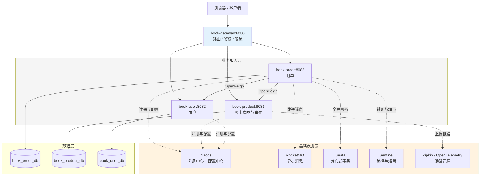

# 课程导言

## 课程目标

- 理解微服务架构解决的问题域，说清本课程与《Spring Boot 开发实战》的递进关系
- 掌握十大模块的组成与课时分布，能够据此安排自己的学习计划
- 了解五个阶段的学习路径，清楚每个阶段结束时应当交付什么
- 掌握全课程统一的版本基线，能独立搭建一套与课件一致的本地环境
- 理解 Netflix 组件停更之后，各项服务治理能力的替代方案
- 建立对微服务与高并发能力的客观预期，明确本课程的能力边界

## 三个问题

1. 为什么要学 Spring Cloud Alibaba？
2. 如何学习 Spring Cloud Alibaba？
3. 学完 Spring Cloud Alibaba，你能做什么？

这三个问题分别对应「动机」「路径」「产出」。先把它们讲清楚，后面的 51 节课才不会变成组件清单的背诵。

## 为什么要学 Spring Cloud Alibaba？

### 从单体到分布式是业务规模推动的必然演进

在《Spring Boot 开发实战》中，我们完成了一个工程质量不错的单体应用：分层清晰、事务可靠、调试简单、一次构建一个可执行包。这在业务早期是最优解，复杂度最低。

问题出现在规模增长之后：编译一次要等十几分钟、改一行代码要回归全量测试、一个内存泄漏能把整个系统拖死。这些现象会在《单体系统存在的问题分析》中逐条展开。

从单体走向分布式，行业已经走过一条比较清晰的路径：

| 阶段 | 典型特征 | 主要矛盾 | 对应课时 |
| --- | --- | --- | --- |
| 单体架构 | 一个进程、一个构建包、一个数据库 | 构建与部署变慢，故障影响全局 | 02 |
| 垂直拆分 | 按业务纵向切成多个独立单体 | 重复建设，系统间集成成本高 | 03 |
| SOA | 通过 ESB 做集中式集成 | ESB 成为瓶颈，治理规则集中且僵硬 | 03 |
| 微服务 | 按业务能力拆分，独立部署独立数据 | 分布式带来的治理、一致性与可观测问题 | 03 至 52 |
| 云原生 | 容器化、编排、服务网格 | 平台工程能力与资源成本治理 | 51 至 52 |

> **结论：** 微服务不是"更高级的写法"，而是业务规模超过单体承载能力之后的一种取舍。理解取舍，比记住组件名更重要。

### 为什么是 Spring Cloud Alibaba

Java 领域的微服务方案不止一套，选择 Spring Cloud Alibaba 的理由有四点：

- **一站式覆盖**：注册中心、配置中心、远程调用、负载均衡、网关、消息、分布式事务、服务保障、可观测性在本课程中形成闭环，不需要在不同体系之间拼装。
- **与 Spring Boot 无缝衔接**：基于 Starter 与自动配置，一个依赖坐标加几行 YAML 即可接入，学习成本集中在"为什么这么配"。
- **国内生产环境验证充分**：Nacos、Sentinel、Seata、RocketMQ 在大量互联网与政企系统中承担核心链路，遇到问题时资料与经验充足。
- **组件职责边界清晰**：每种能力有明确的主责组件，便于架构评审时逐项对照。

### 与 Spring Boot 课程的递进关系

两门课程不是重复，而是同一系统的两个阶段。对照表如下：

| 维度 | 《Spring Boot 开发实战》 | 本课程 |
| --- | --- | --- |
| 系统形态 | 单体应用，单进程部署 | 多服务拆分，独立部署 |
| 关注点 | 单个应用内部的工程质量 | 服务之间的协作、治理与边界 |
| 数据访问 | 单库、本地事务即可保证一致性 | 多库、跨服务事务一致性 |
| 调用方式 | 进程内方法调用，同步且可靠 | 跨进程网络调用，可能超时、失败、乱序 |
| 故障影响 | 局部异常通常收敛在应用内 | 一个服务故障会沿调用链放大 |
| 交付方式 | 一次构建、一次上线 | 多服务独立交付、灰度与回滚 |
| 排查手段 | 单机日志与断点调试 | 链路追踪、日志关联、指标告警 |

因此本课程假定你已掌握：依赖注入与自动配置、AOP、REST 接口开发、MyBatis-Plus 数据访问、统一响应与全局异常处理、参数校验、事务管理、基础测试。这些基本功不再重复讲解。

## 如何学习 Spring Cloud Alibaba？

### 学习内容：十大模块

全课程 52 节课，按能力划分为十大模块，每个模块都有明确的交付物：

| 序号 | 模块 | 课时 | 核心组件 | 阶段交付物 |
| --- | --- | --- | --- | --- |
| 1 | 架构认知与工程初始化 | 01 至 12 | Maven 多模块、MyBatis-Plus | book-microservice 骨架可本地运行 |
| 2 | 注册中心与 Nacos | 13 至 21 | Nacos 3.x | 三个服务完成注册、发现与环境隔离 |
| 3 | 远程调用与 OpenFeign | 22 至 26 | OpenFeign | 订单服务能远程校验库存与用户 |
| 4 | 负载均衡 | 27 至 30 | Spring Cloud LoadBalancer | 自定义加权轮询、超时重试与幂等 |
| 5 | 配置中心 | 31 至 34 | Nacos Config | 多环境配置隔离、动态刷新、敏感配置治理 |
| 6 | 服务网关 | 35 至 38 | Spring Cloud Gateway | 统一入口、鉴权、限流、动态路由 |
| 7 | 消息通信 | 39 至 42 | RocketMQ 5.3.x | 下单异步化、顺序与延迟消息、可靠性保障 |
| 8 | 分布式事务 | 43 至 45 | Seata 2.2.x | AT 模式落地与多模式选型 |
| 9 | 服务保障 | 46 至 48 | Sentinel | 限流、熔断降级、热点参数、规则持久化 |
| 10 | 可观测性与交付 | 49 至 52 | Micrometer Tracing、Docker | 链路追踪、指标告警、容器化部署 |

### 学习路径：五个阶段

| 阶段 | 覆盖课时 | 目标 | 完成标志 |
| --- | --- | --- | --- |
| 阶段一：工程与基础 | 08 至 12 | 完成多模块工程与接口设计 | 三个服务各自能通过 HTTP 接口跑通 CRUD |
| 阶段二：治理与通信 | 13 至 30 | 服务注册发现、远程调用、负载均衡 | 订单服务可调用商品服务，多实例可轮询 |
| 阶段三：配置与入口 | 31 至 38 | 配置集中管理、统一网关入口 | 改配置不重启生效，外部请求统一从 8080 进入 |
| 阶段四：异步与稳定 | 39 至 48 | 消息驱动、分布式事务、流控熔断 | 下单链路可异步化，故障时能自动降级 |
| 阶段五：可观测与交付 | 49 至 52 | 链路追踪、指标告警、容器化 | 一次请求可在 Zipkin 中看到完整链路 |

每个阶段内部都按同一套动作推进，形成稳定的学习闭环：

> **提示：** 阶段二课时最长，是整门课程的分水岭。注册中心、远程调用与负载均衡三者必须打通，否则后面的网关与链路追踪会缺乏可观测对象。

### 贯穿项目 book-microservice 全景

全课程围绕一个图书管理系统的微服务版本展开，最终形态如下：

| 模块 | 包名 | 端口 | 数据库 | 职责 |
| --- | --- | --- | --- | --- |
| book-common | com.example.common | 无 | 无 | 统一响应、异常、常量、工具类 |
| book-product | com.example.product | 8081 | book_product_db | 图书商品信息与库存扣减 |
| book-user | com.example.user | 8082 | book_user_db | 用户信息与状态校验 |
| book-order | com.example.order | 8083 | book_order_db | 订单、订单项、商品快照 |
| book-gateway | com.example.gateway | 8080 | 无 | API 网关，后期引入 |

> **注意：** 每个服务只允许访问自己的数据库。订单服务需要商品信息时，通过 OpenFeign 调用 book-product 接口，而不是直连 book_product_db。

### 学习方法建议

1. **先跑通，再理解，最后改造。** 每个组件先让最小示例跑起来，看到日志与注册列表的变化，再理解配置项含义，最后在自己的服务上改造。
2. **把日志当成教学材料。** 启动日志里的注册成功记录、`LoadBalancer` 选中的实例地址、`Sentinel` 的降级响应，都是最直接的学习反馈。
3. **用故障注入验证结论。** 关掉一个服务实例、改错一个配置、注入一次超时，观察系统如何反应，比只看成功路径有效得多。
4. **不要跳过"不生效"的排查。** 配置不刷新生效、服务注册不上、Feign 找不到实例，这些排查过程才是分布式经验的主要来源。

节奏上可参考下表，按"理解优先、进度其次"推进：

| 场景 | 建议节奏 | 说明 |
| --- | --- | --- |
| 全职学习 | 每天 2 个课时 | 当天必须跑通当天的示例 |
| 业余学习 | 每周 4 至 6 个课时 | 每周留一天做回顾 |
| 复习冲刺 | 只刷阶段二与四 | 这两段是面试与实战高频 |

## 学完 Spring Cloud Alibaba 你能做什么？

### 能力清单

1. **独立设计一套可运行的微服务系统。** 从模块划分、接口设计、数据库拆分，到注册、配置、网关、消息、事务、限流、链路追踪，形成完整闭环。
2. **熟练使用 Nacos、OpenFeign、LoadBalancer、Gateway、RocketMQ、Seata、Sentinel、Micrometer Tracing 等组件**，并能解释各自在架构中的职责。
3. **具备分布式问题的定位能力。** 包括服务注册不上、配置不生效、Feign 调用超时、消息重复消费、分布式事务悬挂、链路断裂等典型问题的排查路径。
4. **掌握微服务演进的方法论。** 能判断什么阶段该拆、拆到什么粒度、数据怎么切、契约怎么定、组织怎么配合。
5. **具备生产化交付的基本意识。** 包括优雅停机、健康检查、配置加密封存、容器化部署与灰度发布。

### 能力边界：务实地看待高并发

微服务架构确实承载了大量高并发手段，但把"学完本课程 = 掌握高并发"当作前提，会在实战中吃亏。本课程的覆盖范围需要说清楚：

| 能力维度 | 本课程覆盖程度 | 说明 |
| --- | --- | --- |
| 流量控制 | 覆盖 | Sentinel 的匀速排队、热点参数、集群流控可落地 |
| 异步解耦与削峰 | 覆盖 | RocketMQ 生产消费、顺序与延迟消息、积压治理 |
| 故障隔离 | 覆盖 | 熔断降级、超时重试、线程与信号量隔离 |
| 网关层防护 | 覆盖 | 统一鉴权、IP 与接口级限流 |
| 分布式事务 | 覆盖常用模式 | AT、TCC、Saga、XA，事务消息配合使用 |
| 缓存设计 | 仅涉及使用场景 | 缓存穿透与失效策略会讲到，Redis 深入使用属中间件课程 |
| 数据库扩展 | 不覆盖 | 分库分表、读写分离需要独立的中间件课程 |
| JVM 与 OS 调优 | 不覆盖 | GC 调优、文件句柄、网络参数需要专项训练 |
| 全链路压测与容量规划 | 仅方法论层面 | 会讲如何做，但不实现压测平台 |

> **结论：** 本课程交付的是"微服务场景下的治理能力"，它是高并发体系的一部分，不是全部。容量规划、数据库优化、缓存体系、并发编程、JVM 调优需要另外补课。

## 常见学习问题

### 需要什么前置知识

- Java 17 基础语法与集合、异常、泛型、Lambda
- Maven 多模块工程的基本操作
- Spring Boot 的自动配置、依赖注入、AOP、事务
- MyBatis-Plus 的常规增删改查
- HTTP 与 REST 的基本概念，会用 Postman 或 IDEA 的 HTTP Request

不需要提前掌握 Docker、Kubernetes、消息队列或分布式理论，课程会在对应课时分开讲。

可以用下表做一次自检，任一项为"否"时，建议先补齐再进入阶段一：

| 自检项 | 判断标准 | 不满足时的补法 |
| --- | --- | --- |
| 环境 | `mvn -v` 显示 JDK 17 | 重装 JDK 并配置 JAVA_HOME |
| 自动配置 | 能说明 Starter 与自动配置的关系 | 回顾 Spring Boot 起步依赖 |
| 数据访问 | 能独立写出 Mapper 与分页查询 | 回顾 MyBatis-Plus 用法 |
| 统一响应 | 项目里有 Result 与全局异常处理 | 按规范补齐公共模块 |
| 事务 | 能解释 `@Transactional` 失效场景 | 回顾代理机制与事务传播 |
| 接口调试 | 能用 HTTP Request 文件调接口 | 熟悉 Postman 或 .http 文件 |
| 日志 | 能按时间与 traceId 定位问题 | 回顾日志框架配置 |

### 与 Spring Boot 课程是什么关系

Spring Boot 课程解决"如何写好一个应用"，本课程解决"如何让多个应用协作成一个系统"。前者是后者的前提：分层、异常处理、事务边界都没理顺，拆成微服务只会把混乱复制多份。

### 版本基线

全课程统一使用以下版本，避免因版本错配导致依赖冲突或 Starter 不兼容：

| 组件 | 版本 | 说明 |
| --- | --- | --- |
| JDK | 17 | 编译与运行统一，Maven 3.9 及以上 |
| Spring Boot | 3.5.16 | 基线版本，jakarta 命名空间 |
| Spring Cloud | 2025.0.0 | 提供 LoadBalancer、Gateway、OpenFeign |
| Spring Cloud Alibaba | 2025.0.0.0 | 提供 Nacos、Sentinel、Seata 适配 |
| MyBatis-Plus | 3.5.17 | 使用 mybatis-plus-spring-boot3-starter |
| Hutool | 5.8.28 | 工具类，用于对象拷贝与常用转换 |
| PostgreSQL | 16 | 三个业务库统一使用 |
| Nacos | 3.0.x | 注册与配置，集群部署课时会说明 2.x 差异 |
| Sentinel Dashboard | 1.8.8 | 控制台，规则下发与观测 |
| RocketMQ | 5.3.x | 消息服务端与客户端 |
| Seata | 2.2.x | 分布式事务协调器 |
| Micrometer Tracing | 随 Spring Boot 3.5.x | 桥接 Brave 或 OpenTelemetry |

> **注意：** 只要 Spring Boot 主版本是 3.x，就必须使用 Jakarta 命名空间的依赖（如 `jakarta.validation`）。把 2.x 的 `javax.*` 代码直接搬过来会编译失败。

### 为什么不用 Netflix 组件

Eureka、Ribbon、Hystrix、Zuul 已停止功能迭代或进入维护模式，Spring Cloud 2025.0.0 也不再提供对应 Starter。本课程直接使用仍在演进的替代方案：

| 旧组件（Netflix） | 当前状态 | 替代方案 | 对应课时 |
| --- | --- | --- | --- |
| Eureka | 停止功能迭代 | Nacos 注册中心 | 13 至 21 |
| Ribbon | 停止维护 | Spring Cloud LoadBalancer | 25 至 30 |
| Hystrix | 停止开发 | Sentinel 熔断降级 | 46 至 48 |
| Zuul 1.x | 阻塞模型，不再推荐 | Spring Cloud Gateway | 35 至 38 |
| Archaius / Config Server | 生态分散 | Nacos Config | 31 至 34 |
| Sleuth | 已迁移到 Micrometer Tracing | Micrometer Tracing + Brave/OTel | 49 至 50 |

> **提示：** 阅读旧资料时看到 `@EnableEurekaClient`、`@HystrixCommand`、`ribbon.ReadTimeout` 这类写法，可据此表定位其在新体系中的对应位置，不要照抄。

### 需要准备多台机器吗

不需要。单机即可完成全部练习：启动一个 Nacos、一个 RocketMQ、一个 Sentinel Dashboard、一个 Seata Server，三个业务服务各启动一到两个实例。Nacos 集群课时用同一台机器的三个端口模拟三节点。

### 学习资料与工具

- 官方文档优先，其次是版本发布说明。
- 示例以课件为准，网上配置常含旧版本写法。
- 工具固定：IDEA、Maven 3.9、Postman 或 HTTP Request。
- 每个组件留一个最小示例，便于复现问题。

### 是否涉及 Kubernetes

不涉及。课程在《容器化部署与生产实践》中会讲 Docker 镜像构建与配置外置，但不展开 Kubernetes 的资源对象、Operator 与服务网格。

## 总结

Spring Cloud Alibaba 是 Java 工程师从单体走向分布式的主干路径。价值不在组件数量，而在于把「服务如何被发现」「配置如何统一」「调用如何可靠」「故障如何隔离」收敛成一套可配置、可治理的标准做法。

学完这门课，你应当具备两样东西：一套能跑在生产环境里的技术方案，以及一套"该不该拆、拆到哪里停"的判断力。后者更难，也更值钱。

## 注意事项

1. **版本必须整套对齐。** Spring Cloud、Spring Cloud Alibaba、Spring Boot 存在严格兼容矩阵，混搭是启动失败的首要原因，遇到 `NoSuchMethodError` 先怀疑版本。
2. **注册中心优先于业务开发。** Nacos 未启动时服务会持续重试注册并刷屏，先确认 `http://localhost:8848/nacos` 可访问再排查业务代码。
3. **不要在导言阶段纠结组件细节。** 这一课只需要建立全局地图，具体配置在第 13 课之后逐个展开，提前深挖容易在细节里失去方向。
4. **端口与库名严格按规范。** 8081 商品、8082 用户、8083 订单、8080 网关，三个库名固定。后期接入网关与链路追踪时，端口约定能省掉大量排查成本。
5. **本地环境建议 16GB 内存起步。** Nacos、RocketMQ、Seata、Sentinel 加三个服务同时运行，内存吃紧时优先给 Nacos 与业务服务留足堆空间。
6. **不要跳过单体阶段的练习。** 第 08 至 12 课看似"没有微服务"，但接口设计、分库与统一响应是后续所有课时的地基。
7. **以官方最新稳定版为准。** 表中版本为编写基线，升级前核对发布说明。
8. **学习成果要可验证。** 每个阶段结束时，用"完成标志"那一列自检，跑不通就停下来补，不要带着空洞往下学。

## 小结

本节课我们学习了：

1. **为什么学**：单体应用在团队与流量增长后会出现构建、扩展、协作、故障域等问题，微服务是应对取舍之一，Spring Cloud Alibaba 是国内 Java 体系落地微服务的主流技术栈。
2. **与 Spring Boot 课程的关系**：前者聚焦单个应用的工程质量，本课程聚焦多服务之间的协作与治理，是递进而非重复。
3. **十大模块**：架构认知与工程初始化、Nacos 注册中心、OpenFeign、LoadBalancer、Nacos Config、Gateway、RocketMQ、Seata、Sentinel、可观测性与交付。
4. **五个阶段**：工程与基础、治理与通信、配置与入口、异步与稳定、可观测与交付，每个阶段都有明确的完成标志。
5. **贯穿项目 book-microservice**：book-common、book-product、book-user、book-order、book-gateway 五个模块，端口 8081/8082/8083/8080，三个独立数据库。
6. **版本基线**：JDK 17、Spring Boot 3.5.16、Spring Cloud 2025.0.0、Spring Cloud Alibaba 2025.0.0.0。
7. **能力边界**：本课程覆盖微服务治理与部分高并发手段，不覆盖数据库扩展、JVM 调优与全链路压测平台建设。
8. **Netflix 组件的替代关系**：Eureka 换 Nacos、Ribbon 换 LoadBalancer、Hystrix 换 Sentinel、Zuul 换 Gateway。

## 作业

### 作业一：绘制你自己的微服务全景图

1. 不看课件，手绘 book-microservice 的模块与依赖关系，标注每个模块的端口与数据库。
2. 在图旁标注：哪些调用是同步的（OpenFeign），哪些是异步的（RocketMQ）。
3. 标注哪些能力的组件尚未引入，例如网关、限流、链路追踪分别在哪一课接入。
4. 对照课件中的全景图，找出遗漏的连接线，并说明遗漏的那条线在什么场景下会被触发。

### 作业二：搭建本地环境并核对版本

1. 安装 JDK 17 与 Maven 3.9，执行 `mvn -v` 确认输出的 JDK 版本为 17。
2. 新建一个空的 Maven 工程，在 `pom.xml` 中声明 Spring Boot 3.5.16、Spring Cloud 2025.0.0、Spring Cloud Alibaba 2025.0.0.0 三个版本属性。
3. 执行 `mvn dependency:tree`，确认 Spring Cloud 相关依赖被正确解析，把结果中与 Spring Boot 版本相关的条目记录下来。

### 作业三：制定个人学习计划

1. 以"每周可投入小时数"为基准，为五个阶段各估算一个完成时间，写清每个阶段的完成标志。
2. 列出你在 Spring Boot 阶段最薄弱的两项能力（例如事务边界、异常处理），在阶段一之前安排补齐。
3. 从十大模块中选出你最关心的两个，写下希望在课程结束后能独立完成的具体工作。
4. 用一句话描述你当前项目最想解决的痛点，课程结束后回看这句话，判断是否已经解决。
