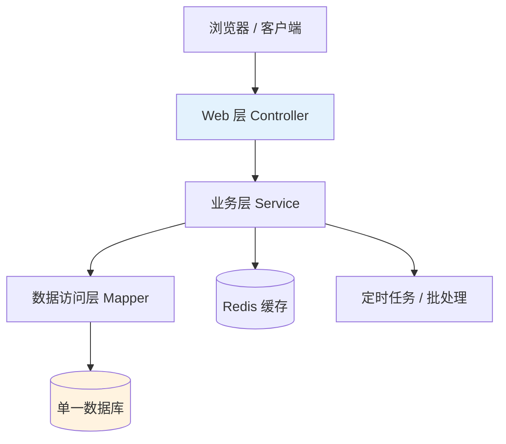
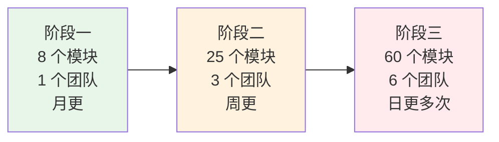
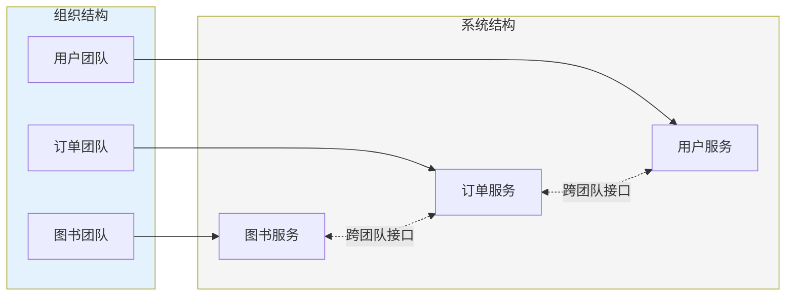

# 单体系统存在的问题分析

## 课程目标

- 理解单体架构的定义，说清它在业务初期的优势来自哪里
- 掌握规模增长后单体系统暴露的七类问题，能对每类问题给出根因与量化信号
- 能够用图书管理系统做规模推演，判断当前系统处于哪个阶段
- 理解康威定律，说明组织结构与系统结构之间的相互塑造关系
- 掌握"什么情况下不该拆微服务"的判断标准，避免为了拆分而拆分
- 能够识别系统中已经出现的演进信号，为下一课的架构选择提供依据

## 回顾与导入

上一课我们从全局看完了这门课程的地图：十大模块、五个阶段、贯穿项目 book-microservice，以及统一的技术基线。这一课回到起点，回答一个更基础的问题：**我们为什么非要拆掉单体应用？**

这个问题必须回答清楚。微服务不是免费的，拆分之后你会额外获得网络调用、分布式事务、配置分散、链路变长、运维对象变多这一整套负担。如果说不清单体到底哪里痛、痛到什么程度，拆分就只是把复杂度从一个地方搬到另一个地方，收益却是零。

本课的原则是：**不谈感觉，只谈现象、根因与可度量的信号。** 只有当信号明确指向架构瓶颈时，演进才是合理的。

## 单体架构的定义与初期优势

### 什么是单体架构

单体架构（Monolithic Architecture）指把系统的全部功能构建成一个部署单元：一个进程、一份制品、一个数据库。内部按分层组织代码，但所有层共享同一个运行时。



在这个结构里，模块之间的调用是进程内的方法调用：同步、可靠、纳秒级、不需要网络协议、不需要序列化、出错就是异常。这是单体最重要的技术优势，也是后来最难替代的部分。

### 单体架构的初期优势

| 优势 | 具体表现 | 来源 |
| --- | --- | --- |
| 开发效率高 | 一个工程、一套依赖、一次启动即可调试全部功能 | 无跨进程边界 |
| 调试简单 | 断点可以跨模块单步执行，调用栈完整 | 同一 JVM |
| 事务天然可靠 | 一个本地事务覆盖全流程，无需补偿 | 同一数据源 |
| 部署简单 | 一个包、一条命令、一个进程 | 单一制品 |
| 测试成本低 | 集成测试不需要准备多个服务实例 | 无外部依赖 |
| 资源占用低 | 只有一份 JVM、一份连接池 | 无重复基础开销 |
| 团队门槛低 | 新人熟悉一套代码即可上手 | 结构直观 |

> **结论：** 单体的优势集中在"简单"。只要业务规模还在单体的承载范围内，它就是最经济的选择。**不要因为微服务流行就否定单体。**

## 规模增长带来的七类问题

下面七类问题，只有少数会同时出现在一个系统里，但只要出现三类以上，就说明架构已经开始拖累业务。

### 一、构建与部署

**现象**：本地改一行代码，全量编译要等十几分钟；上线只能安排在凌晨，因为回滚窗口太长；某个模块的依赖升级会连带全站重新回归。

**根因**：

- 所有模块共用一份构建图，任何改动都触发全量编译与全量打包
- 单一制品意味着"全部或全不"的部署语义，无法只发布变化的部分
- 依赖版本集中管理，升级一个公共库等于全站风险事件

**量化信号**（示意值）：

| 指标 | 健康区间 | 预警区间 | 说明 |
| --- | --- | --- | --- |
| 全量构建时长 | 小于 3 分钟 | 超过 10 分钟 | 排除首次下载依赖 |
| 单次发布耗时 | 小于 10 分钟 | 超过 30 分钟 | 含回归验证 |
| 发布频率 | 每周 1 次以上 | 每月不足 1 次 | 发布越少，单次变更越大 |

### 二、水平扩展

**现象**：大促期间只有商品搜索压力大，但扩容必须复制整个应用；扩容后数据库连接数先被打满，CPU 还没到瓶颈。

**根因**：

- 扩展粒度等于进程粒度，无法只扩展热点模块
- 每个实例都持有完整连接池，实例数与数据库连接数线性放大
- 冷模块与热模块共享同一份资源配额

**量化信号**（示意值）：

| 指标 | 说明 |
| --- | --- |
| 热点模块资源占比 | 单模块 CPU 占比超过 60%，说明扩展被它绑架 |
| 单实例连接数 | 实例数乘连接池上限接近数据库最大连接数 |
| 扩容收益比 | 实例翻倍后 QPS 提升不足 50%，说明瓶颈不在应用层 |

### 三、团队协作与代码冲突

**现象**：同一个 Service 类被三个人同时修改，合并时冲突成片；一个团队的改动要等另一个团队的功能测试通过才能上线。

**根因**：

- 共享代码库，缺乏清晰的代码所有权边界
- 共享发布节奏，团队的交付被绑定在同一条时间线上
- 目录划分按技术分层而非业务能力，导致跨团队修改同一文件

**量化信号**（示意值）：

| 指标 | 预警阈值 | 说明 |
| --- | --- | --- |
| 每周合并冲突次数 | 超过 10 次 | 统计代码库层面冲突 |
| 代码评审等待时长 | 超过 1 个工作日 | 反映评审负载与所有权模糊 |
| 跨团队阻塞次数 | 每月超过 3 次 | 一方等待另一方才能发布 |

### 四、技术栈锁定

**现象**：想给搜索换个检索引擎，评估结论是"要动全站依赖"；框架大版本升级拖了一年也没落地。

**根因**：

- 统一运行时意味着统一依赖树，任何技术替换都是全局事件
- 新旧技术无法并存灰度，只能一次性切换
- 团队被迫在所有模块上使用"最保守的公共技术集"

**量化信号**（示意值）：框架版本落后主流两个大版本以上、依赖冲突需要 `exclusions` 手工干预超过 10 处、新技术的引入评估周期超过一个季度。

### 五、故障域与稳定性

**现象**：一个后台报表的慢查询占满连接池，前台下单接口一起超时；一次内存泄漏让整个系统重启。

**根因**：

- 共享线程池、共享连接池、共享 JVM 堆，故障没有隔离边界
- 没有按业务重要性划分资源，低优先级任务可以抢占核心链路资源
- 一个模块的死循环可以直接耗尽进程资源

```mermaid
flowchart TB
    subgraph 单体：故障影响全局
        R1[报表慢查询] --> APP[单一应用进程<br/>共享线程池 / 连接池 / 堆]
        U1[用户请求] --> APP
        APP --> D1[(单一数据库)]
        style APP fill:#ffcdd2
    end

    subgraph 微服务：故障受限于边界
        U2[用户请求] --> GW[网关]
        GW --> B1[图书服务]
        GW --> B2[订单服务]
        GW --> B3[报表服务]
        B3 -.超时被隔离.-> GW
        style GW fill:#e8f5e9
    end
```

**量化信号**（示意值）：单次故障影响接口比例达到 100%、平均恢复时间（MTTR）超过 30 分钟、因非核心功能导致核心链路不可用的事故每月出现一次以上。

典型的传播路径通常只有三步：

1. 报表模块发起一次全表扫描，单次查询耗时从毫秒级升到数十秒。
2. 该模块占用连接池中的多数连接，其他模块的查询开始排队等待。
3. 用户请求超时后重试，请求量翻倍，连接池彻底耗尽，全部接口不可用。

三步之中没有任何一步属于"代码写错了"，问题出在**共享资源没有隔离**。

### 六、发布风险

**现象**：一次上线包含十几个需求，任何一个出问题都要整体回滚；无法只让 5% 的流量使用新版下单逻辑。

**根因**：

- 单一制品导致变更打包，风险叠加
- 灰度只能按实例灰度，无法按接口或按业务灰度
- 回滚等于全站回滚，代价高，于是团队倾向于"攒着一起发"

**量化信号**（示意值）：单次发布变更条目超过 20 个、回滚耗时超过 30 分钟、发布后 24 小时内故障占比超过全部故障的一半。

### 七、数据库耦合

**现象**：订单表与商品表、用户表在同一个库里互相 join，谁也不敢改字段；给一张表加索引要评估全站影响。

**根因**：

- 一个库承载全部业务域，表之间通过外键与 join 强耦合
- 数据所有权不清晰，任何服务都可以读写任何表
- 单库容量与连接数成为全局瓶颈

**量化信号**（示意值）：单库表数量超过 100 张、单表被超过 5 个模块直接读写、单库 QPS 接近实例上限、DDL 变更审批需要跨 3 个以上团队。

### 七类问题汇总

| 问题 | 一句话概括 | 最直观的信号 |
| --- | --- | --- |
| 构建与部署 | 改一处、等全量 | 全量构建超过 10 分钟 |
| 水平扩展 | 扩一点、全复制 | 扩容收益比低于 50% |
| 团队协作 | 改一文件、三人冲突 | 每周冲突超过 10 次 |
| 技术栈锁定 | 换一个、动全站 | 版本落后两个大版本 |
| 故障域 | 崩一处、全站挂 | 单次故障影响 100% 接口 |
| 发布风险 | 发一次、赌一把 | 单次变更超过 20 条 |
| 数据库耦合 | 改一表、问全站 | 单库超过 100 张表 |

这七类问题并不是孤立的技术债，它们在后文中都有明确的对策与组件。先建立这张映射，学后面的组件时才知道自己在解决什么：

| 单体问题 | 微服务对策 | 关键手段 | 对应课时 |
| --- | --- | --- | --- |
| 构建与部署 | 拆分部署单元 | 多模块工程、独立流水线 | 09 至 12、51 |
| 水平扩展 | 独立伸缩 | 无状态服务、多实例注册 | 15 至 17 |
| 团队协作 | 边界对齐组织 | 服务边界即团队边界 | 04、12 |
| 技术栈锁定 | 独立技术选型 | 按服务选择框架与存储 | 03、06 |
| 故障域 | 隔离与降级 | 限流、熔断、超时、线程隔离 | 46 至 48 |
| 发布风险 | 灰度与回滚 | 权重路由、配置灰度、动态路由 | 20、33、38 |
| 数据库耦合 | 数据所有权独立 | 每服务独立库、事件同步 | 11、12 |

## 图书管理系统的规模推演

把上面的问题放到贯穿项目上，更容易看清演进节奏。假设图书管理系统随业务成长经历三个阶段：



| 维度 | 阶段一 | 阶段二 | 阶段三 |
| --- | --- | --- | --- |
| 业务模块数 | 8 | 25 | 60 |
| 研发团队数 | 1 | 3 | 6 |
| 发布频率 | 每月 1 次 | 每周 2 次 | 每天多次 |
| 全量构建时长（示意值） | 3 分钟 | 12 分钟 | 35 分钟 |
| 单次发布变更条目（示意值） | 10 个 | 40 个 | 100 个以上 |
| 单库表数量（示意值） | 20 张 | 60 张 | 150 张 |
| 故障影响面 | 100% | 100% | 100% |
| 主要矛盾 | 功能交付速度 | 团队协作与发布风险 | 扩展能力与故障隔离 |

> **提示：** 表中数值是示意值，用于说明趋势而非精确预测。真实项目应当以自己的构建日志、发布记录与监控数据为准，先度量再判断。

可以看到一个关键事实：**故障影响面在三个阶段都是 100%**。单体的稳定性不会随规模"自然变好"，只会随规模变差。这正是微服务要解决的核心问题之一。

## 常见误判：问题其实不在架构

体检时最常见的偏差，是把非架构问题记到架构账上。下面三类误判会让团队做出错误的演进决策：

- **把慢查询当成架构瓶颈。** 一条没有索引的 SQL 可以让任何架构的响应时间变成秒级，先看慢日志，再谈拆分。
- **把流程问题当成技术问题。** 发布慢往往不是构建慢，而是审批链路过长、回归范围过大、环境只有一套。
- **把缺乏监控当成故障多。** 没有链路追踪与统一日志时，故障看起来"无处不在"，实际可能只是定位手段缺失。

> **提示：** 判断方法很简单——问一句"如果拆成微服务，这个问题会消失吗？"如果答案是否定的，那就不是架构问题。

## 康威定律

康威定律（Conway's Law）指出：系统的架构结构，会不可避免地向设计它的组织的沟通结构收敛。

换句话说：

- 一个团队同时负责图书、订单、用户三块功能，代码最终会长成一个按技术分层的巨石
- 三个团队各自负责一块业务、通过接口协作，代码自然会长出三个边界清晰的服务
- 反过来，如果你把系统强制拆成五个服务，却仍然由一个大团队统一排期发版，最终会得到一个"分布式单体"



> **结论：** 微服务拆分从来不只是技术动作。**如果团队结构不变，架构最终会被拉回原来的形状。** 这也是《微服务架构的实施方法》中要把组织与流程单独讲一节的原因。

## 什么时候不该拆微服务

拆分是有前置条件的。下表用于反向自检：命中两条以上，说明现在还不适合拆。

| 维度 | 不适合拆的信号 | 说明 |
| --- | --- | --- |
| 团队规模 | 研发人数少于 10 人 | 沟通成本本来就很低，拆分会新增运维与联调成本 |
| 业务成熟度 | 需求方向每周大改 | 边界不稳定，拆完要反复重组，拆分收益为负 |
| 运维能力 | 没有 CI/CD、没有统一日志与监控 | 拆完之后故障无法定位，比单体更危险 |
| 流量规模 | 峰值长期低于单机承载能力 | 扩展收益抵不过复杂度增长 |
| 一致性要求 | 多业务域强一致，且无补偿手段 | 分布式事务成本高，需先设计最终一致方案 |
| 交付节奏 | 全站统一发版，无独立上线需求 | 独立部署的价值无法兑现 |
| 代码质量 | 单体内部已是意大利面 | 拆分只会把混乱复制多份，应先治理再拆 |
| 数据边界 | 大量跨域 join 与事务 | 数据切不开，服务边界就是假的 |

需要特别强调的是最后一条。**服务边界本质上由数据所有权的边界决定**。如果订单查询必须实时 join 商品表和用户表才能完成，那么"订单服务"独立出去只会带来更多远程调用，而不是更清晰的架构。

同样值得注意的是：**"不拆"不等于"不治理"。** 单体阶段完全可以做模块化（按业务能力组织包结构、约束模块间依赖、禁止跨模块直接访问 Mapper），这些工作会让后续拆分成本大幅降低。

## 单体架构演进的八个信号

当下列信号出现三条以上，就该认真考虑演进了：

1. **构建时长失控**：全量构建稳定超过 10 分钟，且随模块数线性增长。
2. **发布成为仪式**：发布需要跨团队协调、只能安排在夜间、回滚方案要提前演练。
3. **扩容不经济**：只为热点模块扩容，却必须复制整个应用与整套连接池。
4. **团队开始排队**：一个团队的交付被另一个团队的测试或发版阻塞，每月超过三次。
5. **技术升级停滞**：框架版本落后两个大版本以上，因牵连过广而不敢升级。
6. **故障无法隔离**：非核心功能（报表、导出、批处理）能拖垮核心下单链路。
7. **数据边界模糊**：一张表被多个业务模块直接读写，字段变更需要全站评估。
8. **新需求上线周期变长**：同类需求的平均交付周期连续两个季度上升。

> **注意：** 这些信号本身并不直接证明"必须上微服务"，它们只说明"当前架构已成为瓶颈"。下一步要做的是分析瓶颈在哪：如果瓶颈只是构建慢，可以先做构建优化与模块化；如果瓶颈是故障域与扩缩容，那才是微服务的用武之地。

## 注意事项

1. **不要用感觉判断架构问题。** "感觉越来越慢""感觉越来越乱"没有说服力，先用构建日志、发布记录、监控数据把问题量化，再决定是否演进。
2. **示意值不能直接当结论。** 课件中的数值用于说明趋势，各团队的团队规模、技术栈、业务特征差异很大，务必用自己的数据替换。
3. **拆分前先做模块化。** 在单体内部把包结构按业务能力重整、切断跨模块的直接数据访问，是成本最低、风险最小的一步。
4. **警惕"技术驱动的拆分"。** 因为想用 Nacos 或想学 Gateway 而拆微服务，是本末倒置；技术选型应服务于业务与组织问题。
5. **康威定律是双向的。** 组织决定架构，架构也会反过来固化组织。拆分方案要同时给出团队调整建议，否则会退化成分布式单体。
6. **数据库耦合是最难解的一环。** 服务可以先拆，数据不能后拆；如果跨域 join 无法消除，优先考虑读模型冗余或事件同步，而不是硬切。
7. **单体的优势不要在拆分中丢失。** 进程内调用的可靠性与本地事务的简洁性，需要靠重试、幂等、事务框架刻意补回来，别以为拆完就自动具备。
8. **本课不涉及具体拆分手段。** 拆分方法、粒度判断与迁移路线在《微服务架构的实施方法》中展开，本课只负责把问题讲透。

## 小结

本节课我们学习了：

1. **单体架构的定义与优势**：一个进程、一份制品、一个数据库；优势集中在开发效率、调试、事务可靠、部署简单与资源占用低。
2. **七类规模问题**：构建与部署、水平扩展、团队协作、技术栈锁定、故障域、发布风险、数据库耦合，每类都从现象、根因与量化信号三个角度展开。
3. **规模推演方法**：用模块数、团队数、发布频率、构建时长与故障影响面五组数据刻画系统所处阶段，故障影响面在单体中始终是 100%。
4. **康威定律**：系统结构向组织沟通结构收敛，团队不变则架构会被拉回原形。
5. **不该拆微服务的场景**：团队少于 10 人、业务方向不稳定、无自动化运维、流量规模有限、强一致无补偿手段、边界无法从数据上切开。
6. **八个演进信号**：构建失控、发布成仪式、扩容不经济、团队排队、技术升级停滞、故障无法隔离、数据边界模糊、交付周期变长。

## 作业

### 作业一：给自己负责的系统做一次体检

1. 选取你当前参与的一个系统，按本课七类问题逐条记录现象，每条至少写一个具体案例。
2. 为每条问题找到可测量的指标，用真实数据填充，没有数据的写清"如何采集"。
3. 对照七类问题汇总表，判断哪些问题已经出现、哪些还未出现。

### 作业二：完成图书管理系统的规模推演

1. 假设图书管理系统在两年内模块数从 8 增长到 60，补齐阶段一到阶段三的推演表，写出你自己估算的构建时长与发布条目数，并注明估算依据。
2. 用一段话说明：阶段三时订单服务与商品服务之间的调用关系会发生什么变化。
3. 指出推演表中哪一列的数值最难造假，为什么。

### 作业三：反向论证"现在不该拆"

1. 从"不该拆微服务"判断表中选出你认为最关键的三条，说明理由。
2. 假设你的系统当前研发团队 8 人、每周发布一次、无 CI/CD，请写一段分析：如果强行拆分，最可能出现的两个后果。
3. 给出替代方案：在不拆微服务的前提下，如何缓解构建慢与发布风险这两个问题。
