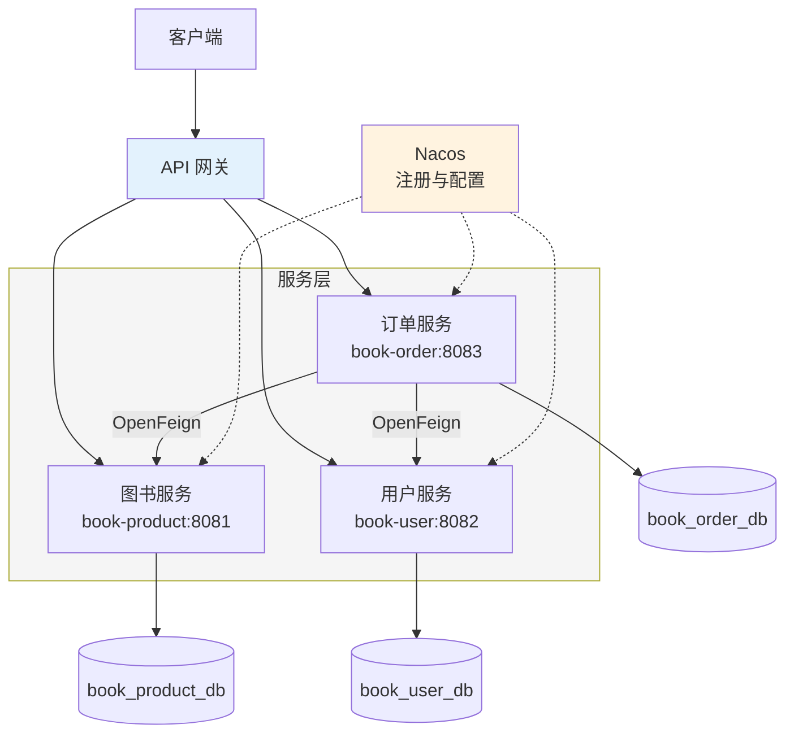
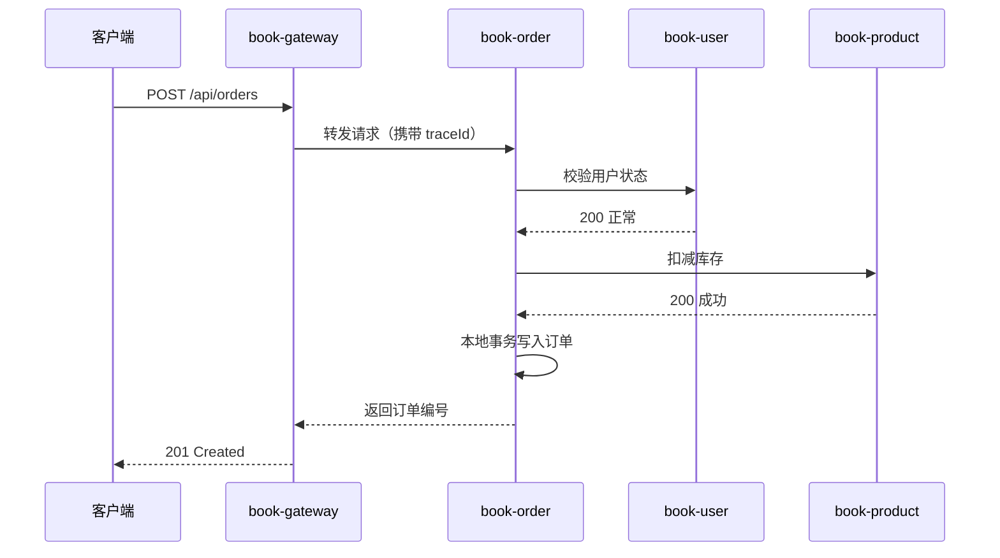
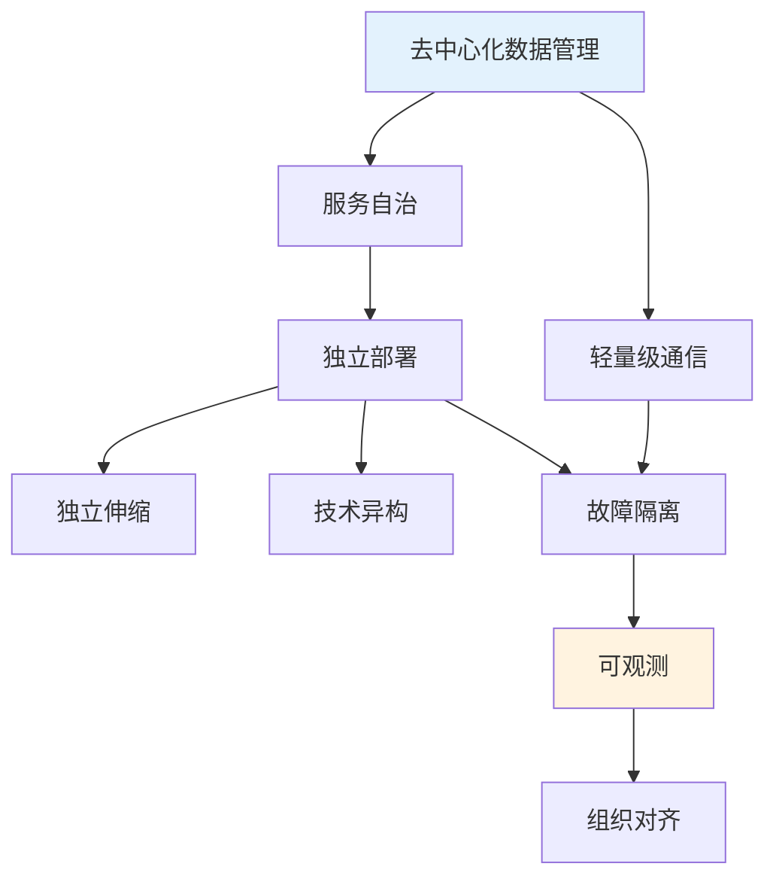
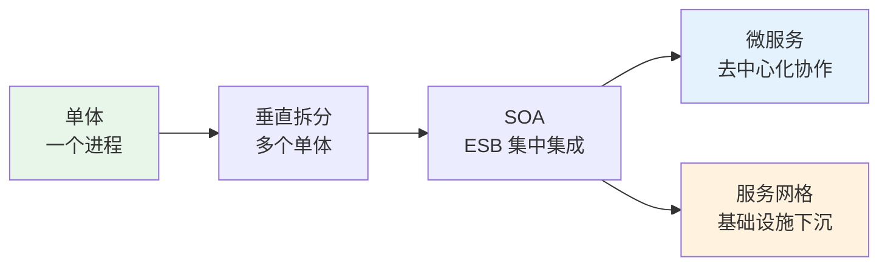

# 微服务架构的特性

## 课程目标

- 掌握微服务架构的标准定义，能说清它与单体在调用、数据、部署、组织四个层面的本质差别
- 掌握微服务的九大特性，并能用可衡量的标准判断一个系统是否真的具备该特性
- 能够对比单体、SOA 与微服务三种架构形态的适用场景与代价
- 理解分布式系统的八大谬误，能把它对应到具体的工程问题与应对手段
- 能够说明微服务引入的新问题：网络不可靠、数据一致性、运维复杂度、调试困难与成本上升
- 能够辨析常见误区，识别"纳米服务"等伪微服务形态

## 回顾与导入

上一课我们把单体系统的七类问题逐条讲透：构建与部署、水平扩展、团队协作、技术栈锁定、故障域、发布风险、数据库耦合，并给出量化信号与八个演进信号。

结论是：演进的前提是瓶颈确实出现在架构层面，而不是慢查询、流程冗长或缺少监控。

那么演进的目标形态长什么样？很多资料一上来就讲组件：Nacos、OpenFeign、Gateway、Sentinel，先学工具再回头猜架构。本课反过来：**先讲"微服务到底是什么"，再讲"它带来了什么新麻烦"**。先接受代价，才不会把限流当成万能药。

## 微服务的定义

### 一个被广泛接受的定义

微服务架构（Microservices Architecture）是一种将单一应用划分为一组小型服务的架构风格，这些服务具备以下共同特征：

- 每个服务运行在**独立进程**中，可独立部署、独立升级、独立重启
- 每个服务**围绕业务能力**构建，而不是围绕技术分层构建
- 服务之间通过**轻量级机制**通信，常见是 HTTP/REST 或 RPC，不使用集中式的企业服务总线
- 每个服务**拥有自己的数据**，不与其他服务共享数据库表
- 服务可由**不同团队**用不同技术栈开发，只需遵守接口契约
- 服务的规模以"一个团队能维护"为上限，而不是以代码行数为标准

### 与单体的核心差别

| 维度 | 单体架构 | 微服务架构 | 影响 |
| --- | --- | --- | --- |
| 部署单元 | 一个进程、一份制品 | 每服务独立进程与制品 | 可独立发布，但部署对象变多 |
| 调用方式 | 进程内方法调用 | 网络调用 | 从"必然成功"变成"可能失败" |
| 数据管理 | 单库共享，join 自由 | 每服务独立库 | 从本地事务变成最终一致 |
| 扩展方式 | 整体复制 | 按服务伸缩 | 资源利用率提升，调度复杂 |
| 故障影响 | 全局 | 局部，可被隔离 | 需要显式的隔离与降级设计 |
| 团队组织 | 共享代码库、统一排期 | 服务所有权、独立排期 | 沟通成本下降，治理成本上升 |
| 技术选型 | 统一依赖树 | 每服务独立 | 可渐进升级，需治理异构 |
| 一致性 | 强一致 | 最终一致 | 业务需要设计补偿与对账 |

> **结论：** 微服务的收益都来自"边界"，代价都来自"边界之间的网络"。

### 一次下单请求的跨服务视角

理解特性最快的方式，是跟着一次真实请求走完链路：

这段链路上有三次是网络调用，每一次都可能超时、可能重复、可能在对方已执行后才失败。独立部署、独立伸缩、技术异构由进程边界提供；故障隔离、可观测、去中心化数据管理则必须在这些调用上额外设计。

## 九大特性

### 特性总表

判断一个系统是不是真的微服务，不要看它用了哪些组件，而要看这九条特性是否成立：

| 特性 | 含义 | 衡量标准 | 本课程落地手段 |
| --- | --- | --- | --- |
| 独立部署 | 单个服务可独立构建、发布、回滚 | 发布某服务时不需同时发布其他服务 | 多模块工程、独立启动、网关路由 |
| 去中心化数据管理 | 每个服务拥有并只访问自己的数据 | 不存在跨服务的共享表与直连 | 三个独立数据库 |
| 服务自治 | 团队对服务的开发、运维全生命周期负责 | 服务可自主选型、自主排期 | 团队边界与独立流水线 |
| 轻量级通信 | 使用 HTTP/JSON 或 RPC，无集中总线 | 无 ESB，无强制统一协议层 | OpenFeign 声明式调用 |
| 故障隔离 | 单服务故障不扩散到全链路 | 单服务不可用时核心链路仍可用 | Sentinel 熔断与降级 |
| 独立伸缩 | 按服务粒度扩缩容 | 热点服务可单独增加实例 | Nacos 多实例与负载均衡 |
| 技术异构 | 不同服务可用不同技术栈 | 某服务可独立升级框架版本 | 独立依赖树与运行时 |
| 组织对齐 | 服务边界与团队边界一致 | 一个服务有明确的责任团队 | 康威定律指导拆分 |
| 可观测 | 能看清跨服务的调用全貌 | 一次请求可通过 traceId 串联 | Micrometer Tracing |

### 逐项解读

**独立部署**是最基础的特性，也最容易被破坏。只要两个服务必须"一起发"才能工作，它们实际上就是一个服务被网络分成了两半。判断标准：单独发布订单服务时，其他服务完全不用重启。

**去中心化数据管理**决定服务边界的真实性。订单服务需要商品信息时只能调用接口，不能直连 `book_product_db`；否则拆分只是把一张大表拆成几个库，耦合依旧。

**服务自治**更多是组织概念。它意味着团队可以自己决定技术选型、自己排期、自己值班。当所有服务的发布仍需要同一个架构组审批时，自治只是名义上的。

**轻量级通信**针对的是 SOA 时代 ESB 的教训：把路由、转换、编排都堆在中心节点上，中心节点一旦成为瓶颈，整个组织的交付节奏都被它拖住。

**故障隔离**是微服务最实在的收益。单体里一次连接池耗尽会让全部接口报错；微服务里报表服务挂掉，下单链路可以通过熔断继续服务。但请注意，隔离需要显式设计，不会自动发生。

**独立伸缩**让资源花在热点上。图书检索在促销时压力大，就只给 book-product 加实例，不需要为订单服务复制一份空闲容量。

**技术异构**的价值在于"允许渐进升级"，而不是"鼓励五花八门"。允许 book-product 先升到新版本框架，验证稳定后再推广，风险被切成小份。

**组织对齐**与康威定律互为一体两面。服务边界与团队边界不一致时，会出现"两个团队共改一个服务"或"一个团队负责五个服务"的失真状态。

**可观测**是微服务能运维下去的前提。调用链一旦跨进程，断点调试就失效了，没有 traceId 串联的日志几乎无法定位问题。

### 特性之间的依赖关系

九大特性不是并列的，它们存在明显的先后依赖：没有数据边界，独立部署就是假的；没有独立部署，独立伸缩无从谈起；没有可观测，前面所有能力都难以验证。

> **提示：** 排序时优先解决"数据边界"与"可观测"两端：前者决定拆分是否成立，后者决定拆分后能否活下去。

### 特性的首次落地课时

| 特性 | 首次落地 | 验证方式 |
| --- | --- | --- |
| 轻量级通信 | OpenFeign 课时 | 订单服务成功调用商品服务 |
| 去中心化数据管理 | 服务拆分课时 | 三个服务各连独立库 |
| 独立部署 | 工程初始化课时 | 单独启动或停止某服务 |
| 独立伸缩 | 注册与负载均衡课时 | 同一服务启动两个实例并轮询 |
| 故障隔离 | Sentinel 课时 | 关闭商品服务后订单接口降级 |
| 技术异构 | 各模块独立依赖 | 单独升级某服务框架版本 |
| 可观测 | 链路追踪课时 | 一次请求在 Zipkin 中完整呈现 |
| 服务自治 | 组织与流程课时 | 团队可独立排期发布 |

## 单体、SOA 与微服务

### 三方对比

| 维度 | 单体架构 | SOA | 微服务架构 |
| --- | --- | --- | --- |
| 拆分粒度 | 不拆分 | 粗粒度服务，常按系统边界 | 细粒度，按业务能力 |
| 通信协议 | 进程内调用 | SOAP/WS，重量级 | REST/JSON 或 RPC |
| 集成方式 | 编译期依赖 | 集中式 ESB 编排与转换 | 去中心化，服务自行协作 |
| 数据管理 | 单库共享 | 常共享库或集中存储 | 每服务独立库 |
| 治理主体 | 无 | ESB 与治理中心 | 服务框架与注册配置中心 |
| 部署形态 | 一个制品 | 少量大型服务 | 大量小型服务 |
| 团队形态 | 职能型分组 | 职能型分组 | 全功能小团队 |
| 典型风险 | 耦合、构建慢 | ESB 成为瓶颈与单点 | 分布式复杂度与运维成本 |
| 适用场景 | 业务早期、小团队 | 大型企业内部系统集成 | 业务复杂、团队规模大、需快速迭代 |

### SOA 与微服务的关键差异

两者常被混为一谈，实质差别集中在三点：

1. **集成重心不同。** SOA 把智能放在 ESB（智能管道、哑端点），微服务把智能放在服务本身。
2. **数据边界不同。** SOA 允许服务共享数据库，微服务要求每个服务独占数据。
3. **治理粒度不同。** SOA 的治理是集中式的，微服务的治理分散在注册、配置与治理组件上。

> **注意：** 微服务不是 SOA 的替代品，而是"去掉 ESB 中心节点、把粒度做细"的分支。这也解释了为什么很多系统在 SOA 之后又走了一遍微服务改造。

## 分布式系统的八大谬误

八大谬误（Fallacies of Distributed Computing）总结了写分布式系统时最容易做错的八个假设，每一条都能在 book-microservice 里复现：

| 谬误 | 现实 | 在本项目中的体现 | 应对手段 |
| --- | --- | --- | --- |
| 网络是可靠的 | 会丢包、会重置连接、会对端宕机 | 下单时 Feign 偶发连接超时 | 超时与有限重试、幂等键 |
| 延迟为零 | 同机房毫秒级，跨机房数十毫秒 | 订单详情聚合三服务后明显变慢 | 并行调用、接口合并、缓存 |
| 带宽是无限的 | 序列化与传输都有成本 | 返回全量字段的订单列表 | 字段裁剪、分页、压缩 |
| 网络是安全的 | 内网也会被横向移动 | 内部接口无鉴权即可调用 | 网关统一鉴权、内部令牌 |
| 拓扑不会改变 | 实例随时上线、下线、迁移 | 扩容后仍调用已下线实例 | 注册中心与客户端负载均衡 |
| 只有一个管理员 | 多团队、多环境、多套配置 | 有人改了共享配置导致全站异常 | 配置中心版本管理与权限 |
| 传输成本为零 | 每次调用都有连接与序列化开销 | 循环中逐条远程查询 | 批量接口、连接复用 |
| 网络是同质的 | 存在代理、网关、不同 MTU | 本地能通、经网关失败 | 契约测试、统一 HTTP 语义 |

> **提示：** 把这八条做成架构评审的检查项。设计一个跨服务流程时，逐条问"如果这条假设不成立，我的方案会怎样"，能提前发现大部分可靠性缺陷。

其中第 2 条"延迟为零"最容易被低估。单体里 5 次方法调用只需微秒，微服务里则是 5 次远程调用，按每次往返 5 毫秒（示意值）计算就是 25 毫秒，还没算序列化与排队。设计接口时应对调用次数保持敏感。

## 微服务引入的新问题

### 问题总表

| 新问题 | 具体表现 | 代价 | 缓解手段 |
| --- | --- | --- | --- |
| 网络不可靠 | 超时、重试、重复提交、乱序 | 需要幂等与补偿逻辑 | 超时策略、幂等键、去重表 |
| 数据一致性 | 跨库写操作无法用本地事务保证 | 需要最终一致方案 | Seata、事务消息、对账补偿 |
| 运维复杂度 | 服务数乘实例数乘环境数 | 部署、监控、排障成本上升 | 容器化、CI/CD、统一日志 |
| 调试困难 | 断点失效，日志分散 | 定位问题时间变长 | 链路追踪、traceId 关联 |
| 成本上升 | 基础设施与人力投入增加 | 资源冗余、平台建设投入 | 合理粒度、共享基础设施 |
| 契约治理 | 接口变更引发连锁故障 | 需要版本与兼容管理 | OpenAPI 契约、兼容原则 |

### 网络不可靠

单体里的方法调用只有两种结果：返回或抛异常。微服务里的调用有第三种结果：**不知道对方到底执行了没有**。超时发生后，对方可能已经扣了库存，也可能没有。

这直接催生两个必备设计：**幂等**（重复执行结果不变）与**补偿**（失败后反向恢复）。第 30 课会专门展开。

### 数据一致性

下单需要扣库存（book_product_db）、写订单（book_order_db）、可能还要更新用户积分（book_user_db）。三个库、三个服务，本地事务覆盖不到。

可选方案各有代价：Seata（一致性好但性能与侵入有成本）、事务消息（最终一致，需消费端幂等）、TCC（灵活但开发量大）、事后对账（最简单也最滞后）。第 43 至 45 课会系统比较。

### 运维复杂度

单体部署 1 个实例，微服务则可能是 3 个服务乘 2 个实例乘 3 套环境共 18 个进程，另外还有注册、配置、消息、事务、流控等基础设施。这个量级必须有自动化支撑。

### 调试困难

以前断点就能看到完整调用栈，现在请求穿过多个服务，异常栈里只剩一段远程调用响应。必须靠 traceId 把分散日志串起来，这正是可观测性被列为九大特性的原因。

### 成本上升

成本不只是机器。每个服务都要有独立流水线、监控面板、值班责任与容量评估。拆分时要问：这份独立性是否值得这些固定成本。

## 常见误区辨析

### 微服务不等于容器化

容器是部署形态，微服务是架构形态。一个单体应用完全可以打包成 Docker 镜像运行；一个拆得很细的系统也可能直接跑在虚拟机上。

| 说法 | 是否成立 | 说明 |
| --- | --- | --- |
| 用了 Docker 就是微服务 | 不成立 | 容器化只解决交付一致性与隔离 |
| 上 Kubernetes 才算微服务 | 不成立 | 编排解决调度与自愈，不改架构边界 |
| 微服务必须容器化 | 不成立 | 建议但非必要，规模大时收益明显 |

### 微服务不等于 Spring Cloud

Spring Cloud 是工具集合，微服务是架构决策。用全套组件实现共享数据库、统一发版的系统，得到的是"分布式单体"；反过来，独立进程加 HTTP 接口加独立库也能构成合格的微服务。

| 误区 | 真实关系 |
| --- | --- |
| 引入 Nacos 就等于微服务改造 | 注册中心只是治理手段，边界与数据才是核心 |
| 组件越全，架构越先进 | 组件应服务于具体问题，多余组件是负债 |
| 框架能自动保证可靠性 | 超时、重试、幂等、降级都需要业务设计 |

### 纳米服务反例

拆得过细是另一种失败形态。假设有人把订单能力拆成这样：

一次下单要串 6 次远程调用，按每次往返 5 毫秒（示意值）计算，仅往返就增加 30 毫秒，还不含序列化与排队；任一环节超时都要补偿。这类"纳米服务"通常只对应一张表或一个接口，没有独立团队与发布节奏，除了增加故障点没有任何自治收益。

判断是否属于纳米服务的三条标准：

1. 服务只被一个调用方使用，且与调用方总是同时发布。
2. 服务不拥有独立的业务能力，只是某张表的增删改查。
3. 服务没有明确的责任团队，改动需要跨团队协调。

命中两条以上，就应当考虑合并回上层服务。

## 注意事项

1. **先有边界，再有组件。** 服务边界由业务能力与数据所有权决定，不由中间件决定；先想清楚"哪些数据归谁"，再选技术。
2. **故障隔离必须显式设计。** 拆成独立进程只是提供了隔离的物理条件，真正生效还需要超时、熔断、线程隔离与降级策略。
3. **谨慎对待远程调用次数。** 每增加一次远程调用，就增加一次超时、一次序列化、一次潜在的重复请求；能用一次调用拿到的数据不要拆成五次。
4. **最终一致需要业务接受。** 引入最终一致前，先与业务方确认"延迟多久可见"的容忍度，否则会在验收阶段返工。
5. **运维能力必须先行。** 没有统一日志、链路追踪与自动化部署就上微服务，故障定位时间会显著变长。
6. **警惕"为了学框架而拆分"。** 组件的价值在于解决具体问题，不是架构先进性的证明。
7. **粒度以团队为参照。** 一个服务如果小到一个团队维护三个还绰绰有余，通常说明拆得太细了。
8. **微服务不是终局。** 服务数增长到几十上百后，治理重心会转向平台化与服务网格，这是《课程总结与架构演进路线》中会讨论的话题。

## 小结

本节课我们学习了：

1. **微服务的定义**：一组运行在独立进程中、围绕业务能力构建、拥有独立数据、通过轻量级机制通信的服务。
2. **与单体的核心差别**：部署单元、调用方式、数据管理、扩展方式、故障影响、团队组织、技术选型、一致性八个维度全面变化。
3. **九大特性**：独立部署、去中心化数据管理、服务自治、轻量级通信、故障隔离、独立伸缩、技术异构、组织对齐、可观测，每条都有可衡量的判断标准。
4. **单体、SOA 与微服务的区别**：粒度、协议、集成方式、数据管理、治理主体、团队形态与适用场景均不同。
5. **八大谬误**：网络可靠、延迟为零、带宽无限、网络安全、拓扑不变、唯一管理员、传输免费、网络同质，每条都能对应到具体缺陷与应对手段。
6. **微服务的新问题**：网络不可靠、数据一致性、运维复杂度、调试困难、成本上升、契约治理，这些代价必须被提前接受。
7. **常见误区**：微服务不等于容器化，也不等于 Spring Cloud；纳米服务可用三条标准识别。

## 作业

### 作业一：用九大特性给自己的系统打分

1. 选取一个你熟悉的系统，对九大特性逐条打分（满足/部分满足/不满足），并写出判断依据。
2. 找出得分最低的两项，说明它们对应的具体技术风险。
3. 针对这两项，各写一条可执行的改进措施，注明需要哪个组件或哪类改造。

### 作业二：把八大谬误落到 book-microservice

1. 为八大谬误各设计一个可以在本地复现的场景，例如用关闭实例模拟"拓扑会改变"。
2. 挑其中三条，写出对应的防御措施及其配置位置（服务端、客户端还是网关）。
3. 说明"延迟为零"这条谬误对下单接口设计的具体影响，给出你的优化思路。

### 作业三：识别纳米服务

1. 假设有人把 book-order 拆成"订单主服务""订单项服务""订单状态服务"三个服务，请列出这次拆分新增的远程调用次数与故障点数量。
2. 用本课的三条标准逐条判断该拆分是否属于纳米服务。
3. 给出你认为合理的边界划分方案，并说明订单项为什么应与订单放在同一个服务内。
