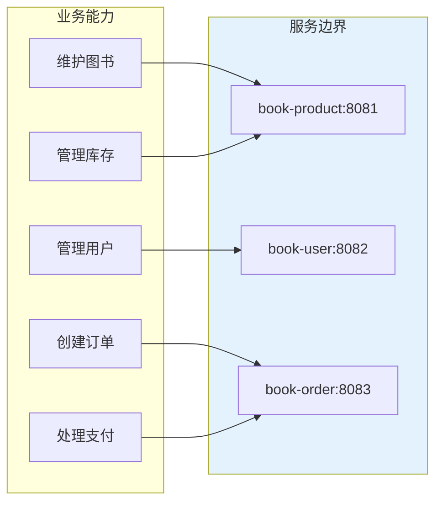
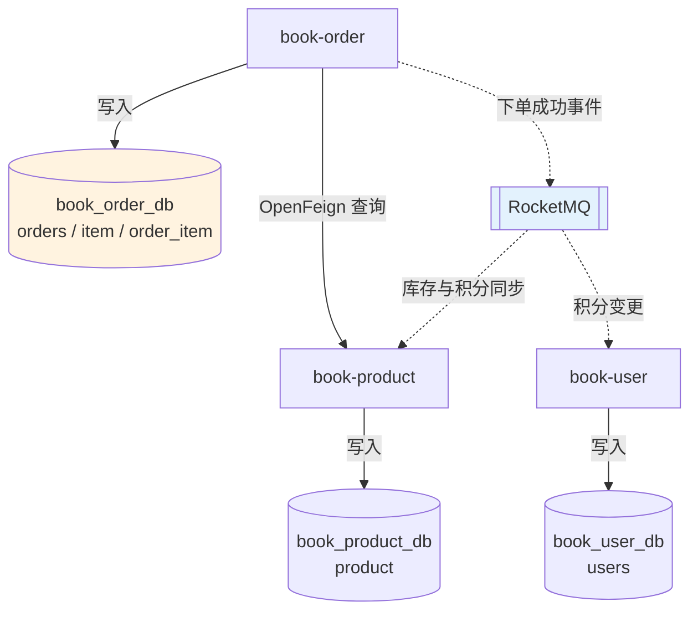

# 微服务架构的实施方法

## 课程目标

- 掌握四种拆分方法论：业务能力拆分、DDD 限界上下文、绞杀者模式、按变更频率拆分
- 能够用粒度判断标准评估一次拆分是否合理，避免拆得过粗或过细
- 掌握五种数据拆分策略的取舍，能为 book-microservice 选择合适的数据方案
- 理解接口契约先行的意义，能写出可用的 OpenAPI 契约并制定版本与兼容策略
- 理解康威定律、DevOps、CI/CD 与 SRE 在微服务落地中的作用
- 能够设计一条渐进式迁移路线，并识别分布式单体、共享数据库、过度拆分、贫血契约四种反模式

## 回顾与导入

前两课完成了两件事：一是用七类问题与八个信号证明了单体在规模增长后会成为瓶颈；二是把微服务的九大特性、八大谬误与新引入的问题讲清楚，明确了它的收益来自边界、代价来自网络。

现在到了最容易被含糊带过的部分：**具体怎么拆。**

很多团队在这一步翻车，不是因为技术不会用，而是因为拆错了地方：

- 按技术分层拆（Controller 服务、Service 服务），结果每次需求都要改三个仓库
- 按表拆（每个表一个服务），结果一次查询要串五次远程调用
- 按团队现状硬拆，拆完发现数据还在一个库里，等于什么都没变
- 先写代码后定契约，联调时才发现字段对不上，只能互相改

本课给出可执行的方法、判断标准和检查清单，把这些坑提前标出来。

## 拆分方法论

### 业务能力拆分

业务能力拆分（Business Capability Decomposition）从"企业做什么"出发，把业务拆成一组能力，再把能力映射为服务。识别方法很朴素：**用"动词 + 名词"描述业务动作**，动作的集合就是能力清单。

| 业务能力 | 对应服务 | 拥有的数据 | 独立发布的理由 |
| --- | --- | --- | --- |
| 维护图书信息 | book-product | product | 图书上下架频率与订单无关 |
| 扣减与管理库存 | book-product | product.stock | 库存变更频繁，需独立伸缩 |
| 管理用户资料 | book-user | users | 用户域变更不影响交易链路 |
| 创建与查询订单 | book-order | orders、item、order_item | 交易链路是最核心的发布单元 |
| 处理支付结果 | book-order | orders | 与订单状态机强绑定 |



判断能力是否应该独立成服务，看三条：是否有独立的数据、是否有独立的变更节奏、是否有明确的责任方。三条都满足，才值得独立。

### DDD 限界上下文

领域驱动设计（Domain-Driven Design，DDD）提供了一套更严谨的边界工具。核心是限界上下文（Bounded Context）：**一个模型只在特定边界内保证含义一致**。

在图书系统里，"商品"这个词在商品上下文里指可售图书与价格，在订单上下文里指下单时刻的价格快照。如果强行用一个 `Product` 类同时表达两者，就会出现"商品涨价导致历史订单金额变化"这类事故。

| 概念 | 含义 | 在本项目中的体现 |
| --- | --- | --- |
| 限界上下文 | 模型生效的边界 | 商品上下文、订单上下文、用户上下文 |
| 聚合根 | 一致性边界的入口 | Order、Product |
| 实体 | 有标识且状态会变 | OrderItem |
| 值对象 | 无标识、不可变 | 金额、地址 |
| 领域事件 | 已发生的业务事实 | OrderCreated、StockDeducted |
| 防腐层 | 隔离外部模型的转换层 | 订单侧的商品快照转换器 |


> **提示：** 聚合根就是事务边界。一个事务只应修改一个聚合，跨聚合的一致性用领域事件与最终一致解决，这条规则直接决定了服务边界与数据边界。

### 绞杀者模式

绞杀者模式（Strangler Fig Pattern）解决的是"存量系统怎么迁移"。做法是在旧系统前面放一层代理，新功能用新服务实现，逐步把旧路径的流量切走，直到旧系统只剩空壳再下线。


关键点有三个：代理层可以是网关，也可以是 Nginx 或 Spring Cloud Gateway；切流按接口或按用户维度灰度，不按机器；每一步都要有可回退的开关。

### 按变更频率拆分

这是一个常被忽略但极其有效的判据：**变更频率差异大的功能，应该分开部署**。

| 变更频率 | 典型模块 | 拆分建议 |
| --- | --- | --- |
| 每天多次 | 促销规则、价格策略、活动配置 | 独立服务，独立发布 |
| 每周一次 | 订单流程、库存策略 | 独立服务，稳定后少动 |
| 每月一次 | 用户资料、权限配置 | 可与其他低频模块合并且独立 |
| 每年一次 | 基础字典、地区数据 | 作为公共依赖或配置，不必独立服务 |

变更频率相同的模块放在一起，发布时不需要协调；频率差异大的放在一起，高频模块会被低频模块的测试周期拖住。

### 四种方法论对比

| 方法 | 切入点 | 优点 | 缺点 | 适用场景 |
| --- | --- | --- | --- | --- |
| 业务能力拆分 | 业务动作 | 直观，易与业务方对齐 | 粒度偏粗，边界可能模糊 | 新系统从零设计 |
| DDD 限界上下文 | 领域模型 | 边界严谨，数据归属清晰 | 学习成本高，需要领域专家 | 业务复杂的核心域 |
| 绞杀者模式 | 存量迁移 | 风险可控，可回退 | 周期长，需要代理层 | 单体系统渐进改造 |
| 按变更频率 | 交付节奏 | 直接改善发布效率 | 不解决数据边界问题 | 与上述方法配合使用 |

### 拆分粒度判断标准

粒度没有绝对标准，但有可核对的判断项。任一项明显不成立，说明这次拆分需要重新考虑：

| 判断维度 | 合理信号 | 不合理信号 |
| --- | --- | --- |
| 数据所有权 | 服务独占一组表，无外部直连 | 与其他服务共享表或需要跨库 join |
| 团队归属 | 有明确的责任团队 | 两个团队共管，或无人负责 |
| 发布节奏 | 可独立发布，不影响他人 | 必须与其他服务同时发布 |
| 调用耦合 | 对外接口稳定，调用次数可控 | 每次请求需要串行调用三次以上 |
| 事务边界 | 核心业务在一个聚合内闭合 | 每次写操作都要跨服务事务 |
| 代码规模 | 一个团队可维护 | 超过三个团队的工作量或只有几百行 |

> **结论：** 一个服务应当"大到值得独立运维，小到一个团队能讲清楚"。判断标准不是代码行数，而是数据、团队、发布三者是否真的独立。

## 数据拆分策略

服务拆分能否成立，最终取决于数据能不能切开。常见策略如下：

| 策略 | 说明 | 优点 | 缺点 | 适用场景 |
| --- | --- | --- | --- | --- |
| 独立数据库 | 每个服务独占库，禁止跨库访问 | 边界最清晰，可独立演进 | 跨域查询需远程调用 | 核心业务域 |
| 共享库只读 | 允许只读访问他人库或只读视图 | 报表查询方便 | 边界被侵蚀，易退化 | 过渡期、数据分析 |
| 数据冗余 | 在本地保存对方数据副本 | 查询快，无远程依赖 | 需同步机制，存在延迟 | 高频读取的少量字段 |
| 事件同步 | 通过消息广播数据变更 | 解耦彻底，天然最终一致 | 需处理重复与乱序 | 跨域状态同步 |
| 分布式事务 | 用 Seata 等框架保证跨库一致 | 业务改造成本低 | 性能与可用性有代价 | 强一致的关键链路 |

在 book-microservice 中使用的是组合方案：三个服务各自独立库（独立数据库），订单保存商品快照（数据冗余），下单成功后通过 RocketMQ 通知其他域（事件同步），扣库存与写订单之间用 Seata 保证一致性（分布式事务）。



> **注意：** "共享库只读"只能作为过渡手段，必须约定退出时间。一旦允许只读，很快就会出现只写、然后出现跨库事务，边界就名存实亡了。

## 接口契约先行

契约先行（Contract First）指在编码之前先把接口的请求、响应、错误码定义清楚，双方以契约文档为准并行开发。

### 用 OpenAPI 描述契约

```yaml
openapi: 3.0.3
info:
  title: 订单服务接口
  version: 1.0.0
paths:
  /api/v1/orders:
    post:
      summary: 创建订单
      requestBody:
        required: true
        content:
          application/json:
            schema:
              $ref: '#/components/schemas/OrderCreateRequest'
      responses:
        '201':
          description: 创建成功
          content:
            application/json:
              schema:
                $ref: '#/components/schemas/ResultOrderVO'
        '400':
          description: 参数校验失败
components:
  schemas:
    OrderCreateRequest:
      type: object
      required: [userId, items]
      properties:
        userId:
          type: integer
          format: int64
        items:
          type: array
          items:
            $ref: '#/components/schemas/OrderItemRequest'
```

契约一旦发布，就是服务之间的合同。上游新增字段要评估下游的反序列化行为，删除字段必须走版本。

### 版本策略

| 策略 | 示例 | 优点 | 缺点 | 适用场景 |
| --- | --- | --- | --- | --- |
| URI 版本 | `/api/v1/orders` | 直观，易路由与统计 | URL 变长 | 对外网关接口 |
| 请求头版本 | `X-Api-Version: 1` | URL 稳定 | 不直观，网关需解析头 | 内部服务 |
| 内容协商 | `Accept: application/vnd.book.v1+json` | 语义规范 | 调试不便 | 公开 API |
| 无版本（只增不减） | 保持向后兼容 | 维护成本最低 | 历史包袱累积 | 内部高频调用 |

### 兼容原则

| 变更类型 | 是否兼容 | 处理方式 |
| --- | --- | --- |
| 新增可选字段 | 兼容 | 直接发布，下游忽略即可 |
| 新增必填字段 | 不兼容 | 先设为可选并给默认值，一个版本后再收紧 |
| 删除字段 | 不兼容 | 先标记弃用，观察调用方，再按版本移除 |
| 修改字段类型 | 不兼容 | 新增字段承载新类型，旧字段保留过渡 |
| 扩展枚举值 | 视情况 | 下游必须能容忍未知枚举值 |
| 修改接口语义 | 不兼容 | 视为新接口，走版本 |

> **提示：** 契约要放进版本库并与代码同级维护，接口变更必须修改契约文件。契约与实现分离，是内部服务长期不腐化的关键。

## 组织与流程

### 康威定律与团队拓扑

架构不会独立于组织存在。团队拓扑（Team Topologies）给出了四种团队类型，落到微服务上大致对应如下关系：

| 团队类型 | 职责 | 与服务的对应 |
| --- | --- | --- |
| 业务团队 | 端到端负责一个业务域 | 一对一拥有服务 |
| 平台团队 | 提供注册、配置、流水线、可观测能力 | 服务所有团队共用 |
| 赋能团队 | 短期帮助业务团队补齐能力 | 不长期拥有服务 |
| 复杂子系统团队 | 维护算法或技术复杂度高的模块 | 对应少数专业服务 |

### DevOps、CI/CD 与 SRE

| 实践 | 核心主张 | 在微服务中的作用 |
| --- | --- | --- |
| DevOps | 谁构建谁运行 | 服务质量与团队责任绑定 |
| CI | 每次提交自动构建与测试 | 高频发布的前提 |
| CD | 自动化部署与快速回滚 | 让独立发布变得可行 |
| SRE | 用 SLO 与错误预算管理稳定性 | 决定发布节奏与止损标准 |

其中 SRE 的错误预算概念特别值得引入：当某个服务的可用性目标为 99.9% 时，一个月允许的不可用时间约 43 分钟（示意值，按 30 天计）。预算耗尽就冻结功能发布，优先修复稳定性。这把"要不要发"从争论变成规则。

## 渐进式迁移路线图

迁移不是一次切换，而是分阶段的持续演进。推荐路线如下：


| 阶段 | 关键动作 | 完成标准 | 主要风险 |
| --- | --- | --- | --- |
| 模块化单体 | 按业务能力重整包结构，禁止跨模块访问 Mapper | 模块间只有 Service 接口调用 | 只改目录不改依赖 |
| 基础设施先行 | 部署 Nacos、CI/CD 流水线、统一日志 | 服务可一键部署、日志可集中查询 | 跳过此步直接拆服务 |
| 首个服务外移 | 选改动少、依赖少的服务先拆，如 book-user | 独立库、独立发布、网关可达 | 选核心链路导致风险失控 |
| 按域逐步迁移 | 依次迁移商品、订单，用绞杀者切流 | 旧路径流量归零 | 数据同步不彻底 |
| 治理与优化 | 限流熔断、链路追踪、容量评估 | SLO 达标，故障可定位 | 治理滞后于拆分 |

> **注意：** 第一个被拆出去的服务应该选"边缘、简单、依赖少"的，不要选订单这类核心链路。第一次拆分的目的是跑通流程、暴露问题，而不是展示技术实力。

## 四种反模式

| 反模式 | 表现 | 后果 | 规避方式 |
| --- | --- | --- | --- |
| 分布式单体 | 多个服务必须同时发布，共享数据库 | 得到单体的复杂度，失去单体的简单 | 按数据与发布独立性验证边界 |
| 共享数据库 | 多个服务直连同一个库 | 表结构变更互相阻塞，边界失效 | 独立库，跨域走接口或事件 |
| 过度拆分 | 服务只对应一张表或一个接口 | 调用链长、事务多、运维成本高 | 用粒度判断标准复核 |
| 贫血契约 | 接口只暴露 CRUD，业务规则散落调用方 | 业务逻辑重复、口径不一致 | 契约表达业务意图，而非表结构 |

**分布式单体**最隐蔽：服务数看起来很多，但每次上线仍然要按顺序发布 5 个服务，数据库还是共用的。判断方法很简单——随机挑一个服务，看它能否在不通知任何人的情况下独立发布。

**共享数据库**是分布式单体的常见成因。它带来的是短期便利与长期僵化：一次加字段要协调三个团队，一次慢查询影响所有服务。

**过度拆分**在第 03 课已经用纳米服务举例。这里补充一个判断技巧：如果一个服务的所有接口调用方都来自另一个服务，且调用比例接近 1:1，它们大概率应该合并。

**贫血契约**指的是接口只暴露数据搬运能力，真正的业务规则由调用方拼装。例如订单服务只提供"写一条订单记录"，而"库存是否足够、用户是否可用、金额是否正确"都由网关或前端判断，规则一旦变更就要改多处。

## 落地检查清单

把上面的内容收成一张可执行的表，落地时逐行核对：

| 阶段 | 动作 | 验收标准 |
| --- | --- | --- |
| 立项 | 整理业务能力清单，标注数据归属 | 每个能力只有一个归属方 |
| 设计 | 用 DDD 划出限界上下文，标出聚合根 | 事务不跨聚合 |
| 设计 | 输出接口契约（OpenAPI）并评审 | 上下游对字段与错误码无异议 |
| 数据 | 确定每个服务的库与表 | 不存在跨服务的共享表 |
| 数据 | 明确跨域数据同步方式 | 同步延迟与补偿方案已确认 |
| 工程 | 搭建多模块工程与公共模块 | book-common 提供 Result 与异常体系 |
| 交付 | 打通 CI/CD 与统一日志 | 单服务可一键部署并回溯日志 |
| 上线 | 首个服务灰度切流并观察 | 灰度期间错误率无上升 |
| 治理 | 配置限流、熔断与链路追踪 | 单服务故障不扩散到全链路 |

## 注意事项

1. **先定数据边界，再定服务边界。** 数据切不开的服务边界是假的，任何架构图都掩盖不了共享表的事实。
2. **拆分顺序要保守。** 从边缘服务开始，核心链路最后动；第一次拆分的目标是验证流程，不是追求彻底。
3. **契约要进版本库。** 接口文档散落在聊天记录或 Wiki 里，等于没有契约。
4. **不要用"共享库只读"长期过渡。** 只读会自然演化为只写，最终回到共享数据库。
5. **粒度判断以团队与发布为准。** 代码行数只是参考，一个团队能否独立讲清、能否独立发布才是硬标准。
6. **迁移必须可回退。** 每一步切流都要有开关，出问题时能在分钟级切回旧路径。
7. **治理能力要同步建设。** 没有链路追踪与限流，拆得越细故障越难定位。
8. **组织不变则架构回弹。** 拆完不调整团队与排期，最终会重新长成一个分布式单体。

## 小结

本节课我们学习了：

1. **四种拆分方法论**：业务能力拆分看业务动作，DDD 限界上下文看领域模型，绞杀者模式解决存量迁移，按变更频率拆分改善交付效率。
2. **粒度判断标准**：从数据所有权、团队归属、发布节奏、调用耦合、事务边界、代码规模六个维度复核，任一明显不成立就要重新考虑。
3. **五种数据拆分策略**：独立数据库、共享库只读、数据冗余、事件同步、分布式事务，本项目采用组合方案。
4. **契约先行**：用 OpenAPI 描述接口，按 URI、请求头、内容协商或无版本策略管理版本，遵循只增不删的兼容原则。
5. **组织与流程**：康威定律决定架构形状，DevOps 绑定责任，CI/CD 支撑高频发布，SRE 用 SLO 与错误预算约束节奏。
6. **渐进式迁移路线**：模块化单体、基础设施先行、首个服务外移、按域迁移、治理优化五个阶段。
7. **四种反模式**：分布式单体、共享数据库、过度拆分、贫血契约，以及对应的识别方法与规避手段。
8. **落地检查清单**：从立项到治理共九个环节，每个环节都有可核对的验收标准。

## 作业

### 作业一：为图书管理系统产出一份拆分方案

1. 列出图书管理系统的业务能力清单，每条标注数据归属与变更频率。
2. 用 DDD 划出至少三个限界上下文，标出每个上下文的聚合根。
3. 用粒度判断标准表逐项复核你的拆分，指出最薄弱的一项并给出改进办法。

### 作业二：编写订单创建接口的契约

1. 用 OpenAPI 描述 `POST /api/v1/orders`，包含请求体、成功响应、参数校验失败三种情况。
2. 在契约中定义错误码字段，与 `ResultCode` 的命名保持一致。
3. 说明如果三个月后需要新增"优惠金额"字段，应该如何变更契约才能保持兼容。

### 作业三：设计迁移计划

1. 假设现有系统是一个包含 25 个模块的单体，请按五个阶段写出一份迁移计划，标注每个阶段的时间与完成标准。
2. 说明你会选择哪个模块作为第一个外移的服务，为什么。
3. 列出三条必须提前具备的基础设施能力，并说明缺少它们时会出现什么问题。
