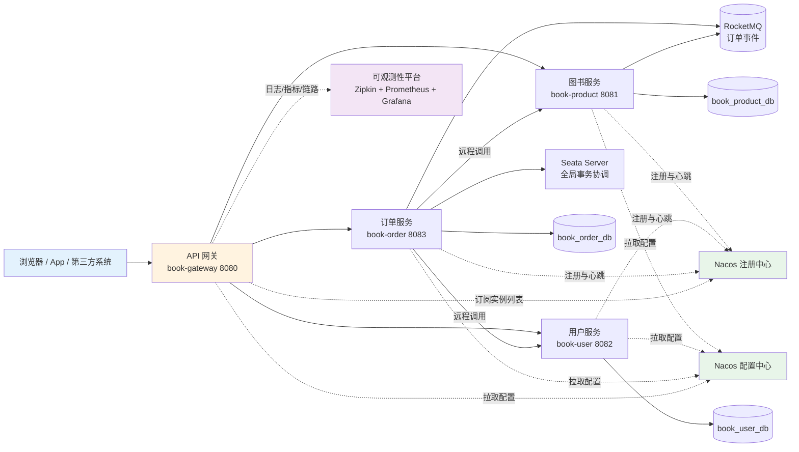
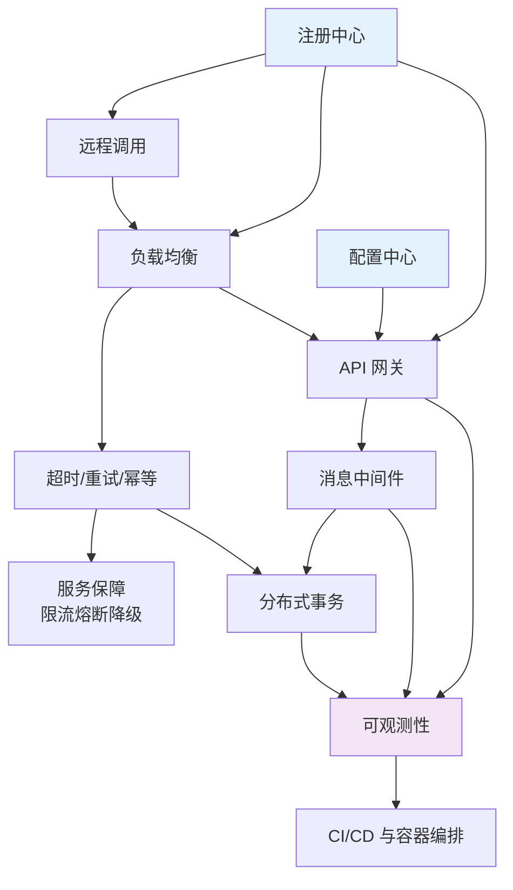

# 微服务架构核心组件

## 课程目标

- 理解微服务架构中十二类核心组件各自承担的责任与能力边界
- 掌握用「解决什么问题 / 不用它会怎样」的方法判断一个组件是否值得引入
- 掌握核心组件之间的依赖关系，能够为一个真实系统排出组件的引入顺序
- 理解为什么注册中心先于配置中心、配置中心先于网关
- 能够为图书管理系统规划「按需引入、逐步演进」的组件落地路线，避免一次性堆砌

## 回顾与导入

上一课《微服务架构的实施方法》讲清了方法论：先拆分领域，再定服务边界，最后按「接口先行、数据分离、独立部署」把单体拆开。但方法只回答了「怎么切」，没回答「切完之后靠什么把它们重新组织成一个整体」。

被拆成三个服务的图书管理系统，立刻会遇到一连串新问题：

- 订单服务要调图书服务，图书服务地址写在配置文件里，换台机器就得改配置、重启、重新发布。
- 三个服务各有自己的 `application.yml`，改一次数据库密码要改三处、发三次版。
- 前端要同时面对 8081、8082、8083 三个地址，还要自己处理登录态、跨域和限流。
- 下单扣库存时订单库写成功、库存库失败，数据就永久不一致。
- 订单服务变慢，没有链路追踪，只能人肉翻三台机器的日志去猜。

这些问题都不是业务问题，而是**分布式带来的系统问题**。解决系统问题要靠基础设施能力，在 Spring Cloud 体系里，这些能力被封装成一组可插拔组件。

本课不写代码，只做一件事：**把组件地图铺开**。先知道每块砖是干什么的、缺了它房子会怎样塌，后面四十多节课才有落脚点。

## 组件全景：一张拓扑图看清全貌

从请求进入系统到数据落库，会穿过五层结构：入口层、服务层、中间件层、数据层，以及贯穿全系统的治理能力。

图上有三点要读出来：网关是唯一入口，服务端口不对外暴露；注册中心与配置中心不与业务请求同链，但每个实例都依赖它们；消息与事务协调器是连接器，不是某个服务的内部实现。

> **结论：** 微服务的复杂度不来自业务，而来自服务之间的连接；图中每条跨服务箭头都是需要治理的边界。

## 十二类核心组件逐个拆解

按「从基础设施到业务保障」的顺序逐个说明，每个组件回答四个问题。

### 注册中心（Service Registry）

| 维度 | 内容 |
| --- | --- |
| 解决什么问题 | 实例启动后自动登记地址，调用方按服务名查可用实例；靠健康检测自动摘除不可用实例 |
| 不用它会怎样 | 地址只能硬编码，扩缩容、换机、滚动发布都要改配置重启，服务一多就不可维护 |
| 代表技术 | Nacos、Eureka（已停更）、Consul、ZooKeeper、etcd |
| 本课程课时 | 13～21（部署、集群、注册、发现、分级模型、Group、权重、API） |

它是整张图的**根节点**：没有它，服务名调用与网关转发都无从谈起。

### 配置中心（Config Center）

| 维度 | 内容 |
| --- | --- |
| 解决什么问题 | 配置集中存储，按环境隔离、按需下发、修改后热更新，并保留修改历史 |
| 不用它会怎样 | 配置散在 N 个 `application.yml` 里，改一个开关要发 N 次版；无法审计谁在何时改了什么 |
| 代表技术 | Nacos Config、Apollo、Spring Cloud Config、Consul KV |
| 本课程课时 | 31～34（快速上手、隔离与共享、动态刷新与灰度、安全治理） |

### 远程调用（Remote Invocation）

| 维度 | 内容 |
| --- | --- |
| 解决什么问题 | 像调用本地方法一样调用远程接口，屏蔽拼 URL、序列化、异常处理等样板代码 |
| 不用它会怎样 | 每个调用点手写 HTTP 客户端，错误处理风格各异，加一个公共请求头要改几十处 |
| 代表技术 | OpenFeign、RestTemplate、WebClient、Dubbo（RPC 风格） |
| 本课程课时 | 22～26（快速上手、核心注解、拦截器、与 LoadBalancer 集成、调用重构） |

### 负载均衡（Load Balancing）

| 维度 | 内容 |
| --- | --- |
| 解决什么问题 | 在多个实例间挑选目标，分摊流量；配合权重与元数据实现灰度与机房亲和 |
| 不用它会怎样 | 只能单实例部署，无法水平扩容；一台实例挂掉，全部流量打到挂掉那台上 |
| 代表技术 | Spring Cloud LoadBalancer、Nginx、HAProxy、LVS、Envoy |
| 本课程课时 | 27～30（快速上手、算法与实现、自定义策略、超时重试与幂等） |

> **提示：** 服务端负载均衡（Nginx）由客户端先打到 LB；客户端负载均衡（LoadBalancer）由调用方自己选实例，少一次网络跳转，且能感知注册中心的实时列表。

### API 网关（API Gateway）

| 维度 | 内容 |
| --- | --- |
| 解决什么问题 | 外部流量统一入口，收拢路由、鉴权、限流、跨域、审计，并隐藏内部拓扑 |
| 不用它会怎样 | 前端直连三个服务，跨域配三处、登录态校验三次、限流规则各写一遍，内部地址直接暴露 |
| 代表技术 | Spring Cloud Gateway、Nginx + Lua、Kong、APISIX、Envoy |
| 本课程课时 | 35～38（快速上手、断言与过滤器、统一鉴权与限流、动态路由与高可用） |

### 消息中间件（Message Broker）

| 维度 | 内容 |
| --- | --- |
| 解决什么问题 | 用「发消息」替代「同步调用」，实现异步解耦、流量削峰、一份事件多方消费 |
| 不用它会怎样 | 下单后发短信、发邮件、加积分全串在主链路，任一环节慢就拖垮下单；突发流量直接打满数据库 |
| 代表技术 | RocketMQ、Kafka、RabbitMQ、Pulsar |
| 本课程课时 | 39～42（概述与部署、发送与消费、顺序/延迟/事务消息、可靠性与幂等） |

### 分布式事务（Distributed Transaction）

| 维度 | 内容 |
| --- | --- |
| 解决什么问题 | 一次业务操作跨多个服务、多个库时，保证全部生效或全部回滚 |
| 不用它会怎样 | 订单写入成功但库存扣减失败，出现「有单无货」，只能靠滞后于故障的对账脚本补救 |
| 代表技术 | Seata（AT/TCC/Saga/XA）、事务消息、本地消息表 |
| 本课程课时 | 43～45（理论与架构、AT 模式实战、TCC/Saga/XA 与选型） |

### 服务保障：限流、熔断、降级

| 维度 | 内容 |
| --- | --- |
| 解决什么问题 | 限流挡住超量请求，熔断切断故障依赖，降级返回兜底数据，把雪崩控制在局部 |
| 不用它会怎样 | 图书服务慢 3 秒，订单服务线程池被占满，网关接着超时，故障沿调用链放大成全站不可用 |
| 代表技术 | Sentinel、Hystrix（已停更）、Resilience4j、Istio 熔断策略 |
| 本课程课时 | 46～48（快速上手与流控、熔断降级与热点参数、规则持久化与集群流控） |

### 可观测性：日志、指标、链路

| 维度 | 内容 |
| --- | --- |
| 解决什么问题 | 用 TraceId 把跨服务日志串起来，用指标看趋势与容量，用告警代替盯屏 |
| 不用它会怎样 | 排查只能逐台 `grep`，判断不出慢在订单还是图书；容量规划只能靠猜 |
| 代表技术 | Micrometer Tracing、OpenTelemetry、Zipkin、Prometheus、Grafana、Loki |
| 本课程课时 | 49～50（Micrometer Tracing 与链路追踪、日志关联与指标告警） |

### 安全认证（Authentication & Authorization）

| 维度 | 内容 |
| --- | --- |
| 解决什么问题 | 统一登录与令牌校验，把身份透传给下游服务，并保护注册中心、配置中心等入口 |
| 不用它会怎样 | 每个服务各写一套登录校验，规则不一致；下游只能信任上游传来的 `userId`，被越权调用 |
| 代表技术 | Spring Security、OAuth 2.1、JWT、Keycloak、Sa-Token |
| 本课程课时 | 37（网关统一鉴权）、34（配置中心安全与治理） |

### CI/CD（持续集成与持续交付）

| 维度 | 内容 |
| --- | --- |
| 解决什么问题 | 构建、测试、镜像打包、发布变成可重复执行的流水线，过程可审计、可回滚 |
| 不用它会怎样 | 手工打包传包重启，四个服务发一次要半天，每次发布都是一次风险事件 |
| 代表技术 | Jenkins、GitLab CI、GitHub Actions、Argo CD、Harbor |
| 本课程课时 | 51（容器化部署与生产实践） |

### 容器编排（Container Orchestration）

| 维度 | 内容 |
| --- | --- |
| 解决什么问题 | 声明式描述期望状态，由平台负责调度、自愈、滚动升级、水平扩缩容 |
| 不用它会怎样 | 手工起进程，扩容靠加机器，实例挂了靠人拉，多环境一致性无法保证 |
| 代表技术 | Docker、Kubernetes、Helm、Kustomize、Nomad |
| 本课程课时 | 51（容器化部署与生产实践） |

### 组件总表

| 组件 | 一句话定位 | 所属层 | 课时 |
| --- | --- | --- | --- |
| 注册中心 | 服务的电话簿 | 基础设施层 | 13～21 |
| 配置中心 | 配置的中央仓库 | 基础设施层 | 31～34 |
| 远程调用 | 服务之间的调用方式 | 服务层 | 22～26 |
| 负载均衡 | 多实例之间的选择策略 | 服务层 | 27～30 |
| API 网关 | 外部流量的唯一入口 | 入口层 | 35～38 |
| 消息中间件 | 异步解耦与削峰 | 中间件层 | 39～42 |
| 分布式事务 | 跨库一致性保障 | 中间件层 | 43～45 |
| 服务保障 | 限流熔断降级 | 服务层 | 46～48 |
| 可观测性 | 看见系统内部状态 | 贯穿全层 | 49～50 |
| 安全认证 | 身份与权限 | 入口层 + 基础设施 | 34、37 |
| CI/CD | 交付流水线 | 交付层 | 51 |
| 容器编排 | 运行时调度平台 | 交付层 | 51 |

## 组件依赖关系

组件不是并列关系，而是有明显的前后依赖。理解依赖，才能理解为什么引入顺序不能随意打乱。

| 依赖关系 | 类型 | 说明 |
| --- | --- | --- |
| 远程调用 → 注册中心 | 强依赖 | 按服务名调用必须有实例列表来源，否则只能硬编码地址 |
| 负载均衡 → 注册中心 | 强依赖 | 候选实例由注册中心提供，算法只负责「怎么选」 |
| 网关 → 注册中心 | 强依赖 | `lb://book-product` 这类路由要求网关能订阅实例列表 |
| 网关 → 负载均衡 | 强依赖 | 网关转发本质是一次带负载均衡的调用 |
| 网关 → 配置中心 | 弱依赖 | 路由与白名单可写死在本地，但生产环境几乎必需动态调整 |
| 远程调用 → 负载均衡 | 强依赖 | Feign 默认就走 LoadBalancer 选实例 |
| 服务保障 → 远程调用 | 强依赖 | 熔断的资源粒度就是某个远程调用或某个接口 |
| 分布式事务 → 远程调用 | 强依赖 | 全局事务的分支通常分布在多个服务的写操作上 |
| 可观测性 → 全部服务 | 弱依赖 | 缺了不影响业务，缺了就无法定位问题 |
| CI/CD → 容器编排 | 强依赖 | 流水线产物是镜像，镜像最终落到编排平台 |

> **注意：** 「弱依赖」指不引入也能跑通业务，但缺失时故障定位成本急剧上升。很多团队把它留到最后，结果中间阶段排查花的钱比开发还多。

## 引入顺序建议

### 顺序与理由

| 顺序 | 组件 | 为什么排在这里 | 排错了会怎样 |
| --- | --- | --- | --- |
| 1 | 工程骨架与公共模块 | 先有可编译、可启动、返回体统一的多模块工程 | 没有统一返回体，后面每个服务的错误处理都要重写 |
| 2 | 注册中心 | 「按服务名调用」的前提，改造量最小 | 先做网关，路由只能写死 IP，等于白做 |
| 3 | 配置中心 | 注册地址、命名空间、数据源都从这里下发，越早统一越省钱 | 等 5 个服务都有本地配置再迁移，改造面翻倍 |
| 4 | 远程调用 + 负载均衡 | 打通服务间调用，业务才真正跑起来；两者天然配套 | 先做消息，同步部分仍是硬编码调用 |
| 5 | API 网关 | 需要「多个服务 + 能按服务名转发」才有意义 | 服务未稳定就上网关，网关自身成为新故障点 |
| 6 | 消息中间件 | 主链路通了，才谈得上哪些环节该异步化 | 过早引入，出现「为用 MQ 而用 MQ」的无意义异步 |
| 7 | 分布式事务 | 只有出现真正的跨库写之后才必要 | 没有跨库写就上 Seata，徒增全局锁开销 |
| 8 | 服务保障 | 依赖链稳定后，用真实压测数据定阈值 | 没有基线就配阈值，规则必然是拍脑袋 |
| 9 | 可观测性 | 越早越好，完整落地放在链路稳定后成本最低 | 一直不做，前面每一步都在盲调 |
| 10 | 容器化与 CI/CD | 发布频率高、手工发布成瓶颈时收益最大 | 一开始就上 K8s，团队被运维复杂度拖住 |

### 与本课程编排的差异

本课程实际顺序是「注册中心 → 远程调用 → 负载均衡 → 配置中心 → 网关」，与上表有一处不同：配置中心放在远程调用之后。原因是远程调用与负载均衡**不依赖**配置中心，属于软依赖，先后可以互换。

> **结论：** 注册中心 → 配置中心 → 网关 是硬依赖链，不能颠倒；远程调用与配置中心的先后可按团队情况调整。

## 组件别一次上全：演进节奏

新手最容易犯的错误，是拿到组件表后想一个月内全上齐。结果系统还没跑起来，运维成本先压垮团队。

| 风险 | 说明 |
| --- | --- |
| 故障面叠加 | 每引入一个组件就多一个可能挂掉的进程、一套要理解的配置、一类新的超时 |
| 排查链路变长 | 请求先后穿过网关、负载均衡、服务、消息、事务协调器，没有可观测性几乎无法定位 |
| 认知负荷 | 同时学 Nacos、Feign、Gateway、RocketMQ、Seata、Sentinel，每项只能学到皮毛 |
| 收益无法归因 | 一次上全之后说不清哪个组件带来收益，也就无法判断该不该继续投入 |
| 回滚困难 | 组件互相耦合后出问题，很难只回滚一个 |

### 分阶段演进路线

| 阶段 | 目标 | 引入组件 | 验收标准 | 课时 |
| --- | --- | --- | --- | --- |
| 一 | 能跑起来 | 多模块 Maven、公共模块 | 四个模块编译通过，三个服务可启动 | 09～12 |
| 二 | 能被发现 | Nacos 注册中心 | 控制台可见三个实例，停实例后自动消失 | 13～21 |
| 三 | 能互相调用 | OpenFeign、LoadBalancer | 订单按服务名调图书，多实例可轮询 | 22～30 |
| 四 | 配置可治理 | Nacos Config | 改配置不重启，多环境隔离生效 | 31～34 |
| 五 | 有统一入口 | Spring Cloud Gateway | 全量流量走 8080，鉴权与限流生效 | 35～38 |
| 六 | 能异步、能一致 | RocketMQ、Seata | 下单事件异步通知；扣库存失败能回滚 | 39～45 |
| 七 | 扛得住、看得见 | Sentinel、Micrometer Tracing | 压测不雪崩，一次请求的完整链路可查 | 46～50 |
| 八 | 交付得快 | Docker、K8s | 一条流水线产出四个镜像并滚动发布 | 51 |

### 引入时机的判断信号

不要问「要不要上」，要问「现在是否必须上」。

| 组件 | 该上的信号 | 可以再等等 |
| --- | --- | --- |
| 注册中心 | 实例数超过 3 个，或需频繁扩缩容 | 只有单机本地开发 |
| 配置中心 | 环境数 ≥ 2，或有需不发版就调整的开关 | 配置只有端口和数据源 |
| 远程调用 | 出现第二个调用方，或调用代码开始重复 | 服务之间没有调用 |
| 负载均衡 | 需水平扩容，或要求单实例故障不影响服务 | 单实例且流量很小 |
| 网关 | 前端要对接多个服务，或需统一鉴权限流 | 只有内部调用，没有外部流量 |
| 消息中间件 | 主链路存在明显的「非核心、可延后」步骤 | 所有步骤必须同步完成 |
| 分布式事务 | 一次业务操作跨两个以上库写 | 单库事务就能保证 |
| 服务保障 | 有明确流量峰值，或依赖方稳定性不可控 | 流量平稳且依赖方 SLA 有保障 |
| 可观测性 | 服务数 ≥ 3，或出现过「查不出原因」的故障 | 单服务本地调试阶段 |
| 容器化 | 发布频率高、环境多，手工发布成瓶颈 | 团队尚无容器运维能力 |

> **提示：** 上表不是标准答案，而是一种思考方式：用**痛点是否已经发生**代替**技术是否先进**来做决策。

## 注意事项

- **不要用组件解决组织问题。** 服务拆得过细的沟通成本，加多少中间件都补不回来；先确认拆分粒度合理，再谈治理。
- **注册中心与配置中心要分开规划。** Nacos 两种能力并存，但命名空间与 Group 要分别考虑；混在一个命名空间，后面做环境隔离会很痛苦。
- **默认配置几乎都不适合生产。** 超时、重试次数、连接池、线程数的默认值是为「能跑通」设计的，不是为「扛住流量」设计的。
- **引入组件必须同步引入验证手段。** 加了限流要有压测脚本，加了重试要有幂等校验，否则无法证明它生效。
- **消息中间件不等于异步万能。** 引入 MQ 也引入了消息丢失、重复消费、顺序错乱三类问题。
- **分布式事务的成本高于想象。** AT 的全局锁、TCC 的补偿接口、Saga 的状态机，都要在选型阶段评估。
- **版本必须成套对齐。** 三者错配会导致启动即失败、注解不生效，详见《Spring Cloud Alibaba简介》。

## 小结

本节课我们学习了：

1. **微服务系统的五层结构**：入口层、服务层、中间件层、数据层，以及贯穿全层的治理能力；网关是唯一入口，注册中心与配置中心是横向基础设施。
2. **十二类核心组件的能力边界**：注册中心、配置中心、远程调用、负载均衡、网关、消息、分布式事务、服务保障、可观测性、安全认证、CI/CD、容器编排，均按「解决什么问题 / 不用它会怎样」做了判断。
3. **组件依赖关系**：注册中心是根节点；远程调用与负载均衡依赖它；网关依赖负载均衡与配置中心；服务保障依赖远程调用；分布式事务依赖跨服务写操作。
4. **引入顺序的三条硬约束**：注册中心先于网关；配置中心先于网关；服务保障建立在远程调用链路之上。远程调用与配置中心的先后可灵活调整。
5. **「组件别一次上全」的演进方法**：分八个阶段推进，每阶段有目标与验收标准，并用「痛点是否已经发生」判断某个组件是否到了该上的时候。

## 作业

### 作业一：画出你自己的组件地图

1. 选择一个熟悉的业务系统，画出它的服务划分草图。
2. 参照本课拓扑图，画出「客户端 → 网关 → 服务 → 中间件 → 数据层」的完整拓扑，至少包含 4 个服务。
3. 用不同颜色标注：已具备的能力、当前缺失但迫切需要的、暂时不需要的。

### 作业二：完成引入顺序论证

1. 为图书管理系统填写引入顺序表，列包含：顺序、组件、前置依赖、引入理由、验收标准。
2. 用不少于 300 字说明：为什么不能先上 Spring Cloud Gateway 再上 Nacos。
3. 假设团队 3 人、日均请求量万级、只有一个生产环境，从十二类组件中挑出「半年内必须上的」与「可以不上」两组并说明理由。

### 作业三：设计「不用它会怎样」的对照实验

1. 选择注册中心或配置中心中的一个，设计可在本地复现的对照实验。
2. 实验需包含：目的、前置条件、对照组做法、实验组做法、观察指标、预期结论。
3. 结论必须是可观测现象（例如「改配置后需重启才生效」），而不是主观判断。
