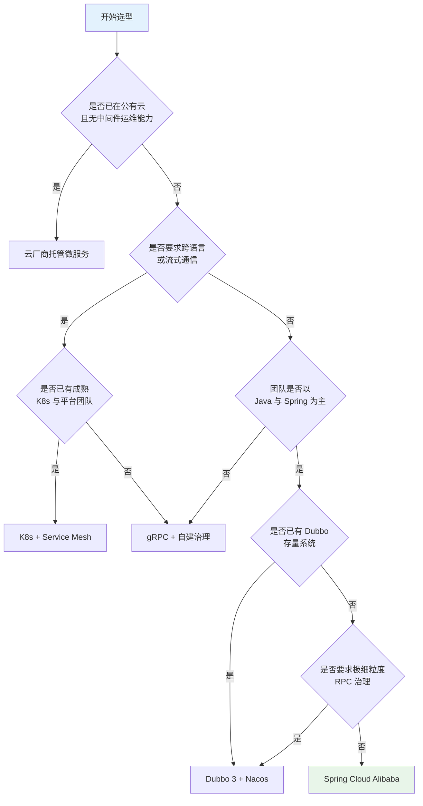
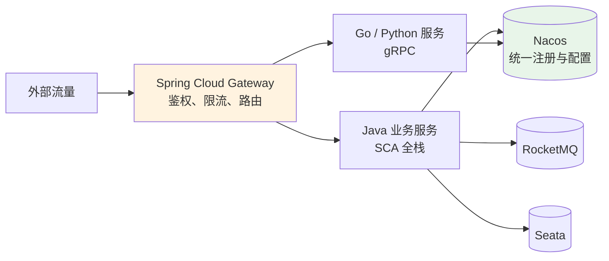

# 微服务架构技术选型

## 课程目标

- 理解技术选型的本质是「在约束条件下做取舍」，而不是选出功能最多的方案
- 掌握生态完整度、社区活跃度、生产案例、学习成本、云原生兼容、厂商锁定、版本演进节奏、可观测性八个评估维度
- 能够点评 Spring Cloud Alibaba、Spring Cloud Netflix、Dubbo、gRPC、Service Mesh、云厂商托管六类候选方案
- 掌握用决策树快速收敛选型结论的方法，并能说明本课程选择 Spring Cloud Alibaba 的理由
- 掌握 Spring Boot 3.5.x 的版本约束：JDK 17+、`jakarta` 命名空间、Spring Cloud 2025.0.0 对齐

## 回顾与导入

上一课《微服务架构核心组件》铺开了组件地图：注册中心、配置中心、远程调用、负载均衡、网关、消息、事务、保障、可观测。地图只是「需要哪些能力」，并没有回答「这些能力由谁提供」。

同一个注册中心能力，至少有 Nacos、Consul、ZooKeeper、etcd 四种实现；同一个网关能力，有 Spring Cloud Gateway、Nginx、Kong、APISIX。选错一个组件，可能要用半年去还技术债；选错一整套技术栈，往往要重写。

因此本课要解决三件事：

1. 用什么标准去评估候选方案，而不是凭「听说它很火」做决定。
2. 面对六类主流路线，各自的适用边界在哪里。
3. 在这个项目上，为什么最终落在 Spring Cloud Alibaba。

> **提示：** 选型结论没有绝对的对错，只有「在当前团队、当前阶段是否合适」。同一家公司，三年前的正确答案和今天可能不同。

## 选型的八个维度

### 维度说明

| 维度 | 含义 | 怎么判断 | 权重（示意） |
| --- | --- | --- | --- |
| 生态完整度 | 注册、配置、调用、网关、事务、保障等能力是否齐全，能否一站式解决 | 数一数还缺哪些能力、缺的部分有没有成熟替代 | 高 |
| 社区活跃度 | 近半年 Issue 响应、发版频率、中文资料与问答数量 | 看仓库提交曲线、Issue 平均关闭时长 | 高 |
| 生产案例 | 是否有同量级、同行业的落地案例 | 看公开案例、招聘 JD 中的技术关键词 | 高 |
| 学习成本 | 团队从零到能独立排障所需的周期 | 看文档质量、调试手段、错误信息是否友好 | 中 |
| 云原生兼容 | 能否容器化、能否在 K8s 上平滑运行、是否支持声明式配置 | 看是否有官方镜像、Helm Chart、Operator | 中 |
| 厂商锁定 | 换掉它需要改多少业务代码、数据能否导出 | 看协议是否开放、是否有标准 API | 中 |
| 版本演进节奏 | 大版本升级频率、是否强制跟随框架升级 | 看历史大版本间隔与破坏性变更比例 | 中 |
| 可观测性 | 是否原生输出指标、链路、日志关联信息 | 看是否内置 Micrometer、OpenTelemetry 支持 | 中 |

### 为什么是这八个

这八个维度可以归成三组，对应三类风险：

| 风险类型 | 对应维度 | 风险表现 |
| --- | --- | --- |
| 能力风险 | 生态完整度、可观测性 | 做到一半发现缺少关键能力，只能自己造轮子 |
| 生存风险 | 社区活跃度、生产案例、版本演进节奏 | 用了两年发现组件停更，无人维护、无安全补丁 |
| 组织风险 | 学习成本、厂商锁定、云原生兼容 | 团队学不动、换不掉、上不了云 |

> **结论：** 能力风险可以靠加班补，生存风险和组织风险补不了。所以「有人在维护」比「功能多」更重要。

### 打分示例

以图书管理系统为例，给三类候选方案打一个示意分（1～5 分，权重按上表「高=3、中=2」）：

| 维度 | 权重 | Spring Cloud Alibaba | Dubbo 体系 | K8s + Service Mesh |
| --- | --- | --- | --- | --- |
| 生态完整度 | 3 | 5 | 3 | 4 |
| 社区活跃度 | 3 | 5 | 4 | 4 |
| 生产案例 | 3 | 5 | 4 | 3 |
| 学习成本 | 2 | 4 | 3 | 2 |
| 云原生兼容 | 2 | 4 | 4 | 5 |
| 厂商锁定 | 2 | 4 | 3 | 3 |
| 版本演进节奏 | 2 | 4 | 3 | 3 |
| 可观测性 | 2 | 4 | 3 | 4 |
| 加权合计 | - | 76 | 58 | 60 |

> **注意：** 上表是**示意值**，作用不是给出标准答案，而是演示「把主观印象变成可讨论的数字」的过程。真实评估时，权重应由团队自己定义，例如初创团队可以把学习成本的权重调高。

## 候选方案逐一点评

### Spring Cloud Alibaba（SCA）

阿里巴巴开源的微服务解决方案，是 Spring Cloud 规范的实现与补充：Nacos 承担注册与配置，Sentinel 承担流量防护，Seata 承担分布式事务，RocketMQ 承担消息，OpenFeign 与 LoadBalancer 承担调用与负载。

| 项目 | 评价 |
| --- | --- |
| 优点 | 一站式覆盖微服务全链路；中文文档与社区问答丰富；与 Spring Boot 自动配置深度集成；国内招聘市场需求大 |
| 缺点 | 组件版本与 Spring Cloud 强绑定，升级需成套推进；Seata、Sentinel 的深度使用有学习曲线 |
| 适用场景 | Java 技术栈、希望快速落地、团队规模 3～50 人、需要中文支持 |

### Spring Cloud Netflix

早期的 Spring Cloud 事实标准，Eureka、Ribbon、Hystrix、Zuul 曾是最常用的四件套。

**停更说明：** 这四者已进入维护或停止开发状态，不再有新功能，部分组件已从 Spring Cloud 官方发布序列中移除。这不是「不好用」，而是「不再演进」：安全补丁、JDK 新版本适配、与新版 Spring Boot 的兼容性都不再有保障。

| 旧组件 | 现状 | 替代方案 |
| --- | --- | --- |
| Eureka | 维护模式 | Nacos、Consul |
| Ribbon | 停止开发，已移除 | Spring Cloud LoadBalancer |
| Hystrix | 停止开发，已移除 | Sentinel、Resilience4j |
| Zuul 1.x | 停止开发 | Spring Cloud Gateway |

> **注意：** 网上大量教程仍基于 Netflix 组件，直接照抄会遇到「依赖拉不下来」「注解不存在」等问题。遇到 Eureka、Ribbon、Hystrix、Zuul 的示例，要先判断它属于哪个年代。

### Apache Dubbo

阿里开源的高性能 Java RPC 框架，3.x 版本已支持多协议、服务治理、可接入 Nacos 或 ZooKeeper 作为注册中心。

| 项目 | 评价 |
| --- | --- |
| 优点 | RPC 调用性能与治理能力强，接口级治理粒度细；国内金融、电商领域案例多；与 Spring Boot 集成成熟 |
| 缺点 | 强绑定 Java，跨语言需额外方案；网关、配置、消息等需另配组件，整体拼装成本高于 SCA |
| 适用场景 | 内部服务调用量大、追求 RPC 治理能力、团队已有 Dubbo 经验 |

> **提示：** Dubbo 与 Spring Cloud 不是互斥关系，Dubbo 3 可以注册到 Nacos 并与 Spring Cloud 应用互通。Dubbo 的完整体系在《主流中间件与框架（Dubbo 与分布式中间件）》中展开，本课程只用 1～2 段做定位说明。

### gRPC

Google 开源的跨语言 RPC 框架，基于 HTTP/2 与 Protocol Buffers。

| 项目 | 评价 |
| --- | --- |
| 优点 | 跨语言能力强，序列化体积小、性能好；IDL 先行，接口契约严格；流式调用支持完善 |
| 缺点 | 生态偏「通信层」，注册、配置、限流、事务都要自己拼；调试不如 HTTP/JSON 直观；浏览器直连需额外代理 |
| 适用场景 | 多语言混合团队、服务间通信性能敏感、需要流式传输 |

### Kubernetes + Service Mesh

把服务治理能力下沉到 Sidecar 代理（如 Envoy），由控制面（如 Istio）统一下发路由、熔断、mTLS 策略。

| 项目 | 评价 |
| --- | --- |
| 优点 | 治理与业务代码彻底解耦，多语言一致；流量管理、灰度、mTLS 能力强大；与 K8s 天然融合 |
| 缺点 | 运维复杂度高，需专职平台团队；问题排查跨越应用与代理两层；引入 Sidecar 带来额外延迟与资源开销 |
| 适用场景 | 服务数量多、多语言、已有成熟 K8s 平台与平台工程团队 |

### 云厂商托管微服务

阿里云 MSE/EDAS、腾讯云 TSF、华为云 CSE 等，把注册中心、配置中心、网关、链路追踪做成开箱即用的托管服务。

| 项目 | 评价 |
| --- | --- |
| 优点 | 免运维，开通即用；与云上监控、日志、告警打通；弹性与高可用由厂商保障 |
| 缺点 | 厂商锁定明显，迁移成本高；按量计费，规模大后成本上升；定制能力受限于产品功能 |
| 适用场景 | 已在某朵云上、团队缺少中间件运维能力、追求上线速度 |

## 多方案横向对比

| 对比项 | Spring Cloud Alibaba | Dubbo 体系 | gRPC | K8s + Service Mesh | 云厂商托管 |
| --- | --- | --- | --- | --- | --- |
| 通信方式 | HTTP/REST（Feign） | Dubbo 协议（默认 TCP） | HTTP/2 + Protobuf | 任意（Sidecar 透明代理） | 通常兼容 REST 与 RPC |
| 注册中心 | Nacos | Nacos / ZooKeeper | 需自建或配合 K8s Service | K8s Service / 控制面 | 厂商托管注册中心 |
| 治理能力 | 中高（Sentinel + Gateway） | 高（接口级、方法级） | 低（需自行扩展） | 高（流量、安全、可观测） | 中高（产品化封装） |
| 学习曲线 | 平缓（Spring 开发者友好） | 中等 | 中等偏陡（IDL、HTTP/2） | 陡（K8s、Istio、Envoy） | 平缓（但深度受产品限制） |
| 适用团队 | Java + Spring 团队 | Java 团队，追求 RPC 治理 | 多语言团队 | 有平台工程的团队 | 缺少中间件运维能力的团队 |
| 跨语言 | 弱（以 Java 为主） | 中（Triple 协议改善） | 强 | 强 | 视产品而定 |
| 落地速度 | 快 | 中 | 中 | 慢 | 最快 |
| 主要成本 | 组件升级需成套 | 生态需自行拼装 | 治理能力需自研 | 平台人力投入 | 长期订阅费用 |

三类典型结论：

| 场景 | 推荐 | 理由 |
| --- | --- | --- |
| 中小团队、Java 技术栈、半年内要上线 | Spring Cloud Alibaba | 能力齐、落地快、中文资料多 |
| 大型企业内部调用密集、已有 Dubbo 积累 | Dubbo 3 + Nacos | 保留既有投资，治理粒度更细 |
| 多语言、服务数百个、已有 K8s 平台 | K8s + Istio | 治理下沉，业务代码零侵入 |

## 选型决策树



决策树的每一次判断，本质上都在回答「约束是什么」：有没有平台团队、是否跨语言、有没有存量系统。约束确定之后，答案往往只剩一个。

### 本课程选择 SCA 的六条理由

1. **能力闭环。** 注册、配置、调用、负载、网关、消息、事务、保障、可观测，本课程要讲的九类能力在 SCA 生态内都有官方组件，不需要东拼西凑。
2. **与 Spring Boot 一致的心智模型。** 加依赖、写配置、加注解即可生效，团队已有的 Spring 经验可以完全复用，学习成本最低。
3. **中文资料与生产案例充足。** Nacos、Sentinel、Seata、RocketMQ 在国内互联网公司广泛使用，遇到问题容易找到参考答案。
4. **版本关系明确。** SCA 官方维护了与 Spring Cloud、Spring Boot 的版本对应表，选型之后「能不能一起用」有据可查。
5. **组件可单独引入。** 可以只用 Nacos 做注册中心，也可以后续再补 Sentinel，不必一次上全，符合上一课讲的演进节奏。
6. **就业相关性高。** 招聘市场上「Spring Cloud Alibaba / Nacos / Sentinel」是 Java 后端的高频关键词，学习投入能直接转化为工程能力。

## 团队约束下的替代建议

### 按团队规模

| 团队规模 | 主要约束 | 建议方案 | 需要规避的做法 |
| --- | --- | --- | --- |
| 1～3 人 | 人力极少，无专职运维 | 单体优先，或 SCA 中最小子集（Nacos + Feign + Gateway） | 上 Service Mesh、自建 Seata 集群 |
| 4～10 人 | 需要快速交付 | SCA 全量基础组件 + 云数据库 | 自研注册中心、自研网关 |
| 11～30 人 | 多团队协作，需要治理规范 | SCA + 统一网关 + 配置中心 + 可观测平台 | 每个团队各选一套技术栈 |
| 30 人以上 | 平台化诉求 | SCA 或 Dubbo + 自建/托管平台，逐步引入 Mesh | 一次性全量 Mesh 化 |

### 按技术栈

| 现状 | 建议 | 说明 |
| --- | --- | --- |
| Java 8 + Spring Boot 2.x 存量系统 | 先升级到 Boot 3.5.x 再谈微服务 | Boot 2.x 生态已停止演进，直接叠 SCA 新版会遇到 `javax` 与 `jakarta` 冲突 |
| Java 17 + Spring Boot 3.x | 直接采用 SCA 2025.0.0.0 | 版本天然对齐，无需额外适配 |
| 已有 Dubbo 2.7 存量 | 升级 Dubbo 3.x 并接入 Nacos | 保留接口资产，同时获得注册中心统一 |
| 多语言（Java + Go + Python） | gRPC 或 Service Mesh | 不要强行用 Java 生态约束所有语言 |
| 前端团队也要写 BFF | 网关 + 轻量 BFF 层 | 避免把 BFF 逻辑塞进核心服务 |

### 混合架构：不必二选一

实际生产中，最常见的不是「纯 SCA」或「纯 Mesh」，而是分层混合：



要点是：**入口统一、注册统一、观测统一**，内部通信方式可以按语言与性能诉求分别选择。统一三件事，就能避免「每个团队一套体系」的碎片化。

## 版本约束：三件套必须成套

### 为什么版本约束是选型的一部分

Spring Boot 3.x 是一次破坏性升级：包名从 `javax.*` 迁移到 `jakarta.*`，Servlet 规范升到 6.0，JDK 基线提到 17。这意味着「随便挑三个最新版本拼起来」在这个生态里行不通。

| 版本线 | JDK 要求 | 命名空间 | Servlet | 与 Boot 3.5.x 兼容 |
| --- | --- | --- | --- | --- |
| Spring Boot 2.7.x | JDK 8+ | `javax.*` | 4.0 | 不兼容 |
| Spring Boot 3.0～3.2 | JDK 17+ | `jakarta.*` | 6.0 | 需对齐具体小版本 |
| **Spring Boot 3.5.x** | **JDK 17+（推荐 17）** | **`jakarta.*`** | **6.1** | 基线 |

### 三条硬约束

**第一，JDK 17 起步。** Boot 3.5.x 的编译与运行基线是 JDK 17，用 JDK 8 或 11 编译会直接失败。编译器与运行时的目标版本要保持一致：

```xml
<properties>
    <java.version>17</java.version>
    <maven.compiler.source>17</maven.compiler.source>
    <maven.compiler.target>17</maven.compiler.target>
</properties>
```

**第二，`jakarta` 命名空间。** 所有 Web、校验、持久化相关的 API 都要换成 `jakarta.*`。这一步最容易在「从旧教程复制代码」时踩坑：

```java
// 正确：Spring Boot 3.x 使用 jakarta 命名空间
import jakarta.validation.constraints.NotBlank;
import jakarta.validation.constraints.Min;

public class BookCreateRequest {

    @NotBlank(message = "书名不能为空")
    private String title;

    @Min(value = 0, message = "库存不能为负数")
    private Integer stock;
}
```

如果写成了 `javax.validation.constraints.NotBlank`，编译能过但校验不生效，因为容器用的已经是 `jakarta` 版本的实现。

**第三，Spring Cloud 2025.0.0 对齐。** Spring Cloud 的版本号采用「年.次版本」命名，每一代只对应特定范围的 Boot 版本。本课程的组合是：

| 组件 | 版本 | 说明 |
| --- | --- | --- |
| JDK | 17 | 编译与运行基线 |
| Spring Boot | 3.5.16 | 应用框架 |
| Spring Cloud | 2025.0.0 | 规范与基础实现（Feign、LoadBalancer、Gateway） |
| Spring Cloud Alibaba | 2025.0.0.0 | 组件实现与适配层 |

### 版本校验方法

选型落地前，先确认依赖树里没有混入旧版本。以下命令任选其一执行：

```bash
# 查看 Spring Cloud 相关依赖的实际版本
mvn -q dependency:tree -Dincludes=org.springframework.cloud

# 确认解析后的 Boot 与 Cloud 版本
mvn -q help:evaluate -Dexpression=spring-boot.version -DforceStdout
```

```bash
# 确认运行时 JDK 版本
java -version
```

| 校验项 | 期望结果 | 异常表现 |
| --- | --- | --- |
| JDK 版本 | 17 及以上 | `Unsupported class file major version` |
| `javax` 残留 | 依赖树中无 `javax.servlet`、`javax.validation` | 启动时报 `ClassNotFoundException` |
| Cloud 版本 | 2025.0.0，且与 SCA 2025.0.0.0 配套 | 注解不生效、自动配置类缺失 |
| Nacos 客户端 | 由 SCA BOM 统一管理，不手写版本 | 注册失败、心跳异常 |

> **注意：** 出现「编译通过但功能不生效」时，第一反应应该是查依赖树，而不是怀疑代码。版本问题的表现往往比逻辑错误更隐蔽。

## 选型的交付物：一页纸结论

选型不能只停留在口头讨论，要落成一份可评审、可追溯的结论文档。参考结构如下：

| 栏目 | 要写什么 | 常见错误 |
| --- | --- | --- |
| 业务背景 | 系统规模、核心链路、预期增长 | 只写「要做微服务」 |
| 约束条件 | 团队人数与技能、交付时间、预算、合规要求 | 忽略团队现有技能，按理想状态选 |
| 候选方案 | 至少列出三个，包括「维持现状」 | 只列最终想选的那一个 |
| 评估结论 | 按八维度打分并说明关键差异 | 只写结论不写依据 |
| 版本清单 | 每个组件的具体版本与配套关系 | 只写组件名不写版本 |
| 风险与退出路径 | 最大风险是什么，换掉它要付多少代价 | 假设选型一定成功 |

> **提示：** 「维持现状」也应当作为候选方案之一。如果现有单体加几个定时任务就能撑住，那么不动架构往往是最优解。

## 注意事项

- **不要用「最新版本」代替「对齐版本」。** 三个最新版本拼在一起，兼容性没有任何保证；以官方版本对应表为准。
- **评估社区活跃度要看趋势，不能只看 Star 数。** Star 是历史积累，Issue 关闭速度与近半年发版频率才反映当前维护状态。
- **停更组件不是立刻不能用，而是不能再依赖它演进。** 存量系统可以保留，新项目不要选。
- **锁定成本要提前算。** 选云厂商托管服务时，先问清楚「数据能不能导出」「协议是不是标准 HTTP/gRPC」，否则迁移时会发现业务代码绑死在 SDK 上。
- **Dubbo 与 Spring Cloud 可以共存，但要有边界。** 同一个服务不要同时暴露两套调用协议，否则治理规则会出现两套口径。
- **Mesh 化是组织能力问题，不是技术选型问题。** 没有平台团队就不要上 Istio，否则故障排查会从「看应用日志」变成「看应用日志 + Envoy 日志 + 控制面配置」。
- **技术选型要留出退出路径。** 至少保证注册中心、配置中心、消息中间件这三类组件可以通过配置切换，不要把它们的 SDK 直接写进业务代码。

## 小结

本节课我们学习了：

1. **选型的本质是取舍**：在团队、时间、成本的约束下选最合适的，而不是功能最全的。
2. **八个评估维度**：生态完整度、社区活跃度、生产案例、学习成本、云原生兼容、厂商锁定、版本演进节奏、可观测性，分别对应能力、生存、组织三类风险。
3. **六类候选方案的边界**：SCA 适合 Java 团队快速落地；Netflix 四件套已停更，只能维护存量；Dubbo 适合追求 RPC 治理；gRPC 适合跨语言；Mesh 适合有平台团队的多语言体系；云厂商托管适合缺少运维能力的团队。
4. **决策树的用法**：把「有没有平台团队、是否跨语言、有没有存量系统」这些约束先问清楚，答案自然收敛；本课程基于六条理由选择 SCA。
5. **版本三件套必须成套**：JDK 17+、`jakarta` 命名空间、Spring Cloud 2025.0.0 与 Spring Cloud Alibaba 2025.0.0.0 对齐，并用依赖树命令做落地校验。

## 作业

### 作业一：为你的项目做一次选型打分

1. 选定一个你正在做或熟悉的系统，列出它的三个关键约束（团队规模、技术栈、上线时间）。
2. 按本课八个维度给三类候选方案打分，权重由你自己定义，并说明为什么这样定权重。
3. 写出最终结论，以及「如果约束变化，结论会不会变」。

### 作业二：停更组件的迁移清单

1. 找一个仍在使用 Eureka、Ribbon、Hystrix 或 Zuul 的开源项目（或自己写一个最小示例）。
2. 列出迁移到 SCA 对应组件需要改动的点：依赖、注解、配置、代码调用方式。
3. 说明迁移中风险最高的一步，并给出验证方法。

### 作业三：版本冲突排查演练

1. 在一个 Spring Boot 3.5.x 工程中故意引入一个依赖 `javax.servlet` 的旧组件。
2. 用 `mvn dependency:tree` 定位冲突来源，记录实际报错信息。
3. 用「排除依赖 + 显式声明版本」或「升级组件」两种方式分别修复，并比较两种方式的适用场景。
