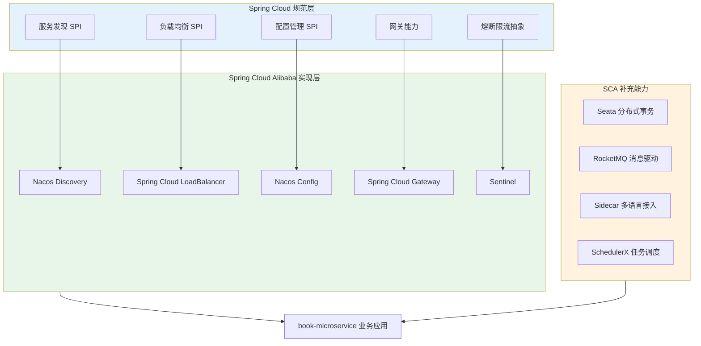
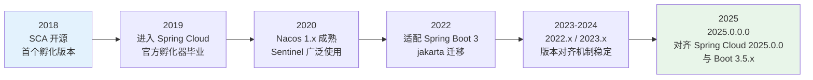
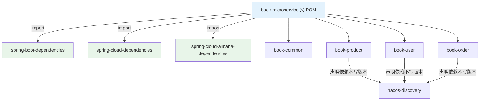
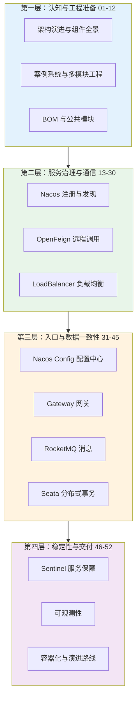

# Spring Cloud Alibaba简介

## 课程目标

- 理解 Spring Cloud Alibaba 的定位：它是 Spring Cloud 规范的实现与补充，而不是替代品
- 掌握 SCA 的演进脉络与各组件解决的问题
- 掌握 SCA、Spring Cloud、Spring Boot 三者的版本对应关系及其判断依据
- 掌握用 BOM 在父 POM 中统一管理依赖版本的写法
- 了解国内生产环境中 SCA 的常见组件组合与落地经验
- 建立本课程 52 节课的能力地图，明确每个模块的位置与目标

## 回顾与导入

上一课《微服务架构技术选型》通过八个维度和一棵决策树，把结论收敛到了 Spring Cloud Alibaba。但那时我们只说了「它合适」，没说「它是什么」。

初学者对 SCA 常有两种误解：

- **误解一：SCA 是另一个 Spring Cloud。** 于是会问「我该学 Spring Cloud 还是 Spring Cloud Alibaba」，好像两者要二选一。
- **误解二：SCA 就是 Nacos。** 于是把它当成一个注册中心组件，忽略了它其实覆盖了配置、限流、事务、消息等一整条链路。

这两种误解都会导致后面学得别扭：不知道该先学规范还是先学组件，也不知道某个注解到底来自哪个依赖。

本课把这三件事讲清楚：**SCA 是什么、由什么组成、版本怎么配**。这三件事打通之后，后面每一节课你都能准确回答「这个能力来自哪个 jar、为什么是这个版本」。

## SCA 的定位：规范的实现，不是规范之外的新东西

### 两句话定位

1. **Spring Cloud 是一套规范。** 它定义了「注册中心应该长什么样」「负载均衡应该提供什么接口」「网关应该具备哪些扩展点」，但不绑定具体实现。
2. **Spring Cloud Alibaba 是这套规范的一组实现，并补充了规范之外的能力。** 它用 Nacos 实现服务发现与配置管理，用 Sentinel 实现流量防护，用 Seata 补齐分布式事务，用 RocketMQ 补齐消息驱动。

换成一句更好记的话：**Spring Cloud 定标准，Spring Cloud Alibaba 供零件。**



### 一个具体例子：同一行注解，两份依赖

下面这段代码在 Spring Cloud 与 SCA 中写法完全一致，因为注解本身来自 Spring Cloud 规范包：

```java
@FeignClient(name = "book-product", path = "/api/products")
public interface ProductClient {

    @GetMapping("/{id}")
    Result<ProductVO> getById(@PathVariable("id") Long id);
}
```

差异只在依赖上：

| 层次 | 依赖 | 作用 |
| --- | --- | --- |
| 规范与注解 | `spring-cloud-starter-openfeign` | 提供 `@FeignClient` 注解与代理生成机制 |
| 实例来源 | `spring-cloud-starter-alibaba-nacos-discovery` | 让 Feign 能从 Nacos 拿到实例列表 |
| 选择实例 | `spring-cloud-starter-loadbalancer` | 在多个实例之间做选择 |

> **结论：** 你写的是 Spring Cloud 的代码，选的是 Spring Cloud Alibaba 的实现。两者是同一套编程模型的两面，不存在「学了这个就不用学那个」。

> **提示：** 这也解释了一个常见困惑：为什么有些注解在纯 Spring Cloud 项目里能编译通过却运行报错？因为注解来自规范包，而运行时缺少实现包。

### 与 Spring Cloud 版本的关系

| 关系 | 说明 |
| --- | --- |
| 版本跟随 | SCA 的版本号前半段与 Spring Cloud 保持一致，例如 2025.0.0.0 对应 Spring Cloud 2025.0.0 |
| 能力超集 | SCA 在规范实现之外增加了 Seata、RocketMQ、SchedulerX 等能力 |
| 不侵入 | SCA 不修改 Spring Cloud 的核心接口，只提供实现，因此可以与官方实现（如 Consul）按需替换 |
| 升级同步 | Spring Cloud 大版本升级时，SCA 需要发布对应的适配版本，不能跨代混用 |

## 演进时间线



| 阶段 | 关键变化 | 对使用者的影响 |
| --- | --- | --- |
| 孵化期 | 整合阿里内部中间件，形成统一的 Starter | 解决了「能不能用」的问题 |
| 成长期 | Nacos 1.x、Sentinel 1.x 稳定，控制台完善 | 注册中心与流控有了生产可用方案 |
| Boot 3 适配期 | 包名迁移到 `jakarta.*`，JDK 基线提到 17 | 旧教程代码大量失效，需要按新命名空间重写 |
| 版本对齐期 | 版本号与 Spring Cloud 严格对应，BOM 统一管理 | 选型从「猜兼容」变成「查表」 |
| 当前阶段 | 与 Boot 3.5.x、Spring Cloud 2025.0.0 配套 | 本课程使用的基线 |

> **注意：** 网上大量教程停留在 Boot 2.x 时代，代码里的 `javax.*`、`spring-cloud-starter-alibaba-nacos-discovery` 旧版本坐标都可能不适用。判断教程年代，先看它的 Spring Boot 版本。

## 组件矩阵

### 组件与一句话定位

| 组件 | 一句话定位 | 本课程是否展开 |
| --- | --- | --- |
| Nacos Discovery | 服务注册与发现，让服务按名字互相找到 | 是，13～21 |
| Nacos Config | 配置中心，让配置集中管理与动态生效 | 是，31～34 |
| Sentinel | 流量防护，限流、熔断、降级、热点参数控制 | 是，46～48 |
| Seata | 分布式事务，跨服务跨库的一致性保障 | 是，43～45 |
| RocketMQ | 消息驱动，异步解耦、削峰、事务消息 | 是，39～42 |
| Spring Cloud Gateway | API 网关，统一入口与路由、鉴权、限流 | 是，35～38 |
| Spring Cloud LoadBalancer | 客户端负载均衡，多实例之间的选择策略 | 是，27～30 |
| OpenFeign | 声明式远程调用，像调本地方法一样调远程接口 | 是，22～26 |
| Spring Cloud Alibaba Sidecar | 让非 Java 服务（如 Go、Python）接入 SCA 体系 | 否，仅定位说明 |
| SchedulerX | 分布式任务调度，替代单机定时任务的集中调度 | 否，仅定位说明 |
| 阿里云 OSS 集成 | 对象存储 Starter，简化文件上传下载 | 否，仅定位说明 |
| 阿里云 SMS 集成 | 短信服务 Starter | 否，仅定位说明 |

> **提示：** 表里「否」的组件并非不重要，而是它们属于云服务集成或非 Java 接入场景，与本书的图书管理系统主线关系较弱。需要时可以按官方文档直接接入。

### 组件在链路中的位置

| 链路环节 | 承担组件 | 说明 |
| --- | --- | --- |
| 请求入口 | Spring Cloud Gateway | 统一鉴权、限流、路由转发 |
| 服务寻址 | Nacos Discovery + LoadBalancer | 拿到实例列表并选出目标 |
| 服务调用 | OpenFeign | 声明式调用，承载超时与重试 |
| 配置下发 | Nacos Config | 启动拉取与运行时刷新 |
| 异步通信 | RocketMQ | 事件通知、削峰填谷 |
| 一致性保障 | Seata | 全局事务协调与分支回滚 |
| 稳定性防护 | Sentinel | 限流、熔断、降级 |
| 状态观测 | Micrometer Tracing + 生态 | 日志、指标、链路 |

## 版本对应关系

### 对应表

| Spring Cloud Alibaba | Spring Cloud | Spring Boot | JDK | Nacos Server | Sentinel Dashboard | Seata Server | RocketMQ |
| --- | --- | --- | --- | --- | --- | --- | --- |
| **2025.0.0.0** | **2025.0.0** | **3.5.x** | **17+** | **3.0.x** | **1.8.8** | **2.2.x** | **5.3.x** |
| 2023.0.x.x | 2023.0.x | 3.2.x | 17+ | 2.3.x | 1.8.x | 2.0.x | 5.x |
| 2022.0.x.x | 2022.0.x | 3.0.x | 17+ | 2.2.x | 1.8.x | 1.7.x | 5.x |
| 2021.0.x.x | 2021.0.x | 2.6.x / 2.7.x | 8+ | 2.x | 1.8.x | 1.5.x | 4.x |

本课程使用的组合：

| 组件 | 版本 |
| --- | --- |
| JDK | 17 |
| Spring Boot | 3.5.16 |
| Spring Cloud | 2025.0.0 |
| Spring Cloud Alibaba | 2025.0.0.0 |
| Nacos | 3.0.x |
| Sentinel Dashboard | 1.8.8 |
| Seata | 2.2.x |
| RocketMQ | 5.3.x |

### 判断依据：官方 wiki 的版本说明

上面这张表不是凭经验拼的，来源是 SCA 官方仓库 wiki 中的「版本说明」页。该页面的组织方式值得掌握，因为它决定了你以后如何自己查：

| 依据 | 怎么用 |
| --- | --- |
| 版本说明页按 SCA 版本分行 | 找到你用的 SCA 版本那一行，横向读出对应的 Spring Cloud 与 Boot 版本范围 |
| Spring Cloud 官方发布说明 | 每个 Spring Cloud 版本标注了它支持的 Boot 版本区间与 JDK 基线 |
| 各项目 Release Notes | Nacos、Sentinel、Seata、RocketMQ 的兼容性说明与破坏性变更 |
| BOM 中的实际版本 | 以父 POM 导入 BOM 后解析出的版本为准，比文档更可靠 |

> **注意：** BOM 里的版本是「适配验证过的版本」，不一定是最新版本。如果手动把某个组件升到更新的补丁版，可能跳出验证范围，需自行回归测试。以官方最新稳定版为准。

### 版本选择的三条原则

| 原则 | 说明 | 反例 |
| --- | --- | --- |
| 选 GA，不选 M/RC | 里程碑版本接口可能变更，不适合教学与生产 | 用 `-M1` 版本做课程基线 |
| 成套对齐，不跨代混用 | SCA、Cloud、Boot 三者必须来自同一代对应关系 | SCA 2025.0.0.0 配 Boot 3.2.x |
| 统一管理，不局部覆盖 | 子模块不写版本，升级只改父 POM 属性 | 某个模块自己写了 Nacos 版本 |

## BOM 依赖管理

### 为什么需要 BOM

多模块工程里，如果每个子模块各写版本，会出现三类问题：同一次构建解析出多份 Nacos 客户端（导致注册异常）、升级时改漏某个模块、新模块忘记写版本。

BOM（Bill of Materials）通过 `<dependencyManagement>` 统一声明版本，子模块只写 `groupId` 与 `artifactId`。



### 父 POM 片段

```xml
<properties>
    <java.version>17</java.version>
    <spring-boot.version>3.5.16</spring-boot.version>
    <spring-cloud.version>2025.0.0</spring-cloud.version>
    <spring-cloud-alibaba.version>2025.0.0.0</spring-cloud-alibaba.version>
</properties>

<dependencyManagement>
    <dependencies>
        <dependency>
            <groupId>org.springframework.boot</groupId>
            <artifactId>spring-boot-dependencies</artifactId>
            <version>${spring-boot.version}</version>
            <type>pom</type>
            <scope>import</scope>
        </dependency>
        <dependency>
            <groupId>org.springframework.cloud</groupId>
            <artifactId>spring-cloud-dependencies</artifactId>
            <version>${spring-cloud.version}</version>
            <type>pom</type>
            <scope>import</scope>
        </dependency>
        <dependency>
            <groupId>com.alibaba.cloud</groupId>
            <artifactId>spring-cloud-alibaba-dependencies</artifactId>
            <version>${spring-cloud-alibaba.version}</version>
            <type>pom</type>
            <scope>import</scope>
        </dependency>
    </dependencies>
</dependencyManagement>
```

关键点有三个：三个 BOM 的顺序不能颠倒（Boot 在前，Cloud 其次，SCA 最后，后导入的同名依赖会覆盖前面的）；必须写 `type` 为 `pom`、`scope` 为 `import`；不要在子模块重复导入。

### 子模块依赖声明

```xml
<dependencies>
    <dependency>
        <groupId>com.alibaba.cloud</groupId>
        <artifactId>spring-cloud-starter-alibaba-nacos-discovery</artifactId>
    </dependency>
    <dependency>
        <groupId>com.alibaba.cloud</groupId>
        <artifactId>spring-cloud-starter-alibaba-nacos-config</artifactId>
    </dependency>
    <dependency>
        <groupId>org.springframework.cloud</groupId>
        <artifactId>spring-cloud-starter-openfeign</artifactId>
    </dependency>
</dependencies>
```

三个依赖都没有写 `<version>`，版本来自父 POM 导入的 BOM。这也是「成套对齐」原则在代码层面的落地方式。

### 校验

```bash
# 确认 Nacos 客户端版本由 BOM 统一提供
mvn -q dependency:tree -Dincludes=com.alibaba.nacos

# 确认两个 Nacos 客户端版本一致
mvn -q dependency:tree -Dverbose -Dincludes=com.alibaba.cloud
```

| 现象 | 可能原因 | 处理 |
| --- | --- | --- |
| 依赖树出现两个 Nacos 客户端版本 | 某处显式写了版本，或引用了旧 Starter | 去掉显式版本，统一由 BOM 管理 |
| `NoClassDefFoundError: jakarta/...` | 引入了 Boot 2.x 时代的组件 | 升级到支持 Boot 3.x 的版本 |
| 启动时找不到自动配置类 | 版本不匹配或 Starter 名称写错 | 核对 BOM 版本与 Starter 坐标 |

## 国内生产实践与常见组合

### 常见组合

| 场景 | 典型组合 | 说明 |
| --- | --- | --- |
| 标准 Java 微服务 | SCA + Nacos + Sentinel + Gateway | 覆盖注册、配置、防护、入口，最常见 |
| 交易类系统 | 上述 + Seata + RocketMQ | 需要跨库一致性与异步解耦 |
| 高并发读多写少 | 上述 + Redis + 多级缓存 | 缓存不在 SCA 范围内，但与 SCA 常一起出现 |
| 已有 Dubbo 存量 | Dubbo 3 + Nacos + SCA 网关 | 保留 RPC 资产，注册中心统一到 Nacos |
| 多语言混合 | SCA + Sidecar + gRPC | Java 主线用 SCA，非 Java 服务通过 Sidecar 接入 |

### 落地经验

| 经验 | 说明 |
| --- | --- |
| 先把注册中心与配置中心跑稳 | 这两个是「所有服务都依赖」的基础设施，必须先做高可用 |
| 网关尽早引入但规则先简单 | 先做路由，再做鉴权，最后做限流；一次性配全容易把自己锁死 |
| Sentinel 规则要持久化 | 控制台配的规则默认存在内存，重启即失效，必须落 Nacos |
| Seata 只用在必要的链路上 | 全局事务开销明显，能靠业务补偿解决的不要用 AT |
| 版本升级排期独立 | 三件套升级是一次专项任务，不要和业务需求混在一个迭代 |

> **提示：** 国内团队常见的误区是「组件都装上就等于微服务了」。真正决定系统质量的，是拆分粒度、调用链设计、失败处理策略，组件只是把这些问题暴露得更明显。

## 本课程能力地图

52 节课按能力分成四个层次，逐层叠加：



| 模块 | 课时范围 | 核心产出 | 在案例系统上的落点 |
| --- | --- | --- | --- |
| 架构认知 | 01～08 | 能说清组件全景与选型依据，理解案例业务 | 画出图书管理系统的目标架构 |
| 工程准备 | 09～12 | 多模块工程可编译启动，公共模块与接口规范就绪 | book-common 与三个服务骨架 |
| 注册发现 | 13～21 | 三个服务注册到 Nacos，掌握分级模型与治理手段 | 8081/8082/8083 出现在服务列表 |
| 远程调用 | 22～26 | 订单服务通过 Feign 调用图书服务 | 下单时校验图书与库存 |
| 负载均衡 | 27～30 | 多实例轮询、自定义策略、超时重试与幂等 | 图书服务双实例灰度 |
| 配置中心 | 31～34 | 配置集中、隔离共享、动态刷新、安全治理 | 数据源与业务开关外置 |
| 网关 | 35～38 | 统一入口、断言过滤器、鉴权限流、动态路由 | 全量流量走 8080 |
| 消息 | 39～42 | 异步下单通知、顺序与事务消息、可靠性设计 | 下单成功后发库存扣减事件 |
| 分布式事务 | 43～45 | AT 模式落地，TCC/Saga/XA 选型 | 订单与库存的一致性保障 |
| 服务保障 | 46～48 | 限流、熔断、热点参数、规则持久化 | 大促时的流量防护 |
| 可观测性 | 49～50 | 链路追踪、日志关联、指标告警 | 一次下单请求的全链路视图 |
| 生产交付 | 51～52 | 容器化部署、架构演进路线 | 四个服务的镜像与发布 |

## 注意事项

- **SCA 不是 Spring Cloud 的替代品。** 学习顺序应当是「先懂规范要什么能力，再看 SCA 怎么实现」，否则容易把注解当成魔法。
- **版本号要按「代」理解。** `2025.0.0.0` 的最后一位是 SCA 自己的修订号，前三段与 Spring Cloud 对齐，不要把它当成四个独立的语义化版本段。
- **BOM 只能解决「版本一致」，解决不了「用法正确」。** 版本对了但配置错了，依然会出现注册不上、配置拉不到的问题。
- **教学环境与生产环境的 Nacos 形态不同。** 课程用单机模式上手，生产必须集群 + 外置数据库，详见《Nacos高可用集群搭建》。
- **Nacos 3.x 在控制台与鉴权默认值上有调整。** 遇到与旧教程不一致的界面或登录行为，先确认服务端版本，不要急着改代码。
- **Seata、RocketMQ 的版本要与服务端匹配。** 客户端与服务端跨大版本时，协议与配置项都可能不兼容。
- **升级三件套要做回归清单。** 至少覆盖：服务能否注册、配置能否拉取、Feign 能否调用、网关能否路由，四项都过再上线。

## 小结

本节课我们学习了：

1. **SCA 的定位**：Spring Cloud 定义规范，SCA 提供实现并补充能力，两者是同一套编程模型的两面，不存在替代关系。
2. **演进脉络**：从孵化期到版本对齐期，关键转折是 Boot 3 的 `jakarta` 迁移与版本对应机制的稳定。
3. **组件矩阵**：Nacos Discovery、Nacos Config、Sentinel、Seata、RocketMQ、Gateway、LoadBalancer、OpenFeign 是主线组件，Sidecar、SchedulerX、OSS、SMS 属于补充集成。
4. **版本对应关系**：以官方 wiki 的版本说明页为依据，SCA 2025.0.0.0 ↔ Spring Cloud 2025.0.0 ↔ Boot 3.5.x ↔ JDK 17+，组件版本按「适配范围内选 GA」的原则确定。
5. **BOM 的用法**：父 POM 按 Boot、Cloud、SCA 的顺序导入三个 BOM，子模块只声明坐标不写版本，并用 `dependency:tree` 校验。
6. **能力地图**：52 节课按「架构认知 → 工程准备 → 服务治理与通信 → 入口与一致性 → 稳定性与交付」四层展开，每一层都在图书管理系统上有明确落点。

## 作业

### 作业一：验证三件套的版本对应

1. 创建一个空的 Maven 工程，按本课的写法导入三个 BOM。
2. 引入 `spring-cloud-starter-alibaba-nacos-discovery`，用 `mvn dependency:tree` 打印完整依赖树。
3. 记录解析出的 Nacos 客户端、Feign、LoadBalancer 版本，并与本课对应表逐项核对，写出核对结论。

### 作业二：解释一段「能编译但跑不通」的代码

1. 写下你认为最可能出现的三种「注解存在但功能不生效」的场景（提示：命名空间、Starter 缺失、版本错配）。
2. 为每种场景各写一个最小复现步骤与预期报错信息。
3. 给出对应的修复方式，并说明为什么这样修。

### 作业三：绘制能力地图

1. 用一张图把你已经掌握的技术点，对应到本课程的四层能力地图上。
2. 标出你认为自己最薄弱的两个模块，并说明判断依据（例如「没接触过分布式事务」「只听说过链路追踪」）。
3. 为这两个模块各写一个可在两周内完成的学习动作与验收方式。
