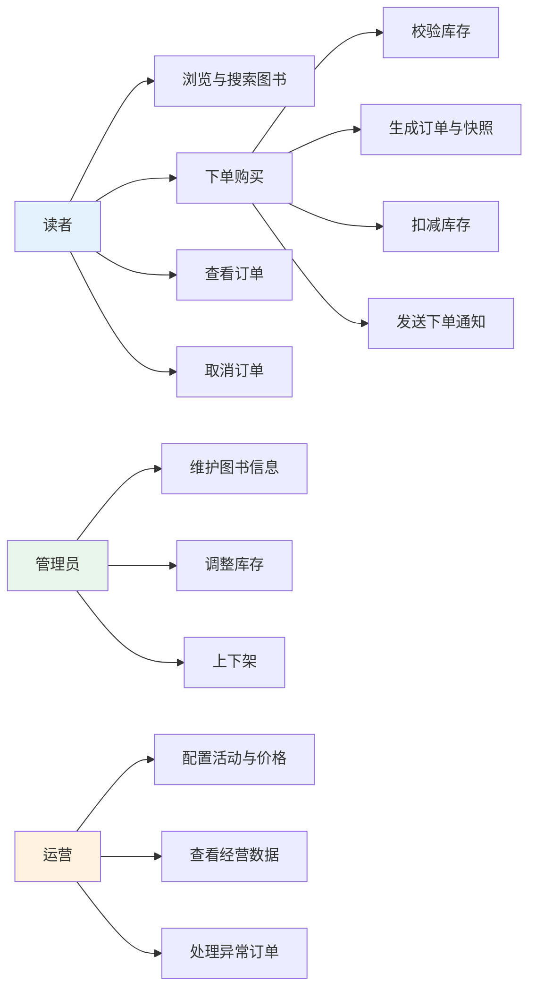
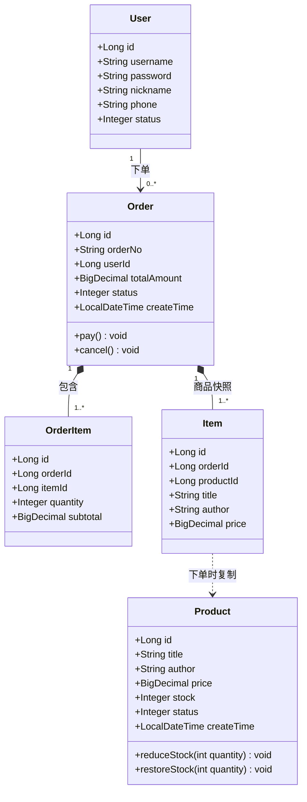
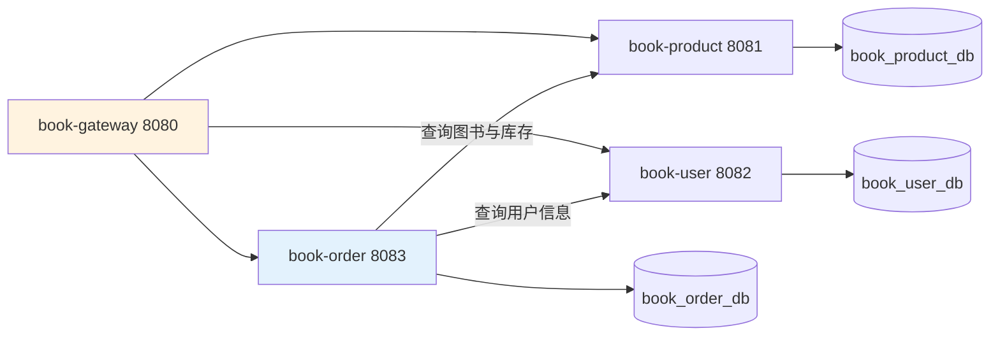
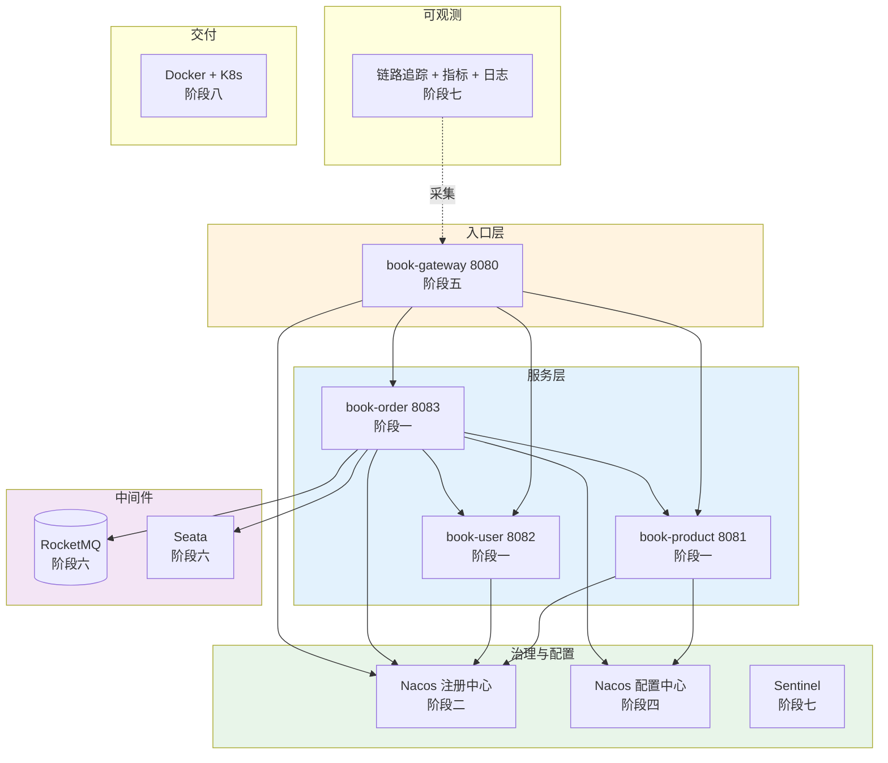

# 项目案例分析：图书管理系统

## 课程目标

- 理解贯穿课程的案例系统 book-microservice 的业务背景与目标
- 掌握三类角色（读者、管理员、运营）与核心用例的关系
- 掌握图书管理系统的领域模型设计，理解 `item` 商品快照的必要性
- 掌握按业务能力划分服务边界的方法，明确三个服务的职责、数据库、接口前缀与端口
- 能够读懂并复用本课的接口清单，理解接口幂等性的判定方式
- 理解非功能需求如何约束技术方案，掌握八阶段演进路线与各阶段对应的课时

## 回顾与导入

前四课我们完成了架构认知：单体的问题、微服务的特性、实施方法、核心组件与技术选型。这些内容都建立在抽象层面——我们知道要拆服务、要上注册中心、要加网关，但拆什么、上在哪里，还没有一个具体对象。

从本课开始，后面四十多节课都将围绕同一个系统展开：**图书管理系统 book-microservice**。选它作为案例，原因有三：

1. **业务足够熟悉。** 买书、下单、看库存，每个人都能立刻理解，不需要花时间解释领域知识，注意力可以集中在架构上。
2. **业务足够完整。** 有商品、有库存、有用户、有订单、有通知，天然覆盖「读多写少」与「写操作跨库」两类典型场景，能自然引出负载均衡、消息、分布式事务。
3. **规模足够可控。** 三个服务、五个核心表，既不会简单到没有治理问题，也不会复杂到淹没重点。

本课要交付的东西很具体：**一份可以直接照着写代码的案例说明书**。后面每一节课都会回到这份说明书上，标记「今天我们实现了哪一格」。

> **提示：** 本课不写代码，但要求你读懂每一个表和每一个接口。看不懂的地方先标记，后续课程会逐个落实。

## 业务背景

### 现状

系统目前是一个单体应用：一个 Spring Boot 工程，一个数据库 `book_db`，所有功能在同一个进程里，通过一个前端页面访问。

| 现状特征 | 具体表现 | 带来的问题 |
| --- | --- | --- |
| 单库单表 | 商品、用户、订单在一张库里 | 任何写操作都可能影响全局，故障影响面大 |
| 单进程部署 | 只有一个可执行 jar | 无法按模块扩容，秒杀时段只能整体加机器 |
| 同步调用 | 下单时串行扣库存、写订单、发通知 | 通知服务异常会直接导致下单失败 |
| 配置内嵌 | 配置散落在 `application.yml` | 改一次活动开关要发版 |
| 无统一入口 | 前端直连应用 | 鉴权、限流、审计各自为政 |

### 目标

| 目标 | 衡量方式 |
| --- | --- |
| 按业务能力拆分服务 | 商品、用户、订单可独立部署与扩容 |
| 数据按服务隔离 | 每个服务独占一个数据库，禁止跨库直连 |
| 核心链路可观测 | 一次下单请求可查到跨服务的完整调用链 |
| 关键操作可保障 | 秒杀类流量可限流，依赖故障可降级 |
| 交付可重复 | 一条流水线可产出全部服务镜像 |

### 业务规模（示意）

| 指标 | 量级（示意值） | 说明 |
| --- | --- | --- |
| 图书 SKU | 10 万级 | 商品数据变更频率低，读多写少 |
| 注册用户 | 100 万级 | 用户信息更新频率低 |
| 日均订单 | 万级 | 集中在促销时段 |
| 峰值下单 QPS | 数百级 | 促销时段出现短时尖峰 |
| 单均订单项 | 1～5 条 | 影响一次事务内写操作的数量 |

> **注意：** 上表是示意量级，用于说明「为什么需要限流与异步」，不代表任何真实系统数据。真实项目应在需求阶段与业务方共同确认。

## 角色与用例

### 三类角色

| 角色 | 关注点 | 典型操作 | 权限边界 |
| --- | --- | --- | --- |
| 读者（Reader） | 找书、买书、看订单 | 浏览图书、搜索、下单、支付、取消、查看订单 | 只能操作自己的订单与信息 |
| 管理员（Admin） | 图书数据与库存 | 新增/修改/下架图书、调整库存、查看销量 | 可操作商品与库存，不可查看用户隐私 |
| 运营（Operator） | 活动与数据 | 配置促销、查看经营看板、处理异常订单 | 可读数据，有限写权限 |

### 核心用例



### 用例说明

| 用例 | 触发者 | 前置条件 | 主流程 | 异常分支 |
| --- | --- | --- | --- | --- |
| 下单购买 | 读者 | 已登录、图书在售 | 校验库存 → 创建订单与快照 → 扣库存 → 发通知 | 库存不足回滚；扣减失败回滚；通知失败不回滚 |
| 取消订单 | 读者 | 订单为待支付状态 | 更新订单状态 → 回补库存 → 发通知 | 状态不合法直接拒绝 |
| 维护图书 | 管理员 | 具备管理权限 | 写入商品信息 → 更新缓存 | 书名重复、价格非法 |
| 调整库存 | 管理员 | 图书存在 | 覆盖或增量调整库存 | 库存不得为负 |
| 查看经营数据 | 运营 | 具备读取权限 | 聚合订单与商品数据 | 数据延迟可接受 |

> **结论：** 所有用例中，只有「下单购买」和「取消订单」是跨服务写操作，它们决定了后面要不要引入分布式事务。其余用例都在单一服务内部完成。

## 功能清单

| 功能模块 | 功能点 | 使用角色 | 所属服务 | 优先级 |
| --- | --- | --- | --- | --- |
| 图书管理 | 新增图书、修改图书、下架图书、按条件查询、详情查看 | 管理员、读者 | book-product | 高 |
| 库存 | 库存查询、扣减库存、回补库存、库存预警 | 管理员、系统 | book-product | 高 |
| 用户 | 注册、登录、查询资料、修改资料、禁用账号 | 读者、管理员 | book-user | 高 |
| 下单 | 创建订单、查询订单、取消订单、支付回调 | 读者、系统 | book-order | 高 |
| 通知 | 下单成功通知、取消通知、库存预警通知 | 系统 | book-order 发起 | 中 |
| 运营 | 活动配置、经营看板 | 运营 | 依赖三者数据 | 低 |

功能与服务的对应关系，直接决定了接口前缀与端口，下一节给出完整映射。

## 领域模型

### 模型关系



### 模型说明

| 对象 | 类型 | 所属服务 | 说明 |
| --- | --- | --- | --- |
| Product | 聚合根 | book-product | 商品与库存的载体，库存变更必须经过它 |
| User | 实体 | book-user | 账号信息，密码加密存储 |
| Order | 聚合根 | book-order | 订单主体，状态机驱动 |
| OrderItem | 实体 | book-order | 订单与商品快照的关联，承载数量与小计 |
| Item | 实体 | book-order | 商品快照，记录下单瞬间的书名、作者、价格 |

### 为什么必须有 Item 快照

这是本案例最关键的一个设计决策。假设没有快照，订单详情直接查 `product` 表：

| 问题 | 后果 |
| --- | --- |
| 商品改价 | 历史订单金额随商品价格变化，财务对不上账 |
| 商品下架或删除 | 订单详情查不到书名，用户看到的订单是空白 |
| 跨库查询 | 订单服务需要访问商品库，违反「服务不跨库」的原则 |
| 性能 | 每次查订单都要远程调用商品服务，列表页放大成 N+1 次调用 |

引入 `Item` 后，下单瞬间把书名、作者、价格复制一份存进 `book_order_db`，订单从此与商品解耦：商品怎么变，历史订单都不受影响。

> **提示：** 快照是「用空间换稳定」的典型手法。快照字段只增不改，不要试图让它与商品保持同步。

## 服务边界划分

### 拆分依据

按业务能力（Business Capability）划分，而不是按技术分层划分。三个服务各自对应一个限界上下文：

| 限界上下文 | 核心概念 | 变更频率 | 独立部署价值 |
| --- | --- | --- | --- |
| 商品与库存 | 图书、价格、库存 | 低 | 大促时独立扩容 |
| 用户 | 账号、身份 | 低 | 安全策略独立演进 |
| 订单 | 下单、支付、取消 | 高 | 高频迭代不影响商品与用户 |

### 服务边界表

| 服务 | 职责 | 数据库 | 接口前缀 | 端口 |
| --- | --- | --- | --- | --- |
| book-product | 图书商品 CRUD、库存查询与扣减、上下架 | book_product_db | `/api/products` | 8081 |
| book-user | 用户注册登录、资料查询与修改、账号状态 | book_user_db | `/api/users` | 8082 |
| book-order | 创建订单、订单查询、取消订单、商品快照 | book_order_db | `/api/orders` | 8083 |
| book-gateway | 统一入口、路由、鉴权、限流 | 无 | 对外统一前缀 `/api/**` | 8080 |
| book-common | 统一返回体、异常、常量、工具（不部署） | 无 | 无 | 无 |

### 服务依赖关系



依赖是单向的：订单依赖商品与用户，商品与用户互不依赖，也不依赖订单。这条规则要一直守住，否则会形成循环依赖，拆分就失去意义。

## 接口清单

### 图书服务（8081）

| 方法 | 路径 | 入参 | 出参 | 幂等性 |
| --- | --- | --- | --- | --- |
| GET | `/api/products/{id}` | 路径参数 id | `Result<ProductVO>` | 天然幂等 |
| GET | `/api/products` | 页码、关键字、作者 | `Result<PageResult<ProductVO>>` | 天然幂等 |
| POST | `/api/products` | `ProductCreateRequest` | `Result<Long>` | 非幂等，重复提交会产生多条 |
| PUT | `/api/products/{id}` | 路径 id + `ProductUpdateRequest` | `Result<Void>` | 幂等（同值覆盖） |
| DELETE | `/api/products/{id}` | 路径 id | `Result<Void>` | 幂等（软删除） |
| POST | `/api/products/{id}/stock/reduce` | 数量 + 请求号 | `Result<Void>` | 需幂等，靠请求号去重 |
| POST | `/api/products/{id}/stock/restore` | 数量 + 请求号 | `Result<Void>` | 需幂等，靠请求号去重 |

### 用户服务（8082）

| 方法 | 路径 | 入参 | 出参 | 幂等性 |
| --- | --- | --- | --- | --- |
| POST | `/api/users/register` | `UserRegisterRequest` | `Result<Long>` | 非幂等，用户名唯一约束兜底 |
| POST | `/api/users/login` | 用户名 + 密码 | `Result<LoginVO>`（含 token） | 非幂等但不产生副作用 |
| GET | `/api/users/{id}` | 路径 id | `Result<UserVO>` | 天然幂等 |
| PUT | `/api/users/{id}` | 路径 id + `UserUpdateRequest` | `Result<Void>` | 幂等（同值覆盖） |

### 订单服务（8083）

| 方法 | 路径 | 入参 | 出参 | 幂等性 |
| --- | --- | --- | --- | --- |
| POST | `/api/orders` | `OrderCreateRequest`（含 items 与 requestId） | `Result<OrderDetailVO>` | 需幂等，`requestId` 唯一索引 |
| GET | `/api/orders/{orderNo}` | 路径 orderNo | `Result<OrderDetailVO>` | 天然幂等 |
| GET | `/api/orders` | 用户 id + 分页 | `Result<PageResult<OrderSummaryVO>>` | 天然幂等 |
| PUT | `/api/orders/{orderNo}/cancel` | 路径 orderNo | `Result<Void>` | 需幂等，状态机保证只取消一次 |
| POST | `/api/orders/{orderNo}/pay-callback` | 支付流水号 + 金额 | `Result<Void>` | 需幂等，回调可能重放 |

### 统一返回体

所有接口返回 `com.example.common.result.Result<T>`，分页返回 `PageResult<T>`：

```json
{
  "code": "SUCCESS",
  "message": "ok",
  "data": {
    "orderNo": "SO20250101000001",
    "totalAmount": 128.00,
    "status": "WAIT_PAY",
    "items": [
      { "title": "分布式系统设计", "price": 128.00, "quantity": 1 }
    ]
  },
  "timestamp": 1767225600000
}
```

### 幂等性约定

| 判定 | 判断方法 | 处理策略 |
| --- | --- | --- |
| 天然幂等 | 查询类接口、同值覆盖类更新 | 无需额外处理 |
| 需业务幂等 | 扣库存、创建订单、支付回调 | 客户端传 `requestId`，服务端建唯一索引去重 |
| 状态机幂等 | 取消订单 | 只允许从「待支付」流转到「已取消」 |
| 无法幂等 | 纯新增且无业务唯一键 | 前端按钮防重 + 后端限流，并接受极小概率重复 |

> **注意：** 幂等不是「加个锁」就能解决的。判断标准是：**同一请求执行一次与执行 N 次，系统状态是否一致**。

## 非功能需求

| 类别 | 要求 | 约束的技术方案 |
| --- | --- | --- |
| 性能 | 商品详情 P99 小于 200ms；下单 P99 小于 500ms（示意目标） | 商品读走缓存；下单减少同步调用 |
| 并发 | 日常数十 QPS，促销峰值数百 QPS（示意值） | 无状态服务 + 多实例 + 网关限流 |
| 可用性 | 核心链路 99.9%（年停机约 8.8 小时） | 服务多实例、依赖降级、健康检测 |
| 一致性 | 订单与库存最终一致，允许秒级延迟 | 分布式事务或消息补偿 |
| 容量 | 订单表年增百万级 | 索引设计、历史数据归档 |
| 可观测 | 每次下单可查到跨服务链路 | Micrometer Tracing + 日志关联 |
| 安全 | 密码加密存储，接口鉴权，敏感信息脱敏 | JWT + BCrypt + 网关鉴权 |
| 可维护 | 服务独立发布，配置不发版可改 | Nacos + 独立流水线 |

### 非功能需求的取舍

| 冲突 | 取舍 | 理由 |
| --- | --- | --- |
| 一致性 vs 可用性 | 下单主链路优先保证「不超卖」，通知允许延迟 | 超卖是资损，通知延迟只是体验问题 |
| 性能 vs 一致性 | 商品详情容忍短暂不一致，走缓存 | 商品价格变更频率低，缓存收益远大于风险 |
| 成本 vs 可用性 | 三个服务各部署两实例，数据库先主备 | 在可控成本内消除单点 |

## 演进路线

### 八阶段与技术架构



### 阶段与课时对应

| 阶段 | 目标 | 关键动作 | 对应课时 |
| --- | --- | --- | --- |
| 一 工程搭建 | 多模块工程可编译启动 | 搭建 book-common/product/user/order，导入 BOM，建库建表 | 09～12 |
| 二 注册发现 | 三个服务可被按名找到 | 部署 Nacos，服务注册，掌握分级模型与元数据 | 13～21 |
| 三 远程调用 | 订单可调用商品与用户 | OpenFeign 声明接口，拦截器透传上下文 | 22～26 |
| 四 负载均衡 | 多实例可分流与灰度 | LoadBalancer 策略、权重、超时重试与幂等 | 27～30 |
| 五 配置中心 | 配置集中且可动态生效 | 配置隔离与共享、动态刷新、灰度发布 | 31～34 |
| 六 网关 | 统一入口与鉴权限流 | 路由断言、过滤器、鉴权、动态路由 | 35～38 |
| 七 消息与事务 | 异步解耦 + 跨库一致 | 下单事件、顺序与事务消息、可靠性、Seata | 39～45 |
| 八 保障与观测 | 扛得住、看得见、发得快 | Sentinel 规则、链路追踪、日志指标、容器化 | 46～51 |

> **提示：** 阶段三与阶段四在目录上是分开的（22～26 与 27～30），但实际开发中 Feign 与 LoadBalancer 是配套使用的，建议连着学完。

## 注意事项

- **不要提前动手写代码。** 本课的价值在于把表结构和接口先定下来。先写代码再补设计，接口会随实现漂移，后面拆分时改造成本成倍上升。
- **`item` 与 `order_item` 是两张表，不要合并。** 前者是商品快照（书名、作者、价格），后者是购买明细（数量、小计）。合并会导致「同一商品买两次」时快照冗余与数量语义混乱。
- **端口 8081/8082/8083 要固定下来。** 后续课程中所有配置、脚本、文档都基于这三个端口，随意调整会让示例对不上。
- **接口前缀按服务划分。** `/api/products`、`/api/users`、`/api/orders` 是网关路由的依据，不要出现「一个服务多个前缀」或「多个服务共用前缀」。
- **金额一律用 `BigDecimal`。** 用 `double` 计算金额，累计误差会在对账时暴露，且难以回溯。
- **幂等字段要在建表时就加上。** `requestId`、`orderNo` 的唯一索引属于表结构的一部分，后期补加需要清洗存量数据。
- **非功能目标是约束，不是承诺。** 表中的 P99 与 QPS 是示意值，用于指导技术选型；真实目标需在压测后调整。

## 小结

本节课我们学习了：

1. **案例系统的背景与目标**：从单体 `book_db` 演进到三个独立服务，解决单库耦合、无法按模块扩容、通知拖垮下单等问题。
2. **三类角色与核心用例**：读者、管理员、运营的关注点与权限边界；只有「下单」与「取消订单」是跨服务写操作，它们决定了分布式事务的必要性。
3. **功能清单与服务归属**：图书、库存、用户、下单、通知、运营六类功能，分别落在 book-product、book-user、book-order 上。
4. **领域模型与快照设计**：Product、User、Order、OrderItem、Item 五个对象的关系；`item` 快照让订单与商品解耦，避免改价影响历史订单。
5. **服务边界**：商品 8081 / 用户 8082 / 订单 8083 / 网关 8080，各自独立数据库与前缀，依赖单向、无循环。
6. **接口清单与幂等约定**：三类服务的接口方法、路径、出入参与幂等性判定标准；幂等的本质是「执行 N 次与执行一次，状态是否一致」。
7. **非功能需求与演进路线**：性能、并发、可用性、一致性、容量、可观测、安全七类要求，以及八阶段演进与课时的对应关系。

## 作业

### 作业一：补充一份接口清单

1. 为「库存预警」功能设计 2 个接口（查询预警列表、触发预警通知），填写方法、路径、入参、出参、幂等性。
2. 为「经营看板」设计 1 个聚合接口，说明它需要调用哪些服务、是否可以缓存、缓存多久。
3. 检查你自己设计的接口，指出其中哪些在网关层需要额外限流，并说明理由。

### 作业二：领域模型评审

1. 画出「取消订单」流程中涉及的实体状态变化（Order 状态、Product 库存、Item 快照）。
2. 论证：如果去掉 `item` 快照表，改为订单详情实时调用商品服务，会出现哪三个具体问题？请用业务场景举例。
3. 提出一个你认为是「过度设计」的模型扩展（例如加入购物车、优惠券），并说明在当前阶段为什么不该加。

### 作业三：非功能目标推导

1. 假设促销峰值下单量为 300 QPS，单次下单平均耗时 300ms，请推算至少需要多少个订单服务实例，并写出计算过程。
2. 以此为输入，说明网关限流阈值应该怎么设，以及为什么不能直接等于 300。
3. 写出你认为最容易被忽略的一条非功能需求，并给出验证方法。
