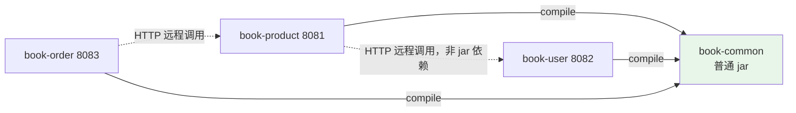
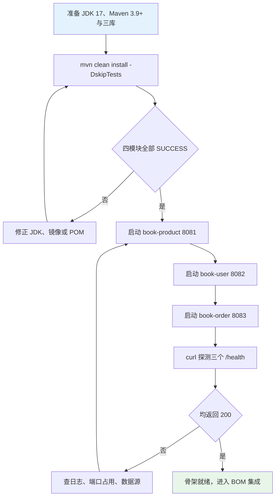

# 微服务架构与案例系统初始化

## 课程目标

- 理解多模块聚合工程在微服务项目中的组织方式与工程价值
- 掌握父 POM 的属性、模块声明与插件管理配置
- 掌握 book-common 与三个业务模块的 POM 依赖关系
- 能够按统一规范创建包结构、启动类与配置文件
- 掌握 PostgreSQL 三库初始化与字符集、时区设置
- 能够独立完成编译、启动与接口探测的全链路验证

## 回顾与导入

前八课完成了理论铺垫：单体系统的问题、微服务架构的特性与实施方法、核心组件、技术选型，以及 Spring Cloud Alibaba 技术全景与图书管理系统案例分析。理论讲完了，从本课开始动手。

落地的第一个问题往往不是"服务怎么调用"，而是"代码放哪里"。四个服务若各建一个独立 Maven 工程，会立刻出现三类麻烦：依赖版本各写各的、公共模块靠手工复制、一次改动要跑四个工程构建。

因此本课先建立**多模块聚合工程**（Multi-module Aggregation Project），再把骨架跑起来：POM、包结构、启动类、端口、数据源、日志、建库脚本。本课不引入任何 Spring Cloud Alibaba 组件，也不导入 BOM，交付一个"能编译、能启动、能访问"的空壳工程。

## 多模块聚合工程的组织方式

### 三种组织方式对比

| 方案 | 优点 | 缺点 | 适用场景 |
| --- | --- | --- | --- |
| 每服务一个独立工程 | 隔离彻底，可独立发版 | 版本分散，公共代码要发私有包 | 服务多、有制品库 |
| 单工程单模块，按包分服务 | 建工程最快 | 无法独立部署 | 原型验证 |
| 多模块聚合工程（本课程） | 一次构建全量编译，版本集中 | 需理解聚合与继承 | 共用技术基线 |

### 聚合与继承是两套机制

`<modules>` 解决"一次构建哪些模块"，`<parent>` 解决"配置从哪里继承"。两者经常同时出现，但职责不同：聚合决定构建范围与顺序，继承决定属性、插件与依赖管理从哪里来。Maven 由聚合关系推导顺序，因此 book-common 必须排在三个业务模块之前。

### 目标目录结构

```text
book-microservice/
├── pom.xml                     # 父 POM：packaging=pom
├── book-common/
│   ├── pom.xml
│   └── src/main/java/com/example/common/    # result/ exception/ constant/ util/
├── book-product/
│   ├── pom.xml
│   └── src/main/
│       ├── java/com/example/product/        # 启动类 + controller/ service/ mapper/ model/
│       └── resources/application.yml
├── book-user/
│   ├── pom.xml
│   └── src/main/java/com/example/user/ProductUserApplication.java
└── book-order/
    ├── pom.xml
    └── src/main/java/com/example/order/BookOrderApplication.java
```

> **提示：** 工程路径不要包含中文或空格，否则 Maven 与 `java -jar` 读取资源时易乱码。

## 父 POM：一个文件管住全工程

### 完整配置

这段代码解决统一 Java 与编码、声明四个子模块、集中管理插件版本三件事。它**不导入任何 BOM**，因此子模块的外部依赖暂时要显式写版本号，这是刻意的过渡设计。

```xml
<?xml version="1.0" encoding="UTF-8"?>
<project xmlns="http://maven.apache.org/POM/4.0.0"
         xmlns:xsi="http://www.w3.org/2001/XMLSchema-instance"
         xsi:schemaLocation="http://maven.apache.org/POM/4.0.0
         http://maven.apache.org/xsd/maven-4.0.0.xsd">
    <modelVersion>4.0.0</modelVersion>

    <groupId>com.example</groupId>
    <artifactId>book-microservice</artifactId>
    <version>1.0.0-SNAPSHOT</version>
    <packaging>pom</packaging>

    <properties>
        <java.version>17</java.version>
        <maven.compiler.source>17</maven.compiler.source>
        <maven.compiler.target>17</maven.compiler.target>
        <project.build.sourceEncoding>UTF-8</project.build.sourceEncoding>

        <!-- 技术栈基线：本课只定义变量，下一课由 BOM 消费 -->
        <spring-boot.version>3.5.16</spring-boot.version>
        <spring-cloud.version>2025.0.0</spring-cloud.version>
        <spring-cloud-alibaba.version>2025.0.0.0</spring-cloud-alibaba.version>
        <mybatis-plus.version>3.5.17</mybatis-plus.version>
        <postgresql.version>42.7.4</postgresql.version>
    </properties>

    <modules>
        <module>book-common</module>
        <module>book-product</module>
        <module>book-user</module>
        <module>book-order</module>
    </modules>

    <build>
        <pluginManagement>
            <plugins>
                <plugin>
                    <groupId>org.apache.maven.plugins</groupId>
                    <artifactId>maven-compiler-plugin</artifactId>
                    <version>3.13.0</version>
                    <configuration>
                        <source>${java.version}</source>
                        <target>${java.version}</target>
                        <encoding>UTF-8</encoding>
                    </configuration>
                </plugin>
                <plugin>
                    <groupId>org.springframework.boot</groupId>
                    <artifactId>spring-boot-maven-plugin</artifactId>
                    <version>${spring-boot.version}</version>
                    <executions>
                        <execution>
                            <goals>
                                <goal>repackage</goal>
                            </goals>
                        </execution>
                    </executions>
                </plugin>
            </plugins>
        </pluginManagement>
    </build>
</project>
```

### 关键配置说明

| 配置 | 作用 | 易错点 |
| --- | --- | --- |
| `packaging=pom` | 只聚合与传配置，不产 jar | 漏写则无法声明子模块 |
| `<modules>` | 声明聚合模块并推导顺序 | 目录名与取值不一致会找不到模块 |
| `java.version` 与编译参数 | 统一编译级别为 17 | 只写 `java.version`，IDE 退回 1.8 |
| `pluginManagement` | 只声明版本与默认配置 | 误以为写了就会执行 |
| `repackage` 绑定 | 把普通 jar 重打成可执行 fat jar | 漏配后 `java -jar` 报无主清单属性 |

> **注意：** 本课程没有继承 `spring-boot-starter-parent`，而是自建 `pluginManagement`（企业父 POM 常已是内部规范工程）。代价是必须自己绑定 `repackage`，否则 `mvn package` 产出的只是普通 jar。

## 四个模块的 POM 骨架

### 模块职责与打包方式

| 模块 | 包名 | 打包 | 端口 | 数据库 | 职责 |
| --- | --- | --- | --- | --- | --- |
| book-common | com.example.common | jar | - | - | 统一响应、异常、常量、工具 |
| book-product | com.example.product | jar 可执行 | 8081 | book_product_db | 图书商品、库存 |
| book-user | com.example.user | jar 可执行 | 8082 | book_user_db | 用户信息 |
| book-order | com.example.order | jar 可执行 | 8083 | book_order_db | 订单、订单项、商品快照 |

判断"可执行"的标准：POM 声明 `spring-boot-maven-plugin` 且模块含启动类；book-common 两者都没有，只产普通 jar。

### book-common 的 POM

公共模块本课不引入外部依赖。此时声明 `spring-boot-starter-web` 又没有 BOM 管理，三个业务模块就得跟着对齐版本；下一课导入 BOM 后再补齐 web、validation、lombok、hutool。

```xml
<?xml version="1.0" encoding="UTF-8"?>
<project xmlns="http://maven.apache.org/POM/4.0.0"
         xmlns:xsi="http://www.w3.org/2001/XMLSchema-instance"
         xsi:schemaLocation="http://maven.apache.org/POM/4.0.0
         http://maven.apache.org/xsd/maven-4.0.0.xsd">
    <modelVersion>4.0.0</modelVersion>

    <parent>
        <groupId>com.example</groupId>
        <artifactId>book-microservice</artifactId>
        <version>1.0.0-SNAPSHOT</version>
    </parent>

    <artifactId>book-common</artifactId>
    <packaging>jar</packaging>
</project>
```

`<parent>` 不写 `<relativePath>` 时默认指向上一级 `pom.xml`，本工程结构正好符合，可以省略。

### book-product 的 POM

业务模块需要三样东西：内部模块依赖、Web 运行能力、数据访问能力。三个服务 POM 结构完全一致，只有坐标不同。

```xml
<?xml version="1.0" encoding="UTF-8"?>
<project xmlns="http://maven.apache.org/POM/4.0.0"
         xmlns:xsi="http://www.w3.org/2001/XMLSchema-instance"
         xsi:schemaLocation="http://maven.apache.org/POM/4.0.0
         http://maven.apache.org/xsd/maven-4.0.0.xsd">
    <modelVersion>4.0.0</modelVersion>

    <parent>
        <groupId>com.example</groupId>
        <artifactId>book-microservice</artifactId>
        <version>1.0.0-SNAPSHOT</version>
    </parent>

    <artifactId>book-product</artifactId>
    <packaging>jar</packaging>

    <dependencies>
        <!-- 内部模块必须写版本 -->
        <dependency>
            <groupId>com.example</groupId>
            <artifactId>book-common</artifactId>
            <version>${project.version}</version>
        </dependency>
        <dependency>
            <groupId>org.springframework.boot</groupId>
            <artifactId>spring-boot-starter-web</artifactId>
            <version>${spring-boot.version}</version>
        </dependency>
        <dependency>
            <groupId>com.baomidou</groupId>
            <artifactId>mybatis-plus-spring-boot3-starter</artifactId>
            <version>${mybatis-plus.version}</version>
        </dependency>
        <dependency>
            <groupId>org.postgresql</groupId>
            <artifactId>postgresql</artifactId>
            <version>${postgresql.version}</version>
            <scope>runtime</scope>
        </dependency>
    </dependencies>

    <build>
        <plugins>
            <!-- 只声明坐标，版本由父 POM 提供 -->
            <plugin>
                <groupId>org.springframework.boot</groupId>
                <artifactId>spring-boot-maven-plugin</artifactId>
            </plugin>
        </plugins>
    </build>
</project>
```

`book-user` 与 `book-order` 把 artifactId 换成对应值即可，其余内容完全相同；端口与库名在 `application.yml` 中区分。这是聚合工程的直接好处：新增服务只改几行。

### 依赖关系视图



虚线要特别注意：**服务之间不能通过 Maven 依赖互相引用**，否则编译期与发布期被绑死，独立部署能力随之消失。

## 包结构与启动类

### 三个启动类

启动类必须位于包名根上，`@SpringBootApplication` 的组件扫描才能覆盖子包。

```java
package com.example.product;

import org.mybatis.spring.annotation.MapperScan;
import org.springframework.boot.SpringApplication;
import org.springframework.boot.autoconfigure.SpringBootApplication;

@SpringBootApplication
@MapperScan("com.example.product.mapper")
public class BookProductApplication {

    public static void main(String[] args) {
        SpringApplication.run(BookProductApplication.class, args);
    }
}
```

`@MapperScan` 指定 Mapper 接口所在包，MyBatis-Plus 为该包下的接口生成代理；漏配时注入 Mapper 会报 "no qualifying bean of type ...Mapper"。

```java
package com.example.user;

// import 与上例相同，仅扫描包与类名不同
@SpringBootApplication
@MapperScan("com.example.user.mapper")
public class ProductUserApplication {
    public static void main(String[] args) {
        SpringApplication.run(ProductUserApplication.class, args);
    }
}
```

```java
package com.example.order;

// import 与上例相同
@SpringBootApplication
@MapperScan("com.example.order.mapper")
public class BookOrderApplication {
    public static void main(String[] args) {
        SpringApplication.run(BookOrderApplication.class, args);
    }
}
```

> **提示：** 类名沿用案例约定；真正区分服务的是包名、端口与数据库。

### book-common 的包结构

公共模块只放 `result/`、`exception/`（第 12 课实现）、`constant/`、`util/` 四类内容。本课只建空目录——公共模块一旦堆积业务代码就会变成第二个单体。

### 端口与应用名

```yaml
server:
  port: 8081

spring:
  application:
    name: book-product
  datasource:
    driver-class-name: org.postgresql.Driver
    url: jdbc:postgresql://localhost:5432/book_product_db?currentSchema=public
    username: postgres
    password: postgres

mybatis-plus:
  configuration:
    map-underscore-to-camel-case: true
```

| 配置项 | 说明 |
| --- | --- |
| `spring.application.name` | 服务名，Nacos 注册与配置中心 dataId 都依赖它，须与模块名一致 |
| `server.port` | 三服务端口必须不同：8081 / 8082 / 8083 |
| `spring.datasource.url` | 每个服务连自己的库，禁止跨库直连 |
| `map-underscore-to-camel-case` | `create_time` 自动映射到 `createTime` |

另两个服务把 `port`、`name`、库名改为 8082 / `book-user` / `book_user_db` 与 8083 / `book-order` / `book_order_db`，其余不变。

## 数据库初始化

### 创建三个数据库

每个服务拥有独立数据库，以下脚本用 postgres 用户执行一次。

```sql
CREATE DATABASE book_product_db WITH ENCODING = 'UTF8' TEMPLATE = template0;
CREATE DATABASE book_user_db    WITH ENCODING = 'UTF8' TEMPLATE = template0;
CREATE DATABASE book_order_db   WITH ENCODING = 'UTF8' TEMPLATE = template0;

ALTER DATABASE book_product_db SET timezone TO 'Asia/Shanghai';
ALTER DATABASE book_user_db    SET timezone TO 'Asia/Shanghai';
ALTER DATABASE book_order_db   SET timezone TO 'Asia/Shanghai';

ALTER DATABASE book_product_db SET client_encoding TO 'UTF8';
ALTER DATABASE book_user_db    SET client_encoding TO 'UTF8';
ALTER DATABASE book_order_db   SET client_encoding TO 'UTF8';
```

### 编码与时区说明

| 设置 | 建议值 | 原因 |
| --- | --- | --- |
| 数据库编码 | UTF8 | 与 Java 侧一致，中文书名不会变成问号 |
| 模板库 | template0 | 只有基于 template0 才能在建库时指定编码 |
| 时区 | Asia/Shanghai | 库级时区决定 `now()` 的解释，避免与 JVM 错位 |
| 客户端编码 | UTF8 | 防止 JDBC 会话层再次转码 |

> **注意：** 报 encoding incompatible 说明漏了 `TEMPLATE = template0`；报 invalid locale 说明 `LC_COLLATE` 写了系统不支持的组合（Windows 版常无 `zh_CN.UTF-8`）。

验证连接：

```bash
psql -U postgres -d book_product_db -c "select current_database(), current_setting('timezone');"
```

预期返回 `book_product_db` 与 `Asia/Shanghai`；通过后再启动服务，可把库问题与应用问题分开。

## 日志与 profile 约定

### 配置文件拆分

配置按环境拆成 `application.yml`（通用）、`application-dev.yml`（本地库与 SQL 日志）、`application-prod.yml`（口令走环境变量，只留占位），复杂日志滚动另建 `logback-spring.xml`。所有文件均可入仓，但不得包含真实口令。

```yaml
spring:
  profiles:
    active: dev
```

生产部署用 `java -jar book-product/target/book-product-1.0.0-SNAPSHOT.jar --spring.profiles.active=prod` 指定环境，命令行优先级高于配置文件，避免把环境写死在 jar 里。

### 统一日志规则

控制台带时间、线程、级别与 traceId 占位；日志按服务名分文件，避免互相覆盖；根级别 `info`，业务包 `debug`，生产由配置中心统一下调。

```yaml
logging:
  level:
    root: info
    com.example: debug
  file:
    name: logs/${spring.application.name}.log
  logback:
    rollingpolicy:
      max-file-size: 100MB
      max-history: 15
```

## 启动验证

### 完整验证流程



### 编译安装

```bash
mvn -v
mvn clean install -DskipTests
```

四个模块按依赖顺序成功：

```text
[INFO] Reactor Summary for book-microservice 1.0.0-SNAPSHOT:
[INFO] book-microservice .................. SUCCESS [  0.103 s]
[INFO] book-common ........................ SUCCESS [  1.204 s]
[INFO] book-product ....................... SUCCESS [  2.517 s]
[INFO] book-user .......................... SUCCESS [  2.106 s]
[INFO] book-order ......................... SUCCESS [  2.284 s]
[INFO] BUILD SUCCESS
```

只构建某模块及其依赖时加 `-pl` 与 `-am`，例如 `mvn -pl book-product -am clean package -DskipTests`。

### 准备探测接口

```java
package com.example.product.controller;

import org.springframework.web.bind.annotation.GetMapping;
import org.springframework.web.bind.annotation.RequestMapping;
import org.springframework.web.bind.annotation.RestController;

@RestController
@RequestMapping("/health")
public class HealthController {

    @GetMapping
    public String health() {
        return "book-product is running";
    }
}
```

book-user 与 book-order 在各自 `controller` 包下创建同名类，返回文案换成自己的服务名。

### 启动与探测

```bash
# 运行可执行 jar
java -jar book-product/target/book-product-1.0.0-SNAPSHOT.jar

# 或用 Spring Boot 插件（自动带上模块依赖）
mvn -pl book-product spring-boot:run
```

```bash
# Windows PowerShell 中 curl 是 Invoke-WebRequest 别名，需写 curl.exe
curl.exe -i http://localhost:8081/health
curl.exe -i http://localhost:8082/health
curl.exe -i http://localhost:8083/health
```

```text
HTTP/1.1 200
Content-Type: text/plain;charset=UTF-8

book-product is running
```

三个服务均返回 200，说明编译、启动、数据源三条链路都已打通；数据源异常时应用通常停不到 `Started` 那一行。

## 常见问题排查

| 现象 | 可能原因 | 排查与解决 |
| --- | --- | --- |
| `invalid target release: 17` | 运行 Maven 的 JDK 低于 17 | `mvn -v` 看版本，`JAVA_HOME` 指向 JDK 17 后重启终端 |
| 依赖下载卡住或超时 | 未配置国内镜像 | `~/.m2/settings.xml` 配镜像后重新构建 |
| `Port 8081 was already in use` | 上次实例未关闭 | `netstat -ano \| findstr :8081` 找 PID，`Stop-Process -Id <PID>` |
| 控制台中文乱码 | 源码、编译器、终端编码不一致 | POM 设 UTF-8，IDEA 全改 UTF-8，终端 `chcp 65001` |
| `password authentication failed` | 口令错或认证方式不匹配 | 重设口令；`pg_hba.conf` 用 `scram-sha-256` 后 reload |
| `no qualifying bean of type ...Mapper` | 漏写 `@MapperScan` | 扫描包是否指向本模块 `mapper` 包 |

## 注意事项

1. **父 POM 的 packaging 必须是 pom**：否则既不能聚合模块，也无法被继承。
2. **子模块不要重复声明 `<version>`**：版本继承自父 POM，重复声明会在升级时留下隐患。
3. **内部模块依赖必须写 `${project.version}`**：book-common 不在任何 BOM 中，省略版本直接构建失败。
4. **本课的显式版本号是过渡方案**：web、MyBatis-Plus、驱动版本下一课由 BOM 接管后移除。
5. **每个服务独占数据库**：跨库直连在拆分后立刻演变为分布式事务问题，边界第一天就要立住。
6. **时区在库级别统一**：库级 `timezone` 须与应用侧 `spring.jackson.time-zone` 一致，否则时间差 8 小时。
7. **服务之间不要用 Maven 依赖互引**：需要数据走远程调用，jar 依赖会让独立部署失效。

## 小结

本节课我们学习了：

1. **聚合工程的价值**：统一构建与版本基线；`<modules>` 管构建范围与顺序，`<parent>` 管配置继承。
2. **父 POM 配置**：属性、模块声明、编译与 Boot 插件的 `pluginManagement`。
3. **四个模块的 POM**：book-common 只产普通 jar；三个业务模块依赖它并绑定 `repackage`。
4. **启动类与配置**：启动类位于包根；8081/8082/8083 三端口、三个独立库、开启下划线转驼峰。
5. **数据库与验证**：基于 `template0` 建 UTF8 库并设时区，用 `mvn clean install`、`java -jar`、`curl` 验证。

## 作业

### 作业一：搭建并验证聚合工程

1. 创建父工程与四个子模块，编写 properties、modules 与 pluginManagement。
2. 执行 `mvn clean install -DskipTests`，记录四个模块的构建顺序。
3. 删除 book-common 的 `<parent>` 段落后重新构建，记录报错再恢复。
4. 画出模块依赖图，标注聚合、继承、依赖三类关系。

### 作业二：数据库与启动验证

1. 执行建库脚本，用 `psql` 验证三个库的编码与时区。
2. 启动三个服务，用 `curl` 探测 `/health`，记录状态码与响应体。
3. 把 book-user 端口改为 8081，观察报错并说明原因。