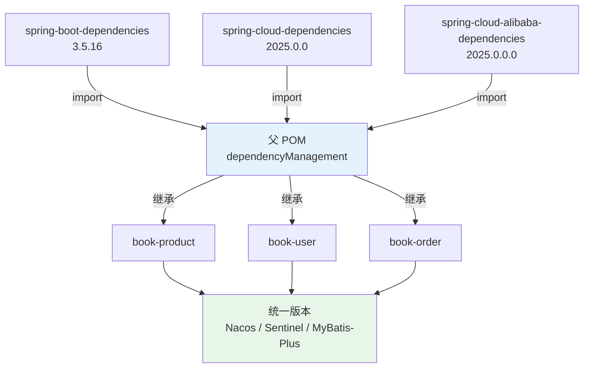
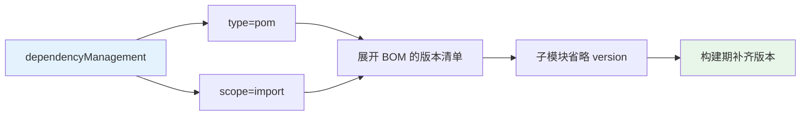
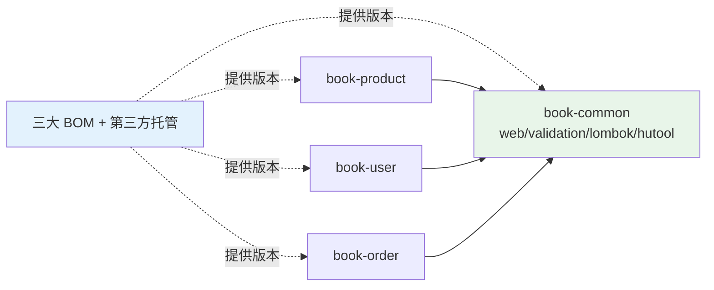

# Spring Cloud Alibaba技术栈集成

## 课程目标

- 理解 BOM 在依赖仲裁中的作用与生效机制
- 掌握 dependencyManagement 与 dependencies 的区别
- 掌握 Spring Cloud Alibaba、Spring Cloud、Spring Boot 的版本对应关系
- 掌握父 POM 导入三大 BOM 的写法与声明顺序
- 掌握子模块依赖矩阵与"不写版本号"的声明规范
- 能够用 `dependency:tree` 与 `effective-pom` 验证版本裁决结果
- 能够用 IDEA HTTP Request 验证三个服务可用

## 回顾与导入

上一课的工程已经能编译、能启动，但版本号是散落着写的：web 写 `${spring-boot.version}`，MyBatis-Plus 写 `${mybatis-plus.version}`，驱动写死 `42.7.4`。三个服务各写一遍，升级时逐个改，漏改一个就会出现模块间版本不一致。

更麻烦的是接下来要引入 Nacos、OpenFeign、Sentinel、Seata 等几十个组件，它们对 Spring Boot 与 Spring Cloud 的版本有硬约束。手工挑版本的结果往往不是编译失败，而是运行时 `NoSuchMethodError`、`ClassNotFoundException`——排查成本远高于编译错误。

BOM 就是解决这个问题的标准机制：把一组经过验证的组件版本固化在一份 pom 里，子模块只声明坐标、不写版本。本课把三大 BOM 导入父 POM，把散落的版本号全部收走。

先看显式写法具体带来哪些问题：

| 显式版本的问题 | 具体表现 | 后果 |
| --- | --- | --- |
| 版本漂移 | 各模块引用了不同小版本 | 运行时方法签名不匹配 |
| 升级成本高 | 改组件要全工程搜索替换 | 容易漏改、回归范围大 |
| 兼容性靠猜 | 手工组合 SCA 与 Spring Cloud 版本 | 启动即报错或行为异常 |
| 新人无约束 | 随手写一个"能用"的版本 | 技术栈长期不可控 |

## 为什么需要 BOM

### BOM 的作用

**BOM（Bill of Materials）** 是一份只做版本管理的 pom：它本身不引入任何 jar，只在 `<dependencyManagement>` 中声明一批组件的推荐版本。父 POM 用 `import` 把它展开，子模块声明依赖时就可以省略版本。



### 三种版本管理方式对比

| 方案 | 优点 | 缺点 | 适用场景 |
| --- | --- | --- | --- |
| 每个模块写死版本 | 直观，无需理解 BOM | 版本分散，冲突不可控 | 单模块小工程 |
| 继承 spring-boot-starter-parent | 开箱即用，插件配置齐全 | 与公司统一父 POM 冲突，只能单继承 | 纯 Spring Boot 项目 |
| 父 POM import BOM（本课程） | 版本集中、可叠加、不占用继承位 | 需理解 import 与声明顺序 | 多模块微服务工程 |

### BOM 如何生效

BOM 生效分两步：父 POM 解析时把 import 的 BOM 内容展开进自己的 `dependencyManagement`；子模块构建时，Maven 在依赖解析阶段用这份清单补齐缺失的版本号。因此**版本仲裁发生在构建期**，与代码无关，也不会写进源码。

## dependencyManagement 与 dependencies

### 两者的区别

| 维度 | `dependencyManagement` | `dependencies` |
| --- | --- | --- |
| 是否引入 jar | 不引入，只声明版本 | 真正引入依赖 |
| 作用范围 | 当前 POM 及其所有子模块 | 仅当前模块 |
| 版本号 | 在这里定义 | 通常省略，由管理清单补齐 |
| 典型用法 | 导入 BOM、统一第三方版本 | 声明实际使用的组件 |

### import scope 的三个条件

导入 BOM 必须同时满足三点，缺一个都不生效：

- 位置：写在父 POM 的 `<dependencyManagement>` 内
- 类型：`<type>pom</type>`
- 范围：`<scope>import</scope>`



> **注意：** 被管理不等于被引入。写在 `dependencyManagement` 里的组件不会出现在依赖树中，只有子模块在 `<dependencies>` 里声明后才真正下载。想升级版本却"没生效"，先检查子模块是否手写了 `<version>`，手写会覆盖管理值。

## 版本对应关系

### 版本矩阵

Spring Cloud Alibaba 的版本号第二段与 Spring Cloud 对齐，第三段与 Spring Boot 的主次版本对齐。三者必须成套使用。

| 组件 | 版本 | 说明 |
| --- | --- | --- |
| Spring Cloud Alibaba | 2025.0.0.0 | 本课程基线，对应 Spring Cloud 2025.0.0 |
| Spring Cloud | 2025.0.0 | 提供 OpenFeign、LoadBalancer、Gateway |
| Spring Boot | 3.5.16 | 要求 JDK 17+ |
| Nacos | 3.x（默认 3.0.x） | 注册中心与配置中心 |
| Sentinel | 1.8.8 | 控制台与客户端版本保持一致 |
| Seata | 2.2.x | 分布式事务 |
| RocketMQ | 5.3.x | 消息中间件 |

### 版本选择原则

| 原则 | 说明 |
| --- | --- |
| 优先 GA 版本 | 不用 M 里程碑或 RC 候选版本 |
| 严格成套 | SCA、Spring Cloud、Spring Boot 不跨版本混搭 |
| 与 JDK 匹配 | Boot 3.x 只支持 JDK 17 及以上 |
| 全工程统一 | 所有模块共用同一组 BOM |
| 跟随团队基线 | 与公司现有项目保持一致，减少运维差异 |

## 父 POM 导入三大 BOM

### 完整配置

在上一课父 POM 的基础上增加 `<dependencyManagement>`，把三个 BOM 与两个第三方组件纳入统一管理；同时删除子模块里手写的版本号。

```xml
<!-- 以下两段位于父 POM 的 <project> 内 -->
<properties>
    <java.version>17</java.version>
    <maven.compiler.source>17</maven.compiler.source>
    <maven.compiler.target>17</maven.compiler.target>
    <project.build.sourceEncoding>UTF-8</project.build.sourceEncoding>

    <spring-boot.version>3.5.16</spring-boot.version>
    <spring-cloud.version>2025.0.0</spring-cloud.version>
    <spring-cloud-alibaba.version>2025.0.0.0</spring-cloud-alibaba.version>
    <mybatis-plus.version>3.5.17</mybatis-plus.version>
    <hutool.version>5.8.28</hutool.version>
</properties>
```

接着导入三个 BOM 并托管第三方组件：

```xml
<dependencyManagement>
    <dependencies>
        <dependency>
            <groupId>org.springframework.boot</groupId>
            <artifactId>spring-boot-dependencies</artifactId>
            <version>${spring-boot.version}</version>
            <type>pom</type>
            <scope>import</scope>
        </dependency>
        <dependency>
            <groupId>org.springframework.cloud</groupId>
            <artifactId>spring-cloud-dependencies</artifactId>
            <version>${spring-cloud.version}</version>
            <type>pom</type>
            <scope>import</scope>
        </dependency>
        <dependency>
            <groupId>com.alibaba.cloud</groupId>
            <artifactId>spring-cloud-alibaba-dependencies</artifactId>
            <version>${spring-cloud-alibaba.version}</version>
            <type>pom</type>
            <scope>import</scope>
        </dependency>

        <!-- BOM 未覆盖的第三方组件，在此单独托管 -->
        <dependency>
            <groupId>com.baomidou</groupId>
            <artifactId>mybatis-plus-spring-boot3-starter</artifactId>
            <version>${mybatis-plus.version}</version>
        </dependency>
        <dependency>
            <groupId>cn.hutool</groupId>
            <artifactId>hutool-all</artifactId>
            <version>${hutool.version}</version>
        </dependency>
    </dependencies>
</dependencyManagement>
```

`<modules>` 与 `pluginManagement` 保持上一课的写法不变。三个 BOM 只提供版本清单，不会给工程增加任何 jar；MyBatis-Plus 与 Hutool 不在三大 BOM 的覆盖范围内，因此必须在这里显式托管，否则子模块又得写版本号。

### 声明顺序与覆盖规则

| 声明顺序 | 覆盖效果 | 结论 |
| --- | --- | --- |
| Boot → Cloud → SCA（本课程） | 后声明者覆盖先声明者的同名条目 | SCA 的 Nacos、Sentinel 版本最终生效 |
| SCA → Cloud → Boot | Boot 覆盖 SCA 的同名依赖 | Nacos 客户端被降级，易出现 NoSuchMethodError |
| 只导入 Boot + Cloud | SCA 组件没有版本 | 编译期即报 missing version |

出现同名依赖时，`dependencyManagement` 以**后声明者优先**覆盖，因此把 SCA 放在最后。SCA 的 BOM 内部已经声明了与之匹配的 Spring Cloud 版本区间，放最后可以保证 Nacos、Sentinel、Seata 的版本不被前两个 BOM 覆盖。

> **提示：** 直接声明在同级 `dependencyManagement` 中的组件（如 MyBatis-Plus）优先级高于 import 进来的条目，所以第三方版本想强制指定时，写在这里最省事。

## 子模块依赖矩阵

### 模块与依赖对照

| 依赖 | book-common | book-product | book-user | book-order |
| --- | --- | --- | --- | --- |
| spring-boot-starter-web | 引入（provided） | 引入 | 引入 | 引入 |
| spring-boot-starter-validation | 引入（provided） | 引入 | 引入 | 引入 |
| spring-boot-starter-actuator | - | 引入 | 引入 | 引入 |
| lombok | 引入（provided） | 引入（provided） | 引入（provided） | 引入（provided） |
| hutool-all | 引入 | 传递获得 | 传递获得 | 传递获得 |
| mybatis-plus-spring-boot3-starter | - | 引入 | 引入 | 引入 |
| postgresql | - | 引入（runtime） | 引入（runtime） | 引入（runtime） |
| spring-cloud-starter-alibaba-nacos-discovery | - | 引入 | 引入 | 引入 |

### book-common 的 POM

```xml
<dependencies>
    <dependency>
        <groupId>org.springframework.boot</groupId>
        <artifactId>spring-boot-starter-web</artifactId>
        <scope>provided</scope>
    </dependency>
    <dependency>
        <groupId>org.springframework.boot</groupId>
        <artifactId>spring-boot-starter-validation</artifactId>
        <scope>provided</scope>
    </dependency>
    <dependency>
        <groupId>org.projectlombok</groupId>
        <artifactId>lombok</artifactId>
        <scope>provided</scope>
    </dependency>
    <dependency>
        <groupId>cn.hutool</groupId>
        <artifactId>hutool-all</artifactId>
    </dependency>
</dependencies>
```

公共模块里的 web 与 validation 用 `provided`：公共模块自己需要这些注解来编译统一响应与异常处理，但不该把 Web 容器强推给所有下游。三个业务模块自己声明 web，因此不会缺依赖。

### 业务模块的 POM

```xml
<dependencies>
    <dependency>
        <groupId>com.example</groupId>
        <artifactId>book-common</artifactId>
        <version>${project.version}</version>
    </dependency>
    <dependency>
        <groupId>org.springframework.boot</groupId>
        <artifactId>spring-boot-starter-web</artifactId>
    </dependency>
    <dependency>
        <groupId>org.springframework.boot</groupId>
        <artifactId>spring-boot-starter-validation</artifactId>
    </dependency>
    <dependency>
        <groupId>org.springframework.boot</groupId>
        <artifactId>spring-boot-starter-actuator</artifactId>
    </dependency>
    <dependency>
        <groupId>com.baomidou</groupId>
        <artifactId>mybatis-plus-spring-boot3-starter</artifactId>
    </dependency>
    <dependency>
        <groupId>org.postgresql</groupId>
        <artifactId>postgresql</artifactId>
        <scope>runtime</scope>
    </dependency>
    <dependency>
        <groupId>com.alibaba.cloud</groupId>
        <artifactId>spring-cloud-starter-alibaba-nacos-discovery</artifactId>
    </dependency>
    <dependency>
        <groupId>org.projectlombok</groupId>
        <artifactId>lombok</artifactId>
        <scope>provided</scope>
    </dependency>
</dependencies>
```

与上一课相比，这里最大的变化是**所有外部依赖都不写 `<version>`**，只有内部模块 book-common 保留 `${project.version}`。这就是 BOM 带来的写法收敛。

| 依赖类型 | 是否写版本 | 示例 |
| --- | --- | --- |
| Spring Boot 组件 | 否 | `spring-boot-starter-web` |
| Spring Cloud 组件 | 否 | `spring-cloud-starter-openfeign` |
| SCA 组件 | 否 | `spring-cloud-starter-alibaba-nacos-discovery` |
| BOM 托管的第三方 | 否 | `mybatis-plus-spring-boot3-starter` |
| 内部模块 | 是，写 `${project.version}` | `book-common` |

### 依赖关系视图



图中虚线表示"只提供版本、不提供 jar"。实线才是真实的编译期依赖，因此三个业务模块的 classpath 里既有自己声明的 starter，也有 book-common 传递过来的 hutool。

## 验证 BOM 生效

### 查看 SCA 组件版本

```bash
mvn dependency:tree -Dincludes=com.alibaba.cloud:*
```

预期输出：

```text
[INFO] --- dependency:3.6.1:tree (default-cli) @ book-product ---
[INFO] com.example:book-product:jar:1.0.0-SNAPSHOT
[INFO] \- com.alibaba.cloud:spring-cloud-starter-alibaba-nacos-discovery:jar:2025.0.0.0:compile
[INFO] BUILD SUCCESS
```

版本 `2025.0.0.0` 来自 SCA BOM，说明 import 生效。若这里显示 `2023.0.x` 或 `2021.0.x`，多半是子模块还留着手写版本，或 BOM 顺序被改过。

```bash
mvn dependency:tree -Dincludes=com.alibaba.nacos:* -pl book-product
```

可以看到 Nacos 客户端被解析为 3.0.x，与 BOM 一致。

### 查看解析后的 POM

```bash
mvn help:effective-pom -pl book-product -Doutput=effective-pom.xml
```

打开输出文件，搜索 `spring-cloud-starter-alibaba-nacos-discovery`，能看到版本被补齐：

```xml
<dependency>
  <groupId>com.alibaba.cloud</groupId>
  <artifactId>spring-cloud-starter-alibaba-nacos-discovery</artifactId>
  <version>2025.0.0.0</version>
</dependency>
```

`effective-pom` 展示的是 Maven 眼中的最终配置，比读源码更可靠：源码里没写版本，这里却有版本，就证明管理链路是通的。

### 冲突检查

```bash
mvn dependency:tree -Dverbose -Dincludes=com.fasterxml.jackson.core:*
```

同一组件出现多个版本时，`-Dverbose` 会标出被省略的版本。处理顺序是：先确认是否有人手写 `<version>`，再确认 BOM 顺序，最后考虑用 `dependencyManagement` 强制指定。

## 用 IDEA HTTP Request 验证服务可用

### 环境变量文件

在工程根目录创建 `http-client.env.json`，把三个端口集中管理：

```json
{
  "dev": {
    "product_url": "http://localhost:8081",
    "user_url": "http://localhost:8082",
    "order_url": "http://localhost:8083"
  }
}
```

### 请求文件

创建 `book-microservice.http`，每个 `###` 分隔一个请求：

```http
### 商品服务健康检查
GET {{product_url}}/health

### 用户服务健康检查
GET {{user_url}}/health

### 订单服务健康检查
GET {{order_url}}/health
```

在 IDEA 右上角选择 `dev` 环境，点击每个请求左侧的运行按钮。文件编码必须是 UTF-8，否则中文注释会显示为乱码。

### 预期响应

| 请求 | 状态码 | 响应体 |
| --- | --- | --- |
| 商品服务 | 200 | book-product is running |
| 用户服务 | 200 | book-user is running |
| 订单服务 | 200 | book-order is running |

### 关于注册开关

本课只验证依赖接入，Nacos 服务端要到第 13 课才部署。为避免启动时反复连接注册中心，先在三个服务的 `application.yml` 中关闭注册发现：

```yaml
spring:
  cloud:
    nacos:
      discovery:
        enabled: false
```

这个开关是临时措施。第 15 课《图书服务注册到Nacos》会把它删掉，改为配置 `server-addr` 后正式注册。若启动时仍报连接 Nacos 失败，先确认该开关拼写正确，或暂时注释掉 nacos-discovery 依赖。

## 常见问题排查

| 现象 | 可能原因 | 排查与解决 |
| --- | --- | --- |
| `javax.servlet` 相关类找不到 | 代码或旧依赖仍停留在 Boot 2 | Boot 3 全面改用 `jakarta.*`，替换 import 并升级依赖 |
| `NoSuchMethodError`（Nacos 相关） | SCA 与 Nacos 客户端版本不匹配 | 用 `dependency:tree -Dincludes=com.alibaba.nacos:*` 核对版本 |
| 组件版本比预期旧 | BOM 顺序错误或被手写版本覆盖 | 调整 BOM 顺序，删除子模块的 `<version>` |
| 改完 POM 仍报旧版本 | IDEA 未重新导入 Maven 工程 | 执行 Maven Reload，或 `mvn -U clean install` |
| 依赖树里出现两份同一组件 | 传递依赖冲突 | `dependency:tree -Dverbose` 定位后做排除 |
| `missing version` 编译失败 | 组件不在任何 BOM 中 | 在父 POM 的 `dependencyManagement` 中补版本 |

> **注意：** 升级 Boot 2 到 Boot 3 时，`javax.servlet`、`javax.validation`、`javax.annotation` 全部迁移到 `jakarta.*`，参数校验注解也从 `javax.validation.constraints` 改为 `jakarta.validation.constraints`。这类改动编译期就能暴露，比运行期问题好处理。

## 注意事项

1. **import 必须配 `type=pom`**：只写 `scope=import` 而漏 `type` 时，BOM 不会被展开。
2. **SCA BOM 放最后**：后声明者覆盖同名条目，放前面会被 Spring Cloud 顶掉版本。
3. **子模块不要手写版本**：手写值优先级高于管理值，会让 BOM 失效且难以察觉。
4. **内部模块仍要写版本**：book-common 不属于任何 BOM，必须写 `${project.version}`。
5. **统一 JDK**：BOM 只解决 jar 版本，编译级别仍由 `java.version` 与 `JAVA_HOME` 决定。
6. **先验证再开发**：导入 BOM 后立刻跑一次 `dependency:tree`，比写完业务再排查省时。
7. **清理本地仓库残留**：版本切换异常时，删除 `~/.m2/repository/com/alibaba/cloud` 后重新构建。

## 小结

本节课我们学习了：

1. **BOM 的价值**：版本集中、冲突可控、升级只改一处。
2. **两种声明区的区别**：`dependencyManagement` 只管版本，`dependencies` 才引入 jar。
3. **import 的三个条件**：写在 `dependencyManagement`、`type=pom`、`scope=import`。
4. **版本对应关系**：SCA 2025.0.0.0 + Spring Cloud 2025.0.0 + Boot 3.5.16，配套 Nacos 3.x、Sentinel 1.8.8。
5. **三大 BOM 的导入顺序**：Boot → Cloud → SCA，后声明者覆盖，SCA 放最后。
6. **子模块声明规范**：外部组件不写版本，内部模块写 `${project.version}`。
7. **验证手段**：`dependency:tree` 看实际版本，`effective-pom` 看最终配置，`.http` 文件验证服务可用。

## 作业

### 作业一：导入 BOM 并验证

1. 在父 POM 中导入三大 BOM，声明 MyBatis-Plus 与 Hutool 的托管版本。
2. 删除三个业务模块中所有外部依赖的 `<version>`。
3. 执行 `mvn dependency:tree -Dincludes=com.alibaba.cloud:*`，记录输出并确认版本为 2025.0.0.0。
4. 生成 `effective-pom.xml`，找出三个被补齐版本的依赖并记录。

### 作业二：制造并修复版本冲突

1. 故意把 SCA BOM 移到 `dependencyManagement` 的第一位，观察依赖树中 Nacos 客户端版本的变化。
2. 在 book-user 的 POM 中手写一个旧版 `spring-cloud-starter-alibaba-nacos-discovery`，观察依赖树与启动日志。
3. 分别说明两种错误的表现与修复方法。

### 作业三：HTTP 验证

1. 创建 `http-client.env.json` 与 `book-microservice.http` 文件。
2. 启动三个服务并执行全部请求，记录状态码与响应体。
3. 关闭 nacos-discovery 开关后再启动，观察日志差异并说明原因。
