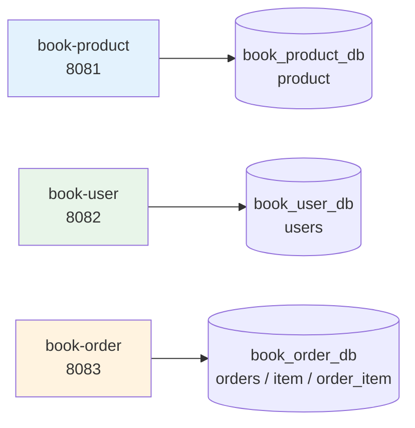
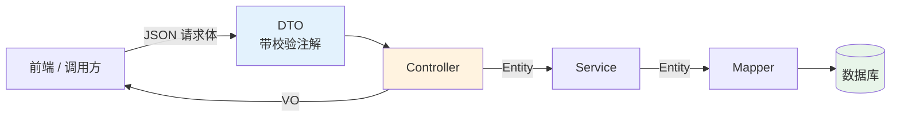

# 微服务拆分与接口设计

## 课程目标

- 理解"一服务一库"的存储边界与分库原则
- 理解 Entity、DTO、VO 的定位与区别
- 掌握用 Hutool `BeanUtil` 完成 Entity 到 VO 的转换
- 掌握 PostgreSQL 16 下五个核心表的建表脚本
- 掌握订单服务"校验库存、算总价、写快照、生成订单号"的事务实现
- 掌握 RESTful 接口设计规范与 `.http` 验证方法

## 回顾与导入

上一课完成技术栈版本对齐，`book-microservice` 五个模块已能编译，这一课开始填业务。

先回答三个问题：按什么边界拆服务？数据放哪？服务之间怎么交互？答案决定了后续注册发现、远程调用、网关与事务的形态。

商品服务和用户服务都很"薄"，本质是单表增删改查，继承 MyBatis-Plus 的 `ServiceImpl` 即可。订单服务不同，一次下单要在 `orders`、`item`、`order_item` 上依次写入订单号、商品快照与明细，还要保证"用户看到的订单"与"当时下单的商品"一致。

分库决定数据放哪，分层与接口规范决定代码怎么写。

## 分库设计

### 一服务一库

微服务下数据库不是"一个库装所有表"，而是"一个服务一个库"：



> **分库原则：** 每个服务独占自己的库，只能访问自己的库；取别人的数据走对方的 API，绝不跨库直连。

| 方案 | 优点 | 缺点 | 适用场景 |
| --- | --- | --- | --- |
| 单库多表 | 事务简单、可联表 | 变更互相影响、无法独立扩容 | 单体系统 |
| 一服务一库 | 边界清晰、可独立演进 | 无跨库事务、需远程调用 | 微服务标准做法 |
| 共享库分 Schema | 迁移成本低 | 实例仍是单点 | 过渡期 |

拆库有三个直接后果：不能跨库 JOIN（订单查不到商品标题，靠快照冗余）、不能跨库外键（一致性靠应用层）、没有跨库事务（需分布式事务或最终一致）。

## Entity、DTO、VO 的定位与区别

### 三者的定位

最常见的错误是"一个类走天下"：Controller 收 `Order`、也返回 `Order`。三种结构各管一段链路：



| 结构 | 定位 | 出现位置 | 关键特征 |
| --- | --- | --- | --- |
| Entity | 数据库表映射 | Mapper / Service | 一个类对应一张表 |
| DTO | 接收请求参数 | Controller 入参 | 带 `jakarta.validation` 注解 |
| VO | 返回展示数据 | Controller 出参 | 可组合 Entity、可计算、可裁剪 |

### 为什么不能只用 Entity

| 问题 | 表现 | 后果 |
| --- | --- | --- |
| 暴露表结构 | `updated_at` 等字段被序列化返回 | 改表就得改前端 |
| 无法组合数据 | 订单详情需要订单 + 明细 + 快照 | 前端多次请求 |
| 无法承载校验 | `@NotEmpty` 找不到对应字段 | 校验散落、容易漏 |

> **注意：** `OrderItemRequest` 故意没有 `title`、`price`，商品信息由订单服务查询后写快照，客户端传来的价格一律不可信。

### VO 转换：用 Hutool BeanUtil

`book-common` 引入 Hutool 后三个服务都能用，版本由父 pom 统一管理：

```xml
<dependency>
    <groupId>cn.hutool</groupId>
    <artifactId>hutool-all</artifactId>
</dependency>
```

手写 set 的写法字段一多就成片重复，漏一个编译期发现不了。本课推荐写法：按"数据来源"分两次拷贝，同名属性自动覆盖，只给计算字段手工赋值。

```java
private OrderDetailVO.OrderItemVO toItemVO(Item item, OrderItem orderItem) {
    // 快照字段：productId、title、author、price
    OrderDetailVO.OrderItemVO vo = BeanUtil.copyProperties(item, OrderDetailVO.OrderItemVO.class);
    // 明细字段：itemId、quantity、price（下单价覆盖快照价）
    BeanUtil.copyProperties(orderItem, vo);
    vo.setSubtotal(orderItem.getPrice()
            .multiply(BigDecimal.valueOf(orderItem.getQuantity()))
            .setScale(2, RoundingMode.HALF_UP));
    return vo;
}
```

| 工具 | 优点 | 缺点 | 适用场景 |
| --- | --- | --- | --- |
| 手写 set | 无依赖、直观 | 冗长、易漏 | 字段少于 3 个 |
| Spring `BeanUtils` | 无需额外依赖 | 不支持集合、转换弱 | 简单同构对象 |
| Hutool `BeanUtil` | 支持集合与类型转换 | 有反射开销 | 本课程统一使用 |

## 数据库表设计

三个库分别建立，建库语句单独执行（PostgreSQL 不允许 `CREATE DATABASE` 出现在事务块中）；下方 `product` 与 `users` 属于两个库，需分别连接执行。

```sql
CREATE DATABASE book_product_db WITH ENCODING 'UTF8';
CREATE DATABASE book_user_db    WITH ENCODING 'UTF8';
CREATE DATABASE book_order_db   WITH ENCODING 'UTF8';
```

### 商品库与用户库（book_product_db / book_user_db）

```sql
CREATE TABLE IF NOT EXISTS product (
    id          BIGSERIAL PRIMARY KEY,
    title       VARCHAR(100)   NOT NULL,
    author      VARCHAR(50)    NOT NULL,
    price       NUMERIC(10, 2) NOT NULL CHECK (price >= 0),
    stock       INT            NOT NULL DEFAULT 0 CHECK (stock >= 0),
    category    VARCHAR(20),
    created_at  TIMESTAMP      NOT NULL DEFAULT CURRENT_TIMESTAMP,
    updated_at  TIMESTAMP      NOT NULL DEFAULT CURRENT_TIMESTAMP
);
COMMENT ON TABLE  product       IS '图书商品表';
COMMENT ON COLUMN product.price IS '单价（元），必须 NUMERIC 保证精度';
COMMENT ON COLUMN product.stock IS '可售库存，扣减用条件更新防超卖';
CREATE INDEX idx_product_category ON product (category);
CREATE INDEX idx_product_title    ON product (title);

-- 以下表属于 book_user_db，先切换到该库再执行
CREATE TABLE IF NOT EXISTS users (
    id         BIGSERIAL PRIMARY KEY,
    username   VARCHAR(50)  NOT NULL,
    email      VARCHAR(100) NOT NULL,
    phone      VARCHAR(20),
    created_at TIMESTAMP    NOT NULL DEFAULT CURRENT_TIMESTAMP,
    updated_at TIMESTAMP    NOT NULL DEFAULT CURRENT_TIMESTAMP,
    CONSTRAINT uk_users_username UNIQUE (username)
);
COMMENT ON TABLE  users          IS '用户表';
COMMENT ON COLUMN users.username IS '登录名，全局唯一';
CREATE INDEX idx_users_email ON users (email);
```

### 订单库（book_order_db）

```sql
CREATE TABLE IF NOT EXISTS orders (
    id           BIGSERIAL PRIMARY KEY,
    order_number VARCHAR(32)    NOT NULL,
    user_id      BIGINT         NOT NULL,
    total_amount NUMERIC(12, 2) NOT NULL DEFAULT 0,
    status       VARCHAR(20)    NOT NULL DEFAULT 'CREATED',
    created_at   TIMESTAMP      NOT NULL DEFAULT CURRENT_TIMESTAMP,
    updated_at   TIMESTAMP      NOT NULL DEFAULT CURRENT_TIMESTAMP,
    CONSTRAINT uk_orders_order_number UNIQUE (order_number)
);
COMMENT ON TABLE  orders              IS '订单主表';
COMMENT ON COLUMN orders.order_number IS '业务订单号，唯一索引兜底防重';
COMMENT ON COLUMN orders.status       IS 'CREATED / PAID / CANCELLED';
CREATE INDEX idx_orders_user_id     ON orders (user_id);
CREATE INDEX idx_orders_status_time ON orders (status, created_at DESC);

CREATE TABLE IF NOT EXISTS item (
    id         BIGSERIAL PRIMARY KEY,
    product_id BIGINT         NOT NULL,
    title      VARCHAR(100)   NOT NULL,
    author     VARCHAR(50)    NOT NULL,
    price      NUMERIC(10, 2) NOT NULL,
    created_at TIMESTAMP      NOT NULL DEFAULT CURRENT_TIMESTAMP
);
COMMENT ON TABLE  item            IS '商品快照表：下单瞬间的信息副本';
COMMENT ON COLUMN item.product_id IS '原商品ID，跨库无法建外键，仅作追溯';
CREATE INDEX idx_item_product_id ON item (product_id);

CREATE TABLE IF NOT EXISTS order_item (
    id         BIGSERIAL PRIMARY KEY,
    order_id   BIGINT         NOT NULL,
    item_id    BIGINT         NOT NULL,
    quantity   INT            NOT NULL CHECK (quantity > 0),
    price      NUMERIC(10, 2) NOT NULL,
    created_at TIMESTAMP      NOT NULL DEFAULT CURRENT_TIMESTAMP,
    CONSTRAINT fk_order_item_order FOREIGN KEY (order_id)
        REFERENCES orders (id) ON DELETE CASCADE,
    CONSTRAINT fk_order_item_item FOREIGN KEY (item_id)
        REFERENCES item (id)
);
COMMENT ON TABLE  order_item         IS '订单明细表，一行代表一种商品';
COMMENT ON COLUMN order_item.item_id IS '指向商品快照，不是商品表';
CREATE INDEX idx_order_item_order_id ON order_item (order_id);
CREATE INDEX idx_order_item_item_id  ON order_item (item_id);
```

### 为什么必须有快照表

快照不是冗余，它把"订单"从"商品"的生命周期里解耦：

| 对比项 | 直接关联商品表 | 使用快照（本课方案） |
| --- | --- | --- |
| 商品改价 | 历史订单金额跟着变，对账错误 | 按下单价永久结算 |
| 商品改名 | 订单显示新名字 | 保留下单时名称 |
| 商品下架 | 订单查询失败 | 订单不受影响 |

## 订单服务的完整实现

### DTO 设计

```java
// com.example.order.dto
@Data
public class OrderCreateRequest {
    @NotNull(message = "用户ID不能为空")
    private Long userId;
    @NotEmpty(message = "订单项不能为空")
    @Valid
    private List<OrderItemRequest> items;
}

@Data
public class OrderItemRequest {
    @NotNull(message = "商品ID不能为空")
    private Long productId;
    @NotNull(message = "数量不能为空")
    @Min(value = 1, message = "数量至少为1")
    private Integer quantity;
}
```

> **说明：** `@Valid` 必须加在集合字段上，嵌套对象里的注解才生效。

### VO 设计

```java
// com.example.order.vo
@Data
public class OrderDetailVO {
    private Long orderId;
    private String orderNumber;
    private Long userId;
    private BigDecimal totalAmount;
    private String status;
    private LocalDateTime createdAt;
    private List<OrderItemVO> items;

    @Data
    public static class OrderItemVO {
        private Long itemId;
        private Long productId;
        private String title;
        private String author;
        private BigDecimal price;
        private Integer quantity;
        private BigDecimal subtotal;
    }
}

@Data
public class ProductStockVO {
    private Long id;
    private String title;
    private String author;
    private BigDecimal price;
    private Integer stock;
}
```

### Entity 层

```java
// com.example.order.entity
@Data
@TableName("orders")
public class Order {
    @TableId(type = IdType.AUTO)
    private Long id;
    private String orderNumber;
    private Long userId;
    private BigDecimal totalAmount;
    private String status;
    private LocalDateTime createdAt;
    private LocalDateTime updatedAt;
}

@Data
@TableName("item")
public class Item {
    @TableId(type = IdType.AUTO)
    private Long id;
    private Long productId;
    private String title;
    private String author;
    private BigDecimal price;
    private LocalDateTime createdAt;
}

@Data
@TableName("order_item")
public class OrderItem {
    @TableId(type = IdType.AUTO)
    private Long id;
    private Long orderId;
    private Long itemId;
    private Integer quantity;
    private BigDecimal price;
    private LocalDateTime createdAt;
}
```

### Mapper 层

```java
// com.example.order.mapper
@Mapper
public interface OrderMapper extends BaseMapper<Order> {
}

@Mapper
public interface ItemMapper extends BaseMapper<Item> {
}

@Mapper
public interface OrderItemMapper extends BaseMapper<OrderItem> {
}
```

### 商品信息查询客户端

订单库没有商品表，必须问商品服务要数据。本课先用 Spring 6.1 的 `RestClient`，后续《订单-图书远程调用重构》替换成 OpenFeign。

```java
// com.example.order.client
@Component
public class ProductStockClient {

    private final RestClient restClient;

    public ProductStockClient(@Value("${book.product.base-url}") String baseUrl) {
        this.restClient = RestClient.create(baseUrl);
    }

    public ProductStockVO getProduct(Long productId) {
        try {
            return restClient.get().uri("/api/products/{id}", productId)
                    .retrieve().body(ProductStockVO.class);
        } catch (HttpClientErrorException.NotFound e) {
            throw new RuntimeException("商品不存在，ID: " + productId);
        }
    }
}
```

### Service 层

`OrderService` 接口声明 `createOrder`、`getOrderDetail`、`cancelOrder` 三个方法并继承 `IService<Order>`。`createOrder` 是全课程最关键的一段实现：

```java
// com.example.order.service.impl
@Service
@RequiredArgsConstructor
public class OrderServiceImpl extends ServiceImpl<OrderMapper, Order> implements OrderService {

    private final ItemMapper itemMapper;
    private final OrderItemMapper orderItemMapper;
    private final ProductStockClient productStockClient;

    public static final String STATUS_CREATED = "CREATED";
    public static final String STATUS_CANCELLED = "CANCELLED";
    private static final DateTimeFormatter ORDER_NO_FORMAT =
            DateTimeFormatter.ofPattern("yyyyMMddHHmmss");
    private static final AtomicInteger SEQUENCE = new AtomicInteger(0);

    @Override
    @Transactional(rollbackFor = Exception.class)
    public OrderDetailVO createOrder(OrderCreateRequest request) {
        // 1. 取商品、校验库存、算总价：任一项不满足都不写库
        List<Item> snapshots = new ArrayList<>();
        List<OrderItem> orderItems = new ArrayList<>();
        BigDecimal totalAmount = BigDecimal.ZERO;
        for (OrderItemRequest itemReq : request.getItems()) {
            ProductStockVO product = productStockClient.getProduct(itemReq.getProductId());
            if (product.getStock() == null || product.getStock() < itemReq.getQuantity()) {
                throw new RuntimeException("库存不足：[" + product.getTitle() + "] 剩余 "
                        + product.getStock() + "，需要 " + itemReq.getQuantity());
            }
            Item item = new Item();
            item.setProductId(product.getId());
            item.setTitle(product.getTitle());
            item.setAuthor(product.getAuthor());
            item.setPrice(product.getPrice());
            snapshots.add(item);

            OrderItem orderItem = new OrderItem();
            orderItem.setQuantity(itemReq.getQuantity());
            orderItem.setPrice(product.getPrice());
            orderItems.add(orderItem);

            totalAmount = totalAmount.add(product.getPrice()
                    .multiply(BigDecimal.valueOf(itemReq.getQuantity())));
        }

        // 2. 订单主表：先落库，明细才有 orderId 可挂
        Order order = new Order();
        order.setOrderNumber(generateOrderNumber());
        order.setUserId(request.getUserId());
        order.setTotalAmount(totalAmount.setScale(2, RoundingMode.HALF_UP));
        order.setStatus(STATUS_CREATED);
        this.save(order);

        // 3. 快照 + 明细：一行快照对应一行明细
        List<OrderDetailVO.OrderItemVO> itemVOs = new ArrayList<>();
        for (int i = 0; i < snapshots.size(); i++) {
            Item item = snapshots.get(i);
            itemMapper.insert(item);

            OrderItem orderItem = orderItems.get(i);
            orderItem.setOrderId(order.getId());
            orderItem.setItemId(item.getId());
            orderItemMapper.insert(orderItem);

            itemVOs.add(toItemVO(item, orderItem));
        }

        OrderDetailVO detailVO = toDetailVO(order);
        detailVO.setItems(itemVOs);
        return detailVO;
    }

    @Override
    public OrderDetailVO getOrderDetail(Long orderId) {

        Order order = this.getById(orderId);
        if (order == null) {
            throw new RuntimeException("订单不存在，ID: " + orderId);
        }
        List<OrderItem> orderItems = orderItemMapper.selectList(
                new LambdaQueryWrapper<OrderItem>().eq(OrderItem::getOrderId, orderId));
        OrderDetailVO detailVO = toDetailVO(order);

        // 批量取快照，避免逐条 selectById 的 N+1
        Set<Long> itemIds = orderItems.stream()
                .map(OrderItem::getItemId).collect(Collectors.toSet());
        Map<Long, Item> itemMap = itemMapper.selectBatchIds(itemIds).stream()
                .collect(Collectors.toMap(Item::getId, Function.identity()));
        detailVO.setItems(orderItems.stream()
                .filter(oi -> itemMap.containsKey(oi.getItemId()))
                .map(oi -> toItemVO(itemMap.get(oi.getItemId()), oi))
                .collect(Collectors.toList()));
        return detailVO;
    }

    @Override
    @Transactional(rollbackFor = Exception.class)
    public boolean cancelOrder(Long orderId) {

        Order order = this.getById(orderId);
        if (order == null) {
            throw new RuntimeException("订单不存在，ID: " + orderId);
        }
        if (!STATUS_CREATED.equals(order.getStatus())) {
            throw new RuntimeException("只有 CREATED 状态可取消，当前状态: " + order.getStatus());
        }
        order.setStatus(STATUS_CANCELLED);
        order.setUpdatedAt(LocalDateTime.now());
        return this.updateById(order);
    }

    private OrderDetailVO toDetailVO(Order order) {
        OrderDetailVO vo = BeanUtil.copyProperties(order, OrderDetailVO.class);
        vo.setOrderId(order.getId());
        return vo;
    }

    private OrderDetailVO.OrderItemVO toItemVO(Item item, OrderItem orderItem) {
        OrderDetailVO.OrderItemVO vo = BeanUtil.copyProperties(item, OrderDetailVO.OrderItemVO.class);
        BeanUtil.copyProperties(orderItem, vo);
        vo.setSubtotal(orderItem.getPrice()
                .multiply(BigDecimal.valueOf(orderItem.getQuantity()))
                .setScale(2, RoundingMode.HALF_UP));
        return vo;
    }

    /** ORD + yyyyMMddHHmmss + 3 位序列，单机唯一，集群需换分布式 ID */
    private String generateOrderNumber() {
        String timestamp = LocalDateTime.now().format(ORDER_NO_FORMAT);
        int seq = Math.floorMod(SEQUENCE.incrementAndGet(), 1000);
        return String.format("ORD%s%03d", timestamp, seq);
    }
}
```

> **关键点：** 循环里只做"取数、校验、累加"，写库集中在后面；任一项库存不足都在写第一张表前抛出，事务要么全成要么全无。

### Controller 层

```java
// com.example.order.controller
@RestController
@RequestMapping("/api/orders")
@RequiredArgsConstructor
public class OrderController {

    private final OrderService orderService;

    @PostMapping
    public OrderDetailVO create(@Valid @RequestBody OrderCreateRequest request) {
        return orderService.createOrder(request);
    }

    @GetMapping("/{id}")
    public OrderDetailVO detail(@PathVariable("id") Long id) {
        return orderService.getOrderDetail(id);
    }

    @PutMapping("/{id}/cancel")
    public Boolean cancel(@PathVariable("id") Long id) {
        return orderService.cancelOrder(id);
    }
}
```

### 配置与启动类

```yaml
server:
  port: 8083
spring:
  application:
    name: book-order
  datasource:
    driver-class-name: org.postgresql.Driver
    url: jdbc:postgresql://localhost:5432/book_order_db
    username: postgres
    password: your_password
mybatis-plus:
  configuration:
    map-underscore-to-camel-case: true
book:
  product:
    base-url: http://localhost:8081
```

```java
// com.example.order
@SpringBootApplication
@MapperScan("com.example.order.mapper")
public class BookOrderApplication {

    public static void main(String[] args) {
        SpringApplication.run(BookOrderApplication.class, args);
    }
}
```

## 接口设计规范

| 规则 | 正确示例 | 错误示例 |
| --- | --- | --- |
| 统一 `/api` 前缀 | `/api/orders` | `/order/api` |
| 名词复数、小写中划线 | `/api/order-items` | `/api/getOrderList` |
| 从属资源放子路径 | `/api/orders/1/items` | `/api/items?orderId=1` |

| 方法 | 语义 | 幂等 | 本课示例 |
| --- | --- | --- | --- |
| GET | 查询 | 是 | `GET /api/orders/{id}` |
| POST | 新建 | 否 | `POST /api/orders` |
| PUT | 全量替换或状态变更 | 是 | `PUT /api/orders/{id}/cancel` |
| DELETE | 删除 | 是 | `DELETE /api/orders/{id}` |

| 场景 | HTTP 状态码 | 业务码 | 说明 |
| --- | --- | --- | --- |
| 成功 | 200 / 201 | 0 | 统一响应体 `code = 0` |
| 参数校验失败 | 400 | 10000 | 字段错误随 `message` 返回 |
| 资源不存在 | 404 | 20001 | 由 `ResourceNotFoundException` 触发 |
| 业务规则拒绝 | 400 | 20xxx | 库存不足、状态不允许 |
| 服务端异常 | 500 | 50000 | 不向前端暴露堆栈 |

| 分页参数 | 类型 | 默认值 | 约束 |
| --- | --- | --- | --- |
| `pageNum` | int | 1 | `>= 1`，与 MyBatis-Plus 一致 |
| `pageSize` | int | 10 | `1 ~ 100`，必须限制上限 |

| 接口 | 是否必须幂等 | 手段 |
| --- | --- | --- |
| `POST /api/orders` | 是 | 客户端 `requestId` + 唯一索引 |
| `PUT /api/orders/{id}/cancel` | 是 | 状态机校验 |

| 版本方案 | 示例 | 优点 | 缺点 | 适用场景 |
| --- | --- | --- | --- | --- |
| URL 版本号 | `/api/v1/orders` | 直观、易路由 | URL 变长 | 本课程采用 |
| 请求头版本 | `Accept-Version: v2` | URL 稳定 | 调试不直观 | 内部服务 |
| 兼容演进 | 只加字段不删字段 | 客户端零改动 | 长期技术债 | 快速迭代 |

## 使用 .http 文件验证接口

```http
@productUrl = http://localhost:8081
@orderUrl = http://localhost:8083

### 1. 准备商品
POST {{productUrl}}/api/products
Content-Type: application/json

{ "title": "Spring Boot 实战", "author": "Craig Walls", "price": 79.00, "stock": 10 }

### 2. 创建订单（两个订单项）
POST {{orderUrl}}/api/orders
Content-Type: application/json

{ "userId": 1, "items": [ { "productId": 1, "quantity": 2 }, { "productId": 2, "quantity": 1 } ] }

### 3. 查询订单详情
GET {{orderUrl}}/api/orders/1

### 4. 取消订单，重复执行验证状态机
PUT {{orderUrl}}/api/orders/1/cancel

### 5. 库存不足
POST {{orderUrl}}/api/orders
Content-Type: application/json

{ "userId": 1, "items": [ { "productId": 1, "quantity": 999 } ] }
```

**创建订单的预期响应（HTTP 200）：**

```json
{
  "orderId": 1, "orderNumber": "ORD20261110173000001", "userId": 1,
  "totalAmount": 247.00, "status": "CREATED", "createdAt": "2026-11-10T17:30:00",
  "items": [
    { "itemId": 1, "productId": 1, "title": "Spring Boot 实战", "author": "Craig Walls",
      "price": 79.00, "quantity": 2, "subtotal": 158.00 },
    { "itemId": 2, "productId": 2, "title": "Java 核心技术", "author": "Cay Horstmann",
      "price": 89.00, "quantity": 1, "subtotal": 89.00 }
  ]
}
```

**取消订单的预期响应（HTTP 200）：**

```json
true
```

**库存不足的预期响应（HTTP 500，尚未接入全局异常处理器）：**

```json
{ "timestamp": "2026-11-10T17:31:12.345+08:00", "status": 500, "error": "Internal Server Error", "path": "/api/orders" }
```

> **结论：** 业务异常的 `message` 被 Spring 默认错误结构吃掉，前端只拿到 500，这正是下一课《公共模块建设》要解决的问题。

## 注意事项

1. **金额一律 NUMERIC + BigDecimal**：`double` 无法精确表示 0.1，`79.9 * 3` 会得到 239.69999999999999；比较用 `compareTo` 而非 `equals`，`divide` 必须指定精度与舍入模式。
2. **库存校验不等于扣减**：并发下两个请求可能同时通过校验造成超卖。扣减要用 `UPDATE product SET stock = stock - ? WHERE id = ? AND stock >= ?` 这类条件更新，方案见《远程调用可靠性：超时、重试与幂等》。
3. **事务边界要短**：`createOrder` 内有远程调用，HTTP 往返期间数据库连接一直被占用，商品服务变慢会拖垮订单服务连接池。生产应把取数校验放在事务外，只有写库进事务。
4. **快照只解决历史一致性**：订单详情里的价格永远是下单价，不是当前售价，购物车结算页必须实时查商品服务。
5. **异常类型是过渡态**：本课用 `RuntimeException` 是因为公共模块还没建好，下一课统一换成 `BusinessException` 与 `ResultCode`。
6. **订单号集群下会冲突**：`AtomicInteger` 只在单 JVM 内自增，多实例同秒可能重复，唯一索引会拦住但用户看到报错；生产用雪花算法或号段模式。
7. **跨库不能建外键**：`item.product_id` 在另一个库，无法建 FK 也无法 JOIN，一致性由应用层与对账任务保证；`BeanUtil` 拷贝顺序也不能反，先拷 `item` 再拷 `orderItem`，否则下单价被快照价覆盖，金额对不上。

## 小结

本节课我们学习了：

1. **分库设计**：三个服务对应三个独立库，只访问自己的库，跨库 JOIN 与外键全部取消。
2. **Entity、DTO、VO 的定位**：Entity 映射表、DTO 收参数带校验、VO 出参可组合；混用会暴露表结构、无法组合数据、金额可被篡改。
3. **Hutool BeanUtil 转换**：按数据来源分两次拷贝，计算字段手工赋值，替代成片 set。
4. **五个核心表**：`product`、`users`、`orders`、`item`、`order_item`，金额全用 `NUMERIC`，并配好索引与注释。
5. **订单服务完整实现**：一个事务内完成校验库存、累加总价、写主表、写快照、写明细、生成订单号；查询用批量取数避免 N+1。
6. **接口设计规范与验证**：URL、方法语义、状态码、分页、幂等、版本六项约束，并用 `.http` 覆盖正向与异常场景。
## 作业

### 作业一：完成商品与用户服务的基础接口

1. 在 `book-product` 中实现 `product` 表的 Entity、Mapper、Service、Controller，提供详情、创建与分页查询。
2. 在 `book-user` 中实现 `users` 表的同等接口，用户名重复时拒绝创建，并用 `.http` 文件跑通正常与异常请求。

### 作业二：订单服务主流程验证

1. 创建含两个订单项的订单，核对三张表的记录数与关联关系，并校验 `total_amount` 等于各明细 `price * quantity` 之和。
2. 把商品价格从 79.00 改为 99.00 后重查历史订单，确认仍返回 79.00，并说明快照的必要性。
