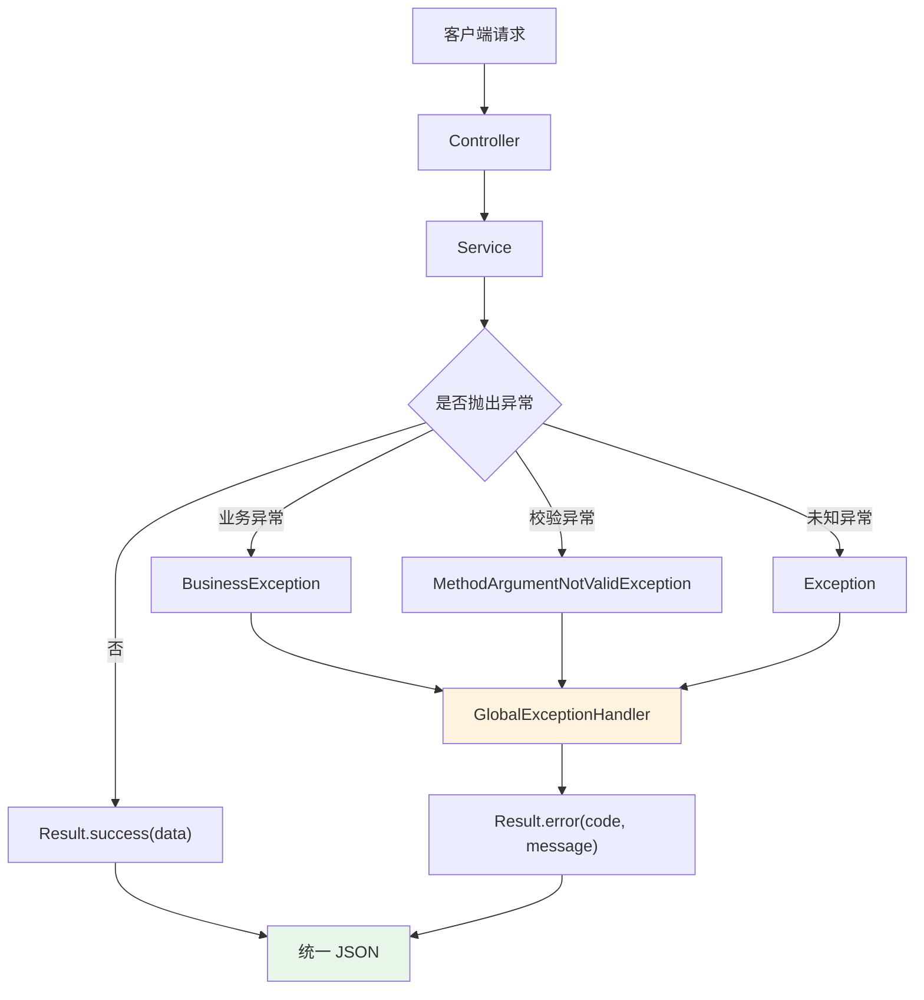
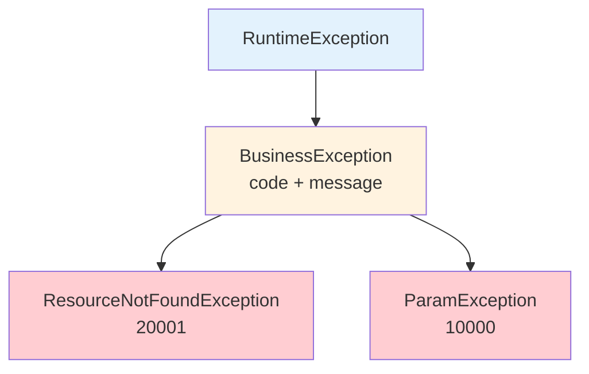

# 公共模块建设

## 课程目标

- 理解公共模块在微服务架构中的边界与职责
- 掌握业务状态码的分段设计与 `ResultCode` 枚举实现
- 掌握统一响应体 `Result<T>` 与分页响应体 `PageResult<T>` 的实现
- 掌握 `BusinessException` 三层异常体系的设计
- 掌握 `GlobalExceptionHandler` 处理校验、绑定、解析与兜底异常
- 完成三个服务的统一响应改造并验证四种典型响应

## 回顾与导入

上一课三个服务的 Controller 直接把 VO、`List`、`Boolean` 返回给前端：

```java
@PostMapping
public OrderDetailVO create(@Valid @RequestBody OrderCreateRequest request) {
    return orderService.createOrder(request);
}
```

```java
@PutMapping("/{id}/cancel")
public Boolean cancel(@PathVariable("id") Long id) {
    return orderService.cancelOrder(id);
}
```

这种风格有三个硬伤：同一个系统里响应结构五花八门；业务失败只能靠 HTTP 500 表达，前端分不清"库存不足"和"服务崩了"；每个 Controller 想返回错误都得自己拼 JSON。上一课 `.http` 文件里那条库存不足的响应只剩 `status: 500`，`message` 被 Spring 默认错误结构吃掉了，这就是最直接的证据。

本节课在 `book-common` 中落地统一响应体与异常体系，让三个服务共用一套契约：



> **结论：** 统一响应的关键不是包一层对象，而是把"业务结果"和"异常出口"都收敛到同一处。

## book-common 包结构与依赖

### 包结构

```text
book-common/src/main/java/com/example/common/
├── result/
│   ├── Result.java              统一响应体
│   ├── PageResult.java          分页响应体
│   └── ResultCode.java          业务状态码枚举
├── exception/
│   ├── BusinessException.java         业务异常基类
│   ├── ResourceNotFoundException.java 资源不存在
│   ├── ParamException.java            参数异常
│   └── GlobalExceptionHandler.java    全局异常处理器
├── constant/
│   └── CommonConstant.java      分页与通用常量
└── util/
    └── JsonUtils.java           JSON 序列化工具
```

| 包 | 放什么 | 不放什么 |
| --- | --- | --- |
| `result` | 响应结构、状态码枚举 | 任何业务字段 |
| `exception` | 异常类型、全局处理器 | Controller 级 try-catch |
| `constant` | 分页默认值、公共 Header 名 | 订单状态等业务枚举 |
| `util` | 与业务无关的工具方法 | 依赖 Service 的方法 |

> **边界：** `book-common` 里不能出现 `Product`、`Order` 这类实体。一旦放进来，商品服务就被迫依赖订单的表结构。

### pom 依赖

```xml
<dependencies>
    <dependency>
        <groupId>org.springframework.boot</groupId>
        <artifactId>spring-boot-starter-web</artifactId>
        <optional>true</optional>
    </dependency>
    <dependency>
        <groupId>org.springframework.boot</groupId>
        <artifactId>spring-boot-starter-validation</artifactId>
    </dependency>
    <dependency>
        <groupId>com.baomidou</groupId>
        <artifactId>mybatis-plus-spring-boot3-starter</artifactId>
        <optional>true</optional>
    </dependency>
    <dependency>
        <groupId>cn.hutool</groupId>
        <artifactId>hutool-all</artifactId>
    </dependency>
    <dependency>
        <groupId>org.projectlombok</groupId>
        <artifactId>lombok</artifactId>
        <optional>true</optional>
    </dependency>
</dependencies>
```

| 依赖 | 为什么要 | `optional` 的含义 |
| --- | --- | --- |
| `spring-boot-starter-web` | `@RestControllerAdvice`、`HttpMessageNotReadableException` | 由使用方引入，避免重复传递 |
| `spring-boot-starter-validation` | `ConstraintViolationException`、`FieldError` | 校验能力是响应体系的前提 |
| `mybatis-plus-spring-boot3-starter` | `PageResult.of(IPage)` | 只有分页的服务需要 |
| `hutool-all` | 工具类与后续 Bean 拷贝 | 版本由父 pom 管理 |

> **提示：** 修改 `book-common` 后必须执行 `mvn install -pl book-common -am`，否则其他模块编译时读到的还是本地仓库里的旧包。

## 状态码设计

### 分段规范

业务状态码与 HTTP 状态码分工不同：HTTP 状态码告诉网关和监控"这次请求处理得怎么样"，业务码告诉前端"具体哪里不对"。

| 段 | 范围 | 含义 | 典型码 |
| --- | --- | --- | --- |
| 成功 | 0 | 请求被正确处理 | `SUCCESS(0)` |
| 参数 | 1xxxx | 参数缺失、格式错误、校验失败 | `PARAM_INVALID(10000)` |
| 业务 | 2xxxx | 业务规则拒绝 | `STOCK_INSUFFICIENT(20003)` |
| 鉴权 | 4xxxx | 未认证、令牌失效、无权限 | `UNAUTHORIZED(40001)` |
| 系统 | 5xxxx | 服务内部或依赖故障 | `SYSTEM_ERROR(50000)` |

段位留白是刻意的：1xxxx 里给校验细分留位置，2xxxx 按业务模块再分段（如 21xxx 商品、22xxx 订单），4xxxx 与 5xxxx 与 HTTP 语义对齐，便于排查。

### ResultCode 完整实现

```java
// com.example.common.result
@Getter
public enum ResultCode {

    SUCCESS(0, "操作成功"),

    // 1xxxx 参数类
    PARAM_INVALID(10000, "参数校验失败"),
    PARAM_MISSING(10001, "缺少必要参数"),
    PARAM_TYPE_ERROR(10002, "参数类型不匹配"),
    BODY_NOT_READABLE(10003, "请求体格式错误"),

    // 2xxxx 业务类
    BUSINESS_ERROR(20000, "业务处理失败"),
    RESOURCE_NOT_FOUND(20001, "资源不存在"),
    RESOURCE_EXISTS(20002, "资源已存在"),
    STOCK_INSUFFICIENT(20003, "库存不足"),
    ORDER_STATUS_ERROR(20004, "订单状态不允许该操作"),

    // 4xxxx 鉴权类
    UNAUTHORIZED(40001, "未认证或登录已过期"),
    TOKEN_INVALID(40002, "令牌无效"),
    FORBIDDEN(40301, "无权限访问"),

    // 5xxxx 系统类
    SYSTEM_ERROR(50000, "系统内部错误，请稍后重试"),
    SERVICE_UNAVAILABLE(50001, "依赖服务不可用"),
    DB_ERROR(50002, "数据库操作失败");

    private final int code;
    private final String message;

    ResultCode(int code, String message) {
        this.code = code;
        this.message = message;
    }
}
```

> **说明：** 枚举里只放"语义稳定"的码。一次性的提示文案走 `Result.error(code, message)` 的第二个参数，不要为每句话新增一个枚举值。

## 统一响应体 Result

### 字段设计

| 字段 | 类型 | 说明 |
| --- | --- | --- |
| `code` | `Integer` | 业务状态码，成功固定为 0 |
| `message` | `String` | 面向调用方的描述 |
| `data` | `T` | 业务数据，失败时为 null |
| `timestamp` | `Long` | 服务端响应时间戳，便于排查时序 |

### 完整实现

```java
// com.example.common.result
@Data
@JsonInclude(JsonInclude.Include.NON_NULL)
public class Result<T> implements Serializable {

    private static final long serialVersionUID = 1L;
    private static final int SUCCESS_CODE = 0;

    private Integer code;
    private String message;
    private T data;
    private Long timestamp;

    public Result() {
        this.timestamp = System.currentTimeMillis();
    }

    private Result(Integer code, String message, T data) {
        this.code = code;
        this.message = message;
        this.data = data;
        this.timestamp = System.currentTimeMillis();
    }

    public static <T> Result<T> success() {
        return new Result<>(SUCCESS_CODE, ResultCode.SUCCESS.getMessage(), null);
    }

    public static <T> Result<T> success(T data) {
        return new Result<>(SUCCESS_CODE, ResultCode.SUCCESS.getMessage(), data);
    }

    public static <T> Result<T> success(String message, T data) {
        return new Result<>(SUCCESS_CODE, message, data);
    }

    public static <T> Result<T> error(ResultCode resultCode) {
        return new Result<>(resultCode.getCode(), resultCode.getMessage(), null);
    }

    public static <T> Result<T> error(ResultCode resultCode, String message) {
        return new Result<>(resultCode.getCode(), message, null);
    }

    public static <T> Result<T> error(Integer code, String message) {
        return new Result<>(code, message, null);
    }

    public boolean isSuccess() {
        return this.code != null && this.code == SUCCESS_CODE;
    }
}
```

> **注意：** 私有构造器挡住了 `new Result<>(...)` 的随意调用，四个静态工厂覆盖成功、带消息成功、枚举失败、自定义失败四种场景；`@JsonInclude(NON_NULL)` 让失败响应不再返回 `"data": null`。

## 分页响应体 PageResult

### 字段与计算

| 字段 | 类型 | 来源 |
| --- | --- | --- |
| `list` | `List<T>` | 当前页记录 |
| `total` | `Long` | 符合条件的总记录数 |
| `pageNum` | `Integer` | 当前页码，从 1 开始 |
| `pageSize` | `Integer` | 每页条数 |
| `pages` | `Integer` | 总页数 = (total + pageSize - 1) / pageSize |

### 完整实现

```java
// com.example.common.result
@Data
public class PageResult<T> implements Serializable {

    private List<T> list;
    private Long total;
    private Integer pageNum;
    private Integer pageSize;
    private Integer pages;

    public PageResult() {
    }

    public PageResult(List<T> list, Long total, Integer pageNum, Integer pageSize) {
        this.list = list == null ? Collections.emptyList() : list;
        this.total = total == null ? 0L : total;
        this.pageNum = pageNum == null || pageNum < 1
                ? CommonConstant.DEFAULT_PAGE_NUM : pageNum;
        this.pageSize = pageSize == null || pageSize < 1
                ? CommonConstant.DEFAULT_PAGE_SIZE : pageSize;
        this.pages = (int) ((this.total + this.pageSize - 1) / this.pageSize);
    }

    public static <T> PageResult<T> of(IPage<T> page) {
        return new PageResult<>(page.getRecords(), page.getTotal(),
                (int) page.getCurrent(), (int) page.getSize());
    }

    public static <T, R> PageResult<R> of(IPage<T> page, Function<T, R> converter) {
        List<R> records = page.getRecords().stream().map(converter).collect(Collectors.toList());
        return new PageResult<>(records, page.getTotal(),
                (int) page.getCurrent(), (int) page.getSize());
    }

    public static <T> PageResult<T> empty(Integer pageNum, Integer pageSize) {
        return new PageResult<>(Collections.emptyList(), 0L, pageNum, pageSize);
    }
}
```

> **说明：** `pages` 用整数运算 `(total + pageSize - 1) / pageSize` 计算，避免 `Math.ceil(double)` 在大数下丢精度；`total = 0` 时结果为 0，前端不必特判。

### 常量与工具

```java
// com.example.common.constant
public final class CommonConstant {

    public static final int DEFAULT_PAGE_NUM = 1;
    public static final int DEFAULT_PAGE_SIZE = 10;
    public static final int MAX_PAGE_SIZE = 100;
    public static final String TRACE_ID = "traceId";

    private CommonConstant() {
    }
}
```

```java
// com.example.common.util
public final class JsonUtils {

    private static final ObjectMapper MAPPER = new ObjectMapper()
            .registerModule(new JavaTimeModule())
            .disable(SerializationFeature.WRITE_DATES_AS_TIMESTAMPS);

    private JsonUtils() {
    }

    public static String toJson(Object value) {
        try {
            return MAPPER.writeValueAsString(value);
        } catch (JsonProcessingException e) {
            throw new IllegalStateException("JSON 序列化失败", e);
        }
    }

    public static <T> T parse(String json, Class<T> type) {
        try {
            return MAPPER.readValue(json, type);
        } catch (JsonProcessingException e) {
            throw new IllegalArgumentException("JSON 解析失败", e);
        }
    }
}
```

## 异常体系

### 层次结构



| 异常 | 语义 | 业务码 | 典型场景 |
| --- | --- | --- | --- |
| `BusinessException` | 业务规则拒绝 | 20000 起 | 订单状态不允许取消 |
| `ResourceNotFoundException` | 目标资源缺失 | 20001 | 查询不存在的订单 |
| `ParamException` | 入参语义不合法 | 10000 | 价格为负、页码超限 |

> **为什么统一继承 RuntimeException：** Service 方法签名不必声明 throws，`@Transactional` 默认也只对运行时异常回滚，配合 `rollbackFor = Exception.class` 形成完整闭环。

### 三个异常类

```java
// com.example.common.exception
@Getter
public class BusinessException extends RuntimeException {

    private final Integer code;

    public BusinessException(String message) {
        super(message);
        this.code = ResultCode.BUSINESS_ERROR.getCode();
    }

    public BusinessException(ResultCode resultCode) {
        super(resultCode.getMessage());
        this.code = resultCode.getCode();
    }

    public BusinessException(ResultCode resultCode, String message) {
        super(message);
        this.code = resultCode.getCode();
    }

    public BusinessException(Integer code, String message) {
        super(message);
        this.code = code;
    }
}
```

```java
// com.example.common.exception
public class ResourceNotFoundException extends BusinessException {

    public ResourceNotFoundException(String resource, Long id) {
        super(ResultCode.RESOURCE_NOT_FOUND, resource + "不存在，ID: " + id);
    }

    public ResourceNotFoundException(String message) {
        super(ResultCode.RESOURCE_NOT_FOUND, message);
    }
}
```

```java
// com.example.common.exception
public class ParamException extends BusinessException {

    public ParamException(String message) {
        super(ResultCode.PARAM_INVALID, message);
    }
}
```

> **提示：** `message` 由父类 `RuntimeException#getMessage()` 提供，`code` 由子类方法锁定，`catch (BusinessException e)` 一处就能兜住全部业务异常。

## 全局异常处理器

不加处理器时，异常会走 Spring 默认错误页，前端拿不到业务码。处理器把每类异常翻译成 `Result`，并决定 HTTP 状态码。

```java
// com.example.common.exception
@Slf4j
@RestControllerAdvice
public class GlobalExceptionHandler {

    private static final String SEPARATOR = "; ";

    @ExceptionHandler(ResourceNotFoundException.class)
    @ResponseStatus(HttpStatus.NOT_FOUND)
    public Result<Void> handleNotFound(ResourceNotFoundException e) {
        log.warn("资源不存在: {}", e.getMessage());
        return Result.error(e.getCode(), e.getMessage());
    }

    @ExceptionHandler(BusinessException.class)
    @ResponseStatus(HttpStatus.BAD_REQUEST)
    public Result<Void> handleBusiness(BusinessException e) {
        log.warn("业务异常: code={}, message={}", e.getCode(), e.getMessage());
        return Result.error(e.getCode(), e.getMessage());
    }

    @ExceptionHandler(MethodArgumentNotValidException.class)
    @ResponseStatus(HttpStatus.BAD_REQUEST)
    public Result<Void> handleMethodArgumentNotValid(MethodArgumentNotValidException e) {
        String message = e.getBindingResult().getFieldErrors().stream()
                .map(err -> err.getField() + " " + err.getDefaultMessage())
                .collect(Collectors.joining(SEPARATOR));
        log.warn("参数校验失败: {}", message);
        return Result.error(ResultCode.PARAM_INVALID, message);
    }

    @ExceptionHandler(BindException.class)
    @ResponseStatus(HttpStatus.BAD_REQUEST)
    public Result<Void> handleBind(BindException e) {
        String message = e.getBindingResult().getAllErrors().stream()
                .map(err -> err instanceof FieldError fieldError
                        ? fieldError.getField() + " " + fieldError.getDefaultMessage()
                        : err.getDefaultMessage())
                .collect(Collectors.joining(SEPARATOR));
        log.warn("参数绑定失败: {}", message);
        return Result.error(ResultCode.PARAM_INVALID, message);
    }

    @ExceptionHandler(ConstraintViolationException.class)
    @ResponseStatus(HttpStatus.BAD_REQUEST)
    public Result<Void> handleConstraintViolation(ConstraintViolationException e) {
        String message = e.getConstraintViolations().stream()
                .map(v -> v.getPropertyPath() + " " + v.getMessage())
                .collect(Collectors.joining(SEPARATOR));
        log.warn("约束校验失败: {}", message);
        return Result.error(ResultCode.PARAM_INVALID, message);
    }

    @ExceptionHandler(HttpMessageNotReadableException.class)
    @ResponseStatus(HttpStatus.BAD_REQUEST)
    public Result<Void> handleNotReadable(HttpMessageNotReadableException e) {
        log.warn("请求体解析失败: {}", e.getMessage());
        return Result.error(ResultCode.BODY_NOT_READABLE);
    }

    @ExceptionHandler(Exception.class)
    @ResponseStatus(HttpStatus.INTERNAL_SERVER_ERROR)
    public Result<Void> handleException(Exception e) {
        log.error("系统异常", e);
        return Result.error(ResultCode.SYSTEM_ERROR);
    }
}
```

| 异常 | 触发场景 | HTTP | 业务码 |
| --- | --- | --- | --- |
| `ResourceNotFoundException` | 查询不到的订单、商品 | 404 | 20001 |
| `BusinessException` | 库存不足、状态不允许 | 400 | 2xxxx |
| `MethodArgumentNotValidException` | `@RequestBody` + `@Valid` 校验失败 | 400 | 10000 |
| `BindException` | 表单或查询参数绑定失败 | 400 | 10000 |
| `ConstraintViolationException` | `@RequestParam` 上的约束校验 | 400 | 10000 |
| `HttpMessageNotReadableException` | JSON 格式错误、类型不匹配 | 400 | 10003 |
| `Exception` | 未预料到的故障 | 500 | 50000 |

> **注意：** Spring 6 中 `MethodArgumentNotValidException` 继承自 `BindException`，两个 handler 同时存在时按"最具体类型优先"匹配，不会冲突；但如果只写 `BindException` 一个，消息拼接要兼容两种 `BindingResult`。

## 集成到各服务

### 依赖 book-common

三个服务的 `pom.xml` 都要声明对公共模块的依赖，版本跟随父工程：

```xml
<!-- book-product/pom.xml -->
<dependency>
    <groupId>com.example</groupId>
    <artifactId>book-common</artifactId>
    <version>${project.version}</version>
</dependency>
```

### 主启动类

`GlobalExceptionHandler` 位于 `com.example.common`，而主启动类在 `com.example.product`，默认组件扫描只覆盖自己所在的包，必须显式扩大扫描范围。

```java
// com.example.product
@SpringBootApplication(scanBasePackages = "com.example")
@MapperScan("com.example.product.mapper")
public class BookProductApplication {

    public static void main(String[] args) {
        SpringApplication.run(BookProductApplication.class, args);
    }
}
```

`BookUserApplication` 与 `BookOrderApplication` 同样加上 `scanBasePackages = "com.example"`，只改各自的 `@MapperScan`。

### Controller 改造

```java
// 改造前：返回类型五花八门
@PostMapping
public ProductVO create(@Valid @RequestBody ProductCreateRequest request) {
    return productService.create(request);
}
```

```java
// 改造后：统一包 Result，分页用 PageResult
@PostMapping
public Result<ProductVO> create(@Valid @RequestBody ProductCreateRequest request) {
    return Result.success(productService.create(request));
}

@GetMapping
public Result<PageResult<ProductVO>> page(@RequestParam(defaultValue = "1") Integer pageNum,
                                          @RequestParam(defaultValue = "10") Integer pageSize) {
    return Result.success(productService.page(pageNum, pageSize));
}

@GetMapping("/{id}")
public Result<ProductVO> detail(@PathVariable("id") Long id) {
    return Result.success(productService.getDetail(id));
}
```

### Service 改造

Service 层不返回 null，也不抛无意义的 `RuntimeException`，而是抛出带业务码的异常：

```java
// 改造前
Product product = this.getById(id);
if (product == null) {
    throw new RuntimeException("商品不存在，ID: " + id);
}
if (product.getStock() < request.getQuantity()) {
    throw new RuntimeException("库存不足");
}
```

```java
// 改造后
Product product = this.getById(id);
if (product == null) {
    throw new ResourceNotFoundException("Product", id);
}
if (product.getStock() < request.getQuantity()) {
    throw new BusinessException(ResultCode.STOCK_INSUFFICIENT);
}
```

> **提示：** 订单服务里同样的改造适用于 `createOrder`（库存不足）、`getOrderDetail`（订单不存在）、`cancelOrder`（状态不允许），改造后异常响应自动带上 20001、20003 等业务码。

## 运行验证

**正常响应（HTTP 200）：**

```json
{
  "code": 0,
  "message": "操作成功",
  "data": {
    "list": [
      { "id": 1, "title": "Spring Boot 实战", "author": "Craig Walls", "price": 79.00, "stock": 10 }
    ],
    "total": 1,
    "pageNum": 1,
    "pageSize": 10,
    "pages": 1
  },
  "timestamp": 1762767000000
}
```

**资源不存在（HTTP 404）：**

```json
{
  "code": 20001,
  "message": "Order不存在，ID: 999",
  "timestamp": 1762767000000
}
```

**参数校验失败（HTTP 400）：**

```json
{
  "code": 10000,
  "message": "quantity 数量至少为1; userId 用户ID不能为空",
  "timestamp": 1762767000000
}
```

**系统异常（HTTP 500）：**

```json
{
  "code": 50000,
  "message": "系统内部错误，请稍后重试",
  "timestamp": 1762767000000
}
```

> **结论：** 四种响应的结构完全一致，前端只需判断 `code === 0`，失败时按 code 段位决定是提示用户还是上报监控。

## 注意事项

1. **`scanBasePackages` 不能写成 `com.example.common`**：那样会漏掉本服务自己的 Controller 与 Service，正确写法是 `com.example`，靠包前缀统一覆盖。
2. **HTTP 状态码与业务码要协同**：成功用 200、创建用 201、校验失败用 400、资源缺失用 404、系统故障用 500，业务码放在 `code` 里。全部返回 200 会让网关熔断、监控告警、浏览器缓存全部失灵。
3. **异常日志分级**：业务异常与校验异常用 `log.warn` 且不打堆栈，系统异常用 `log.error` 带堆栈。生产环境靠这个区分"用户输错了"和"代码坏了"。
4. **不要吞异常**：`catch (Exception e) { return Result.error(...) }` 而不记录日志，会让故障变成"没有报错但功能不对"。要么转换后记录，要么原样抛出交给全局处理器。
5. **`book-common` 不能反向依赖业务模块**：它被所有服务依赖，一旦引入 `book-order` 就会形成循环依赖，Maven 直接构建失败。
6. **`optional` 依赖的副作用**：`spring-boot-starter-web` 设为 `optional` 后，使用方必须自己引入 web 依赖，否则编译期找不到 `@RestControllerAdvice`。
7. **远程调用要适配新响应体**：商品、订单、用户之间的调用在统一响应后，返回体多了一层 `Result`，上一课的 `ProductStockClient` 取值方式要改成解析 `Result.data`，否则反序列化出来全是 null。
8. **分页边界要兜底**：`pageSize` 上限 100、`pageNum` 小于 1 时归 1，否则前端传 `pageSize=100000` 会直接把库拖慢。

## 小结

本节课我们学习了：

1. **公共模块的边界**：`book-common` 只放与业务无关的响应结构、状态码、异常和工具，四个子包职责清晰。
2. **状态码分段**：0 成功、1xxxx 参数、2xxxx 业务、4xxxx 鉴权、5xxxx 系统，配合 HTTP 状态码表达各自层面的结果。
3. **`Result<T>`**：`code`、`message`、`data`、`timestamp` 四字段，静态工厂覆盖成功与失败，`@JsonInclude` 瘦身响应。
4. **`PageResult<T>`**：`list`、`total`、`pageNum`、`pageSize`、`pages` 五字段，`of(IPage)` 一键转换。
5. **异常体系与全局处理**：`BusinessException` 携带 `code`，`ResourceNotFoundException` 与 `ParamException` 锁定语义，`GlobalExceptionHandler` 为七类异常各自提供出口，校验错误拼接成可读消息。
6. **服务集成**：`scanBasePackages = "com.example"`、Controller 返回 `Result`、Service 抛业务异常，并用四种响应完成验证。

## 作业

### 作业一：落地公共模块

1. 在 `book-common` 中实现 `ResultCode`、`Result`、`PageResult`、三个异常类与 `GlobalExceptionHandler`。
2. 三个服务的主启动类加上 `scanBasePackages = "com.example"`，执行 `mvn clean install` 确认编译通过。

### 作业二：改造并验证三个服务

1. 把三个服务 Controller 的返回值统一改为 `Result<T>`，列表接口使用 `Result<PageResult<T>>`。
2. 用 `.http` 文件验证正常、404、400、500 四种响应，记录 `code`、HTTP 状态码与 `message` 的对应关系。
3. 说明为什么"所有接口都返回 HTTP 200 + 业务码"在微服务架构下不可取。
