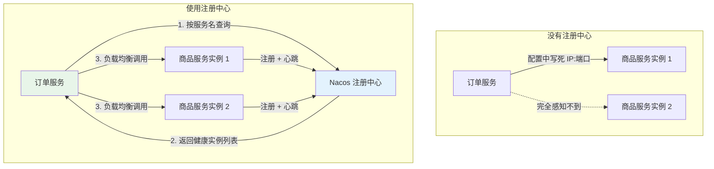
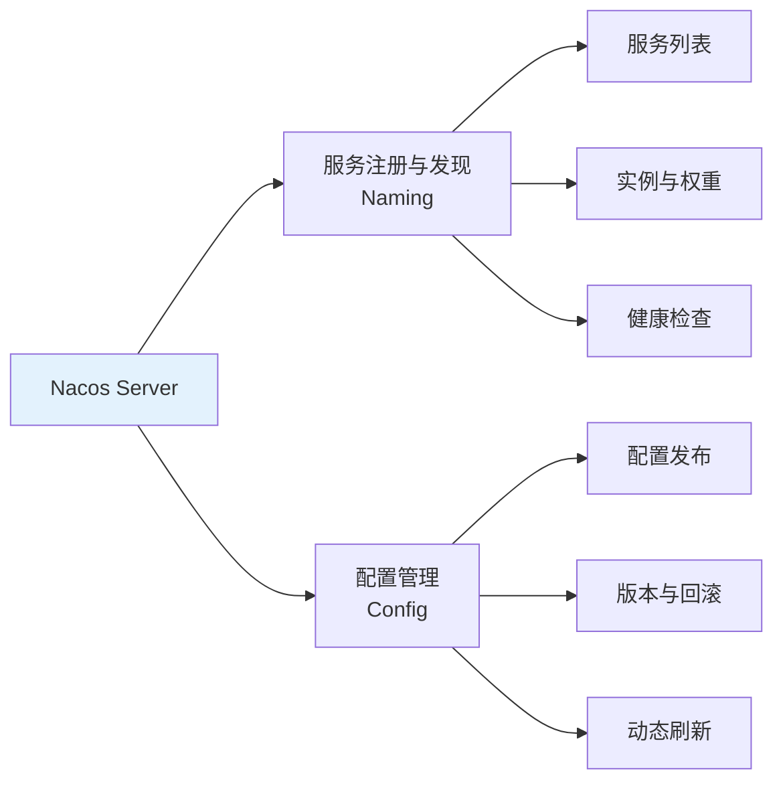

# Nacos部署与快速上手

## 课程目标

- 理解服务注册中心（Service Registry）在微服务架构中承担的职责与边界
- 掌握 Nacos 与 Eureka、ZooKeeper、Consul、etcd 的差异，能够说明选型依据
- 掌握 Nacos 3.x 安装包的获取、解压与目录结构
- 能够以单机模式启动 Nacos，并独立完成日志、端口与健康检查三重验证
- 掌握 Nacos 3.x 控制台的登录方式与鉴权初始化的差异
- 能够定位端口占用、内存不足、鉴权失败、Derby 锁等启动期故障

## 回顾与导入

上一课《公共模块建设》交付了 `Result<T>`、`ResultCode`、`PageResult<T>`、`BusinessException` 与 `GlobalExceptionHandler`，三个服务已经能各自启动、各自连库、各自返回统一格式的响应。

但它们之间仍是三座孤岛。订单服务要扣库存，只能拿到前端传来的商品标题和价格，它并不知道商品服务在哪里；即便知道，也只能把 `127.0.0.1:8081` 写进配置文件。代价是：商品服务一扩容，订单服务要改配置重启；一迁移，订单服务就报连接超时。

把地址从"写死"变成"查询"，就需要一个所有服务都认可的通讯录。这个通讯录就是注册中心：服务启动时把自己的地址写进去，服务下线时把地址划掉，调用方每次用服务名去查当前可用的地址列表。



本课只做一件事：把这块"通讯录"装起来，并确认它真的能用。业务服务如何注册进去，留到《图书服务注册到Nacos》。

## 服务注册中心解决什么问题

### 四类典型痛点

注册中心不是一个"为了架构好看"而存在的组件，它对应四类具体故障：

| 痛点 | 典型现象 | 注册中心的解法 |
| --- | --- | --- |
| 地址硬编码 | 服务扩容后要改配置并重启调用方 | 调用方只持有服务名，运行时向注册中心查询 |
| 地址动态变化 | 容器重建、IP 漂移导致调用失败 | 实例地址由服务自己上报，调用方实时拉取 |
| 无法感知健康状态 | 请求打到已宕机的实例，出现间歇性超时 | 心跳与主动探测，异常实例被标记并剔除 |
| 多实例无统一视图 | 不知道某个服务当前有几个实例、在哪台机器 | 集中维护实例列表、权重、上下线状态 |

> **结论：** 注册中心只解决"地址从哪来、地址还可不可用"，它不解决调用本身。调用要靠 OpenFeign 或 RestClient，负载均衡要靠 Spring Cloud LoadBalancer，这些是后面几课的内容。

## 为什么选择 Nacos

### 主流注册中心横向对比

| 注册中心 | 一致性模型 | 健康检查 | 配置中心能力 | 控制台 | 生态与维护状态 |
| --- | --- | --- | --- | --- | --- |
| **Nacos** | AP/CP 可切换（Distro + JRaft） | 心跳、主动探测、临时/持久实例 | 内置，同一套控制台 | 内置，功能完整 | Spring Cloud Alibaba 原生集成，社区活跃 |
| Eureka | AP（Peer to Peer 复制） | 客户端心跳 | 不支持 | 有，页面简陋 | Netflix 已停止新功能开发，Spring Cloud 2025 已移除 |
| ZooKeeper | CP（ZAB 协议） | 会话（Session）超时 | 不支持（需自建） | 无，依赖第三方 | Apache 维护，多用于 Dubbo、Kafka 场景 |
| Consul | CP（Raft） | TCP/HTTP/gRPC/TTL 多种探针 | 支持（KV） | 内置 | HashiCorp 维护，云原生场景较多 |
| etcd | CP（Raft） | 租约（Lease）+ 探针 | 支持（KV，无专门模型） | 无，依赖 etcdctl 或第三方 | CNCF 项目，Kubernetes 的数据底座 |

### AP 与 CP 的取舍

CAP 指的是分区容错性（Partition tolerance）下的一致性与可用性二选一。网络分区无法避免，所以真正要选的是分区发生时保哪一头：选 AP，各节点继续提供服务，可能读到旧实例列表，注册与发现不中断；选 CP，少数派节点拒绝写入，极端情况下注册失败，但列表绝对准确。

Nacos 的临时实例走 AP（Distro 协议，自研最终一致性），持久实例与集群元数据走 CP（JRaft）。这个开关不是安装时选一次，而是按实例类型自动区分，这是它比 Eureka、ZooKeeper 更适合"混合场景"的关键。

### Nacos 的双核心能力



选 Nacos 的理由是：注册与配置共用服务端、控制台与鉴权体系，运维成本低；Starter 由同一 BOM 管版本；临时实例与持久实例并存，能同时容纳微服务与中间件；国内案例多，排障资料完整。

### 版本对应关系

Spring Cloud Alibaba `2025.0.0.0` 的 BOM 锁定的 Nacos Client 为 `3.0.3`，因此服务端选 `3.0.x`（本课程用 `3.0.3`）即可对齐。

> **注意：** 客户端与服务端不要求小版本完全一致，但大版本应匹配。3.x 客户端连 2.x 服务端会因 gRPC 接口变化出现兼容问题，反之亦然。升级时先升服务端再升客户端。

## 下载与目录结构

### 环境要求

| 项目 | 要求 | 检查方式 |
| --- | --- | --- |
| 操作系统 | 64 位 Linux / macOS / Windows | `uname -m`（Linux）、`systeminfo`（Windows） |
| JDK | 17 及以上 | `java -version` |
| 内存 | 单机演示 2 GB 可用，生产建议 4 GB 以上 | `free -h`（Linux）、任务管理器（Windows） |
| 端口 | 8848、9848、9849、7848、8080（3.x 控制台） | 见后文端口排查 |

Nacos 3.x 明确不再支持 JDK 8。启动脚本会用 `JAVA_HOME` 定位 Java，因此除了 `java` 在 PATH 中，还要确认 `JAVA_HOME` 指向 JDK 17：

```bash
# Linux / macOS
echo $JAVA_HOME
java -version
```

```cmd
:: Windows
echo %JAVA_HOME%
java -version
```

> **提示：** `java -version` 走 PATH，Nacos 脚本走 `JAVA_HOME`，两者可能不是同一个 JDK。排查"版本够却启动失败"时先看 `JAVA_HOME`。

### 获取安装包

下载有两条通道：官网下载页 `https://nacos.io/download/nacos-server/`，以及 GitHub Releases `https://github.com/alibaba/nacos/releases`（官网限流时的备用）。在 Releases 页面选择 `3.0.3`，下载 Assets 中的 `nacos-server-3.0.3.zip`。Windows 与 Linux 共用同一个包，区别只在启动脚本。

> **注意：** 不要下载 `nacos-server-3.0.3.tar.gz` 以外的源码包（`Source code`）。源码包需要自行用 Maven 编译，产出在 `distribution/target/` 下，对新手没有必要。

### 解压与目录说明

```bash
# Linux / macOS
unzip nacos-server-3.0.3.zip -d /opt
cd /opt/nacos
```

Windows 直接用解压工具展开到 `D:\nacos`。解压后的结构如下（`target` 目录为 3.x 新增）：

```text
nacos/
├── bin/
│   ├── startup.sh / startup.cmd      # 启动脚本
│   ├── shutdown.sh / shutdown.cmd    # 停止脚本
│   └── logs/                         # 启动脚本自身的输出（startup.out）
├── conf/
│   ├── application.properties        # 主配置
│   ├── application.properties.example
│   ├── mysql-schema.sql              # 外置 MySQL 初始化脚本
│   ├── cluster.conf.example          # 集群节点列表模板
│   └── nacos-logback.xml             # 日志配置
├── target/
│   └── nacos-server.jar              # 3.x 的可执行 jar
├── data/                             # Derby 数据目录（首次启动后生成）
└── logs/                             # 运行日志
```

日常只动两处：调内存改 `bin/` 脚本，改端口、鉴权、数据源改 `conf/application.properties`。`data/` 是单机模式的 Derby 数据，清理会丢失全部配置与用户。

> **提示：** 目录路径不要带中文或空格。Windows 上中文路径会导致日志输出乱码，某些场景下还会让 Derby 无法创建数据文件。

## 单机模式启动

### 两种部署模式

| 模式 | 启动参数 | 存储 | 适用场景 |
| --- | --- | --- | --- |
| 单机（standalone） | `-m standalone` | 内置 Derby | 本地开发、教学演示 |
| 集群（cluster） | `-m cluster` 或不加参数 | 外置 MySQL | 测试、生产 |

单机模式不需要外部依赖，解压即可启动；Derby 是嵌入式数据库，只允许一个进程访问，因此不能把 `data/` 共享给多个 Nacos 进程。

### 启动命令

```bash
# Linux / macOS
sh startup.sh -m standalone

# Ubuntu/Debian 若提示 "[[: not found"，改用 bash
bash startup.sh -m standalone
```

```cmd
:: Windows
startup.cmd -m standalone
```

`-m standalone` 是唯一必须记住的参数。漏掉它会按集群模式启动，此时如果 `conf/cluster.conf` 不存在或内容不合法，启动会直接失败。

### JDK 与内存参数

启动脚本按模式分配不同的 JVM 参数，单机模式默认较小：

| 参数 | 单机默认 | 集群默认 | 作用 |
| --- | --- | --- | --- |
| `-Xms` | 512m | 2g | 堆初始大小 |
| `-Xmx` | 512m | 2g | 堆最大值 |
| `-Xmn` | 256m | 1g | 新生代大小 |
| `-XX:MetaspaceSize` | 依版本 | 128m | 元空间初始值 |

本地机器内存紧张时可下调，但不建议低于 256m，否则配置较多时容易触发 Full GC。改法是编辑 `bin/startup.sh` 单机分支的 `JAVA_OPT`，或 Windows 下用记事本打开 `bin/startup.cmd` 修改 `set "JAVA_OPT=..."`。

> **注意：** 不要直接改 `target/nacos-server.jar` 的启动方式去绕开脚本。脚本除了堆参数，还设置了 `-Dnacos.home`、日志路径、模块化参数（`--add-opens` 等），手工 `java -jar` 很容易漏项。

### 启动日志验证

三种验证方式，建议都做一遍，因为它们的失败含义不同。

**方式一：看启动脚本输出**。`bin/logs/startup.out` 尾部打印 `Nacos started successfully in stand alone mode. use embedded storage` 即为成功。

**方式二：看运行日志**。`tail -f logs/nacos.log`，出现 `Nacos started successfully` 与 `Tomcat started on port(s): 8848` 表示 HTTP 服务就绪。

**方式三：调健康检查接口**。`curl -i http://127.0.0.1:8848/nacos/v3/console/health/readiness`，返回 `HTTP/1.1 200` 与 `{"code":0,"message":"success","data":"ok"}` 形式即初始化完成。

> **提示：** 健康检查通过不代表控制台可登录。控制台是 3.x 的独立端口 8080，若只验证了 8848，控制台打不开时容易误判为"没启动"。

## 控制台访问与首次登录

### 访问地址

| 版本 | 地址 | 说明 |
| --- | --- | --- |
| Nacos 3.x | `http://localhost:8080/index.html` | 控制台独立端口，与 API 分离 |
| Nacos 3.x（反向代理/旧路径） | `http://localhost:8848/nacos` | 由 Nginx 或兼容路径转发时可用 |
| Nacos 2.x | `http://localhost:8848/nacos` | 控制台与 API 同端口、同前缀 |

这就是最容易踩的坑：教程写 `http://localhost:8848/nacos`，照做却打不开，因为手里是 3.x，控制台在 8080。**先确认版本，再确认端口。**

### 首次登录：3.x 与 2.x 的差异

| 项目 | Nacos 2.x | Nacos 3.x |
| --- | --- | --- |
| 默认账号 | `nacos` / `nacos` | 无默认密码，首次登录需初始化 `nacos` 用户密码 |
| 默认鉴权开关 | 早期版本 `nacos.core.auth.enabled=false` | 默认 `true` |
| 初始化入口 | 无需初始化，直接登录 | 控制台首次打开时引导设置密码 |
| 密码修改 | 控制台用户管理 | 控制台用户管理，或 `nacos` 命令重置 |

3.x 首次访问控制台会要求为内置管理员 `nacos` 设置密码，设定后写入 `users` 表（单机为 Derby），后续启动不再提示。

> **注意：** 初始化只发生一次。忘记密码时，单机可停服务后清理 `data/` 重新初始化（会丢失已有配置），集群模式通过数据库或官方重置流程处理。

### 鉴权相关配置

如果希望关闭鉴权（仅限本地学习），或需要自定义密钥，编辑 `conf/application.properties`：

```properties
# 是否开启鉴权，3.x 默认 true
nacos.core.auth.enabled=true
# 生成 JWT 的密钥，必须 Base64 编码且原始长度不小于 32 字节
nacos.core.auth.plugin.nacos.token.secret.key=SecretKey012345678901234567890123456789012345678901234567890123456789
# 节点间内部通信的身份标识，集群部署必须配置且各节点一致
nacos.core.auth.server.identity.key=serverIdentity
nacos.core.auth.server.identity.value=security
```

这三项的分工各不相同：`nacos.core.auth.enabled` 是总开关，关闭后任何人都能读写配置；`token.secret.key` 决定 JWT 能否被伪造，使用默认值等于没有密钥；`server.identity.key/value` 用于集群节点互信，配错会导致节点之间互相拒绝、节点列表异常。

> **提示：** 生成随机密钥可以执行 `openssl rand -base64 48`，把输出整行贴进配置。密钥在集群所有节点上必须完全一致，否则会出现"这个节点能登录、那个节点 403"的诡异现象。

### 控制台功能概览

控制台左边栏固定是服务管理、配置管理、命名空间、集群管理与权限控制五块，分别对应注册结果核对、集中配置、环境隔离、节点观察与账号授权。具体操作会在《Nacos服务发现实战》《Nacos Config配置中心快速上手》中展开。

## Nacos 3.x 关键变化

从 2.x 迁到 3.x，最容易出错的不是功能，而是默认值与端口。

| 变化点 | Nacos 3.x | Nacos 2.x | 影响 |
| --- | --- | --- | --- |
| 默认鉴权 | 开启，首次登录初始化密码 | 早期版本关闭，默认 `nacos/nacos` | 客户端未配置用户名密码时注册失败并返回 403 |
| 端口划分 | 控制台 8080，HTTP API 8848，gRPC 9848/9849 | 控制台与 API 同为 8848 | 书签、脚本、防火墙规则都要改 |
| OpenAPI | v3 为主，路径 `/nacos/v3/admin/**`、`/nacos/v3/client/**` | v1 `/nacos/v1/ns/**` 为主 | 旧脚本调用可能返回 404 或鉴权失败 |
| 命名空间 ID | 新建时由用户填写，`public` 保留 | 自动生成 UUID | 配置里手写 UUID 的习惯要改 |
| JDK 要求 | 17+ | 8+ | JDK 8 环境直接启动失败 |
| 控制台形态 | 新版 UI，内置 MCP/AI 资源管理 | 旧版 UI | 菜单名称与位置有调整 |

### OpenAPI v3 的路径规则

v1 与 v2 在 3.x 中仍可调用，但已被标记为兼容接口。新脚本建议直接用 v3：

```bash
# 登录获取 accessToken（3.x 鉴权开启时必需）
curl -X POST 'http://127.0.0.1:8848/nacos/v3/auth/user/login' \
  -d 'username=nacos&password=${NACOS_PASSWORD}'

# 查询服务列表
curl 'http://127.0.0.1:8848/nacos/v3/admin/ns/service/list?namespaceId=public&pageNo=1&pageSize=10&accessToken=上一步的token'
```

> **注意：** 管理端接口需要管理员身份，用业务账号调 `/admin/` 下的接口会返回 403；这不是接口不存在，而是权限不足。

### 命名空间 ID 规则的变化

2.x 新建命名空间时，ID 由系统生成一串 UUID，用户只能填名称。3.x 改为由用户显式指定 ID，规则大致为：2~64 个字符，支持字母、数字、中划线、下划线，不能与保留字 `public` 冲突。

实操差异在于：2.x 要填名称、系统生成 UUID，再把 UUID 复制到客户端；3.x 直接填名称与 ID，客户端使用自定义 ID 如 `dev`，跨环境迁移时配置不必替换。

> **提示：** 无论 2.x 还是 3.x，`namespace` 配置项填的都是**ID**而不是名称。3.x 简化了这一步，但不代表可以填中文名称。

## 停止与重启

### 正常停止与强制停止

Linux/macOS 执行 `sh shutdown.sh`，Windows 执行 `shutdown.cmd`。脚本读取 `logs/nacos.pid` 并发送终止信号，属于优雅停机，会先注销实例、刷盘再退出。脚本失效（如 PID 文件丢失）时按端口找进程：

```bash
# Linux / macOS
lsof -i:8848
kill -9 <PID>
```

```cmd
:: Windows
netstat -ano | findstr :8848
taskkill /PID <PID> /F
```

> **注意：** 强制停止可能留下 Derby 锁文件。单机模式如果重启时报 `Another instance of Derby may have already booted the database`，说明旧进程没退干净，先确认进程真的结束，再重新启动。

### 重启与日志位置

```bash
sh shutdown.sh && sleep 5 && sh startup.sh -m standalone
```

| 日志文件 | 内容 | 排障优先级 |
| --- | --- | --- |
| `bin/logs/startup.out` | 启动脚本与 JVM 的原始输出 | 高：启动即失败先看这里 |
| `logs/nacos.log` | 服务端主日志，注册、配置、异常 | 高 |
| `logs/nacos-cluster.log` | 集群成员与一致性状态 | 集群部署时看 |
| `logs/connection.log` | 长连接（gRPC）相关 | 客户端连不上时看 |
| `logs/protocol-raft.log` | JRaft 选举与日志复制 | 集群脑裂时看 |

## 常见问题排查

| 现象 | 最可能的原因 | 排查与处理 |
| --- | --- | --- |
| 启动脚本一闪而过 | `JAVA_HOME` 未设置或指向 JDK 8 | 看 `bin/logs/startup.out`，确认版本为 17+ |
| `Port 8848 was already in use` | 端口被其它进程占用 | `netstat -ano \| findstr :8848` 后结束进程 |
| 控制台打不开但 8848 通 | 访问了 `8848/nacos` 而实际是 3.x | 改用 `http://localhost:8080/index.html` |
| `OutOfMemoryError` | 堆过小或机器内存不足 | 上调 `-Xmx`，或关闭其它占内存的应用 |
| 客户端注册返回 403 | 鉴权开启但未配置账号 | 配置 `spring.cloud.nacos.username/password` |
| 启动报缺少 `cluster.conf` | 漏了 `-m standalone` | 补上模式参数 |
| Derby 锁冲突 | 同一 `data/` 被两个进程打开 | 只保留一个单机实例，或改用 MySQL |
| 页面能开但接口 404 | 调用了 v1 路径或端口写错 | 确认 `/nacos/v3/` 前缀与 8848 端口 |

### 端口占用排查

```bash
# Linux / macOS
ss -lntp | grep -E '8848|9848|9849|7848|8080'
```

```cmd
:: Windows
netstat -ano | findstr "8848 9848 9849 7848 8080"
```

Nacos 单机模式会监听多个端口，任一被占都会启动失败：8848（HTTP）、9848（客户端 gRPC）、9849（服务端 gRPC）、7848（JRaft）以及 3.x 控制台 8080。

> **结论：** 只放行 8848 是不够的。客户端 3.x 默认走 gRPC，9848 不通时会一直重连，表现为"启动不报错但服务迟迟不注册"；内存不足则表现为启动阶段 `OutOfMemoryError`，单机开发把堆设为 256m~512m 通常足够，仍不够时应拆分机器而非继续压参数。

## 注意事项

1. **端口要成组开放**：8848、9848、9849、7848 是一组，只开 8848 会导致注册异常。
2. **3.x 控制台在 8080**：与 Spring Boot 应用默认端口冲突，建议把 `book-gateway` 改为 8085。
3. **鉴权默认开启**：本地可关闭，但服务暴露在局域网就必须保留并替换默认密钥。
4. **单机模式仅用于开发**：Derby 不支持多进程并发，生产必须用集群 + MySQL。
5. **版本要对齐**：Server 3.0.x 对应 Client 3.0.x，跨大版本会出现 gRPC 协议不兼容。
6. **不要长期用 `kill -9`**：优雅停机能让实例及时注销，缩短调用方拿到死实例的窗口。
7. **配置改完必须重启**：`application.properties` 不是动态配置，改端口、鉴权、数据源都要重启。

## 小结

本节课我们学习了：

1. **注册中心的定位**：解决地址硬编码、动态变化、健康感知与多实例管理，它只管"地址从哪来"，不管调用。
2. **选型依据**：Nacos 注册与配置一体、AP/CP 按实例类型切换、与 SCA 原生集成，优于 Eureka、ZooKeeper、Consul、etcd 的单点能力。
3. **安装与目录**：解压即用，`bin` 管脚本、`conf` 管配置、`target` 放 jar、`logs` 看日志。
4. **单机启动**：`startup.cmd -m standalone` 或 `sh startup.sh -m standalone`，理解 `JAVA_HOME` 与堆参数。
5. **控制台与鉴权**：3.x 控制台在 8080，首次登录需初始化 `nacos` 用户；2.x 为 8848/nacos 且默认 `nacos/nacos`。
6. **3.x 关键变化**：默认鉴权、端口分离、OpenAPI v3、命名空间 ID 自定义、JDK 17 起步。
7. **故障排查**：端口成组检查、内存分级处理、403 看鉴权、Derby 锁看残留进程。

## 作业

### 作业一：搭建并验证单机 Nacos

1. 下载 `nacos-server-3.0.3.zip`，解压到不含中文与空格的目录。
2. 确认 `java -version` 为 17+ 且 `JAVA_HOME` 指向同一 JDK。
3. 以单机模式启动，记录 `bin/logs/startup.out` 中成功启动的那一行。
4. 访问控制台完成 `nacos` 用户初始化并登录，用 `curl` 调用健康检查接口。

### 作业二：整理故障排查清单

1. 人为占用 8848 端口，观察启动报错并记录完整异常，释放端口后重启确认恢复。
2. 把 `-Xmx` 改为 `64m` 再启动，观察内存异常后改回。
3. 将两次实验的现象、日志关键字与处理方式整理成一张排查表。

### 作业三：对比 2.x 与 3.x

1. 列出 3.x 相对 2.x 在端口、鉴权、OpenAPI 三方面的差异。
2. 说明现有脚本调用 `/nacos/v1/ns/service/list` 时，迁移到 3.x 需要改哪些内容。
3. 给出至少两条升级失败时的回滚预案。
