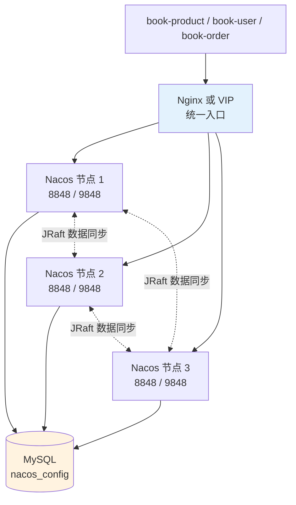
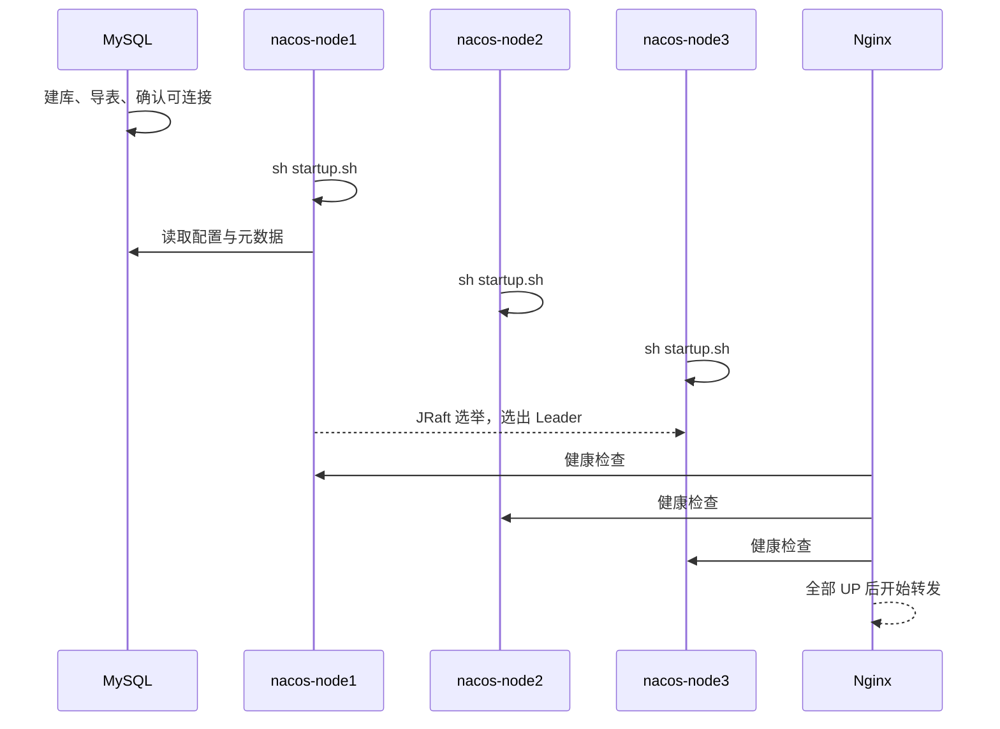

# Nacos高可用集群搭建

## 课程目标

- 理解 Nacos 集群的三种角色：接入层、Nacos 节点、外置数据源
- 掌握集群节点数、端口与磁盘的规划方法
- 掌握外置 MySQL 的建库、授权与 `mysql-schema.sql` 导入
- 能够编写 `cluster.conf` 与 `application.properties` 的集群配置
- 掌握"MySQL → 各节点 → 接入层"的启动顺序与逐层验证方法
- 能够通过下线节点验证集群可用性，并定位节点列表为空、脑裂、403 等故障

## 回顾与导入

上一课我们把 Nacos 以单机模式跑了起来：解压、`-m standalone`、登录控制台、看日志。这套环境足够支撑本课程的大部分演示，但它有一个致命问题——**只有一个节点**。

单机模式的三个限制必须说清楚：

| 限制 | 现象 | 生产后果 |
| --- | --- | --- |
| 单点故障 | 进程退出或机器宕机 | 注册与配置同时不可用，所有服务无法发现彼此 |
| 内置 Derby | 数据落在本机 `data/` 目录 | 无法多节点共享，扩容即数据不一致 |
| 无一致性协议 | 不存在节点间的数据复制 | 没有"多数派"，谈不上容错 |

注册中心是整套微服务的"总机"，它的可用性要求高于任何一个业务服务。因此真实环境里 Nacos 必须以集群方式部署：至少三个节点、外置 MySQL、前置一个统一入口。

本课就把单机环境升级成三节点集群，并用"杀掉一个节点"的方式验证它真的扛得住。集群搭好之后，《图书服务注册到Nacos》才有意义——服务注册的目标地址将指向这个集群。

## 集群架构

### 整体结构



三个角色各司其职：

| 角色 | 职责 | 缺失后的后果 |
| --- | --- | --- |
| 接入层（Nginx/VIP） | 统一地址、健康检查、故障转移 | 客户端要自己维护三个地址，入口不统一 |
| Nacos 节点 | 处理注册、发现、配置读写，参与一致性协议 | 少于多数派时集群拒绝写入 |
| 外置 MySQL | 持久化配置、用户、权限等元数据 | 节点无法启动或数据无法共享 |

> **注意：** 客户端直连三个节点地址也能工作（`server-addr` 逗号分隔），接入层不是强制项。它的价值在于统一入口、隐藏节点变更、把控制台与 API 收敛到一个域名。

### 为什么节点数必须是奇数

Nacos 的集群元数据用 JRaft 维护，写入需要**多数派**（Quorum）确认。节点数与容错能力的关系如下：

| 节点数 | 多数派 | 可容忍故障节点 | 说明 |
| --- | --- | --- | --- |
| 1 | 1 | 0 | 单机，无高可用 |
| 2 | 2 | 0 | 坏一台即失去多数派，比单机更差 |
| 3 | 2 | 1 | 生产最低配置 |
| 4 | 3 | 1 | 容错与 3 节点相同，多浪费一台 |
| 5 | 3 | 2 | 容错更高，成本更高 |

> **结论：** 偶数节点不增加容错能力，只会增加成本。生产环境选 3 或 5，不要选 2 和 4。

### 端口规划

| 端口 | 用途 | 规划要点 |
| --- | --- | --- |
| 8848 | HTTP API 与 OpenAPI | 各节点一致，接入层对外暴露 |
| 9848 | 客户端 gRPC（`8848+1000`） | 客户端必须能直连，不能只代理 8848 |
| 9849 | 服务端间 gRPC（`8848+1001`） | 节点间互通，防火墙放行 |
| 7848 | JRaft 选举与日志复制（`8848-1000`） | 节点间互通，对延迟敏感 |
| 8080 | 3.x 控制台 | 独立端口，同机多节点时必须改 |

> **提示：** 9848/9849/7848 由 8848 推导得出，所以修改主端口后这几个端口会跟着变。接入层只代理 8848 会导致客户端注册失败，这是集群接入最常见的坑。

## 环境规划与准备

### 节点规划表

以下规划按三台独立主机设计，IP 仅作示例：

| 节点 | IP | HTTP | gRPC | 控制台 | 数据盘 |
| --- | --- | --- | --- | --- | --- |
| nacos-node1 | 192.168.10.11 | 8848 | 9848 | 8080 | /data/nacos |
| nacos-node2 | 192.168.10.12 | 8848 | 9848 | 8080 | /data/nacos |
| nacos-node3 | 192.168.10.13 | 8848 | 9848 | 8080 | /data/nacos |
| MySQL | 192.168.10.20 | 3306 | - | - | /data/mysql |
| Nginx | 192.168.10.30 | 80 | - | - | - |

单机多节点（仅用于学习）时，三个节点的 8848 必须错开，且控制台端口也要各自覆盖：

| 节点 | HTTP | gRPC | 控制台 | 配置差异 |
| --- | --- | --- | --- | --- |
| node1 | 8848 | 9848 | 8080 | 默认 |
| node2 | 8858 | 9858 | 8082 | `nacos.console.port=8082` |
| node3 | 8868 | 9868 | 8083 | `nacos.console.port=8083` |

### 系统层准备

三件事必须在启动前完成，否则后面所有异常都会指向它们：

```bash
# 1. 主机名解析，三个节点都要有相同内容
cat >> /etc/hosts <<'EOF'
192.168.10.11 nacos-node1
192.168.10.12 nacos-node2
192.168.10.13 nacos-node3
EOF

# 2. 时间同步，偏差过大会导致 JRaft 选举异常
timedatectl set-ntp true
chronyc tracking

# 3. 确认 JDK 17 与文件句柄数
java -version
ulimit -n 65535
```

> **注意：** 三个节点的时间偏差建议控制在 1 秒内。容器环境尤其容易漂移，因为宿主机负载高时容器时钟会落后于真实时间。

### 外置 MySQL 初始化

先在 MySQL 上建库与专用账号：

```sql
CREATE DATABASE nacos_config
    DEFAULT CHARACTER SET utf8mb4
    COLLATE utf8mb4_general_ci;

CREATE USER 'nacos'@'192.168.10.%' IDENTIFIED BY 'Nacos@123456';
GRANT ALL PRIVILEGES ON nacos_config.* TO 'nacos'@'192.168.10.%';
FLUSH PRIVILEGES;
```

再用安装包自带的脚本建表，不要手写建表语句：

```bash
mysql -h 192.168.10.20 -unacos -p nacos_config < conf/mysql-schema.sql
```

导入后至少应存在以下表：

| 表名 | 用途 |
| --- | --- |
| `config_info` | 配置内容主表 |
| `his_config_info` | 配置历史版本，支持回滚 |
| `users` / `roles` / `permissions` | 控制台账号与权限 |
| `tenant_info` | 命名空间元信息 |

> **提示：** 若导入时报 `Specified key was too long`，说明库的字符集不是 `utf8mb4` 或 MySQL 版本过低。3.x 的脚本按 MySQL 8 编写，建议直接用 8.0 以上版本。

## 集群配置

### cluster.conf

在**每个节点**的 `conf/` 下创建 `cluster.conf`，内容完全一致，每行一个 `IP:端口`：

```text
192.168.10.11:8848
192.168.10.12:8848
192.168.10.13:8848
```

三个易错点：

| 错误写法 | 后果 |
| --- | --- |
| 写成 `IP:9848` | 节点按 gRPC 端口互相访问 HTTP 接口，全部失败 |
| 混入空行、注释或中文 | 解析异常，节点列表为空 |
| 各节点内容不一致 | 集群被识别成多个小集群，出现脑裂表现 |

### application.properties 集群片段

在 `conf/application.properties` 末尾追加以下内容，三个节点除控制台端口外保持一致：

```properties
# ===== 数据源：使用外置 MySQL =====
spring.sql.init.platform=mysql
db.num=1
db.url.0=jdbc:mysql://192.168.10.20:3306/nacos_config?characterEncoding=utf8&connectTimeout=3000&socketTimeout=5000&autoReconnect=true&useUnicode=true&useSSL=false&serverTimezone=Asia/Shanghai&allowPublicKeyRetrieval=true
db.user.0=nacos
db.password.0=Nacos@123456

# ===== 鉴权：集群所有节点必须一致 =====
nacos.core.auth.enabled=true
nacos.core.auth.plugin.nacos.token.secret.key=VGhpc0lzQVNlY3JldEtleUZvck5hY29zQ2x1c3RlcjEyMzQ1Njc4OTA=
nacos.core.auth.server.identity.key=clusterIdentity
nacos.core.auth.server.identity.value=clusterValue

# ===== 3.x 控制台端口（同机多节点时各自覆盖） =====
# nacos.console.port=8080
```

关键项说明：

| 配置项 | 作用 | 配错的表现 |
| --- | --- | --- |
| `spring.sql.init.platform=mysql` | 声明使用外置数据源 | 回退到 Derby，各节点数据不一致 |
| `db.url.0` | 数据库连接串 | 启动报 `Communications link failure` |
| `db.password.0` | 数据库密码 | 启动报 `Access denied` |
| `token.secret.key` | 签发与校验 JWT | 各节点不一致时登录状态互相不认，403 频发 |
| `server.identity.key/value` | 节点间内部调用鉴权 | 节点互相拒绝，节点列表异常 |

### 安全项的正确生成方式

`token.secret.key` 必须是 Base64 编码、原始长度不少于 32 字节的字符串，且**三个节点完全一致**：

```bash
openssl rand -base64 48
```

> **注意：** 不要随手写一句 `nacos` 当密钥。长度不足会导致启动时抛 `Secret key length is too short`；各节点不一致会导致"在 node1 登录成功，请求打到 node2 却 401"。

### 配置文件的分发

三份配置只差控制台端口时，建议用脚本统一分发，避免手改出错：

```bash
for ip in 192.168.10.11 192.168.10.12 192.168.10.13; do
  scp conf/cluster.conf "root@${ip}:/opt/nacos/conf/"
  scp conf/application.properties "root@${ip}:/opt/nacos/conf/"
done
```

## 启动与验证

### 启动顺序

顺序不能颠倒：数据库没起来，节点会因为初始化失败而退出；节点没起来，接入层的健康检查全部失败。



集群模式不需要 `-m standalone`，直接执行启动脚本即可：

```bash
# Linux / macOS
sh startup.sh

# 同机多节点时，先在 application.properties 中设置各自的控制台端口
sh startup.sh
```

```cmd
:: Windows
startup.cmd
```

### 逐节点验证

每启动一个节点，先单独确认它自己没问题，再去启动下一个：

```bash
# 节点存活与 HTTP 端口
curl -i http://192.168.10.11:8848/nacos/v3/console/health/readiness

# 节点角色与集群成员（需要鉴权时带 accessToken）
curl 'http://192.168.10.11:8848/nacos/v1/ns/operator/servers'
```

预期响应中 `servers` 数组包含三个节点，且 `state` 为 `UP`、`leader` 只有一个为 `true`。

### 控制台查看集群节点

登录任一节点的控制台（3.x 为 `http://192.168.10.11:8080/index.html`），进入"集群管理"，应看到：

| 节点地址 | 状态 | 角色 |
| --- | --- | --- |
| 192.168.10.11:8848 | UP | LEADER |
| 192.168.10.12:8848 | UP | FOLLOWER |
| 192.168.10.13:8848 | UP | FOLLOWER |

> **提示：** 刚启动的几秒内可能只显示部分节点，属于正常现象；持续 1 分钟仍缺节点，按"常见问题"排查 `cluster.conf` 与 8848/7848 连通性。

### 高可用验证：杀掉一个节点

验证步骤：

1. 在控制台注册一个测试服务（或用后续课的业务服务），确认三个节点都能查到实例；
2. 在 node1 上执行 `sh shutdown.sh`，或直接 `kill -9` 模拟宕机；
3. 观察另外两个节点的控制台、客户端注册与查询是否正常；
4. 重新启动 node1，观察它是否自动追上数据并回到集群。

预期结果：

| 观察点 | 杀掉一个节点后 | 说明 |
| --- | --- | --- |
| 剩余节点控制台 | 可正常访问 | 多数派仍在 |
| 新服务注册 | 成功 | 写请求由 Leader 处理 |
| 服务查询 | 成功，实例列表完整 | 数据已同步到多数派 |
| 集群管理页面 | 故障节点显示 DOWN | 不会立即从列表移除 |
| 恢复节点 | 自动同步并转 UP | JRaft 日志复制追平 |

> **结论：** 三节点集群能容忍一台机器故障。但如果你同时杀掉两台，只剩一个节点时无法形成多数派，所有写操作会失败——这正是"不要部署两台"的原因。

## 接入层配置

### Nginx 反向代理

```text
upstream nacos_api {
    server 192.168.10.11:8848 max_fails=2 fail_timeout=10s;
    server 192.168.10.12:8848 max_fails=2 fail_timeout=10s;
    server 192.168.10.13:8848 max_fails=2 fail_timeout=10s;
    keepalive 32;
}

server {
    listen 80;
    server_name nacos.example.com;

    location /nacos/ {
        proxy_pass http://nacos_api/nacos/;
        proxy_http_version 1.1;
        proxy_set_header Connection "";
        proxy_connect_timeout 3s;
        proxy_read_timeout 10s;
        proxy_next_upstream error timeout http_502 http_503;
    }
}
```

| 参数 | 作用 | 建议值 |
| --- | --- | --- |
| `max_fails` / `fail_timeout` | 摘除连续失败的节点 | 2 次 / 10s |
| `keepalive` | 复用到后端的连接 | 32 以上 |
| `proxy_next_upstream` | 失败后切换下一节点 | 至少包含 `error timeout` |
| `proxy_read_timeout` | 长轮询配置监听的超时 | 配置中心场景需大于 30s |

> **注意：** Nginx 只代理 8848 的 HTTP 流量，**gRPC 9848 不会被代理**。客户端仍需要能直连三个节点的 9848，或用支持 gRPC 四层转发的负载均衡器。这是"只配了 Nginx 就注册不上"的根本原因。

## 生产建议

### 部署建议

| 项目 | 建议 | 原因 |
| --- | --- | --- |
| 节点数 | 3 或 5，奇数 | 多数派机制决定偶数无收益 |
| 磁盘 | 日志与数据独立磁盘，预留 50 GB 以上 | 日志增长快，写满会导致节点异常 |
| 内存 | 每节点 4 GB 以上，堆 2g | 配置数量与连接数增长后 512m 不够 |
| 网络 | 节点间同机房、低延迟 | JRaft 对网络抖动敏感 |
| MySQL | 主从或云数据库，独立于 Nacos 主机 | 数据库故障会使整个集群不可写 |
| 暴露范围 | 只在内网，控制台加白名单 | 注册中心是横向移动的高价值目标 |

### 监控指标

| 指标 | 采集方式 | 告警阈值建议 |
| --- | --- | --- |
| 节点存活 | 健康检查接口 | 连续 3 次失败 |
| JVM 堆使用率 | JMX / Prometheus | 持续 5 分钟高于 85% |
| 集群节点数 | 集群管理接口 | 少于预期节点数 |
| JRaft 日志延迟 | `protocol-raft.log` 或指标 | 持续增长 |
| 磁盘使用率 | 系统监控 | 高于 80% |
| 数据库连接数 | MySQL 监控 | 接近最大连接数 |

### 备份与恢复

配置是核心资产，必须定期备份数据库：

```bash
mysqldump -h 192.168.10.20 -unacos -p \
  --single-transaction --routines \
  nacos_config > nacos_config_$(date +%F).sql
```

| 备份对象 | 频率 | 保留 | 恢复方式 |
| --- | --- | --- | --- |
| MySQL 全库 | 每日 | 30 天 | 导入 SQL 后重启节点 |
| `cluster.conf` 与 `application.properties` | 变更时 | 永久 | 覆盖后重启 |
| 控制台导出的配置压缩包 | 每周 | 12 周 | 控制台导入 |

## 常见问题

| 现象 | 最可能的原因 | 排查与处理 |
| --- | --- | --- |
| 集群管理页面节点列表为空 | `cluster.conf` 缺失、格式错误或各节点不一致 | 检查每行 `IP:8848`，三份文件用 `diff` 对比 |
| 节点显示 DOWN | 7848/9848 不通或时间偏差过大 | `telnet IP 7848`，检查防火墙与时钟同步 |
| 集群分裂成两组 | 网络分区或节点数配置错误 | 保证多数派可达；跨机房部署需评估 |
| 启动报 403 | `token.secret.key` 或 identity 各节点不一致 | 统一配置并重启全部节点 |
| 启动报 `Access denied` | 数据库账号、密码或授权主机不匹配 | 用同一账号在节点上执行 `mysql` 登录验证 |
| 控制台端口冲突 | 同机多节点都用 8080 | 为每个节点设置 `nacos.console.port` |
| 客户端注册不上 | 只放了 8848，9848 未放行 | 放行 9848/9849，或确认接入层支持 gRPC |
| 节点启动后反复重启 | 数据源连接超时或表结构缺失 | 查 `logs/nacos.log`，确认已导入 `mysql-schema.sql` |

### 脑裂的识别与预防

脑裂指集群被网络分成两组，各自认为自己是唯一集群。JRaft 的保护机制是"没有多数派就不写入"，因此 3 节点被切成 2+1 时，1 那一侧会停止写入而不是产生双写。

| 部署方式 | 脑裂风险 | 建议 |
| --- | --- | --- |
| 三节点同机房 | 低 | 推荐，网络稳定 |
| 三节点跨两机房（2+1） | 中 | 机房互联中断时 1 侧不可写 |
| 两机房各三节点（3+3） | 高 | 不要做成两个独立集群后强行合并 |

> **提示：** 预防胜于恢复。跨机房部署时，把多数派放在主机房，备机房只放少数节点；同时给节点间链路做独立监控。

### 时间不同步的排查

```bash
chronyc sources -v
date
```

| 现象 | 说明 | 处理 |
| --- | --- | --- |
| 节点频繁重新选举 | 时钟漂移导致租约判断异常 | 启用 chrony/ntp，偏差控制在 1 秒内 |
| 日志时间戳错乱 | 各节点时区不一致 | 统一 `Asia/Shanghai`，容器挂载 `/etc/localtime` |
| Token 校验随机失败 | JWT 的 `exp` 判断受时钟影响 | 先修时间，再查密钥是否一致 |

## 注意事项

1. **节点数用奇数**：3 节点容错 1 台，5 节点容错 2 台，偶数节点只增加成本。
2. **三份配置必须一致**：`cluster.conf`、token 密钥、identity 三项任一不一致都会导致集群异常。
3. **端口要整组放行**：8848、9848、9849、7848 缺一不可，Nginx 只解决 HTTP。
4. **MySQL 是单点**：生产必须做主从或使用云数据库，并单独监控连接数与慢查询。
5. **不要用 `kill -9` 做日常运维**：优雅停机会先注销实例，避免调用方继续打流量。
6. **首次扩容先备份**：新增节点前备份数据库与配置，扩容后核对节点列表与配置数量。
7. **版本统一**：三个节点必须是同一版本、同一 JDK 大版本，混布会引发序列化与协议问题。

## 小结

本节课我们学习了：

1. **集群的三个角色**：接入层统一入口、Nacos 节点处理读写与一致性、MySQL 持久化元数据。
2. **节点规划**：奇数节点才有容错收益，3 节点是生产最低配置；端口按 8848/9848/9849/7848 成组规划。
3. **MySQL 初始化**：建库授权后用 `mysql-schema.sql` 建表，字符集必须是 `utf8mb4`。
4. **集群配置**：`cluster.conf` 三份一致，数据源、token 密钥与 identity 三项必须统一。
5. **启动顺序**：MySQL → 各节点 → 接入层，逐层验证，确认 Leader 与三个 UP 节点。
6. **可用性验证**：杀掉一个节点后注册与查询仍正常，恢复后自动追平。
7. **生产与排障**：监控节点数、堆、磁盘与数据库；节点列表为空看 `cluster.conf`，403 看密钥一致性。

## 作业

### 作业一：完成三节点集群

1. 按本课规划表准备三台主机（或同机三个端口），完成 MySQL 建库与导表。
2. 编写并分发 `cluster.conf` 与 `application.properties`，用 `diff` 确认三份一致。
3. 按顺序启动，记录每个节点的启动日志与集群管理页面截图。
4. 用 `curl` 调 `/nacos/v1/ns/operator/servers`，保存返回的节点列表。

### 作业二：故障演练

1. 停掉 node1，观察控制台、注册与查询是否正常，记录故障节点状态变化。
2. 再停掉 node2，观察只剩一个节点时的写入行为，记录报错信息。
3. 依次恢复两个节点，确认集群自动回到三个 UP。
4. 把演练过程整理成一张"故障现象—判断依据—恢复动作"的表。

### 作业三：接入层与安全加固

1. 配置 Nginx 反向代理三个节点的 8848，验证通过统一入口能访问控制台与 API。
2. 说明为什么客户端仍需直连 9848，并给出两种解决方案。
3. 为集群生成独立的 token 密钥与 identity，替换默认值后重启验证。
