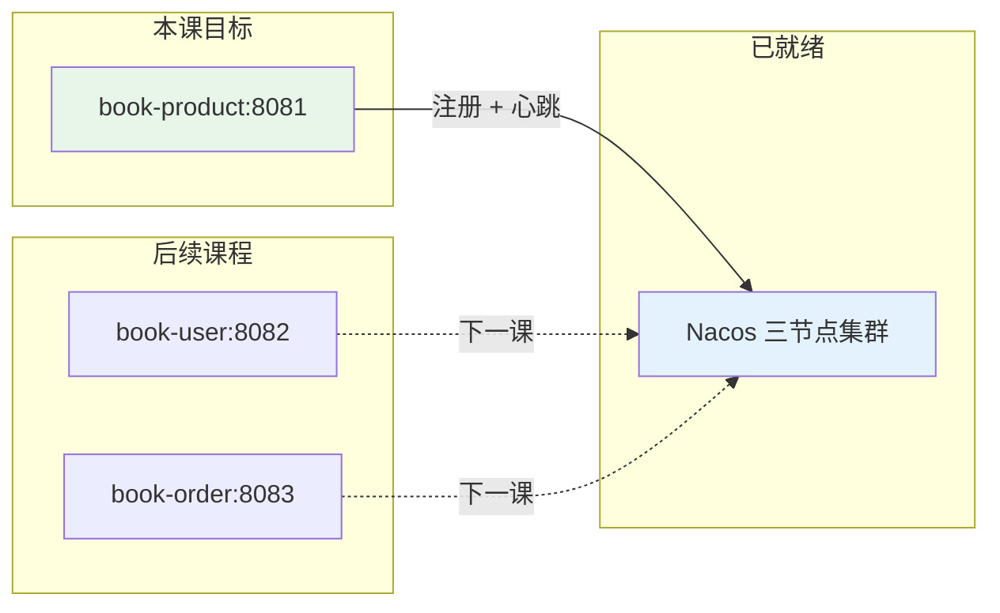
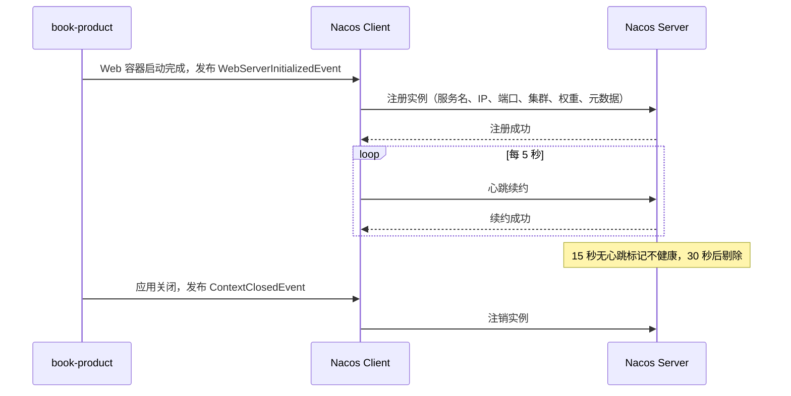

# 图书服务注册到Nacos

## 课程目标

- 理解 Nacos 客户端注册、心跳、注销的完整过程
- 掌握临时实例与持久实例的差异及选择依据
- 掌握 `spring-cloud-starter-alibaba-nacos-discovery` 的引入与版本校验
- 能够编写完整的 `spring.cloud.nacos.discovery` 配置并解释每个配置项
- 理解 `@EnableDiscoveryClient` 为何可以省略及其自动装配原理
- 能够通过控制台与 OpenAPI 双通道验证注册结果，并排查注册失败

## 回顾与导入

前两课完成了注册中心的建设：第 13 课把 Nacos 3.0.3 以单机模式跑通，第 14 课搭好了三节点集群与外置 MySQL。现在环境是就绪的，但控制台的服务列表还是空的——因为还没有任何服务主动登记。

本课要做的动作很小：给 `book-product` 加一个 Starter、写一段 YAML、启动应用，然后看它出现在服务列表里。但要做到"一次成功、失败能查"，就必须理解注册背后发生了什么：客户端如何知道服务端地址，注册请求带了哪些信息，心跳多久发一次，超时后服务端怎么处理。



> **提示：** 本课只做服务端注册，不做远程调用。调用要等 OpenFeign 与 LoadBalancer 到位，因此此刻"注册成功"的验收标准是控制台能看到健康实例，而不是能发起请求。

## 服务注册与发现机制回顾

### 一次完整的注册生命周期



整个过程没有任何业务代码参与。客户端在 Spring 容器启动完成后自动发起注册，在容器关闭时自动注销；期间的续约由后台线程完成。

### 心跳与健康判定

| 参数 | 默认值 | 作用 | 调整建议 |
| --- | --- | --- | --- |
| 心跳间隔 | 5 秒 | 客户端向服务端续约的频率 | 一般不改，网络差可适当放宽 |
| 心跳超时 | 15 秒 | 超过此时长未续约标记为不健康 | 与网络抖动容忍度相关 |
| 实例删除超时 | 30 秒 | 不健康状态持续此时长后从列表剔除 | 可配合优雅停机缩短 |

三个时间是递进关系：**5 秒发一次，15 秒判不健康，30 秒才删除**。所以进程被强制杀掉后，调用方最多会看到约 30 秒的"实例还在列表里但请求失败"的窗口。这也是为什么生产环境强调优雅停机。

### 临时实例与持久实例

| 维度 | 临时实例（ephemeral=true） | 持久实例（ephemeral=false） |
| --- | --- | --- |
| 数据存储 | 保存在服务端内存，不落库 | 持久化到数据库 |
| 健康检查 | 客户端主动上报心跳 | 服务端主动探测 |
| 一致性 | AP（Distro 协议） | CP（JRaft） |
| 断连表现 | 心跳超时后被自动剔除 | 保留实例，标记不健康 |
| 典型使用者 | Spring Cloud 微服务 | 数据库代理、中间件、非 Java 服务 |

> **结论：** 业务微服务保持默认的临时实例即可，它能在实例异常时快速摘除。持久实例适合"实例必须长期存在、由服务端探测健康"的场景。

### Nacos 的数据模型

| 层级 | 示例 | 作用 |
| --- | --- | --- |
| 命名空间 Namespace | `public`、`dev`、`prod` | 最外层隔离，常用于环境 |
| 分组 Group | `DEFAULT_GROUP`、`BOOK_GROUP` | 同一环境内的业务隔离 |
| 服务 Service | `book-product` | 由 `spring.application.name` 决定 |
| 集群 Cluster | `SHANGHAI`、`BEIJING` | 同机房/同区域分组，可做就近访问 |
| 实例 Instance | `192.168.1.10:8081` | 真正提供服务的进程 |

配置里的 `namespace`、`group`、`cluster-name` 分别对应前三层与集群层，服务名则来自 `spring.application.name`。这四项共同决定了一个实例"挂在哪里"。

## 引入依赖

### pom.xml

`book-product` 需要增加服务发现 Starter，版本由父 POM 的 BOM 管理，不要手写版本号：

```xml
<dependency>
    <groupId>com.alibaba.cloud</groupId>
    <artifactId>spring-cloud-starter-alibaba-nacos-discovery</artifactId>
</dependency>
```

这段依赖带来三样东西：Nacos Client、Spring Cloud 的服务注册抽象、以及自动装配类。它不包含配置中心能力，配置中心由 `spring-cloud-starter-alibaba-nacos-config` 负责。

### 校验版本

在父工程根目录执行：

```bash
mvn dependency:tree -pl book-product -Dincludes=com.alibaba.nacos
```

预期看到客户端版本与集群一致：

```text
[INFO] +- com.alibaba.cloud:spring-cloud-starter-alibaba-nacos-discovery:jar:2025.0.0.0:compile
[INFO] |  \- com.alibaba.nacos:nacos-client:jar:3.0.3:compile
```

| 检查项 | 正确结果 | 异常处理 |
| --- | --- | --- |
| Starter 版本 | 2025.0.0.0 | 确认父 POM 已导入 SCA BOM |
| Client 版本 | 3.0.3 | 与 Server 大版本一致 |
| 是否出现多个 nacos-client | 只有一个 | 用 `exclusions` 排掉旧版本 |

> **注意：** 如果项目里同时存在 `nacos-client` 1.x 与 3.x，启动时常见 `NoSuchMethodError` 或 `ClassNotFoundException`。用 `dependency:tree` 找到引入源，排除旧版本，而不是靠升级某个中间件碰运气。

## 配置 application.yml

### 完整配置

这段配置解决四件事：告诉客户端服务端在哪、注册到哪个命名空间与分组、注册到哪个集群、携带哪些元数据。

```yaml
server:
  port: 8081

spring:
  application:
    name: book-product
  cloud:
    nacos:
      discovery:
        # 集群入口：Nginx 或任一节点，多个地址用英文逗号分隔
        server-addr: 192.168.10.30:80
        # 命名空间 ID，默认 public
        namespace: public
        # 分组，默认 DEFAULT_GROUP
        group: DEFAULT_GROUP
        # 集群名称，用于同区域优先
        cluster-name: SHANGHAI
        # 权重，越大分到的流量越多
        weight: 1.0
        # 临时实例：心跳上报，异常自动剔除
        ephemeral: true
        # 是否注册到 Nacos，纯消费者可设为 false
        register-enabled: true
        # 3.x 默认开启鉴权，需提供服务端账号
        username: nacos
        password: ${NACOS_PASSWORD}
        # 注册失败时快速失败，避免"启动了但没注册"的假成功
        fail-fast: true
        metadata:
          version: 1.0.0
          region: cn-east
          zone: zone-a
```

### 配置项详解

| 配置项 | 默认值 | 说明 |
| --- | --- | --- |
| `server-addr` | 无 | 服务端地址，集群用逗号分隔；可带 `/nacos` 上下文 |
| `namespace` | `public` | 命名空间 **ID**，不是名称 |
| `group` | `DEFAULT_GROUP` | 服务分组，消费端必须与服务端一致 |
| `cluster-name` | `DEFAULT` | 集群名，配合就近访问与权重策略 |
| `weight` | `1.0` | 0~1 之间通常表示降权，大于 1 表示加权 |
| `ephemeral` | `true` | 是否临时实例 |
| `register-enabled` | `true` | 是否执行注册动作 |
| `username` / `password` | 空 | 服务端开启鉴权时必填 |
| `fail-fast` | `false` | 注册失败是否中断启动 |
| `metadata` | 空 | 自定义键值，供路由与治理使用 |

> **提示：** `weight` 与 `cluster-name` 真正发挥作用要等负载均衡介入，本课只验证它们被正确写入实例信息。权重与元数据的治理手段详见《Nacos权重路由与元数据治理》。

### namespace 与 group 的填写规则

| 配置项 | 填什么 | 常见错误 |
| --- | --- | --- |
| `namespace` | 控制台命名空间列表中的 ID | 填成中文名称，注册到错误空间 |
| `group` | 与服务端约定的一致字符串 | 消费端用 `DEFAULT_GROUP`，提供端用别的分组 |
| `server-addr` | 集群入口或节点列表 | 只写 IP 漏端口，或把 8080 控制台端口当 API |

> **注意：** 3.x 新建命名空间时由用户指定 ID，2.x 由系统生成 UUID。升级后如果沿用旧 UUID，会注册到一个不存在的空间，表现为"注册成功但控制台看不到"。

### 鉴权配置说明

集群开启了 `nacos.core.auth.enabled=true` 后，客户端必须携带账号。推荐用环境变量而不是明文：

```bash
# Linux / macOS
export NACOS_PASSWORD='Nacos@123456'
```

```cmd
:: Windows
set NACOS_PASSWORD=Nacos@123456
```

| 现象 | 原因 | 处理 |
| --- | --- | --- |
| 启动日志出现 `403` | 未配置账号或密码错误 | 核对 `username`/`password` |
| 只有部分请求 403 | 各节点 token 密钥不一致 | 统一 `token.secret.key` 后重启 |
| 本地能注册、容器内不能 | 环境变量未注入 | 检查容器环境变量与配置变量标记 |

## 启动类与自动装配

### @EnableDiscoveryClient 是否必需

在本课程使用的版本中，**不是必需的**。只要引入 Starter 并配置 `server-addr`，注册就会自动完成。

原因在于自动装配链：

| 自动配置类 | 职责 |
| --- | --- |
| `NacosDiscoveryAutoConfiguration` | 创建 `NacosServiceDiscovery` 与相关 Bean |
| `NacosServiceRegistryAutoConfiguration` | 创建 `NacosServiceRegistry` |
| `NacosAutoServiceRegistration` | 监听 Web 容器启动事件，触发注册 |

`NacosAutoServiceRegistration` 继承自 Spring Cloud 的 `AbstractAutoServiceRegistration`，它在 `WebServerInitializedEvent` 事件到达时调用 `NacosServiceRegistry.register()`。注解的作用只是"显式声明意图"，并不参与这条链路。

> **结论：** 省不省略都不影响功能。团队规范建议保留，让启动类的职责一眼可见；如果项目要求极简，可以省略并在文档中注明。

### 启动类示例

```java
@SpringBootApplication(scanBasePackages = "com.example")
@EnableDiscoveryClient
@MapperScan("com.example.product.mapper")
public class BookProductApplication {

    public static void main(String[] args) {
        SpringApplication.run(BookProductApplication.class, args);
    }
}
```

## 启动与验证

### 启动日志

应用启动后，日志中应出现注册相关输出：

```text
[Nacos Register] register service, serviceName: book-product, groupName: DEFAULT_GROUP
[Nacos Register] register success, serviceName: book-product
```

如果 `fail-fast=true` 且注册失败，应用会直接启动失败——这是刻意的，避免带着"未注册"状态接流量。

### 控制台验证

登录集群控制台，进入"服务管理 → 服务列表"：

| 服务名 | 集群数目 | 实例数目 | 健康实例数 |
| --- | --- | --- | --- |
| `book-product` | 1 | 1 | 1 |

进入实例详情，核对以下字段：

| 字段 | 预期值 | 说明 |
| --- | --- | --- |
| IP | 应用所在机器 IP | 容器环境常见为 Pod IP |
| 端口 | 8081 | 来自 `server.port` |
| 集群 | SHANGHAI | 来自 `cluster-name` |
| 权重 | 1.0 | 来自 `weight` |
| 健康 | 是 | 心跳正常 |
| 临时实例 | 是 | `ephemeral=true` |
| 元数据 | version/region/zone | 来自 `metadata` |

### OpenAPI 验证

3.x 的管理端接口需要令牌，先登录再查询：

```bash
# 获取 accessToken
curl -X POST 'http://192.168.10.30/nacos/v3/auth/user/login' \
  -d 'username=nacos&password=${NACOS_PASSWORD}'

# 查询服务列表
curl 'http://192.168.10.30/nacos/v3/admin/ns/service/list?namespaceId=public&pageNo=1&pageSize=10&accessToken=${TOKEN}'

# 查询实例列表
curl 'http://192.168.10.30/nacos/v3/admin/ns/instance/list?namespaceId=public&groupName=DEFAULT_GROUP&serviceName=book-product&accessToken=${TOKEN}'
```

实例查询的关键字段：

```json
{
  "name": "DEFAULT_GROUP@@book-product",
  "hosts": [
    {
      "ip": "192.168.1.10",
      "port": 8081,
      "weight": 1.0,
      "healthy": true,
      "enabled": true,
      "ephemeral": true,
      "clusterName": "SHANGHAI",
      "metadata": { "version": "1.0.0", "region": "cn-east", "zone": "zone-a" }
    }
  ]
}
```

### 状态字段的含义

| 字段 | 取值 | 含义 |
| --- | --- | --- |
| `healthy` | true/false | 心跳是否正常 |
| `enabled` | true/false | 是否被人工下线 |
| `ephemeral` | true/false | 临时实例还是持久实例 |

`healthy=false` 的实例不会参与正常调用；`enabled=false` 是运维主动下线的结果，两者要区分开。

## 多实例注册

### 启动第二个实例

同一个服务名再起一个进程，用命令行覆盖端口，不修改配置文件：

```bash
# Maven 运行
mvn spring-boot:run -Dspring-boot.run.arguments=--server.port=8081
```

```bash
# jar 运行
java -jar book-product-1.0.0-SNAPSHOT.jar --server.port=8081
```

> **提示：** 8081 已被占用时改用 8091 等未占用端口。命令行参数的优先级高于 `application.yml`，适合本地验证。

### 验证多实例

| 实例 | IP | 端口 | 权重 | 健康 |
| --- | --- | --- | --- | --- |
| 实例 1 | 192.168.1.10 | 8081 | 1.0 | 是 |
| 实例 2 | 192.168.1.10 | 8091 | 1.0 | 是 |

控制台中 `book-product` 的实例数应变为 2，健康实例数也是 2。此时两个实例同名、同分组、同集群，后续接入负载均衡后会轮询调用。

### 停止实例的三种结果

| 停止方式 | 控制台表现 | 时间 |
| --- | --- | --- |
| 正常关闭（Ctrl+C / `kill`） | 立即从列表移除 | 秒级 |
| 优雅停机但未注销 | 15 秒后标记不健康，30 秒后移除 | 约 45 秒 |
| `kill -9` 或宕机 | 同上 | 约 45 秒 |

> **结论：** 扩容时看实例数是否增加，缩容时看实例是否及时消失，这是验证注册链路是否健康最直接的方式。

## 常见问题排查

| 现象 | 最可能的原因 | 排查与处理 |
| --- | --- | --- |
| 控制台看不到服务 | 未引入 Starter、`server-addr` 错误、`register-enabled=false` | 看启动日志是否有 `register success` |
| 注册报连接超时 | 只开了 8848，9848 未放行 | 放行 9848 或确认入口支持 gRPC |
| 注册返回 403 | 鉴权开启但未配账号 | 配置 `username`/`password` |
| 实例显示不健康 | 心跳被拦截、时钟偏差大 | 检查网络与节点时间 |
| 注册到了错误命名空间 | `namespace` 填了名称而非 ID | 复制控制台命名空间 ID |
| 消费端找不到服务 | 两端 `group` 不一致 | 统一为 `DEFAULT_GROUP` 或约定分组 |
| 启动报 `NoSuchMethodError` | `nacos-client` 版本冲突 | `dependency:tree` 找来源并排除 |
| 应用启动但无注册日志 | `spring.application.name` 缺失 | 补上服务名 |

### 排查顺序

| 顺序 | 检查点 | 判断依据 |
| --- | --- | --- |
| 1 | 服务端是否可用 | 控制台能登录、集群节点 UP |
| 2 | 网络是否通 | `telnet server-addr 8848` 与 9848 均通 |
| 3 | 配置是否生效 | 日志打印的 `server-addr`、`namespace` 是否正确 |
| 4 | 注册请求是否发出 | 搜索日志关键字 `register` |
| 5 | 服务端是否收到 | 服务端 `nacos.log` 中查服务名 |

> **提示：** 第 3 步经常被跳过。YAML 缩进错误、profile 覆盖、环境变量拼写错误都会让配置"看起来对、实际没生效"，启动日志里的实际值才是准的。

## 注意事项

1. **不要手写 Starter 版本**：由 BOM 统一管理，手写版本极易与 Client 版本冲突。
2. **`namespace` 填 ID**：2.x 是 UUID，3.x 是自定义 ID，填名称一定注册到错误位置。
3. **`server-addr` 用 8848 或入口的 HTTP 端口**：不要写 8080 控制台端口。
4. **保留优雅停机**：直接 `kill -9` 会让死实例在列表中多停留约 30 秒。
5. **`metadata` 保持精简**：元数据会随心跳同步，键值过多会增加网络与存储开销。
6. **集群环境配多个地址**：单地址在节点故障时会导致注册失败，虽然客户端会重试，但恢复时间变长。
7. **容器环境确认 IP**：默认注册容器 IP，跨主机访问不通时需配置 `ip` 或使用 Host 网络。

## 小结

本节课我们学习了：

1. **注册生命周期**：容器启动触发注册，后台每 5 秒续约，关闭时注销。
2. **健康判定**：15 秒无心跳标记不健康，30 秒后剔除，因此强杀进程会留下约 30 秒的死实例窗口。
3. **实例类型**：业务微服务用临时实例（AP），需要长期保留的实例用持久实例（CP）。
4. **依赖引入**：一个 Starter 即可，版本交给 BOM，用 `dependency:tree` 校验。
5. **完整配置**：`server-addr`、`namespace`、`group`、`cluster-name`、`weight`、`ephemeral`、`register-enabled`、`metadata`、鉴权账号。
6. **注解原理**：`@EnableDiscoveryClient` 可省略，注册由自动装配监听 Web 容器事件完成。
7. **验证与排障**：控制台看实例、OpenAPI 查 JSON、日志搜 `register`，按"服务端→网络→配置→日志"顺序排查。

## 作业

### 作业一：完成 book-product 注册

1. 在 `book-product/pom.xml` 中加入 Nacos Discovery Starter，用 `dependency:tree` 确认 Client 版本。
2. 按本课示例补全 `application.yml`，把 `server-addr` 指向自己的集群入口。
3. 启动应用，保存包含 `register success` 的日志。
4. 在控制台找到实例，记录 IP、端口、集群、权重与元数据。

### 作业二：多实例与状态观察

1. 用命令行参数再启动一个实例，确认实例数变为 2。
2. 正常关闭其中一个，记录实例消失的时间。
3. 用 `kill -9` 强杀另一个，记录"不健康"与"被剔除"两个时间点。
4. 对比两种停止方式的差异并解释原因。

### 作业三：排障演练

1. 故意把 `namespace` 改成一个不存在的 ID，观察注册结果与日志。
2. 故意把 `group` 改为 `BOOK_GROUP`，在控制台确认服务出现的位置。
3. 关闭服务端鉴权或改错密码，记录 403 的完整报错。
4. 把三次实验整理成"现象—原因—修复"的排障表。
