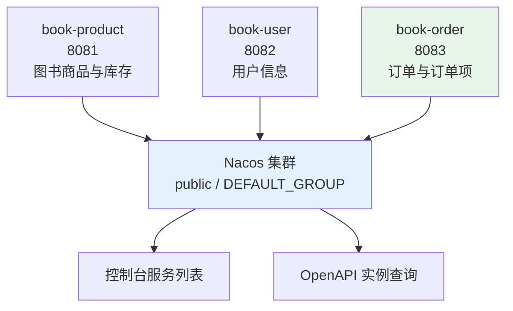
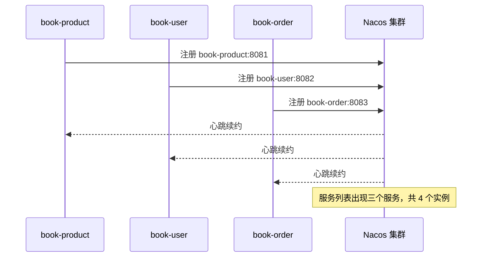

# 用户与订单服务注册

## 课程目标

- 理解同一套注册配置在不同职责服务上的差异化设计
- 掌握 `book-user` 与 `book-order` 的注册配置与改造清单
- 能够把重复的注册配置抽取为共享配置，或交给 Maven profile 管理
- 掌握三服务全部注册后的控制台与 OpenAPI 验证方法
- 掌握实例下线、上线、改权重、切换临时实例等运维操作
- 能够用注册开关与元数据支撑灰度、迁移与故障演练

## 回顾与导入

上一课把 `book-product` 注册进了 Nacos：加依赖、写 YAML、启动、验证，链路已经跑通。现在服务列表里只有一个条目，另外两个服务还在"各自为政"。

三个服务的注册动作看起来完全一样，实际存在差异。商品服务是流量入口，实例多、权重要细调；用户服务被所有业务依赖，必须稳定；订单服务写多读少，后期还要调用商品服务扣库存，它的元数据要能表达"依赖谁"。这些差异最终都落在同一份 `spring.cloud.nacos.discovery` 配置里。



本课除了补齐两个服务，还要解决一个工程问题：三份几乎相同的注册配置，是复制三遍，还是抽出来共享？复制最省事，但改一次服务端地址就要改三个文件；抽得太早又会增加理解成本。课程会给出可落地的折中方案。

## 三服务差异分析

### 注册信息的差异

| 维度 | book-product | book-user | book-order |
| --- | --- | --- | --- |
| 职责 | 图书商品、库存扣减 | 用户注册、登录、资料 | 订单创建、订单项、商品快照 |
| 端口 | 8081 | 8082 | 8083 |
| 本地实例数 | 2（便于验证负载均衡） | 1 | 1 |
| 初始权重 | 1.0 | 1.0 | 1.0 |
| 集群 | SHANGHAI | SHANGHAI | SHANGHAI |
| 元数据 | `version`、`region`、`zone`、`domain=product` | 增加 `domain=user` | 增加 `domain=order`、`depends=book-product` |
| 注册开关 | 开启 | 开启 | 开启 |

### 为什么权重不一开始就调

| 做法 | 优点 | 缺点 | 适用场景 |
| --- | --- | --- | --- |
| 全部 1.0，上线后按监控调 | 简单、无预设偏见 | 初期可能不均衡 | 新系统、流量未知 |
| 按机器规格预设权重 | 大机器多吃流量 | 规格变化后要人工维护 | 机器异构明显 |
| 按机房/区域设置 | 就近访问、降低跨机房延迟 | 需要元数据与路由策略配合 | 多机房部署 |

> **结论：** 权重是运行期参数，不要写死在代码里当常量。配置文件给 1.0，真实权重由控制台或 OpenAPI 调整，调整依据是监控而不是直觉。

### 服务之间的依赖关系

| 服务 | 当前依赖 | 后续演进 |
| --- | --- | --- |
| book-product | 无 | 被订单服务调用扣库存 |
| book-user | 无 | 被订单服务查询用户信息 |
| book-order | 无远程调用 | 通过 OpenFeign 调用 product 与 user |

订单服务是典型的"消费者 + 提供者"双重身份：它自己要被网关调用，又要调用别人。因此它的注册不能关闭，但后续可以为它单独配置超时与重试策略。

## 配置文件改造

### book-user 的 application.yml

```yaml
server:
  port: 8082

spring:
  application:
    name: book-user
  cloud:
    nacos:
      discovery:
        server-addr: 192.168.10.30:80
        namespace: public
        group: DEFAULT_GROUP
        cluster-name: SHANGHAI
        weight: 1.0
        ephemeral: true
        register-enabled: true
        username: nacos
        password: ${NACOS_PASSWORD}
        metadata:
          version: 1.0.0
          region: cn-east
          zone: zone-a
          domain: user
```

### book-order 的 application.yml

```yaml
server:
  port: 8083

spring:
  application:
    name: book-order
  cloud:
    nacos:
      discovery:
        server-addr: 192.168.10.30:80
        namespace: public
        group: DEFAULT_GROUP
        cluster-name: SHANGHAI
        weight: 1.0
        ephemeral: true
        register-enabled: true
        username: nacos
        password: ${NACOS_PASSWORD}
        metadata:
          version: 1.0.0
          region: cn-east
          zone: zone-a
          domain: order
          depends: book-product
```

两份配置与 `book-product` 的差别只有三处：`server.port`、`spring.application.name`、`metadata`。这正是后续要抽取共享配置的直接原因。

### 改动清单

| 模块 | 改动点 | 具体内容 | 验证方式 |
| --- | --- | --- | --- |
| book-user | `pom.xml` | 确认 Discovery Starter 已存在 | `dependency:tree` |
| book-user | `application.yml` | 端口 8082、服务名 `book-user`、注册配置 | 启动日志 |
| book-user | 启动类 | `@EnableDiscoveryClient` 与包扫描 | 编译通过 |
| book-order | `pom.xml` | 确认 Discovery Starter 已存在 | `dependency:tree` |
| book-order | `application.yml` | 端口 8083、服务名 `book-order`、注册配置 | 启动日志 |
| book-order | 启动类 | `@EnableDiscoveryClient` 与 `@MapperScan` | 启动成功 |
| 全部 | 环境变量 | `NACOS_PASSWORD` 已注入 | 注册不报 403 |

### 启动类确认

两个服务的启动类结构一致，只有包名与 Mapper 扫描路径不同：

```java
@SpringBootApplication(scanBasePackages = "com.example")
@EnableDiscoveryClient
@MapperScan("com.example.order.mapper")
public class BookOrderApplication {

    public static void main(String[] args) {
        SpringApplication.run(BookOrderApplication.class, args);
    }
}
```

> **提示：** `scanBasePackages = "com.example"` 是为了扫描到 `book-common` 中的 `GlobalExceptionHandler`。如果只写 `com.example.order`，异常处理不会生效，但注册仍然正常，容易误判为"公共模块没生效"。

## 配置抽取与共享

### 四种方案对比

| 方案 | 优点 | 缺点 | 适用场景 |
| --- | --- | --- | --- |
| 每个服务各写一份 | 直观、无额外机制 | 改地址要改多处，易漏 | 服务少、环境固定 |
| 共享 classpath 配置文件 | 复用彻底、无外部依赖 | 需要理解导入顺序与覆盖规则 | 同一工程内的多模块 |
| Maven profile + 资源过滤 | 构建期定值，环境切换方便 | 改配置要重新打包 | 镜像按环境分别构建 |
| Nacos 配置中心 | 运行期动态、集中管理 | 引入配置中心依赖与治理成本 | 多环境、多团队 |

本课先用第二种方案解决重复，配置中心的完整方案留到《Nacos Config配置中心快速上手》。

### 用 spring.config.import 引入公共配置

把三服务共有的注册配置放到 `book-common` 的 `src/main/resources/nacos-common.yml`：

```yaml
spring:
  cloud:
    nacos:
      discovery:
        server-addr: ${NACOS_SERVER_ADDR:192.168.10.30:80}
        namespace: ${NACOS_NAMESPACE:public}
        group: DEFAULT_GROUP
        cluster-name: SHANGHAI
        weight: 1.0
        ephemeral: true
        register-enabled: true
        username: nacos
        password: ${NACOS_PASSWORD}
```

各服务的 `application.yml` 只保留差异部分，并用 `spring.config.import` 导入：

```yaml
server:
  port: 8083

spring:
  application:
    name: book-order
  config:
    import: optional:classpath:nacos-common.yml
  cloud:
    nacos:
      discovery:
        metadata:
          version: 1.0.0
          domain: order
```

| 写法 | 含义 |
| --- | --- |
| `classpath:nacos-common.yml` | 文件不存在时启动失败 |
| `optional:classpath:nacos-common.yml` | 文件不存在时跳过，适合可选配置 |
| `spring.config.import` 的优先级 | 低于声明导入的文件本身，服务内可局部覆盖 |
| 位置要求 | 必须是 `spring.config.import`，写在 `spring.cloud` 下无效 |

> **注意：** 导入的配置与本地配置是"文档合并"关系。同名标量键以本地为准；集合类配置建议只在一处定义，避免合并结果与预期不一致。

### 用 Maven profile 管理环境差异

当不同环境要打不同镜像时，用 profile 在构建期注入地址：

```xml
<profiles>
    <profile>
        <id>dev</id>
        <activation>
            <activeByDefault>true</activeByDefault>
        </activation>
        <properties>
            <nacos.server-addr>192.168.10.30:80</nacos.server-addr>
            <nacos.namespace>public</nacos.namespace>
        </properties>
    </profile>
    <profile>
        <id>prod</id>
        <properties>
            <nacos.server-addr>nacos.example.com:80</nacos.server-addr>
            <nacos.namespace>prod</nacos.namespace>
        </properties>
    </profile>
</profiles>
```

`pom.xml` 中还需开启资源过滤，否则变量标记不会被替换：

```xml
<build>
    <resources>
        <resource>
            <directory>src/main/resources</directory>
            <filtering>true</filtering>
        </resource>
    </resources>
</build>
```

配置文件中使用 `@...@` 变量标记（Spring Boot 父 POM 的默认分隔符）：

```yaml
spring:
  cloud:
    nacos:
      discovery:
        server-addr: @nacos.server-addr@
        namespace: @nacos.namespace@
```

```bash
mvn clean package -Pprod
```

> **提示：** 若父 POM 不是 `spring-boot-starter-parent`，`@...@` 分隔符需要额外配置 `maven-resources-plugin` 的 `delimiters`，或改用 `${...}`，但要注意与 Spring 自身的属性引用语法冲突。

### 如何选择

| 判断条件 | 选择 |
| --- | --- |
| 只有地址随环境变化，镜像一次构建多处运行 | 环境变量 + 默认值 |
| 环境差异多，且每个环境单独构建 | Maven profile |
| 希望运行期修改、灰度生效 | Nacos 配置中心 |
| 只是消除三份重复 | `spring.config.import` |

## 三服务全注册验证

### 启动顺序



### 控制台验证

进入"服务管理 → 服务列表"，预期看到：

| 服务名 | 集群数 | 实例数 | 健康实例数 | 分组 |
| --- | --- | --- | --- | --- |
| book-product | 1 | 2 | 2 | DEFAULT_GROUP |
| book-user | 1 | 1 | 1 | DEFAULT_GROUP |
| book-order | 1 | 1 | 1 | DEFAULT_GROUP |

逐项核对：

| 检查项 | 预期 | 不满足时看什么 |
| --- | --- | --- |
| 服务数量 | 3 | 是否有服务未启动或注册被关闭 |
| 实例总数 | 4 | 商品服务的第二个实例是否启动 |
| 健康数等于实例数 | 是 | 心跳、网络、时钟 |
| 元数据完整 | `domain` 等键存在 | YAML 缩进、导入覆盖 |

### OpenAPI 验证

```bash
# 1. 登录拿令牌
TOKEN=$(curl -s -X POST 'http://192.168.10.30/nacos/v3/auth/user/login' \
  -d 'username=nacos&password='"${NACOS_PASSWORD}"' | jq -r '.accessToken')

# 2. 查服务列表
curl -s "http://192.168.10.30/nacos/v3/admin/ns/service/list?namespaceId=public&pageNo=1&pageSize=10&accessToken=${TOKEN}" | jq

# 3. 逐个查实例
for s in book-product book-user book-order; do
  echo "== ${s} =="
  curl -s "http://192.168.10.30/nacos/v3/admin/ns/instance/list?namespaceId=public&groupName=DEFAULT_GROUP&serviceName=${s}&accessToken=${TOKEN}" \
    | jq '.hosts[] | {ip, port, weight, healthy, clusterName, metadata}'
done
```

预期每个服务返回类似结构：

```json
{
  "ip": "192.168.1.10",
  "port": 8083,
  "weight": 1.0,
  "healthy": true,
  "clusterName": "SHANGHAI",
  "metadata": {
    "version": "1.0.0",
    "region": "cn-east",
    "zone": "zone-a",
    "domain": "order",
    "depends": "book-product"
  }
}
```

> **提示：** 命令依赖 `jq`。没有安装时去掉 `| jq`，直接看原始 JSON，字段名不变。

## 注册后的运维操作

### 下线与上线

| 操作 | 入口 | 效果 | 适用场景 |
| --- | --- | --- | --- |
| 下线（enabled=false） | 控制台实例列表 → 下线 | 实例仍在列表，但不参与调用 | 发布前摘流量、临时维护 |
| 上线（enabled=true） | 控制台实例列表 → 上线 | 恢复参与调用 | 维护完成 |
| 删除实例 | 控制台或 API | 从列表移除 | 缩容、清理脏数据 |

对应 API（v1 兼容接口，便于脚本化）：

```bash
# 下线
curl -X PUT "http://192.168.10.30/nacos/v1/ns/instance?serviceName=book-order&ip=192.168.1.10&port=8083&enabled=false&namespaceId=public"

# 上线
curl -X PUT "http://192.168.10.30/nacos/v1/ns/instance?serviceName=book-order&ip=192.168.1.10&port=8083&enabled=true&namespaceId=public"
```

> **注意：** 下线是"逻辑摘除"，实例心跳还在，进程重启后可能被重新注册为上线状态。需要彻底阻止注册时，应改 `register-enabled=false` 并重启。

### 修改权重

| 方式 | 操作 | 生效时间 | 风险 |
| --- | --- | --- | --- |
| 控制台 | 实例详情 → 编辑权重 | 秒级 | 权重为 0 等同于摘流量 |
| OpenAPI | `PUT /nacos/v1/ns/instance` 带 `weight` | 秒级 | 脚本误操作影响面大 |

权重规则：临时实例的权重由客户端上报，客户端重新注册时可能覆盖控制台修改；持久实例的权重由服务端保存，不受客户端影响。要让权重长期稳定，应把权重写进配置并在发布时统一下发，而不是只在控制台点一次。

```yaml
spring:
  cloud:
    nacos:
      discovery:
        weight: 2.0
```

### 临时实例转持久实例

控制台不提供"临时转持久"的开关，正确做法是先删除再以持久实例重新注册：

| 步骤 | 操作 | 说明 |
| --- | --- | --- |
| 1 | 控制台删除临时实例 | 或停应用等待自动剔除 |
| 2 | 配置 `ephemeral: false` | 客户端注册为持久实例 |
| 3 | 重启应用 | 服务端主动探测健康状态 |
| 4 | 确认健康检查方式 | 持久实例不再依赖客户端心跳 |

> **结论：** 微服务不要随意改成持久实例。持久实例在进程挂掉后仍留在列表，直到服务端探测失败，摘除速度比临时实例慢。

### 注册开关的三种用途

| 用途 | 配置 | 说明 |
| --- | --- | --- |
| 纯消费者不注册 | `register-enabled: false` | 只订阅、不暴露，如定时任务节点 |
| 迁移期间双注册切换 | 先关闭新集群注册 | 灰度验证后再打开 |
| 故障隔离 | 临时关闭注册 | 阻止问题实例继续接流量 |

```yaml
spring:
  cloud:
    nacos:
      discovery:
        register-enabled: false
```

> **注意：** 关闭注册只影响"自己不被发现"，不影响"自己发现别人"。网关、纯前端 BFF 这类只调用不提供服务的节点适合关闭。

### 元数据的治理用途

| 键 | 示例 | 用途 |
| --- | --- | --- |
| `version` | `1.0.0` | 灰度路由，按版本分流 |
| `region` | `cn-east` | 地域优先，降低跨地域延迟 |
| `zone` | `zone-a` | 同可用区优先 |
| `domain` | `order` | 业务域标记，便于检索与权限划分 |

元数据不会自动生效，需要配合负载均衡策略或网关路由规则。具体实现详见《Nacos权重路由与元数据治理》。

### 运维操作速查

| 操作 | 控制台 | OpenAPI | 影响 | 回滚 |
| --- | --- | --- | --- | --- |
| 摘流量 | 实例下线 | `enabled=false` | 该实例不再被调用 | 上线 |
| 降权 | 编辑权重 | `weight=0.1` | 分到的流量减少 | 恢复权重 |
| 停止注册 | 改配置重启 | 无 | 实例消失 | 改回并重启 |
| 删除实例 | 删除按钮 | `DELETE /nacos/v1/ns/instance` | 列表移除 | 重启自动注册 |
| 改元数据 | 编辑实例 | `PUT` 带 `metadata` | 影响路由 | 改回 |

## 注意事项

1. **服务名一旦上线不要改**：调用方按服务名寻址，改名等于换了一个服务。
2. **`group` 必须双方一致**：提供端与消费端分组不同，会出现"服务在列表里但消费端找不到"。
3. **共享配置注意覆盖顺序**：`spring.config.import` 导入的配置优先级低于本地文件，本地覆盖是刻意设计。
4. **权重不要写死在代码**：配置只给基准值，运行期调整交给控制台或治理平台。
5. **临时实例不要随意转持久**：持久实例摘除慢，适合中间件而非业务服务。
6. **元数据控制在 10 个键以内**：过多会影响心跳包大小与可读性。
7. **下线不等于停止**：下线只是不接流量，进程仍在运行并继续心跳。

## 小结

本节课我们学习了：

1. **差异设计**：三个服务端口、服务名、元数据不同，注册机制完全相同。
2. **配置落地**：`book-user` 与 `book-order` 的完整 YAML 与六项改动清单。
3. **配置共享**：用 `book-common` 中的 `nacos-common.yml` 配合 `spring.config.import` 消除重复，本地可覆盖。
4. **构建期注入**：Maven profile 加资源过滤，适合"一环境一镜像"的交付方式。
5. **全量验证**：控制台核对服务数、实例数、健康数与元数据，OpenAPI 按服务逐个查实例。
6. **运维操作**：下线/上线、改权重、切换临时实例、注册开关，各自的影响与回滚方式。
7. **元数据价值**：`version`、`region`、`zone` 是灰度与就近访问的基础。

## 作业

### 作业一：完成三服务注册

1. 为 `book-user` 与 `book-order` 补齐注册配置，启动后确认服务列表出现三个服务。
2. 启动第二个 `book-product` 实例，确认实例总数为 4。
3. 用 OpenAPI 查询三个服务的实例，保存返回的 JSON。
4. 核对每个实例的 `domain` 元数据是否正确。

### 作业二：抽取共享配置

1. 把公共注册配置移入 `book-common` 的 `nacos-common.yml`。
2. 三个服务改为 `spring.config.import` 导入，本地只保留差异项。
3. 在 `book-order` 本地覆盖 `weight`，验证覆盖生效。
4. 让共享配置与本地配置各写一个 `metadata` 键，验证最终结果并说明覆盖规则。

### 作业三：运维演练

1. 在控制台把 `book-order` 下线，观察实例状态与调用结果。
2. 把 `book-product` 某个实例权重改为 0.1，说明预期流量变化。
3. 关闭 `book-user` 的注册开关并重启，确认它从列表消失但仍能调用他人。
4. 记录每步操作的控制台路径与对应的 OpenAPI 命令。
