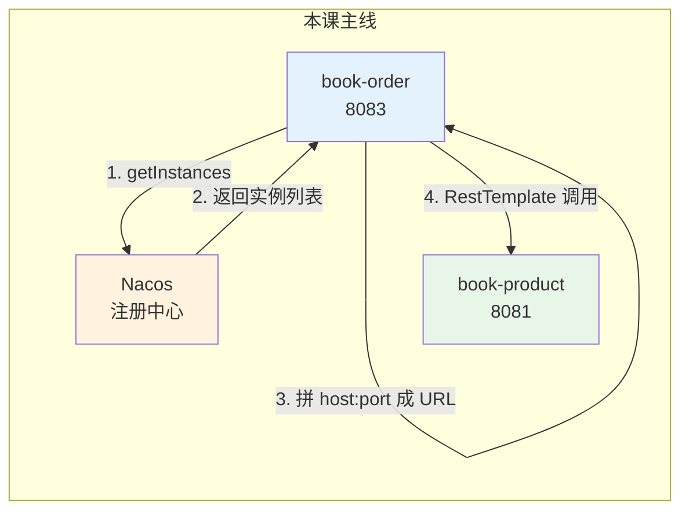
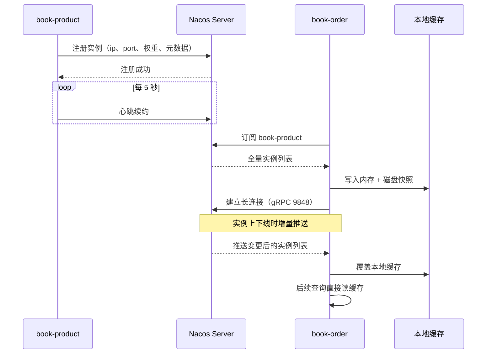
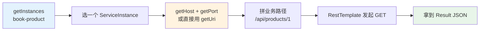
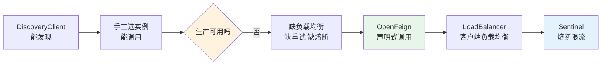

# Nacos服务发现实战

## 课程目标

- 理解服务发现（Service Discovery）的核心概念，说清注册表、订阅推送、本地缓存三层机制
- 掌握 `DiscoveryClient` 的四个核心 API 及其返回结构
- 掌握 `ServiceInstance` 的字段含义，能从实例解析出 host、port 与 URI
- 掌握在 `book-order` 中集成 `DiscoveryClient` 并调用 `book-product` 的完整代码
- 能够手写实例轮询，验证多实例下的流量分发
- 说得清服务发现的四个局限，理解后续课程为什么必须引入 OpenFeign

## 回顾与导入

前两课我们把三个服务都注册进了 Nacos：`book-product`（8081）、`book-user`（8082）、`book-order`（8083）。控制台服务列表里三个服务都是健康状态，实例数为 1。

但注册只是"把地址交给注册中心"，真正产生业务价值的是另一半：**被发现**。下单时 `book-order` 要扣库存，它必须先知道 `book-product` 在哪台机器、哪个端口。传统写法是写死地址：

```yaml
# 不可取：地址被固化在配置里
book:
  product:
    base-url: http://127.0.0.1:8081
```

这种写法的代价非常直接：商品服务扩容到两台，订单服务不知道；商品服务换机器，订单服务要改配置重启；商品服务挂掉，订单服务只会连接超时。微服务下实例地址是**动态**的，消费方必须在运行时向注册中心要一份"当前可用实例清单"，这个动作就叫服务发现。



本课不用任何高级封装：只用 `DiscoveryClient` 拿清单，手工拼 URL，用裸 `RestTemplate` 发请求。目的是把"服务发现"这层窗户纸捅破，后面学 OpenFeign 时才知道框架替你做了什么。

> **前置条件：** 三个服务已注册到同一命名空间（默认 `public`），Nacos 控制台能看到 `book-product`、`book-user`、`book-order`，且实例数为 1、健康实例数为 1。

## 服务发现核心概念

### 三个角色

服务发现是一条三方协作的链路，任何一方缺位都不成立：

| 角色 | 职责 | 本课程中的对象 |
| --- | --- | --- |
| 服务提供者（Provider） | 启动时注册自身信息，定时心跳续约，下线时注销 | `book-product`、`book-user` |
| 服务消费者（Consumer） | 按服务名查询实例列表，选择实例并发起调用 | `book-order` |
| 注册中心（Registry） | 维护注册表，感知实例上下线，向订阅者推送变更 | Nacos Server |

### 注册表与订阅推送

注册中心内部维护一张注册表（Registry），键是"命名空间 + 分组 + 服务名"，值是实例列表。消费者并不是每次都实时查库，而是**订阅 + 本地缓存**：



这条链路有三个关键点：

- **首次是全量，之后是增量**：第一次订阅拿全量清单，后续 Nacos 通过长连接推送差异。
- **查询读本地缓存**：`getInstances()` 不会每次都发网络请求，读的是客户端内存缓存，所以足够快。
- **长连接端口**：Nacos 3.x 客户端走 gRPC，除主端口 8848 外还要能连通 `8848+1000`（9848），只开 8848 会导致注册成功但收不到推送。

### 客户端本地缓存目录

Nacos 客户端除了内存缓存，还会把实例快照落盘。默认路径与当前用户名、命名空间有关：

```text
${user.home}/nacos/naming/{namespace}/
├── book-product
├── book-user
└── book-order
```

每个文件里是 JSON 格式的实例列表，包含 `hosts`、`lastRefTime` 等字段。落盘的意义是**降级**：Nacos 重启的几十秒内，客户端连不上服务端，仍可从磁盘快照读到上一次的实例列表，调用不至于全面失败。

> **注意：** 缓存目录在不同 Nacos 客户端版本下可能略有差异，可通过启动参数 `-DJM.SNAPSHOT.PATH=自定义目录` 指定。排查"实例已下线但消费方还能调到"这类问题时，先看这个目录里的快照时间戳。

### DiscoveryClient 抽象

Spring Cloud 用 `DiscoveryClient` 接口屏蔽了注册中心差异，Nacos 的实现类是 `NacosDiscoveryClient`，内部委托给 `NacosServiceDiscovery` 再调 Nacos 客户端。换注册中心时业务代码不用动，这是面向接口的价值。

| 方法 | 返回值 | 说明 |
| --- | --- | --- |
| `getServices()` | `List<String>` | 当前命名空间下所有服务名 |
| `getInstances(String serviceId)` | `List<ServiceInstance>` | 指定服务的全部实例（含不健康实例） |
| `getInstances(String serviceId, boolean healthy)` | `List<ServiceInstance>` | `healthy=true` 只返回健康实例 |
| `description()` | `String` | 客户端描述，排查时确认实现类 |

`serviceId` 就是提供方的 `spring.application.name`，大小写敏感，`book-product` 与 `Book-Product` 是两个不同的服务。

## ServiceInstance 详解

`ServiceInstance` 是一个实例的完整描述，Nacos 返回的实现类为 `NacosServiceInstance`：

| 字段 / 方法 | 类型 | 含义 | 示例值 |
| --- | --- | --- | --- |
| `getInstanceId()` | `String` | 实例唯一标识，一般是 `ip:port` | `192.168.1.10:8081` |
| `getServiceId()` | `String` | 所属服务名 | `book-product` |
| `getHost()` | `String` | 主机地址（IP 或域名） | `192.168.1.10` |
| `getPort()` | `int` | 端口 | `8081` |
| `getUri()` | `URI` | 拼好的基地址 | `http://192.168.1.10:8081` |
| `getScheme()` | `String` | 协议 | `http` |
| `isSecure()` | `boolean` | 是否 HTTPS | `false` |
| `getMetadata()` | `Map<String,String>` | 元数据（权重、版本、环境等） | `{version=1.0.0, weight=1.0}` |
| `getWeight()` | `double` | 权重（Spring Cloud 抽象方法，Nacos 由元数据映射） | `1.0` |
| `isHealthy()` | `boolean` | 是否健康（部分实现返回固定值） | `true` |

两个容易出错的点：

- `getUri()` 已经带协议和端口，再拼 `":" + port` 就重复了。
- `getMetadata()` 里的权重是字符串，取出来要自己转 `double`；Nacos 控制台的权重在元数据键 `weight` 中。

## 在 book-order 中集成 DiscoveryClient

### 确认依赖

`DiscoveryClient` 由 `spring-cloud-commons` 提供，随 Nacos 注册发现 starter 传递引入，无需单独加依赖。确认 `book-order/pom.xml` 中有：

```xml
<dependency>
    <groupId>com.alibaba.cloud</groupId>
    <artifactId>spring-cloud-starter-alibaba-nacos-discovery</artifactId>
</dependency>
```

### 配置 RestTemplate

本课刻意使用**裸** `RestTemplate`，不加 `@LoadBalanced`。加了之后 `http://book-product/...` 这种服务名地址会被拦截器改写，就看不清手工拼 URL 的过程了。

```java
package com.example.order.config;

import org.springframework.context.annotation.Bean;
import org.springframework.context.annotation.Configuration;
import org.springframework.web.client.RestTemplate;

@Configuration
public class RestTemplateConfig {

    /**
     * 教学用 RestTemplate：不带 @LoadBalanced，只认写全的 http://host:port
     */
    @Bean
    public RestTemplate restTemplate() {
        return new RestTemplate();
    }
}
```

### DiscoveryController 完整代码

在 `book-order` 中新建控制器，把前面三个 API 全部暴露出来，便于用 `.http` 文件逐个验证：

```java
package com.example.order.controller;

import com.example.common.result.Result;
import lombok.RequiredArgsConstructor;
import lombok.extern.slf4j.Slf4j;
import org.springframework.cloud.client.ServiceInstance;
import org.springframework.cloud.client.discovery.DiscoveryClient;
import org.springframework.web.bind.annotation.GetMapping;
import org.springframework.web.bind.annotation.PathVariable;
import org.springframework.web.bind.annotation.RequestMapping;
import org.springframework.web.bind.annotation.RestController;

import java.util.List;

@Slf4j
@RestController
@RequestMapping("/api/discovery")
@RequiredArgsConstructor
public class DiscoveryController {

    private final DiscoveryClient discoveryClient;

    @GetMapping("/description")
    public Result<String> description() {
        return Result.success(discoveryClient.description());
    }

    @GetMapping("/services")
    public Result<List<String>> services() {
        List<String> services = discoveryClient.getServices();
        log.info("当前命名空间的服务列表：{}", services);
        return Result.success(services);
    }

    @GetMapping("/instances/{serviceId}")
    public Result<List<ServiceInstance>> instances(@PathVariable("serviceId") String serviceId) {
        List<ServiceInstance> instances = discoveryClient.getInstances(serviceId);
        log.info("服务 {} 的实例数量：{}", serviceId, instances.size());
        instances.forEach(i -> log.info("实例 id={}, uri={}, metadata={}",
                i.getInstanceId(), i.getUri(), i.getMetadata()));
        return Result.success(instances);
    }

    @GetMapping("/instances/{serviceId}/healthy")
    public Result<List<ServiceInstance>> healthyInstances(@PathVariable("serviceId") String serviceId) {
        return Result.success(discoveryClient.getInstances(serviceId, true));
    }
}
```

注入方式用 `@RequiredArgsConstructor` + `private final`，与课程其他模块保持一致。`description()` 返回的内容通常形如 `Nacos Discovery Client`，排查"到底装配了哪个注册中心的客户端"时很有用。

> **提示：** 若启动时报 `NoSuchBeanDefinitionException: DiscoveryClient`，依次检查依赖、`spring.cloud.nacos.discovery.server-addr` 配置、启动类是否被扫描到。

## 构造调用 URL 完成跨服务调用

### 三步解析

从实例到一次 HTTP 调用，固定是三步：



两种拼法等价，推荐直接用 `getUri()`：手工拼 `"http://" + host + ":" + port` 容易漏协议，IPv6 地址还要额外加方括号。

### 完整调用代码

给 `DiscoveryController` 增加一个跨服务查询方法，返回图书服务原始 JSON 字符串：

```java
    private final RestTemplate restTemplate;

    @GetMapping("/book/{id}")
    public Result<String> book(@PathVariable("id") Long id) {
        List<ServiceInstance> instances = discoveryClient.getInstances("book-product");
        if (instances.isEmpty()) {
            return Result.error(503, "图书服务暂无可用实例");
        }

        ServiceInstance instance = instances.get(0);
        String url = instance.getUri() + "/api/products/" + id;
        log.info("选中实例 {}，发起调用：{}", instance.getInstanceId(), url);

        try {
            String body = restTemplate.getForObject(url, String.class);
            return Result.success(body);
        } catch (Exception e) {
            log.error("调用 book-product 失败，url={}", url, e);
            return Result.error(500, "调用图书服务失败：" + e.getMessage());
        }
    }
```

关键点有三：实例为空返回 503 而不是 NPE；URL 用 `getUri()` 拼接；异常必须捕获，否则远程故障以 500 直接冒到用户面前。返回 `String` 是为了观察原始报文，生产应定义 DTO 并用 `getForObject(url, ProductVO.class)` 反序列化。

### 多实例手工轮询

`restTemplate` 配置了作用域为单例，`AtomicInteger` 计数器正好可以跨请求累加。把 `instances.get(0)` 换成轮询，就能观察到流量在两个实例间交替：

```java
package com.example.order.discovery;

import org.springframework.cloud.client.ServiceInstance;

import java.util.List;
import java.util.concurrent.atomic.AtomicInteger;

/**
 * 教学用轮询选择器：按调用次数取模，逐个访问实例
 */
public class RoundRobinSelector {

    private final AtomicInteger counter = new AtomicInteger(0);

    public ServiceInstance choose(List<ServiceInstance> instances) {
        if (instances == null || instances.isEmpty()) {
            return null;
        }
        int index = Math.floorMod(counter.getAndIncrement(), instances.size());
        return instances.get(index);
    }
}
```

把它注入控制器后，连续调用 6 次（假设 8081、8084 两个实例），日志与端口分布如下：

| 调用次序 | `counter` 值 | `index` | 命中实例 |
| --- | --- | --- | --- |
| 第 1 次 | 0 | 0 | 8081 |
| 第 2 次 | 1 | 1 | 8084 |
| 第 3 次 | 2 | 0 | 8081 |
| 第 4 次 | 3 | 1 | 8084 |

> **注意：** 用 `Math.floorMod` 而不是 `%`，避免计数器溢出成负数后索引越界。轮询只在实例列表顺序稳定时均匀；实例上下线导致列表顺序变化时，短时间内分配会有抖动，这是自研选择器的天然缺陷。

## 启动与验证

启动 Nacos 与三个服务后，用 `.http` 文件依次验证：

```http
### 1. 服务发现客户端实现
GET http://127.0.0.1:8083/api/discovery/description

### 2. 所有服务名
GET http://127.0.0.1:8083/api/discovery/services

### 3. 图书服务实例列表
GET http://127.0.0.1:8083/api/discovery/instances/book-product

### 4. 跨服务调用
GET http://127.0.0.1:8083/api/discovery/book/1
```

**服务列表预期响应：**

```json
{
  "code": 200,
  "message": "操作成功",
  "data": ["book-order", "book-product", "book-user"],
  "timestamp": 1731300000000
}
```

**实例列表预期响应（截取关键字段）：**

```json
{
  "code": 200,
  "data": [
    {
      "instanceId": "192.168.1.10:8081",
      "serviceId": "book-product",
      "host": "192.168.1.10",
      "port": 8081,
      "uri": "http://192.168.1.10:8081",
      "metadata": { "version": "1.0.0", "weight": "1.0" }
    }
  ]
}
```

**跨服务调用预期响应：**

```text
code=200, data={"code":200,"message":"操作成功","data":{"id":1,"title":"Spring Boot 实战","price":79.00,...}}
```

注意 `data` 是一段 JSON **字符串**：`book-order` 用 `String.class` 接收，没有二次解析。要确认跨服务链路真的走通，看 `book-product` 的调用日志比看返回值更可靠。

## 服务发现的局限性

`DiscoveryClient` + `RestTemplate` 能跑通，但它只是"能调"，离"可靠地调"还有明显差距：

| 局限 | 具体表现 | 后果 | 后续方案 |
| --- | --- | --- | --- |
| 无负载均衡 | 只能自己 `get(0)` 或手写轮询 | 策略单一，无法按权重、区域分配 | Spring Cloud LoadBalancer |
| 无重试 | 实例网络抖动直接抛异常 | 偶发失败被放大成业务失败 | OpenFeign + Retry |
| 无熔断降级 | 下游持续超时会拖死调用线程 | 故障沿调用链扩散 | Sentinel |
| 手工拼 URL | 路径、参数、编码全靠字符串 | 拼接错误编译期发现不了 | OpenFeign 声明式接口 |
| 无统一超时 | 用 `RestTemplate` 默认值 | 慢下游长期占用线程 | 连接/读取超时配置 |

隐性成本更麻烦：每个远程调用都要重复写"查实例、选实例、拼 URL、序列化、异常处理"五段样板代码，调三个服务就是三份复制粘贴。



> **结论：** 本课的价值是理解原理，不是让你在生产里手写这套代码。`DiscoveryClient` 依然要会用——排查"Feign 调不到服务"时，第一件事就是用 `getInstances` 确认注册中心里到底有没有实例。

## 常见问题排查

### getInstances 返回空列表

| 可能原因 | 排查动作 |
| --- | --- |
| 服务名拼错 | 打印 `getServices()`，与 `spring.application.name` 逐字比对，注意大小写与连字符 |
| 命名空间不一致 | 比对消费方与提供方的 `spring.cloud.nacos.discovery.namespace` |
| 分组不一致 | 比对双方的 `group`，默认都是 `DEFAULT_GROUP` |
| 服务未注册成功 | 看提供方启动日志有无 `nacos registry, ... register finished`，或查控制台 |
| 连错了 Nacos | 比对双方的 `server-addr`，多环境时极易连到另一套集群 |

### 实例存在但 unhealthy

| 可能原因 | 排查动作 |
| --- | --- |
| 心跳中断 | 实例进程假死或 Full GC，看提供方日志与 CPU |
| 端口探测失败 | Nacos 3.x 默认走 gRPC 健康检查，确认 9848 端口连通 |
| 元数据 `preserved.heart.beat` 异常 | 检查是否有脚本错误修改元数据 |
| 网络分区 | 从 Nacos 所在机器 `ping`/`telnet` 提供方 IP 与端口 |

`getInstances(serviceId)` 默认会包含不健康实例，`getInstances(serviceId, true)` 才会过滤。生产代码选择实例前应先按 `isHealthy()` 过滤，否则会把流量打到已经心跳超时的节点。

### 缓存未刷新

权重、元数据、实例数量的变更都走推送，正常情况下秒级生效。若长时间不生效，按下面顺序查：

```bash
# 1. 确认长连接端口是否可通（Nacos 3.x 需 9848）
telnet 127.0.0.1 9848

# 2. 查看客户端落盘快照的更新时间和内容
type %USERPROFILE%\nacos\naming\public\book-product

# 3. 打开客户端日志，搜索 receive server push
#    日志目录：${user.home}/logs/nacos/naming.log
```

三种常见结局：端口不通收不到推送（改网络策略）；业务层自建缓存（去掉，直接调 `getInstances`）；服务端健康检查已置不健康但未剔除（看控制台实例详情）。

## 注意事项

1. **`getUri()` 已含协议与端口**：`instance.getUri() + ":" + port` 会拼出 `http://host:8081:8081`，是最常见的低级错误。
2. **`serviceId` 大小写敏感**：`book-product` 与 `Book-Product` 是两个服务，消费方拼错只得到空列表。
3. **`getInstances` 默认包含不健康实例**：需要健康实例时显式传 `true` 或自行按 `isHealthy()` 过滤。
4. **本课的 `RestTemplate` 不能加 `@LoadBalanced`**：加了之后会走拦截器改写地址，手工拼 URL 的教学目的就失效了，且两种机制混用容易排查困难。
5. **gRPC 端口必须放通**：Nacos 3.x 推送依赖 8848+1000，只开 8848 会出现"能注册、清单不更新"的怪现象。
6. **不要自建实例缓存**：客户端已有内存缓存与磁盘快照，业务层再缓存一层会导致上下线感知延迟，权重调整也失效。
7. **测试多实例请用不同端口**：同一台机器启动两个 `book-product` 时，第二个改 `server.port` 为 8084，并在启动参数中覆盖，避免端口冲突。
8. **远程调用必须有超时**：裸 `RestTemplate` 默认无读取超时，慢下游会耗尽线程池，生产必须设置连接与读取超时。

## 小结

本节课我们学习了：

1. **服务发现的核心概念**：提供者、消费者、注册中心三方协作，注册表 + 订阅推送 + 本地缓存构成完整链路。
2. **`DiscoveryClient` 的四个 API**：`getServices`、`getInstances`、带健康标记的重载、`description`。
3. **`ServiceInstance` 的字段**：`instanceId`、`host`、`port`、`uri`、`metadata`、`weight`、`healthy` 的含义与取值。
4. **在 `book-order` 中集成**：注入 `DiscoveryClient`、配置裸 `RestTemplate`、暴露发现接口并验证。
5. **构造调用 URL**：`ServiceInstance` → `host:port` → `URI` → 业务路径 → `RestTemplate` 调用，并用 `AtomicInteger` 实现多实例轮询。
6. **服务发现的局限**：无负载均衡、无重试、无熔断、手工拼 URL，这四条正是 OpenFeign 与 LoadBalancer 要解决的问题。
7. **三类常见故障**：实例列表为空、实例不健康、缓存未刷新，各自的排查路径与判断依据。

## 作业

### 作业一：完成服务发现三个接口的验证

1. 在 `book-order` 中实现 `DiscoveryController`，提供 `services`、`instances`、`book/{id}` 三个接口。
2. 用 `.http` 文件依次调用，记录返回的服务列表与 `book-product` 实例详情。
3. 把 `book-product` 的 `server.port` 改为 8084 再启动一个实例，重新查询实例列表，确认返回两条记录，并说明 `instanceId` 有何不同。

### 作业二：手写轮询并统计流量分布

1. 实现 `RoundRobinSelector`，替换 `instances.get(0)`。
2. 连续调用 20 次 `/api/discovery/book/1`，把 `book-product` 两个实例的日志被调用次数填入表格，核对是否各 10 次。
3. 停掉其中一个实例后立即调用 5 次，记录成功与失败次数，解释为什么轮询会失败，并说明这属于本课哪一条局限。
