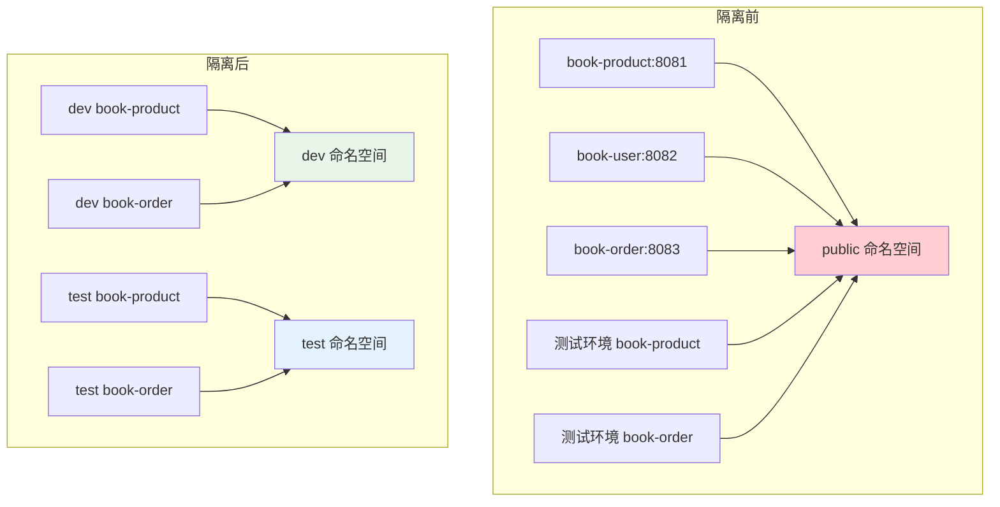
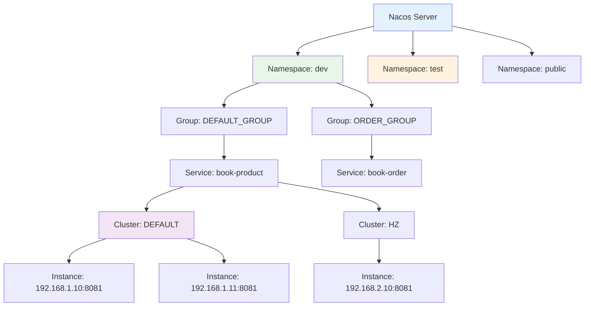
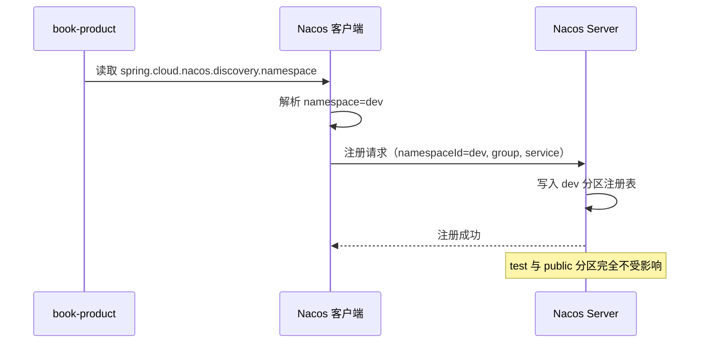

# Nacos分级模型与Namespace环境隔离

## 课程目标

- 理解 Nacos 五级模型 Namespace、Group、Service、Cluster、Instance 的层级关系
- 掌握每一层的职责边界，能说清"什么该放命名空间、什么该放分组"
- 掌握命名空间按环境划分与按团队划分的取舍
- 掌握控制台与 OpenAPI 两种创建命名空间的方式
- 掌握 `namespace` 必须填 ID 的规则，完成 `book-product` 注册到 dev 的实战
- 能够用控制台与 `DiscoveryClient` 两种方式验证环境隔离

## 回顾与导入

上一课我们用 `DiscoveryClient` 拿到了 `book-product` 的实例列表，跨服务调用跑通了。但当时三个服务全在 Nacos 默认的 `public` 命名空间里——开发、测试、生产的服务挤在同一个空间，是线上事故的常见源头：

| 问题 | 具体表现 |
| --- | --- |
| 环境串台 | 本地启动的 `book-product` 与测试环境的同名服务互相顶替 |
| 调用错乱 | 测试环境 `book-order` 调到同事本机的 `book-product`，写脏测试库 |
| 配置冲突 | 三套 `application.yml` 的差异项堆在一个空间，靠命名约定区分 |
| 权限失控 | 无法只给测试同学授权测试环境的资源 |

这不是假设。真实项目里出现过这样的事故：开发在 `public` 空间启动了一个调试用的 `book-order`，测试环境的 `book-order` 被挤下线，压测数据全部打到了开发本机的 PostgreSQL 上，排查了一个下午才发现是"实例互相覆盖"。

本课要做的只有一件事：**把不同环境隔离到不同命名空间**，让 `dev` 的消费方永远看不到 `test` 的提供方。



## Nacos 五级模型

### 模型总览

Nacos 的服务与配置都挂在一棵五层树上。很多人只记住"Namespace、Group、Service"三层，是因为 Cluster 与 Instance 由客户端自动填充，但排查问题时它们同样关键：



### 每层职责

| 层级 | 作用 | 唯一性范围 | 典型值 | 谁来设置 |
| --- | --- | --- | --- | --- |
| Namespace | 最外层隔离，环境或租户维度 | 全局唯一 | `dev`、`test`、`prod` | 运维在控制台创建 |
| Group | 命名空间内的业务分组 | 命名空间内唯一 | `DEFAULT_GROUP`、`ORDER_GROUP` | 应用 yml |
| Service | 一组相同职责的实例集合 | 命名空间 + 分组内唯一 | `book-product` | `spring.application.name` |
| Cluster | 同一服务内的机房/分区子集 | 服务内唯一 | `DEFAULT`、`HZ`、`BJ` | 应用 yml |
| Instance | 一个进程的地址与元数据 | 服务 + 集群内唯一 | `192.168.1.10:8081` | 启动时自动上报 |

一句话记忆：**Namespace 切环境，Group 切业务，Cluster 切机房，Instance 是进程**。

### 层级与隔离强度的关系

隔离强度从上到下递减，这一点决定了方案选型：

| 维度 | 是否互相可见 | 隔离强度 | 改造成本 |
| --- | --- | --- | --- |
| 不同 Namespace | 完全不可见，服务名相同也互不干扰 | 最强 | 低（改一行配置） |
| 同 Namespace 不同 Group | 默认不可见，显式指定 group 才能互调 | 中 | 低（改一行配置） |
| 同 Group 不同 Cluster | 可见，可配同集群优先或就近访问 | 弱 | 中（需理解路由策略） |
| 同 Cluster 不同 Instance | 完全可见，靠权重与健康状态区分 | 无 | 低 |

### 服务调用的完整坐标

Nacos 客户端定位一个实例，靠的是五元组，少一个都可能查到"不存在"：

```text
namespaceId + groupName + serviceName + clusterName + ip:port
   dev          DEFAULT_GROUP   book-product   DEFAULT     192.168.1.10:8081
```

消费方只显式提供 `namespaceId`、`groupName`、`serviceName` 三项，后两项由服务端返回的实例数据给出。`groupName` 缺省值 `DEFAULT_GROUP`、`clusterName` 缺省值 `DEFAULT` 都是 Nacos 内置常量，不写也不会报错，但会导致"你以为写的是 A，实际查的是 B"。

## 命名空间设计

### 按环境还是按团队

这是架构评审上必然被问的问题，答案取决于组织结构：

| 方案 | 优点 | 缺点 | 适用场景 |
| --- | --- | --- | --- |
| 按环境划分（dev/test/uat/prod） | 与发布流程天然对齐；权限按环境授权清晰 | 多团队共用一个空间，服务名易撞 | 中小团队、单产品线 |
| 按团队划分（team-a/team-b） | 团队自治，服务名不冲突 | 环境维度要靠 Group 补，发布链路复杂 | 多团队共享一个 Nacos 集群 |
| 按环境 + 团队二级（dev-team-a） | 两个维度都隔离彻底 | 命名空间数量膨胀，运维成本高 | 大型组织、强合规要求 |
| 按租户划分（tenant-001） | 满足 SaaS 数据隔离 | 实例量放大，资源占用高 | SaaS 多租户产品 |

本课程采用**按环境划分**：`dev`、`test`（后期再加 `prod`）。理由很实际——我们只有一条产品线，环境隔离带来的收益远大于团队隔离。

### 命名空间 ID 规划

创建命名空间时，名称是给人看的，ID 是给程序用的。规划表建议提前固定下来，写进项目的部署文档：

| 名称 | ID | 用途 | 谁能改 |
| --- | --- | --- | --- |
| public | `public` | 保留空间，不承载业务 | 不建议使用 |
| 开发环境 | `dev` | 日常开发联调 | 开发 |
| 测试环境 | `test` | 功能测试、集成测试 | 测试 + 开发 |
| 预发环境 | `uat` | 上线前验证 | 运维 |
| 生产环境 | `prod` | 线上流量 | 运维，严格审批 |

> **注意：** ID 一旦被应用引用就不能随意改。改 ID 等于所有服务的配置文件都要改一遍并重新发布，所以自定义 ID（如 `dev`）优于让 Nacos 自动生成 UUID。

### 创建方式一：控制台

**步骤一：** 打开控制台 `http://127.0.0.1:8080/index.html`，用管理员账号登录（Nacos 3.x 首次启动会要求初始化 `nacos` 用户密码）。

**步骤二：** 左侧导航选择"命名空间"，页面初始只有 `public` 一条记录。

**步骤三：** 点"创建命名空间"，按下表填写：

| 配置项 | dev 填写值 | test 填写值 | 说明 |
| --- | --- | --- | --- |
| 命名空间名称 | `开发环境` | `测试环境` | 显示名，可中文 |
| 命名空间 ID | `dev` | `test` | 客户端配置用的就是这个值 |
| 描述 | `图书系统开发联调` | `图书系统功能测试` | 便于识别 |

创建完成后列表应有三条记录，`public` 的类型标记为"保留空间"，其余为自定义。

### 创建方式二：OpenAPI

自动化环境（CI 建环境、Terraform 初始化）不适合手工点控制台，用 OpenAPI 更可控：

```bash
# 创建命名空间；Nacos 3.x 开启了鉴权时需要携带 accessToken
curl -X POST "http://127.0.0.1:8080/nacos/v1/console/namespaces" \
  -d "customNamespaceId=dev" \
  -d "namespaceName=开发环境" \
  -d "namespaceDesc=图书系统开发联调"

# 查询命名空间列表，确认创建结果
curl "http://127.0.0.1:8080/nacos/v1/console/namespaces"
```

```http
### 等价的 .http 写法
POST http://127.0.0.1:8080/nacos/v1/console/namespaces
Content-Type: application/x-www-form-urlencoded

customNamespaceId=test&namespaceName=测试环境&namespaceDesc=图书系统功能测试
```

关键参数只有 `customNamespaceId`：传了就按你给的值创建，不传则由服务端生成 UUID。返回值 `true` 表示成功，重复创建同名 ID 会返回 `false`，这是幂等写法的基础。

> **提示：** 生产环境不要用默认 `nacos/nacos` 账号调 OpenAPI，应创建独立运维账号并只授予命名空间级权限。鉴权与密钥轮换的完整做法见《配置中心安全与治理实践》。

## 实战：book-product 注册到 dev

### 修改配置

当前 `book-product/src/main/resources/application.yml` 中 `namespace` 是 `public`。把它改成 `dev`：

```yaml
server:
  port: 8081

spring:
  application:
    name: book-product
  cloud:
    nacos:
      discovery:
        server-addr: 127.0.0.1:8848
        # 命名空间 ID，不是名称
        namespace: dev
        group: DEFAULT_GROUP
        cluster-name: DEFAULT
        metadata:
          env: dev
          version: 1.0.0
```

只动了一个坐标 `namespace`，其余保持不变。`metadata` 里补上 `env: dev`，控制台实例详情里能直接看到，排查时不必再去翻配置。

注册请求在客户端就带上了命名空间，服务端按分区落库，这条链路决定了隔离是"物理分治"而不是"查询时过滤"：



### 启动日志验证

重启 `book-product`，启动日志中应出现命名空间信息：

```text
nacos registry, DEFAULT_GROUP book-product 192.168.1.10:8081 register finished
[Nacos Register] namespace: dev, serviceName: book-product
```

第一行来自 Spring Cloud Alibaba 的注册日志，第二行不同版本可能省略。判断是否注册成功，最稳的还是看控制台。

### 控制台验证

在控制台右上角的命名空间下拉框选择"开发环境"，进入"服务管理 - 服务列表"：

| 服务名 | 集群数目 | 实例数目 | 健康实例数 |
| --- | --- | --- | --- |
| `book-product` | 1 | 1 | 1 |

再切回 `public`，服务列表里应**看不到** `book-product`。如果还能看到，说明配置没生效——检查 yml 是否被 `bootstrap.yml` 或环境变量覆盖。

### 消费方验证隔离

把 `book-user`、`book-order` 也改为 `namespace: dev` 后重启，三个服务都出现在 dev 空间。此时在 dev 的 `book-order` 上调用上一课的接口：

```java
List<ServiceInstance> instances = discoveryClient.getInstances("book-product");
log.info("dev 环境可见实例数：{}", instances.size());
```

预期只返回 dev 环境的实例。再做一个反向验证：启动一个 `test` 空间的 `book-product`（端口 8084），dev 的 `book-order` 依然看不到它。

> **结论：** 命名空间隔离是服务端强制的，不是客户端"约定不查"。消费方的 `namespace` 决定了它查询请求落在哪个数据分区，跨空间根本查不到数据。

## namespace 的坑

### ID 与名称混用

这是新手最高频的错误，两种写法的结果完全不同：

| yml 写法 | 实际含义 | 结果 |
| --- | --- | --- |
| `namespace: dev` | 命名空间 ID 为 `dev` | 注册到开发环境，正确 |
| `namespace: 开发环境` | 当作 ID 去匹配 | 匹配不到，注册失败或落到空空间 |
| `namespace:` 留空 | 使用默认空间 | Nacos 3.x 落到 `public` |
| `namespace: public` | 显式指定默认空间 | 与留空等价 |

判断依据很简单：配置值必须是控制台列表里"命名空间 ID"列的内容。如果创建时没填 ID、由系统生成 UUID，就要把那串 UUID 完整复制过去，一个字符都不能差。

### 客户端日志的判断方法

注册失败时日志不一定报错，可能只是"注册到了别处"。两个观察点：

```bash
# 1. 应用日志里搜索 namespace 关键字
#    能看到实际生效的命名空间
grep -i "namespace" logs/book-product.log

# 2. 客户端本地缓存目录按命名空间分目录
#    出现 dev 目录说明客户端确实按 dev 在拉数据
dir %USERPROFILE%\nacos\naming
```

如果缓存目录里只有 `public`，说明配置没被读到。常见原因是 yml 层级写错（把 `namespace` 写到了 `spring.cloud.nacos` 而不是 `spring.cloud.nacos.discovery` 下），或者是 `spring.config.import` 引入了另一份配置覆盖了它。

### 与配置中心的复用关系

注册中心与配置中心是两个独立模块，但**命名空间是同一套**。同一份 yml 里通常要写两处：

```yaml
spring:
  cloud:
    nacos:
      discovery:
        server-addr: 127.0.0.1:8848
        namespace: dev          # 服务注册到 dev
      config:
        server-addr: 127.0.0.1:8848
        namespace: dev          # 配置也从 dev 读取
        file-extension: yaml
```

| 场景 | 现象 | 建议 |
| --- | --- | --- |
| 两处都写 `dev` | 服务与配置都在 dev，行为一致 | 推荐，环境彻底隔离 |
| 注册 dev、配置 public | 服务在 dev，读到的是 public 的配置 | 禁止，极易出事故 |
| 只写 discovery 不写 config | 配置中心落到 public | 上线前必须核查 |
| 两处 ID 写错成不同值 | 服务一个空间、配置另一个空间 | 用统一的环境变量注入避免手误 |

推荐做法是把命名空间收敛成一处变量，在启动时注入，杜绝两处不一致：

```yaml
spring:
  cloud:
    nacos:
      discovery:
        namespace: ${NACOS_NAMESPACE:dev}
      config:
        namespace: ${NACOS_NAMESPACE:dev}
```

这样本地开发默认 `dev`，容器部署时用 `-DNACOS_NAMESPACE=prod` 或环境变量覆盖即可，不需要改代码。

### 命名空间不是"万能隔离"

三个边界必须清楚：

- 命名空间隔离的是**数据可见性**，不隔离网络。dev 的实例仍然能被 test 的机器直接 `curl` 到（如果网络互通）。
- 命名空间不隔离**数据库**，环境隔离还得靠独立的库与账号。
- 命名空间不提供**资源配额**，一个空间塞一千个实例照样会拖慢推送。

## 多环境矩阵

把环境、命名空间、端口、库、分组一次性规划清楚，后续课程直接查这张表：

| 环境 | 命名空间 ID | 服务端口 | 数据库 | 分组 | 用途 |
| --- | --- | --- | --- | --- | --- |
| 本地开发 | `dev` | 8081/8082/8083 | `book_*_db` 本地实例 | `DEFAULT_GROUP` | 单人联调 |
| 开发联调 | `dev` | 8081/8082/8083 | 开发库 | `DEFAULT_GROUP` | 多人共享 |
| 功能测试 | `test` | 8181/8182/8183 | 测试库 | `DEFAULT_GROUP` | 测试验证 |
| 预发 | `uat` | 8281/8282/8283 | 预发库（脱敏数据） | `DEFAULT_GROUP` | 上线前回归 |
| 生产 | `prod` | 8081/8082/8083 | 生产库 | `DEFAULT_GROUP` | 线上流量 |

> **注意：** 同一台机器上同时跑 dev 和 test，端口必须错开，否则后启动的进程直接绑定失败。矩阵里的端口规划就是为此服务。

## 注意事项

1. **`namespace` 填 ID 不填名称**：配成中文名称会导致注册失败或落到错误的命名空间，这是本课第一号坑。
2. **Nacos 3.x 默认空间是 `public`**：2.x 时代默认命名空间为空字符串，迁移时不要把空值照搬，否则会与 3.x 的 `public` 产生两套数据。
3. **注册与配置两处都要写**：只配 `discovery.namespace` 会导致配置中心仍在 `public`，环境隔离只做了一半。
4. **`public` 空间不要承载业务**：保留空间缺乏独立治理手段，长期使用后清理成本极高。
5. **不要用 Group 代替 Namespace 做环境隔离**：Group 的隔离强度弱于 Namespace，且配置中心的 Group 语义不同，详见《Nacos Group分组与多环境切换》。
6. **ID 一经引用不要改名**：改 ID 意味着所有服务配置同步变更，属于破坏性操作，必须走变更流程。
7. **环境变量注入优于硬编码**：用 `${NACOS_NAMESPACE:dev}` 统一取值，避免打包时改文件、上线时漏改。
8. **命名空间数量要克制**：每增加一个空间都会带来一套实例与配置的维护成本，按环境划分通常 3 到 5 个足够。

## 小结

本节课我们学习了：

1. **Nacos 五级模型**：Namespace、Group、Service、Cluster、Instance 层层收敛，隔离强度自上而下递减。
2. **各层职责边界**：Namespace 切环境，Group 切业务，Cluster 切机房，Instance 是进程。
3. **命名空间设计**：按环境与按团队两种划分方式的取舍，以及 ID 规划表的写法。
4. **两种创建方式**：控制台适合人工初始化，OpenAPI 适合自动化流水线，`customNamespaceId` 是关键参数。
5. **注册到 dev 的实战**：只改 `namespace: dev` 一行，从启动日志、控制台、`DiscoveryClient` 三处验证。
6. **`namespace` 必须写 ID**：名称与 ID 混用、注册与配置两处不一致，是两类高频事故。
7. **多环境矩阵**：环境、空间、端口、库、分组的统一规划，为后续多环境切换打下基础。

## 作业

### 作业一：完成 dev 与 test 两套环境的隔离

1. 在控制台创建 `dev`、`test` 两个命名空间，记录 ID 与创建时间。
2. 将三个服务的 `namespace` 全部改为 `dev` 并重启，在控制台确认 dev 空间有三个服务、`public` 空间为空。
3. 用 OpenAPI 查询命名空间列表，把返回的 JSON 保存下来，说明 `namespace` 与 `namespaceShowName` 两个字段的区别。

### 作业二：验证隔离的边界

1. 在 `test` 空间启动一个 `book-product`（端口 8181），确认 dev 的 `book-order` 调用 `getInstances` 时看不到它。
2. 把 `book-order` 的 `discovery.namespace` 改成 `test` 后启动，确认此时能看到 8181 的实例，并解释为什么。
3. 把 `config.namespace` 故意留成 `public`，观察启动日志中配置加载的来源，写出你认为最容易出事故的组合。
