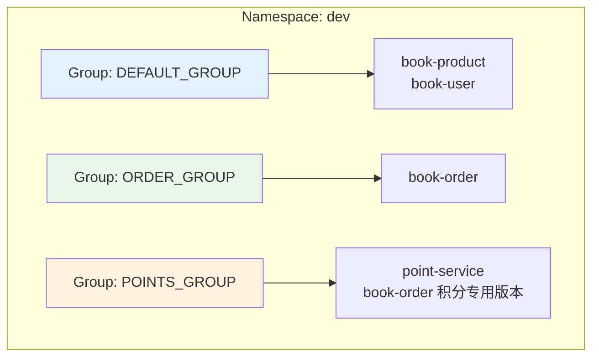
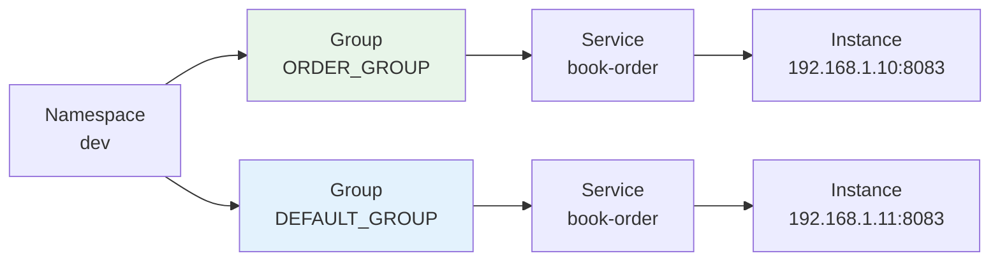
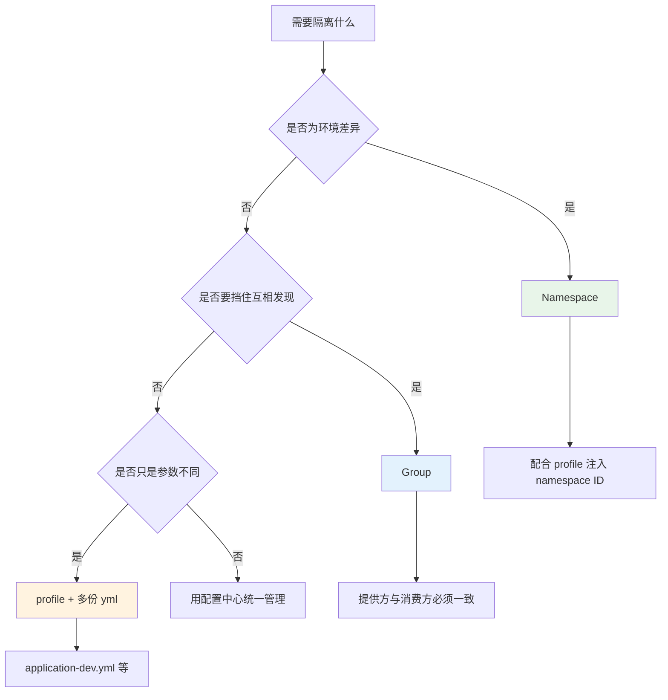

# Nacos Group分组与多环境切换

## 课程目标

- 理解 Group（分组）在 Nacos 数据模型中的位置与隔离语义
- 掌握 Group 的五类适用场景，能判断"该用命名空间还是分组"
- 掌握为 `book-order` 配置独立分组，并让提供方与消费方对齐
- 掌握 Namespace、Group、profile 三种多环境切换方式的差异与选型
- 掌握 `spring.profiles.active` 联动多份 yml 的落地方案
- 能够定位分组不一致、元数据不匹配、配置与注册分组混淆三类故障

## 回顾与导入

上一课我们用命名空间把 dev 与 test 彻底隔开，`book-order` 在 dev 里再也看不到 test 的 `book-product`。环境维度解决了，但同一环境内部还有新的划分需求：

- 图书系统要和积分系统共用一个 Nacos 集群，两边的 `book-order` 服务重名，怎么共存？
- 订单服务要做新旧版本并行验证，两个版本都叫 `book-order`，怎么让指定消费方只调新版本？
- 中间件类的服务（消息补偿、定时任务）不想被业务服务误调，怎么划一条界线？
- 有些老项目来不及改命名空间，只想在现有环境里再隔一层，怎么办？

这些问题的共同点是：**隔离粒度比环境更细，又不想再开一套命名空间**。Nacos 给出的答案是 Group。



> **前置条件：** 三个服务已注册到 `dev` 命名空间，控制台能看到 `book-product`、`book-user`、`book-order`，分组均为 `DEFAULT_GROUP`。

## Group 核心概念

### Group 在数据模型中的位置

Group 位于 Namespace 之下、Service 之上。它的作用是给服务名加一个"二级目录"，让同名服务可以在同一命名空间内共存：



两个 `book-order` 服务名完全相同，但因为分组不同，它们是两条独立记录：实例互不干扰，订阅互不可见。这与"两个不同命名空间里的同名服务"效果相似，区别在隔离强度与运维成本。

### Group 与 Namespace 的分工

| 对比项 | Namespace | Group |
| --- | --- | --- |
| 数据可见性 | 完全不可见 | 默认不可见，可通过 API 跨组查询 |
| 控制台操作 | 有独立管理页面，可创建、授权 | 无独立创建入口，注册时自动产生 |
| 权限粒度 | 支持命名空间级授权 | 一般不在 Group 级做权限 |
| 配置中心语义 | 配置的独立分区 | 同一 dataId 的不同分组版本 |
| 变更成本 | 需重启全部服务 | 需重启相关服务 |
| 推荐用途 | 环境、租户 | 业务线、版本、中间件隔离 |

> **结论：** 环境隔离优先用 Namespace；同一环境内的业务划分优先用 Group。二者可以叠加，形成"环境 + 业务"的二维隔离。

### 五类适用场景

| 场景 | Group 命名示例 | 说明 |
| --- | --- | --- |
| 业务线隔离 | `ORDER_GROUP`、`POINTS_GROUP` | 不同业务的服务名允许重名，互不发现 |
| 老项目过渡 | `LEGACY_GROUP` | 不改命名空间，先把存量服务圈起来 |
| 版本灰度 | `ORDER_GROUP_V2` | 新旧版本并行，消费方按需切换 |
| 中间件隔离 | `MIDDLEWARE_GROUP` | 补偿任务、定时作业不被业务误调 |
| 测试专用 | `TEST_GROUP` | 测试构造的桩服务不污染正常调用 |

命名规范建议：大写字母 + 下划线，以 `_GROUP` 结尾。Nacos 默认分组 `DEFAULT_GROUP` 就是这个风格，保持一致能减少沟通成本。

## 实战一：为 book-order 配置独立 Group

### 目标拓扑

把订单服务从默认分组挪到独立分组，商品与用户服务留在默认分组：

| 服务 | 分组 | 端口 | 说明 |
| --- | --- | --- | --- |
| `book-order` | `ORDER_GROUP` | 8083 | 订单侧统一入口 |
| `book-product` | `DEFAULT_GROUP` | 8081 | 商品域，保持默认 |
| `book-user` | `DEFAULT_GROUP` | 8082 | 用户域，保持默认 |

这带来一个重要事实：**分组只影响"发现"，不影响"调用"**。`book-order` 仍要能发现 `book-product`，所以它不能简单地把自己的分组改掉就完事，必须理解"消费方查哪个分组"的规则。

### 提供方配置

`book-order` 的 `application.yml`：

```yaml
server:
  port: 8083

spring:
  application:
    name: book-order
  cloud:
    nacos:
      discovery:
        server-addr: 127.0.0.1:8848
        namespace: dev
        group: ORDER_GROUP
        metadata:
          env: dev
          version: 1.0.0
```

重启后，控制台 dev 空间的服务列表中会出现分组为 `ORDER_GROUP` 的 `book-order`，与 `DEFAULT_GROUP` 的 `book-product` 并列显示。

### 消费方查询规则

关键点在这里：**`DiscoveryClient.getInstances(serviceId)` 使用的是本应用自己配置的 group**，不是被调服务的 group。`book-order` 配了 `ORDER_GROUP`，那么它查 `book-product` 时实际查的是 `ORDER_GROUP/book-product`，而商品服务注册在 `DEFAULT_GROUP`，结果必然是空列表。

```java
// book-order 中执行，group 已配置为 ORDER_GROUP
List<ServiceInstance> instances = discoveryClient.getInstances("book-product");
// 实际查询坐标：dev / ORDER_GROUP / book-product → 空
```

这和很多人的直觉相反。解决办法有三个，按推荐度排序：

| 方案 | 做法 | 优点 | 缺点 |
| --- | --- | --- | --- |
| 保持消费方默认分组 | 消费方不改 group，只有纯提供方进自定义组 | 调用链不受影响 | 消费方无法被隔离 |
| 全部服务统一分组 | 三个服务都配 `ORDER_GROUP` | 边界清晰，一次改完 | 影响面大，需同步发布 |
| 跨分组显式查询 | 用 `NamingService` 指定分组查实例 | 灵活，可按需跨组 | 代码侵入，失去 `DiscoveryClient` 抽象 |

### 统一分组的完整配置

本课程选择第二种：整个图书系统统一进入 `ORDER_GROUP`，这样既拿到了分组隔离，又不会破坏调用链。`book-product` 的配置改动只有一行：

```yaml
spring:
  cloud:
    nacos:
      discovery:
        server-addr: 127.0.0.1:8848
        namespace: dev
        group: ORDER_GROUP
        metadata:
          env: dev
          version: 1.0.0
```

`book-user` 同样改为 `ORDER_GROUP`。三个服务重启后，控制台 dev 空间的默认分组下应为空，`ORDER_GROUP` 下有全部三个服务：

| 命名空间 | 分组 | 服务 | 实例数 |
| --- | --- | --- | --- |
| dev | `ORDER_GROUP` | `book-product`、`book-user`、`book-order` | 各 1 |
| dev | `DEFAULT_GROUP` | 无 | 0 |

> **提示：** 分组改名后，旧的 `DEFAULT_GROUP` 记录不会自动删除。Nacos 在实例心跳超时（默认 15 秒标记不健康，30 秒剔除）后清理，控制台看到残留是正常现象，等待片刻即可。

### 跨分组查询的写法

确实需要跨组调用时，`DiscoveryClient` 帮不上忙，要用 Nacos 原生 `NamingService`：

```java
package com.example.order.discovery;

import com.alibaba.nacos.api.exception.NacosException;
import com.alibaba.nacos.api.naming.NamingService;
import com.alibaba.nacos.api.naming.pojo.Instance;

import java.util.List;

public class CrossGroupLookup {

    private final NamingService namingService;

    public CrossGroupLookup(NamingService namingService) {
        this.namingService = namingService;
    }

    /**
     * 跨分组查实例：显式指定 groupName，便于灰度或过渡期调用
     */
    public List<Instance> lookup(String serviceName, String groupName) throws NacosException {
        return namingService.selectInstances(serviceName, groupName, true);
    }
}
```

`NamingService` 可以从 `NacosServiceManager` 获取，也可以直接注入（注册发现 starter 会装配）。这套 API 的完整用法在《Nacos API 专题》展开，本课只需记住：**分组是查询条件的一部分，不传就是默认值**。

## 多环境切换的三种方式

### 三者对比

| 方式 | 隔离强度 | 改造成本 | 适用场景 | 主要风险 |
| --- | --- | --- | --- | --- |
| Namespace | 强，数据完全隔离 | 低，改一行配置 | 环境隔离（dev/test/prod） | 空间数量膨胀 |
| Group | 中，默认不可见但可跨组查 | 低，改一行配置 | 同环境内业务线、版本、中间件隔离 | 消费方漏改导致查空 |
| profile + 多份配置 | 弱，隔离由配置内容保证 | 中，要维护多份 yml | 同一环境内的参数差异、本地开发 | 配置漂移、误加载 |

### 选择路径



实践中三者常常叠加：用 `profile` 决定加载哪份 yml，yml 里写的 `namespace` 与 `group` 决定数据落在哪。这就是下一节的落地方式。

### 方式一：Namespace 切换

```yaml
spring:
  cloud:
    nacos:
      discovery:
        namespace: ${NACOS_NAMESPACE:dev}
```

优点是一次配置解决注册与配置中心两边；缺点是环境数量直接等于命名空间数量，空间一多管理成本上升。

### 方式二：Group 切换

```yaml
spring:
  cloud:
    nacos:
      discovery:
        namespace: dev
        group: ${NACOS_GROUP:ORDER_GROUP}
```

好处是同一空间内可以放多套逻辑隔离的服务；坏处是必须同步改所有相关服务，漏一个就会查不到实例。

### 方式三：profile 切换

Spring Boot 的 `spring.profiles.active` 决定加载哪些配置文件，Nacos 相关参数跟着变：

```yaml
spring:
  profiles:
    active: dev
```

这种方式最大的价值是**本地开发友好**：开发只需切 profile，不必改代码或环境变量。但它本身不具备隔离能力——如果两个 profile 指向同一个命名空间，服务照样会互相干扰。

## 实战二：profile 联动 yml

### 目录结构

把环境差异从主配置里抽出来，三个服务保持同样的组织方式：

```text
book-order/src/main/resources/
├── application.yml          主配置：公共项 + 激活的 profile
├── application-dev.yml      开发环境
└── application-test.yml     测试环境
```

### 主配置

`application.yml` 只放不随环境变化的内容与激活开关：

```yaml
server:
  port: ${SERVER_PORT:8083}

spring:
  application:
    name: book-order
  profiles:
    active: ${SPRING_PROFILES_ACTIVE:dev}
  cloud:
    nacos:
      discovery:
        server-addr: ${NACOS_ADDR:127.0.0.1:8848}
        username: ${NACOS_USERNAME:nacos}
        password: ${NACOS_PASSWORD:nacos}
```

### dev 与 test 两套配置

`application-dev.yml`：

```yaml
spring:
  cloud:
    nacos:
      discovery:
        namespace: dev
        group: ORDER_GROUP
        metadata:
          env: dev
          version: 1.0.0
  datasource:
    url: jdbc:postgresql://127.0.0.1:5432/book_order_db
    username: postgres
    password: postgres
```

`application-test.yml`：

```yaml
spring:
  cloud:
    nacos:
      discovery:
        namespace: test
        group: ORDER_GROUP
        metadata:
          env: test
          version: 1.0.0
  datasource:
    url: jdbc:postgresql://192.168.1.20:5432/book_order_db
    username: book_test
    password: book_test_2026
```

要注意：`spring.profiles.active` 写在主配置里时，profile 专属文件会**覆盖**主配置中的同名键，但不会覆盖 `spring.profiles.active` 本身。因此不要在 `application-dev.yml` 里再写一次 `spring.profiles.active`。

### 启动与验证

```bash
# 方式一：命令行参数，优先级最高
java -jar book-order.jar --spring.profiles.active=test

# 方式二：环境变量，容器部署常用
# Windows PowerShell
$env:SPRING_PROFILES_ACTIVE="test"
# Linux
export SPRING_PROFILES_ACTIVE=test
java -jar book-order.jar
```

验证方式与上一课一致：切到对应命名空间看服务列表，确认实例的分组与 `metadata.env` 是否符合预期。两个环境同时运行时，记得用 `--server.port` 错开端口。

| 启动方式 | 优先级 | 适用场景 |
| --- | --- | --- |
| 命令行 `--spring.profiles.active` | 最高 | 临时验证、脚本启动 |
| 环境变量 `SPRING_PROFILES_ACTIVE` | 高 | 容器、Kubernetes |
| `application.yml` 中的 `spring.profiles.active` | 低 | 本地默认值 |

### 配置中心的 group 是另一个参数

启动配置中心后，同一个 dataId 可以按分组存多份。注册用的 `discovery.group` 与配置用的 `config.group` 互不相干：

```yaml
spring:
  cloud:
    nacos:
      discovery:
        group: ORDER_GROUP        # 服务注册的分组
      config:
        group: ORDER_GROUP        # 配置读取的分组，两者可以不同
        file-extension: yaml
```

常见错误是把两者当成一个：改了 `discovery.group` 却忘了 `config.group`，结果服务注册到新分组、配置仍从默认分组读，启动时表现正常，运行时某些参数却是旧的。

## 常见问题

### 分组不一致导致查不到实例

| 现象 | 原因 | 排查动作 |
| --- | --- | --- |
| 消费方实例列表为空，提供方注册正常 | 两边 group 不同 | 控制台比对两个服务的分组列 |
| 调用报 `No instances available for book-product` | OpenFeign 按消费方 group 查 | 看消费方 yml 的 `discovery.group` |
| 同一个服务在两个分组下都有实例 | 灰度场景或改配置未清理 | 确认业务预期，清理旧分组实例 |
| 只有部分请求失败 | 多实例分属不同分组，部分未被发现 | 检查各实例的启动参数是否一致 |

排查顺序固定：**先看控制台分组列，再看消费方 yml，最后看启动参数有没有覆盖**。`--spring.cloud.nacos.discovery.group=XXX` 的命令行参数优先级高于 yml，很容易被忽略。

### 元数据不匹配

分组一致但仍有问题，往往是元数据在作怪：

| 元数据场景 | 影响 | 处理方式 |
| --- | --- | --- |
| `metadata.env` 与实际环境不一致 | 基于元数据的路由会把流量导错 | 启动参数统一注入，禁止手写 |
| `version` 缺失 | 版本路由取不到值，退化为全量 | 约定必填字段并加校验 |
| `preserved.register.source` 被改 | 控制台来源展示异常 | 不要修改 Nacos 保留键 |
| 元数据含中文或空格 | 部分序列化场景解析失败 | 只用小写字母、数字、点、横线 |

### 配置分组与注册分组混淆

| 混淆点 | 错误表现 | 正确理解 |
| --- | --- | --- |
| 以为改 `config.group` 会改服务分组 | 控制台分组没变 | 注册与配置是两个独立模块 |
| 以为 `discovery.group` 能读到分组配置 | 配置加载失败或读到默认值 | 配置读取看 `config.group` |
| 分组名含 `+` 号 | 被当作多分组拼接语法 | 业务分组不要用 `+`、`@@` 等保留字符 |
| 在配置中心按分组隔离环境 | 服务仍互相发现 | 环境隔离要用 Namespace |

> **注意：** Nacos 的配置分组名里 `+` 有特殊含义（多分组组合），`@@` 用于特殊分隔场景。给业务分组命名时避开这些字符，只用 `A-Z`、`0-9`、`_`。

## 注意事项

1. **消费方查的是自己的分组**：`DiscoveryClient.getInstances` 用本应用的 group，不是被调服务的 group，这是分组方案最容易踩的坑。
2. **分组变更要整链路同步**：提供方改分组、消费方没改，线上立刻全量失败，发布顺序应是"先改消费方配置再切提供方"或一次性全量发布。
3. **`DEFAULT_GROUP` 是常量不是约定**：不写 `group` 时默认值就是它，控制台里看到的默认分组即来源于此。
4. **分组不做权限控制**：需要权限隔离时用命名空间，Group 级别的授权能力有限。
5. **配置文件与启动参数优先级要清楚**：命令行 > 环境变量 > profile 专属 yml > 主 yml，排查"改了不生效"先确认有没有被更高优先级覆盖。
6. **元数据用小写键名**：`version`、`env`、`region` 统一小写，避免不同框架取值时大小写不匹配。
7. **切换 profile 不改代码**：环境参数一律走配置或环境变量，禁止在代码里 `if (env.equals("dev"))` 分支。
8. **本地多环境并行要错开端口**：同一台机器同时跑 dev 与 test，除命名空间不同外，`server.port` 也必须不同。

## 小结

本节课我们学习了：

1. **Group 的定位**：位于 Namespace 与 Service 之间，让同名服务在同一空间内共存，默认互相不可见。
2. **五类适用场景**：业务线、老项目过渡、版本灰度、中间件隔离、测试桩，命名统一用 `大写 + _GROUP`。
3. **提供方与消费方必须一致**：消费方按自身配置的 group 查询，单边修改必然查空，整链路需同步发布。
4. **跨分组查询**：`DiscoveryClient` 不支持指定分组，需要 `NamingService.selectInstances`，详见《Nacos API 专题》。
5. **三种切换方式对比**：Namespace 强隔离、Group 中隔离、profile 只解决参数差异，三者常叠加使用。
6. **profile 联动实战**：主配置放公共项，`application-dev.yml` 与 `application-test.yml` 放环境差异，命令行参数优先级最高。
7. **三类高频故障**：分组不一致、元数据不匹配、配置与注册分组混淆，各有固定的排查顺序。

## 作业

### 作业一：完成分组迁移

1. 把三个服务的 `discovery.group` 统一改为 `ORDER_GROUP`，重启后在控制台确认 dev 空间的默认分组为空。
2. 只把 `book-order` 的分组改回 `DEFAULT_GROUP` 并重启，调用 `/api/discovery/book/1`，记录报错信息并解释原因。
3. 恢复配置，说明为什么生产环境的分组变更必须整链路一起发布。

### 作业二：profile 双环境切换

1. 按本课结构为 `book-order` 建立 `application-dev.yml` 与 `application-test.yml`，两套配置指向不同命名空间与数据库。
2. 用命令行参数启动 test profile，在控制台确认实例落在 test 空间，`metadata.env` 为 `test`。
3. 把 `config.group` 故意写成与 `discovery.group` 不同的值，观察启动日志，说明配置加载来源如何变化。
