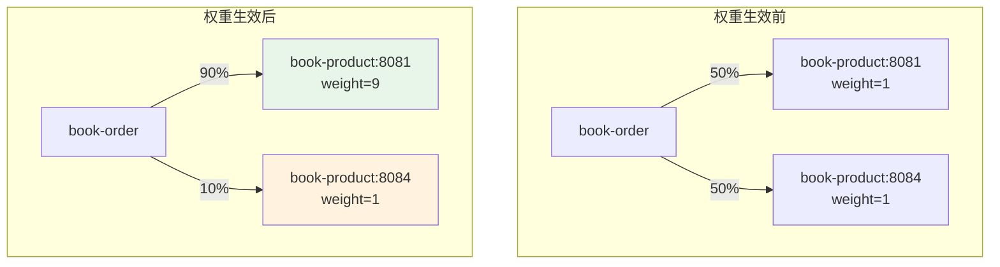
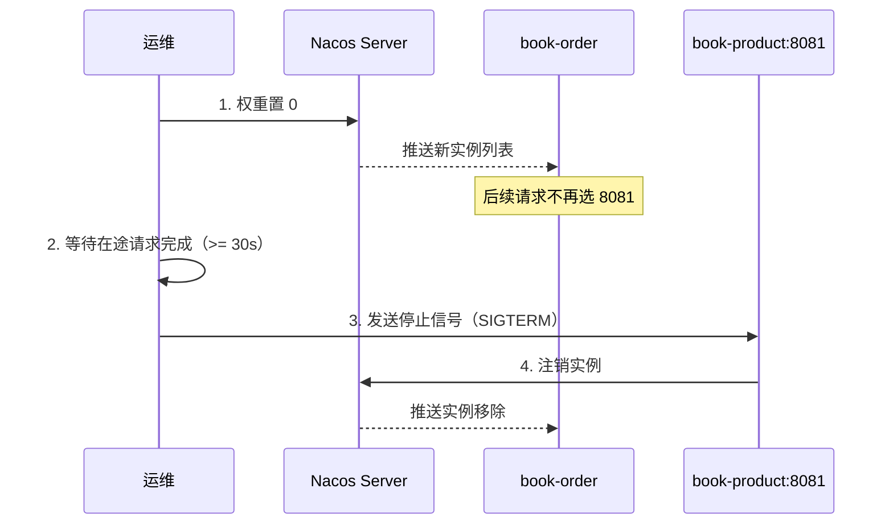
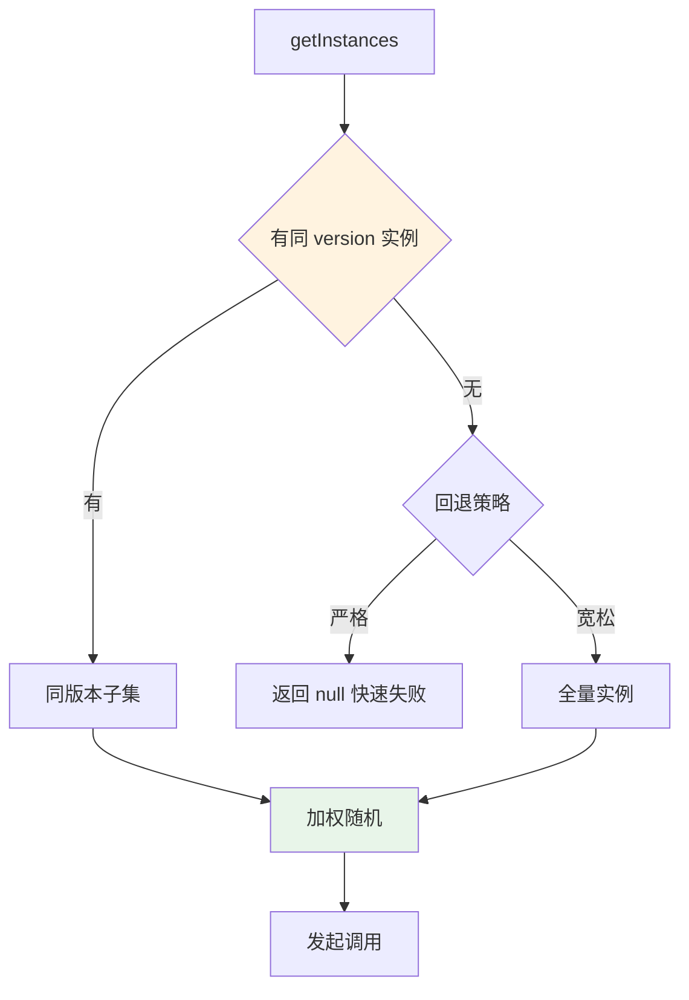

# Nacos权重路由与元数据治理

## 课程目标

- 理解权重路由的数学原理，说清"相对值""概率性""客户端执行"三点
- 掌握控制台、OpenAPI、启动参数三种设置权重的方式及其差异
- 掌握手写 `WeightedInstanceSelector`：累积权重 + 二分查找的完整实现
- 能够把权重选择器接入 `book-order` 调用链并统计流量分布
- 掌握主备部署与优雅上下线的操作步骤
- 掌握 `version`、`region`、`zone`、`env` 等元数据约定，完成版本路由预演

## 回顾与导入

上一课我们把三个服务收进 `ORDER_GROUP`，分组隔离生效。但同一分组内如果有多个实例，默认行为是**等概率**选中——谁的机器都一样，谁也不会多拿流量。

真实场景很少这么理想：

| 场景 | 诉求 | 等概率分配的后果 |
| --- | --- | --- |
| 主备部署 | 主机性能强，承担绝大部分流量 | 备机被压满，主机闲置 |
| 灰度验证 | 新版本只接少量流量 | 新版本故障影响一半用户 |
| 机器差异 | 新机器规格高、旧机器规格低 | 旧机器成为瓶颈 |
| 优雅下线 | 下线前逐步把流量摘走 | 直接停进程导致在途请求失败 |

Nacos 的权重（weight）就是为此设计的：每个实例带一个数值，由**调用方**按比例分配流量。注意"由调用方"这四个字——服务端只存权重、推权重，不做任何转发决策，这一点决定了后面所有实现细节。



## 权重路由原理

### 加权随机的数学模型

设第 i 个健康实例的权重为 w_i，总权重 W = Σw_i，则它被选中的概率为：

```text
P(实例 i) = w_i / W
```

权重是**相对值**而不是百分比：9 和 1 表示 90% / 10%，改成 90 和 10 结果完全一样。

| 实例 | 权重 | 计算 | 流量占比 |
| --- | --- | --- | --- |
| 8081 | 9 | 9 / 10 | 90% |
| 8084 | 1 | 1 / 10 | 10% |
| 合计 | 10 | - | 100% |

### 三个必须记住的特性

| 特性 | 说明 | 实践含义 |
| --- | --- | --- |
| 相对值 | 只有比例有意义，绝对值无意义 | 调权重时可整体放大，不影响比例 |
| 概率性 | 每次独立抽样，不是严格配额 | 少样本波动大，验证至少 50 次 |
| 客户端执行 | 服务端不参与流量分配 | 不用客户端负载均衡就完全不生效 |

概率性常被误解：权重 9:1 时连续 5 次全落在 8081 完全可能（59%）。判断生效与否，样本量比"看几次"更重要。

### 权重为 0 的语义

权重设为 0 不等于下线，而是"保留实例、不下发流量"：

| 操作 | 实例是否还在注册表 | 新流量 | 在途请求 | 恢复方式 |
| --- | --- | --- | --- | --- |
| 权重设为 0 | 在，健康状态正常 | 不进入候选集 | 正常完成 | 改回非 0 权重 |
| 停止进程 | 心跳超时后剔除 | 不进入候选集 | 可能失败 | 重新启动并注册 |
| 手动下线实例 | 立即移除 | 不进入候选集 | 可能失败 | 手动上线或重启 |

这就是优雅下线的基础：先把权重调 0，等在途请求跑完，再停进程。

### 权重的生效范围

| 场景 | 权重是否生效 | 原因 |
| --- | --- | --- |
| `NacosLoadBalancer` / `@LoadBalanced` | 生效 | 客户端读取权重做选择 |
| 本课手写的选择器 | 生效 | 我们自己读元数据算比例 |
| `DiscoveryClient` + `instances.get(0)` | 不生效 | 完全没读权重 |
| 直连 IP 调用 | 不生效 | 绕过了服务发现 |
| Nacos 服务端转发 | 不存在该能力 | Nacos 不是反向代理 |
| 持久化实例（`ephemeral=false`） | 变更推送不及时 | 依赖客户端主动拉取，表现为"改了没反应" |

> **结论：** 权重是"给客户端的建议"，不是"服务端的指令"。这也是为什么权重只对临时实例（`ephemeral=true`，默认）配合客户端负载均衡才表现符合预期。

## 三种设置权重的方式

### 方式一：控制台

进入 dev 命名空间，服务列表点 `book-product`，实例列表的"权重"列可直接编辑，填写后点确认即刻生效（客户端下一次收到推送后开始使用，通常 1 到 10 秒）。

### 方式二：OpenAPI

批量或自动化场景用 OpenAPI 更可靠：

```bash
# 将 8081 实例权重设为 100，8084 设为 1
curl -X PUT "http://127.0.0.1:8848/nacos/v1/ns/instance" \
  -d "serviceName=book-product" \
  -d "groupName=ORDER_GROUP" \
  -d "namespaceId=dev" \
  -d "ip=192.168.1.10" \
  -d "port=8081" \
  -d "weight=100" \
  -d "enabled=true" \
  -d "ephemeral=true"

curl -X PUT "http://127.0.0.1:8848/nacos/v1/ns/instance" \
  -d "serviceName=book-product" \
  -d "groupName=ORDER_GROUP" \
  -d "namespaceId=dev" \
  -d "ip=192.168.1.10" \
  -d "port=8084" \
  -d "weight=1" \
  -d "enabled=true" \
  -d "ephemeral=true"
```

参数必须齐全：`namespaceId`、`groupName`、`serviceName`、`ip`、`port` 五项定位唯一实例，少一个会返回 400 或更新到错误实例。

### 方式三：启动参数与元数据

```yaml
spring:
  cloud:
    nacos:
      discovery:
        weight: 100          # 上报到实例的 weight 字段
        metadata:
          weight: "100"      # 写进元数据，供自研选择器读取
```

两种写法的落点不同，务必分清：

| 设置方式 | 修改对象 | 是否需重启 | 谁读取 |
| --- | --- | --- | --- |
| 控制台 | 实例 `weight` 字段 | 否 | 框架负载均衡器 |
| OpenAPI | 实例 `weight` 字段 | 否 | 框架负载均衡器 |
| `discovery.weight` | 启动时上报的 `weight` | 是 | 框架负载均衡器 |
| `metadata.weight` | 元数据键值 | 是 | 自研选择器 |

> **注意：** 服务端 `weight` 字段与元数据 `weight` 是两份独立数据，控制台改前者不会动后者。本课的选择器读元数据，所以要么两边都设置，要么统一走一种口径，否则会出现"控制台改了权重但流量没变"的困惑。

## 手写 WeightedInstanceSelector

### 算法设计

累积权重 + 二分查找分两步：

1. 遍历候选实例，累加权重得到严格递增的前缀和数组 `prefixSum`。
2. 在 `[0, total)` 取随机数 `point`，用二分查找定位第一个 `prefixSum[k] > point` 的 k。


### 完整实现

```java
package com.example.order.discovery;

import org.springframework.cloud.client.ServiceInstance;

import java.util.ArrayList;
import java.util.Arrays;
import java.util.List;
import java.util.Map;
import java.util.concurrent.ThreadLocalRandom;

/**
 * 加权随机选择器：累积权重 + 二分查找
 * 权重读取顺序：metadata.weight -> metadata["nacos.weight"] -> 1.0
 */
public class WeightedInstanceSelector {

    private static final String WEIGHT_KEY = "weight";
    private static final String NACOS_WEIGHT_KEY = "nacos.weight";
    private static final double DEFAULT_WEIGHT = 1.0;

    public ServiceInstance choose(List<ServiceInstance> instances) {
        if (instances == null || instances.isEmpty()) {
            return null;
        }

        List<ServiceInstance> candidates = new ArrayList<>(instances.size());
        double[] prefixSum = new double[instances.size()];
        double total = 0.0;

        for (ServiceInstance instance : instances) {
            double weight = weightOf(instance);
            // 权重 <= 0 表示摘流量，直接排除出候选集
            if (weight <= 0) {
                continue;
            }
            total += weight;
            // prefixSum[k] 表示前 k+1 个候选实例的累计权重
            prefixSum[candidates.size()] = total;
            candidates.add(instance);
        }

        if (candidates.isEmpty()) {
            return null;
        }

        double point = ThreadLocalRandom.current().nextDouble(total);
        int index = Arrays.binarySearch(prefixSum, 0, candidates.size(), point);
        if (index < 0) {
            // 未精确命中时，插入点即第一个前缀和大于 point 的位置
            index = -index - 1;
        }
        if (index >= candidates.size()) {
            index = candidates.size() - 1;
        }
        return candidates.get(index);
    }

    private double weightOf(ServiceInstance instance) {
        Map<String, String> metadata = instance.getMetadata();
        String raw = metadata == null ? null : metadata.get(WEIGHT_KEY);
        if (raw == null || raw.isBlank()) {
            raw = metadata == null ? null : metadata.get(NACOS_WEIGHT_KEY);
        }
        if (raw == null || raw.isBlank()) {
            return DEFAULT_WEIGHT;
        }
        try {
            return Double.parseDouble(raw.trim());
        } catch (NumberFormatException e) {
            // 非法权重不放大故障，退化为默认值
            return DEFAULT_WEIGHT;
        }
    }
}
```

### 算法推演

假设两个实例权重分别为 9 和 1，前缀和数组为 `[9, 10]`：

| 随机数落点 | 二分返回 | 命中实例 | 概率 |
| --- | --- | --- | --- |
| `[0, 9)` | 插入点 0 | 8081 | 90% |
| `[9, 10)` | 插入点 1 | 8084 | 10% |

`Arrays.binarySearch` 未命中时返回 `-(插入点) - 1`，故统一用 `-index - 1` 还原插入点。权重都大于 0，前缀和严格递增，二分前提成立。

### 为什么用二分

| 实现 | 构建耗时 | 单次选择 | 适用规模 |
| --- | --- | --- | --- |
| 线性扫描累加 | 无 | O(n) | 实例数少（10 以内） |
| 累积权重 + 二分 | O(n) | O(log n) | 实例多、选择频繁 |
| 别名法（Alias Method） | O(n) | O(1) | 超大实例池、极致性能 |

实例只有两三个时线性扫描更简单；但一个服务几十个实例、每秒上千次选择时，二分优势才显现。写成通用选择器，后续课程可直接复用。

## 接入 book-order 调用链

### 注册为 Bean 并统计流量

```java
package com.example.order.config;

import com.example.order.discovery.WeightedInstanceSelector;
import org.springframework.context.annotation.Bean;
import org.springframework.context.annotation.Configuration;

@Configuration
public class SelectorConfig {

    @Bean
    public WeightedInstanceSelector weightedInstanceSelector() {
        return new WeightedInstanceSelector();
    }
}
```

统计逻辑放在控制器里：`ConcurrentHashMap` 计数，并暴露一个查询接口：

```java
package com.example.order.controller;

import com.example.common.result.Result;
import com.example.order.discovery.WeightedInstanceSelector;
import lombok.RequiredArgsConstructor;
import lombok.extern.slf4j.Slf4j;
import org.springframework.cloud.client.ServiceInstance;
import org.springframework.cloud.client.discovery.DiscoveryClient;
import org.springframework.web.bind.annotation.GetMapping;
import org.springframework.web.bind.annotation.PathVariable;
import org.springframework.web.bind.annotation.RequestMapping;
import org.springframework.web.bind.annotation.RestController;

import java.util.List;
import java.util.Map;
import java.util.concurrent.ConcurrentHashMap;
import java.util.concurrent.atomic.AtomicLong;

@Slf4j
@RestController
@RequestMapping("/api/discovery")
@RequiredArgsConstructor
public class WeightedDiscoveryController {

    private final DiscoveryClient discoveryClient;
    private final WeightedInstanceSelector selector;

    private final Map<String, AtomicLong> hitCounter = new ConcurrentHashMap<>();
    private final AtomicLong totalCounter = new AtomicLong();

    @GetMapping("/book/instance-port")
    public Result<String> instancePort() {
        List<ServiceInstance> instances = discoveryClient.getInstances("book-product");
        ServiceInstance instance = selector.choose(instances);
        if (instance == null) {
            return Result.error(503, "book-product 无可用实例或权重全为 0");
        }

        String key = instance.getHost() + ":" + instance.getPort();
        hitCounter.computeIfAbsent(key, k -> new AtomicLong()).incrementAndGet();
        long total = totalCounter.incrementAndGet();
        log.info("第 {} 次选取，命中 {}，权重 {}", total, key, instance.getMetadata().get("weight"));

        return Result.success(key);
    }

    @GetMapping("/stats")
    public Result<Map<String, Object>> stats() {
        long total = totalCounter.get();
        return Result.success(Map.of("total", total, "detail", hitCounter));
    }
}
```

`computeIfAbsent` + `AtomicLong` 的组合避免了加锁，`ConcurrentHashMap` 保证多线程下计数准确。`/stats` 接口让验证不必翻日志。

### 验证流量分布

两个 `book-product` 实例权重设为 3 和 1，连续调用 100 次：

```http
### 连续调用（IDEA 的 .http 可用多次请求或脚本循环）
GET http://127.0.0.1:8083/api/discovery/book/instance-port

### 查看统计
GET http://127.0.0.1:8083/api/discovery/stats
```

| 权重配置 | 实例 | 理论占比 | 100 次预期 | 可接受区间（示意） |
| --- | --- | --- | --- | --- |
| 3 : 1 | 8081 | 75% | 75 | 65 到 85 |
| 3 : 1 | 8084 | 25% | 25 | 15 到 35 |
| 100 : 1 | 8081 | 99% | 99 | 97 以上 |
| 100 : 1 | 8084 | 1% | 1 | 0 到 3 |

> **提示：** 区间是二项分布的近似波动（示意值，非精确置信区间）。样本越小波动越大，判断"权重没生效"至少要 50 次以上；若 100 次里 8084 一次没被选中，而权重是 3:1，那基本可以确认选择器读错了权重来源。

## 主备与优雅上下线

### 主备配置

主备部署的目标是"主机吃满、备机保温"：

| 角色 | 实例 | 权重 | 定位 |
| --- | --- | --- | --- |
| 主 | 8081 | 100 | 承担绝大多数流量 |
| 备 | 8084 | 1 | 保留少量流量，随时可接管 |

备机为什么不用 0？保持热备（连接池与缓存处于活跃状态）、快速接管（不必再改权重）、监控可比（两边都有指标）。只有明确要完全隔离某台机器时才用 0。

### 优雅下线四步



Spring Boot 侧要开启优雅停机，让已接收的请求跑完再退出：

```yaml
server:
  shutdown: graceful

spring:
  lifecycle:
    timeout-per-shutdown-phase: 30s
```

运维脚本把前两步自动化，避免"手快停了进程"：

```bash
# 第一步：权重置 0（Linux 示例，Windows 用 curl.exe 同样参数）
curl -X PUT "http://127.0.0.1:8848/nacos/v1/ns/instance" \
  -d "serviceName=book-product&groupName=ORDER_GROUP&namespaceId=dev" \
  -d "ip=192.168.1.10&port=8081&weight=0&enabled=true&ephemeral=true"

# 第二步：等待推送生效与在途请求完成
sleep 35

# 第三步：停止进程
kill -TERM $(cat /opt/book/book-product.pid)
```

## 元数据治理

### 约定字段

元数据（metadata）是实例上附带的键值对，是"路由与治理的抓手"。团队必须约定一套字段，否则每个服务各写一套，路由策略无从下手：

| 字段 | 含义 | 取值示例 | 使用者 |
| --- | --- | --- | --- |
| `version` | 应用版本 | `1.0.0` | 版本灰度路由 |
| `env` | 所属环境 | `dev` | 环境校验、排障 |
| `region` | 地域 | `cn-east` | 跨地域就近访问 |
| `zone` | 可用区 | `zone-a` | 同可用区优先 |
| `weight` | 权重（自研选择器读取） | `100` | 加权随机 |
| `owner` | 负责人 | `order-team` | 告警与责任归属 |

### 统一注入

```yaml
spring:
  cloud:
    nacos:
      discovery:
        metadata:
          version: ${APP_VERSION:1.0.0}
          env: ${NACOS_NAMESPACE:dev}
          region: cn-east
          zone: zone-a
          owner: order-team
```

用构建号注入 `version`，能保证"镜像里跑的是哪个版本"与注册信息一致；写死字符串则很快失真。

### 版本路由预演

在加权随机之上加一层"版本筛选"，就是灰度路由的雏形：

```java
package com.example.order.discovery;

import org.springframework.cloud.client.ServiceInstance;

import java.util.List;

/**
 * 版本路由：优先在同版本实例中加权选择，无匹配时按策略回退
 */
public class MetadataVersionRouter {

    private final WeightedInstanceSelector selector;

    public MetadataVersionRouter(WeightedInstanceSelector selector) {
        this.selector = selector;
    }

    public ServiceInstance route(List<ServiceInstance> instances, String expectedVersion) {
        if (instances == null || instances.isEmpty()) {
            return null;
        }
        List<ServiceInstance> sameVersion = instances.stream()
                .filter(i -> expectedVersion.equals(i.getMetadata().get("version")))
                .toList();

        // 严格模式返回 null；宽松模式回退到全量，按业务容忍度选择
        List<ServiceInstance> pool = sameVersion.isEmpty() ? instances : sameVersion;
        return selector.choose(pool);
    }
}
```

| 回退策略 | 无同版本实例时 | 优点 | 风险 |
| --- | --- | --- | --- |
| 严格（返回 null） | 直接失败 | 绝不串版本 | 新版本未全量时调用失败 |
| 宽松（回退全量） | 使用其他版本 | 可用性优先 | 可能调到不兼容版本 |
| 权重兜底 | 老版本权重设 0 前先观察 | 平滑过渡 | 需要精确的发布编排 |

版本路由的完整实现要结合缓存、同区域优先、失败重试，这些在后续课程中逐步补齐。这里先把"元数据即路由输入"的观念立住。



> **预告：** 第 25 课会把权重与元数据交给 `NacosLoadBalancer`，由框架完成"同集群优先 + 加权选择"；第 29 课在此之上写自定义负载均衡策略与平滑加权轮询。本课的手写实现是理解它们的必经之路。

## 注意事项

1. **权重是相对值**：9:1 与 90:10 等价，调权重不必在意绝对值，只看比例。
2. **改权重不会立刻全量生效**：客户端收到推送后才使用新值，通常 1 到 10 秒，验证前先等待。
3. **少样本不能判断生效**：3:1 的权重下连续 5 次全命中同一个实例属正常波动，至少统计 50 次。
4. **两处 weight 要统一口径**：服务端 `weight` 与 `metadata.weight` 是两份数据，改一份不会同步另一份。
5. **权重 0 是摘流不是下线**：实例仍在注册表、仍健康，只是不接收新流量，这是优雅下线的关键手段。
6. **持久化实例权重不灵**：`ephemeral=false` 的实例变更推送不及时，权重调整常表现为无效；需要动态权重时坚持用临时实例。
7. **权重不替代熔断**：权重只影响"选中概率"，实例真正故障仍需健康检查剔除与熔断降级，见《Sentinel熔断降级与热点参数限流》。
8. **元数据键名统一小写**：`version`、`env`、`region`、`zone` 全小写，避免不同框架取值时大小写不一致。

## 小结

本节课我们学习了：

1. **权重路由原理**：`P(i) = w_i / Σw`，权重是相对值、概率性、由客户端执行。
2. **权重为 0 的语义**：摘流量而非下线，为优雅上下线提供技术基础。
3. **三种设置方式**：控制台与 OpenAPI 改服务端字段，启动参数与元数据在重启后上报，落点不同。
4. **`WeightedInstanceSelector`**：累积权重生成前缀和，二分查找定位命中实例，复杂度从 O(n) 降到 O(log n)。
5. **调用链接入与验证**：选择器注册为 Bean，控制器统计各实例命中次数，用 `/stats` 对比理论占比。
6. **主备与优雅下线**：主 100、备 1 的热备策略，四步下线流程配合 Spring Boot 优雅停机。
7. **元数据治理**：`version`、`env`、`region`、`zone` 等约定字段，以及基于 `version` 的灰度路由预演。

## 作业

### 作业一：验证权重与流量分布

1. 启动两个 `book-product` 实例（8081、8084），在控制台把权重设为 3 和 1。
2. 调用 `/api/discovery/book/instance-port` 100 次，用 `/api/discovery/stats` 记录分布，与理论值 75:25 对比。
3. 把 8084 权重改为 0，再调用 20 次，确认全部命中 8081，并说明此时 8084 实例是否仍健康。

### 作业二：实现主备切换与版本路由

1. 配置主 100、备 1，模拟主机故障（直接把权重改 0），观察流量是否全部切到备机。
2. 为两个实例设置不同的 `metadata.version`（如 `1.0.0` 与 `1.1.0`），用 `MetadataVersionRouter` 分别请求两个版本，记录命中结果。
3. 把请求版本改为不存在的 `2.0.0`，分别测试严格与宽松两种回退策略，说明生产环境更适合哪一种及理由。
