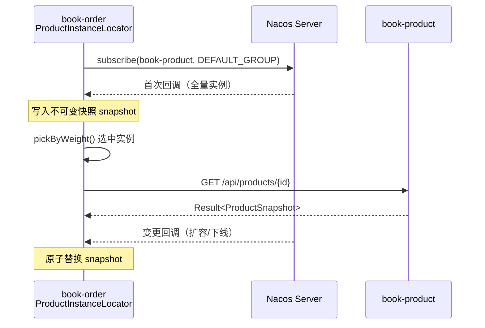
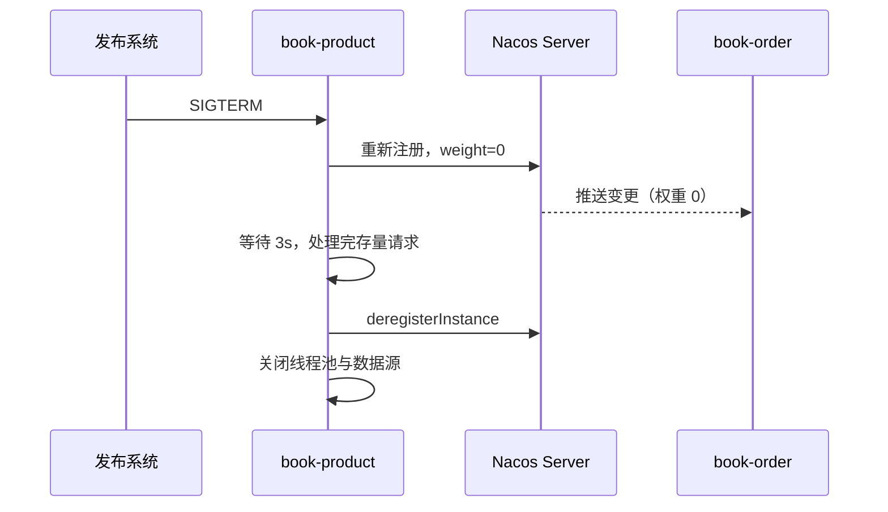

# Nacos API 专题

## 课程目标

- 理解 Nacos 3.x 的 API 分层：OpenAPI v3、v2 兼容路径、控制台 API 与内部 API 的边界
- 掌握 OpenAPI 鉴权流程：用 `username` 与 `password` 换取 `accessToken` 并携带到请求
- 掌握 Java SDK 中 `NamingService` 的核心方法与 `Instance` 的关键字段
- 能够用 SDK 实现服务消费者的动态发现、订阅回调与加权选择
- 能够用 SDK 实现服务提供者的动态注册、元数据上报与优雅下线
- 能够区分临时实例与持久实例，并说明两者在健康检查上的差异

## 回顾与导入

前二十课把 Nacos 当注册中心用了一整轮：注册、发现、Namespace 隔离、Group 分组、权重与元数据治理。这些能力几乎都靠控制台或 starter 自动装配，一旦要写脚本、做网关路由或对接其他语言，就只剩 HTTP 接口一条路：

| 场景 | 直接面临的约束 |
| --- | --- |
| 运维脚本批量摘除节点 | 没有 starter，只能调 HTTP 接口 |
| 网关做动态路由 | 需要主动查询实例，不能等容器注入 |
| 灰度发布平台 | 需要自己算权重、自己感知变更 |
| 跨语言接入（Go、Python） | 只能对照 OpenAPI 文档逐条实现 |

框架替我们做的，本质只有三件事：实例上报、实例查询、变更通知。本课把这三件事拆开，先用 `curl` 打通 HTTP 层，再用 Java SDK 手写消费者与提供者两个场景。

> **结论：** 注册中心的能力可以收敛为「注册、发现、订阅」六个字，看懂 SDK，OpenFeign 的自动发现就不再是黑盒。

## Nacos 3.x 的 API 分层

### 四类 API 的边界

| API 类型 | 调用方 | 路径前缀 | 协议 | 默认鉴权 |
| --- | --- | --- | --- | --- |
| Client OpenAPI | 业务应用 | `/nacos/v3/client` | gRPC | 关闭 |
| Admin OpenAPI | 运维脚本 | `/nacos/v3/admin` | HTTP | 开启 |
| Console API | 控制台 | `/nacos/v3/console` | HTTP | 开启 |
| Inner API | 集群节点 | `/nacos/v3/inner` | gRPC | 开启 |

四类接口共用端口：HTTP 8848，gRPC 客户端 9848、服务端 9849。业务代码用 Client OpenAPI（即 Java SDK），脚本与平台用 Admin OpenAPI。

### v3 的变化：服务名与分组拆开

v1 把分组和服务名拼在 `serviceName` 里，形如 `DEFAULT_GROUP@@book-product`；v3 拆成两个参数。

| 版本 | 注册实例路径 | 服务名写法 | 成功响应 |
| --- | --- | --- | --- |
| v1（默认下线） | `/nacos/v1/ns/instance` | `DEFAULT_GROUP@@book-product` | 纯文本 `ok` |
| v2（兼容保留） | `/nacos/v2/ns/instance` | `DEFAULT_GROUP@@book-product` | 纯文本 `ok` |
| v3（推荐） | `/nacos/v3/admin/ns/instance` | `book-product` 加 `groupName` | JSON `code/message/data` |

v3 响应统一为 `code` 为 0 即成功，非 0 时先看 `message` 再看服务端日志。

> **注意：** Nacos 3.0 起 v1 OpenAPI 默认不再注册路由，照搬 `/nacos/v1/...` 会拿到 404。升级前先全局替换路径，再验证鉴权参数。

### 鉴权：先换令牌，再带令牌

开启鉴权后，Admin 与 Console 路径都要求身份，令牌接口是 `POST /nacos/v3/auth/user/login`：

```bash
curl.exe -s -X POST "http://127.0.0.1:8848/nacos/v3/auth/user/login" \
  -d "username=nacos" -d "password=nacos"
```

返回体的 `accessToken` 是后续凭证，`tokenTtl` 是有效期（默认 18000 秒），`globalAdmin` 表示该账号是否全局管理员。

| 携带方式 | 写法 | 适用场景 |
| --- | --- | --- |
| 查询参数 | `?accessToken=xxx` | 与官方文档一致，脚本最通用 |
| HTTP Basic | `curl -u nacos:nacos` | 一次性调用，免去先登录 |

> **提示：** Java SDK 不需要手动换令牌，在 `Properties` 填 `username` 与 `password` 后由客户端登录与续期。

## 用 curl 走通 OpenAPI 全流程

这条链路把「登录、注册、查询、注销」串成可复现的命令序列：

```bash
# 1. 登录换取令牌
TOKEN=$(curl -s -X POST "http://127.0.0.1:8848/nacos/v3/auth/user/login" \
  -d "username=nacos" -d "password=nacos" | jq -r '.accessToken')

# 2. 注册临时实例（metadata 是 JSON，必须 URL 编码）
curl -s -X POST "http://127.0.0.1:8848/nacos/v3/admin/ns/instance?accessToken=${TOKEN}" \
  -d "namespaceId=public" -d "groupName=DEFAULT_GROUP" -d "serviceName=book-product" \
  -d "ip=127.0.0.1" -d "port=8081" -d "weight=1.0" -d "ephemeral=true" \
  --data-urlencode 'metadata={"version":"v1","zone":"shanghai"}'

# 3. 查询实例列表
curl -s -G "http://127.0.0.1:8848/nacos/v3/admin/ns/instance/list" \
  -d "accessToken=${TOKEN}" -d "namespaceId=public" \
  -d "groupName=DEFAULT_GROUP" -d "serviceName=book-product"

# 4. 注销实例（ephemeral 必须与注册一致）
curl -s -X DELETE "http://127.0.0.1:8848/nacos/v3/admin/ns/instance?accessToken=${TOKEN}" \
  -d "namespaceId=public" -d "groupName=DEFAULT_GROUP" -d "serviceName=book-product" \
  -d "ip=127.0.0.1" -d "port=8081" -d "ephemeral=true"
```

Windows PowerShell 用 `Invoke-RestMethod` 调同一路径，令牌从返回对象直接取，不需要 `jq`。四个参数要对齐：`namespaceId` 要 ID 而非名称，`groupName` 省略会落到默认分组，`ephemeral` 需与注册一致，`metadata` 是 JSON 需 URL 编码。

## Java SDK：NamingService

### 依赖坐标

版本交给 BOM 托管：

```xml
<dependency>
    <groupId>com.alibaba.nacos</groupId>
    <artifactId>nacos-client</artifactId>
</dependency>
```

### 实例模型 Instance 的关键字段

| 字段 | 含义 | 注意点 |
| --- | --- | --- |
| `ip` / `port` | 实例地址 | 多网卡需显式指定 `ip` |
| `weight` | 权重，默认 1.0 | 0 表示不参与流量 |
| `healthy` | 服务端判定的状态 | 临时实例看心跳，持久实例看探测 |
| `enabled` | 人工开关 | false 时不会被选中 |
| `ephemeral` | 是否临时实例 | 决定断线后是否删除 |
| `clusterName` | 集群名，默认 `DEFAULT` | 同机房优先靠它 |
| `metadata` | 自定义键值对 | 承载版本、机房、灰度标记 |

### 核心方法

| 方法 | 作用 | 同步性 | 说明 |
| --- | --- | --- | --- |
| `registerInstance(serviceName, instance)` | 注册实例 | 同步 | 默认分组、默认集群 |
| `registerInstance(serviceName, groupName, instance)` | 注册实例 | 同步 | 推荐显式传分组 |
| `deregisterInstance(serviceName, groupName, instance)` | 注销实例 | 同步 | `ephemeral` 需一致 |
| `getAllInstances(serviceName, groupName, subscribe)` | 全部实例 | 读本地缓存 | 含不健康实例 |
| `selectInstances(serviceName, groupName, true)` | 健康实例 | 读本地缓存 | 优先用它，别手动过滤 |
| `selectOneHealthyInstance(serviceName, groupName)` | 加权选一个 | 本地计算 | 权重越大命中越高 |
| `subscribe(serviceName, groupName, listener)` | 订阅变更 | 异步回调 | 首次回调全量 |
| `unsubscribe(serviceName, groupName, listener)` | 取消订阅 | 同步 | 同一个 listener 实例 |
| `getServicesOfServer(pageNo, pageSize, groupName)` | 服务清单 | 走服务端 | 运维平台用 |
| `shutDown()` | 关闭客户端 | 同步 | 退出前必调 |

### 初始化 NamingService

一个 `NamingService` 绑定一个命名空间，跨命名空间要建多个实例。这段代码集中构造连接与鉴权参数：

```java
package com.example.order.discovery;

public final class NamingServiceFactory {

    public static NamingService create(String serverAddr, String namespace,
                                       String username, String password) throws Exception {
        Properties properties = new Properties();
        properties.put(PropertyKeyConst.SERVER_ADDR, serverAddr);
        properties.put(PropertyKeyConst.NAMESPACE, namespace);
        properties.put(PropertyKeyConst.USERNAME, username);
        properties.put(PropertyKeyConst.PASSWORD, password);
        properties.put(PropertyKeyConst.NAMING_LOAD_CACHE_AT_START, "true");
        return NacosFactory.createNamingService(properties);
    }
}
```

四个键分别来自 `com.alibaba.nacos.api.PropertyKeyConst` 与 `NacosFactory`。`NAMING_LOAD_CACHE_AT_START=true` 让客户端启动时载入本地缓存，注册中心短暂不可用时服务仍可调。

> **注意：** SDK 只在握手阶段用 8848，真正的服务发现走 gRPC 9848。防火墙只放行 8848 会出现「注册成功但发现为空」。

## 场景一：服务消费者动态发现与加权调用

book-order 要在不重启的前提下感知 book-product 的实例变化，并按权重分配流量。



### 步骤一：订阅回调写入快照

订阅的价值不在「拿到列表」，而在「变更时有人通知」。回调只做赋值，结果收敛到不可变快照：

```java
package com.example.order.discovery;

import com.alibaba.nacos.api.naming.NamingService;
import com.alibaba.nacos.api.naming.listener.NamingEvent;
import com.alibaba.nacos.api.naming.pojo.Instance;
import com.example.common.exception.BusinessException;
import lombok.extern.slf4j.Slf4j;
import org.springframework.beans.factory.DisposableBean;
import org.springframework.beans.factory.InitializingBean;
import org.springframework.beans.factory.annotation.Value;
import org.springframework.stereotype.Component;

import java.util.Collections;
import java.util.List;
import java.util.concurrent.ThreadLocalRandom;
import java.util.concurrent.atomic.AtomicReference;
import java.util.stream.Collectors;

@Slf4j
@Component
public class ProductInstanceLocator implements InitializingBean, DisposableBean {

    private static final String SERVICE_NAME = "book-product";
    private static final String GROUP_NAME = "DEFAULT_GROUP";

    private final NamingService namingService;
    private final AtomicReference<List<Instance>> snapshot =
            new AtomicReference<>(Collections.emptyList());

    public ProductInstanceLocator(
            @Value("${nacos.discovery.server-addr:127.0.0.1:8848}") String serverAddr,
            @Value("${nacos.discovery.namespace:public}") String namespace,
            @Value("${nacos.discovery.username:nacos}") String username,
            @Value("${nacos.discovery.password:nacos}") String password) throws Exception {
        this.namingService = NamingServiceFactory.create(serverAddr, namespace, username, password);
    }

    @Override
    public void afterPropertiesSet() throws Exception {
        namingService.subscribe(SERVICE_NAME, GROUP_NAME, event -> {
            if (event instanceof NamingEvent namingEvent) {
                List<Instance> healthy = namingEvent.getInstances().stream()
                        .filter(instance -> instance.isHealthy() && instance.isEnabled())
                        .collect(Collectors.toList());
                snapshot.set(List.copyOf(healthy));
                log.info("book-product 实例变更，健康实例 {} 个", healthy.size());
            }
        });
        snapshot.set(namingService.selectInstances(SERVICE_NAME, GROUP_NAME, true));
    }

    @Override
    public void destroy() throws Exception {
        namingService.shutDown();
    }

    public Instance pick() {
        List<Instance> candidates = snapshot.get();
        if (candidates.isEmpty()) {
            throw new BusinessException("book-product 无可用实例");
        }
        return pickByWeight(candidates);
    }

    private Instance pickByWeight(List<Instance> candidates) {
        double total = candidates.stream().mapToDouble(Instance::getWeight).sum();
        if (total <= 0) {
            return candidates.get(ThreadLocalRandom.current().nextInt(candidates.size()));
        }
        double point = ThreadLocalRandom.current().nextDouble(total);
        double cursor = 0;
        for (Instance candidate : candidates) {
            cursor += candidate.getWeight();
            if (point <= cursor) {
                return candidate;
            }
        }
        return candidates.get(candidates.size() - 1);
    }
}
```

`AtomicReference` 加不可变列表保证读侧一致：回调线程只做一次原子替换，业务线程读到的永远是完整快照。

### 步骤二：加权选择与发起调用

`selectOneHealthyInstance` 已内置加权随机，但无法按 `metadata` 过滤灰度实例，所以上面把权重算法摊开。`BookSnapshotClient` 里的调用代码如下，`locator` 与 `RestTemplate` 均由构造器注入：

```java
    public ProductSnapshot getProduct(Long productId) {
        var instance = locator.pick();
        String url = "http://" + instance.getIp() + ":" + instance.getPort()
                + "/api/products/" + productId;
        ResponseEntity<Result<ProductSnapshot>> response = restTemplate.exchange(
                url, HttpMethod.GET, null, new ParameterizedTypeReference<>() {
                });
        Result<ProductSnapshot> body = response.getBody();
        if (body == null || body.getCode() != 0) {
            throw new BusinessException("图书服务返回异常");
        }
        return body.getData();
    }
```

`ParameterizedTypeReference` 保留了 `Result<ProductSnapshot>` 的泛型，否则 Jackson 只能反序列化成 `LinkedHashMap`。

> **提示：** 权重 0 的实例仍会被 `selectInstances` 返回，但它在概率轴上占不到区间，等价于摘流。灰度下线先改权重 0，等一个调用周期再注销。

### 步骤三：验证

启动单实例后控制台出现 1 个健康实例；再启动一个不同端口的实例，book-order 日志里的健康实例数应在一个心跳周期内变为 2；强杀其中一个回落为 1；权重改为 0 后连续调用 20 次不应命中它。

## 场景二：服务提供者动态注册

### 注册实例（含元数据）

```java
package com.example.product.registry;

import com.alibaba.nacos.api.naming.NamingService;
import com.alibaba.nacos.api.naming.pojo.Instance;
import lombok.extern.slf4j.Slf4j;
import org.springframework.beans.factory.DisposableBean;
import org.springframework.beans.factory.annotation.Value;
import org.springframework.boot.ApplicationArguments;
import org.springframework.boot.ApplicationRunner;
import org.springframework.stereotype.Component;

import java.net.InetAddress;
import java.util.Map;

@Slf4j
@Component
public class NacosInstanceRegistrar implements ApplicationRunner, DisposableBean {

    private static final String SERVICE_NAME = "book-product";
    private static final String GROUP_NAME = "DEFAULT_GROUP";

    private final NamingService namingService;
    private final int port;
    private final double weight;
    private final Map<String, String> metadata;
    private Instance registered;

    public NacosInstanceRegistrar(NamingService namingService,
                                  @Value("${server.port:8081}") int port,
                                  @Value("${nacos.discovery.weight:1.0}") double weight,
                                  @Value("${nacos.discovery.metadata.version:1.0.0}") String version,
                                  @Value("${nacos.discovery.metadata.zone:shanghai}") String zone) {
        this.namingService = namingService;
        this.port = port;
        this.weight = weight;
        this.metadata = Map.of("version", version, "zone", zone, "owner", "book-team");
    }

    @Override
    public void run(ApplicationArguments args) throws Exception {
        Instance instance = new Instance();
        instance.setIp(InetAddress.getLocalHost().getHostAddress());
        instance.setPort(port);
        instance.setWeight(weight);
        instance.setHealthy(true);
        instance.setEnabled(true);
        instance.setEphemeral(true);
        instance.setClusterName("DEFAULT");
        instance.setMetadata(metadata);

        namingService.registerInstance(SERVICE_NAME, GROUP_NAME, instance);
        this.registered = instance;
        log.info("已注册到 Nacos：{}:{}，元数据 {}", instance.getIp(), port, metadata);
    }

    @Override
    public void destroy() throws Exception {
        if (registered == null) {
            return;
        }
        registered.setWeight(0);
        namingService.registerInstance(SERVICE_NAME, GROUP_NAME, registered);
        Thread.sleep(3000L);
        namingService.deregisterInstance(SERVICE_NAME, GROUP_NAME, registered);
        namingService.shutDown();
        log.info("已从 Nacos 下线：{}:{}", registered.getIp(), port);
    }
}
```

注册写在 `ApplicationRunner` 里而非构造函数：此时 Tomcat 已就绪，注册上去立即可用；写在构造函数会出现「已注册但端口未监听」的 502 窗口。`NamingService` 由配置类借上文工厂方法注册为 Bean。

### 健康状态由谁判定

`healthy` 不是应用自己说了算，而是服务端按实例类型判定：

| 维度 | 临时实例（ephemeral=true） | 持久实例（ephemeral=false） |
| --- | --- | --- |
| 保活 | 客户端心跳（gRPC 长连接） | 服务端主动探测 |
| 健康检查 | 心跳超时即不健康 | TCP、HTTP、MySQL 探针 |
| 断连后 | 超时自动删除 | 保留，标记不健康 |
| 存储 | 内存加本地缓存 | 持久化到数据库 |
| 场景 | 微服务（默认） | 对接外部系统 |

> **结论：** `spring.cloud.nacos.discovery.ephemeral` 默认 true。进程自己管生死的服务用临时实例，只有「不知道对方何时上线」的外部系统才用持久实例。

### 优雅下线的时序

直接注销会留下几百毫秒空窗：调用方快照里还有该实例，请求打进来却已无监听端口。稳妥做法是先摘流再注销。



容器环境里这段等待要与 `terminationGracePeriodSeconds` 对齐；虚拟机环境用 `server.shutdown=graceful` 配合 `destroy()`。验证：控制台看到新 IP:PORT 与元数据，`Ctrl+C` 后日志先打印下线再打印关闭，直接杀进程则约 15 秒后实例消失。

## 两个场景的对比

| 关注点 | 场景一：消费者 | 场景二：提供者 |
| --- | --- | --- |
| 核心方法 | `subscribe`、`selectInstances` | `registerInstance`、`deregisterInstance` |
| 方向 | 读，被动接收推送 | 写，主动上报 |
| 关键状态 | 本地快照的一致性 | 元数据与权重的准确性 |
| 失败影响 | 调用打空、路由到不健康节点 | 请求根本进不来 |
| 容错要求 | 快照兜底，注册中心挂了仍可调 | 下线幂等，重复注销不报错 |
| 典型坑 | 回调里阻塞推送线程 | 注册太早导致端口未就绪 |

选型边界：业务服务用 starter 最省事；网关与灰度组件用 SDK；运维脚本用 Admin OpenAPI，语言无关但扛不住高频。

## 注意事项

1. **令牌会过期**：`accessToken` 默认 18000 秒，过期返回 401 或 403，脚本要有重新登录分支。
2. **`namespaceId` 是 ID**：控制台显示的是名称，接口要 ID，新建不填会生成 UUID。
3. **`ephemeral` 必须成对**：注册与注销不一致会「假成功」，实例残留到超时。
4. **v1 已下线、v2 仅兼容**：新代码只写 v3 路径，升级前搜一遍 `/nacos/v1/`。
5. **别用 OpenAPI 做发现**：每次查询都是 HTTP 往返，服务端还有限流保护，业务侧一律走 SDK 的 gRPC 订阅。
6. **回调里禁止阻塞**：回调跑在客户端推送线程，写库或远程调用会拖垮通知链路。
7. **`NamingService` 是重量级对象**：按命名空间复用，每次创建会让 gRPC 连接数失控。
8. **下线留缓冲**：权重置 0 与注销之间建议 3 秒以上，不能设为 0。

## 小结

本节课我们学习了：

1. **API 分层**：Client、Admin、Console、Inner 按调用方划分，v3 是唯一推荐写法。
2. **鉴权流程**：登录接口换 `accessToken`，用查询参数或 HTTP Basic 携带，SDK 自动完成。
3. **`NamingService`**：注册、注销、查询、订阅四组方法，`selectInstances` 取健康实例。
4. **消费者场景**：订阅回调加原子快照加权重选择，变更收敛为一次不可变替换。
5. **提供者场景**：`ApplicationRunner` 中注册，元数据承载版本与机房，权重置 0 后注销。
6. **实例类型**：进程自管理的服务用临时实例，外部系统对接用持久实例。

## 作业

### 作业一：用 curl 完成实例生命周期

1. 登录换取 `accessToken`，记录 `tokenTtl` 数值。
2. 注册 `book-product` 临时实例，元数据含 `version=2.0.0`、`zone=beijing`。
3. 查询实例列表，确认元数据与权重。
4. 分别用 `ephemeral=true` 与 `false` 注销，记录响应差异并解释。

### 作业二：为消费者加上元数据过滤

1. 在 `ProductInstanceLocator` 中增加 `version` 过滤，只保留 `metadata.version` 匹配的实例。
2. 启动两个不同 `version` 的实例，验证过滤生效。
3. 过滤后列表为空时，设计降级策略并说明取舍。

### 作业三：设计一张优雅下线检查单

1. 结合本课时序图，写出发布系统需要的信号顺序与等待时长。
2. 说明三步顺序颠倒后各会出现什么现象。
