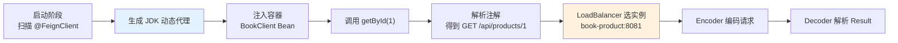
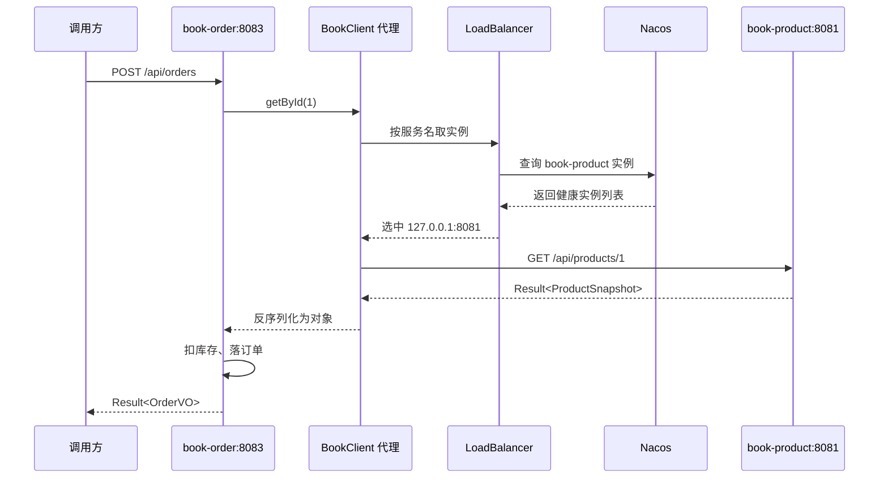

# OpenFeign快速上手

## 课程目标

- 理解声明式远程调用的思想，说清它与 RestTemplate 命令式写法的本质差异
- 掌握 `spring-cloud-starter-openfeign` 依赖、`@EnableFeignClients` 与 `@FeignClient` 的配合
- 能够把 book-order 中手写的服务发现与 HTTP 调用替换为 Feign 接口
- 掌握 Feign 日志的四个级别与「两个开关」配置法
- 掌握超时配置项与默认值，能判断超时该在 Feign 还是负载均衡层调整
- 能够独立排查 Feign 接入阶段的常见报错

## 回顾与导入

上一课我们用 `NamingService` 手写了服务发现：订阅回调维护实例快照，按权重选一个实例，再拼 URL 调 `RestTemplate`。代码能跑，但每多一个下游接口，就要重复一遍「选实例、拼 URL、反序列化、判错误码」。

book-order 现在只调了图书查询一个接口。等它要调扣库存、查用户、查优惠券时，这类样板代码会成倍增长，而且散落在各个 Service 里，接口路径一变就要全量搜索替换。

OpenFeign（声明式 HTTP 客户端）解决的就是这件事：你把下游接口写成一个 Java 接口，加上注解，调用时像调本地方法一样。服务发现、负载均衡、编码解码、错误处理全部由框架接管。

> **结论：** OpenFeign 不是新的通信协议，它只是把「选实例 + 发 HTTP + 解 JSON」这套动作收敛到一个动态代理里。

## 从 RestTemplate 到 OpenFeign

### 手写调用的三道工序

上一课的调用代码有三段固定动作，缺一不可：

```java
var instance = locator.pick();                                   // 1. 选实例
String url = "http://" + instance.getIp() + ":" + instance.getPort()
        + "/api/products/" + productId;                          // 2. 拼 URL
Result<ProductSnapshot> body = restTemplate.exchange(url, HttpMethod.GET, null,
        new ParameterizedTypeReference<Result<ProductSnapshot>>() {}).getBody();   // 3. 发请求
```

### 声明式写法的等价形态

同样的调用，用 Feign 只需定义一个接口：

```java
@FeignClient(name = "book-product")
public interface BookClient {

    @GetMapping("/api/products/{id}")
    Result<ProductSnapshot> getById(@PathVariable("id") Long id);
}
```

`name` 就是 Nacos 里的服务名，`@GetMapping` 就是下游的路径。方法体没有，因为实现由框架生成。

### 动态代理做了什么

启动时 Feign 扫描所有 `@FeignClient` 接口，为每个接口生成代理对象并注册进容器；调用时由代理把方法签名翻译成 HTTP 请求。



### 两种方式对比

| 维度 | RestTemplate | OpenFeign |
| --- | --- | --- |
| 调用写法 | 命令式，逐句描述怎么调 | 声明式，只描述调什么 |
| 服务发现 | 自己选实例、拼 URL | `name` 交给 LoadBalancer |
| 负载均衡 | 需要自己实现权重选择 | 与 Spring Cloud LoadBalancer 集成 |
| 契约维护 | URL 散落各处，改一处搜全仓 | 接口即契约，改接口即可 |
| 错误处理 | 每个调用点判空判码 | 统一 `ErrorDecoder` 与异常 |
| 学习成本 | 低，但要写大量样板 | 低，注解即用 |

## 为 book-order 引入 OpenFeign

### 步骤一：加依赖

Feign 与 LoadBalancer 是两个 starter，缺一不可：

```xml
<dependency>
    <groupId>org.springframework.cloud</groupId>
    <artifactId>spring-cloud-starter-openfeign</artifactId>
</dependency>
<dependency>
    <groupId>org.springframework.cloud</groupId>
    <artifactId>spring-cloud-starter-loadbalancer</artifactId>
</dependency>
```

OpenFeign 没有把 LoadBalancer 作为强制依赖，只加前者会在启动或首次调用时报 `No Feign Client for loadBalancing defined`。

### 步骤二：开启 Feign

```java
package com.example.order;

@SpringBootApplication(scanBasePackages = "com.example")
@EnableFeignClients(basePackages = "com.example.order.client")
@MapperScan("com.example.order.mapper")
public class BookOrderApplication {
    public static void main(String[] args) {
        SpringApplication.run(BookOrderApplication.class, args);
    }
}
```

`@EnableFeignClients` 负责扫描并注册接口。显式写 `basePackages` 是为了避免整个 `com.example` 都参与扫描导致的启动变慢与误注册。

### 步骤三：定义接口

```java
package com.example.order.client;

@FeignClient(name = "book-product")
public interface BookClient {

    @GetMapping("/api/products/{id}")
    Result<ProductSnapshot> getById(@PathVariable("id") Long id);

    @PostMapping("/api/products/stock/deduct")
    Result<Void> deductStock(@RequestBody StockDeductRequest request);
}
```

`StockDeductRequest` 是订单侧自己的入参对象，字段与图书服务的接口对齐即可。

## 改造订单下单流程

### 改造前：手写调用

```java
ProductSnapshot product = bookSnapshotClient.getProduct(productId);
```

### 改造后：注入 Feign 接口

```java
package com.example.order.service;

@Service
@RequiredArgsConstructor
public class OrderService {

    private final OrderMapper orderMapper;
    private final ItemMapper itemMapper;
    private final BookClient bookClient;

    public OrderVO createOrder(CreateOrderRequest request) {
        Result<ProductSnapshot> productResult = bookClient.getById(request.getProductId());
        if (productResult == null || productResult.getCode() != 0
                || productResult.getData() == null) {
            throw new BusinessException("图书不存在或已下架");
        }
        ProductSnapshot product = productResult.getData();
        if (product.getStock() < request.getQuantity()) {
            throw new BusinessException("库存不足");
        }

        StockDeductRequest deduct = new StockDeductRequest();
        deduct.setProductId(product.getId());
        deduct.setQuantity(request.getQuantity());
        Result<Void> deductResult = bookClient.deductStock(deduct);
        if (deductResult == null || deductResult.getCode() != 0) {
            throw new BusinessException("扣减库存失败");
        }

        Order order = new Order();
        order.setOrderNo(IdUtil.getSnowflakeNextIdStr());
        order.setUserId(request.getUserId());
        order.setTotalAmount(product.getPrice().multiply(BigDecimal.valueOf(request.getQuantity())));
        order.setStatus(OrderStatus.PAID.name());
        orderMapper.insert(order);

        Item item = new Item();
        item.setOrderId(order.getId());
        item.setProductId(product.getId());
        item.setTitle(product.getTitle());
        item.setPrice(product.getPrice());
        item.setQuantity(request.getQuantity());
        itemMapper.insert(item);

        return OrderVO.from(order);
    }
}
```

这段代码解决下单主流程：查商品、校验库存、扣库存、落订单与商品快照。业务逻辑一行没变，变的是通信细节从代码里消失了。

### Controller 暴露接口

```java
@RestController
@RequestMapping("/api/orders")
@RequiredArgsConstructor
public class OrderController {

    private final OrderService orderService;

    @PostMapping
    public Result<OrderVO> create(@RequestBody @Valid CreateOrderRequest request) {
        return Result.success(orderService.createOrder(request));
    }
}
```

### 一次下单的完整链路



注意选实例发生在 Feign 的 LoadBalancer 拦截器里，业务代码全程不感知 IP 与端口。

### 验证

启动 book-product（8081）与 book-order（8083），先确认两个服务在 Nacos 中健康，再下单：

```bash
curl.exe -X POST "http://localhost:8083/api/orders" \
  -H "Content-Type: application/json" \
  -d "{\"userId\":1,\"productId\":1,\"quantity\":2}"
```

| 验证项 | 预期结果 |
| --- | --- |
| 下单成功 | 返回 `Result` 且 `data.orderNo` 有值 |
| 商品不存在 | 返回业务异常，前端拿到明确提示 |
| 库存不足 | 返回业务异常，订单未落库 |
| 停掉 book-product | 报连接失败或 503，而不是空指针 |

## Result 泛型反序列化

### 为什么必须写具体类型

Feign 的 `Decoder` 依靠方法签名的 `ResolvableType` 完成泛型还原。写成 `Result<Object>` 时，`data` 会被解析成 `LinkedHashMap`，强转 `ProductSnapshot` 直接抛 `ClassCastException`。

| 写法 | 反序列化结果 | 是否推荐 |
| --- | --- | --- |
| `Result<ProductSnapshot>` | 直接得到强类型对象 | 推荐 |
| `Result<Object>` | `data` 是 `LinkedHashMap` | 仅调试 |
| `Object` | 整体是 `LinkedHashMap` | 禁止 |
| `String` | 原始 JSON 字符串 | 需要二次解析时才用 |

### 三条硬约定

| 约定 | 原因 |
| --- | --- |
| 返回对象必须有无参构造函数 | Jackson 需要实例化，`@Data` 会生成无参构造 |
| 字段名与提供方完全一致 | 默认按字段名匹配，不一致需要 `@JsonProperty` |
| 不使用基本类型字段 | `int` 收到 null 会抛异常，用 `Integer` 更安全 |

## Feign 日志

### 两个开关都要打开

Feign 日志有「是否记录」和「是否输出」两道闸，只开一个看不到任何内容。

| 开关 | 配置项 | 作用 |
| --- | --- | --- |
| Feign 日志级别 | `spring.cloud.openfeign.client.config.<name>.logger-level` | 决定记录多详细 |
| 日志框架级别 | `logging.level.<接口全限定名>` | 决定能否打印到控制台 |

```yaml
spring:
  cloud:
    openfeign:
      client:
        config:
          default:
            logger-level: basic
logging:
  level:
    com.example.order.client.BookClient: debug
```

`<name>` 处填 `default` 表示对所有客户端生效，填 `book-product` 表示只对该服务生效。日志框架级别必须给到 Feign 接口的全限定名，且不低于 `debug`。

### 四个级别的差异

| 级别 | 记录内容 | 适用场景 | 风险 |
| --- | --- | --- | --- |
| `NONE` | 不记录（默认） | 生产常规 | 无 |
| `BASIC` | 方法、URL、状态码、耗时 | 生产排查首选 | 低 |
| `HEADERS` | BASIC 加请求头与响应头 | 排查鉴权、透传问题 | 中，可能泄露 Token |
| `FULL` | HEADERS 加请求体与响应体 | 本地联调 | 高，日志量与敏感数据都不可控 |

打开 `basic` 后，控制台会长这样：

```text
---> GET http://book-product/api/products/1 HTTP/1.1
<--- HTTP/1.1 200 (37ms)
```

## 超时配置

### 默认值与配置项

OpenFeign 的默认值偏宽松：连接 10 秒、读取 60 秒。生产环境几乎一定要调小，否则下游卡死会把调用方线程池占满。

| 配置项 | 含义 | 默认值 | 建议值 |
| --- | --- | --- | --- |
| `connect-timeout` | 建立连接超时 | 10 秒 | 1 到 3 秒 |
| `read-timeout` | 读取响应超时 | 60 秒 | 按接口 P99 设，通常 2 到 5 秒 |
| `logger-level` | 日志级别 | `NONE` | 生产 `BASIC` |

```yaml
spring:
  cloud:
    openfeign:
      client:
        config:
          book-product:
            connect-timeout: 2000
            read-timeout: 3000
            logger-level: basic
```

### 三层超时的关系

一次 Feign 调用要穿过三层超时，取其中最先触发的那个：

| 层次 | 控制方 | 现象 |
| --- | --- | --- |
| 连接超时 | Feign 配置 | `ConnectTimeoutException` |
| 读取超时 | Feign 配置 | `SocketTimeoutException` 或 `Read timed out` |
| 重试与熔断 | 后续课程的重试、Sentinel | 抛出自定义降级异常 |

> **注意：** Spring Cloud OpenFeign 4.x 起配置前缀由 `feign.*` 改为 `spring.cloud.openfeign.*`。照抄老项目的 `feign.client.config` 不会报错，但配置完全不生效，这是升级后「日志没了、超时没变」的常见原因。

### 配置的优先级

`default` 与具体服务名可以同时存在，后者覆盖前者：

| 配置位置 | 生效范围 | 优先级 |
| --- | --- | --- |
| `spring.cloud.openfeign.client.config.default` | 所有客户端 | 低 |
| `spring.cloud.openfeign.client.config.book-product` | 只对 book-product | 高 |
| `@FeignClient(configuration = ...)` | 只对该接口 | 最高，且只能用代码配置 |

实践中把「基线」放 `default`（统一超时与日志），把「例外」放具体服务名（慢接口单独放宽读超时），避免每个客户端重复抄一遍。

## Feign 的适用边界

Feign 适合服务之间的同步请求应答，不适合所有场景：

| 场景 | 是否适合 Feign | 更合适的方案 |
| --- | --- | --- |
| 查询商品详情 | 适合 | Feign |
| 扣减库存并要求强一致 | 谨慎 | Feign 加分布式事务，或改为可靠消息 |
| 大批量数据同步 | 不适合 | 批量接口、文件、消息 |
| 长耗时任务（生成报表） | 不适合 | 异步任务加回调或轮询 |
| 跨语言、跨团队的外部 API | 可以 | 对外部系统优先用专用 SDK |

判断标准很简单：调用方需要立刻拿到结果，且下游能在几百毫秒内返回，就用 Feign；否则换成消息或异步任务。

## 常见问题排查

| 现象 | 根因 | 处理 |
| --- | --- | --- |
| 启动报 `No Feign Client for loadBalancing defined` | 缺 LoadBalancer 依赖 | 补 `spring-cloud-starter-loadbalancer` |
| 调用返回 404 | 注解路径与提供方不一致 | 用 `path` 声明公共前缀，逐个核对 |
| 启动报 `Service id not legal hostname` | 把路径写进了 `name` | `name` 只填服务名，路径放 `path` |
| 调用返回 405 | 方法映射写错，GET 写成 POST | 核对 `@GetMapping` 与 Controller |
| `ClassCastException: LinkedHashMap` | 返回类型写成 `Object` 或裸类型 | 改成 `Result<ProductSnapshot>` |
| 反序列化报 `Unrecognized field` | 字段名不一致且未忽略未知字段 | 统一字段名或配置 Jackson |
| 接口找不到 Bean | 接口不在 `basePackages` 内 | 调整 `@EnableFeignClients` 扫描范围 |
| 配置不生效 | 仍在使用 `feign.client.config` | 改为 `spring.cloud.openfeign.client.config` |
| 启动报版本冲突 | OpenFeign 与 Spring Cloud 版本不匹配 | 依赖交给 BOM，不手写版本 |

## 注意事项

1. **`name` 是服务名不是地址**：写了 `http://...` 会走 URL 直连模式，负载均衡与故障转移全部失效。
2. **接口不要继承业务 Service**：Feign 接口只描述 HTTP 契约，塞进业务方法会导致代理生成失败。
3. **返回值不要用裸泛型**：`Result` 不写类型参数等于放弃类型安全，运行期才会炸。
4. **生产不要开 `FULL`**：请求体里有手机号、令牌，日志落盘就是数据泄露。
5. **超时要小于上游超时**：book-order 的读超时必须小于网关超时，否则网关先断开，日志里看不到真实原因。
6. **同服务多客户端要加 `contextId`**：否则两个接口的配置 Bean 重名，容器启动失败，详见下一课。
7. **压测前先把日志级别降下来**：`FULL` 在千级 QPS 下会显著拖慢响应，不要带着它上生产。

## 小结

本节课我们学习了：

1. **声明式调用**：Feign 用接口描述 HTTP 契约，把选实例、编码、解码交给框架。
2. **接入三步**：加 OpenFeign 与 LoadBalancer 依赖、启动类加 `@EnableFeignClients`、定义 `@FeignClient` 接口。
3. **业务改造**：`OrderService` 从手写 URL 变成注入接口，业务逻辑与通信细节解耦。
4. **泛型反序列化**：返回类型必须写全 `Result<T>`，DTO 要有无参构造且字段名一致。
5. **日志两级开关**：Feign 级别决定记什么，日志框架级别决定能不能输出。
6. **超时配置**：连接与读取超时按 P99 收紧，并注意 4.x 的配置前缀变化。

## 作业

### 作业一：完成 Feign 改造并验证

1. 按本课步骤改造 book-order，确认下单链路通过 Feign 调用图书服务。
2. 打开 `basic` 日志，记录一次下单产生的两行 Feign 日志。
3. 停掉 book-product，观察异常类型并说明它属于哪一层超时。

### 作业二：排查三个故障

1. 去掉 LoadBalancer 依赖后启动，记录报错原文。
2. 把 `BookClient` 的路径改成 `/products/{id}`，观察 404 并修复。
3. 把返回类型改成 `Result<Object>`，记录强转时的异常并解释原因。

### 作业三：设计超时基线

1. 为查询商品与扣减库存两个接口分别设定连接、读取超时，说明依据。
2. 说明为什么扣库存接口的读超时要大于查询接口。
