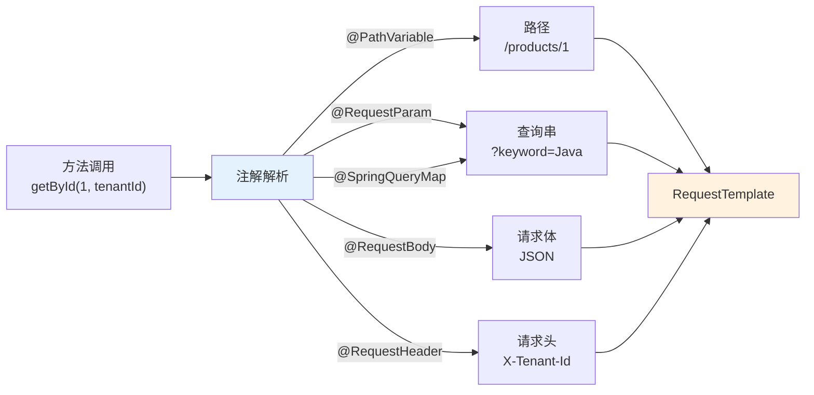
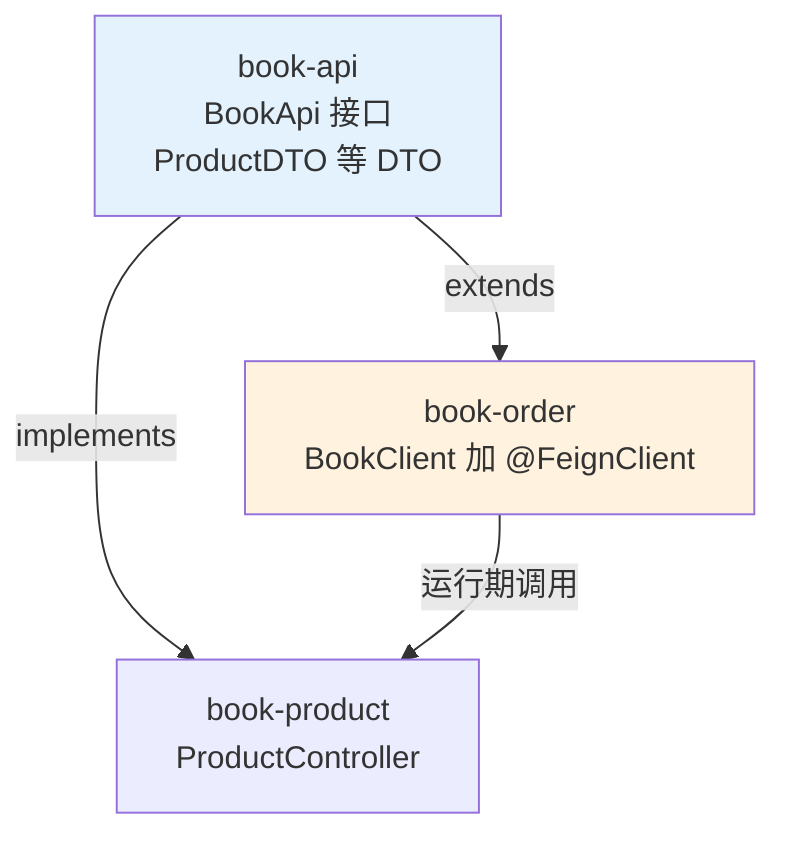

# OpenFeign核心注解详解

## 课程目标

- 理解契约模块的价值，能够把 DTO 与接口从调用方抽到共享模块
- 掌握 `@FeignClient` 的八个核心属性及其适用场景
- 掌握方法级映射注解与 Spring MVC 的对应关系
- 掌握六种参数绑定方式的取值位置与高频坑点
- 理解 Feign 接口继承特性，能判断何时该用、何时不该用
- 能够用 `contextId` 解决同一服务多客户端的配置冲突

## 回顾与导入

上一课的 `BookClient` 有两个方法，返回值用了订单服务自己的 `ProductSnapshot`：

```java
@FeignClient(name = "book-product")
public interface BookClient {

    @GetMapping("/api/products/{id}")
    Result<ProductSnapshot> getById(@PathVariable("id") Long id);
}
```

能跑通，但埋了三个隐患：路径与参数注解是从 book-product 的 Controller 手抄来的，改了不知道；`ProductSnapshot` 与图书服务的出参各写一份，字段迟早漂移；订单服务只用到四个字段，图书服务改名一个字段，订单侧要到运行期才炸。

本课解决这三件事：把 DTO 与接口抽成契约模块，把 `@FeignClient` 与参数注解讲透，最后用接口继承把「谁实现、谁继承」固定下来。

> **结论：** Feign 接口是**契约**，不是业务代码。契约集中一份、双方共用，接口变更才能变成编译期错误，而不是线上 500。

## 契约模块：book-api

### 三种组织方式

| 方案 | 优点 | 缺点 | 适用场景 |
| --- | --- | --- | --- |
| DTO 与接口各写一份 | 模块零耦合，起步最快 | 字段漂移无感知，联调靠运气 | 一次性对接、外包项目 |
| 抽到 `book-api` 模块（推荐） | 一份契约，编译期校验 | 多一个模块要维护版本 | 多服务长期协作 |
| 全部塞进 `book-common` | 不用新建模块 | 公共模块变成业务大杂烩 | 服务少、迭代快 |

本课采用第二种：新建 `book-api`，由 book-product 与 book-order 共同依赖。

### 模块结构

```text
book-microservice/
├── book-api/                        # 契约模块：DTO + Feign 接口
│   └── src/main/java/com/example/api/
│       ├── dto/ProductDTO.java
│       ├── dto/ProductQuery.java
│       ├── dto/StockDeductRequest.java
│       └── BookApi.java
├── book-product/                    # 实现方：implements BookApi
└── book-order/                      # 调用方：interface BookClient extends BookApi
```

book-api 只依赖 book-common（拿 `Result`）与 OpenFeign 的注解包，不依赖任何业务实现。

### DTO 定义

```java
package com.example.api.dto;

@Data
public class ProductDTO implements Serializable {

    private Long id;
    private String title;
    private String author;
    private BigDecimal price;
    private Integer stock;
    private String category;
}
```

```java
package com.example.api.dto;

@Data
public class ProductQuery implements Serializable {

    private String keyword;
    private String category;
    private BigDecimal minPrice;
    private BigDecimal maxPrice;
}
```

```java
package com.example.api.dto;

@Data
public class StockDeductRequest implements Serializable {

    private Long productId;
    private Integer quantity;
}
```

三个 DTO 都遵循三条规矩：实现 `Serializable`、用 `@Data` 生成无参构造与访问器、金额用 `BigDecimal` 而不用 `Double`。

### 提供方实现

```java
@RestController
@RequestMapping("/api/products")
@RequiredArgsConstructor
public class ProductController {

    private final ProductService productService;

    @GetMapping("/{id}")
    public Result<ProductDTO> getById(@PathVariable("id") Long id) {
        return Result.success(productService.getProductDTO(id));
    }

    @PostMapping("/stock/deduct")
    public Result<Void> deductStock(@RequestBody StockDeductRequest request) {
        productService.deductStock(request.getProductId(), request.getQuantity());
        return Result.success();
    }
}
```

`ProductService` 把 Entity 转成 DTO 后再返回，Entity 不出服务边界，这是控制器层的底线。

## @FeignClient 属性全表

| 属性 | 作用 | 是否常用 | 关键注意点 |
| --- | --- | --- | --- |
| `value` / `name` | 服务名（互为别名） | 必填 | 必须与 `spring.application.name` 一致 |
| `path` | 统一路径前缀 | 常用 | 只写公共部分，不要带方法路径 |
| `url` | 直连地址 | 调试用 | 配置后绕过发现与负载均衡 |
| `configuration` | 局部配置类 | 常用 | 配置类**不能**加 `@Configuration` |
| `fallback` | 降级实现类 | 视场景 | 需开启断路器支持 |
| `fallbackFactory` | 带异常的降级工厂 | 视场景 | 能拿到触发降级的原因 |
| `contextId` | 客户端上下文标识 | 多客户端必用 | 决定配置 Bean 与日志名 |
| `primary` | 是否标记为主 Bean | 少用 | 同名多客户端时避免注入歧义 |
| `qualifiers` | 自定义限定符 | 少用 | 配合 `@Qualifier` 精确注入 |
| `dismiss404` | 404 是否解码为空 | 少用 | 4.x 取代了旧属性 `decode404` |

### name 与 path

`name` 只填服务名，`path` 只填前缀，两件事不要混：

```java
@FeignClient(name = "book-product", path = "/api")
public interface BookClient {

    @GetMapping("/products/{id}")      // 实际请求 /api/products/{id}
    Result<ProductDTO> getById(@PathVariable("id") Long id);
}
```

把路径写进 `name`（如 `name = "/api/products"`）会在启动时报 `Service id not legal hostname`。

### url：只用于调试

```java
@FeignClient(name = "book-product", url = "${feign.product.url:http://localhost:8081}")
```

| 场景 | 是否用 `url` |
| --- | --- |
| 生产通过 Nacos 发现 | 不用 |
| 本地调试，提供方未注册 | 可用 |
| 对接无注册中心的外部 API | 可用 |

一旦配置 `url`，Feign 不再查注册中心，负载均衡与故障转移全部失效。

### configuration：局部配置

```java
public class BookFeignConfig {

    @Bean
    public Logger.Level bookLoggerLevel() {
        return Logger.Level.basic;
    }
}
```

```java
@FeignClient(name = "book-product", configuration = BookFeignConfig.class)
```

这个类**不能**加 `@Configuration`。加了会被主容器扫描，配置从「只对 book-product 生效」变成「对所有客户端生效」，这就是下一课要细讲的父子容器坑。

### fallback 与断路器

```java
@FeignClient(name = "book-product", fallbackFactory = BookClientFallbackFactory.class)
public interface BookClient {

    @GetMapping("/api/products/{id}")
    Result<ProductDTO> getById(@PathVariable("id") Long id);
}
```

```java
@Component
public class BookClientFallbackFactory implements FallbackFactory<BookClient> {

    @Override
    public BookClient create(Throwable cause) {
        return id -> Result.error(ResultCode.INTERNAL_ERROR.getCode(),
                "图书服务降级：" + cause.getMessage());
    }
}
```

`fallback` 只能返回固定降级值，`fallbackFactory` 能拿到异常原因，排查更方便。两者都要求开启断路器支持：

```yaml
spring:
  cloud:
    openfeign:
      circuitbreaker:
        enabled: true
```

> **注意：** 不开启 `circuitbreaker.enabled` 时，`fallback` 会被静默忽略，表现为「配了降级但异常照抛」。Sentinel 的整合方式详见《Sentinel快速上手与流量控制》。

### contextId：同服务多客户端

一个服务往往需要多个客户端：查询类用一个短超时配置，写入类用另一个。

```java
@FeignClient(name = "book-product", contextId = "bookQueryClient", configuration = QueryConfig.class)
public interface BookQueryClient { ... }

@FeignClient(name = "book-product", contextId = "bookStockClient", configuration = StockConfig.class)
public interface BookStockClient { ... }
```

`contextId` 会参与配置 Bean 的名称生成，同时作为该客户端的配置前缀标识。不写时默认取 `name`，此时两个客户端的配置会互相覆盖，甚至启动直接报 Bean 冲突。

### dismiss404 与 decode404

| 版本 | 属性 | 含义 |
| --- | --- | --- |
| 3.x | `decode404 = true` | 404 不抛异常，解码为空值 |
| 4.x | `dismiss404 = true` | 同上，旧属性已废弃 |

需要「查不到返回 null 而不是异常」时用它，例如存在性校验接口。多数业务接口不建议开启，404 通常意味着路径写错，静默吞掉只会让问题更难查。

## 方法级注解

| 注解 | HTTP 方法 | 与 Spring MVC 的一致性 | 典型用途 |
| --- | --- | --- | --- |
| `@GetMapping` | GET | 完全一致 | 查询 |
| `@PostMapping` | POST | 完全一致 | 新增、扣库存 |
| `@PutMapping` | PUT | 完全一致 | 全量更新 |
| `@PatchMapping` | PATCH | 完全一致 | 局部更新 |
| `@DeleteMapping` | DELETE | 完全一致 | 删除 |
| `@RequestMapping` | 任意 | 需显式写 `method` | 兼容老接口 |

Feign 复用 Spring MVC 的注解语义，但**不经过 Spring MVC 的处理器映射**：它只是把注解解析成 `RequestTemplate`。因此 `@RequestMapping` 不写 `method` 时默认按 GET 处理，容易与提供方的 POST 对不上。

## 参数绑定矩阵

一个 Feign 方法调用的每个参数，都要被注解明确指派到 HTTP 报文的某个位置：



| 注解 | 取值位置 | 有值时的请求形态 | 高频坑点 |
| --- | --- | --- | --- |
| `@PathVariable` | 路径 | `/products/1` | `value` 必须与模板变量同名 |
| `@RequestParam` | 查询串 | `/search?keyword=x` | `value` 必须显式写 |
| `@RequestBody` | 请求体 | JSON | GET 不用，一个方法最多一个 |
| `@RequestHeader` | 请求头 | `Authorization: xxx` | 批量传递交给拦截器 |
| `@SpringQueryMap` | 查询串（对象） | `/query?keyword=x&category=y` | 嵌套对象不展开 |
| 无注解 POJO | 请求体 | JSON | 在 GET 中会被当 body，导致 400 或 405 |

### @PathVariable

```java
@GetMapping("/products/{id}")
Result<ProductDTO> getById(@PathVariable("id") Long id);
```

`value` 与 URL 模板必须逐字一致。省略 `value` 依赖编译时的 `-parameters`，一旦构建配置变了就会绑定失败，所以本课程统一显式写。

### @RequestParam

```java
@GetMapping("/products/search")
Result<List<ProductDTO>> search(@RequestParam("keyword") String keyword,
                                @RequestParam("page") int page,
                                @RequestParam("size") int size);
```

`@RequestParam` 漏写 `value` 且参数名被编译器擦除时，请求照常发出，但提供方收不到参数，这类「静默丢参」最难排查。

### @RequestBody

```java
@PostMapping("/products/stock/deduct")
Result<Void> deductStock(@RequestBody StockDeductRequest request);
```

请求体只能有一个，且对象必须有无参构造。GET 请求携带 body 在部分 HTTP 客户端与网关下会被丢弃或拒绝，不要这样设计。

### @RequestHeader

```java
@GetMapping("/products/{id}")
Result<ProductDTO> getById(@PathVariable("id") Long id,
                           @RequestHeader("X-Tenant-Id") String tenantId);
```

单个头手动传即可；Token、TraceId 这类全局头如果每个方法都写一遍，维护成本会失控，交给拦截器统一注入。

### @SpringQueryMap

GET 接口的参数是一个对象时，Feign 无法自动展开字段，必须加 `@SpringQueryMap`：

```java
@GetMapping("/products/query")
Result<List<ProductDTO>> query(@SpringQueryMap ProductQuery query);
```

生成的请求是 `/products/query?keyword=Spring&category=编程`，空字段自动忽略。

### 无注解 POJO 的默认行为

| 方法类型 | 参数写法 | Feign 行为 | 结果 |
| --- | --- | --- | --- |
| POST | `deductStock(StockDeductRequest r)` | 当请求体，走 JSON 编码 | 可能可用，但不推荐 |
| GET | `query(ProductQuery q)` | 仍当请求体 | 提供方收不到参数 |
| 任意 | 显式加 `@SpringQueryMap` | 展开为查询串 | 正确 |

结论：参数注解一个都不要省。省掉的注解不会报错，只会在运行期表现为「参数丢了」。

## Feign 接口继承

### 三种契约复用方式

| 方式 | 做法 | 优点 | 缺点 |
| --- | --- | --- | --- |
| 各自手抄 | 调用方按 Controller 抄一份 | 简单直接 | 易漂移，改一处要搜全仓 |
| 共享接口继承（推荐） | 契约接口放 book-api，提供方实现、调用方继承 | 编译期校验，路径与参数只写一次 | 需要额外模块 |
| 共享注解类 | 把 `@RequestMapping` 常量抽成类 | 不改结构 | 只能复用字符串，注解仍需重写 |

### 落地三步

第一步，在 book-api 中定义契约接口，**不写** `@FeignClient`：

```java
package com.example.api;

public interface BookApi {

    @GetMapping("/api/products/{id}")
    Result<ProductDTO> getById(@PathVariable("id") Long id);

    @PostMapping("/api/products/stock/deduct")
    Result<Void> deductStock(@RequestBody StockDeductRequest request);
}
```

第二步，提供方实现它，Controller 上不再重复写映射路径：

```java
@RestController
@RequiredArgsConstructor
public class ProductController implements BookApi {

    private final ProductService productService;

    @Override
    public Result<ProductDTO> getById(Long id) {
        return Result.success(productService.getProductDTO(id));
    }

    @Override
    public Result<Void> deductStock(StockDeductRequest request) {
        productService.deductStock(request.getProductId(), request.getQuantity());
        return Result.success();
    }
}
```

第三步，调用方继承它，只补 `@FeignClient`：

```java
@FeignClient(name = "book-product", contextId = "bookClient")
public interface BookClient extends BookApi {
}
```



### 继承的优缺点

| 维度 | 收益 | 代价 |
| --- | --- | --- |
| 契约一致性 | 路径、参数、返回类型只写一次 | 修改契约要同时回归双方 |
| 开发效率 | 新增接口无需抄写注解 | 提供方必须严格按接口签名实现 |
| 版本管理 | 契约变更可追溯 | book-api 需要独立版本与发布节奏 |
| 耦合度 | 编译期就能发现不兼容 | 双方共享一个模块，拆分成本变高 |

### 继承的两个坑

1. **类级别 `@RequestMapping` 会被忽略**：Feign 只解析方法级映射，接口上写 `@RequestMapping("/api")` 不会拼到路径里。公共前缀请用 `@FeignClient(path = "/api")`。
2. **`@PathVariable` 的 `value` 必须写**：接口继承后参数名可能被擦除，省略 `value` 会导致模板变量无法绑定，报 `PathVariable annotation was empty`。

## 最佳实践

1. **契约接口只放映射方法**：不写 `default` 方法里的业务逻辑，更不要继承 Service。
2. **DTO 与 Entity 分家**：DTO 放 book-api，Entity 留在各自服务，转换在 Service 层完成。
3. **一个下游一个 `contextId`**：同一服务多个客户端必须显式命名，避免配置互相覆盖。
4. **公共前缀用 `path`**：方法上只写相对路径，改前缀只改一处。
5. **降级用 `fallbackFactory`**：拿得到异常原因，排查成本低一半。

## 注意事项

1. **book-api 不要依赖业务模块**：它只能依赖 book-common 与 OpenFeign 注解包，否则会形成循环依赖。
2. **`configuration` 类不加 `@Configuration`**：加了就变成全局配置，这一点在下一课还会展开。
3. **`fallback` 需要开启断路器**：`spring.cloud.openfeign.circuitbreaker.enabled=true`，否则静默不生效。
4. **4.x 用 `dismiss404`**：老项目里的 `decode404` 已废弃，升级时要一并替换。
5. **GET 不要传对象当请求体**：用 `@SpringQueryMap`，否则参数在网关或 Tomcat 处被丢弃。
6. **接口继承后不要重复写注解**：提供方实现方法上加 `@GetMapping` 会与接口注解冲突，保持只在接口写一次。
7. **`path` 与 Controller 的 `@RequestMapping` 要对齐**：两边各写一半是最常见的 404 来源。

## 小结

本节课我们学习了：

1. **契约模块**：DTO 与接口抽到 `book-api`，提供方实现、调用方继承，字段漂移变成编译错误。
2. **`@FeignClient` 属性**：`name` 定服务、`path` 定前缀、`url` 只调试、`configuration` 定局部配置。
3. **降级与上下文**：`fallbackFactory` 拿到异常原因，`contextId` 隔离同服务的多客户端配置。
4. **方法级注解**：与 Spring MVC 语义一致，但解析目标不同，`@RequestMapping` 要写 `method`。
5. **参数绑定**：六种注解决定取值位置，注解绝不能省，否则表现为静默丢参。
6. **接口继承**：适合长期协作的团队，代价是契约模块需要独立的版本节奏。

## 作业

### 作业一：抽取 book-api 模块

1. 新建 `book-api` 模块，放置 `ProductDTO`、`ProductQuery`、`StockDeductRequest` 与 `BookApi`。
2. 让 book-product 实现 `BookApi`，book-order 继承它，删除原来的手抄注解。
3. 修改 `ProductDTO` 的字段名后重新编译，记录哪些模块报错并解释原因。

### 作业二：覆盖六种参数绑定

1. 在 `BookApi` 中增加按条件查询、扣库存、查请求头三个方法。
2. 用 `@SpringQueryMap` 传递 `ProductQuery`，观察实际请求串。
3. 把 `@RequestParam` 的 `value` 去掉，验证参数是否丢失并说明原因。

### 作业三：解决多客户端冲突

1. 为 book-product 建两个客户端：`BookQueryClient` 与 `BookStockClient`。
2. 只给其中一个设置 `Configuration`，观察不写 `contextId` 时的启动报错。
3. 加上 `contextId` 后重新启动，验证两个客户端的超时与日志级别互不影响。
