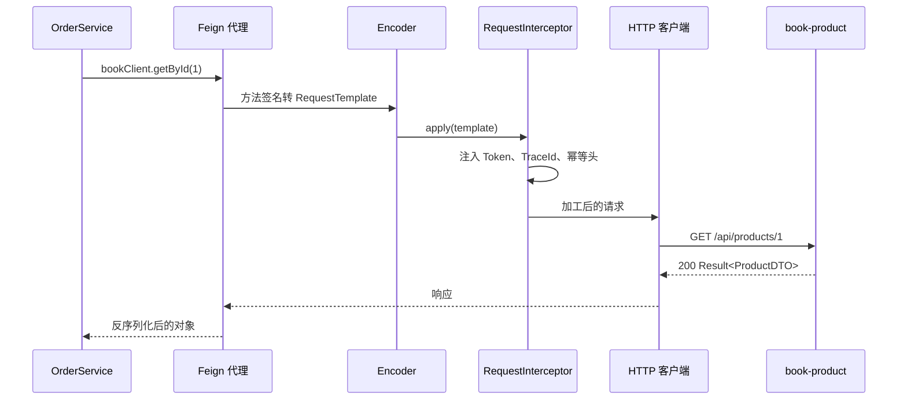
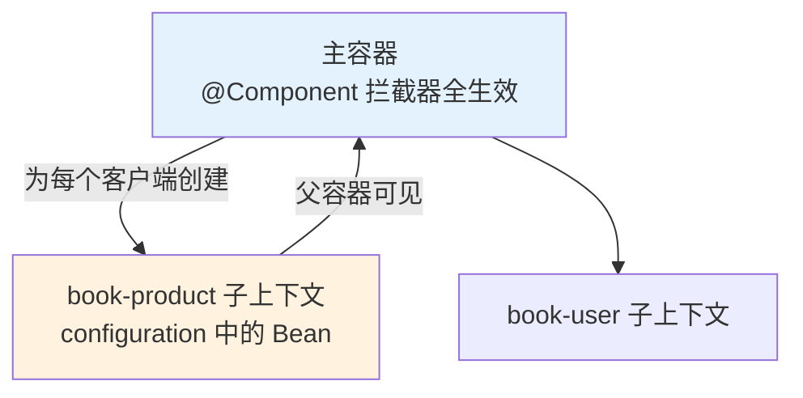

# OpenFeign拦截器与上下文透传

## 课程目标

- 理解 `RequestInterceptor` 的执行时机与在调用链中的位置
- 掌握全局 `@Bean` 与局部 `configuration` 两种作用域，并说清父子容器带来的坑
- 能够用拦截器统一透传 Token、租户 ID、TraceId 与幂等标识
- 能够自定义 `ErrorDecoder`，把下游 `Result` 的错误码翻译成 `BusinessException`
- 理解 `RequestContextHolder` 基于 ThreadLocal 的局限，并掌握异步场景的补偿方案
- 能够规划拦截器顺序与灰度标记头的传递策略

## 回顾与导入

上一课的 `BookApi` 里，如果每个方法都要带上认证信息，就会写成这样：

```java
@GetMapping("/api/products/{id}")
Result<ProductDTO> getById(@PathVariable("id") Long id,
                           @RequestHeader("Authorization") String token,
                           @RequestHeader("X-Tenant-Id") String tenantId);
```

问题很明显：每加一个方法就要多写两个参数，业务代码被迫感知协议细节；漏写一个，下游直接 401；异步线程里调用时，token 从哪来又是一个新问题。

拦截器（`RequestInterceptor`）把这件事前移到框架层：一次配置，所有 Feign 请求自动带上需要的头。本课围绕它解决四类高频需求：认证透传、链路标识、错误翻译、异步上下文。

> **结论：** 拦截器处理的是「横切」问题——凡是每个请求都要做、且与业务无关的动作，都应该放在拦截器里，而不是方法签名上。

## RequestInterceptor 原理

### 接口与执行时机

```java
public interface RequestInterceptor {
    void apply(RequestTemplate template);
}
```

Spring Cloud 会收集容器中的所有 `RequestInterceptor`，在 Feign 完成方法到请求的编码之后、HTTP 客户端真正发出之前依次调用。



拦截器改的是 `RequestTemplate`，也就是「请求的中间表示」，不是字节流，因此不必关心 JSON 编码细节。

### RequestTemplate 的三个能力

| 能力 | 方法 | 说明 |
| --- | --- | --- |
| 改请求头 | `header(name, values...)` | 同名多次调用会追加为多值 |
| 改查询参数 | `query(name, values...)` | 适合追加 `source`、`version` 标记 |
| 改目标地址 | `uri(...)` | 少用，容易与服务发现冲突 |

```java
@Override
public void apply(RequestTemplate template) {
    template.header("X-Source", "book-order");
    template.query("caller", "order-service");
}
```

`uri` 能改写目标地址，但会把 LoadBalancer 选好的实例覆盖掉，除非做特殊路由，否则不要碰。

### 执行顺序

多个拦截器按 `@Order` 升序执行，也可以用 `Ordered` 接口：

```java
@Component
@Order(1)
public class TraceRelayInterceptor implements RequestInterceptor { ... }

@Component
@Order(2)
public class AuthRelayInterceptor implements RequestInterceptor { ... }
```

| 顺序 | 拦截器 | 理由 |
| --- | --- | --- |
| 1 | TraceId | 越早注入，后续拦截器与 HTTP 日志都能带上它 |
| 2 | 认证与租户 | 依赖请求上下文，TraceId 就绪后再注入 |
| 3 | 幂等与灰度 | 依赖业务上下文，通常最后执行 |

## 全局与局部作用域

### 全局拦截器

```java
@Component
public class TenantRelayInterceptor implements RequestInterceptor { ... }
```

只要被 Spring 扫描到，就会注入到**每一个** Feign 客户端。等价的写法是在主配置类里用 `@Bean` 声明：

```java
@Configuration
public class GlobalFeignConfig {

    @Bean
    public RequestInterceptor tenantRelayInterceptor() {
        return new TenantRelayInterceptor();
    }
}
```

两种写法本质相同，区别只是 `@Bean` 方式便于按 profile 条件装配。

### 局部拦截器

```java
public class BookFeignConfig {          // 注意：不加 @Configuration

    @Bean
    public RequestInterceptor internalOnlyInterceptor() {
        return template -> template.header("X-Internal", "true");
    }
}
```

```java
@FeignClient(name = "book-product", configuration = BookFeignConfig.class)
public interface BookClient extends BookApi {
}
```

局部配置只对声明它的客户端生效，适合「只给内部服务加标记头」这类需求。

### 父子容器坑



坑在于：`BookFeignConfig` 一旦加了 `@Configuration` 且落在主扫描路径内，就会被主容器注册，于是局部配置变成全局配置；同时子上下文又会创建一份，可能出现同名 Bean 冲突。

| 写法 | 生效范围 | 结果 |
| --- | --- | --- |
| `@Component` 拦截器 | 所有客户端 | 预期行为 |
| 配置类不加 `@Configuration` | 指定客户端 | 预期行为 |
| 配置类加了 `@Configuration` | 所有客户端 | 配置泄漏，难排查 |
| 配置类加了 `@Configuration` 且 Bean 重名 | 启动失败 | Bean 冲突 |

> **注意：** 判断依据只有一条——`@FeignClient(configuration = ...)` 指向的类必须是普通类。Spring Cloud 内部把它注册为子上下文配置，不需要也不应该再由主容器扫描。

## 实战一：透传 Token 与租户 ID

### 拦截器实现

```java
package com.example.order.interceptor;

@Component
@Order(2)
public class AuthRelayInterceptor implements RequestInterceptor {

    private static final List<String> HEADERS = List.of("Authorization", "X-Tenant-Id");

    @Override
    public void apply(RequestTemplate template) {
        ServletRequestAttributes attributes =
                (ServletRequestAttributes) RequestContextHolder.getRequestAttributes();
        if (attributes == null) {
            return;
        }
        HttpServletRequest request = attributes.getRequest();
        for (String header : HEADERS) {
            String value = request.getHeader(header);
            if (StringUtils.hasText(value)) {
                template.header(header, value);
            }
        }
    }
}
```

`attributes == null` 的判空不能省：定时任务、消息消费线程里发起 Feign 调用时没有请求上下文，不判空会直接空指针。

### 下游接收

book-product 用一个过滤器把租户写进线程上下文，业务代码就不用再申明参数：

```java
@Component
public class TenantFilter extends OncePerRequestFilter {

    @Override
    protected void doFilterInternal(HttpServletRequest request, HttpServletResponse response,
                                    FilterChain chain) throws ServletException, IOException {
        String tenantId = request.getHeader("X-Tenant-Id");
        try {
            if (StringUtils.hasText(tenantId)) {
                TenantContext.set(tenantId);
            }
            chain.doFilter(request, response);
        } finally {
            TenantContext.clear();
        }
    }
}
```

`finally` 里的清理是必须的，Tomcat 线程复用，不清理会把上个请求的租户带到下一个请求。

### 验证

| 验证项 | 操作 | 预期结果 |
| --- | --- | --- |
| Token 透传 | 带 `Authorization` 调用下单接口 | book-product 日志打印同一 Token |
| 租户透传 | 带 `X-Tenant-Id: t001` 调用 | 下游查询只返回该租户数据 |
| 无头调用 | 不带任何头直接调用 | 请求正常发出，不因拦截器报错 |
| 局部隔离 | 检查配置类是否加了 `@Configuration` | 其他服务未收到 `X-Internal` |

## 实战二：TraceId 与请求耗时

### 入口生成 TraceId

```java
@Component
@Order(Ordered.HIGHEST_PRECEDENCE)
public class TraceIdFilter extends OncePerRequestFilter {

    @Override
    protected void doFilterInternal(HttpServletRequest request, HttpServletResponse response,
                                    FilterChain chain) throws ServletException, IOException {
        String traceId = request.getHeader("X-Trace-Id");
        if (!StringUtils.hasText(traceId)) {
            traceId = UUID.randomUUID().toString().replace("-", "");
        }
        MDC.put("traceId", traceId);
        response.setHeader("X-Trace-Id", traceId);
        try {
            chain.doFilter(request, response);
        } finally {
            MDC.remove("traceId");
        }
    }
}
```

### 拦截器注入标识与起始时间

```java
@Component
@Order(1)
public class TraceRelayInterceptor implements RequestInterceptor {

    @Override
    public void apply(RequestTemplate template) {
        String traceId = MDC.get("traceId");
        template.header("X-Trace-Id",
                StringUtils.hasText(traceId) ? traceId : UUID.randomUUID().toString().replace("-", ""));
        template.header("X-Client-Start", String.valueOf(System.currentTimeMillis()));
    }
}
```

`X-Client-Start` 让下游能算出「请求在路上花了多久」，比单纯看两端日志更直观。

### 下游记录耗时

```java
@Component
public class ServerTraceFilter extends OncePerRequestFilter {

    @Override
    protected void doFilterInternal(HttpServletRequest request, HttpServletResponse response,
                                    FilterChain chain) throws ServletException, IOException {
        String traceId = request.getHeader("X-Trace-Id");
        String clientStart = request.getHeader("X-Client-Start");
        MDC.put("traceId", StringUtils.hasText(traceId) ? traceId : "-");
        long begin = System.currentTimeMillis();
        try {
            chain.doFilter(request, response);
        } finally {
            long cost = System.currentTimeMillis() - begin;
            long network = StringUtils.hasText(clientStart)
                    ? begin - Long.parseLong(clientStart) : -1L;
            log.info("traceId={} uri={} cost={}ms network={}ms", traceId,
                    request.getRequestURI(), cost, network);
            MDC.remove("traceId");
        }
    }
}
```

日志输出形如一串可 grep 的键值，配合 `logging.pattern.level` 把 `traceId` 打进每行日志：

```yaml
logging:
  pattern:
    level: "%5p [%X{traceId:-}]"
```

```text
INFO [7f3c9a1e5b2d4c60] 下单成功 orderNo=20250101120001 cost=48ms
INFO [7f3c9a1e5b2d4c60] traceId=7f3c9a1e5b2d4c60 uri=/api/products/1 cost=12ms network=3ms
```

> **提示：** 这套方案是手写链路追踪的轻量版。引入 Micrometer Tracing 后 TraceId 由框架自动传播，拦截器只保留业务头的透传，详见《Micrometer Tracing与链路追踪》。

## ErrorDecoder 统一错误翻译

### 默认行为

Feign 默认的 `ErrorDecoder` 只按状态码抛 `FeignException`，下游返回的 `Result` 业务错误码被丢在响应体里，调用方拿到的是 500 加一段 JSON 字符串。

| 场景 | 默认表现 | 期望表现 |
| --- | --- | --- |
| 下游返回 404 加 `Result(404, "图书不存在")` | 抛 `FeignException.NotFound` | 抛 `BusinessException("图书不存在")` |
| 下游返回 200 但 `code=1001` | 正常返回，业务层自行判断 | 仍由业务层判断 |
| 下游返回 500 加错误码 | 抛 `FeignException.InternalServerError` | 抛带 code 的 `BusinessException` |

### 自定义实现

```java
package com.example.order.config;

public class ResultErrorDecoder implements ErrorDecoder {

    private final ObjectMapper objectMapper = new ObjectMapper();
    private final ErrorDecoder defaultDecoder = new ErrorDecoder.Default();

    @Override
    public Exception decode(String methodKey, Response response) {
        if (response.body() == null) {
            return new BusinessException("远程调用失败，状态码 " + response.status());
        }
        try (InputStream body = response.body().asInputStream()) {
            Result<?> result = objectMapper.readValue(body, Result.class);
            if (result.getCode() != null && result.getCode() != 0) {
                return new BusinessException(result.getCode(), result.getMessage());
            }
        } catch (IOException ex) {
            return defaultDecoder.decode(methodKey, response);
        }
        return defaultDecoder.decode(methodKey, response);
    }
}
```

三个要点：读取响应体后不能重复读，`asInputStream` 只能取一次；`Result.class` 反序列化足够拿到 code 与 message；解析失败时退回默认实现，不要吞掉状态码信息。

### 注册方式

```java
public class BookFeignConfig {

    @Bean
    public ErrorDecoder resultErrorDecoder() {
        return new ResultErrorDecoder();
    }
}
```

```java
@FeignClient(name = "book-product", configuration = BookFeignConfig.class)
```

> **注意：** `ErrorDecoder` 注册成全局 `@Bean` 会影响所有客户端，包括对接外部 API 的客户端。外部返回体不是 `Result` 结构时解析失败率很高，因此推荐走局部配置。

## RequestContextHolder 与异步

### 为什么会丢

`RequestContextHolder` 把请求属性存在 ThreadLocal 里，线程一换就取不到：

| 场景 | 是否拿得到上下文 | 原因 |
| --- | --- | --- |
| 同一个 Tomcat 线程内调用 | 能 | ThreadLocal 同线程可见 |
| `@Async` 方法里调用 | 不能 | 线程池换了线程 |
| CompletableFuture 里调用 | 不能 | 同上 |
| 定时任务、MQ 消费线程 | 不能 | 根本没有请求上下文 |

### 四种补救方案

| 方案 | 做法 | 优点 | 缺点 |
| --- | --- | --- | --- |
| 手动传参 | 把 token 作为方法参数传入 | 明确、可控 | 污染方法签名 |
| 请求属性可继承 | `RequestContextHolder.setRequestAttributes(attrs, true)` | 改动小 | 只对子线程生效，线程池复用会串数据 |
| TaskDecorator | 提交任务时复制上下文 | 线程池场景通用 | 需要理解装饰器机制 |
| Micrometer Tracing | 框架级上下文传播 | 最彻底 | 需要引入可观测性体系 |

### TaskDecorator 复制上下文

```java
@Configuration
public class AsyncConfig {

    @Bean
    public TaskDecorator contextCopyingDecorator() {
        return runnable -> {
            RequestAttributes attributes = RequestContextHolder.getRequestAttributes();
            Map<String, String> mdc = MDC.getCopyOfContextMap();
            return () -> {
                RequestContextHolder.setRequestAttributes(attributes, true);
                if (mdc != null) {
                    MDC.setContextMap(mdc);
                }
                try {
                    runnable.run();
                } finally {
                    MDC.clear();
                    RequestContextHolder.resetRequestAttributes();
                }
            };
        };
    }
}
```

这个 `TaskDecorator` 会被 Spring Boot 自动配置的 `applicationTaskExecutor` 采用，`@Async` 方法因此也能读到原请求的头信息。`finally` 里的清理同样不能省，否则线程池里的下一个任务会继承到上一个请求的 Token。

## 幂等头与灰度标记

### 常用透传头

| 头名称 | 内容 | 谁生成 | 谁消费 |
| --- | --- | --- | --- |
| `Authorization` | JWT Token | 网关或登录服务 | 各业务服务 |
| `X-Tenant-Id` | 租户标识 | 网关 | 数据访问层 |
| `X-Trace-Id` | 链路标识 | 入口过滤器 | 全链路日志 |
| `X-Idempotency-Key` | 幂等键 | 下单入口 | 订单、库存服务 |
| `X-Gray-Tag` | 灰度标记 | 网关 | 路由与业务开关 |

### 统一注入

```java
@Component
@Order(3)
public class BusinessHeaderInterceptor implements RequestInterceptor {

    @Override
    public void apply(RequestTemplate template) {
        putIfPresent(template, "X-Idempotency-Key", MDC.get("idempotencyKey"));
        putIfPresent(template, "X-Gray-Tag", MDC.get("grayTag"));
    }

    private void putIfPresent(RequestTemplate template, String name, String value) {
        if (StringUtils.hasText(value)) {
            template.header(name);
            template.header(name, value);
        }
    }
}
```

先清空再写入，避免同一个头在多次重试后被追加成一串值。幂等键在下游用来做去重表，灰度标记用来决定走新逻辑还是老逻辑。

## 注意事项

1. **拦截器只做无状态加工**：不要在 `apply` 里查库、调远程，它跑在业务线程上，一次慢查询会拖垮整条调用。
2. **`RequestTemplate.header` 是追加语义**：重复注入前先用无参 `header(name)` 清空，否则下游会收到多值头。
3. **局部配置类不要加 `@Configuration`**：加了就变全局，问题出现时往往已经在生产。
4. **`attributes` 必须判空**：异步线程、定时任务下没有上下文，不判空直接空指针。
5. **ThreadLocal 用完必须清理**：过滤器、拦截器都要在 `finally` 中清理 MDC 与 `RequestContextHolder`。
6. **`ErrorDecoder` 优先局部注册**：全局注册会波及对接外部 API 的客户端。
7. **不要透传内部头给外部**：`X-Internal`、`X-Gray-Tag` 这类头只应在内部服务间传递。
8. **TraceId 不要用自增或时间戳**：多实例并发会撞号，用 UUID 或雪花算法。

## 小结

本节课我们学习了：

1. **拦截器定位**：`RequestInterceptor` 在编码之后、发送之前修改 `RequestTemplate`，解决横切需求。
2. **作用域**：`@Component` 全局生效，`@FeignClient(configuration = ...)` 局部生效，配置类不能加 `@Configuration`。
3. **认证透传**：从 `RequestContextHolder` 取原请求头注入 Feign 请求，下游用过滤器写入线程上下文。
4. **链路标识**：入口生成 TraceId 写 MDC，拦截器注入请求头，下游记录耗时与网络延迟。
5. **错误翻译**：自定义 `ErrorDecoder` 把下游 `Result` 翻译成 `BusinessException`，保留错误码。
6. **上下文丢失**：ThreadLocal 跨线程失效，用 `TaskDecorator` 复制上下文并在 `finally` 清理。
7. **业务头治理**：幂等键与灰度标记统一由拦截器注入，注意追加语义与内部头的边界。

## 作业

### 作业一：实现认证与租户透传

1. 编写 `AuthRelayInterceptor`，透传 `Authorization` 与 `X-Tenant-Id`。
2. 在 book-product 用过滤器接收租户，验证数据按租户隔离。
3. 在不带任何请求头的定时任务中调用 Feign，验证不会空指针。

### 作业二：搭建最小链路追踪

1. 实现入口 `TraceIdFilter`、`TraceRelayInterceptor` 与下游 `ServerTraceFilter`。
2. 用 `curl` 连续发起三次请求，按 TraceId 串联三个服务的日志。
3. 在日志中输出网络耗时，说明它与服务端耗时的差别来自哪里。

### 作业三：统一错误翻译

1. 实现 `ResultErrorDecoder`，把下游业务错误码翻译为 `BusinessException`。
2. 分别在局部配置与全局 Bean 两种方式下注册，记录对外部 API 客户端的影响。
3. 说明为什么 `ErrorDecoder` 里不能重复读取响应体。
