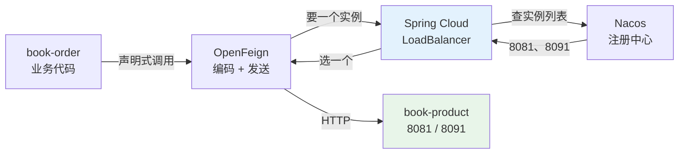
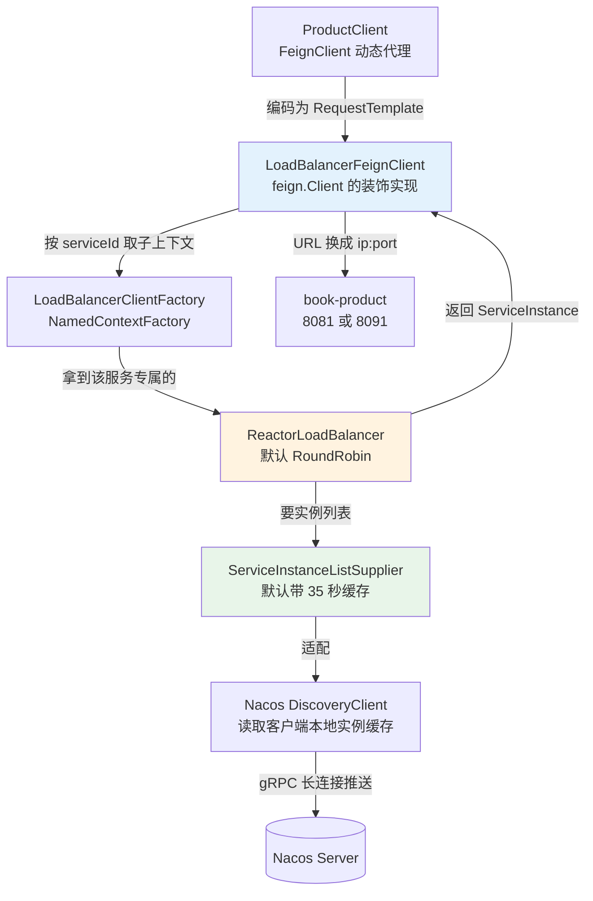
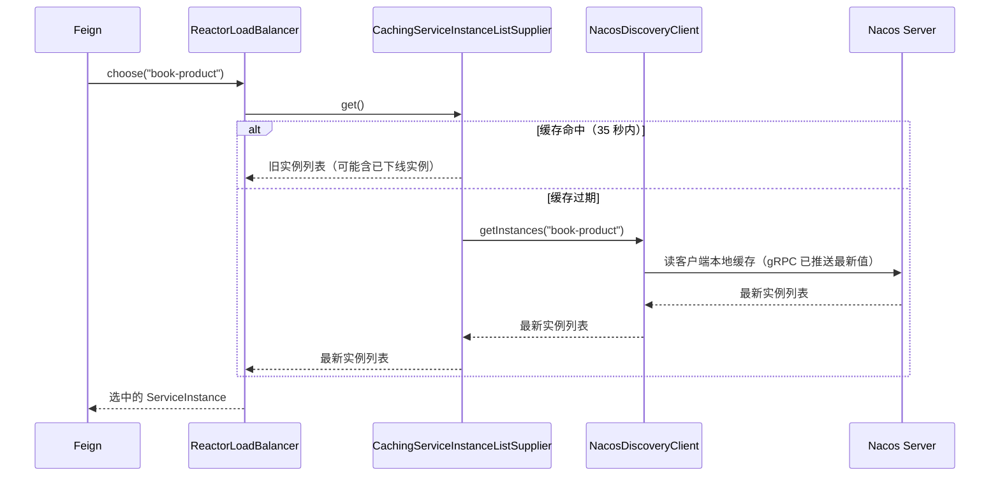

# OpenFeign与LoadBalancer集成

## 课程目标

- 理解 OpenFeign 与 Spring Cloud LoadBalancer 的分工：Feign 负责把接口编码成请求，LoadBalancer 负责把服务名换成实例地址
- 掌握一次 Feign 调用经过的五个环节，能说出每个环节失效时的典型异常
- 掌握用 `LoadBalancerLifecycle` 与响应标识两种手段，确认请求最终落到哪台实例
- 理解 `CachingServiceInstanceListSupplier` 的 35 秒缓存窗口，能解释"Nacos 里已下线、请求仍打过去"的现象
- 掌握 `spring.cloud.loadbalancer.cache.*` 的三种配置取舍与优雅下线的正确顺序
- 掌握 `spring.cloud.loadbalancer.nacos.enabled=true` 启用 `NacosLoadBalancer` 后与默认轮询的行为差异
- 能够独立排查无可用实例、实例列表为空、旧实例仍被调用、命名空间或分组不一致、缺少负载均衡依赖五类故障

## 回顾与导入

上一课我们给 `ProductClient` 配好了请求拦截器，`X-Trace-Id`、`X-User-Id` 已经能自动透传到 `book-product`。到这里，"请求带什么"解决了，"请求发给谁"还悬着。

把 `book-product` 扩容成两台之后，问题立刻变得具体：`book-order` 的控制台日志只打印 `GET http://book-product/api/products/1`，看不到任何 IP 和端口。开发者无法回答三个基本问题：

| 疑问 | 仅凭 Feign 日志能否回答 |
| --- | --- |
| 这次请求打到了 8081 还是 8091 | 不能 |
| 两台实例的流量是否均匀 | 不能 |
| 停掉一台实例后，多久停止向它发请求 | 不能 |

`@FeignClient(name = "book-product")` 里的 `book-product` 只是一个**服务名**，Feign 自己并不知道 8081 和 8091 的存在。真正把服务名解析成实例地址的是 Spring Cloud LoadBalancer，Feign 只是它的调用方之一。



本课把这条链路逐段拆开：先讲清"服务名怎么变成 IP:端口"，再让选中实例的过程可见可验证，最后处理两个生产上必踩的坑——实例缓存导致的感知延迟，以及默认轮询对 Nacos 权重的无视。

> **结论：** Feign 决定"怎么发"，LoadBalancer 决定"发给谁"，Nacos 决定"有哪些可选"。三者职责清晰，排错时才能定位到层。

## 一、服务名如何变成 IP:端口

### ProductClient 只声明了服务名

订单服务里的远程调用接口长这样，注意 `name` 和 `path`：

```java
package com.example.order.feign;

import com.example.common.result.Result;
import com.example.order.dto.ProductDTO;
import org.springframework.cloud.openfeign.FeignClient;
import org.springframework.web.bind.annotation.GetMapping;
import org.springframework.web.bind.annotation.PathVariable;

@FeignClient(name = "book-product", path = "/api")
public interface ProductClient {

    @GetMapping("/products/{id}")
    Result<ProductDTO> getById(@PathVariable("id") Long id);
}
```

接口里没有出现任何 IP 和端口，调用 `getById(1L)` 时生成的 URL 是 `http://book-product/api/products/1`。`book-product` 既不是域名也不是主机名，它必须被替换，替换动作发生在请求真正发出之前。

### 调用链全景

一次 `productClient.getById(1L)` 的完整路径如下。注意 `LoadBalancerFeignClient` 是 Feign 与 LoadBalancer 的衔接点：



链路概括成一句话：**Feign 把服务名交给 LoadBalancer，LoadBalancer 从 Supplier 拿列表并按策略选一个，Feign 再用选中实例的地址重写 URL**。

### 五个环节的职责

| 环节 | 关键类 | 做什么 | 失效时的典型现象 |
| --- | --- | --- | --- |
| 动态代理 | `FeignClientFactoryBean` | 解析接口注解，生成代理对象 | 启动报 `No Feign Client for loadBalancing defined` |
| 负载均衡客户端 | `LoadBalancerFeignClient` | 包装真实 `Client`，在发送前插入选实例逻辑 | 走了 `url` 属性时完全跳过本层 |
| 服务级子上下文 | `LoadBalancerClientFactory` | 为每个 serviceId 建立独立 Spring 子容器 | 自定义配置类不生效，策略串服务 |
| 实例列表 | `ServiceInstanceListSupplier` | 提供实例清单，默认叠了一层缓存 | 实例已下线但仍被选中 |
| 发现客户端 | `NacosDiscoveryClient` | 从 Nacos 客户端本地缓存读实例 | 返回空列表，报 `No instances available` |

### 一个容易误会的点：url 属性会短路整条链路

`@FeignClient` 还有 `url` 属性，一旦填了值，`LoadBalancerFeignClient` 就不再参与，Feign 直接连这个地址：

| 写法 | 是否走 LoadBalancer | 是否读 Nacos | 适用场景 |
| --- | --- | --- | --- |
| `@FeignClient(name = "book-product")` | 是 | 是 | 生产环境标准写法 |
| `@FeignClient(name = "book-product", url = "...")` | 否 | 否 | 联调第三方服务、临时直连排查 |
| 无 `@EnableFeignClients` 扫描 | 不生成代理 | 否 | 启动即报错，属于配置遗漏 |

> **注意：** 排查"多实例不轮询"时，第一件事是确认 `@FeignClient` 上没有多余的 `url`。它常被临时加上做调试，事后忘了删。

## 二、实战：两台实例的负载均衡验证

### 启动第二台 book-product

第一台保持 8081。第二台用命令行参数覆盖端口，IDEA 中复制一份运行配置，在 Program arguments 里填 `--server.port=8091`。端口取 8091 是为了避开 `book-user` 的 8082。

两台实例共用同一套配置时，有两处容易冲突：

```yaml
server:
  port: ${SERVER_PORT:8081}

logging:
  file:
    name: logs/${spring.application.name}-${server.port}.log
```

- `server.port` 用占位符，命令行传 `--SERVER_PORT=8091` 也能生效；
- 日志文件名带上端口，否则两个进程写同一个文件，Windows 下会直接报文件占用。

启动后到 Nacos 控制台确认：`book-product` 的实例数变成 2，两个实例都是健康状态。Nacos 注册端口默认取 `server.port`，没显式配 `spring.cloud.nacos.discovery.port` 时改端口就等于改了注册端口。

### 让选中实例可见：LoadBalancerLifecycle

Feign 的 `BASIC` 或 `FULL` 日志打印的是服务名级别的 URL，看不到最终实例。`LoadBalancerLifecycle` 在选实例的关键节点回调，是最直接的观测点。

```java
package com.example.order.lb;

import lombok.extern.slf4j.Slf4j;
import org.springframework.cloud.client.ServiceInstance;
import org.springframework.cloud.client.loadbalancer.CompletionContext;
import org.springframework.cloud.client.loadbalancer.LoadBalancerLifecycle;
import org.springframework.cloud.client.loadbalancer.Request;
import org.springframework.cloud.client.loadbalancer.RequestDataContext;
import org.springframework.cloud.client.loadbalancer.Response;
import org.springframework.cloud.client.loadbalancer.ResponseData;
import org.springframework.stereotype.Component;

@Slf4j
@Component
public class InstanceTraceLifecycle
        implements LoadBalancerLifecycle<RequestDataContext, ResponseData, ServiceInstance> {

    @Override
    public void onStartRequest(Request<RequestDataContext> request,
                               Response<ServiceInstance> response) {
        ServiceInstance instance = response.getServer();
        if (instance != null) {
            log.info("[LB] 选中 {}:{}", instance.getHost(), instance.getPort());
        }
    }

    @Override
    public void onComplete(CompletionContext<ResponseData, ServiceInstance, RequestDataContext> context) {
        ServiceInstance instance = context.getLoadBalancerResponse() == null
                ? null : context.getLoadBalancerResponse().getServer();
        log.info("[LB] 调用结束，状态={}，实例={}", context.getStatus(),
                instance == null ? "none" : instance.getHost() + ":" + instance.getPort());
    }
}
```

两个回调分别对应"选完了"和"调用结束了"：`onStartRequest` 的第二个参数就是选择结果，`getServer()` 返回的 `ServiceInstance` 里带着 host、port 和元数据；`onComplete` 还能拿到本次调用的状态。这个 Bean 只要注册进容器就会被自动收集，无需额外配置。

### 在响应里带上实例标识

日志适合自己看，响应标识适合演示和排查。给 `book-product` 的 `ProductController` 加一个只用于诊断的方法，复用注入的 `applicationName`、`server.port` 与本地 IP：

```java
// com.example.product.controller.ProductController

@GetMapping("/instances/current")
public Result<Map<String, Object>> currentInstance() throws UnknownHostException {
    return Result.success(Map.of(
            "service", applicationName,
            "ip", InetAddress.getLocalHost().getHostAddress(),
            "port", port));
}
```

订单侧在 `ProductClient` 中补一个方法，路径不要和 `/products/{id}` 冲突：

```java
@GetMapping("/instances/current")
Result<ProductInstanceVO> currentInstance();
```

再在 `book-order` 的 `OrderController` 暴露一个透传端点，调用后直接把实例信息返回给调用方：

```java
// com.example.order.controller.OrderController

@GetMapping("/probe-product")
public Result<ProductInstanceVO> probeProduct() {
    return productClient.currentInstance();
}
```

### 连续调用与预期输出

```http
@order_url = http://127.0.0.1:8083

### 连续执行 8 次，观察返回的 port 是否交替
GET {{order_url}}/api/orders/probe-product
```

`book-order` 控制台应看到交替出现的选中实例：

```text
[LB] 选中 127.0.0.1:8081
[LB] 调用结束，状态=SUCCESS，实例=127.0.0.1:8081
[LB] 选中 127.0.0.1:8091
[LB] 调用结束，状态=SUCCESS，实例=127.0.0.1:8091
```

> **观察要点：** Feign 日志中的 URL 始终是 `http://book-product/...`，只有 `[LB]` 日志与响应里的 `port` 才能揭示真实落点；若只看到 8081，按第五节排错表排查。

## 三、实例缓存：35 秒的"幽灵实例"窗口

### 缓存挂在哪一层

LoadBalancer 默认在实例列表外再包一层缓存 `CachingServiceInstanceListSupplier`，默认 TTL 35 秒、初始容量 256，命中就直接用旧列表：



关键点：**Nacos 2.x 之后实例变更是 gRPC 实时推送**，`NacosDiscoveryClient` 拿到的已经是新数据，问题出在 LoadBalancer 自己又缓存了一层，把实时性吃掉了。

### 现象复现

两台实例正常轮询后，在 Nacos 控制台把 8091 下线，或直接停掉 8091 进程，然后立刻连续调用 `/api/orders/probe-product`。

预期会看到：前若干次请求仍然选中 `127.0.0.1:8091`，随后才报连接失败或超时，直到缓存过期才彻底消失。进程已退出时客户端表现为 `Connection refused`，网络不可达时表现为读超时。这个过程最长持续约 35 秒。

### 原因：两层缓存叠加

| 缓存层 | 谁维护 | 刷新方式 | 失效窗口 |
| --- | --- | --- | --- |
| Nacos 客户端实例缓存 | `nacos-client` | gRPC 长连接推送，秒级 | 毫秒到秒级 |
| LoadBalancer 实例列表缓存 | `CachingServiceInstanceListSupplier` | TTL 到期后重新拉取 | 默认 35 秒 |

第二层是本节的主角：设计初衷是避免高 QPS 下反复构造实例列表，但在 Nacos 已做到内存级读取的场景里收益很小，代价却是**下线感知延迟**。

### 三种规避手段

| 手段 | 配置 | 效果 | 代价 |
| --- | --- | --- | --- |
| 关闭缓存 | `cache.enabled: false` | 每次直读 Nacos 客户端内存，秒级感知 | 每次请求多一次列表对象构造 |
| 缩短 TTL | `cache.enabled: true` + `cache.ttl: 5s` | 感知延迟压到 5 秒内 | 折中方案，仍有窗口 |
| 优雅下线 | 先摘流量、等一个缓存周期、再停进程 | 彻底消除窗口 | 需要运维流程配合 |

推荐配置（Nacos 注册中心的场景）：

```yaml
spring:
  cloud:
    loadbalancer:
      cache:
        enabled: false
```

如果服务数量多、实例总量大，担心列表构造开销，可以先用缩短 TTL 的方案过渡：

```yaml
spring:
  cloud:
    loadbalancer:
      cache:
        enabled: true
        ttl: 5s
        capacity: 512
```

> **注意：** `ttl` 与 `capacity` 只在 `enabled: true` 时生效，改成 `false` 后写了也无效。

### 优雅下线的正确顺序

即便关闭了缓存，JVM 停止到 Nacos 感知之间仍有一个短暂窗口。稳妥的顺序是：**先调 Nacos 注销接口摘除实例，再等一个缓存周期（默认 35 秒，关闭缓存后 5 秒足够），最后停止进程**。应用侧同时开启 `server.shutdown: graceful` 与 `spring.lifecycle.timeout-per-shutdown-phase: 20s`，让在途请求处理完再退出；容器环境把这三步写进 `preStop` 钩子，细节详见《容器化部署与生产实践》。

## 四、NacosLoadBalancer：把权重用起来

### 默认轮询忽略了什么

第 20 课我们在 Nacos 控制台调过实例权重，当时它并没有影响流量分布。原因很直接：默认的 `RoundRobinLoadBalancer` 只按列表下标轮转，**完全不读 Nacos 的权重字段**，同样不看集群名、不看元数据。

### 开启方式

Spring Cloud Alibaba 在 `nacos-discovery` 中内置了 `NacosLoadBalancer`，一个开关即可启用：

```yaml
spring:
  cloud:
    loadbalancer:
      nacos:
        enabled: true
```

开启后，`LoadBalancerClientFactory` 为每个服务构建子上下文时，会用 Nacos 提供的配置类替换默认的轮询实现。业务代码零改动，`ProductClient` 不需要调整。

### 行为差异表

| 维度 | 默认 RoundRobinLoadBalancer | NacosLoadBalancer |
| --- | --- | --- |
| 选择算法 | 轮询（计数器取模） | 按实例权重加权随机 |
| 是否读取 Nacos 权重 | 否 | 是 |
| 实例来源 | `ServiceInstanceListSupplier` 默认链 | 自带的实例获取路径，直接读 Nacos 客户端缓存 |
| 与 35 秒缓存的关系 | 受缓存影响 | 基本不经过该缓存层，下线感知更快 |
| 同集群优先 | 无 | 支持，按 `cluster-name` 过滤 |
| 自定义 `ServiceInstanceListSupplier` | 完全兼容 | 可能被绕过，扩展点要重新评估 |
| 权重都相等时的表现 | 严格 1:1 交替 | 随机分布，长期比例接近 |
| 适用场景 | 实例同规格、要严格均摊 | 实例规格不同、需要按权重调度 |

> **结论：** 权重治理要生效，必须启用 `NacosLoadBalancer`；如果团队依赖自定义的 `ServiceInstanceListSupplier` 做灰度，开启前先确认它是否还起作用。

### 权重验证

在 Nacos 控制台把 8081 的权重调成 9、8091 调成 1，再连续调用 20 次 `/api/orders/probe-product`，统计返回的端口。

| 配置 | 预期分布（示意值，实际有随机波动） | 观察方法 |
| --- | --- | --- |
| 权重 1:1 | 约 10:10 | 严格交替，可用序号奇偶判断 |
| 权重 9:1 | 约 18:2 | 统计 20 次的端口计数 |

权重为 0 时实例不会被选中，这是做人工摘流的常用手法，比直接停进程更平滑。统计脚本可以用一次循环直接跑完：

```bash
for i in $(seq 1 20); do
  curl -s http://127.0.0.1:8083/api/orders/probe-product | grep -o '"port":[0-9]*'
done | sort | uniq -c
```

> **注意：** 加权随机不保证短窗口内的严格比例，20 次样本出现 16:4 属于正常波动。要验证比例，样本量至少上百次。

## 五、排错清单

实际问题的绝大多数落在下表五类，异常文本与定位动作都相对固定：

| 异常或现象 | 触发原因 | 定位动作 | 处理 |
| --- | --- | --- | --- |
| `No instances available for book-product` | 注册中心里没有可用实例，或消费方查错了 namespace/group | Nacos 控制台确认实例数与健康数 | 修正配置或恢复实例，见下一行 |
| 实例列表为空但控制台有实例 | 服务名大小写、namespace、group 三者之一不一致 | 对比三方 `spring.cloud.nacos.discovery.*` | 统一 namespace/group，服务名保持小写中划线 |
| 旧实例仍被调用 | LoadBalancer 35 秒缓存，或 Nacos 尚未摘除 | 看 `[LB]` 日志里的 port | 关闭缓存或缩短 TTL，配合优雅下线 |
| `UnknownHostException: book-product` | 用了普通 `RestTemplate` 或 Feign 走了 `url` | 检查注解与 Bean 定义 | 补 `@LoadBalanced` 或删除 `url` |
| 报错 `No Feign Client for loadBalancing defined` | 缺少 `spring-cloud-starter-loadbalancer` | `mvn dependency:tree` 查依赖 | 引入 starter，Nacos 场景下确认未被排除 |

命名空间与分组这块最容易"看不见"：消费方在 `dev` 的 `ORDER_GROUP`，提供方注册在 `public` 的 `DEFAULT_GROUP`，双方都正常启动、控制台各自看得到实例，却互相发现不了。排查时先把两边配置贴出来对齐，比反复重启有效。

```yaml
spring:
  cloud:
    nacos:
      discovery:
        server-addr: 127.0.0.1:8848
        namespace: dev            # 三方必须一致
        group: ORDER_GROUP        # 三方必须一致
        service: book-product     # 消费方靠它拼请求，提供方靠它注册
```

## 注意事项

- `@FeignClient` 的 `url` 属性会让负载均衡整条链路失效。临时调试加上之后务必删除，必要时用独立接口隔离。
- 关闭 LoadBalancer 缓存后，实例列表的实时性由 Nacos 客户端保证，但仍要配合优雅下线；先摘流量再停进程，顺序不能反。
- 启用 `spring.cloud.loadbalancer.nacos.enabled=true` 前，先确认项目没有依赖自定义 `ServiceInstanceListSupplier` 做灰度或路由，否则扩展点会被绕过。
- `LoadBalancerLifecycle` 在每次调用都会触发，`onComplete` 里不要做远程调用、不要写库，否则会把观测代码变成故障源。
- 两台实例同机部署时必须隔离日志文件与临时目录，否则 Windows 下会因文件占用直接启动失败。
- 权重为 0 与实例下线效果不同：权重 0 的实例仍在注册表里，只是不被选中，适合灰度摘流。

## 小结

本节课我们学习了：

1. **分工**：Feign 编码并发送请求，LoadBalancer 从服务名解析出具体实例，Nacos 只提供实例清单。
2. **五个环节的调用链**：`FeignClient` 代理、`LoadBalancerFeignClient`、`LoadBalancerClientFactory` 子上下文、`ServiceInstanceListSupplier` 实例列表、`NacosDiscoveryClient` 发现能力。
3. **`url` 属性的短路效应**：填了 `url` 就绕过负载均衡，是"多实例不轮询"的头号原因。
4. **实例可见性**：`LoadBalancerLifecycle` 在选实例后回调，配合响应里的端口标识，完整还原一次调用的落点。
5. **35 秒缓存窗口**：`CachingServiceInstanceListSupplier` 让下线实例最多再被调用 35 秒，可用 `cache.enabled: false`、缩短 `ttl` 或优雅下线规避。
6. **`NacosLoadBalancer` 的差异**：按权重加权随机、同集群优先、绕过默认缓存层，代价是自定义 supplier 扩展点可能失效。
7. **五类典型故障的定位路径**：无可用实例、实例列表为空、旧实例仍被调用、namespace/group 不一致、缺少 `spring-cloud-starter-loadbalancer`。

## 作业

### 作业一：完成双实例负载均衡验证

1. 启动两台 `book-product`（8081、8091），日志文件按端口隔离，确认 Nacos 中实例数为 2。
2. 在 `book-order` 中实现 `InstanceTraceLifecycle`，开启 `onStartRequest` 与 `onComplete`。
3. 新增 `/api/instances/current` 与 `/api/orders/probe-product`，让响应携带实例端口。
4. 连续调用 10 次，记录 `[LB]` 日志与返回端口，确认两台实例交替出现。

### 作业二：对比缓存的两种配置

1. 保持 `cache.enabled` 默认值，停掉 8091 后立刻连续调用，记录多少次之后才不再选中 8091。
2. 改为 `cache.enabled: false`，重启后重复实验，记录切换速度。
3. 用数据说明两者差异，结合业务下线要求给出你的选择。

### 作业三：验证权重与 NacosLoadBalancer

1. 默认轮询下把 8081 权重设为 9、8091 设为 1，调用 20 次并统计端口分布。
2. 开启 `spring.cloud.loadbalancer.nacos.enabled=true`，重启后重复统计。
3. 对比两组数据，解释默认轮询下权重为何不起作用，以及何时应优先选 `NacosLoadBalancer`。
