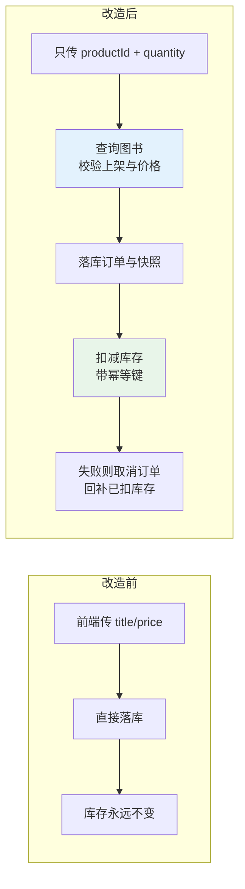
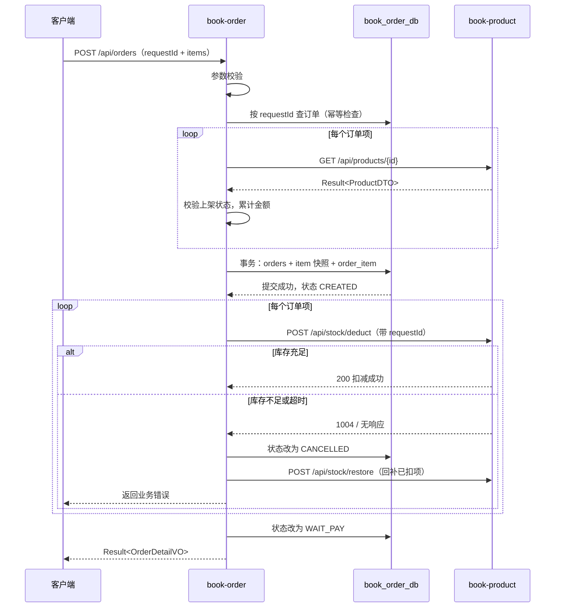
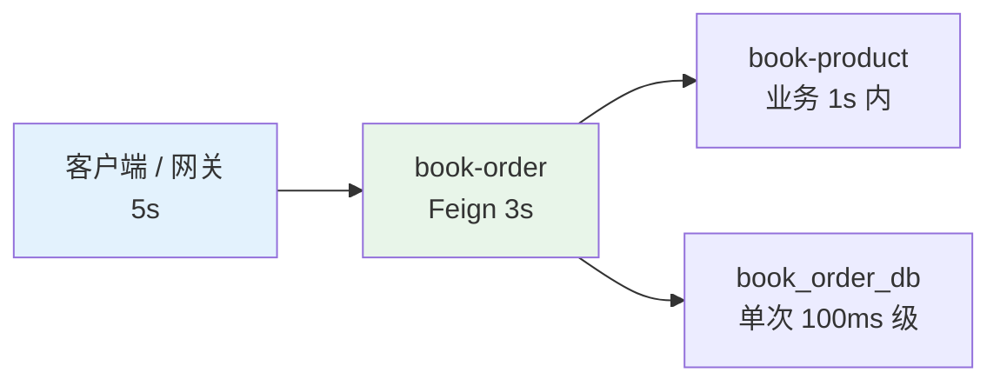

# 订单-图书远程调用重构

## 课程目标

- 掌握下单扣库存的完整流程与调用顺序，说清每一步失败时的中间状态
- 掌握 `ProductClient` 的定义与编排层、落库层的职责划分
- 掌握 `Result` 错误码翻译，把远端业务错误转换成调用方可理解的本地异常
- 掌握写操作的三条底线：幂等键、超时边界、失败补偿
- 能够用失败场景矩阵定位下单异常卡在哪一步、留下了什么脏数据
- 完成端到端验证，并让日志具备串联 traceId 的位置

## 回顾与导入

上一课证明了负载均衡已经生效：`[LB]` 日志里两台 `book-product` 都在接流量。但业务侧还停在"假下单"阶段——`book-order` 从未调用过图书服务的业务接口，商品信息和库存都是编出来的。

| 现状 | 代码里的证据 | 真实业务应该 |
| --- | --- | --- |
| 商品信息由前端传入 | `OrderItemRequest` 带 `title`、`author`、`price` | 从图书服务查询，价格不接受前端输入 |
| 库存从不扣减 | `product.stock` 始终不变 | 下单成功后扣减，取消时回补 |
| 失败无法区分 | 统一返回"系统异常" | 库存不足、商品下架、超时分别处理 |

这三件事必须一起改：查商品是为了拿到可信价格，扣库存是为了不超卖，错误码翻译是为了让调用方知道"该重试还是该改参数"。



> **前置条件：** `book-product` 已暴露 `GET /api/products/{id}`、`POST /api/stock/deduct` 与 `POST /api/stock/restore`。

## 一、下单扣库存的流程设计

### 完整业务流程

一次下单涉及调用方、订单服务、订单库、图书服务四个角色。注意扣减发生在订单落库**之后**，原因在下一节说明。



### 三种调用顺序的取舍

| 方案 | 流程 | 优点 | 缺点 |
| --- | --- | --- | --- |
| 先扣库存后建单 | 扣减 → 建单 | 库存不足时订单表无脏数据 | 建单失败需回补，回补也可能失败 |
| 先建单后扣库存 | 建单 → 扣减 | 订单先落地，可追踪可补偿 | 扣减失败须撤销订单 |
| 预占 + 确认 | 预占 → 支付 → 确认扣减 | 兼顾不超卖与体验 | 需要预占记录与超时释放任务 |

本课选**先建单后扣库存**，不是因为它更优，而是它一次暴露三个必须处理的问题：订单先落库意味着失败要撤销，扣减失败意味着要补偿，补偿失败意味着要人工介入。

### 订单状态与表结构

订单有四个状态：`CREATED`（已落库未扣减）、`WAIT_PAY`（库存已扣待支付）、`CANCELLED`（已取消且库存已回补）、`PAID`（已支付），后两者是终态。

```sql
ALTER TABLE orders ADD COLUMN request_id VARCHAR(64);
ALTER TABLE orders ADD COLUMN status VARCHAR(20) NOT NULL DEFAULT 'CREATED';
CREATE UNIQUE INDEX uk_orders_request_id ON orders (request_id);
```

`request_id` 上的唯一索引是幂等的最后一道防线：即使应用层判断全部失效，数据库也会拒绝第二条同键记录。

## 二、改造 book-order

### 定义 ProductClient

订单侧三个方法，写操作都带 `requestId`，这是幂等的前提。

```java
package com.example.order.feign;

import com.example.common.result.Result;
import com.example.order.dto.ProductDTO;
import com.example.order.dto.StockChangeRequest;
import org.springframework.cloud.openfeign.FeignClient;
import org.springframework.web.bind.annotation.GetMapping;
import org.springframework.web.bind.annotation.PathVariable;
import org.springframework.web.bind.annotation.PostMapping;
import org.springframework.web.bind.annotation.RequestBody;

@FeignClient(name = "book-product", path = "/api", contextId = "productClient")
public interface ProductClient {

    @GetMapping("/products/{id}")
    Result<ProductDTO> getById(@PathVariable("id") Long id);

    @PostMapping("/stock/deduct")
    Result<Void> deduct(@RequestBody StockChangeRequest request);

    @PostMapping("/stock/restore")
    Result<Void> restore(@RequestBody StockChangeRequest request);
}
```

`contextId` 用于区分同一服务的多个 Feign 接口，避免共享一份配置。这里只有一个，写上是为了养成习惯——后续为查询与写操作配不同超时，必须靠它拆开。

```java
package com.example.order.dto;

import jakarta.validation.constraints.Min;
import jakarta.validation.constraints.NotNull;
import lombok.Data;

@Data
public class StockChangeRequest {

    @NotNull(message = "商品ID不能为空")
    private Long productId;

    @NotNull(message = "数量不能为空")
    @Min(value = 1, message = "数量必须大于0")
    private Integer quantity;

    /** 幂等键：订单号 + 商品ID，重试与补偿时保持不变 */
    private String requestId;
}
```

### 编排层：CreateOrderService

编排层负责"按顺序做对的事"，**本身不加事务**，这样远程调用落在事务之外，不会长时间占着数据库连接。

```java
package com.example.order.service.impl;

import com.example.common.exception.BusinessException;
import com.example.common.result.ResultCode;
import com.example.order.feign.ProductClient;
import lombok.RequiredArgsConstructor;
import lombok.extern.slf4j.Slf4j;
import org.springframework.stereotype.Service;

@Slf4j
@Service
@RequiredArgsConstructor
public class CreateOrderService {

    private final ProductClient productClient;
    private final OrderTxService orderTxService;

    public OrderDetailVO create(CreateOrderRequest request) {
        // 1. 幂等：同一个 requestId 只允许成功一次
        OrderDetailVO exists = orderTxService.findByRequestId(request.getRequestId());
        if (exists != null) {
            log.info("重复提交，返回已有订单 requestId={}", request.getRequestId());
            return exists;
        }

        // 2. 查询并校验商品，金额以图书服务为准
        List<ProductDTO> products = new ArrayList<>();
        for (OrderItemRequest item : request.getItems()) {
            ProductDTO product = RemoteResultSupport.unwrap(
                    productClient.getById(item.getProductId()), "查询商品");
            if (!"ON_SALE".equals(product.getStatus())) {
                throw new BusinessException(ResultCode.PRODUCT_OFF_SHELF,
                        "商品[" + product.getTitle() + "]已下架");
            }
            // 库存预检只提示：是否够扣以扣减时的原子更新为准
            if (product.getStock() < item.getQuantity()) {
                log.warn("库存预检不足，商品={}，库存={}，需求={}",
                        product.getId(), product.getStock(), item.getQuantity());
            }
            products.add(product);
        }

        // 3. 本地事务落库：订单主表、商品快照、订单明细
        String orderNo = orderTxService.createOrder(request, products);

        // 4. 逐项扣减，失败则取消订单并回补已扣项
        List<StockChangeRequest> deducted = new ArrayList<>();
        try {
            for (OrderItemRequest item : request.getItems()) {
                StockChangeRequest change = new StockChangeRequest();
                change.setProductId(item.getProductId());
                change.setQuantity(item.getQuantity());
                change.setRequestId(orderNo + ":" + item.getProductId());
                RemoteResultSupport.unwrap(productClient.deduct(change), "扣减库存");
                deducted.add(change);
            }
        } catch (RuntimeException ex) {
            log.warn("扣减失败进入补偿，orderNo={}，已扣项={}", orderNo, deducted.size(), ex);
            compensate(orderNo, deducted);
            throw ex;
        }

        orderTxService.markWaitPay(orderNo);
        return orderTxService.detail(orderNo);
    }
}
```

三个细节值得说明：第 2 步先把商品全部查完再落库，任何一项不存在或下架都直接失败，**不产生半成品订单**；库存是否够扣不在此判定，否则并发下预检通过、扣减仍失败，还会跳过补偿；`deducted` 只记录已扣成功的项，补偿不重复操作。

### Result 错误码翻译

远端返回 `Result`，本地抛 `BusinessException`，中间必须有一层翻译。翻译的目标不是"原样透传"，而是**让调用方知道下一步该做什么**。

| 远端 `code` | 远端含义 | 本地返回 `code` | 调用方动作 |
| --- | --- | --- | --- |
| 200 | 成功 | 200 | 继续 |
| 1002 | 商品不存在 | 1002 | 修改商品 ID |
| 1003 | 商品已下架 | 1003 | 换商品 |
| 1004 | 库存不足 | 1004 | 减少数量或换商品 |
| 2001 | 远端内部错误 | 2001 | 稍后重试 |

```java
package com.example.order.support;

import com.example.common.exception.BusinessException;
import com.example.common.result.Result;
import com.example.common.result.ResultCode;

public final class RemoteResultSupport {

    private RemoteResultSupport() {
    }

    public static <T> T unwrap(Result<T> result, String action) {
        if (result == null) {
            throw new BusinessException(ResultCode.REMOTE_SERVICE_ERROR, action + "：远端无响应");
        }
        if (!ResultCode.SUCCESS.getCode().equals(result.getCode())) {
            throw new BusinessException(ResultCode.fromCode(result.getCode()),
                    action + "：" + result.getMessage());
        }
        return result.getData();
    }
}
```

`ResultCode.fromCode(code)` 把远端字符串码映射成本地枚举，映射不到的统一落到 `REMOTE_SERVICE_ERROR`。写完这一层，Controller 只剩一段 `try-catch`，错误码口径全项目一致。

### 超时配置

```yaml
spring:
  cloud:
    openfeign:
      client:
        config:
          book-product:
            connectTimeout: 1500
            readTimeout: 3000
      httpclient:
        hc5:
          enabled: true
```

`hc5` 启用 Apache HttpClient 5 连接池，替代默认的 `HttpURLConnection`，高并发下更稳。超时按服务配置，意味着查询与扣减共用同一份 `readTimeout`。

## 三、写操作安全设计

### 幂等键：三处校验

幂等不能只靠一处判断，本课做成三层：

| 层次 | 手段 | 拦截的重复来源 |
| --- | --- | --- |
| 接入层 | Redis `SETNX requestId` | 用户连点、前端重发 |
| 应用层 | 按 `requestId` 查订单 | 前一次已成功落库 |
| 存储层 | `uk_orders_request_id` 唯一索引 | 并发穿透前两层，数据库兜底 |

接入层用 `setIfAbsent` 抢一个 10 分钟的键，抢占失败直接抛 `DUPLICATE_SUBMIT`；存储层的唯一索引负责在并发穿透时兜底，`DataIntegrityViolationException` 被翻译成"重复提交"。

### 超时与重试边界

一条硬规则：**上游超时必须大于下游超时**，否则下游还在正常处理，上游已经放弃，两边对结果的理解必然分叉。



| 层级 | 建议超时 | 依据 |
| --- | --- | --- |
| 网关到 `book-order` | 5s | 覆盖订单服务内部两次远程调用 |
| `book-order` 到 `book-product` | 3s | 覆盖扣减接口 P99 并留余量 |
| 连接建立 | 1.5s | 内网建连失败多为实例不可用，快速失败 |

重试方面，Spring Cloud OpenFeign 默认 `Retryer.NEVER_RETRY`：扣减是写操作，自动重试会让库存扣两次。

| 请求类型 | 是否重试 | 说明 |
| --- | --- | --- |
| GET 查询商品 | 可重试 1 次 | 幂等，失败多为网络抖动 |
| POST 扣减库存 | 禁止自动重试 | 依赖 `requestId` 幂等，由补偿或人工重试 |
| POST 回补库存 | 禁止自动重试 | 同一 `requestId` 重复回补须被服务端拦下 |

> **注意：** `spring.cloud.loadbalancer.retry` 的 `retry-on-all-operations` 默认为 `false`，即只对 GET 重试。不要为了"提高成功率"改成 `true`，否则扣减会被自动重发。

### 补偿：回补库存

补偿有三步：取消订单、回补已扣项、失败告警，而不是"再调一次扣减"。

```java
private void compensate(String orderNo, List<StockChangeRequest> deducted) {
    // 先把订单推到终态，避免继续被支付
    orderTxService.markCancelled(orderNo);
    // 只回补已经扣成功的那部分，单项失败不阻断其他项
    for (StockChangeRequest change : deducted) {
        try {
            productClient.restore(change);
        } catch (RuntimeException ex) {
            log.error("回补失败，需人工介入，requestId={}", change.getRequestId(), ex);
        }
    }
}
```

补偿必须同时满足两个条件才安全：**幂等**（同一 `requestId` 重复回补只生效一次）与**尽力而为**（单项失败转告警，不在请求线程里重试）。持续失败就进入对账，由定时任务扫描 `CANCELLED` 但库存未回补的订单。

### 防重复提交

幂等键解决"同一笔请求重复执行"，防重复提交解决"用户连点产生多笔请求"。常见手段有按钮置灰、提交令牌、请求指纹加分布式锁三种。

本课用第三种：客户端生成 `requestId`，服务端用 Redis 抢占 10 分钟，这个 ID 同时充当幂等键，一物两用。

### 失败场景矩阵

| 失败场景 | 远端状态 | 本地订单状态 | 库存状态 | 是否一致 | 处理动作 |
| --- | --- | --- | --- | --- | --- |
| 商品不存在 | 未调用扣减 | 未落库 | 未变化 | 一致 | 返回 1002，提示换商品 |
| 库存不足（首项） | 返回 1004 | 已落库 → `CANCELLED` | 未变化 | 一致 | 返回 1004，提示减量 |
| 库存不足（第 N 项） | 前 N-1 项已扣 | 已落库 → `CANCELLED` | 前 N-1 项回补 | 补偿成功后一致 | 核对补偿日志 |
| 扣减超时 | 结果未知，可能已扣 | 已落库 → `CANCELLED` | 可能已扣未回补 | **可能不一致** | 按幂等键重查，进入对账 |
| 网络异常 / 实例宕机 | 未执行 | 已落库 → `CANCELLED` | 未变化 | 一致 | 返回 2001，可安全重试 |
| 重复提交 | 不会二次扣减 | 返回已有订单 | 不变 | 一致 | 返回 200，跳转详情 |

超时那一行是唯一"可能不一致"的场景，也正是后续分布式事务要解决的根因：**远程调用一旦超时，调用方就失去了对结果的确定性**。

### 残留问题：跨服务事务

本地事务只覆盖 `book_order_db`，扣减发生在 `book_product_db`。上面的补偿是"应用层尽力一致"，不是"事务保证一致"。一旦补偿本身失败、进程在补偿前崩溃，数据会长期不一致。更彻底的做法是引入 Seata AT 模式（框架自动回滚，改造量中等，详见《Seata AT模式实战》）或 TCC / Saga（业务侵入明显，详见《TCC、Saga、XA模式与选型》）。

> **结论：** 补偿方案能跑通、能兜底，但它把一致性责任交给了代码。看清这条链路的脆弱点，才知道 Seata 到底替你做了什么。

## 四、端到端验证

### 准备数据与请求

```sql
INSERT INTO product (id, title, author, price, stock, sales, status)
VALUES (1, 'Spring Boot 实战', 'Craig Walls', 79.0, 100, 0, 'ON_SALE'),
       (2, 'Java 核心技术', 'Cay Horstmann', 89.0, 2, 0, 'ON_SALE');
```

```http
@order_url = http://127.0.0.1:8083

### 1. 正常下单
POST {{order_url}}/api/orders
Content-Type: application/json

{ "requestId": "req-0001", "userId": 1, "items": [{ "productId": 1, "quantity": 2 }] }

### 2. 重复提交（requestId 不变）
POST {{order_url}}/api/orders
Content-Type: application/json

{ "requestId": "req-0001", "userId": 1, "items": [{ "productId": 1, "quantity": 2 }] }

### 3. 库存不足
POST {{order_url}}/api/orders
Content-Type: application/json

{ "requestId": "req-0002", "userId": 1, "items": [{ "productId": 2, "quantity": 5 }] }

### 4. 部分失败（第一项够、第二项不够）
POST {{order_url}}/api/orders
Content-Type: application/json

{ "requestId": "req-0003", "userId": 1, "items": [
  { "productId": 1, "quantity": 1 }, { "productId": 2, "quantity": 5 }] }
```

### 预期结果

| 场景 | 响应 | 订单表 | 库存变化 | 关键日志 |
| --- | --- | --- | --- | --- |
| 正常下单 | 200，金额 158.0 | 新增 1 条 `WAIT_PAY` | id=1：100 → 98 | 扣减成功 |
| 重复提交 | 200，同一订单 | 不新增 | 不变 | 重复提交，返回已有订单 |
| 库存不足 | 1004 | 新增 1 条 `CANCELLED` | 不变 | 库存不足 |
| 部分失败 | 1004 | 新增 1 条 `CANCELLED` | id=1：减 1 再回补为 100 | 进入补偿，已扣项=1 |
| 图书服务全停 | 2001 | 新增 1 条 `CANCELLED` | 不变 | `Connection refused` |

```sql
SELECT id, order_no, request_id, status, total_amount FROM orders ORDER BY id DESC LIMIT 5;
SELECT id, stock, sales FROM product WHERE id IN (1, 2);
```

### 日志打点与 traceId

下单链路跨两个服务，靠单机日志无法串联。本课先在格式里预留 traceId 的位置，第 49 课接入 Micrometer Tracing 后才真正有值。

```yaml
logging:
  pattern:
    level: "%5p [${spring.application.name:},%X{traceId:-},%X{spanId:-}]"
```

| 日志位置 | 打印内容 |
| --- | --- |
| 入口 | `requestId`、`userId`、`items` 数量 |
| 扣减 | `requestId`、返回 `code` |
| 补偿 | `orderNo`、已扣项数、失败 `requestId` |

> **提示：** 不要打印完整请求体，商品列表可能很长；打印数量与关键 ID 足够定位。接入链路追踪后 `traceId` 由 MDC 自动注入，pattern 不需要再改。

## 注意事项

- 远程调用不要放在长事务里。本课把落库与扣减拆成两个 Bean，就是让数据库连接尽早归还。
- 上游超时必须大于下游超时。任何一层颠倒都会导致"上游判失败、下游仍成功"。
- 扣减与回补接口都必须幂等。请求端传 `requestId`，服务端用它做唯一约束或去重表，否则重试会二次扣减。
- 补偿必须吞掉单项异常并打 ERROR 日志。一项失败不能让其他项放弃，最终一致靠对账补齐，而不是在请求线程里重试。
- 幂等返回要区分"重复提交"与"并发冲突"：前者返回已有订单，后者返回明确提示，不要一律报"系统异常"。
- 订单状态要落库后再返回，否则前端查到 `CREATED` 的订单会误判为下单失败。
- 本地事务只覆盖本服务的库，本节补偿只是应用层保证，不等于已具备分布式事务能力。

## 小结

本节课我们学习了：

1. **下单扣库存的完整流程**：校验 → 幂等检查 → 查商品 → 事务落库 → 逐项扣减 → 转待支付，每步失败都有明确的中间状态。
2. **三种调用顺序的取舍**：依据是"宁可少卖还是宁可回补"，本课选先建后扣，为的是暴露补偿问题。
3. **分层设计**：`CreateOrderService` 编排流程且不加事务，`OrderTxService` 只做落库且方法级事务，远程调用被隔离在事务之外。
4. **错误码翻译**：用 `RemoteResultSupport` 把远端 `Result` 映射成本地 `BusinessException`，让调用方知道该改参数还是该重试。
5. **写操作三条底线**：幂等键三层校验、上下游超时顺序、补偿的幂等与尽力而为。
6. **失败场景矩阵**：六类场景中只有"扣减超时"存在不一致风险，这正是分布式事务要解决的问题。

## 作业

### 作业一：完成下单扣库存改造

1. 定义 `ProductClient`、`StockChangeRequest`，给 `orders` 加上 `request_id` 与唯一索引。
2. 拆分 `CreateOrderService` 与 `OrderTxService`，确认 `@Transactional` 只出现在落库层。
3. 正常下单 2 本图书，核对订单金额、`item` 快照价格、`product.stock` 与 `sales` 的变化。

### 作业二：验证失败场景与补偿

1. 制造库存不足，确认订单状态为 `CANCELLED`、库存未变。
2. 制造部分失败，确认第一项库存被回补，并用 SQL 核对最终值。
3. 停掉 `book-product` 后下单，记录异常类型与耗时，判断是连接失败还是读超时。

### 作业三：设计幂等验证

1. 用同一 `requestId` 连续提交 5 次，统计订单记录数与库存变化。
2. 用两个不同 `requestId` 并发提交同一商品，确认库存不会被扣成负数。
3. 说明三层幂等各拦住哪次请求，并指出去掉唯一索引会出现什么后果。
