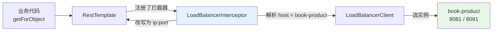
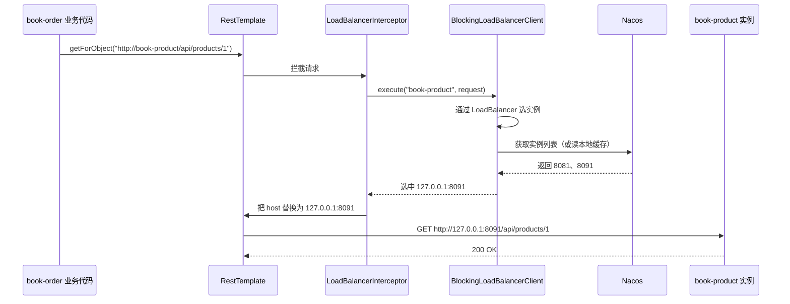
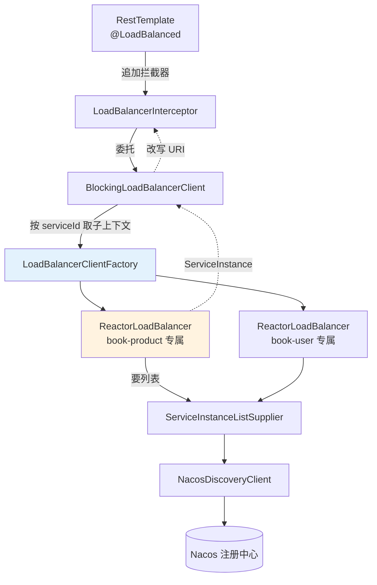

# Spring Cloud LoadBalancer快速上手

## 课程目标

- 理解 `@LoadBalanced` 只是一个标记注解，真正干活的是它引出的拦截器
- 掌握 `@LoadBalanced RestTemplate` 的配置与调用方式，能用服务名发起请求
- 理解 `LoadBalancerInterceptor` 在请求发出前替换 host 的机制
- 掌握 LoadBalancer 的核心组件与各自的职责边界
- 掌握 `WebClient` 场景下的 `@LoadBalanced WebClient.Builder` 用法
- 能够对比 `RestTemplate`、`WebClient` 与 OpenFeign 三条调用链路的取舍

## 回顾与导入

前两课的主线是 OpenFeign：`@FeignClient` 声明接口，拦截器透传上下文，LoadBalancer 挑实例，最后把下单流程改造成真实调用。日常开发确实以 Feign 为主，但还有两个问题没回答：

- 老项目或第三方 SDK 只给 `RestTemplate`，能不能也用服务名调服务？
- `@LoadBalanced` 这个注解凭什么能让 `book-product` 这样一个"不存在的域名"被解析？

先看效果：

```java
@Bean
@LoadBalanced
public RestTemplate loadBalancedRestTemplate() {
    return new RestTemplate();
}

// 调用时 host 直接写服务名
restTemplate.getForObject("http://book-product/api/products/1", Result.class);
```

`book-product` 在 DNS 里根本不存在，请求却成功了。这说明 URL 在发出前被改写过，改写者不是 `RestTemplate` 自己，而是有人给它加了一个拦截器。



本课把这条链路拆开：先讲注解为什么"什么也没做"，再讲拦截器做了什么，最后把 `RestTemplate`、`WebClient`、OpenFeign 三条路径放在一起对比，给出选型结论。

## 一、@LoadBalanced 只是一个标记

### 注解源码里没有任何逻辑

```java
@Target({ ElementType.FIELD, ElementType.PARAMETER, ElementType.METHOD })
@Retention(RetentionPolicy.RUNTIME)
@Documented
@Inherited
@Qualifier
public @interface LoadBalanced {
}
```

注解体是空的，唯一值得注意的是元注解 `@Qualifier`：它让被标记的 Bean 具备"限定符"语义，自动配置可以据此筛选出"需要被负载均衡加工"的那批 Bean。所以 `@LoadBalanced` 的本质是**一个给容器看的标记**，实现全部在别处。

### 不加注解会发生什么

```java
RestTemplate restTemplate = new RestTemplate();
restTemplate.getForObject("http://book-product/api/products/1", Result.class);
```

`RestTemplate` 会把 `book-product` 当作真实主机名交给 DNS 解析，解析失败抛 `UnknownHostException: book-product`。这与"手动拼 `http://127.0.0.1:8081`"有本质区别：后者 URL 里已经是可以直连的地址。

### 加了注解之后发生了什么

Spring Cloud LoadBalancer 的自动配置会收集所有 `@LoadBalanced` 标记的 `RestTemplate`，为它们追加 `LoadBalancerInterceptor`。请求发出前，拦截器把 URL 里的 host 换成选中的实例地址：



关键点：拦截器只做两件事——**提取服务名、把选中的实例地址写回 URI**。选哪个实例由 `LoadBalancerClient` 决定，拦截器不参与算法。

### 拦截器的核心逻辑

`LoadBalancerInterceptor` 实现了 `ClientHttpRequestInterceptor`，逻辑非常短，看懂它就等于看懂了整条链路：

```java
public ClientHttpResponse intercept(HttpRequest request, byte[] body,
                                    ClientHttpRequestExecution execution) throws IOException {
    // 1. 取出原始 URI，host 就是服务名
    URI originalUri = request.getURI();
    String serviceId = originalUri.getHost();
    // 2. 交给 LoadBalancerClient 选实例，阻塞式实现内部走 ReactorLoadBalancer
    ServiceInstance instance = loadBalancerClient.choose(serviceId);
    // 3. 用选中实例的地址重建 URI，其余部分（路径、查询串）保持不变
    URI reconstructed = loadBalancer.reconstructURI(instance, originalUri);
    // 4. 用新 URI 继续执行原有请求
    return execution.execute(new LoadBalancerRequest(request, reconstructed), body);
}
```

两个推论直接来自这段代码：host 段必须是服务名，写成 IP 就查不到实例；路径与查询参数被原样保留，所以 `?page=1&size=10` 不需要额外处理。

### 核心组件与职责

| 组件 | 角色 | 负责什么 | 不负责什么 |
| --- | --- | --- | --- |
| `LoadBalancerInterceptor` | 入口 | 提取 host 作为 serviceId，改写 URI | 不做实例选择 |
| `BlockingLoadBalancerClient` | 阻塞适配 | 把同步调用转成对 `ReactorLoadBalancer` 的调用 | 不持有实例列表 |
| `LoadBalancerClientFactory` | 容器工厂 | 为每个 serviceId 建独立子上下文，隔离策略与配置 | 不参与算法计算 |
| `ReactorLoadBalancer` | 决策者 | 从实例列表中挑一个 | 不负责取列表 |
| `RoundRobinLoadBalancer` | 默认实现 | 计数器取模，按顺序轮转 | 不读权重与元数据 |
| `ServiceInstanceListSupplier` | 数据源 | 提供实例列表，可叠加缓存、过滤、健康检查 | 不做选择 |
| `LoadBalancerProperties` | 配置载体 | 承载 `spring.cloud.loadbalancer.*` 的缓存、重试、健康检查参数 | 不参与运行时决策 |

这七个组件构成一条固定的流水线：拦截 → 适配 → 找子上下文 → 拿策略 → 取列表 → 选择 → 改写。`SupportedLoadBalancerBalance` 这类名字并非框架中的类，Spring Cloud LoadBalancer 对外暴露的扩展点是 `ReactorLoadBalancer` 接口，实现类只有 `RoundRobinLoadBalancer` 与 `RandomLoadBalancer` 两个开箱可用的选择。



> **结论：** `@LoadBalanced` 只是"报名"，`LoadBalancerClientFactory` 才是"分包"，`ReactorLoadBalancer` 是"选人"，`ServiceInstanceListSupplier` 是"名单"。理解这条分包流水线，自定义策略时才知道该动哪一层。

## 二、实战：@LoadBalanced RestTemplate

### 配置类

超时必须显式设置。`new RestTemplate()` 默认没有连接超时和读超时，下游卡住时调用线程会一直等待。

```java
package com.example.order.config;

import org.springframework.cloud.client.loadbalancer.LoadBalanced;
import org.springframework.context.annotation.Bean;
import org.springframework.context.annotation.Configuration;
import org.springframework.http.client.SimpleClientHttpRequestFactory;
import org.springframework.web.client.RestTemplate;

import java.time.Duration;

@Configuration
public class LoadBalancedRestTemplateConfig {

    @Bean
    @LoadBalanced
    public RestTemplate loadBalancedRestTemplate() {
        SimpleClientHttpRequestFactory factory = new SimpleClientHttpRequestFactory();
        factory.setConnectTimeout(Duration.ofSeconds(2));
        factory.setReadTimeout(Duration.ofSeconds(3));
        return new RestTemplate(factory);
    }
}
```

Spring Framework 6.1 起 `SimpleClientHttpRequestFactory` 提供 `Duration` 重载；若项目基线更早，改成毫秒整数 `setConnectTimeout(2000)`。

### 超时与连接池

`RestTemplate` 的超时分布在请求工厂上，不是一个参数：

| 参数 | 作用阶段 | 设置方式 | 典型值 |
| --- | --- | --- | --- |
| 连接超时 | TCP 建连 | `setConnectTimeout` | 2s |
| 读超时 | 等待响应数据 | `setReadTimeout` | 3s |
| 连接池上限 | 并发连接数 | `setMaxConnTotal` / `setMaxConnPerRoute` | 按 QPS 与 RT 估算 |
| 获取连接超时 | 池满时等待 | 连接池管理器配置 | 1s |

默认的 `SimpleClientHttpRequestFactory` 每个请求新建连接，没有池化能力。并发量上来后，把 Bean 内部的工厂换成带连接池的实现即可，注解与注入方式都不变（需引入 `org.apache.httpcomponents.client5:httpclient5`）：

```java
@Bean
@LoadBalanced
public RestTemplate loadBalancedRestTemplate() {
    HttpComponentsClientHttpRequestFactory factory = new HttpComponentsClientHttpRequestFactory(
            HttpClientBuilder.create().setMaxConnTotal(200).setMaxConnPerRoute(50).build());
    factory.setConnectTimeout(2000);
    factory.setReadTimeout(3000);
    return new RestTemplate(factory);
}
```

> **提示：** 连接池上限不是越大越好。按"单实例 QPS × 平均响应时间"估算并发占用，再留一倍余量即可，盲目放大只会把下游压垮。

### 调用服务

```java
package com.example.order.service.impl;

import com.example.common.exception.BusinessException;
import com.example.common.result.Result;
import com.example.common.result.ResultCode;
import com.example.order.dto.ProductDTO;
import lombok.RequiredArgsConstructor;
import org.springframework.core.ParameterizedTypeReference;
import org.springframework.http.HttpMethod;
import org.springframework.http.ResponseEntity;
import org.springframework.stereotype.Service;
import org.springframework.web.client.RestTemplate;

@Service
@RequiredArgsConstructor
public class ProductQueryService {

    private final RestTemplate loadBalancedRestTemplate;

    public ProductDTO getById(Long id) {
        String url = "http://book-product/api/products/" + id;
        ResponseEntity<Result<ProductDTO>> response = loadBalancedRestTemplate.exchange(
                url, HttpMethod.GET, null, new ParameterizedTypeReference<>() {
                });
        Result<ProductDTO> body = response.getBody();
        if (body == null || !ResultCode.SUCCESS.getCode().equals(body.getCode())) {
            throw new BusinessException(ResultCode.REMOTE_SERVICE_ERROR, "查询商品失败：" + id);
        }
        return body.getData();
    }
}
```

两个要点：URL 的 host 必须写服务名，不能写 `127.0.0.1`；响应体是 `Result<ProductDTO>` 这种带泛型的嵌套结构，必须用 `ParameterizedTypeReference` 保留类型信息，否则 `data` 会被反序列化成 `LinkedHashMap`。

### 暴露验证端点

```java
package com.example.order.controller;

import com.example.common.result.Result;
import com.example.order.dto.ProductDTO;
import com.example.order.service.impl.ProductQueryService;
import lombok.RequiredArgsConstructor;
import org.springframework.web.bind.annotation.GetMapping;
import org.springframework.web.bind.annotation.PathVariable;
import org.springframework.web.bind.annotation.RequestMapping;
import org.springframework.web.bind.annotation.RestController;

@RestController
@RequestMapping("/api/orders")
@RequiredArgsConstructor
public class ProductQueryController {

    private final ProductQueryService productQueryService;

    @GetMapping("/product-rest/{id}")
    public Result<ProductDTO> getProductByRest(@PathVariable("id") Long id) {
        return Result.success(productQueryService.getById(id));
    }
}
```

### 验证实例可见与轮询

第 25 课的 `InstanceTraceLifecycle` 对 `RestTemplate` 同样生效，因为两者共用同一套 LoadBalancer 基础设施。启动 8081、8091 两台 `book-product` 后连续调用：

```http
@order_url = http://127.0.0.1:8083

### 连续执行 6 次
GET {{order_url}}/api/orders/product-rest/1
```

```text
[LB] 选中 127.0.0.1:8081
[LB] 选中 127.0.0.1:8091
[LB] 选中 127.0.0.1:8081
[LB] 选中 127.0.0.1:8091
```

期望两个端口交替出现。若始终只有一个端口，按顺序检查：

| 现象 | 原因 | 处理 |
| --- | --- | --- |
| 抛 `UnknownHostException: book-product` | Bean 上没有 `@LoadBalanced` | 补注解，确认注入的是同一个 Bean |
| 抛 `No instances available for book-product` | 服务名不匹配或实例未注册 | Nacos 控制台核对服务名与健康实例数 |
| 只打到一台 | 第二台刚启动，缓存未刷新 | 关闭 `spring.cloud.loadbalancer.cache.enabled` 后重试 |
| 注入报 `NoUniqueBeanDefinitionException` | 容器里有多个 `RestTemplate` | 用 `@Qualifier("loadBalancedRestTemplate")` 指定 |

## 三、与 OpenFeign 的对比

两条链路在 LoadBalancer 层完全共用，差别在"谁帮你写 HTTP 代码"：

| 维度 | `@LoadBalanced RestTemplate` | `@FeignClient` |
| --- | --- | --- |
| 调用方式 | 手动拼 URL，调用 `getForObject` / `exchange` | 声明接口，像本地方法一样调用 |
| 服务名位置 | URL 的 host | 注解的 `name` 属性 |
| 参数与返回值 | 手写类型，泛型靠 `ParameterizedTypeReference` | 由方法签名自动推导 |
| 负载均衡入口 | `LoadBalancerInterceptor` | `LoadBalancerFeignClient` |
| 超时配置 | `ClientHttpRequestFactory`，按 Bean 设置 | `spring.cloud.openfeign.client.config.*`，按服务设置 |
| 拦截器扩展 | `ClientHttpRequestInterceptor` | `RequestInterceptor` |
| 实例观测 | `LoadBalancerLifecycle` | 同一个 `LoadBalancerLifecycle` |
| 适用场景 | 临时验证、第三方 SDK 强制要求、极简调用 | 接口契约清晰、调用点多的常规业务 |

> **选择建议：** 项目已全面使用 OpenFeign 时，`@LoadBalanced RestTemplate` 只用于轻量验证或被迫场景。两者可以共存，但团队应约定一种主调用方式，避免同一个服务出现两套超时与日志口径。

## 四、WebClient 场景

`RestTemplate` 是阻塞模型，Spring 官方推荐新项目改用 `WebClient`。它同样支持 `@LoadBalanced`，只是标记位置在 `Builder` 上。

```java
package com.example.order.config;

import org.springframework.cloud.client.loadbalancer.LoadBalanced;
import org.springframework.context.annotation.Bean;
import org.springframework.context.annotation.Configuration;
import org.springframework.web.reactive.function.client.WebClient;

@Configuration
public class LoadBalancedWebClientConfig {

    @Bean
    @LoadBalanced
    public WebClient.Builder loadBalancedWebClientBuilder() {
        return WebClient.builder();
    }
}
```

调用时把服务名写进 `baseUrl`，URI 解析交给 `ReactiveLoadBalancerClientFilter`：

```java
public ProductDTO getById(Long id) {
    return webClientBuilder.baseUrl("http://book-product")
            .build()
            .get()
            .uri("/api/products/{id}", id)
            .retrieve()
            .bodyToMono(new ParameterizedTypeReference<Result<ProductDTO>>() {
            })
            .map(Result::getData)
            .timeout(Duration.ofSeconds(3))
            .block();
}
```

这里用 `block()` 是为了在同步接口里取结果，仅用于演示；真正使用 `WebClient` 时应让调用链保持响应式，避免阻塞事件循环线程。三种方式的能力对照如下：

| 能力 | `RestTemplate` | `WebClient` | OpenFeign |
| --- | --- | --- | --- |
| 编程模型 | 同步阻塞 | 异步非阻塞 | 同步阻塞 |
| 负载均衡支持 | `@LoadBalanced` | `@LoadBalanced Builder` | 内置 |
| 依赖 | `spring-web` | `spring-boot-starter-webflux` | `spring-cloud-starter-openfeign` |
| 声明式契约 | 无 | 无 | 有 |
| 流式调用与背压 | 不支持 | 支持 | 不支持 |
| 典型用途 | 老项目改造、简单调用 | 高并发、网关类场景 | 业务服务间调用 |

> **注意：** `WebClient` 的负载均衡由 `ReactiveLoadBalancerClientFilter` 完成，与阻塞链路的 `LoadBalancerInterceptor` 是两个实现。混用阻塞与非阻塞代码时，超时与线程模型的差异要单独验证。

## 注意事项

- 不要给所有 `RestTemplate` 加 `@LoadBalanced`。它只适用于"host 写服务名"的调用；访问真实域名或 IP 的 Bean 必须保持普通实现，否则会把 `127.0.0.1` 当成服务名去注册中心查，报"无可用实例"。
- 拦截器只处理 URL 的 host 段。URL 写成 `http://127.0.0.1:8081/...` 时，host 是 `127.0.0.1`，拦截器会拿它当服务名查询并失败。
- 超时必须通过 `ClientHttpRequestFactory` 显式设置。默认实现没有读超时，下游无响应时调用线程会长期挂起，连接池很快被占满。
- 多个 `RestTemplate` Bean 共存时，注入点要用 `@Qualifier` 指定，否则按类型注入会报 `NoUniqueBeanDefinitionException`，或注入到错误的 Bean 上而失去负载均衡能力。
- 泛型响应必须用 `ParameterizedTypeReference`。直接用 `Result.class` 会让 `data` 退化成 `LinkedHashMap`，取字段时抛 `ClassCastException`。
- `RestTemplate` 默认使用 `HttpURLConnection`，高并发下建议换成带连接池的工厂（如 Apache HttpClient 5），并设置最大连接数与获取连接超时。
- `@LoadBalanced` 与 Feign 共用同一个 `LoadBalancerClientFactory` 与实例缓存，调缓存参数时两条链路同时受影响。

## 小结

本节课我们学习了：

1. **`@LoadBalanced` 的定位**：空注解加 `@Qualifier`，只负责让自动配置认出"需要加工的 Bean"，实现全在拦截器里。
2. **拦截器机制**：`LoadBalancerInterceptor` 提取 host 作为 serviceId，把选中实例的 `host:port` 写回 URI 后再放行。
3. **核心组件分工**：`LoadBalancerClientFactory` 建服务级子上下文，`ReactorLoadBalancer` 选实例，`ServiceInstanceListSupplier` 供名单，`BlockingLoadBalancerClient` 做同步适配。
4. **完整配置方式**：`@Bean` 加 `@LoadBalanced`，用 `SimpleClientHttpRequestFactory` 设连接与读超时，调用时 host 写服务名。
5. **验证方法**：`LoadBalancerLifecycle` 对 `RestTemplate` 同样生效，两台实例下日志端口应交替出现。
6. **三条链路对比**：`RestTemplate` 轻量直接，`WebClient` 面向响应式，OpenFeign 契约清晰，三者共用同一套负载均衡基础设施。

## 作业

### 作业一：跑通 @LoadBalanced RestTemplate

1. 在 `book-order` 中新增 `LoadBalancedRestTemplateConfig`，设置 2 秒连接超时、3 秒读超时。
2. 实现 `ProductQueryService#getById`，用 `exchange` 加 `ParameterizedTypeReference` 解析 `Result<ProductDTO>`。
3. 启动两台 `book-product`，连续调用 10 次，记录 `[LB]` 日志中的端口序列。

### 作业二：对比两种调用方式

1. 在同一 Controller 中分别暴露 Feign 与 `RestTemplate` 两条查询路径。
2. 各调用 10 次，记录端口分布、平均耗时与代码行数。
3. 从"代码量、参数处理、超时配置、可观测性"四个维度给出你的选型结论。

### 作业三：排查三类典型错误

1. 去掉 `@LoadBalanced`，记录异常类型与完整堆栈。
2. 把 URL 改成 `http://127.0.0.1:8081/api/products/1`，观察报错信息，解释为什么会被当成服务名。
3. 不设置任何超时，停掉 `book-product` 后发起调用，记录线程阻塞时长与恢复方式。
