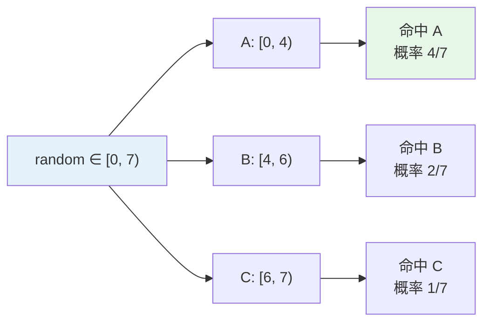
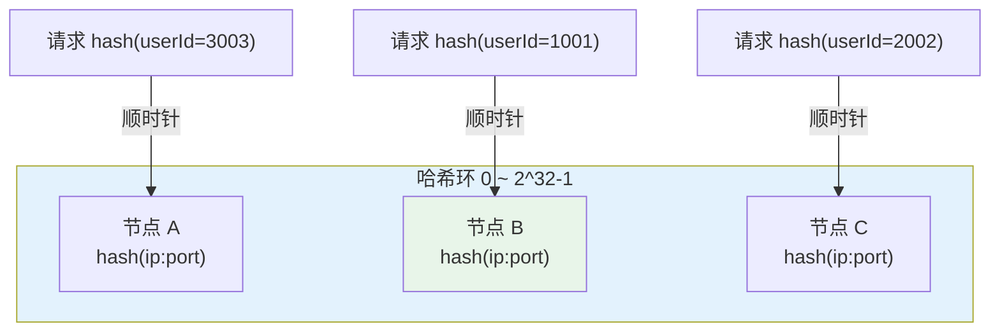

# 负载均衡算法与LoadBalancer

## 课程目标

- 理解负载均衡算法在「是否依赖实时状态」与「是否保持请求粘性」两个维度上的分类
- 掌握轮询、加权轮询、随机、加权随机、最少连接、一致性哈希的原理与边界
- 理解加权轮询「连续选中」造成的不平滑，以及一致性哈希的虚拟节点与数据倾斜
- 掌握 Spring Cloud LoadBalancer 内置策略清单与能力边界
- 能够验证 `book-order` 调用 `book-product` 时的默认轮询行为
- 能够用 `RandomLoadBalancerConfig` 与 `@LoadBalancerClient` 为单个服务切换随机策略
- 能够结合会话粘性、灰度比例、实例异构三个场景给出算法选型结论

## 回顾与导入

上一课《Spring Cloud LoadBalancer快速上手》已经把 `@LoadBalanced RestTemplate` 配好，`book-order` 通过服务名 `book-product` 发起调用，由 LoadBalancer 从 Nacos 返回的实例列表里挑一个。代码能跑，但「挑一个」背后的规则被框架藏了起来。

进入生产后藏不住：实例性能差一倍，默认策略仍一人一半；购物车放在本地内存，下一跳换了实例就消失；灰度只放 10%，短暂窗口却可能 100% 打到新版本。三类问题分别对应加权、粘性、精确比例三种诉求，而框架只内置轮询与随机。

本课先摊开算法地图，再落地验证两个内置策略；自定义策略与平滑加权轮询放到下一课。

> **结论：** 算法没有好坏，只有匹配不匹配。轮询解决「均匀」，加权解决「异构」，哈希解决「粘性」，加权轮询解决「比例」。

## 负载均衡算法的两个分类维度

| 维度 | 类型 | 含义 | 典型算法 |
| --- | --- | --- | --- |
| 是否依赖实时状态 | 静态 | 只看预设规则，不感知后端实时负载 | 轮询、加权轮询、随机、加权随机 |
| 是否依赖实时状态 | 动态 | 依据连接数、活跃请求数、响应时间分配 | 最少连接、最小活跃数、最快响应 |
| 是否保持请求粘性 | 无状态 | 同一客户端的连续请求可能落到不同实例 | 轮询、随机、加权类算法 |
| 是否保持请求粘性 | 有状态 | 同一特征（用户、租户、参数）稳定落到同一实例 | 一致性哈希、IP 哈希 |

两个维度可以组合：「加权最少连接」既动态也感知权重，但依然无状态；「带虚拟节点的一致性哈希」既粘性也支持权重。

## 静态算法逐项拆解

### 简单轮询

用一个原子计数器记录请求序号，对实例数量取模得到下标：

```text
index = counter.getAndIncrement() % instanceCount
```

| 优点 | 缺点 | 适用场景 |
| --- | --- | --- |
| 实现最简单，长期绝对均匀 | 不感知实例性能差异，也不感知权重 | 实例同构、无状态、耗时接近 |
| 无状态，实例增减后自动适应 | 每个客户端各自计数，无法全局均匀 | 内部服务调用、批量任务分发 |

`RoundRobinLoadBalancer` 用 `AtomicInteger` 递增位置，用 `AtomicReference` 整体替换实例列表，避免遍历中被并发修改。

### 加权轮询：连续选中导致的不平滑

加权轮询给实例配权重，权重高的被选中次数多。最朴素的实现是按权重展开成数组再轮询：`A:4, B:2, C:1` 展开后是 `A,A,A,A,B,B,C`。

| 轮次 | 1 | 2 | 3 | 4 | 5 | 6 | 7 |
| --- | --- | --- | --- | --- | --- | --- | --- |
| 朴素加权轮询 | A | A | A | A | B | B | C |
| 平滑加权轮询 | A | B | A | C | A | B | A |

问题非常直观：**高权重实例在一轮的前段被连续打满，后段完全闲置**。7 个请求里前 4 个全压在 A 上，A 瞬时承受 4 倍压力随后空闲，既没削峰，又让排队变长、超时率上升。

这正是 Nginx 提出平滑加权轮询（Smooth Weighted Round Robin）的原因：把 4 次 A 摊平到 7 个轮次，任意时刻比例都接近 4:2:1，完整实现放在下一课。

> **注意：** 不少团队把加权轮询直接理解成朴素展开版，灰度时看到新版本瞬间被打满又归零，其实是算法不平滑。

### 随机

每次请求独立随机抽取，不维护任何状态。

| 优点 | 缺点 | 适用场景 |
| --- | --- | --- |
| 实现最简单，客户端之间天然错峰 | 短期波动大，小样本下可能连续命中同一实例 | 无状态服务、实例多、客户端多 |
| 实例增减无需维护计数器 | 无法保证绝对均匀，压测时可能单实例倾斜 | 大量客户端并行调用，避免同步节拍 |

随机最大的价值是**打散同步节拍**：上千客户端若都按轮询，会在同一时刻命中同一台机器形成周期性「惊群」。

### 加权随机：区间法与二分查找

每次独立按权重比例抽取，常见实现是「累积区间 + 随机数定位」：先算权重总和 `total`，为每个实例生成累积区间 `[cumulative, cumulative + weight)`，再生成 `[0, total)` 的随机数定位落点。



```java
public ServiceInstance weightedRandom(List<ServiceInstance> instances) {
    int total = instances.stream().mapToInt(this::weightOf).sum();
    if (total <= 0) {
        return instances.get(ThreadLocalRandom.current().nextInt(instances.size()));
    }
    int offset = ThreadLocalRandom.current().nextInt(total);
    int cumulative = 0;
    for (ServiceInstance instance : instances) {
        cumulative += weightOf(instance);
        if (offset < cumulative) {
            return instance;
        }
    }
    return instances.get(instances.size() - 1);
}

private int weightOf(ServiceInstance instance) {
    try {
        return Math.max(Integer.parseInt(instance.getMetadata().getOrDefault("weight", "1")), 0);
    } catch (NumberFormatException ex) {
        return 1;
    }
}
```

总权重为 0 时必须回退到纯随机，否则永远返回最后一个实例。线性扫描是 O(n)；实例上百且权重长期不变时，可固化累积数组用二分查找降到 O(log n)，Nacos 的 `WeightedInstanceSelector` 正是这一思路。

加权随机的边界是**短期波动**：10% 的灰度权重下，100 次里命中 7 次或 15 次都正常，随机做不到「任意 100 次正好 10 次」。

## 动态算法：最少连接

最少连接（Least Connections）依据后端实时活跃连接数分配，常用公式 `score = activeConnections / weight`，选 `score` 最小的实例。

| 优点 | 缺点 | 适用场景 |
| --- | --- | --- |
| 真正感知后端压力，慢实例自动少接活 | 依赖实时指标采集，采集延迟导致决策失真 | 耗时方差大、长连接、流式响应 |
| 天然抗「慢节点」，避免雪崩 | 新实例连接数为 0，冷启动会被瞬间打满 | 处理能力差异明显的批处理服务 |

「新实例被打满」是最典型的坑，解法是慢启动（warm-up）：预热期内限制分配比例，或以权重 0 注册、预热后再放开。框架没有内置该策略，因为它依赖客户端侧连接统计，而 Feign 默认客户端不暴露全局连接池指标。

## 有状态算法：一致性哈希

一致性哈希（Consistent Hashing）把 `0 ~ 2^32-1` 组织成环，实例与请求特征都哈希到环上，请求顺时针找到第一个实例。



核心价值是**节点变动时影响范围最小**：只有落在变动节点区间上的请求需要重新路由；取模轮询在实例数从 2 变 3 时几乎全部请求都要换实例。

### 虚拟节点与数据倾斜

每个物理实例若只在环上占一个点，实例少时分布极不均匀：三个实例可能只覆盖环上 10%、15%、75% 的区间，这就是**数据倾斜**（Data Skew）。解决方式是给每个物理实例生成多个虚拟节点（Virtual Node），例如 160 个，把 `hash(ip:port#i)` 均匀撒到环上；虚拟节点越多越均匀，内存与查找开销也越大，100~200 个是常见折中。

| 优点 | 缺点 | 适用场景 |
| --- | --- | --- |
| 相同特征稳定路由，天然支持会话粘性 | 实现复杂，需要维护有序环 | 本地缓存、分片任务、WebSocket 长连接 |
| 节点变动影响范围小，缓存命中率高 | 哈希键设计不当会造成热点 | 有状态服务、缓存亲和场景 |
| 虚拟节点可缓解倾斜 | 节点过少时仍需大量虚拟节点 | 实例数量中等且稳定的集群 |

## Spring Cloud LoadBalancer 的内置策略与边界

| 策略 | 实现类 | 是否默认 | 说明 |
| --- | --- | --- | --- |
| 轮询 | `RoundRobinLoadBalancer` | 是 | 未做任何配置时的默认策略 |
| 随机 | `RandomLoadBalancer` | 否 | 需要声明 Bean 并绑定服务名 |
| 加权随机 | 无内置 | 否 | 由 `NacosLoadBalancer` 提供，需开启 `nacos.enabled` |
| 平滑加权轮询 | 无内置 | 否 | 需自定义 `ReactorServiceInstanceLoadBalancer` |
| 最少连接 | 无内置 | 否 | 需自建指标采集与自定义策略 |
| 一致性哈希 | 无内置 | 否 | 需自定义策略并维护哈希环 |

> **重要：** 表中的加权随机来自 Spring Cloud Alibaba 扩展，不属于 LoadBalancer 本体，排查时容易找错源码位置。

权重来源与哈希键都无法统一约定，框架只留两个扩展点：`ReactorServiceInstanceLoadBalancer` 决定「选谁」，`ServiceInstanceListSupplier` 决定「列表从哪来」。

## 验证默认轮询策略

### 先确认开关关闭

默认策略是轮询，前提是没被 Nacos 扩展覆盖：`book-order` 的 `application.yml` 里**不要出现** `spring.cloud.loadbalancer.nacos.enabled`。实验期间同时关闭实例缓存，避免缓存窗口干扰观察：

```yaml
spring:
  cloud:
    loadbalancer:
      cache:
        enabled: false
```

> **注意：** 开启 `spring.cloud.loadbalancer.nacos.enabled=true` 后由 `NacosLoadBalancer` 接管，它是加权随机，序列不再严格交替。

### 加一个命中日志

为了看清「这一次到底选中了谁」，加一个 `LoadBalancerLifecycle` 实现：

```java
package com.example.order.lb;

import lombok.extern.slf4j.Slf4j;
import org.springframework.cloud.client.ServiceInstance;
import org.springframework.cloud.client.loadbalancer.LoadBalancerLifecycle;
import org.springframework.cloud.client.loadbalancer.Request;
import org.springframework.cloud.client.loadbalancer.Response;
import org.springframework.stereotype.Component;

@Slf4j
@Component
public class LbLifecycleLogger implements LoadBalancerLifecycle<Object, Object, ServiceInstance> {

    @Override
    public void onStartRequest(Request<Object> request, Response<ServiceInstance> response) {
        ServiceInstance instance = response.getServer();
        if (instance != null) {
            log.info("[LB选中实例] {}:{} service={}", instance.getHost(), instance.getPort(), instance.getServiceId());
        }
    }
}
```

`LoadBalancerLifecycle` 在每次选择完成后拿到结果，Feign 与 `@LoadBalanced RestTemplate` 都经过它，两种调用共用同一份日志。生产环境不要保留每请求一条的 INFO 日志，长期观测应改为打点指标（第 50 课）。

### 两个实例、两种调用方式

启动两个 `book-product` 实例，8082 用命令行覆盖端口：

```bash
java -jar book-product.jar --server.port=8081
java -jar book-product.jar --server.port=8082
```

实验期间只需 `book-order` 与这两个实例，`book-user` 不必启动。先调用 Feign 接口 6 次：

```http
### 连续执行 6 次，观察 [LB选中实例]
GET http://127.0.0.1:8083/api/order/product/1
```

预期严格交替：

```text
[LB选中实例] 127.0.0.1:8081 service=book-product
[LB选中实例] 127.0.0.1:8082 service=book-product
[LB选中实例] 127.0.0.1:8081 service=book-product
[LB选中实例] 127.0.0.1:8082 service=book-product
[LB选中实例] 127.0.0.1:8081 service=book-product
[LB选中实例] 127.0.0.1:8082 service=book-product
```

再用 `@LoadBalanced RestTemplate` 走一遍：

```http
### 连续执行 6 次，观察 [LB选中实例]
GET http://127.0.0.1:8083/api/order/product/lb/1
```

两者共享同一服务名子上下文，**序列连续累加**；先调 Feign 6 次再调 RestTemplate，看到的是同一条序列的第 7 至第 12 位。

> **结论：** 只有「实例健康状态相同、权重相同、未开启 Nacos 权重感知、缓存关闭」四个条件同时满足，轮询才会严格交替。序列异常时先查 8082 是否注册成功，再查是否有自定义策略 Bean 被全局扫描。

## 切换到随机策略

### 声明随机负载均衡器

Spring Cloud LoadBalancer 没有「一行配置切换策略」的开关，切换需要声明 `ReactorLoadBalancer` Bean：

```java
package com.example.order.config;

import org.springframework.cloud.client.ServiceInstance;
import org.springframework.cloud.client.loadbalancer.reactive.ReactorLoadBalancer;
import org.springframework.cloud.loadbalancer.core.RandomLoadBalancer;
import org.springframework.cloud.loadbalancer.core.ServiceInstanceListSupplier;
import org.springframework.cloud.loadbalancer.support.LoadBalancerClientFactory;
import org.springframework.context.annotation.Bean;
import org.springframework.core.env.Environment;

public class RandomLoadBalancerConfig {

    @Bean
    public ReactorLoadBalancer<ServiceInstance> randomLoadBalancer(
            Environment environment,
            LoadBalancerClientFactory loadBalancerClientFactory) {
        String name = environment.getProperty(LoadBalancerClientFactory.PROPERTY_NAME);
        return new RandomLoadBalancer(
                loadBalancerClientFactory.getLazyProvider(name, ServiceInstanceListSupplier.class),
                name);
    }
}
```

`environment.getProperty(PROPERTY_NAME)` 取出当前子上下文绑定的服务名；`getLazyProvider(...)` 懒加载实例列表供应器，避免循环依赖；`new RandomLoadBalancer(...)` 构造策略实例。

> **关键提醒：** 这个类**不能加 `@Configuration`**。加了会被 `book-order` 主容器扫描，`ReactorLoadBalancer` Bean 提升为全局默认，`book-user` 等其他服务的调用全部变成随机。正确做法是保持普通类，只在 `@LoadBalancerClient` 里被引用。

### 绑定到 book-product

```java
package com.example.order;

import com.example.order.config.RandomLoadBalancerConfig;
import org.springframework.boot.SpringApplication;
import org.springframework.boot.autoconfigure.SpringBootApplication;
import org.springframework.cloud.loadbalancer.annotation.LoadBalancerClient;
import org.springframework.cloud.openfeign.EnableFeignClients;

@SpringBootApplication
@EnableFeignClients
@LoadBalancerClient(name = "book-product", configuration = RandomLoadBalancerConfig.class)
public class BookOrderApplication {

    public static void main(String[] args) {
        SpringApplication.run(BookOrderApplication.class, args);
    }
}
```

`@LoadBalancerClient` 把配置类注册到 `book-product` 的**子上下文**（child context）中，只有该服务名的调用会用到这个 Bean。服务名必须与 `@FeignClient(name = ...)` 或 `@LoadBalanced` 调用中的主机名完全一致，大小写与连字符都不能差。

### 验证随机分布

重启 `book-order`，连续调用 12 次：

```http
### 连续执行 12 次
GET http://127.0.0.1:8083/api/order/product/1
```

预期 8081 与 8082 各约 6 次，但**顺序不可预测**，可能出现连续两次甚至三次命中同一实例。这正是随机的特征——长期比例正确，短期允许波动。

### 验证作用域没有扩散

用 `LoadBalancerClientFactory.getInstance(serviceId, ReactorLoadBalancer.class)` 打印策略类，`book-product` 为 `RandomLoadBalancer`，未绑定策略的 `book-user` 仍为 `RoundRobinLoadBalancer`。`getInstance` 会创建或复用子上下文，即使没有实例也能查到生效策略。

## 轮询与随机的对比与选型

| 维度 | 轮询 `RoundRobinLoadBalancer` | 随机 `RandomLoadBalancer` |
| --- | --- | --- |
| 短期分布 | 严格交替，无偏差 | 波动大，小样本可能连续命中 |
| 多客户端同步风险 | 高，容易形成同步节拍 | 低，天然错峰 |
| 压测可复现性 | 强，序列可预测 | 弱，只能看统计 |
| 适用场景 | 实例同构、耗时接近、需可预测 | 实例多、客户端多、无状态服务 |

**一、会话粘性：用一致性哈希或把状态外置。** 会话、本地缓存、WebSocket 连接绑定实例时，轮询与随机都会让请求「跳」，表现为登录态丢失、缓存命中率骤降。优先把状态挪到 Redis；挪不动的用带虚拟节点的一致性哈希，哈希键选稳定维度（用户 ID、租户 ID）。

**二、灰度比例：用平滑加权轮询。** 加权随机只保证概率，不保证任意窗口内的比例；灰度 10% 时 100 次里命中 20 次并不奇怪，监控上会出现「新版本错误率暴涨」的误判。

**三、实例异构：先用 Nacos 权重。** 等权分配必然让弱实例先过载。在 Nacos 控制台调 `weight` 并开启 `nacos.enabled=true` 即可；需要同时按版本灰度等更精细控制时，再写自定义 `ReactorServiceInstanceLoadBalancer`。

| 业务诉求 | 推荐算法 | 理由 |
| --- | --- | --- |
| 无状态服务，实例同构 | 轮询 | 绝对均匀，可预测 |
| 无状态服务，客户端极多 | 随机 | 打散同步节拍，避免惊群 |
| 实例规格不一致 | 加权随机或平滑加权轮询 | 按能力分配，弱实例不被打爆 |
| 灰度按比例放量 | 平滑加权轮询 | 短期比例稳定，便于观测 |
| 本地缓存 / 长连接 | 一致性哈希（虚拟节点） | 请求粘性，节点变动影响小 |
| 请求耗时差异大 | 最少连接（需自建） | 按实时压力分配 |

> **结论：** 先问「有没有状态」，再问「实例是否同构」，最后问「比例是否需要精确」。三个问题答完，算法基本就定了。

## 注意事项

1. **默认是轮询，前提是没被覆盖。** `nacos.enabled=true` 会切到 `NacosLoadBalancer`（加权随机）。
2. **切换策略没有配置开关。** 只能声明 `ReactorLoadBalancer` Bean 并用 `@LoadBalancerClient` 绑定。
3. **配置类不能加 `@Configuration`。** 被主启动类扫描后策略提升为全局默认，其他服务被静默改掉。
4. **服务名必须精确匹配。** 写成 `book_product` 或 `BOOK-PRODUCT` 不报错，但策略静默失效。
5. **实验前关闭缓存。** 否则 35 秒实例缓存会让「停掉一个实例」看起来没生效。
6. **加权随机的短期波动是特性。** 不要用 100 次的比例断言权重配置错误。
7. **一致性哈希解决分布，不解决热点。** 业务集中的键仍会打到同一实例。

## 小结

本节课我们学习了：

1. **算法分类**：静态与动态、无状态与有状态，四个格子对应不同诉求。
2. **静态算法**：轮询追求均匀，加权轮询按能力分配但朴素实现不平滑，随机打散同步节拍，加权随机用区间法加二分查找按概率抽取。
3. **动态与有状态算法**：最少连接感知实时压力但有冷启动问题，一致性哈希通过虚拟节点实现粘性并缩小节点变动的影响范围。
4. **框架边界**：只内置轮询与随机，加权随机来自 `NacosLoadBalancer`，加权轮询与一致性哈希需要自定义。
5. **默认轮询验证**：关闭 Nacos 权重开关与缓存，两个实例下 Feign 与 RestTemplate 都呈现严格交替。
6. **随机策略切换**：`RandomLoadBalancerConfig` 保持普通类，通过 `@LoadBalancerClient` 绑定，并用 `LoadBalancerClientFactory` 验证作用域。
7. **选型方法**：会话粘性看一致性哈希或状态外置，灰度比例看平滑加权轮询，实例异构看 Nacos 权重。

## 作业

### 作业一：复现并记录轮询序列

1. 注释掉 `nacos.enabled`，设置 `cache.enabled=false`，启动 8081、8082 两个 `book-product` 实例。
2. 连续调用 Feign 接口 9 次，记录 `[LB选中实例]` 序列，判断是否严格交替。
3. 再调用 `@LoadBalanced RestTemplate` 接口 3 次，说明序列为什么接着上次继续，而不是从 8081 重新开始。
4. 在 Nacos 控制台把 8082 的权重改为 0.5 后重新调用，记录变化并解释原因。

### 作业二：切换随机策略并验证作用域

1. 创建 `RandomLoadBalancerConfig`，确认类上没有 `@Configuration`。
2. 通过 `@LoadBalancerClient(name = "book-product", configuration = RandomLoadBalancerConfig.class)` 绑定。
3. 打印两个服务的策略类，确认只有 `book-product` 是 `RandomLoadBalancer`；再给配置类加 `@Configuration` 重启，观察变化。
4. 结合会话粘性、灰度 5% 比例、8C/4C/2C 异构实例三个场景，各给出一个算法选择与理由。
