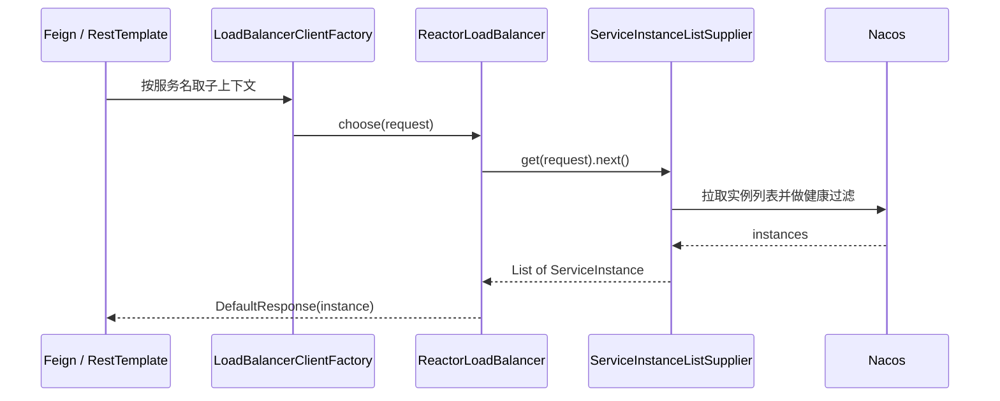
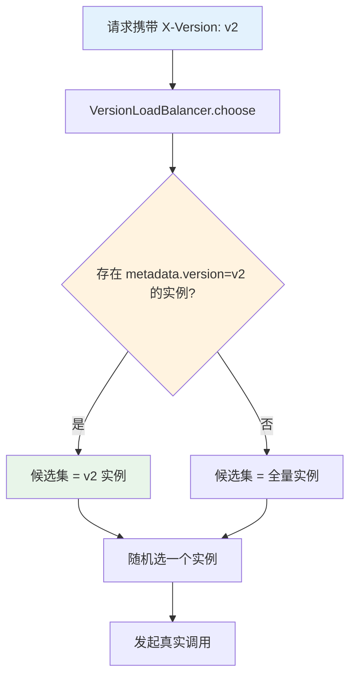

# 自定义负载均衡策略与平滑加权轮询

## 课程目标

- 理解 `ReactorServiceInstanceLoadBalancer` 与 `ServiceInstanceListSupplier` 的协作关系
- 能够手写一个读取元数据权重的随机负载均衡器，并完成实例过滤与空列表处理
- 掌握 `@LoadBalancerClient`、`@LoadBalancerClients` 的绑定方式与配置类作用域规则
- 能够实现 Nginx 版平滑加权轮询，并验证权重 4:2:1 的输出序列
- 能够基于元数据实现版本灰度路由，并画出灰度流程
- 理解自定义策略的性能边界、线程安全要求与 Nacos 权重的叠加关系

## 回顾与导入

上一课验证了默认轮询与随机，确认框架只内置 `RoundRobinLoadBalancer` 与 `RandomLoadBalancer`。`NacosLoadBalancer` 的权重只能来自 `weight` 字段，无法表达「按请求头灰度」「按租户分层」这类规则。

真实需求往往同时包含按实例能力分配流量、按业务标记选择实例两件事。本课先实现读权重的策略，讲透注册与作用域，再实现平滑加权轮询，最后用元数据做版本灰度。

> **结论：** 自定义负载均衡器只做三件事——拿到实例列表、过滤出候选、按规则选一个。难点不在算法，而在作用域与并发。

## 自定义负载均衡器的两个扩展点

### 调用链



`ServiceInstanceListSupplier` 负责「列表从哪来」，`ReactorServiceInstanceLoadBalancer` 负责「选谁」。前者可层层装饰（发现、缓存、健康检查、同区域优先），后者拿到的是已过滤好的列表；`LoadBalancerClientFactory` 为每个服务名维护独立子上下文。`choose` 返回 `Mono<Response<ServiceInstance>>`，选中返回 `DefaultResponse`，无实例返回 `EmptyResponse`，不能返回 `null`。

## 手写加权随机策略

### 完整实现

这段代码实现「按元数据权重随机选择」，并处理空列表、权重非法、权重全为 0 三种边界：

```java
package com.example.order.lb;

import java.util.List;
import java.util.concurrent.ThreadLocalRandom;

import org.springframework.beans.factory.ObjectProvider;
import org.springframework.cloud.client.ServiceInstance;
import org.springframework.cloud.client.loadbalancer.DefaultResponse;
import org.springframework.cloud.client.loadbalancer.EmptyResponse;
import org.springframework.cloud.client.loadbalancer.Request;
import org.springframework.cloud.client.loadbalancer.Response;
import org.springframework.cloud.loadbalancer.core.NoopServiceInstanceListSupplier;
import org.springframework.cloud.loadbalancer.core.ReactorServiceInstanceLoadBalancer;
import org.springframework.cloud.loadbalancer.core.ServiceInstanceListSupplier;

import reactor.core.publisher.Mono;

public class WeightedRandomLoadBalancer implements ReactorServiceInstanceLoadBalancer {

    private final ObjectProvider<ServiceInstanceListSupplier> supplierProvider;
    private final String serviceId;

    public WeightedRandomLoadBalancer(ObjectProvider<ServiceInstanceListSupplier> supplierProvider,
                                      String serviceId) {
        this.supplierProvider = supplierProvider;
        this.serviceId = serviceId;
    }

    @Override
    public Mono<Response<ServiceInstance>> choose(Request request) {
        ServiceInstanceListSupplier supplier =
                supplierProvider.getIfAvailable(NoopServiceInstanceListSupplier::new);
        return supplier.get(request).next().map(this::chooseFrom);
    }

    private Response<ServiceInstance> chooseFrom(List<ServiceInstance> instances) {
        List<ServiceInstance> candidates = instances.stream()
                .filter(instance -> weightOf(instance) > 0)
                .toList();
        if (candidates.isEmpty()) {
            return new EmptyResponse();
        }
        int total = candidates.stream().mapToInt(this::weightOf).sum();
        int offset = ThreadLocalRandom.current().nextInt(total);
        int cumulative = 0;
        for (ServiceInstance candidate : candidates) {
            cumulative += weightOf(candidate);
            if (offset < cumulative) {
                return new DefaultResponse(candidate);
            }
        }
        return new DefaultResponse(candidates.get(candidates.size() - 1));
    }

    private int weightOf(ServiceInstance instance) {
        String raw = instance.getMetadata().getOrDefault("weight", "1");
        try {
            return Math.max(Integer.parseInt(raw), 0);
        } catch (NumberFormatException ex) {
            return 1;
        }
    }
}
```

| 代码片段 | 解决的问题 |
| --- | --- |
| `supplierProvider.getIfAvailable(...)` | 子上下文未注册供应器时退回 `NoopServiceInstanceListSupplier`，避免空指针 |
| `filter(weightOf > 0)` | 权重 0 的实例视为摘除，不参与抽取 |
| `new EmptyResponse()` | 无候选时返回可识别的空响应，调用方据此抛「无可用实例」 |
| `DefaultResponse(candidate)` | 命中实例的标准返回体 |

权重写在实例元数据里，注册时通过配置声明：

```yaml
spring:
  cloud:
    nacos:
      discovery:
        metadata:
          weight: 3
          version: v2
```

`DefaultRequest` 是 `Request` 的默认实现，测试时用 `new DefaultRequest<>(new DefaultRequestContext(null))` 即可直接调用 `choose`，无需启动 Spring 上下文。

## 注册与作用域规则

### 正确做法

```java
package com.example.order.config;

import org.springframework.cloud.client.ServiceInstance;
import org.springframework.cloud.client.loadbalancer.reactive.ReactorLoadBalancer;
import org.springframework.cloud.loadbalancer.core.ServiceInstanceListSupplier;
import org.springframework.cloud.loadbalancer.support.LoadBalancerClientFactory;
import org.springframework.context.annotation.Bean;
import org.springframework.core.env.Environment;

public class WeightedLoadBalancerConfig {

    @Bean
    public ReactorLoadBalancer<ServiceInstance> weightedLoadBalancer(
            Environment environment,
            LoadBalancerClientFactory loadBalancerClientFactory) {
        String name = environment.getProperty(LoadBalancerClientFactory.PROPERTY_NAME);
        return new WeightedRandomLoadBalancer(
                loadBalancerClientFactory.getLazyProvider(name, ServiceInstanceListSupplier.class),
                name);
    }
}
```

配置类写好后，绑定方式与上一课一致，只把 `configuration` 换成新的配置类：

```java
package com.example.order;

import com.example.order.config.WeightedLoadBalancerConfig;
import org.springframework.boot.SpringApplication;
import org.springframework.boot.autoconfigure.SpringBootApplication;
import org.springframework.cloud.loadbalancer.annotation.LoadBalancerClient;
import org.springframework.cloud.openfeign.EnableFeignClients;

@SpringBootApplication
@EnableFeignClients
@LoadBalancerClient(name = "book-product", configuration = WeightedLoadBalancerConfig.class)
public class BookOrderApplication {

    public static void main(String[] args) {
        SpringApplication.run(BookOrderApplication.class, args);
    }
}
```

`@LoadBalancerClient` 为 `book-product` 建子上下文并注册配置类中的 Bean，策略只影响该服务。

### 错误示范

```java
// 错误：加了 @Configuration 且在扫描路径内
@Configuration
public class GlobalLbConfig {

    @Bean
    public ReactorLoadBalancer<ServiceInstance> globalBalancer(
            Environment environment,
            LoadBalancerClientFactory factory) {
        String name = environment.getProperty(LoadBalancerClientFactory.PROPERTY_NAME);
        return new WeightedRandomLoadBalancer(factory.getLazyProvider(name, ServiceInstanceListSupplier.class), name);
    }
}
```

主容器扫描到它之后，这个 `ReactorLoadBalancer` Bean 就成了**全局默认策略**：`book-user`、`book-order` 之间互相调用也全部走加权随机。更隐蔽的是它不会报错，只有对比各服务的策略类时才会发现。

| 写法 | 生效范围 | 结果 |
| --- | --- | --- |
| 普通类 + `@LoadBalancerClient` 引用 | 指定服务子上下文 | 正确，只影响目标服务 |
| `@Configuration` + 在扫描路径内 | 主容器，成为全局默认 | 错误，所有服务都被替换 |
| 普通类 + `@LoadBalancerClients` 引用多个服务 | 各服务独立子上下文 | 正确，可分别指定策略 |

> **注意：** 子上下文的 Bean 优先于父上下文，但父上下文里「已经是默认」的 Bean 不会被自动覆盖——一旦配置类被主容器扫描，绑定关系就失去意义。

### 为多个服务绑定策略

```java
@LoadBalancerClients({
        @LoadBalancerClient(name = "book-product", configuration = WeightedLoadBalancerConfig.class),
        @LoadBalancerClient(name = "book-user", configuration = VersionLoadBalancerConfig.class)
})
```

需要给「没有显式绑定的服务」统一设置默认策略时，用 `@LoadBalancerClients(defaultConfiguration = X.class)`，同样要求 `X` 不被主容器扫描。

## 平滑加权轮询

### 算法三步

平滑加权轮询（Smooth Weighted Round Robin）在每一轮做三件事：

```text
1. 每个候选：currentWeight += effectiveWeight
2. 选出 currentWeight 最大的那个
3. 被选中者：currentWeight -= totalWeight
```

初始 `currentWeight` 全为 0，`totalWeight` 是有效权重之和。这样每一轮都把「欠账」补回来，被选中的实例立刻扣减总量，保证后续轮次不会连续命中它。

### 完整实现

```java
package com.example.order.lb;

import java.util.List;
import java.util.Map;
import java.util.concurrent.ConcurrentHashMap;

import org.springframework.beans.factory.ObjectProvider;
import org.springframework.cloud.client.ServiceInstance;
import org.springframework.cloud.client.loadbalancer.DefaultResponse;
import org.springframework.cloud.client.loadbalancer.EmptyResponse;
import org.springframework.cloud.client.loadbalancer.Request;
import org.springframework.cloud.client.loadbalancer.Response;
import org.springframework.cloud.loadbalancer.core.NoopServiceInstanceListSupplier;
import org.springframework.cloud.loadbalancer.core.ReactorServiceInstanceLoadBalancer;
import org.springframework.cloud.loadbalancer.core.ServiceInstanceListSupplier;

import reactor.core.publisher.Mono;

public class SmoothWeightedLoadBalancer implements ReactorServiceInstanceLoadBalancer {

    private final ObjectProvider<ServiceInstanceListSupplier> supplierProvider;
    private final String serviceId;
    private final Map<String, Integer> currentWeights = new ConcurrentHashMap<>();

    public SmoothWeightedLoadBalancer(ObjectProvider<ServiceInstanceListSupplier> supplierProvider,
                                      String serviceId) {
        this.supplierProvider = supplierProvider;
        this.serviceId = serviceId;
    }

    @Override
    public Mono<Response<ServiceInstance>> choose(Request request) {
        ServiceInstanceListSupplier supplier =
                supplierProvider.getIfAvailable(NoopServiceInstanceListSupplier::new);
        return supplier.get(request).next().map(this::chooseFrom);
    }

    private Response<ServiceInstance> chooseFrom(List<ServiceInstance> instances) {
        List<ServiceInstance> candidates = instances.stream()
                .filter(instance -> weightOf(instance) > 0)
                .toList();
        if (candidates.isEmpty()) {
            return new EmptyResponse();
        }
        synchronized (this) {
            int total = 0;
            ServiceInstance best = null;
            int bestCurrent = Integer.MIN_VALUE;
            for (ServiceInstance candidate : candidates) {
                int effective = weightOf(candidate);
                int current = currentWeights.merge(keyOf(candidate), effective, Integer::sum);
                total += effective;
                if (current > bestCurrent) {
                    bestCurrent = current;
                    best = candidate;
                }
            }
            currentWeights.merge(keyOf(best), -total, Integer::sum);
            return new DefaultResponse(best);
        }
    }

    private String keyOf(ServiceInstance instance) {
        return instance.getHost() + ":" + instance.getPort();
    }

    private int weightOf(ServiceInstance instance) {
        String raw = instance.getMetadata().getOrDefault("weight", "1");
        try {
            return Math.max(Integer.parseInt(raw), 0);
        } catch (NumberFormatException ex) {
            return 1;
        }
    }
}
```

三处关键：`currentWeights` 用 `ConcurrentHashMap` 保存跨请求状态；「累加、选最大、扣减」放在同一个 `synchronized` 块里，保证多线程下序列正确；`keyOf` 用 `host:port`，否则同一服务的多个实例共用一份计数器。

### 权重 4:2:1 的推演

三个实例 A、B、C 权重分别为 4、2、1，初始 `currentWeight` 全为 0：

| 轮次 | 累加后 currentWeight | 选中 | 扣减后 currentWeight |
| --- | --- | --- | --- |
| 1 | A=4, B=2, C=1 | A | A=-3, B=2, C=1 |
| 2 | A=1, B=4, C=2 | B | A=1, B=-3, C=2 |
| 3 | A=5, B=-1, C=3 | A | A=-2, B=-1, C=3 |
| 4 | A=2, B=1, C=4 | C | A=2, B=1, C=-3 |
| 5 | A=6, B=3, C=-2 | A | A=-1, B=3, C=-2 |
| 6 | A=3, B=5, C=-1 | B | A=3, B=-2, C=-1 |
| 7 | A=7, B=0, C=0 | A | A=0, B=0, C=0 |

输出序列是 `A B A C A B A`，7 个请求中 A 出现 4 次、B 出现 2 次、C 出现 1 次，且没有连续命中超过两次；对比朴素展开版 `A A A A B B C`，前 4 个请求的瞬时压力差了一倍。

> **结论：** 平滑加权轮询的「平滑」来自 `currentWeight -= totalWeight` 这一步。少了它，算法退化成朴素加权轮询。

## 基于元数据的版本灰度

### VersionLoadBalancer

灰度发布要求「带特定标记的请求打到新版本，其余走旧版本」。标记通常来自请求头，实例版本来自元数据：

```java
package com.example.order.lb;

import java.util.List;
import java.util.concurrent.ThreadLocalRandom;

import org.springframework.beans.factory.ObjectProvider;
import org.springframework.cloud.client.ServiceInstance;
import org.springframework.cloud.client.loadbalancer.DefaultResponse;
import org.springframework.cloud.client.loadbalancer.EmptyResponse;
import org.springframework.cloud.client.loadbalancer.Request;
import org.springframework.cloud.client.loadbalancer.RequestDataContext;
import org.springframework.cloud.client.loadbalancer.Response;
import org.springframework.cloud.loadbalancer.core.NoopServiceInstanceListSupplier;
import org.springframework.cloud.loadbalancer.core.ReactorServiceInstanceLoadBalancer;
import org.springframework.cloud.loadbalancer.core.ServiceInstanceListSupplier;
import org.springframework.web.context.request.RequestAttributes;
import org.springframework.web.context.request.RequestContextHolder;
import org.springframework.web.context.request.ServletRequestAttributes;

import reactor.core.publisher.Mono;

public class VersionLoadBalancer implements ReactorServiceInstanceLoadBalancer {

    private static final String VERSION_HEADER = "X-Version";

    private final ObjectProvider<ServiceInstanceListSupplier> supplierProvider;
    private final String serviceId;

    public VersionLoadBalancer(ObjectProvider<ServiceInstanceListSupplier> supplierProvider, String serviceId) {
        this.supplierProvider = supplierProvider;
        this.serviceId = serviceId;
    }

    @Override
    public Mono<Response<ServiceInstance>> choose(Request request) {
        ServiceInstanceListSupplier supplier =
                supplierProvider.getIfAvailable(NoopServiceInstanceListSupplier::new);
        return supplier.get(request).next().map(instances -> chooseFrom(instances, request));
    }

    private Response<ServiceInstance> chooseFrom(List<ServiceInstance> instances, Request<?> request) {
        if (instances.isEmpty()) {
            return new EmptyResponse();
        }
        String version = resolveVersion(request);
        List<ServiceInstance> candidates = instances;
        if (version != null && !version.isBlank()) {
            candidates = instances.stream()
                    .filter(instance -> version.equals(instance.getMetadata().get("version")))
                    .toList();
            if (candidates.isEmpty()) {
                candidates = instances;
            }
        }
        return new DefaultResponse(candidates.get(ThreadLocalRandom.current().nextInt(candidates.size())));
    }

    private String resolveVersion(Request<?> request) {
        if (request.getContext() instanceof RequestDataContext dataContext) {
            String header = dataContext.getClientRequest().getHeaders().getFirst(VERSION_HEADER);
            if (header != null && !header.isBlank()) {
                return header;
            }
        }
        RequestAttributes attributes = RequestContextHolder.getRequestAttributes();
        if (attributes instanceof ServletRequestAttributes servletAttributes) {
            return servletAttributes.getRequest().getHeader(VERSION_HEADER);
        }
        return null;
    }
}
```

三个要点：`RequestDataContext` 由 RestTemplate 等阻塞客户端传递，可直接读原始请求头；Feign 上下文不是它时，退回 `RequestContextHolder` 读线程内的 Servlet 请求；候选为空必须回退全量，否则一个错误版本号就会让调用全部失败。

### 灰度流程



| 灰度阶段 | 新版本实例数 | 流量来源 | 观察指标 |
| --- | --- | --- | --- |
| 内部验证 | 1 个 | 测试账号带 `X-Version` 头 | 错误率、慢调用比例 |
| 按比例放量 | 与旧版本 1:3 | 网关按用户 ID 取模加头 | 版本间对比指标 |

> **提示：** 版本头必须由可信入口注入，否则用户可自带 `X-Version` 打到未验证的灰度实例。

## 注意事项

1. **配置类不要加 `@Configuration`。** 被主容器扫描后策略提升为全局默认，且不报错，只能靠对比策略类发现。
2. **`choose` 永远不要返回 `null`。** 无候选时返回 `EmptyResponse`，让上层抛可读的「无可用实例」异常。
3. **状态键用 `host:port`。** 用 `serviceId` 做键会让同一服务的多个实例共用计数，平滑算法立刻失真。
4. **累加、选最大、扣减必须原子。** 三步之间被其他线程插入会破坏序列，最可靠的写法是方法级锁。
5. **避免每次请求排序。** 平滑算法本身是 O(n) 单趟扫描，实例列表变化时才排序。
6. **锁粒度按服务隔离。** 负载均衡器 Bean 每个服务名一个，锁天然隔离；抽成静态全局锁会让所有服务互相阻塞。
7. **与 Nacos 权重不要叠加两次。** 自定义策略生效后 `NacosLoadBalancer` 不再参与，若代码里又乘 `instance.getWeight()`，权重等于被平方；`currentWeights` 也要按当前实例列表惰性清理。

## 小结

本节课我们学习了：

1. **两个扩展点**：`ServiceInstanceListSupplier` 提供实例列表，`ReactorServiceInstanceLoadBalancer` 负责从中选一个。
2. **加权随机实现**：从元数据读权重，过滤零权重实例，用累积区间加随机数定位，空列表返回 `EmptyResponse`。
3. **注册与作用域**：配置类保持普通类，通过 `@LoadBalancerClient` 绑定到服务子上下文；加了 `@Configuration` 会变成全局默认。
4. **平滑加权轮询**：累加权重、选最大、扣减总量三步，权重 4:2:1 输出 `A B A C A B A`。
5. **版本灰度**：从请求头取版本标记，与实例元数据匹配后过滤候选，无匹配时回退全量避免雪崩。
6. **工程约束**：状态键用 `host:port`，三步操作原子执行，锁按服务隔离，不与 Nacos 权重重复叠加。

## 作业

### 作业一：实现并验证平滑加权轮询

1. 按本课代码实现 `SmoothWeightedLoadBalancer`，绑定到 `book-product`。
2. 三个实例权重分别设为 4、2、1，连续调用 14 次，记录序列。
3. 对照推演表，确认前 7 次为 `A B A C A B A`，后 7 次重复同一序列。
4. 把 `currentWeights` 的键改成 `serviceId`，观察序列如何失真并解释原因。

### 作业二：实现版本灰度路由

1. 启动两个 `book-product` 实例，元数据分别设为 `version=v1` 与 `version=v2`。
2. 实现 `VersionLoadBalancer`，通过 `@LoadBalancerClient` 绑定。
3. 用 `curl` 带 `X-Version: v2` 调用 10 次，确认全部命中 8082；不带头部时两个实例各约一半。
4. 停掉 v2 实例后再带 `X-Version: v2` 调用，验证回退逻辑并说明风险。
