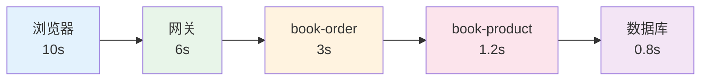
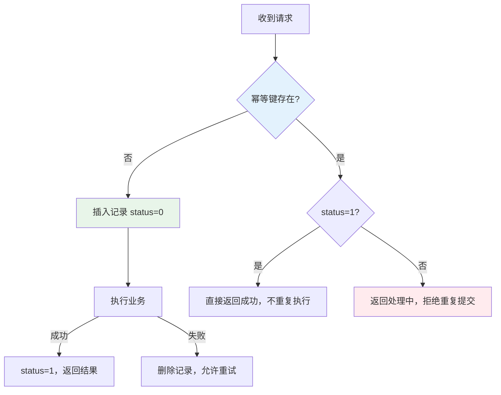

# 远程调用可靠性：超时、重试与幂等

## 课程目标

- 理解一次远程调用可能出现的失败类型，以及「超时」为什么必须逐层递减
- 掌握 Feign 连接超时、读超时与 HikariCP、PostgreSQL 超时的完整配置
- 理解重试的代价与前提，能够区分可重试错误与不可重试错误
- 掌握 `Retryer.Default` 与 Spring Cloud LoadBalancer 重试的组合方式，避免重复重试
- 能够设计幂等键并落地幂等表、AOP 拦截与状态机幂等
- 能够通过故障演练观察超时、断实例、重复提交三类现象并验证修复效果
- 能够按上线检查清单对一条调用链做可靠性验收

## 回顾与导入

前两课解决了「选谁」的问题：轮询、随机、自定义加权、灰度路由。但即使每次都选对实例，调用依然可能失败——实例正在 Full GC、数据库慢查询、网络抖动，任何一种都会让请求挂在那里。

没有超时的调用是最危险的：线程被占住、连接池被耗尽、上游继续堆积请求，最终整条链路一起雪崩。加上超时之后，新的问题立刻出现：超时了要不要重试？重试会不会把下游打死？重复的请求会不会创建两笔订单？

可靠性就是这三件事的组合：**超时划定边界，重试争取成功率，幂等兜住重复。**

> **结论：** 超时是底线，重试是概率，幂等是保险。三者缺一，链路都不可上线。

## 一次调用可能怎么失败

| 失败类型 | 典型原因 | 表象 | 应对手段 |
| --- | --- | --- | --- |
| 连接超时 | 实例宕机、网络不通、SYN 被丢 | `ConnectTimeoutException` | 短超时加快速失败 |
| 读超时 | 下游处理慢、锁等待、慢 SQL | `SocketTimeoutException` | 合理读超时加重试或降级 |
| 连接被拒 | 端口未监听、进程已退出 | `ConnectException` | 实例摘除 |
| 5xx 响应 | 下游内部异常、依赖故障 | `FeignException$InternalServerError` | 有限重试或熔断 |
| 4xx 响应 | 参数错误、鉴权失败 | `FeignException$BadRequest` | 不重试，直接上抛 |
| 重复请求 | 客户端重试、用户重复点击 | 重复下单、重复扣款 | 幂等设计 |

## 超时预算与配置

### 逐层递减的预算

超时要从用户体验倒推并逐层收窄：外层必须比内层大，否则外层先超时、内层还在跑，形成「僵尸请求」。



| 层级 | 组件 | 关键参数 | 建议值 | 说明 |
| --- | --- | --- | --- | --- |
| 浏览器 | fetch / axios | `timeout` | 10000ms | 用户可接受的上限 |
| 网关 | Gateway | `connect-timeout` / `response-timeout` | 1000ms / 6000ms | 全局兜底，见第 38 课 |
| 订单服务 | Feign 调 `book-product` | `connect-timeout` / `read-timeout` | 300ms / 1200ms | 单次调用预算 |
| 订单服务 | 自身处理总预算 | — | 3000ms | 含一次重试余量 |
| 图书服务 | 业务处理 | — | 800ms | 纯计算与缓存读取 |
| 数据库 | HikariCP / PostgreSQL | `connection-timeout` / `statement_timeout` | 1000ms / 800ms | 最小粒度 |

预留规则可以用一个不等式表达：**外层超时 ≥ 内层超时 ×（重试次数 + 1）+ 排队与序列化余量**。按「连接 300ms + 读 1200ms」配一次重试，订单服务至少需要 `(1500 × 2) + 少量余量`，所以 3 秒是合理值。

### book-order 完整配置

```yaml
server:
  port: 8083
spring:
  cloud:
    openfeign:
      client:
        config:
          default:
            connect-timeout: 500
            read-timeout: 2000
            logger-level: basic
          book-product:
            connect-timeout: 300
            read-timeout: 1200
      httpclient:
        hc5:
          enabled: true
    loadbalancer:
      retry:
        enabled: true
        retry-on-all-operations: false
        max-retries-on-same-service-instance: 0
        max-retries-on-next-service-instance: 1
  datasource:
    hikari:
      connection-timeout: 1000
      validation-timeout: 500
```

`default` 是所有 Feign 客户端的默认值，`book-product` 覆盖它实现按依赖细化；`retry-on-all-operations: false` 表示只对幂等方法重试；同实例重试次数设为 0，是为了避免在已经变慢的实例上再补一刀。

### book-product 侧配置

```yaml
server:
  port: 8081
spring:
  datasource:
    hikari:
      connection-timeout: 1000
      max-lifetime: 1800000
  jpa:
    properties:
      jakarta.persistence.query.timeout: 800
```

数据库侧再兜一层：`statement_timeout` 由 PostgreSQL 执行，能杀掉真正的慢查询；HikariCP 的 `connection-timeout` 只负责「借连接」的等待，两者不能互相替代。

## 重试：代价与前提

### 重试会放大什么

重试不是免费的：一次超时请求本来只占下游 1 个线程，重试后占 2 个、3 个，下游越慢重试越猛，这就是**重试风暴**。

| 重试带来的问题 | 说明 | 缓解方式 |
| --- | --- | --- |
| 流量放大 | N 次重试把峰值放大 N 倍 | 限制次数、只重试幂等操作 |
| 延迟放大 | 每次重试都重新计时 | 外层超时要预留余量 |
| 重复副作用 | 下游已成功但响应丢失 | 幂等键、状态机 |
| 掩盖故障 | 重试成功掩盖了下游劣化 | 记录重试指标并告警 |

重试的前提只有一个：**被重试的操作必须幂等**。GET、查询、按主键更新天然幂等；「创建订单」「扣减库存」这类操作，没有幂等设计就不能重试。

### 三种退避策略

| 策略 | 计算方式 | 优点 | 缺点 | 适用场景 |
| --- | --- | --- | --- | --- |
| 固定间隔 | 每次等待固定值，如 200ms | 实现简单、可预测 | 下游拥塞时容易形成同步冲击 | 内部轻量接口 |
| 指数退避 | 200ms、400ms、800ms… | 给下游恢复时间 | 尾部延迟增长快 | 依赖外部系统 |
| 指数退避加抖动 | 指数值再乘随机因子 | 打散重试尖峰，避免同步 | 时间不可精确预测 | 高并发生产环境 |

抖动（Jitter）是生产环境的默认选择：大量客户端在同一时刻超时，如果都按固定间隔重试，就会在 200ms 后形成第二波尖峰。

### Feign 的 Retryer

```java
package com.example.order.config;

import feign.Retryer;
import org.springframework.context.annotation.Bean;
import org.springframework.context.annotation.Configuration;

@Configuration
public class FeignRetryConfig {

    @Bean
    public Retryer feignRetryer() {
        return new Retryer.Default(200, 2000, 3);
    }
}
```

`Retryer.Default(period, maxPeriod, maxAttempts)` 的间隔按 1.5 倍递增并受 `maxPeriod` 限制，`maxAttempts` 含首次调用。Spring Cloud OpenFeign 默认注入 `Retryer.NEVER_RETRY`，所以不声明这个 Bean 时 Feign 层不重试。

> **关键提醒：** Feign 的 `Retryer` 与 Spring Cloud LoadBalancer 的重试会**叠加**。`Retryer` 重试的是整个 `execute`，每次都会重新选实例；LoadBalancer 重试的是「换一个实例再试」。两者同时开启，实际调用次数是乘积。生产环境只保留一层，通常保留 LoadBalancer 层。

LoadBalancer 层的重试由 Spring Retry 驱动：classpath 上有 `spring-retry` 时，Feign 会使用 `RetryableFeignBlockingLoadBalancerClient`，按 `spring.cloud.loadbalancer.retry.*` 决定同实例重试与换实例重试的次数。

### 用 ErrorDecoder 区分可重试错误

```java
package com.example.order.config;

import feign.Request;
import feign.RetryableException;
import feign.codec.ErrorDecoder;
import org.springframework.context.annotation.Bean;
import org.springframework.context.annotation.Configuration;

@Configuration
public class FeignErrorConfig {

    @Bean
    public ErrorDecoder errorDecoder() {
        ErrorDecoder delegate = new ErrorDecoder.Default();
        return (methodKey, response) -> {
            int status = response.status();
            if (status >= 500 || status == 429) {
                return new RetryableException(status, "retryable status: " + status,
                        response.request().httpMethod(), null, response.request());
            }
            return delegate.decode(methodKey, response);
        };
    }
}
```

这段代码把 5xx 与 429 转成 `RetryableException`，其余状态交给默认解码器。注意 4xx 一律不重试：参数错误重试一万次还是错，只会浪费资源并放大日志。

| 错误类型 | 是否重试 | 理由 |
| --- | --- | --- |
| 连接超时、连接被拒 | 是（换实例） | 实例或网络问题，换一个可能成功 |
| 读超时 | 谨慎，仅幂等操作 | 下游可能已经执行成功 |
| 500 / 502 / 503 / 504 | 是（有限次） | 多为瞬时故障 |
| 429 | 是（按 `Retry-After`） | 被限流，退避后重试 |
| 400 / 401 / 403 / 404 | 否 | 请求本身有问题 |
| 业务异常（余额不足等） | 否 | 重试结果不会改变 |

## 幂等设计

### 幂等键的三种来源

| 来源 | 生成方式 | 示例 | 特点 |
| --- | --- | --- | --- |
| 客户端令牌 | 前端进入页面时生成 UUID，放在 `Idempotency-Key` 头 | `7f3c...` | 覆盖「重复点击」，需校验格式与长度 |
| 业务唯一键 | 订单号、外部单号加操作类型 | `ORDER-CREATE:20261110001` | 天然唯一，依赖业务字段设计 |
| 请求指纹 | 方法、路径、请求体一起哈希 | `sha256(POST/api/orders+body)` | 无需前端配合，误判风险较高 |

优先选客户端令牌：语义清晰、冲突最低；业务唯一键适合对接外部系统；指纹只作兜底。

### 幂等表 DDL

```sql
CREATE TABLE idempotent_record (
    id             BIGSERIAL PRIMARY KEY,
    idempotent_key VARCHAR(128) NOT NULL,
    biz_type       VARCHAR(64)  NOT NULL,
    status         SMALLINT     NOT NULL DEFAULT 0,
    created_at     TIMESTAMPTZ  NOT NULL DEFAULT now(),
    updated_at     TIMESTAMPTZ  NOT NULL DEFAULT now(),
    CONSTRAINT uk_idempotent_key UNIQUE (idempotent_key)
);

CREATE INDEX idx_idempotent_created_at ON idempotent_record (created_at);
```

`status` 用 0 表示处理中、1 表示成功；唯一约束靠数据库保证只有一个请求能插入。历史数据按 `created_at` 定期清理，保留 7 天足够。

### AOP 实现

```java
package com.example.order.idempotent;

import java.lang.annotation.ElementType;
import java.lang.annotation.Retention;
import java.lang.annotation.RetentionPolicy;
import java.lang.annotation.Target;

@Target(ElementType.METHOD)
@Retention(RetentionPolicy.RUNTIME)
public @interface Idempotent {

    String key();

    String bizType() default "default";
}
```

```java
package com.example.order.idempotent;

import com.example.common.exception.BusinessException;
import com.example.common.result.ResultCode;
import lombok.RequiredArgsConstructor;
import lombok.extern.slf4j.Slf4j;
import org.aspectj.lang.ProceedingJoinPoint;
import org.aspectj.lang.annotation.Around;
import org.aspectj.lang.annotation.Aspect;
import org.aspectj.lang.reflect.MethodSignature;
import org.springframework.context.expression.MethodBasedEvaluationContext;
import org.springframework.core.DefaultParameterNameDiscoverer;
import org.springframework.expression.EvaluationContext;
import org.springframework.expression.spel.standard.SpelExpressionParser;
import org.springframework.jdbc.core.JdbcTemplate;
import org.springframework.stereotype.Component;

@Slf4j
@Aspect
@Component
@RequiredArgsConstructor
public class IdempotentAspect {

    private static final String INSERT_SQL = """
            INSERT INTO idempotent_record (idempotent_key, biz_type, status)
            VALUES (?, ?, 0) ON CONFLICT (idempotent_key) DO NOTHING
            """;

    private final JdbcTemplate jdbcTemplate;

    @Around("@annotation(idempotent)")
    public Object around(ProceedingJoinPoint joinPoint, Idempotent idempotent) throws Throwable {
        String key = resolveKey(joinPoint, idempotent.key());
        int inserted = jdbcTemplate.update(INSERT_SQL, key, idempotent.bizType());
        if (inserted == 0) {
            log.warn("重复请求被拦截, key={}", key);
            throw new BusinessException(ResultCode.IDEMPOTENT_REPEAT);
        }
        try {
            Object result = joinPoint.proceed();
            jdbcTemplate.update(
                    "UPDATE idempotent_record SET status = 1, updated_at = now() WHERE idempotent_key = ?", key);
            return result;
        } catch (Throwable ex) {
            jdbcTemplate.update("DELETE FROM idempotent_record WHERE idempotent_key = ? AND status = 0", key);
            throw ex;
        }
    }

    private String resolveKey(ProceedingJoinPoint joinPoint, String expression) {
        MethodSignature signature = (MethodSignature) joinPoint.getSignature();
        EvaluationContext context = new MethodBasedEvaluationContext(
                null, signature.getMethod(), joinPoint.getArgs(), new DefaultParameterNameDiscoverer());
        Object value = new SpelExpressionParser().parseExpression(expression).getValue(context);
        if (value == null || value.toString().isBlank()) {
            throw new BusinessException(ResultCode.PARAM_ERROR);
        }
        return value.toString();
    }
}
```

业务方法只需一行注解：

```java
@Idempotent(key = "#request.orderNo", bizType = "order-create")
public Result<OrderVO> create(@RequestBody CreateOrderRequest request) { ... }
```

`ResultCode.IDEMPOTENT_REPEAT` 对应公共模块中新增的错误码 4090「重复提交」。

三个设计点：`ON CONFLICT DO NOTHING` 把并发判断交给唯一约束，避免「先查后插」的竞态；业务抛异常时删除记录，让调用方可以重新提交，跨服务场景需额外补偿；`resolveKey` 用 SpEL 取业务字段，避免每个接口写一个拦截器。

### 状态机幂等

有些操作天然适合用状态机表达幂等：只允许从某个状态迁移到下一个状态，重复请求自然落到「条件不满足」。

```sql
UPDATE orders
SET status = 'PAID', updated_at = now()
WHERE order_no = '20261110001' AND status = 'CREATED';
```

| 当前状态 | 事件 | 目标状态 | 条件 | 重复请求结果 |
| --- | --- | --- | --- | --- |
| CREATED | 支付成功 | PAID | `status = 'CREATED'` | 影响 0 行，返回成功 |
| PAID | 发货 | SHIPPED | `status = 'PAID'` | 影响 0 行，返回成功 |
| SHIPPED | 确认收货 | COMPLETED | `status = 'SHIPPED'` | 影响 0 行，返回成功 |

影响行数为 0 时先查当前状态：已是目标状态说明是重复请求，返回成功；其他状态才是非法迁移。



## 熔断降级预告与失败矩阵

超时与重试解决「单次调用」，解决不了「持续故障」。当下游连续失败，继续重试只会拖垮自己，这时需要熔断：失败率超过阈值就快速失败，经过一段冷却时间再放少量请求探测。

Spring Cloud Alibaba 的答案是 Sentinel，第 46、47 课会讲限流、熔断与降级。这里只记住一个原则：**熔断打开时要有降级返回值**，不能把异常直接抛给用户。

| 场景 | 超时 | 重试 | 幂等 | 补偿 | 预期结果 |
| --- | --- | --- | --- | --- | --- |
| 下游偶发慢查询 | 有 | 1 次换实例 | 需要 | 不需要 | 大部分请求成功，少量超时被重试救回 |
| 下游全部不可用 | 有 | 关闭 | 需要 | 不需要 | 快速失败并降级，避免线程堆积 |
| 响应丢失但已执行 | 有 | 允许 | **必须** | 视业务 | 第二次请求被幂等拦截，返回成功 |
| 跨服务扣库存 | 有 | 谨慎 | **必须** | **需要** | 依赖 Seata 或本地消息表保证最终一致 |

## 故障演练

### 演练一：注入 3 秒延迟

在 `book-product` 加一个可控延迟接口：

```java
@GetMapping("/api/product/{id}/slow")
public Result<ProductVO> slow(@PathVariable Long id,
                              @RequestParam(defaultValue = "3000") long ms) throws InterruptedException {
    Thread.sleep(ms);
    return Result.success(productService.getById(id));
}
```

调用 `book-order` 的下单接口，现象是 1.2 秒后抛 `SocketTimeoutException`；把读超时改成 5 秒后请求会成功，但耗时接近 3 秒。超时值决定了「快速失败」还是「慢成功」。

### 演练二：断开实例

停掉 8082 的 `book-product` 后连续调用 6 次：前几次可能命中已停实例而失败，随后 Nacos 摘除实例，请求全部落到 8081；开启换实例重试后失败会被自动救回。

### 演练三：重复提交

用同一个 `Idempotency-Key` 连续提交两次下单：第一次返回订单号，第二次返回 `4090 重复提交`，数据库中只有一条订单。

| 演练 | 观察点 | 未配置时的现象 | 配置后的现象 |
| --- | --- | --- | --- |
| 3 秒延迟 | 调用耗时、异常类型 | 线程阻塞，超时时间由默认值决定 | 1.2 秒快速失败 |
| 断开实例 | 命中实例、失败次数 | 部分请求连接被拒 | 换实例重试成功 |
| 重复提交 | 订单条数 | 两笔订单、两次扣款 | 一笔订单，第二次被拦截 |

> **提示：** 演练时打开 `logging.level.com.example.order=DEBUG`，可以看到超时异常、重试次数与实例切换的完整过程。

## 可靠性上线检查清单

| 检查项 | 要求 | 验收方式 |
| --- | --- | --- |
| 连接超时 | 明确配置，不超过 500ms | 查看 yml 或配置中心 |
| 读超时 | 按依赖细化，小于上游预算 | 对照超时预算表 |
| 数据库超时 | `connection-timeout` 与 `statement_timeout` 都配置 | 慢查询演练 |
| 重试次数 | 全局不超过 1 次换实例重试 | 检查 `loadbalancer.retry` |
| 重试范围 | 只对幂等操作开启 | 检查 `retry-on-all-operations` |
| 幂等覆盖 | 写接口全部有幂等键 | 遍历 Controller 写方法 |
| 幂等表清理 | 有定时清理任务 | 查看调度记录 |
| 降级预案 | 依赖不可用时有兜底返回 | 演练断依赖 |
| 监控告警 | 超时率、重试率、幂等拦截数有指标 | 查看 Dashboard |

## 注意事项

1. **超时必须逐层递减。** 外层小于内层时，外层先超时，内层还在跑，连接与线程都被浪费。
2. **连接超时要短，读超时要准。** 连接超时反映网络与端口问题，300~500ms 足够；读超时要按 P99 加余量，配太小会误杀正常请求。
3. **不要同时开两层重试。** Feign `Retryer` 与 LoadBalancer 重试叠加会让调用次数成倍增长。
4. **重试只给幂等操作。** `retry-on-all-operations: true` 会把 POST 也重试，重复下单往往从这里开始。
5. **幂等表的唯一约束不可省。** 靠「先查后插」在并发下必然失效，必须让数据库保证唯一。
6. **幂等失败要允许重来，键要有校验。** 业务异常时删除记录，否则用户无法重新提交；同时对 key 做长度与格式校验，避免超长值撑爆索引。
7. **熔断是第三道防线。** 持续故障时继续重试只会加速雪崩，详见第 46 课。

## 小结

本节课我们学习了：

1. **失败画像**：连接超时、读超时、连接被拒、5xx、4xx、重复请求六类问题。
2. **超时预算**：浏览器 10 秒逐层收窄到数据库 800ms，外层 ≥ 内层 ×（重试次数 + 1）+ 余量。
3. **完整配置**：Feign 按客户端细化超时，HikariCP 与 PostgreSQL 兜住数据库层。
4. **重试代价**：会放大流量与延迟，前提是幂等；固定、指数、带抖动按场景选。
5. **错误分类**：连接超时与 5xx 可重试，4xx 与业务异常不可重试，两层重试不能叠加。
6. **幂等落地**：幂等键三选一，唯一约束保证并发安全，AOP 拦截，状态机处理业务流转。
7. **故障演练与验收**：延迟注入、断实例、重复提交三类演练加一张检查清单。

## 作业

### 作业一：配置并验证超时预算

1. 按预算表配置 `book-order` 与 `book-product` 的超时参数，记录每层取值。
2. 给 `book-product` 注入 3 秒延迟，调用下单接口，记录异常类型与耗时。
3. 把读超时改为 5 秒后重试，记录耗时变化，并说明为什么不能靠加大超时解决问题。
4. 观察一次完整请求的耗时分解，指出哪一层的时间预算最紧张。

### 作业二：实现幂等并做重复提交演练

1. 创建 `idempotent_record` 表，确认唯一约束生效。
2. 实现 `@Idempotent` 注解与切面，绑定到下单接口，幂等键取请求头 `Idempotency-Key`。
3. 用同一个 key 连续提交两次，记录两次响应与数据库记录数。
4. 把失败分支的删除逻辑去掉，重新演练一次失败后重试，说明会出现什么问题。
