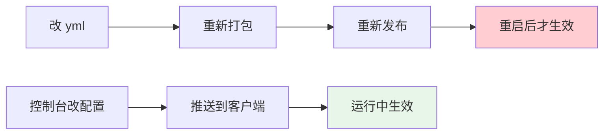
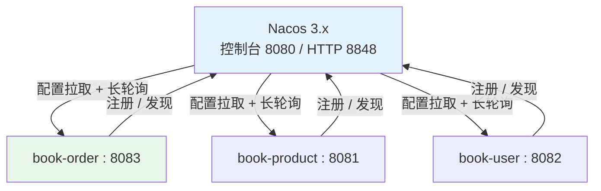
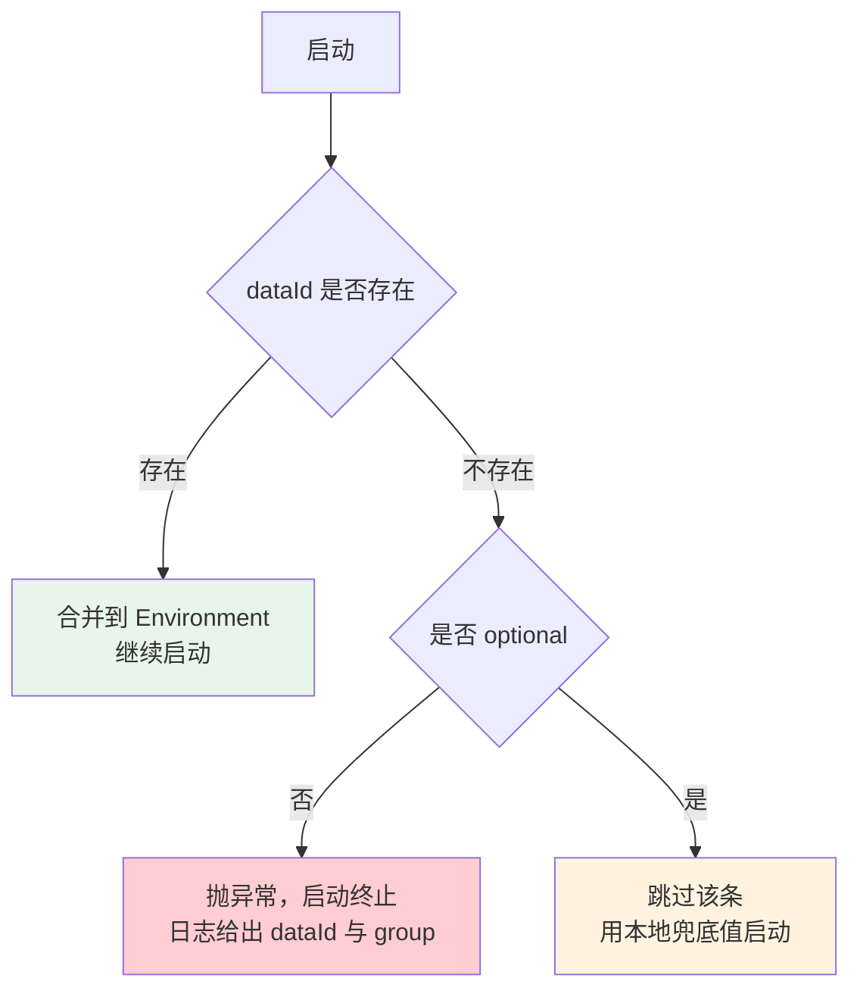
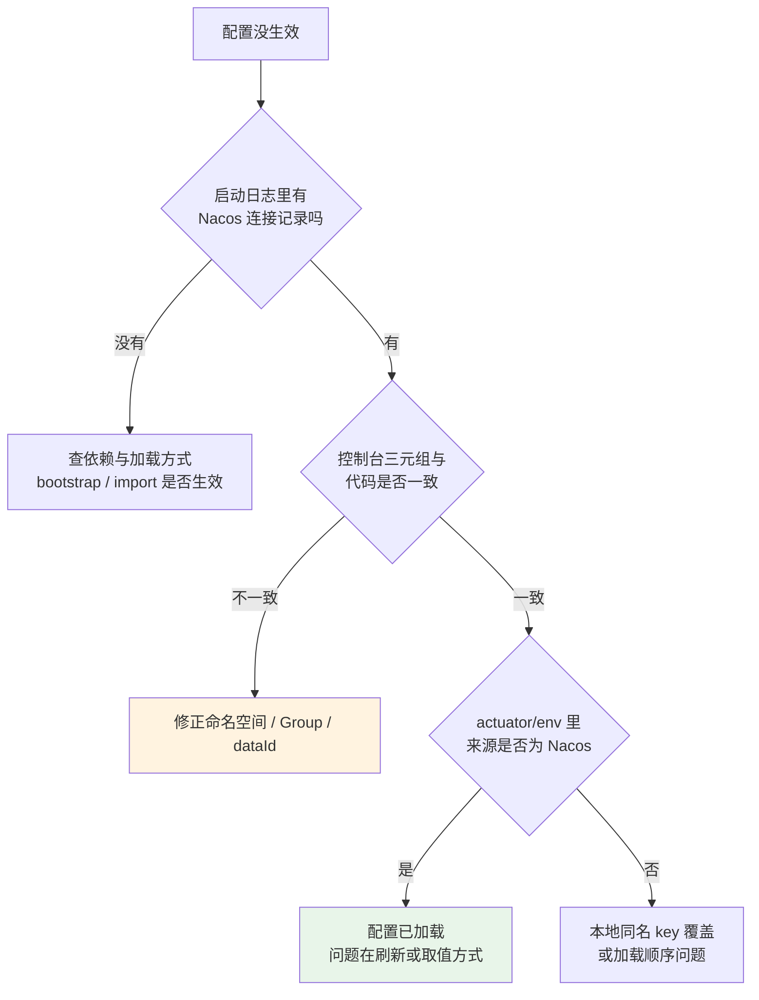

# Nacos Config配置中心快速上手

## 课程目标

- 理解本地配置文件在微服务架构下的六类痛点，能判断一个项目何时该引入配置中心
- 掌握 Nacos 配置模型的三层坐标：命名空间（Namespace）、分组（Group）、配置项（dataId）
- 掌握 dataId 的生成规则 `${prefix}-${spring.profiles.active}.${file-extension}` 以及 prefix 的默认取值
- 掌握两套接入写法：`bootstrap.yml` 旧写法与 `spring.config.import` 新写法，并能说明选型依据
- 掌握用 `@Value` 与 `@ConfigurationProperties` 两种方式读取 Nacos 配置，并验证配置真的生效
- 能够定位 dataId 拼错、分组与命名空间不匹配、缺少 bootstrap 依赖、配置未生效四类启动期故障

## 回顾与导入

上一课我们收口了远程调用的可靠性，用超时、重试、幂等把"调用失败"控制在可接受范围内。至此 `book-order` 能稳定调到 `book-product` 与 `book-user`，但被调地址、超时时间、重试次数依然写死在各服务的 `resources/application.yml` 里。

参数一膨胀，问题就暴露了。订单服务现在有支付超时、自动取消开关、单笔最大条目数、通知渠道、通知重试次数五组业务参数，加上数据源、日志级别、Feign 超时，一个 `application.yml` 接近三百行；三个服务、五套环境，就是十几份互相复制粘贴的文件。变更方式更麻烦：把日志级别从 `info` 调到 `debug` 要改文件、重新打包、走完发布流程，而排查线上问题时最宝贵的就是这十分钟。



本课把配置从代码仓库搬进 Nacos 配置中心（Nacos Config）。这是 Nacos 篇的收尾，也是后续网关、消息、熔断各课的共同基础——它们的规则、地址、阈值最终都要落在配置中心统一管理。

> **前置条件：** Nacos 3.x 单机版已启动，具备 `dev` 命名空间；`book-order` 已在 `dev` 注册成功；三个服务端口 8081、8082、8083 与《Nacos分级模型与Namespace环境隔离》保持一致。

## 为什么需要配置中心

### 本地配置文件的六类痛点

先不谈方案，先把痛点列清楚。如果下面六条里有三条以上命中你的项目，配置中心就不是"锦上添花"，而是必选项。

| 痛点 | 本地配置的表现 | 直接后果 | 配置中心怎么解 |
| --- | --- | --- | --- |
| 多环境难管 | 每个环境一份 yml，靠 profile 切换 | 打包时拿错环境文件，连到错误的库 | 环境做成命名空间，配置与服务彻底解耦 |
| 改配置要重启 | 修改 yml 必须重新打包发布 | 调一个日志级别也要走完整发布流程 | 配置独立推送，配合动态刷新无需重启 |
| 审计缺失 | 谁改的、改了什么、何时改，只有 git 提交记录 | 事故复盘定不了责，也无法回溯 | 每条配置有版本历史与操作记录，可对比 |
| 敏感信息外泄 | 数据库密码、第三方密钥明文写在仓库 | 仓库权限一放开等于密码公开 | 集中存储加鉴权，敏感项可加密 |
| 共享困难 | 三个服务各写一遍 Redis、日志、Feign 配置 | 改一处漏两处，长期不一致 | 共享配置一处修改，多个服务同时生效 |
| 回滚难 | 回滚只能回滚代码包 | 一个参数改错要回滚整个应用 | 配置有历史版本，单条记录即可回滚 |

其中"审计缺失"和"回滚难"最容易被低估。它们的代价不在平时，而在出事的那半小时——你需要在几十个实例上确认"现在跑的是哪一份配置"，而本地配置文件根本回答不了这个问题。

### 配置中心的职责边界

配置中心不是"什么都能往里放"，边界不清会引入新的问题。

| 适合放配置中心 | 不适合放配置中心 |
| --- | --- |
| 业务开关、阈值、超时、限流参数 | 端口、应用名等启动即定的参数 |
| 数据源地址与账号（配合加密） | 与实例绑定的机器信息（IP、机房） |
| 日志级别、线程池参数 | 超大文件（字典、证书链） |
| 三方 API 地址与密钥引用 | 需要在启动参数覆盖的值（优先级更高） |
| 需要多环境差异化的一切参数 | 代码里就该写死的常量 |

> **结论：** 配置中心管"运行时可变、需要集中治理"的参数。`server.port` 这种启动即定的值放进去，只会带来"改了不生效"的困惑——端口在配置拉取之前就已经绑定好了。

### 配置中心的定位



注意这张图里 Nacos 承担了两个角色：注册中心与配置中心。它们是同一套服务端上的两个独立模块，共用命名空间与鉴权体系，但配置项与实例数据完全分开管理。

## Nacos 配置模型

### 三层坐标

Nacos 用三个坐标唯一确定一条配置，缺一不可：命名空间、分组、dataId。两个 dataId 相同但命名空间不同的记录互不相干，这正是"同一份配置在不同环境取不同值"的实现方式：**环境差异靠命名空间表达，不靠文件名硬编码**。

| 坐标 | 取值示例 | 作用 | 能否省略 |
| --- | --- | --- | --- |
| Namespace | `dev`、`test`、`prod` | 环境级隔离，数据互不可见 | 可省略，默认 `public` |
| Group | `DEFAULT_GROUP`、`ORDER_GROUP` | 同环境内的业务域或版本分组 | 可省略，默认 `DEFAULT_GROUP` |
| dataId | `book-order-dev.yml` | 一条具体的配置项 | 不可省略 |

> **注意：** 命名空间要填 **ID** 而不是显示名。控制台里显示"开发环境"，但 ID 是 `dev`，配置里必须写 `dev`，写成中文名称会落到意料之外的空间。

### dataId 的完整生成规则

使用 `bootstrap.yml` 旧写法时，dataId 不需要手写，客户端按固定规则拼出来：

```text
${prefix}-${spring.profiles.active}.${file-extension}
```

三个占位符各有默认值，理解默认值是排查"读不到配置"的关键：

| 占位符 | 默认取值 | 由谁决定 | 说明 |
| --- | --- | --- | --- |
| `prefix` | `spring.application.name` | `spring.cloud.nacos.config.prefix` 可覆盖 | 一般等于服务名，如 `book-order` |
| `spring.profiles.active` | 空 | `spring.profiles.active` | 为空时中间的连字符一并去掉 |
| `file-extension` | `properties` | `spring.cloud.nacos.config.file-extension` | 常用 `yml`，必须与控制台后缀一致 |

举几个常见组合，对着这张表就能算出客户端到底在找哪条配置：

| 应用名 | `profiles.active` | `file-extension` | 实际 dataId |
| --- | --- | --- | --- |
| `book-order` | `dev` | `yml` | `book-order-dev.yml` |
| `book-order` | `dev` | `yaml` | `book-order-dev.yaml` |
| `book-order` | 空 | `yml` | `book-order.yml` |
| `book-order` | `dev` | `properties` | `book-order-dev.properties` |
| `book-order`（prefix 改为 `biz`） | `dev` | `yml` | `biz-dev.yml` |

> **提示：** 客户端只是按后缀字符串拼 dataId，`yaml` 与 `yml` 不会互相兼容。本课程统一用 `yml`，控制台"配置格式"选 YAML 即可，但 `file-extension` 必须是 `yml`；后缀不一致时客户端找的是一个不存在的 dataId，表现为"不报错，但值是空的"。

## 接入配置中心

### 依赖

配置中心客户端由 `spring-cloud-starter-alibaba-nacos-config` 提供，版本由课程统一的 BOM 管理，不需要写 version。

```xml
<dependencies>
    <dependency>
        <groupId>com.alibaba.cloud</groupId>
        <artifactId>spring-cloud-starter-alibaba-nacos-config</artifactId>
    </dependency>
</dependencies>
```

### 方式一：bootstrap.yml 旧写法

Spring Cloud 原本的约定是：先用一个"引导上下文"把远程配置拉下来，再启动主应用上下文。这个引导上下文由 `bootstrap.yml` 触发。但 Spring Boot 2.4 之后，引导上下文默认关闭，必须额外引入一个依赖才能恢复。

```xml
<dependency>
    <groupId>org.springframework.cloud</groupId>
    <artifactId>spring-cloud-starter-bootstrap</artifactId>
</dependency>
```

引入后，把配置中心的连接信息写在 `bootstrap.yml` 里：

```yaml
spring:
  application:
    name: book-order
  profiles:
    active: dev
  cloud:
    nacos:
      config:
        server-addr: 127.0.0.1:8848
        namespace: dev
        group: DEFAULT_GROUP
        file-extension: yml
        username: nacos
        password: nacos
```

这三个配置项的位置非常关键：`spring.application.name` 与 `spring.profiles.active` 决定 dataId，`spring.cloud.nacos.config.*` 决定去哪个服务端、哪个命名空间、哪个分组找。少一个，dataId 就拼错。

> **为什么 Boot 2.4 是分水岭：** 2.4 引入了全新的配置加载机制 `spring.config.import`，把"加载外部配置"变成了配置数据加载流程的一部分，不再依赖引导上下文。保留 bootstrap 只是为了让存量项目平滑迁移。

### 方式二：spring.config.import 新写法

新写法不再需要引导上下文，直接把要加载的 dataId 写在 `application.yml` 的导入列表里：

```yaml
server:
  port: 8083

spring:
  application:
    name: book-order
  profiles:
    active: dev
  config:
    import:
      - nacos:book-order-dev.yml?group=DEFAULT_GROUP&refreshEnabled=true
  cloud:
    nacos:
      config:
        server-addr: 127.0.0.1:8848
        namespace: dev
        username: nacos
        password: nacos
        file-extension: yml
```

`nacos:` 后面的部分就是 dataId，问号后是参数：`group` 指定分组，`refreshEnabled` 指定该条配置是否支持动态刷新。与旧写法相比，有两点必须记住：

- **dataId 不再自动推导**。你写了哪几条就加载哪几条，不写就不加载。好处是显式、可控，代价是漏写就漏配置。
- **连接参数必须写在本地文件里**。`server-addr`、`namespace`、`username` 这些值决定了"去哪里拉配置"，它们不可能来自配置中心自身，只能来自本地文件、环境变量或启动参数。

> **注意：** 同一份 `application.yml` 里不要同时出现 `spring.config.import: nacos:` 与 `spring-cloud-starter-bootstrap` 的 bootstrap 配置。两条链路会各拉一遍，同一个 dataId 被加载两次，优先级变得难以推理，排查时几乎无法定位。

### 新旧写法对照与选型

| 维度 | `bootstrap.yml` 旧写法 | `spring.config.import` 新写法 |
| --- | --- | --- |
| 生效前提 | 必须引入 `spring-cloud-starter-bootstrap` | 无额外依赖 |
| dataId 来源 | 按 `${prefix}-${profile}.${ext}` 自动推导 | 显式列出每一条 |
| 共享配置 | `shared-configs`、`extension-configs` 数组 | 多个 import 条目按顺序排列 |
| profile 联动 | 自动拼接，切 profile 即切 dataId | 需自己拼，或用 `${spring.profiles.active}` 占位 |
| 加载时机 | 引导上下文，早于主上下文 | 配置数据加载阶段，与主配置同流程 |
| 官方态度 | 兼容保留 | 推荐 |
| 迁移成本 | 低，存量项目就地可用 | 中，需要重写配置入口 |

选型结论：

1. **新项目一律用 `spring.config.import`**，配置入口集中在一个文件，看得到加载了什么。
2. 存量项目继续用 `bootstrap.yml`，不必为了"新"去改动本来能跑的加载链路。
3. 两者不混用。混用带来的优先级问题，比它省下的迁移工作量昂贵得多。

## 实战：把 book-order 的配置搬进 Nacos

### 步骤一：控制台新建配置

登录 Nacos 控制台（3.x 是 `http://localhost:8080/index.html`），切到 `dev` 命名空间，进入"配置管理 → 配置列表"，点击"新建配置"：

| 字段 | 填写内容 | 说明 |
| --- | --- | --- |
| Data ID | `book-order-dev.yml` | 与后续 import 完全一致 |
| Group | `DEFAULT_GROUP` | 与 yml 里的 `group` 一致 |
| 配置格式 | YAML | 与 `file-extension: yml` 一致 |
| 配置内容 | 见下方片段 | 业务参数与环境差异参数 |

配置内容把订单服务的业务参数与数据源搬上去：

```yaml
book:
  order:
    pay-timeout-minutes: 30
    auto-cancel-enabled: true
    max-items-per-order: 20
    notice:
      channels: sms,email
      retry-times: 3

logging:
  level:
    com.example.order: info

spring:
  datasource:
    url: jdbc:postgresql://127.0.0.1:5432/book_order_db
    username: book_order
    password: book_order_2026
```

> **注意：** 不要把 `server.port` 放进配置中心。端口在配置拉取之前就已经绑定，改它必然"不生效"，只会误导排查。

### 步骤二：改造本地配置

`application.yml` 只留启动必需的项，其余交给配置中心：

```yaml
server:
  port: 8083

spring:
  application:
    name: book-order
  profiles:
    active: dev
  config:
    import:
      - nacos:book-order-dev.yml?group=DEFAULT_GROUP&refreshEnabled=true
  cloud:
    nacos:
      config:
        server-addr: 127.0.0.1:8848
        namespace: dev
        username: nacos
        password: nacos
        file-extension: yml
      discovery:
        server-addr: 127.0.0.1:8848
        namespace: dev
```

本地文件变短的意义不只是"看起来干净"：它把"这个服务在不同环境里到底差在哪"变成了控制台上两次对比就能回答的问题。

### 步骤三：用 @Value 读取

`@Value` 是最轻的读取方式，适合零散的一两个值。

```java
@Slf4j
@RestController
@RequestMapping("/api/config")
public class ConfigProbeController {

    @Value("${book.order.pay-timeout-minutes}")
    private int payTimeoutMinutes;

    @Value("${book.order.auto-cancel-enabled:false}")
    private boolean autoCancelEnabled;

    @Value("${book.order.notice.channels}")
    private String noticeChannels;

    @GetMapping("/probe")
    public Result<Map<String, Object>> probe() {
        Map<String, Object> data = new LinkedHashMap<>();
        data.put("payTimeoutMinutes", payTimeoutMinutes);
        data.put("autoCancelEnabled", autoCancelEnabled);
        data.put("noticeChannels", List.of(noticeChannels.split(",")));
        log.info("配置探测结果：{}", data);
        return Result.success(data);
    }
}
```

三个要点：占位符里的 key 必须与配置中心完全一致（区分大小写）；`:` 后面是默认值，配置缺失时用默认值兜底；`@Value` **不支持宽松绑定**，`pay-timeout-minutes` 不能写成 `payTimeoutMinutes`。值缺失且没有默认值时，启动会直接失败在占位符解析阶段。

### 步骤四：用 @ConfigurationProperties 读取

参数一多，`@Value` 就失控了：十几个字段、没有分组、没有类型校验。此时改用 `@ConfigurationProperties`，把一组配置绑定成一个对象。

```java
@Data
@Component
@Validated
@ConfigurationProperties(prefix = "book.order")
public class OrderProperties {

    @Min(1)
    private int payTimeoutMinutes = 30;

    private boolean autoCancelEnabled = true;

    @Max(100)
    private int maxItemsPerOrder = 20;

    private Notice notice = new Notice();

    @Data
    public static class Notice {
        private List<String> channels = List.of("sms");
        private int retryTimes = 3;
    }
}
```

这里体现了 `@ConfigurationProperties` 相对 `@Value` 的三个优势：

- **宽松绑定**：`pay-timeout-minutes`、`payTimeoutMinutes`、`PAY_TIMEOUT_MINUTES` 都能绑到 `payTimeoutMinutes` 字段，命名风格不必迁就代码。
- **结构化**：`book.order.notice.*` 自动收敛成嵌套对象 `Notice`，一组参数一个类型。
- **可校验**：配合 `@Validated` 与 `jakarta.validation` 注解，非法值在启动期就暴露，而不是等到业务执行到那行代码才炸。

把对象注入控制器，接口返回结果与 `@Value` 版本一致：

```java
@Slf4j
@RestController
@RequestMapping("/api/config")
@RequiredArgsConstructor
public class OrderPropertiesController {

    private final OrderProperties orderProperties;

    @GetMapping("/properties")
    public Result<OrderProperties> properties() {
        log.info("读取订单配置：{}", orderProperties);
        return Result.success(orderProperties);
    }
}
```

### 步骤五：验证配置真的生效

配置中心最常见的失败不是"报错"，而是"没报错但值是旧的"。所以验证必须从三个层面做，缺一层就可能漏判。

| 验证层面 | 操作 | 期望结果 |
| --- | --- | --- |
| 启动日志 | 启动时搜索 `nacos` 与 dataId 关键字 | 能看到配置加载记录与 dataId |
| 生效值 | `GET /api/config/probe` | 返回 `payTimeoutMinutes: 30` 等 Nacos 中的值 |
| 来源确认 | `GET /actuator/env` 搜索 `book.order` | 属性来源标注为 Nacos 的 dataId |

```bash
curl.exe -s http://127.0.0.1:8083/api/config/probe
curl.exe -s http://127.0.0.1:8083/api/config/properties
```

```json
{"code":200,"message":"success","data":{"payTimeoutMinutes":30,"autoCancelEnabled":true,"noticeChannels":["sms","email"]}}
```

如果接口返回 200 但字段全是默认值，说明配置**没被加载**，而不是"加载了但值不对"。这两种情况的排查方向完全不同，先分层再动手。

## fail-fast 与可选导入

### 两种导入语义

生产环境与本地开发对"配置缺失"的容忍度完全不同，`optional:` 前缀就是为这种差异准备的。

| 写法 | 配置缺失时的行为 | 适用场景 |
| --- | --- | --- |
| `nacos:book-order-dev.yml?...` | 启动直接失败并终止 | 生产、预发，配置是硬依赖 |
| `optional:nacos:book-order-dev.yml?...` | 跳过该条，用本地值或其他来源兜底 | 本地开发、灰度环境尚未建配置 |

### fail-fast 才是生产默认

把配置当硬依赖，是配置中心能否真正生效的前提。启动即失败的价值在于：问题出现在发布阶段（还有回滚窗口），而不是运行阶段（用户已经在用）。

```yaml
spring:
  config:
    import:
      - nacos:book-order-dev.yml?group=DEFAULT_GROUP&refreshEnabled=true
```



> **结论：** `optional:` 是开发期的便利，不是生产期的宽容。生产环境用非 optional，让"配置没建好"在发布环节就暴露。

> **提示：** `spring.cloud.nacos.config.import-check.enabled` 可以关掉"必须配置 `spring.config.import`"的启动检查，但关掉的是检查不是问题本身——应用能启动，一条远程配置也不会加载。

## 常见问题排查

### 四类高频故障

| 现象 | 最可能的原因 | 排查动作 |
| --- | --- | --- |
| 启动报占位符无法解析 | dataId 拼错，配置根本没加载 | 核对 `${prefix}-${profile}.${ext}` 三段是否与控制台一致 |
| 启动正常但值全为默认 | 分组或命名空间不匹配 | 控制台确认三元组：命名空间 ID、groupId、dataId |
| 完全没有去 Nacos 拉配置 | 未引入 bootstrap 依赖却用了 `bootstrap.yml` | 检查依赖树里是否有 `spring-cloud-starter-bootstrap` |
| 配置拉到了但业务没变 | 读到的是本地同名 key，或 Bean 未刷新 | `/actuator/env` 看来源；详见《配置动态刷新与灰度发布》 |

### 为什么"未引入 bootstrap"最难查

它不报错。`bootstrap.yml` 在缺少 `spring-cloud-starter-bootstrap` 时只是一个普通文件，Spring Boot 甚至会忽略它——应用照常启动，配置中心照常连不上，日志里安静得像什么都没发生。

```bash
# 确认引导上下文是否生效
mvn -q dependency:tree -Dincludes=org.springframework.cloud:spring-cloud-starter-bootstrap

# 用启动日志反查实际生效的配置来源
curl.exe -s http://127.0.0.1:8083/actuator/env | findstr /i "nacos"
```

如果依赖树里没有 `spring-cloud-starter-bootstrap`，那 `bootstrap.yml` 里的一切配置（包括 dataId 的三段要素）全部无效。

### 固定排查顺序



顺序不能颠倒：先确认"有没有连上"，再确认"找的是哪条"，最后确认"值有没有进 Environment"。跳过前两步直接改代码，是最常见的无效排查。

## 注意事项

1. **命名空间填 ID 不填名称**：控制台显示"开发环境"，配置里必须写 `dev`，写中文名会静默落到错误空间。
2. **`yaml` 与 `yml` 不能混用**：控制台格式、`file-extension`、import 的 dataId 后缀三者必须完全一致，这是"配了却不生效"的头号原因。
3. **配置中心的配置不是"覆盖"本地文件，而是"合并"**：本地 `application.yml` 里保留的同名 key 依然有效，且优先级取决于加载顺序，容易造成"改 Nacos 没用"的假象。
4. **`server.port`、`spring.application.name` 不要放配置中心**：它们在配置加载前就已被使用，放进去只会制造误解。
5. **生产环境用非 optional 导入**：让配置缺失在启动期失败，而不是在业务执行期返回空值。
6. **鉴权开启后必须配账号**：Nacos 3.x 默认开启鉴权，客户端未配置 `username`、`password` 时拉取配置会返回 401 或 403，详见《Nacos部署与快速上手》。
7. **敏感信息即使进了配置中心也仍是明文**：配置中心解决的是"集中管理"，不是"加密存储"，加密方案见《配置中心安全与治理实践》。
8. **配置中心不可用时应用行为要明确**：本地缓存能让重启后短时兜底，但无法应对首次启动，关键配置应在本地保留一份可用的降级值。

## 小结

本节课我们学习了：

1. **六类痛点**：多环境、改配置要重启、审计缺失、敏感信息外泄、共享困难、回滚难，是引入配置中心的真实动因。
2. **三层坐标**：命名空间切环境、Group 切业务域、dataId 定位单条配置，三者共同唯一确定一条记录。
3. **dataId 生成规则**：`${prefix}-${spring.profiles.active}.${file-extension}`，prefix 默认取应用名，profile 为空时连字符一并去掉。
4. **两套接入写法**：`bootstrap.yml` 需引入 `spring-cloud-starter-bootstrap`，`spring.config.import` 无需额外依赖且显式列出 dataId；新项目选后者，两者不混用。
5. **两种读取方式**：`@Value` 适合零散值且不支持宽松绑定，`@ConfigurationProperties` 支持结构化、宽松绑定与校验，参数成组时优先选它。
6. **fail-fast 与 optional**：生产用非 optional 让配置缺失在启动期暴露，`optional:` 只用于开发期便利。
7. **四类高频故障**：dataId 拼错、分组与命名空间不匹配、缺少 bootstrap 依赖、值被本地覆盖，按"连接 → 定位 → 来源"三步固定顺序排查。

## 作业

### 作业一：完成 book-order 的配置迁移

1. 在 `dev` 命名空间新建 `book-order-dev.yml`，写入业务参数、日志级别与数据源三段内容。
2. 用 `spring.config.import` 方式接入，把本地 `application.yml` 精简到只剩端口、应用名与连接参数。
3. 用 `/api/config/probe` 与 `/api/config/properties` 两个接口验证，并用 `/actuator/env` 确认这些值的来源是 Nacos。

### 作业二：制造并修复三类故障

1. 把 dataId 故意写成 `book-order-dev.yaml`（控制台仍用 YAML 格式，`file-extension` 仍是 `yml`），记录启动日志里的关键信息，说明为什么不报错。
2. 把 `namespace` 改成 `test` 后启动，观察配置取值变化，再改回 `dev`。
3. 删掉 `spring-cloud-starter-bootstrap` 依赖，并把加载方式临时改成 `bootstrap.yml`，记录启动日志与 `/actuator/env` 的差异，写出你认为最快的三种判断方法。
