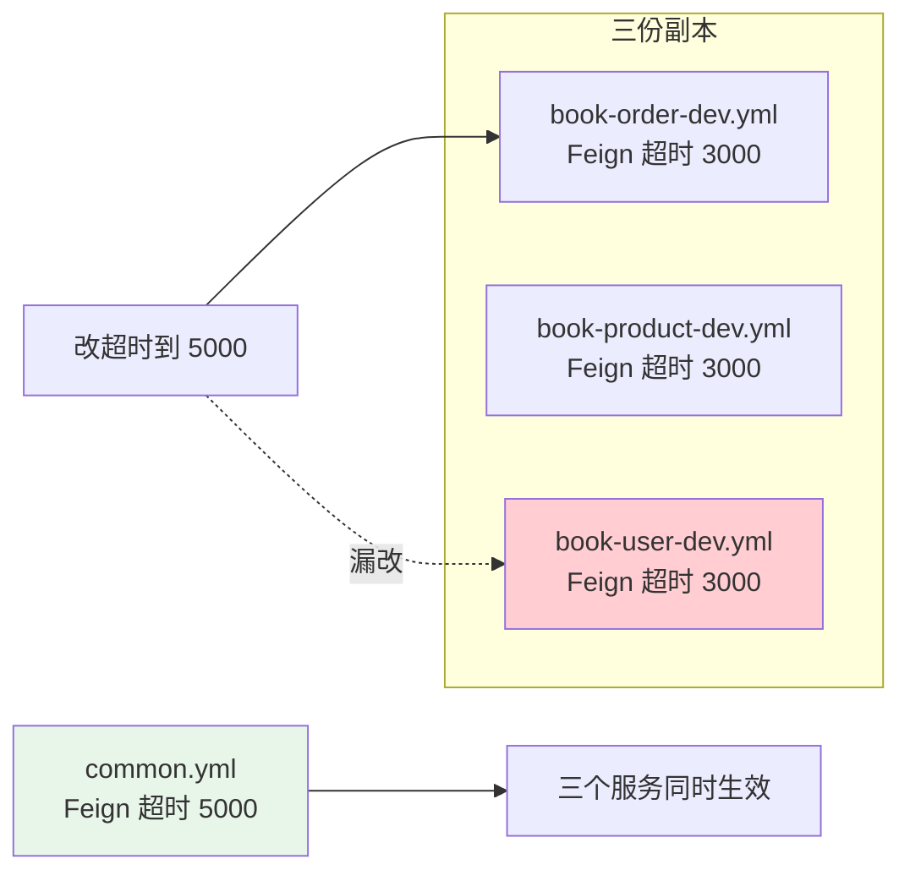
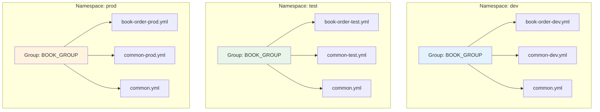
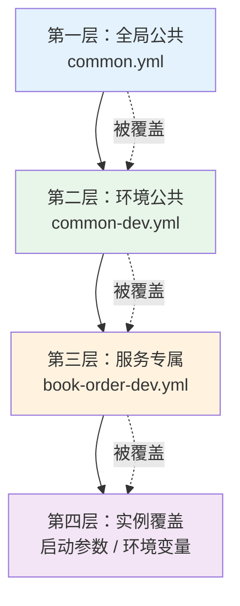

# 配置隔离、共享与多环境管理

## 课程目标

- 理解命名空间、Group、dataId 三个维度的隔离能力，能给出"环境 + 业务域 + 服务"的推荐组合
- 掌握 `shared-configs` 与 `extension-configs` 的语义差异、适用条件与 `refresh` 行为
- 掌握配置分层设计：全局公共、环境公共、服务专属、实例覆盖四层各自的边界
- 掌握配置优先级的完整算法：Spring Boot 配置源顺序叠加 Nacos 导入顺序，明确"后导入覆盖先导入"
- 完成 `common.yml` 与 `book-order-dev.yml` 的组合实战，并用 `/actuator/env` 验证覆盖关系
- 能够识别共享配置被误改、profile 命名不规范、灰度环境复用命名空间三类高风险操作

## 回顾与导入

上一课我们把 `book-order` 的配置搬进了 Nacos，本地 `application.yml` 只剩下端口、应用名与连接参数。单个服务看起来清爽了，但把另外两个服务也搬上去之后，新的问题冒出来了：

- `spring.jackson.date-format`、`logging.pattern.console`、`openfeign` 的超时，三个服务的配置内容一模一样，各抄了一份。
- 某天要把 Feign 读超时从 3 秒调到 5 秒，改了两个服务，漏了 `book-user`，线上表现是"只有用户服务偶发超时"。
- 五个环境各有一套配置，`dev` 和 `test` 的公共部分有 80% 重复，改一处要同步五遍。

这就是配置中心用深之后的典型状态：**配置有了统一存放的地方，但没有统一组织的规则**。三份副本就是三个真相，谁也说不清哪份才是"当前正确的"。



本课要解决两件事：**怎么把配置分层组织起来**（隔离维度的选择与共享配置的抽取），以及**多层配置冲突时谁说了算**（优先级算法）。这两件事定了，后面动态刷新与灰度才有稳定的地基。

> **前置条件：** 三个服务都已接入 `spring.config.import` 方式读取 Nacos 配置；`dev` 命名空间下已有 `book-order-dev.yml`。

## 隔离的三个维度

### 三维坐标的隔离能力

同一份"环境 + 业务域 + 服务"的差异，可以用三个维度中的任意一个表达，也可以叠加。区别在于隔离强度与运维成本。

| 维度 | 隔离对象 | 隔离强度 | 跨维共享 | 变更成本 | 典型用途 |
| --- | --- | --- | --- | --- | --- |
| Namespace | 整套服务与配置 | 最强，数据互不可见 | 不可跨空间共享 | 需要创建空间、授权 | 环境、租户 |
| Group | 同空间内的同名 dataId | 中，同组内可见 | 同空间不同组不可见 | 改一行配置并重启 | 业务域、版本并行 |
| dataId 前缀 | 单个服务的配置 | 弱，只是命名约定 | 任意组合均可 | 无需重启，改文件名即可 | 服务专属 |

三者的关系是"越靠前越粗、越靠后越细"：命名空间切一刀，整片数据分家；Group 再切一刀，同名配置可以并存多份；dataId 前缀区分到单个服务内部。

### 推荐组合

把三个维度各自绑定一个固定语义，团队就不必每次讨论"这个差异放哪"：



| 维度 | 绑定语义 | 示例 | 理由 |
| --- | --- | --- | --- |
| Namespace | 环境 | `dev`、`test`、`prod` | 环境之间必须完全不可见，只有命名空间能做到 |
| Group | 业务域 | `BOOK_GROUP`、`POINTS_GROUP` | 同名服务在不同业务线下需要各自的配置版本 |
| dataId 前缀 | 服务 | `book-order`、`book-product` | 与 `spring.application.name` 天然对齐，无需额外约定 |

> **提示：** 本课实战为与上一课衔接，配置仍放在 `DEFAULT_GROUP`；只有多业务线共用一个 Nacos 时，才需要按业务域拆 Group。注册用的 `discovery.group` 与配置用的 `config.group` 是两个独立参数，详见《Nacos Group分组与多环境切换》。

三种常见组织方案的取舍：

| 方案 | 隔离强度 | 优点 | 缺点 | 适用场景 |
| --- | --- | --- | --- | --- |
| 只用 profile 前缀（`book-order-dev.yml` 放同一空间） | 弱 | 零运维成本，接入最快 | 一次误操作可能改到别的环境；权限无法按环境收口 | 单人本地开发、临时验证 |
| 只用 Group 分环境（`DEV_GROUP`、`PROD_GROUP`） | 中 | 不用建命名空间 | 隔离弱于命名空间，权限粒度粗 | 老项目过渡，改动量最小的折中 |
| 命名空间 + Group + 前缀 | 强 | 环境彻底隔离，配置可分层共享 | 初次规划成本高 | 生产系统，多环境多业务线 |

> **结论：** 环境一律用命名空间表达；业务域按需用 Group；服务名交给 dataId 前缀。**不要用 dataId 后缀当环境标记**，那是把隔离降级成命名约定。

### 反模式清单

| 反模式 | 现象 | 后果 | 正确做法 |
| --- | --- | --- | --- |
| 用 dataId 表达环境 | `book-order-dev.yml` 与 `book-order-prod.yml` 同在 `public` 空间 | 一个前缀写错就连到生产库；权限无法按环境隔离 | 环境进命名空间，dataId 只留服务名与 profile |
| 用 Group 做环境隔离 | 在 `public` 空间里建 `DEV_GROUP`、`PROD_GROUP` | 隔离强度不足，误配置风险仍在 | 环境用命名空间，Group 只切业务域 |
| 所有业务共用 `DEFAULT_GROUP` 且服务重名 | 两个 `book-order` 抢同名 dataId | 后建覆盖先建，配置互相污染 | 多业务线时用 Group 隔离，或服务名前缀带上业务域 |
| 实例级参数写进服务专属配置 | 把单机的 `server.port`、机器 IP 写进 `book-order-dev.yml` | 多实例启动互相覆盖，改一台影响全部 | 实例级参数走启动参数或环境变量 |
| 一个 dataId 塞进所有环境差异 | 用 `spring.profiles.active` 在单文件里堆 `---` 分段 | 谁能读到哪段变得难以推理 | 环境拆命名空间，文件只放本环境的值 |

## 共享配置

### 为什么要共享

先算一笔账，把重复的配置项列出来，共享的价值立刻清楚：

| 配置项 | 出现在几个服务 | 每处修改的成本 |
| --- | --- | --- |
| `spring.jackson.*` 序列化规则 | 3 | 改 3 次，漏 1 次就出现格式不一致 |
| `logging.pattern.console` | 3 | 日志格式不统一，采集侧要多写规则 |
| `openfeign.client.config.default.*` | 3 | 超时口径不一致，故障表现五花八门 |
| `management.endpoints.*` | 3 | 有的服务能看指标，有的看不到 |
| 数据源公共参数（连接池大小等） | 3 | 池大小不一致，压测结论不可比 |

这些配置的共同点是：**与业务无关、所有服务都该一样**。它们最适合抽成一份共享配置。

### shared-configs

`shared-configs` 是"全应用共享"的语义，适合放框架级、与业务无关的配置。旧写法（`bootstrap.yml`）如下：

```yaml
spring:
  cloud:
    nacos:
      config:
        server-addr: 127.0.0.1:8848
        namespace: dev
        file-extension: yml
        shared-configs:
          - data-id: common.yml
            group: DEFAULT_GROUP
            refresh: true
```

### extension-configs

`extension-configs` 是"业务扩展"的语义，适合放某一组服务共用、但并非全局的配置，例如订单域与商品域共用的"图书业务字典"：

```yaml
spring:
  cloud:
    nacos:
      config:
        extension-configs:
          - data-id: book-common.yml
            group: DEFAULT_GROUP
            refresh: true
          - data-id: book-order-ext.yml
            group: DEFAULT_GROUP
            refresh: true
```

### 两者的本质区别

两者在加载机制上完全一致，区别在**语义定位与优先级**。这不是文档层面的约定，而是排序结果不同。

| 维度 | `shared-configs` | `extension-configs` |
| --- | --- | --- |
| 语义定位 | 全应用共享，与业务无关 | 业务扩展，一组服务共用 |
| 优先级 | 最低，先被覆盖 | 高于 shared，低于服务自身配置 |
| 数组顺序 | 下标越大优先级越高 | 下标越大优先级越高 |
| 典型内容 | Jackson、日志、Actuator、Feign 默认值 | 业务字典、领域公共参数 |
| `refresh` 默认值 | `false`，需显式开启 | `false`，需显式开启 |
| 数量建议 | 1 到 2 个，越少越好 | 按业务域控制，一般不超过 3 个 |
| 误改影响面 | 全空间所有服务 | 使用该扩展配置的一组服务 |

> **注意：** `refresh` 的默认值是 `false`，意味着共享配置改了之后不会自动刷新。这是"共享配置改了没生效"的首要原因，排查时先看这一项。不同小版本对默认值的处理存在差异，显式写 `refresh: true` 最稳妥。

### refresh 行为

`refresh` 决定这条配置变更后是否触发客户端刷新，与"能不能读到"是两件事：

| 场景 | `refresh` 设置 | 结果 |
| --- | --- | --- |
| 共享配置改了，服务没变化 | `false`（默认） | 只有重启后生效 |
| 共享配置改了，服务没变化 | `true` | 推送后进入刷新流程，Bean 是否更新取决于作用域 |
| 单条配置只想重启生效 | `false` | 有意为之，适合改动风险高的项 |
| 全局关闭刷新 | `spring.cloud.nacos.config.refresh-enabled: false` | 所有配置都只重启生效 |

### 新写法里的等价表达

用 `spring.config.import` 时没有 `shared-configs` 这个概念，共享配置就是 import 列表里更靠前的一条：

```yaml
spring:
  config:
    import:
      - nacos:common.yml?group=DEFAULT_GROUP&refreshEnabled=true
      - nacos:book-order-dev.yml?group=DEFAULT_GROUP&refreshEnabled=true
```

顺序即优先级：`common.yml` 写在前面，`book-order-dev.yml` 写在后面，后者覆盖前者。这与 `shared-configs` 优先级低于服务自身配置的效果一致，只是把"谁低谁高"从隐式规则变成了显式的书写顺序。

## 配置分层设计

### 四层模型

把配置按"变更频率"和"影响面"分层，是控制风险最有效的手段：



| 层级 | 承载文件 | 内容示例 | 变更频率 | 维护者 |
| --- | --- | --- | --- | --- |
| 全局公共 | `common.yml` | Jackson、日志格式、Actuator、Feign 默认超时 | 极低 | 架构组 |
| 环境公共 | `common-dev.yml` | 环境标识、注册中心地址、公共中间件地址 | 低 | 运维 |
| 服务专属 | `book-order-dev.yml` | 业务参数、数据源、服务级日志级别 | 中 | 服务负责人 |
| 实例覆盖 | 启动参数、环境变量 | 单实例端口、临时调试开关 | 高 | 值班人员 |

### 各层的边界规则

- **全局公共只放"所有服务都该一样"的项**。任何一个服务需要不同的值，就说明它不该在这层，应下沉到服务专属层。
- **环境公共只放"同环境所有服务一致"的项**。它随环境变化，但与环境无关的服务差异不能放进来。
- **服务专属放业务语义**。别人看不懂的 key，只应该出现在这里。
- **实例覆盖只放临时、单机、可丢弃的值**。它不进配置中心，也就不受审计与回滚保护，用完必须清理。

> **提示：** 判断一个配置该放哪层，问一句"改它会影响几个服务"。影响全部选第一层，影响一个环境选第二层，影响一个服务选第三层，影响一台机器选第四层。

### 命名清单

规划清楚之后，一个环境的配置结构大概是这样：

| dataId | 层级 | 命名空间 | Group | 说明 |
| --- | --- | --- | --- | --- |
| `common.yml` | 全局公共 | 每空间一份 | `DEFAULT_GROUP` | 内容在各空间保持一致 |
| `common-dev.yml` | 环境公共 | `dev` | `DEFAULT_GROUP` | 只放 dev 的环境差异 |
| `book-order-dev.yml` | 服务专属 | `dev` | `DEFAULT_GROUP` | 订单业务参数与数据源 |
| `book-product-dev.yml` | 服务专属 | `dev` | `DEFAULT_GROUP` | 商品业务参数与数据源 |
| 启动参数 | 实例覆盖 | - | - | 不进配置中心 |

## 配置优先级

### 第一层：Spring Boot 配置源顺序

配置冲突时，先看 Spring Boot 自身的配置源顺序。这个顺序与 Nacos 无关，是所有外部化配置的底层规则（从高到低）：

| 优先级 | 配置源 | 说明 |
| --- | --- | --- |
| 1 | 命令行参数 | `--book.order.pay-timeout-minutes=5`，临时验证的首选 |
| 2 | Java 系统属性 | `-Dbook.order.pay-timeout-minutes=5` |
| 3 | 操作系统环境变量 | 容器部署的标准做法 |
| 4 | 通过 `spring.config.import` 导入的配置 | 含 Nacos 各条 dataId，按导入顺序排 |
| 5 | jar 外 `application-{profile}.yml` | 部署目录下的覆盖文件 |
| 6 | jar 外 `application.yml` | 同上 |
| 7 | jar 内 `application-{profile}.yml` | 打包进应用的 profile 文件 |
| 8 | jar 内 `application.yml` | 打包进应用的主配置 |
| 9 | `@PropertySource` 与默认值 | 代码内声明，优先级最低 |

> **注意：** 第 4 行是配置中心接入后最容易被忽略的一行。它意味着 Nacos 里的值会覆盖 jar 内 `application.yml` 的同名 key，但**不会**覆盖命令行参数与环境变量。排查"改了 Nacos 不生效"时，先确认没有被前三行压住。

### 第二层：Nacos 内的导入顺序

进入 Nacos 内部，多条 dataId 之间的覆盖规则只有一条：**后导入的覆盖先导入的**。

| 写法 | 顺序规则 | 谁赢 |
| --- | --- | --- |
| `spring.config.import` 多条 | 列表从上到下依次导入 | 列表越靠后优先级越高 |
| `shared-configs` 数组 | 下标 `[0]`、`[1]` 依次导入 | 下标越大优先级越高 |
| `extension-configs` 数组 | 同上 | 下标越大优先级越高 |
| `shared-configs` 与 `extension-configs` 并存 | shared 先于 extension 加载 | extension 赢 |
| 共享配置与服务自身 dataId | 共享配置先加载 | 服务自身的 dataId 赢 |

这条规则与直觉一致：越具体、越靠后的配置，越应该赢。所以书写顺序本身就是设计的一部分，不要随手排列。

### 合成后的完整优先级

把两层叠起来，得到一张可以直接贴在工位上的表（从高到低）：

| 序号 | 配置来源 | 典型场景 |
| --- | --- | --- |
| 1 | 命令行参数 | 值班时临时调参 |
| 2 | 系统属性 `-D` | 容器外的定制启动 |
| 3 | 环境变量 | Kubernetes 注入 |
| 4 | Nacos 中后导入的服务专属配置 | `book-order-dev.yml` |
| 5 | Nacos 中先导入的共享配置 | `common.yml` |
| 6 | jar 外 `application-{profile}.yml` | 部署目录覆盖 |
| 7 | jar 内 `application-{profile}.yml` | 本地 profile |
| 8 | jar 内 `application.yml` | 本地主配置 |
| 9 | 代码默认值 | `OrderProperties` 字段初始值 |

### 验证优先级而不是猜

任何关于优先级的结论都必须验证。最直接的入口是 `/actuator/env` 的精确查询，它会给出每个属性的最终值与来源：

```bash
curl.exe -s "http://127.0.0.1:8083/actuator/env/spring.cloud.openfeign.client.config.default.read-timeout"
```

```json
{
  "property": {"source": "nacos:book-order-dev.yml", "value": "5000"},
  "activeProfiles": ["dev"],
  "propertySources": [
    {"name": "nacos:book-order-dev.yml", "property": {"value": "5000"}},
    {"name": "nacos:common.yml", "property": {"value": "3000"}}
  ]
}
```

`propertySources` 数组本身就是优先级顺序：排在前面的赢。看到目标属性落在哪个源里，优先级问题就不需要推理了。

## 实战：common.yml 与 book-order-dev.yml 组合

### 目标

把三个服务的公共项抽到 `common.yml`，订单服务的业务项留在 `book-order-dev.yml`，并让服务专属配置覆盖共享配置中的同名项。

| 配置项 | common.yml | book-order-dev.yml | 期望结果 |
| --- | --- | --- | --- |
| `spring.jackson.date-format` | `yyyy-MM-dd HH:mm:ss` | 无 | 来自 common |
| `spring.cloud.openfeign.client.config.default.read-timeout` | `3000` | `5000` | 来自 book-order（覆盖） |
| `logging.level.root` | `info` | 无 | 来自 common |
| `logging.level.com.example.order` | 无 | `debug` | 来自 book-order |
| `book.order.pay-timeout-minutes` | 无 | `30` | 来自 book-order |

### 第一步：新建 common.yml

在 `dev` 空间、`DEFAULT_GROUP` 下新建 `common.yml`，格式选 YAML：

```yaml
spring:
  jackson:
    date-format: yyyy-MM-dd HH:mm:ss
    time-zone: GMT+8
    default-property-inclusion: non_null
  cloud:
    openfeign:
      client:
        config:
          default:
            connect-timeout: 2000
            read-timeout: 3000

management:
  endpoints:
    web:
      exposure:
        include: health,info,env,refresh
  endpoint:
    health:
      show-details: always

logging:
  pattern:
    console: "%d{HH:mm:ss.SSS} [%thread] %-5level [%X{traceId:-}] %logger{36} - %msg%n"
  level:
    root: info
```

这份内容与业务无关，三个服务、五个环境都该一样，属于典型的第一层配置。

### 第二步：调整 book-order 的加载顺序

`application.yml` 中把 `common.yml` 放在前面，服务专属配置放在后面：

```yaml
server:
  port: 8083

spring:
  application:
    name: book-order
  profiles:
    active: dev
  config:
    import:
      - nacos:common.yml?group=DEFAULT_GROUP&refreshEnabled=true
      - nacos:book-order-dev.yml?group=DEFAULT_GROUP&refreshEnabled=true
  cloud:
    nacos:
      config:
        server-addr: 127.0.0.1:8848
        namespace: dev
        username: nacos
        password: nacos
        file-extension: yml
      discovery:
        server-addr: 127.0.0.1:8848
        namespace: dev
```

`book-order-dev.yml` 只补充业务项，并显式覆盖需要不同的那一项：

```yaml
book:
  order:
    pay-timeout-minutes: 30
    auto-cancel-enabled: true
    max-items-per-order: 20

logging:
  level:
    com.example.order: debug

spring:
  cloud:
    openfeign:
      client:
        config:
          default:
            read-timeout: 5000
```

### 第三步：加一个配置溯源接口

把关键项的最终值输出出来，用于一次性核对分层结果：

```java
@Slf4j
@RestController
@RequestMapping("/api/config")
@RequiredArgsConstructor
public class ConfigSourceController {

    private static final List<String> KEYS = List.of(
            "spring.jackson.date-format",
            "spring.cloud.openfeign.client.config.default.read-timeout",
            "logging.level.root",
            "logging.level.com.example.order",
            "book.order.pay-timeout-minutes");

    private final ConfigurableEnvironment environment;

    @GetMapping("/sources")
    public Result<Map<String, String>> sources() {
        Map<String, String> data = new LinkedHashMap<>();
        for (String key : KEYS) {
            data.put(key, environment.getProperty(key, "<未配置>"));
        }
        log.info("配置溯源结果：{}", data);
        return Result.success(data);
    }
}
```

这里用 `Environment` 直接取值，而不是注入 `@Value` 字段，目的是绕开 Bean 初始化时机的影响，看到"Environment 里当前到底是什么"。

### 第四步：验证覆盖关系

```bash
curl.exe -s http://127.0.0.1:8083/api/config/sources
```

```json
{
  "code": 200,
  "message": "success",
  "data": {
    "spring.jackson.date-format": "yyyy-MM-dd HH:mm:ss",
    "spring.cloud.openfeign.client.config.default.read-timeout": "5000",
    "logging.level.root": "info",
    "logging.level.com.example.order": "debug",
    "book.order.pay-timeout-minutes": "30"
  }
}
```

| 观察点 | 结论 |
| --- | --- |
| `date-format` 有值 | 共享配置确实被加载，不是"只写了没生效" |
| `read-timeout` 是 `5000` 而非 `3000` | 后导入的服务专属配置覆盖了先导入的共享配置 |
| `logging.level.root` 与 `com.example.order` 并存 | 分层不冲突，粗粒度与细粒度可以同时存在 |
| 把两条 import 顺序对调后 `read-timeout` 变 `3000` | 顺序即优先级，这是最直接的证明 |

> **注意：** 对调顺序验证完记得改回来。这个实验同时说明了一件事：共享配置里放"服务可能需要不同的项"，早晚会被后导入的配置覆盖，与其如此，不如一开始就别放进共享层。

## 注意事项

1. **共享配置是"影响面最大"的一层**：一次误改会同时打到该空间下所有服务，所以它只放与业务无关的框架项，并且必须走评审。
2. **profile 命名要规范且有限**：只允许 `dev`、`test`、`uat`、`prod` 四个值，禁止 `dev-zhang`、`dev2`、`test-new` 这类临时名。临时名字一旦上线就没人敢删。
3. **灰度环境必须用独立命名空间**：`gray` 与 `prod` 共用空间时，一次 dataId 手误就会把灰度值写进生产。灰度与生产共享代码，但不能共享配置空间。
4. **`refresh` 默认关闭，别假设它会自动生效**：共享配置与扩展配置都要显式写 `refresh: true`，否则改了只能重启。
5. **数组下标越大优先级越高**：调换 `extension-configs` 里两项的顺序会改变生效结果，这不是排版问题。
6. **环境公共配置不要承载业务差异**：`common-dev.yml` 里出现 `book.order.*` 就是分层失控的信号。
7. **实例级参数不进配置中心**：端口、机器 IP、临时调试开关走启动参数，否则一台机器的调整会扩散成全局变更。
8. **优先级结论必须用 `/actuator/env` 复核**：文档给的是规则，实际生效取决于加载链路，两者不一致时以运行时为准。

## 小结

本节课我们学习了：

1. **三维隔离**：命名空间切环境、Group 切业务域、dataId 前缀切服务，隔离强度依次递减。
2. **推荐组合**：环境用命名空间、业务域按需用 Group、服务名交给前缀；用 dataId 表达环境是反模式。
3. **共享配置两种机制**：`shared-configs` 面向全应用框架项且优先级最低，`extension-configs` 面向业务域且优先级更高，两者 `refresh` 默认都是 `false`。
4. **四层分层**：全局公共、环境公共、服务专属、实例覆盖，按"改它影响几个服务"判断归属。
5. **优先级双层算法**：先看 Spring Boot 配置源（命令行、环境变量高于导入配置），再看 Nacos 导入顺序（后导入覆盖先导入）。
6. **实战结论**：`common.yml` 提供默认值，`book-order-dev.yml` 覆盖需要不同的项，对调导入顺序即可观察到覆盖反转。
7. **三类高风险操作**：共享配置误改、profile 命名失控、灰度复用生产空间，都要靠规范与评审挡住。

## 作业

### 作业一：完成公共配置抽取

1. 新建 `common.yml`，把 Jackson、日志格式、Actuator、Feign 默认超时四组配置抽进去，三个服务都改为先导入它。
2. 调整 `book-order-dev.yml`，只保留业务参数与需要覆盖的项，用 `/api/config/sources` 验证覆盖关系。
3. 把两条 import 顺序对调，记录 `read-timeout` 的变化，写出你自己的一句话结论。

### 作业二：设计一套三层配置结构

1. 为 `dev` 与 `test` 两个空间各设计一份 `common-{profile}.yml`，放入环境标识与公共中间件地址。
2. 给出三个服务在两个空间下的完整 dataId 清单表，标明层级、分组与维护者。
3. 说明如果 `book-user` 需要与 `book-order` 不同的 Feign 超时，这个差异应该放在哪一层、为什么不能放在共享层。
