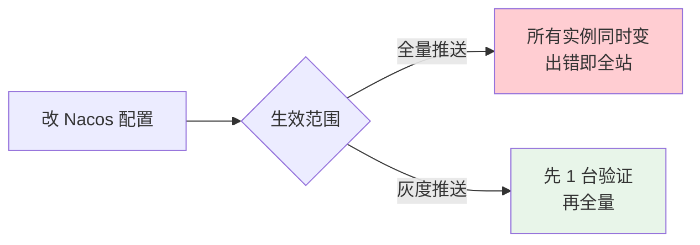
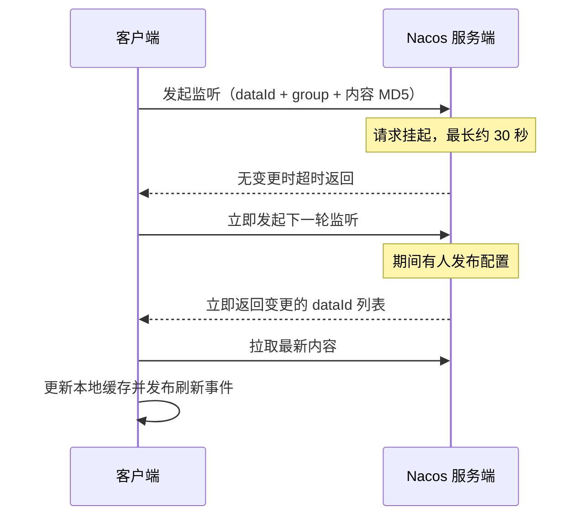
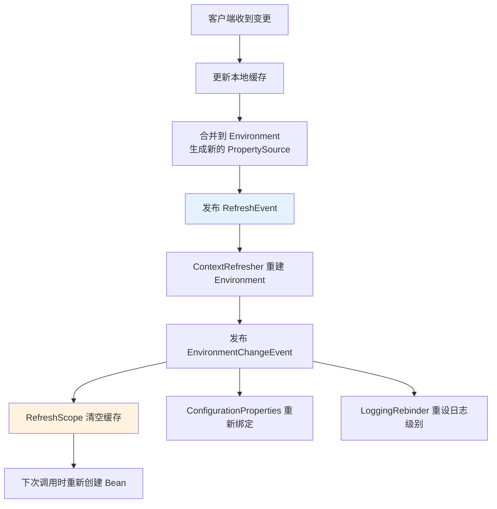
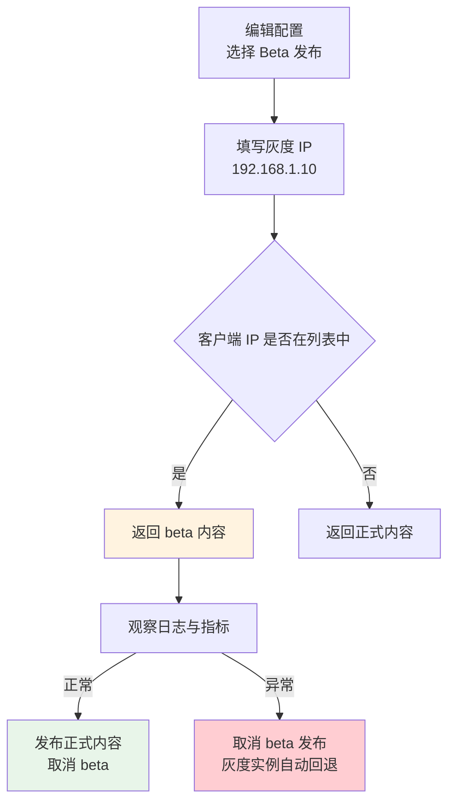

# 配置动态刷新与灰度发布

## 课程目标

- 理解 Nacos 长轮询与 gRPC 推送两种变更通知机制，说清"客户端怎么知道配置变了"
- 掌握动态刷新的完整链路：变更通知、`RefreshEvent`、`RefreshScope` 重建 Bean
- 掌握 `@RefreshScope` 的三类失效场景：单例注入、代理失效、与 `@ConfigurationProperties` 的差异
- 完成三个实战：日志级别动态调整、业务开关切换、线程池参数就地调整
- 掌握手动刷新与刷新失败后的回滚手段
- 掌握 Nacos beta 按 IP 灰度发布的流程、验证方式与回滚动作

## 回顾与导入

上一课我们把配置拆成了分层结构：`common.yml` 提供框架默认值，`book-order-dev.yml` 提供业务参数与服务级覆盖。结构清楚了，但还有一个隐性前提没被打破——**改完配置依然要重启**。

严格来说，配置是"进 Environment 了"，只是 Bean 里的值没变。上一课加的 `/api/config/sources` 走的是 `Environment.getProperty`，它能立刻看到新值；而 `OrderProperties` 这个 Bean 里的字段，还是启动时绑定的那一份。这就是为什么"配置中心明明显示改成 5000，业务还是按 3000 跑"。

第二件事更危险：配置一改，**所有实例同时生效**。假设 `book.order.feature.points-notify-enabled` 改错，多个订单服务实例会在同一秒切换行为，没有任何缓冲。配置中心给了我们"随时能改"的能力，也同时把"改错的爆炸半径"扩大到了全部实例。



本课解决这两个问题：让配置**不重启就生效**（动态刷新），让生效过程**可控可回滚**（灰度发布）。两者配合，才是配置中心在生产环境可用的完整形态。

## 动态刷新的实现原理

### 变更通知：长轮询与推送

客户端不可能每隔一秒去问一次服务端，那样 QPS 会随实例数线性膨胀。Nacos 用的是"长轮询（Long Polling）"：客户端发起请求后，服务端并不立即返回，而是把它挂起，直到配置发生变化或等待超时才响应。



这套机制把"实时性"和"低开销"同时拿到了：无变更时一个实例大约 30 秒才产生一次请求；有变更时秒级返回。

> **提示：** Nacos 2.x 起客户端与服务端之间建立了 gRPC 长连接（9848 端口），配置变更直接在这条连接上推送，长轮询主要作为 HTTP 通道的兼容路径保留。所以"长轮询"要理解成设计思想，不要死记成"一定有 HTTP 请求被挂起 30 秒"。

### 刷新链路：从事件到 Bean 重建

拿到新内容只是第一步，真正让业务看到新值，要经过一条固定的链路：



这条链路上有两个事件，职责不同，别混用：

| 事件 | 发布者 | 监听它适合做什么 |
| --- | --- | --- |
| `RefreshEvent` | 配置变更处理流程 | 记录刷新动作、打审计日志、触发下游同步 |
| `EnvironmentChangeEvent` | `ContextRefresher` | 拿到变更的 key 列表，做精确的后续处理 |

### 关键组件

| 组件 | 所属模块 | 职责 |
| --- | --- | --- |
| Nacos 客户端监听器 | `nacos-client` | 监听 dataId，感知内容变化 |
| `ContextRefresher` | spring-cloud-context | 重建 Environment，发布环境变更事件 |
| `RefreshEvent` | spring-cloud-context | 刷新动作的事件载体 |
| `RefreshScope` | spring-cloud-context | 作用域缓存，清空后下次访问重建 Bean |
| `ConfigurationPropertiesRebinder` | spring-boot | 重新绑定 `@ConfigurationProperties` Bean |
| `LoggingRebinder` | spring-cloud-context | 按新的 `logging.level.*` 调整日志级别 |

### 哪些东西真的会变

这是本课最重要的一张表。刷新不是"什么都自动更新"，不同类型的配置项行为完全不同：

| 配置承载方式 | 刷新后是否生效 | 原因 |
| --- | --- | --- |
| `Environment` 直接读取 | 是 | 每次读取都取当前 Environment |
| `@ConfigurationProperties` Bean | 是 | 重新绑定属性，实例不变 |
| `@Value` + `@RefreshScope` | 是 | Bean 被销毁重建，重新注入 |
| `@Value`（无 `@RefreshScope`） | 否 | 单例已创建，字段不会再被赋值 |
| `logging.level.*` | 是 | 由 `LoggingRebinder` 主动重设 |
| `@ConditionalOnProperty` 装配的 Bean | 否 | 条件只在启动时求值一次 |
| `static` / `final` 字段 | 否 | 类级别状态，与容器无关 |
| 已初始化的线程池、连接池 | 否 | 需要调用 API 就地调整 |
| 通过 `new` 创建的对象 | 否 | 不归容器管理 |

> **结论：** "支持动态刷新"是配置项级别的属性，不是应用级别的属性。同一个服务里，一部分配置改了立刻生效，另一部分必须重启，这很正常。

## @RefreshScope 的坑

### 坑一：单例里的 @Value 不刷新

最常见的错误写法是这样：

```java
@Slf4j
@Service
@RequiredArgsConstructor
public class OrderTimeoutService {

    @Value("${book.order.pay-timeout-minutes}")
    private int payTimeoutMinutes;

    public void checkTimeout(Order order) {
        log.info("支付超时阈值：{} 分钟", payTimeoutMinutes);
    }
}
```

`OrderTimeoutService` 是单例，Spring 只在创建它时解析一次占位符。之后无论配置怎么改，`payTimeoutMinutes` 都是旧值——而且不会报错，不会告警，只能靠对比日志发现。

两种修法各有适用场景：

```java
@Slf4j
@Service
@RefreshScope
public class OrderTimeoutService {

    @Value("${book.order.pay-timeout-minutes}")
    private int payTimeoutMinutes;

    public void checkTimeout(Order order) {
        log.info("支付超时阈值：{} 分钟", payTimeoutMinutes);
    }
}
```

加 `@RefreshScope` 后，这个 Bean 变成作用域代理，刷新时缓存被清空，下次调用会重新创建并重新注入。另一种修法是改用 `@ConfigurationProperties`，见本节第三部分。

> **注意：** `@RefreshScope` 的代价是"每次刷新后第一次调用会变慢"，因为要重建 Bean。放在高频调用的 Service 上要评估，放在开关类、配置类的 Bean 上更合适。

### 坑二：代理失效

`@RefreshScope` 本质是给 Bean 套一层作用域代理。凡是让代理失效的写法，刷新就跟着失效：

| 失效场景 | 原因 | 规避方式 |
| --- | --- | --- |
| 类或方法被声明为 `final` | CGLIB 无法继承代理 | 去掉 `final`，或改为接口代理 |
| 同类内部调用 `this.method()` | 绕过代理，直接走原始实例 | 通过注入的自身代理或拆分到另一个 Bean |
| 被注入到 `BeanPostProcessor` | 这类 Bean 创建过早，拿不到代理 | 改为延迟获取 `ObjectProvider` |
| 注入到静态字段 | 静态字段与容器生命周期无关 | 改为实例字段或方法内获取 |
| 用在 `@Scheduled` 所在 Bean 上 | 重建后调度器可能重复注册或丢失 | 定时任务 Bean 不加 `@RefreshScope`，把参数抽到别处 |
| 手动 `new` 出来的实例 | 完全不受容器管理 | 交给容器创建 |

其中最隐蔽的是"同类内部调用"。看这段代码：

```java
@RefreshScope
@Service
public class OrderFacadeService {

    @Value("${book.order.feature.points-notify-enabled:true}")
    private boolean pointsNotifyEnabled;

    public void submit(Order order) {
        // 内部调用走的是原始实例，不是代理
        doNotify(order);
    }

    public void doNotify(Order order) {
        if (pointsNotifyEnabled) {
            log.info("发送积分通知：{}", order.getOrderNo());
        }
    }
}
```

从外部调用 `submit` 时，代理转发一次，`pointsNotifyEnabled` 是刷新后的值；但 `submit` 内部调 `doNotify` 用的是 `this`，`this` 指向当前实例，实例本身的字段值没变。刷新一次看起来"生效了"，刷新两次就发现值停在第一次——这种半生效现象最难排查。

### 坑三：与 @ConfigurationProperties 的差异

两者都能刷新，但机制不同，代价也不同：

| 维度 | `@Value` + `@RefreshScope` | `@ConfigurationProperties` | `Environment` 直接读取 |
| --- | --- | --- | --- |
| 刷新机制 | 销毁 Bean 再重建 | 重新绑定属性，实例不变 | 每次读取取最新值 |
| 运行时状态 | 丢失，重建后归零 | 保留 | 无状态 |
| 宽松绑定 | 不支持，key 必须精确 | 支持 | 不支持 |
| 类型校验 | 弱，靠解析异常 | 强，可用 `jakarta.validation` | 无 |
| 结构化 | 一个字段一个占位符 | 嵌套对象天然支持 | 需自行拼 key |
| 每次刷新成本 | 较高，涉及 Bean 重建 | 低 | 无 |
| 适用场景 | 零散的一两个开关 | 成组配置、需要校验 | 动态分支判断 |

> **结论：** 参数成组、需要校验的，用 `@ConfigurationProperties`，**不要**再叠 `@RefreshScope`——叠上去会让"重新绑定"退化成"重建"，白白丢掉状态与性能优势。

## 实战一：日志级别动态调整

### 配置与机制

日志级别是动态刷新最典型的场景，因为它不需要改 Bean——`LoggingRebinder` 会监听 `EnvironmentChangeEvent`，把 `logging.level.*` 重新应用到日志框架。

在 `book-order-dev.yml` 中确认存在：

```yaml
logging:
  level:
    com.example.order: info
```

把值改成 `debug` 并发布，无需重启，`com.example.order` 包下的日志会立刻变详细。这个能力对线上排查极其关键：出问题时把级别调低到 `debug`，观察几分钟，再调回 `info`。

### 为什么它能生效而 @Value 不能

因为日志框架的级别不是普通字段，而是一个可以通过 `setLogLevel` 修改的运行时状态。`LoggingRebinder` 主动去调用了这个方法，所以刷新后立刻生效。这也是"哪些东西会变"那张表里唯一一个"框架主动处理"的例外。

### 加一个受控的调整入口

有些团队希望保留一个应急接口，而不是每次都登录控制台：

```java
@Slf4j
@RestController
@RequestMapping("/api/config")
@RequiredArgsConstructor
public class LogLevelController {

    private final LoggingSystem loggingSystem;

    @PostMapping("/log-level")
    public Result<String> change(@RequestParam("level") String level) {
        LogLevel target = LogLevel.valueOf(level.toUpperCase());
        loggingSystem.setLogLevel("com.example.order", target);
        log.info("com.example.order 日志级别已调整为 {}", target);
        return Result.success("已调整为 " + target);
    }
}
```

> **注意：** 这个接口必须加鉴权与白名单，并且只允许 `debug` 与 `info` 两档。它能改日志级别，也就能把磁盘写满，属于"高权限运维操作"，不能对公网开放。

## 实战二：业务开关动态切换

### 场景

大促期间积分系统压力过大，需要临时关闭"下单送积分"的通知，但不发版、不重启。这就是特性开关（Feature Flag）的典型用法。

### 配置

```yaml
book:
  order:
    feature:
      points-notify-enabled: true
      new-pay-channel-enabled: false
      gray-user-percent: 10
```

### 代码

用 `@ConfigurationProperties` 承载这一组开关，它会在刷新后自动重新绑定，不需要 `@RefreshScope`：

```java
@Data
@Component
@Validated
@ConfigurationProperties(prefix = "book.order.feature")
public class OrderFeatureProperties {

    private boolean pointsNotifyEnabled = true;

    private boolean newPayChannelEnabled = false;

    @Min(0)
    @Max(100)
    private int grayUserPercent = 10;
}
```

业务侧只判断这个对象，不做任何"读取配置"的动作：

```java
@Slf4j
@Service
@RequiredArgsConstructor
public class PointsNotifyService {

    private final OrderFeatureProperties featureProperties;

    public void notifyIfEnabled(Order order) {
        if (!featureProperties.isPointsNotifyEnabled()) {
            log.info("积分通知开关已关闭，跳过订单 {}", order.getOrderNo());
            return;
        }
        log.info("发送积分通知，订单 {}，灰度比例 {}%",
                order.getOrderNo(), featureProperties.getGrayUserPercent());
    }
}
```

刷新后，`ConfigurationPropertiesRebinder` 会把 `pointsNotifyEnabled` 重新绑成 `false`，`PointsNotifyService` 无需重建，下一次调用即走新分支。

### 一个必须避开的写法

```java
// 错误示范：刷新不会让这个 Bean 消失
@Bean
@ConditionalOnProperty(name = "book.order.feature.points-notify-enabled", havingValue = "true")
public PointsNotifier pointsNotifier() {
    return new PointsNotifier();
}
```

`@ConditionalOnProperty` 只在启动时求值。配置改成 `false` 后，Bean 依然存在，程序照旧执行；改成 `true` 后，Bean 也不会凭空出现。**装配条件不是动态开关**，开关必须写在业务判断里。

### 验证

| 步骤 | 操作 | 观察点 |
| --- | --- | --- |
| 1 | 发布 `points-notify-enabled: false` | 控制台显示配置已更新 |
| 2 | 调用下单接口 | 日志出现"积分通知开关已关闭" |
| 3 | 改回 `true` 再调用 | 日志恢复"发送积分通知" |
| 4 | 全程不重启服务 | 进程启动时间戳不变 |

## 实战三：线程池参数动态调整

### 为什么不能靠重建

线程池最忌讳"重建"：旧池里的任务会被丢弃，正在执行的线程被中断，客户端出现一批莫名其妙的超时。正确做法是**拿到现有线程池，就地调整核心数与最大数**。

### 配置与线程池定义

```yaml
book:
  order:
    thread-pool:
      core-size: 8
      max-size: 32
      queue-capacity: 200
      keep-alive-seconds: 60
```

```java
@Data
@Component
@ConfigurationProperties(prefix = "book.order.thread-pool")
public class ThreadPoolProperties {

    private int coreSize = 8;

    private int maxSize = 32;

    private int queueCapacity = 200;

    private int keepAliveSeconds = 60;
}
```

```java
@Configuration
@EnableAsync
@RequiredArgsConstructor
public class ThreadPoolConfig {

    private final ThreadPoolProperties properties;

    @Bean("orderExecutor")
    public ThreadPoolTaskExecutor orderExecutor() {
        ThreadPoolTaskExecutor executor = new ThreadPoolTaskExecutor();
        executor.setCorePoolSize(properties.getCoreSize());
        executor.setMaxPoolSize(properties.getMaxSize());
        executor.setQueueCapacity(properties.getQueueCapacity());
        executor.setKeepAliveSeconds(properties.getKeepAliveSeconds());
        executor.setThreadNamePrefix("order-async-");
        executor.setRejectedExecutionHandler(new ThreadPoolExecutor.CallerRunsPolicy());
        executor.initialize();
        return executor;
    }
}
```

### 就地调整的实现

```java
@Slf4j
@Component
public class ThreadPoolTuner {

    private static final String PREFIX = "book.order.thread-pool";

    private final Environment environment;
    private final ThreadPoolTaskExecutor executor;

    public ThreadPoolTuner(Environment environment,
                           @Qualifier("orderExecutor") ThreadPoolTaskExecutor executor) {
        this.environment = environment;
        this.executor = executor;
    }

    @EventListener(EnvironmentChangeEvent.class)
    public void onEnvironmentChange(EnvironmentChangeEvent event) {
        boolean related = event.getKeys().stream()
                .anyMatch(key -> key.startsWith(PREFIX));
        if (!related) {
            return;
        }
        resize();
    }

    public void resize() {
        int targetCore = environment.getProperty(PREFIX + ".core-size", Integer.class, 8);
        int targetMax = environment.getProperty(PREFIX + ".max-size", Integer.class, 32);
        if (targetCore < 1 || targetMax < targetCore) {
            log.warn("线程池配置非法：core={}, max={}，本次调整被忽略", targetCore, targetMax);
            return;
        }

        ThreadPoolExecutor pool = executor.getThreadPoolExecutor();
        int oldCore = pool.getCorePoolSize();
        int oldMax = pool.getMaximumPoolSize();

        // 放大时先抬 max 再抬 core；缩小时顺序相反，避免中途出现 core > max
        if (targetMax >= oldMax) {
            pool.setMaximumPoolSize(targetMax);
            pool.setCorePoolSize(targetCore);
        } else {
            pool.setCorePoolSize(targetCore);
            pool.setMaximumPoolSize(targetMax);
        }

        log.info("线程池参数已调整：core {} -> {}, max {} -> {}",
                oldCore, targetCore, oldMax, targetMax);
    }
}
```

四个关键点：

- **先校验再调整**。`core > max` 会直接抛 `IllegalArgumentException`，必须挡在调用之前。
- **顺序影响成败**。放大时先抬 `max`，否则 `setCorePoolSize` 可能因为超过当前 `max` 而失败。
- **监听 `EnvironmentChangeEvent` 而不是 `@RefreshScope`**。线程池 Bean 一旦重建，排队任务就没了。
- **从 `Environment` 直接取值，不要注入 `ThreadPoolProperties`**。`ConfigurationPropertiesRebinder` 与本监听器都是环境变更事件的监听者，执行顺序不作保证，直接读 Environment 最稳。

> **注意：** 队列容量无法在运行时修改。`LinkedBlockingQueue` 的容量是 `final` 字段，要改只能换队列或重建线程池。所以 `queue-capacity` 属于"改了要重启"的配置，别指望它动态生效。

## 手动刷新与回滚

### 用 ContextRefresher 主动刷新

正常流程由配置变更自动触发，但有时需要"人为推一次"，例如本地验证、或某个配置项被设成了不自动刷新：

```java
@Slf4j
@RestController
@RequestMapping("/api/config")
@RequiredArgsConstructor
public class ManualRefreshController {

    private final ContextRefresher contextRefresher;
    private final RefreshScope refreshScope;

    @PostMapping("/refresh")
    public Result<Set<String>> refresh() {
        Set<String> changedKeys = contextRefresher.refreshEnvironment();
        if (!changedKeys.isEmpty()) {
            refreshScope.refreshAll();
        }
        log.info("手动刷新完成，变更项：{}", changedKeys);
        return Result.success(changedKeys);
    }
}
```

`refreshEnvironment()` 只重建 Environment 并返回变更的 key；要让 `@RefreshScope` 的 Bean 一起重建，需要再调一次 `refreshAll()`。老版本常用的 `refresh()` 已标记废弃，新代码不要再使用。

### 监听刷新事件

想在刷新后做点"业务动作"，用事件监听比改写刷新流程更合适：

```java
@Slf4j
@Component
public class ConfigChangeAuditor {

    @EventListener(RefreshEvent.class)
    public void onRefresh(RefreshEvent event) {
        log.info("配置刷新完成，来源：{}", event.getEventDesc());
    }

    @EventListener(EnvironmentChangeEvent.class)
    public void onEnvironmentChange(EnvironmentChangeEvent event) {
        log.info("本次变更的配置项共 {} 个：{}",
                event.getKeys().size(), event.getKeys());
    }
}
```

监听器里只做记录、通知、缓存清理这类轻量动作。不要在监听器里做远程调用或长事务，它会阻塞整个刷新流程。

### 刷新失败怎么回滚

刷新不是事务，失败的表现形式很多，回滚手段也不同：

| 失败类型 | 表现 | 处理方式 |
| --- | --- | --- |
| YAML 语法错误 | 该 dataId 解析失败，变更未生效 | 控制台改回上一版本，客户端重新拉取 |
| 类型或校验不通过 | 绑定异常，日志报 `BindException` | 修正值后重新发布，必要时加默认值兜底 |
| 部分 dataId 已生效 | 出现"半新半旧"的中间状态 | 一次性发布全部相关 dataId，缩短窗口 |
| 新值导致业务异常 | 无报错但行为错误 | 回滚配置版本，必要时重启清缓存 |
| beta 灰度失败 | 只有灰度实例异常 | 取消 beta 发布，灰度实例自动回到正式内容 |

回滚优先用控制台的**历史版本**功能：每条配置都有版本与时间戳，选中上一版本一键回滚，比手工改回原值更可靠。

## 灰度发布

### beta 发布：按 IP 灰度

Nacos 的灰度发布叫 beta 发布：在编辑配置时选择"Beta 发布"，填入灰度 IP 列表。服务端会同时保存两份内容——正式内容与 beta 内容，只有列表内 IP 的客户端能拿到 beta 内容。



### 操作步骤

| 步骤 | 操作 | 说明 |
| --- | --- | --- |
| 1 | 配置详情页点击"编辑" | 不要直接改正式内容 |
| 2 | 勾选"Beta 发布"，填入 IP | 多个 IP 用逗号分隔 |
| 3 | 确认发布 | 此时正式内容未变 |
| 4 | 观察灰度实例日志与指标 | 至少覆盖一个完整业务周期 |
| 5 | 验证通过后点"发布" | 正式内容替换为 beta 内容 |
| 6 | 异常时点"停止 Beta" | 灰度实例自动回到正式内容 |

### 验证与回滚

```bash
# 在灰度实例上确认拿到的是 beta 内容
curl.exe -s "http://192.168.1.10:8083/actuator/env/book.order.feature.points-notify-enabled"

# 在非灰度实例上确认仍是正式内容
curl.exe -s "http://192.168.1.11:8083/actuator/env/book.order.feature.points-notify-enabled"
```

两边返回值不同，说明 beta 生效；两边相同，先查 IP 是否匹配（容器内网卡多、NAT 之后 IP 可能与宿主机不同）。

| 动作 | 何时执行 | 风险 |
| --- | --- | --- |
| 停止 Beta | 灰度实例出现异常 | 低，立即回退 |
| 回滚到历史版本 | 正式内容已经出错 | 低，一次点击 |
| 重启灰度实例 | 刷新未生效 | 中，会短暂减少可用实例 |
| 关闭开关配置 | 业务逻辑本身有问题 | 中，依赖开关设计是否留了后路 |

### 三种灰度粒度

| 方式 | 粒度 | 优点 | 缺点 | 适用场景 |
| --- | --- | --- | --- | --- |
| beta 按 IP | 实例级 | 精确，可指定某一台 | 需要知道实例 IP，扩缩容后要重配 | 配置变更验证 |
| 标签灰度 | 实例组 | 按分组批量控制 | 需要维护实例标签 | 多机房、多分组 |
| 应用内比例开关 | 用户级 | 可按用户、订单号切流 | 与配置发布解耦，需代码支持 | 功能灰度 |

> **结论：** 配置内容本身的验证用 beta 按 IP；业务功能的灰度用应用内开关。前者解决"这次改动会不会炸"，后者解决"这个功能该不该对某批用户开放"。

## 排查表：改了不生效

| 现象 | 可能原因 | 排查动作 |
| --- | --- | --- |
| 完全没有任何变化 | dataId 拼错，根本没监听上 | 控制台核对 dataId 与 `file-extension` |
| 只有部分服务变了 | 命名空间或 Group 不一致 | 对比各服务 yml 中的 `namespace`、`group` |
| 重启后才生效 | `refreshEnabled=false` 或共享配置未开 `refresh` | 检查 import 参数与 `shared-configs[n].refresh` |
| Environment 有新值，Bean 是旧值 | 未加 `@RefreshScope`，或字段是单例 `@Value` | 改用 `@ConfigurationProperties` 或加作用域 |
| 开关改了但分支没变 | 用了 `@ConditionalOnProperty` | 改为业务代码内判断 |
| 灰度实例没拿到 beta | IP 不匹配（容器多网卡、NAT） | 用 `curl` 查实例真实出口 IP |
| 第一次生效，第二次不生效 | 同类内部调用绕过代理 | 拆分 Bean 或改为接口代理 |
| 值被覆盖成旧值 | 本地 yml 或启动参数优先级更高 | `/actuator/env/<key>` 看 propertySources 顺序 |
| 重启后又回到旧值 | 客户端本地缓存未更新，或读到的是旧快照 | 检查 `${user.home}/nacos/config` 缓存目录与时间戳 |

排查顺序建议固定为：**先确认有没有监听上，再确认新值有没有进 Environment，最后确认 Bean 有没有重新取值**。三段都过一遍，基本不会有漏判。

## 注意事项

1. **`@RefreshScope` 不是万能开关**：它只对作用域代理生效，静态字段、`final` 类、`new` 出来的对象一律无效。
2. **优先用 `@ConfigurationProperties` 承载成组配置**：重新绑定比销毁重建更轻，且保留运行时状态与校验能力。
3. **`@ConditionalOnProperty` 不能当开关用**：条件装配只在启动时求值，动态开关必须写在业务判断里。
4. **刷新期间可能出现"半新半旧"**：多条 dataId 不是原子生效，相关配置应一次性发布。
5. **线程池、连接池要就地调整**：重建会丢任务、断连接，改队列容量则只能重启。
6. **beta 灰度要覆盖完整业务周期**：只看一分钟的日志不足以判断，至少覆盖一次定时任务或一次批量作业。
7. **灰度 IP 要考虑容器网络**：Pod IP、宿主机 IP、NAT 后 IP 可能不一致，配置前先确认客户端上报的是哪个。
8. **刷新失败优先回滚而不是修**：先把版本回退到已知可用状态，再在低峰期重新验证，避免边修边扩大影响。

## 小结

本节课我们学习了：

1. **变更通知机制**：长轮询把"实时"与"低开销"结合，Nacos 3.x 走 gRPC 推送，长轮询作为设计思想理解即可。
2. **刷新完整链路**：更新缓存、合并 Environment、发布 `RefreshEvent`、清空 `RefreshScope`、重新绑定配置对象。
3. **生效范围差异**：`Environment` 直读与 `@ConfigurationProperties` 天然刷新，单例 `@Value` 不刷新，静态字段与条件装配永不刷新。
4. **`@RefreshScope` 三类坑**：单例注入拿旧值、代理被 `final` 或内部调用破坏、与 `@ConfigurationProperties` 叠加导致重建退化。
5. **三个实战**：日志级别由 `LoggingRebinder` 生效，业务开关写在业务判断里，线程池通过事件监听就地调整且必须校验顺序。
6. **手动刷新与回滚**：`refreshEnvironment()` 加 `refreshAll()` 组合手动刷新，失败时用历史版本一键回退。
7. **beta 灰度**：按 IP 灰度只影响指定实例，验证通过再发布正式内容，异常时停 Beta 即回退。

## 作业

### 作业一：实现三个动态刷新场景

1. 在 `book-order-dev.yml` 中把 `com.example.order` 的日志级别在 `info` 与 `debug` 之间切换，全程不重启，记录两次日志量的差异。
2. 实现 `OrderFeatureProperties` 与 `PointsNotifyService`，验证开关从 `true` 改到 `false` 后业务分支立即变化。
3. 实现线程池的就地调整，把 `core-size` 从 8 改到 16，观察线程名与池参数变化，并说明为什么不能改队列容量。

### 作业二：完成一次灰度发布

1. 用 beta 发布把 `points-notify-enabled` 的新值只推给一台实例，用 `/actuator/env` 验证两台实例的差异。
2. 在非灰度实例上确认行为未变，在灰度实例上确认行为已变，记录验证过程。
3. 模拟灰度失败：把 beta 值改成一个非法值（如 `gray-user-percent: 200`），观察绑定异常日志，再执行停止 Beta 并说明回滚是否彻底。
