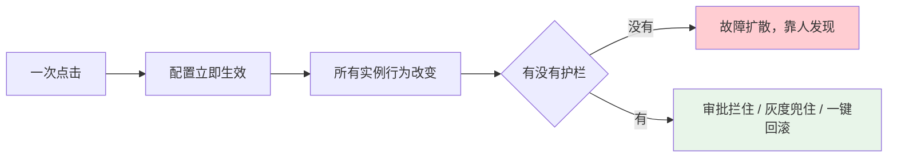
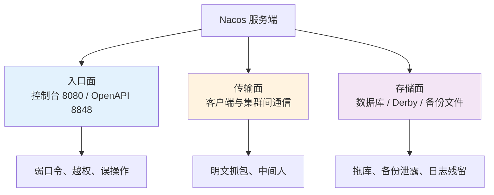
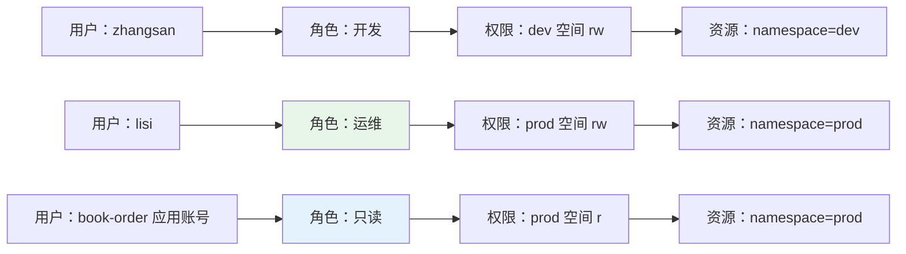
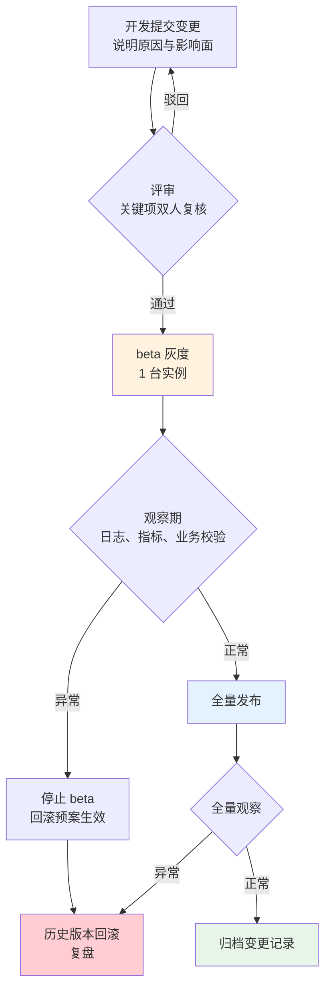

# 配置中心安全与治理实践

## 课程目标

- 理解配置中心的三类暴露面：控制台与 OpenAPI 入口、客户端到服务端的传输链路、落盘存储与备份
- 掌握 Nacos 3.x 的鉴权开关组合与"用户、角色、权限、命名空间"四层权限模型
- 掌握敏感配置的加密落地：Jasypt 集成、密钥管理方式，以及 KMS 方案的对比与选型
- 掌握配置治理规范：命名约定、Group 规划、变更审批、审计与回滚、环境隔离红线
- 能够用发布流程图与检查清单把配置变更卡在流程里，而不是靠人的记忆
- 能够复盘生产配置误改、密钥泄漏、共享配置污染三类事故，并给出检测与防护手段

## 回顾与导入

前四课把配置中心的能力铺齐了：接入、分层共享、动态刷新、灰度发布。能力齐了，风险也跟着齐了——现在任何一个能登录控制台的人，都可以在几秒内改掉生产环境的任意一条配置，并且所有实例会立即响应。

这件事的可怕之处在于它的"安静"：改配置不像发版，没有流水线、没有构建记录、没有灰度批次。一条错误的 `max-items-per-order: 2` 保存下去，用户的订单会开始被拒绝，而代码、镜像、发布记录全都正常。

现实中的开场通常是这样：值班同学要排查一个超时问题，需要在 `prod` 空间把日志级别调成 `debug`。他打开了控制台，切命名空间时手滑停在 `prod` 的 `common.yml` 上，看到里面一堆熟悉的 key，顺手改了一个 `openfeign` 超时并保存。三分钟后，全部服务的远端调用超时从 3 秒变成 300 毫秒，订单服务大面积失败。



本课补的就是这套护栏：**安全**解决"谁能改、能不能被窃取"，**治理**解决"怎么改才不出事"。这两件事不是运维的附加题，而是配置中心能否上生产的前置条件。

## 配置中心的安全边界

### 三类暴露面



| 暴露面 | 典型风险 | 首要手段 |
| --- | --- | --- |
| 入口面 | 默认口令、账号共享、越权改生产 | 开启鉴权、按命名空间授权、账号与人员一一对应 |
| 传输面 | 配置内容与令牌被明文抓取 | 全链路 HTTPS 或可信内网加双向认证 |
| 存储面 | 数据库被拖、备份文件外流、日志打印配置内容 | 落盘加密、备份加密、禁止打印敏感项 |

### 风险清单

先把"可能怎么出事"列全，才谈得上防护：

| 风险 | 攻击或事故路径 | 影响 | 首要手段 |
| --- | --- | --- | --- |
| 默认口令 | 使用初始账号登录控制台 | 全量配置可读可改 | 首次登录立即改密，禁用默认账号共享 |
| 账号共享 | 一个"运维账号"多人使用 | 审计日志失去追责能力 | 一人一账号，按角色授权 |
| 越权修改 | 开发账号能写生产空间 | 误改或恶意改生产配置 | 命名空间级授权，生产只给少数人写权限 |
| 明文传输 | 内网抓包拿到数据库密码 | 直接导致数据泄露 | HTTPS、网络分段 |
| 配置内容入日志 | 启动日志打印全部配置 | 日志平台成为泄密渠道 | 关闭配置内容打印，敏感项打码 |
| 仓库残留 | 加密前的明文进了 Git 历史 | 密钥轮换也无法彻底消除 | 引入前清理历史，使用密文与外部密钥 |
| 令牌泄露 | `accessToken` 写进脚本并入库 | 攻击者可长期读写 | 令牌短时效、脚本走密钥托管 |
| 备份未加密 | 备份文件被拷走 | 等同数据库泄露 | 备份加密与访问审批 |

## 鉴权与权限模型

### Nacos 3.x 的鉴权开关

Nacos 3.x 默认开启鉴权，这是与 2.x 早期版本最大的差别。四个配置项各管一件事，配错任何一个都会留下口子：

| 配置项 | 作用 | 建议 |
| --- | --- | --- |
| `nacos.core.auth.enabled` | 鉴权总开关 | 生产必须为 `true`，不要为图方便关闭 |
| `nacos.core.auth.plugin.nacos.token.secret.key` | 令牌签名密钥 | 必须替换默认值，长度足够且随机，纳入密钥管理 |
| `nacos.core.auth.server.identity.key/value` | 集群节点互信身份 | 集群内一致，不得外泄 |
| `nacos.core.auth.plugin.nacos.token.expire.seconds` | 令牌有效期 | 按安全要求调短，减少泄露后的可用窗口 |

`token.secret.key` 使用默认值等于没有密钥：任何人都能按公开的默认值伪造令牌。这一项是安全审计的必查项。

### 四层权限模型

Nacos 的权限不是直接授给用户，而是"用户挂角色、角色挂权限、权限作用在资源上"：



| 对象 | 作用 | 示例 |
| --- | --- | --- |
| 用户 | 身份主体，一人一号 | `zhangsan`、`book-order-client` |
| 角色 | 权限集合，按职责划分 | 管理员、开发、运维、只读 |
| 权限 | 对某资源的一组动作 | `dev` 空间读写、`prod` 空间只读 |
| 命名空间 | 权限作用的最小单位 | `dev`、`test`、`prod` |

| 动作 | 含义 | 典型授予对象 |
| --- | --- | --- |
| `r` | 只读，可查看与订阅 | 应用客户端账号、测试人员 |
| `w` | 只写，可发布不可查看 | 流水线发布账号 |
| `rw` | 读写 | 环境负责人、值班运维 |

> **注意：** 应用账号与人员账号必须分开。应用账号只授予 `r`，即使泄露也只能读；人员账号才可能具备 `w`。把应用账号配成管理员，是"密钥泄漏即全网失守"的根源。

### 客户端如何带账号

开启鉴权后，客户端必须显式配置账号，否则拉配置直接返回 401 或 403：

```yaml
spring:
  cloud:
    nacos:
      config:
        server-addr: 127.0.0.1:8848
        namespace: prod
        username: ${NACOS_CONFIG_USERNAME}
        password: ${NACOS_CONFIG_PASSWORD}
      discovery:
        server-addr: 127.0.0.1:8848
        namespace: prod
        username: ${NACOS_DISCOVERY_USERNAME}
        password: ${NACOS_DISCOVERY_PASSWORD}
```

账号密码一律用环境变量或启动参数注入，不写进仓库。配置与注册用不同账号，是为了让两个模块的权限可以分开收紧。

### 传输加密

| 环节 | 明文风险 | 做法 |
| --- | --- | --- |
| 客户端到服务端 | 配置内容、账号、令牌可被抓包 | 前置 Nginx 做 TLS 终结，`server-addr` 写 `https://` |
| 服务端集群之间 | 节点同步数据可被嗅探 | 内网隔离，必要时开启节点间 TLS |
| 控制台访问 | 口令与配置在浏览器与服务端之间明文 | 控制台统一走 HTTPS 域名，禁止直连 8080 |
| 客户端到 gRPC 端口 | 长连接上承载配置推送 | 与 HTTP 同一入口代理，统一证书 |

```text
# Nginx 反向代理示例：统一 TLS 入口
server {
    listen 443 ssl;
    server_name nacos.example.com;

    ssl_certificate     /etc/nginx/certs/nacos.crt;
    ssl_certificate_key /etc/nginx/certs/nacos.key;

    location / {
        proxy_pass http://127.0.0.1:8848;
        proxy_set_header Host $host;
        proxy_set_header X-Real-IP $remote_addr;
    }
}
```

客户端把 `server-addr` 改为 `nacos.example.com:443`，并在前面显式带上 `https://`。证书要用内部 CA 或公开 CA 签发，客户端信任链必须配好，否则会退化成"跳过校验"，等于没加密。

### 存储加密

| 存储位置 | 风险 | 做法 |
| --- | --- | --- |
| 数据库（MySQL） | 拖库后配置全裸 | 库级加密或磁盘加密，账号最小权限 |
| 单机 Derby 数据目录 | 拷走文件即拿到全部配置 | 生产禁用单机模式，目录权限收紧 |
| 备份文件 | 备份比生产更容易被带走 | 备份加密，访问需审批，定期清理 |
| 日志文件 | 异常堆栈里带出配置内容 | 关闭配置打印，敏感项打码 |
| 客户端本地缓存 | 缓存目录里有明文 | 机器权限控制，敏感项走加密存储 |

## 敏感配置的加密方案

### Jasypt 落地

Jasypt 的思路很简单：配置里存密文，应用启动时用密钥解密后注入。配置中心看到的永远是密文，只有拿到密钥的人才能真正使用。

```xml
<dependency>
    <groupId>com.github.ulisesbocchio</groupId>
    <artifactId>jasypt-spring-boot-starter</artifactId>
    <version>3.0.5</version>
</dependency>
```

配置解密参数，密钥从环境变量注入：

```yaml
jasypt:
  encryptor:
    password: ${JASYPT_ENCRYPTOR_PASSWORD}
    algorithm: PBEWITHHMACSHA512ANDAES_256
    iv-generator-classname: org.jasypt.iv.RandomIvGenerator
    property:
      prefix: "ENC("
      suffix: ")"
```

生成密文用官方 CLI：

```bash
java -cp jasypt-1.9.3.jar org.jasypt.intf.cli.JasyptPBEStringEncryptionCLI \
  input="book_order_2026" password="$JASYPT_ENCRYPTOR_PASSWORD" \
  algorithm=PBEWITHHMACSHA512ANDAES_256 \
  ivGeneratorClassName=org.jasypt.iv.RandomIvGenerator
```

```powershell
# Windows PowerShell 单行写法
java -cp jasypt-1.9.3.jar org.jasypt.intf.cli.JasyptPBEStringEncryptionCLI input="book_order_2026" password="$env:JASYPT_ENCRYPTOR_PASSWORD" algorithm=PBEWITHHMACSHA512ANDAES_256 ivGeneratorClassName=org.jasypt.iv.RandomIvGenerator
```

把输出的密文贴回配置中心，用 `ENC(...)` 包住：

```yaml
spring:
  datasource:
    url: jdbc:postgresql://127.0.0.1:5432/book_order_db
    username: book_order
    password: ENC(3xY9kPq2LmN7vRt5UwZs8AeF1GhJ4KdC6)
```

业务代码完全不用改：`@Value` 与 `@ConfigurationProperties` 拿到的都是解密后的明文，因为解密发生在属性值进入 Environment 之前。

> **注意：** 密钥不能存在同一个 Nacos 里。配置与密钥放在一起，等于把锁和钥匙挂在同一个门把手上。密钥走环境变量、容器 Secret 或密钥管理服务，与配置中心分离。

### 密钥管理方式

| 存放方式 | 安全性 | 运维成本 | 适用场景 |
| --- | --- | --- | --- |
| 环境变量 | 中，进程可见、易随日志外泄 | 低 | 中小项目、容器化部署 |
| 启动参数 `-D` | 中，`ps` 可见 | 低 | 临时验证，不建议生产 |
| 容器 Secret / K8s Secret | 中高，可做挂载与权限控制 | 中 | Kubernetes 环境 |
| 密钥管理服务（KMS） | 高，密钥不出服务、可审计可轮换 | 高 | 生产、合规要求场景 |
| 写在配置文件里 | 极低 | 极低 | 禁止 |

### 方案对比与选型

> **提示：** Nacos 服务端的配置加密依赖 `ConfigFilter` SPI 扩展，需要自行实现或引入插件，并非开箱即用；多数团队先落地应用侧加密，再评估是否补齐服务端加密。

| 方案 | 加密位置 | 优点 | 缺点 | 适用场景 |
| --- | --- | --- | --- | --- |
| Jasypt 应用侧加密 | 应用启动时解密 | 接入简单，与框架无关，代码零改动 | 密钥需另行管理，轮换要改全部密文 | 数据库密码、三方密钥 |
| Nacos 配置加密插件 | 服务端加解密 | 客户端无感知，配置内容统一加密 | 依赖插件实现，密钥管理仍在服务端 | 整条配置需保护 |
| KMS 托管 | 密钥服务集中管理 | 密钥不落地，支持轮换与审计 | 引入外部依赖，网络与权限要打通 | 合规要求高的生产环境 |
| Vault 动态凭证 | 由 Vault 签发短时凭证 | 凭证时效短，泄露影响可控 | 架构改造成本高 | 对安全要求极高的系统 |

> **结论：** 起步阶段用 Jasypt 加外部密钥托管，能覆盖绝大多数泄露场景；有合规要求或密钥需要频繁轮换时，升级到 KMS 或 Vault。三种方式不冲突，可以按敏感级别混用。

## 治理规范

### 命名规范

命名是治理的地基。名字不统一，审计日志看不懂，权限也授不下去：

| 对象 | 规范 | 正例 | 反例 |
| --- | --- | --- | --- |
| 命名空间 | 环境短名，小写 | `dev`、`test`、`prod` | `开发环境`、`dev2`、`prod-new` |
| Group | 业务域，大写下划线 | `BOOK_GROUP`、`POINTS_GROUP` | `group1`、`图书组` |
| dataId | `${服务名}-${profile}.yml` | `book-order-dev.yml` | `order.yml`、`订单配置` |
| 配置 key | 小写短横线，按域分层 | `book.order.pay-timeout-minutes` | `payTimeout`、`ORDER_TIMEOUT` |
| 开关 key | `feature.` 前缀，布尔语义 | `book.order.feature.points-notify-enabled` | `book.order.open` |
| 环境变量 | 大写下划线 | `NACOS_CONFIG_PASSWORD` | `nacosPwd` |

### Group 规划

| Group | 用途 | 典型内容 | 写权限 | 审批 |
| --- | --- | --- | --- | --- |
| `DEFAULT_GROUP` | 框架层公共配置 | `common.yml`、日志、Jackson | 架构组 | 双人复核 |
| `BOOK_GROUP` | 图书业务域 | 三个服务的专属配置 | 业务组负责人 | 单人或双人 |
| `POINTS_GROUP` | 积分业务域 | 积分服务配置 | 积分组负责人 | 单人 |
| `MIDDLEWARE_GROUP` | 中间件与作业 | 补偿任务、定时作业参数 | 运维 | 双人复核 |
| `TEMP_GROUP` | 临时验证 | 压测、演练用 | 申请人 | 到期自动清理 |

Group 数量要克制。每多一个分组，就多一套权限与审批规则要维护。

### 变更审批流程



| 阶段 | 责任人 | 产出物 | 卡点 |
| --- | --- | --- | --- |
| 提交 | 变更发起人 | 变更单：改什么、为什么、影响哪些服务 | 无变更单不允许直接改生产 |
| 评审 | 服务负责人或架构组 | 评审意见 | 关键项（超时、限流、开关、数据源）必须双人 |
| 灰度 | 发起人 | 灰度实例清单与观察结论 | 观察期未满不得全量 |
| 全量 | 发起人 | 发布记录 | 必须已准备好回滚版本号 |
| 观察 | 值班 | 指标与日志结论 | 异常触发回滚 |
| 归档 | 值班 | 变更归档 | 未归档的变更视为未完成 |

### 审计与回滚

| 需求 | Nacos 提供的能力 | 落地做法 |
| --- | --- | --- |
| 谁改了什么 | 配置历史与操作记录 | 变更单号写入配置内容或备注，便于对齐 |
| 改前改后对比 | 历史版本 diff | 评审时贴 diff 截图或链接 |
| 快速回滚 | 历史版本一键回滚 | 每次全量发布前记录当前版本号 |
| 变更留痕 | 发布记录 | 与工单系统关联，季度审计抽查 |
| 敏感操作告警 | 无内置告警 | 通过操作日志采集，写入监控平台 |

### 环境隔离红线

以下五条一旦破例，前面所有治理手段都会失效：

1. **生产命名空间不对普通开发开放写权限**，只保留两到三个值班账号。
2. **禁止跨环境复制配置内容**，需要时按模板重建，复制必然带上环境专属值。
3. **灰度环境使用独立命名空间**，不与生产共用，避免 dataId 手误直接生效。
4. **应用账号只读**，任何写操作必须由人执行并留痕。
5. **密钥与配置分离存放**，密钥不进配置中心，也不进代码仓库。

## 事故案例复盘

### 案例一：生产配置误改

某次排查超时问题，值班同学在生产空间的 `common.yml` 里把 Feign 读超时从 `3000` 改成了 `300`，本意是"先观察一下超时分布"。配置生效后，所有服务的远端调用开始大面积失败。


| 环节 | 当时的做法 | 问题 | 改进 |
| --- | --- | --- | --- |
| 操作入口 | 直接在生产控制台编辑 | 没有走变更单 | 生产写权限收敛，操作前必须填单 |
| 变更范围 | 一次改 `common.yml` | 影响面是全空间 | 共享配置禁止单人修改，强制双人复核 |
| 发布方式 | 直接发布正式内容 | 没有灰度 | 关键项一律 beta 先灰度一台 |
| 检测 | 靠业务告警发现 | 延迟十几分钟 | 增加"关键配置变更"事件告警，变更后 5 分钟内比对错误率 |
| 回滚 | 手工改回原值 | 期间又改错一次 | 统一使用历史版本回滚 |

检测手段：把配置变更事件接到监控，任一关键 key 变更后自动触发"错误率、RT、QPS"三分钟对比，异常立即通知变更人。

防护手段：共享配置双人复核加 beta 灰度，生产写权限只保留值班账号。

### 案例二：密钥泄漏

某项目的数据库密码以明文写在 `book-order-prod.yml` 里，同时被复制进了内部文档。半年后有人离职，密码随文档流出。

| 环节 | 当时的做法 | 问题 | 改进 |
| --- | --- | --- | --- |
| 存储 | 明文存配置中心 | 任何有读权限的人都能看到 | 全部改为 `ENC()` 密文 |
| 传播 | 复制到文档与聊天记录 | 泄露面远超配置中心 | 禁止明文外传，文档只放引用 |
| 权限 | 开发账号可读生产配置 | 读权限过宽 | 生产读权限按需申请、限期回收 |
| 轮换 | 从未轮换 | 泄露后无法判断影响期 | 建立季度轮换机制 |
| 检测 | 无 | 无法感知泄露 | 数据库异常登录告警、密钥使用审计 |

检测手段：数据库侧开启异常来源登录告警；配置中心侧对"非工作时段大批量读取"做监控。

防护手段：Jasypt 加密加 KMS 托管密钥，配置中心只存密文；密钥轮换纳入固定运维动作。

### 案例三：共享配置污染

某同学把订单服务的业务参数 `book.order.pay-timeout-minutes` 写进了 `common.yml`，理由是"这样别的服务也能用"。一周后商品服务也读到了这个 key，其内部的同名逻辑被意外激活，出现了与订单完全无关的超时清理任务。

| 环节 | 当时的做法 | 问题 | 改进 |
| --- | --- | --- | --- |
| 分层 | 业务参数进共享层 | 影响面从 1 个服务扩到全部 | 共享层只放与业务无关的项 |
| 命名 | key 没有业务前缀约束 | 与其他服务同名 key 冲突 | 强制 `服务名.域.参数` 三段式 |
| 评审 | 只看了"能不能跑" | 没评估谁还会读到 | 评审必须回答"影响哪些服务" |
| 检测 | 无 | 一周后才发现 | 共享配置 key 变更做全空间影响分析 |

检测手段：对 `common.yml` 的 key 清单建立基线，新增 key 触发告警并自动列出读取该 key 的服务。

防护手段：共享层准入清单制，只允许框架类 key；业务 key 一律下沉到服务专属配置。

## 配置治理检查清单

上线前逐项核对，任一"阻断"项不通过则不允许发布：

| 序号 | 检查项 | 判定标准 | 卡点级别 |
| --- | --- | --- | --- |
| 1 | 鉴权开关 | `nacos.core.auth.enabled=true` | 阻断 |
| 2 | 令牌密钥 | 已替换默认值且长度足够 | 阻断 |
| 3 | 账号体系 | 一人一号，应用账号与人员账号分离 | 阻断 |
| 4 | 生产写权限 | 仅限值班与负责人，名单可查 | 阻断 |
| 5 | 传输加密 | 控制台与客户端均走 HTTPS | 阻断 |
| 6 | 敏感项加密 | 密码、密钥均为 `ENC()` 或 KMS 引用 | 阻断 |
| 7 | 密钥存放 | 不在配置中心、不在代码仓库 | 阻断 |
| 8 | 命名规范 | 空间、Group、dataId、key 全部合规 | 阻断 |
| 9 | 分层归属 | 共享层无业务 key，服务层无框架 key | 阻断 |
| 10 | 环境隔离 | 灰度与生产使用不同命名空间 | 阻断 |
| 11 | 变更单 | 有变更单、有影响面说明、有回滚版本号 | 阻断 |
| 12 | 灰度验证 | beta 至少一台实例，观察期已满 | 告警 |
| 13 | 审计归档 | 变更记录已归档并关联工单 | 告警 |
| 14 | 备份加密 | 备份文件加密且访问受控 | 告警 |
| 15 | 到期清理 | 临时空间、临时 key 已登记到期时间 | 告警 |

## 注意事项

1. **鉴权开启后忘记配账号是最常见的上线故障**：现象是注册与拉配置 401，先查 `username`、`password` 是否注入。
2. **默认令牌密钥等同于没有密钥**：升级或初始化后必须替换，且纳入密钥管理，不要写进脚本。
3. **HTTPS 不能只做一半**：客户端信任链没配好时，有人会关掉证书校验，那等于回到明文。
4. **Jasypt 密钥必须外置**：放在同一个 Nacos 或同一个仓库里，加密只增加了心理安全感。
5. **共享配置的修改要走最严的评审**：它的影响面是全空间，一次手误等于一次全站变更。
6. **历史版本是最后一道保险**：每次全量发布前记录版本号，出问题时一键回滚比手工改回快得多。
7. **临时空间与临时 key 必须有到期时间**：没有到期机制的临时配置，两年后没人敢删。
8. **审计日志要能对上人**：账号共享会让审计失效，这是治理体系里最容易被忽视的漏洞。

## 小结

本节课我们学习了：

1. **三类暴露面**：入口面、传输面、存储面，分别对应鉴权、加密传输、加密存储三类手段。
2. **鉴权开关组合**：总开关、令牌密钥、节点互信、令牌时效四项必须一起配，缺一项就留了口子。
3. **四层权限模型**：用户挂角色、角色挂权限、权限作用在命名空间上；应用账号只读，人员账号才可能有写权限。
4. **敏感配置加密**：Jasypt 用 `ENC()` 存密文且代码零改动，密钥必须外置；有合规要求时升级到 KMS 或 Vault。
5. **治理规范**：命名统一、Group 克制、审批分层、审计归档、五条环境隔离红线。
6. **发布流程**：提交、评审、灰度、全量、观察、回滚预案，每一步都有责任人与卡点。
7. **三类事故的共同点**：都缺一道"影响面判断"与"灰度缓冲"，检测手段则依赖变更事件告警而非人工发现。

## 作业

### 作业一：为配置中心补上安全基座

1. 检查本机 Nacos 的鉴权配置，确认 `token.secret.key` 是否已替换，把结果与判定依据写成一段说明。
2. 创建三个账号：管理员、开发（只读 `prod`）、应用客户端（只读 `prod`），并给出各自的角色与权限配置表。
3. 把 `book-order-prod.yml` 中的数据源密码改为 Jasypt 密文，密钥通过环境变量注入，验证启动与连接正常。

### 作业二：落地一次受控的配置变更

1. 按本课的流程图，为"调整 Feign 读超时"写一份变更单，包含影响面、灰度实例、观察指标与回滚版本号。
2. 执行 beta 灰度并记录观察结论，再全量发布，最后用历史版本回滚一次，验证回滚后取值恢复。
3. 用检查清单的 15 项对本次变更做自评，标出哪些项属于阻断级、哪些是为了赶时间被跳过的。
