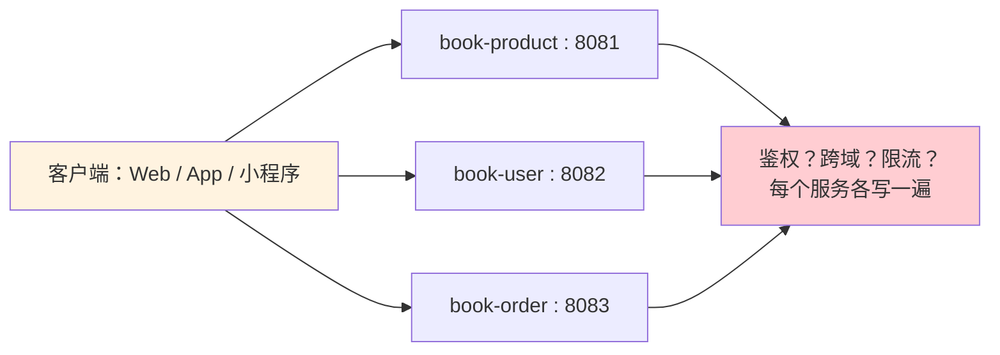
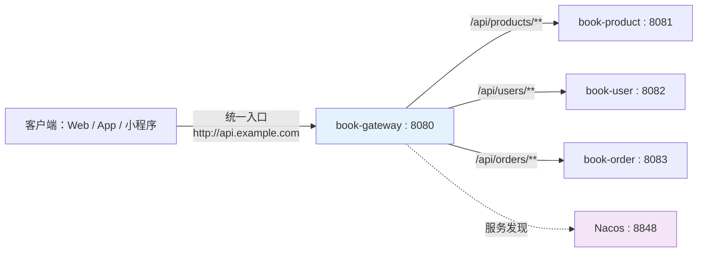
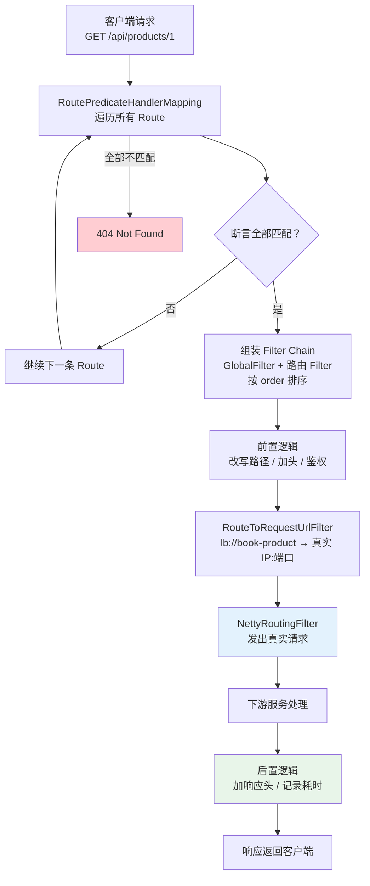
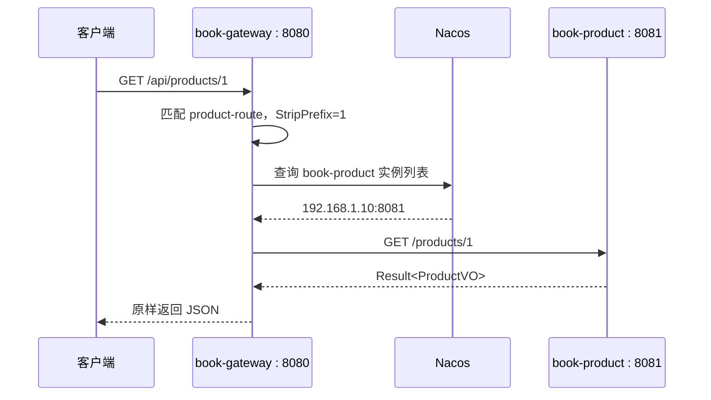
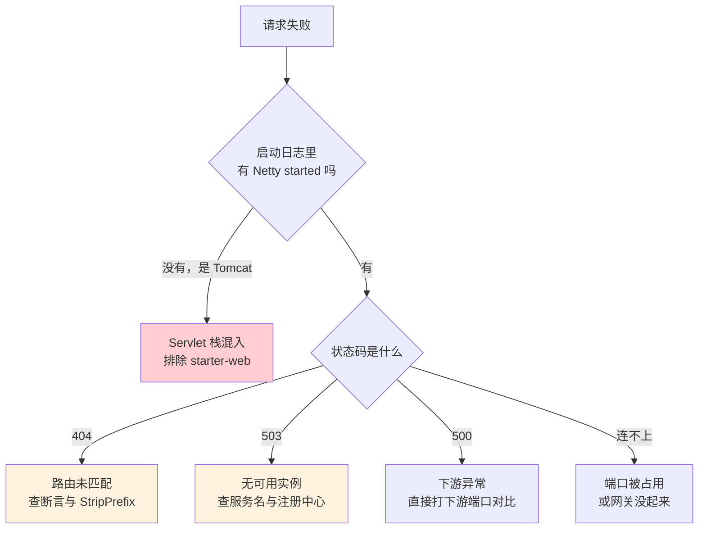

# Spring Cloud Gateway快速上手

## 课程目标

- 理解客户端直连三个服务的四个痛点：鉴权重复、跨域重复、客户端耦合、限流分散
- 掌握网关的职责边界，能判断哪些逻辑该放进网关、哪些必须留在服务内部
- 掌握 Spring Cloud Gateway 与 Zuul 1、Zuul 2、Nginx 的定位差异与选型依据
- 理解 SCG 基于 Spring WebFlux 与 Netty 的运行模型，能规避 WebFlux 与 MVC 混用导致的启动失败
- 掌握 Route、Predicate、Filter 三大概念，能说清一次请求在网关内部经过哪些环节
- 能够独立搭建 book-gateway 模块（8080），用 `lb://` 转发到 8081、8082、8083 并完成验证
- 能够定位 404、503、WebFlux 冲突、服务名无法解析四类高频故障
- 能够形成本项目的网关职责清单，明确哪些横切逻辑上移、哪些必须保留在服务内

## 回顾与导入

前六课我们做完了三件事：三个服务注册进 Nacos、订单服务用 OpenFeign 调商品与用户、用 LoadBalancer 与超时重试把"调用失败"控制在可接受范围。服务与服务之间已经通了，但客户端到服务之间还是一条条裸链路。

现在打开前端代码，`baseURL` 是这样的：商品页配 `http://192.168.1.10:8081`，个人中心配 `http://192.168.1.10:8082`，订单页配 `http://192.168.1.10:8083`。三个地址、三套跨域配置、三处登录取 Token 的逻辑，而小程序端还要再抄一遍。



真正麻烦的不是"配三个地址"，而是**横切逻辑的重复**。登录校验在每个服务写一遍，跨域配置在每个服务写一遍，限流规则在每个服务写一遍——加第四个服务时再抄一遍。抄漏一处，就是一个安全缺口。

本课引入 API 网关（API Gateway）。它把"所有外部流量必须先经过的那一层"收敛成一个独立模块 `book-gateway`（端口 8080），客户端从此只认识一个地址。这是网关篇的第一课，后面三课分别讲断言与过滤器、统一鉴权与限流、动态路由与高可用。

> **前置条件：** Nacos 3.x 已启动且存在 `dev` 命名空间；`book-product`、`book-user`、`book-order` 已运行在 8081、8082、8083 并注册成功。

## 没有网关的四个痛点

### 痛点清单

先把问题列清楚。下面四条里命中两条以上，就该引入网关了。

| 痛点 | 具体表现 | 直接后果 | 网关怎么解 |
| --- | --- | --- | --- |
| 鉴权重复 | 每个服务都要写一遍 Token 解析、白名单、失败响应 | 逻辑四份拷贝，改规则要改四处，漏一处即漏洞 | 鉴权前移到网关，服务只信任内部请求头 |
| 跨域重复 | 每个服务各配一份 CORS，预检请求各处理一遍 | 配置不一致，前端在某些页面莫名跨域失败 | 网关统一处理 `OPTIONS` 预检与响应头 |
| 客户端耦合 | 前端硬编码三个域名或 IP，服务拆分变化要发版 | 后端一拆服务，客户端就得跟着改 | 客户端只认网关，后端拓扑对外不可见 |
| 限流分散 | 每个服务自己做限流，配额无法按整体流量分配 | 攻击流量在三个服务间轮着打，谁都拦不住全貌 | 网关是唯一入口，全局限流与防刷在此实施 |

其中"客户端耦合"最容易被低估：它不影响功能，却让后端的每一次拆分都要拉上客户端一起发版。微服务追求的是服务可以独立演进，而客户端直连恰好把这个自由锁死了。

### 流量入口的收敛

网关的本质不是"多了一跳"，而是把 N 条客户端到服务的连线收敛成"客户端到网关一条、网关到服务内部若干条"。



注意图里网关到 Nacos 的那条虚线：网关不写死下游 IP，而是从注册中心拿实例列表，再配合 LoadBalancer 做选择。这一点决定了网关天生就具备"下游扩容、下线自动感知"的能力。

## 网关的职责边界

### 该做与不该做

网关是架构里的"瓶颈位置"，一旦放错东西，代价会被所有请求放大。

| 适合放在网关 | 不适合放在网关 |
| --- | --- |
| 路由转发、路径重写、协议转换 | 业务规则校验（库存是否足够、订单状态机） |
| 身份认证、Token 解析、权限粗筛 | 需要访问业务库的判断（用户是否黑名单） |
| 全局限流、防刷、IP 黑白名单 | 复杂的参数组装与聚合编排 |
| 跨域、响应头统一、灰度分流 | 大文件上传、长连接的协议处理 |
| 访问日志、链路标识注入、指标埋点 | 需要强一致的事务操作 |

### 三条判断标准

不确定某个逻辑要不要上移时，用这三条筛一遍：

1. **它是否与具体业务无关？** "校验 Token 是否有效"与业务无关，可以上移；"这个用户能不能买这本书"与业务强相关，不能。
2. **它出错时是否所有请求都受影响？** 网关是单点位置，越重的逻辑故障面越大。凡是需要查库、算价、调第三方的，都不要放。
3. **它是否需要与业务数据保持一致？** 需要强一致的逻辑留在服务内，网关只做"无状态的快速判断"。

> **结论：** 网关做**与业务解耦的横切关注点**，业务逻辑一律留在服务里。把网关写成"第二套业务系统"是微服务架构里最常见的返工点。

## 技术选型

### 四种方案对比

| 方案 | 运行模型 | 优点 | 缺点 | 适用场景 |
| --- | --- | --- | --- | --- |
| Zuul 1 | Servlet 阻塞 IO，一请求一线程 | 生态老、文档多、上手快 | 阻塞模型，高并发下线程数成为瓶颈；已停止演进 | 维护中的老项目 |
| Zuul 2 | Netty 异步非阻塞 | 性能优于 Zuul 1 | 开源版本长期未跟进 Spring 生态，集成成本高 | 极少新项目选用 |
| Nginx / OpenResty | C 模块 + Lua 扩展 | 吞吐极高、稳定、静态资源强 | 动态路由与 Java 生态结合弱，业务级扩展要写 Lua | 边缘接入层、静态资源、TLS 卸载 |
| Spring Cloud Gateway | Spring WebFlux + Netty 非阻塞 | 与 Spring 生态无缝、断言与过滤器可编程、易扩展 | 需要理解响应式模型，不能引 Servlet 栈 | Java 微服务体系的标准选择 |

选型结论很直接：**Java 体系内新建网关，选 Spring Cloud Gateway（下称 SCG）**。它与 Nacos、Sentinel、LoadBalancer 都是同一套 Spring Cloud 抽象，配置能复用、代码能复用、团队不用学第二门语言。

### Zuul 1 为什么被替代

Zuul 1 的模型是"一个请求占一个线程"。线程池大小决定了并发上限，下游一慢，线程被占满，网关自己就先挂了。SCG 用少量事件循环线程处理大量连接，下游慢只会让请求在队列里等，不会把线程耗光。

这不是"性能差一点"的区别，而是**故障模式的区别**：阻塞网关在下游抖动时会整体雪崩，非阻塞网关的退化是渐进的。

### Nginx 与 SCG 的分工

| 层次 | 组件 | 职责 |
| --- | --- | --- |
| 边缘层 | Nginx / F5 | TLS 卸载、静态资源、WAF、四层负载、公网入口 |
| 应用网关层 | SCG | 业务路由、鉴权、限流、灰度、日志与链路 |
| 服务层 | 三个业务服务 | 业务逻辑 |

两者不是二选一。生产上常见的是"公网 → Nginx → SCG 集群 → 微服务"，Nginx 管"能不能进来"，SCG 管"进来之后去哪、能不能做"。详见《网关动态路由、跨域与高可用》。

## SCG 的运行模型与硬约束

### WebFlux + Netty

SCG 建立在 Spring WebFlux 之上，底层默认是 Netty。它没有 `HttpServletRequest`，请求对象是 `ServerWebExchange`，响应式类型是 `Mono` 与 `Flux`。

| 概念 | Servlet 栈 | SCG（WebFlux 栈） |
| --- | --- | --- |
| 请求对象 | `HttpServletRequest` | `ServerWebExchange` |
| 线程模型 | 一请求一线程 | 事件循环 + 少量工作线程 |
| 阻塞调用 | 正常使用 | 会卡住事件循环，必须切到弹性线程池 |
| 过滤器 | `Filter` | `GatewayFilter` / `GlobalFilter` |
| 返回类型 | 直接写 `response` | `Mono<Void>` |

这意味着**在网关里写 `Thread.sleep`、JDBC 查询、同步 HTTP 调用都是危险操作**。它们会占住事件循环线程，让整个网关失去响应。

### 绝对不能引入 spring-boot-starter-web

这是新手在网关模块上踩的第一个坑，也是唯一一个"抄错一行依赖就直接启动失败"的坑。

SCG 的自动配置带有 Servlet 栈的排他检查。只要类路径上同时存在 `spring-boot-starter-web`（带来 `spring-webmvc` 与内嵌 Tomcat），启动时会看到这段报错：

```text
Spring MVC found on classpath, which is incompatible with Spring Cloud Gateway.
```

原因是 Spring Boot 的 `WebApplicationType` 推断逻辑：类路径上有 `DispatcherServlet` 与 `ServletContainer` 时，应用被判定为 Servlet 应用，于是启动 Tomcat 并加载 MVC 自动配置；而 SCG 的 `GatewayAutoConfiguration` 只在响应式应用下生效，两边对不上。

| 错误来源 | 典型报错 | 处理方式 |
| --- | --- | --- |
| 模块自身引了 `spring-boot-starter-web` | `Spring MVC found on classpath` | 删掉该依赖 |
| 依赖 `book-common`，而它在 pom 里带上了 web 依赖 | 同上，但本模块 pom 里看不到 web | 在 `book-common` 里把 web 依赖改为 `provided` 或 `optional` |
| 用了 `spring-boot-starter-webflux` 与 web 并存 | 同上 | 只保留 webflux（SCG 已自带） |
| 强行设置 `spring.main.web-application-type: reactive` | 可能启动成功但网关不工作 | 不要靠这个开关掩盖问题 |

排查依赖来源的标准动作是先看依赖树：

```bash
mvn -q dependency:tree -Dincludes=org.springframework.boot:spring-boot-starter-web
mvn -q dependency:tree -Dincludes=org.springframework:spring-webmvc
```

如果输出里出现了 `spring-boot-starter-web`，但本模块 `pom.xml` 里并没有写，那就是 `book-common` 带进来的。此时在网关模块里用 `<exclusion>` 排除，而不是去改公共模块（改了会影响三个业务服务）：

```xml
<dependency>
    <groupId>com.example</groupId>
    <artifactId>book-common</artifactId>
    <version>1.0.0-SNAPSHOT</version>
    <exclusions>
        <exclusion>
            <groupId>org.springframework.boot</groupId>
            <artifactId>spring-boot-starter-web</artifactId>
        </exclusion>
    </exclusions>
</dependency>
```

> **注意：** `spring.main.web-application-type: reactive` 能把启动"救"回来，但 `book-common` 里的 `GlobalExceptionHandler`、`OncePerRequestFilter` 等 Servlet 类型依然在类路径上，一旦被扫描到就会在运行期报错。正确做法是让依赖关系干净，不是让启动日志干净。

## 三大核心概念

### Route、Predicate、Filter

SCG 的配置模型只有三个概念，理解它们就理解了网关的全部行为。

| 概念 | 定义 | 关键属性 | 一句话理解 |
| --- | --- | --- | --- |
| Route（路由） | 网关的最小转发单元，由 ID、目标 URI、断言集合、过滤器集合组成 | `id`、`uri`、`predicates`、`filters` | "一条转发规则" |
| Predicate（断言） | 判断当前请求是否匹配这条路由，多个断言之间是**与**关系 | `Path`、`Method`、`Header` 等 | "什么请求走这条规则" |
| Filter（过滤器） | 在转发前后修改请求或响应，分路由级与全局级 | `StripPrefix`、`AddRequestHeader` 等 | "走这条规则时要做什么" |

一条路由的判定顺序是：**先匹配所有断言，全部通过后再执行过滤器链**。断言里只要有一个不通过，这条路由就被跳过，继续匹配下一条。

### 一次请求的完整流程



图里有两个细节值得记住：

- **`lb://` 的解析发生在过滤器链内部**，不是在配置加载时。所以网关启动时 Nacos 里没有实例也能启动成功，只是请求会 503。
- **前后置逻辑在同一个过滤器里**，靠 `chain.filter(exchange)` 分割：调用之前是前置，`then(...)` 里是后置。

## 创建 book-gateway 模块

### 步骤一：模块结构与依赖

在父工程 `book-microservice` 下新建 `book-gateway` 模块，包名 `com.example.gateway`，端口 8080。

```xml
<project xmlns="http://maven.apache.org/POM/4.0.0"
         xmlns:xsi="http://www.w3.org/2001/XMLSchema-instance"
         xsi:schemaLocation="http://maven.apache.org/POM/4.0.0 https://maven.apache.org/xsd/maven-4.0.0.xsd">
    <modelVersion>4.0.0</modelVersion>

    <parent>
        <groupId>com.example</groupId>
        <artifactId>book-microservice</artifactId>
        <version>1.0.0-SNAPSHOT</version>
    </parent>

    <artifactId>book-gateway</artifactId>
    <name>book-gateway</name>

    <dependencies>
        <dependency>
            <groupId>org.springframework.cloud</groupId>
            <artifactId>spring-cloud-starter-gateway</artifactId>
        </dependency>
        <dependency>
            <groupId>com.alibaba.cloud</groupId>
            <artifactId>spring-cloud-starter-alibaba-nacos-discovery</artifactId>
        </dependency>
        <dependency>
            <groupId>org.springframework.cloud</groupId>
            <artifactId>spring-cloud-starter-loadbalancer</artifactId>
        </dependency>
        <dependency>
            <groupId>org.springframework.boot</groupId>
            <artifactId>spring-boot-starter-actuator</artifactId>
        </dependency>
        <dependency>
            <groupId>org.projectlombok</groupId>
            <artifactId>lombok</artifactId>
            <optional>true</optional>
        </dependency>
    </dependencies>
</project>
```

三个依赖各司其职：`spring-cloud-starter-gateway` 提供网关核心（内部已带 `spring-boot-starter-webflux`）；`spring-cloud-starter-alibaba-nacos-discovery` 让网关能发现三个业务服务；`spring-cloud-starter-loadbalancer` 负责把 `lb://服务名` 解析成具体实例。

> **提示：** 版本由父 POM 的三份 BOM 统一管理，这里一个 `<version>` 都不写。手写版本会覆盖 BOM 的仲裁结果，是"网关版本与 Spring Cloud 不匹配"的常见起因。

### 步骤二：路由与注册中心配置

```yaml
server:
  port: 8080

spring:
  application:
    name: book-gateway
  cloud:
    nacos:
      discovery:
        server-addr: 127.0.0.1:8848
        namespace: dev
        username: nacos
        password: nacos
    gateway:
      routes:
        - id: product-route
          uri: lb://book-product
          predicates:
            - Path=/api/products/**
          filters:
            - StripPrefix=1
        - id: user-route
          uri: lb://book-user
          predicates:
            - Path=/api/users/**
          filters:
            - StripPrefix=1
        - id: order-route
          uri: lb://book-order
          predicates:
            - Path=/api/orders/**
          filters:
            - StripPrefix=1
  config:
    import: optional:nacos:book-gateway-dev.yml?group=DEFAULT_GROUP

management:
  endpoints:
    web:
      exposure:
        include: health,info,gateway
```

这段配置解决"请求从哪来到哪去"的问题。三个关键点：

- `uri: lb://book-product` 中的 `lb` 是 LoadBalancer 的协议前缀，网关拿到服务名后去 Nacos 取实例列表再选一个，写死 IP 就失去了注册中心的意义。
- `Path=/api/products/**` 是唯一的断言，匹配该前缀下的所有路径（含子路径）。匹配不上就是 404，这是最常见的"网关不生效"。
- `StripPrefix=1` 表示转发前去掉路径的第一段。`/api/products/1` 去掉 `/api` 后变成 `/products/1` 发给下游。

### 路径映射约定

`StripPrefix=1` 把"对外前缀"与"内部路径"分开了，这正是引入网关后应当确立的约定：`/api` 由网关独占，服务内部的控制器不再重复携带它。

| 对外路径（网关 8080） | 剥离后（下游可见） | 目标服务 | 下游控制器 |
| --- | --- | --- | --- |
| `/api/products/{id}` | `/products/{id}` | book-product : 8081 | `@RequestMapping("/products")` |
| `/api/users/{id}` | `/users/{id}` | book-user : 8082 | `@RequestMapping("/users")` |
| `/api/orders/{id}` | `/orders/{id}` | book-order : 8083 | `@RequestMapping("/orders")` |

需要同步调整两处：三个服务的控制器类去掉 `/api` 前缀；`book-order` 里的 Feign 客户端 `@FeignClient(path = "/api/products")` 改为 `path = "/products"`（见《OpenFeign快速上手》）。

> **注意：** 如果不想动存量控制器，就必须删掉 `StripPrefix=1`，让网关路径与下游路径完全一致。两个做法只能选一个，混着用会得到 404——这个现象本课后面的排查一节还会再遇到。

### 步骤三：启动类

```java
package com.example.gateway;

import org.springframework.boot.SpringApplication;
import org.springframework.boot.autoconfigure.SpringBootApplication;

@SpringBootApplication
public class GatewayApplication {

    public static void main(String[] args) {
        SpringApplication.run(GatewayApplication.class, args);
    }
}
```

启动类里没有任何网关专属注解。SCG 的装配全部由 `spring-cloud-starter-gateway` 的自动配置完成，写 `@EnableDiscoveryClient` 也可以，但 Spring Cloud 2025.0.0 已不需要它显式开启服务发现。

启动时应该看到两个关键信号：日志里出现 `Netty started on port 8080`（而不是 `Tomcat started`），以及 Nacos 注册成功的输出。看到 Tomcat 就说明 Servlet 栈进了类路径，回到上一节排查依赖。

## 验证

### 三条链路一次打通

```bash
curl.exe -s http://127.0.0.1:8080/api/products/1
curl.exe -s http://127.0.0.1:8080/api/users/1
curl.exe -s http://127.0.0.1:8080/api/orders/1
```

```json
{"code":200,"message":"success","data":{"id":1,"name":"Spring Cloud Alibaba实战","price":89.00,"stock":120}}
```

三条命令都返回 200 且数据正确，说明"路由匹配 → 断言通过 → 剥离前缀 → 负载均衡 → 转发"整条链路是通的。

### 验证清单

| 验证项 | 操作 | 期望结果 | 说明 |
| --- | --- | --- | --- |
| 路由生效 | 访问 `/api/products/1` | 200，返回商品数据 | 证明断言与转发都正确 |
| 前缀剥离 | 下游日志里的请求路径为 `/products/1` | 不带 `/api` | 证明 `StripPrefix=1` 生效 |
| 负载均衡 | 启动两个 book-product 实例，连续访问 | 响应来自不同实例 | 证明 `lb://` 走了注册中心 |
| 自动感知 | 停掉一个 book-product 实例 | 请求全部成功，无 503 | 证明实例列表实时刷新 |
| 未匹配路径 | 访问 `/api/unknown/1` | 404 | 证明没有路由兜底 |



这张时序图解释了一个常被误解的点：网关默认**不修改响应体**，也不做协议转换。下游返回什么，客户端就收到什么。

## 常见问题排查

### 四类高频故障

| 现象 | 最可能的原因 | 排查动作 |
| --- | --- | --- |
| 404 Not Found | 断言没匹配上；`StripPrefix` 剥多或剥少；下游控制器路径与剥离结果不一致 | 打开 `/actuator/gateway/routes` 看已加载的路由与断言；对照路径映射表 |
| 503 Service Unavailable | 服务名拼错；Nacos 里没有健康实例；实例注册在别的命名空间 | 控制台确认服务列表与命名空间；检查 `lb://` 后的名字是否与 `spring.application.name` 完全一致 |
| 启动报 Spring MVC found on classpath | 类路径上同时有 `spring-boot-starter-web` 与 webflux | `mvn dependency:tree` 定位来源，用 `<exclusion>` 排除 |
| 启动失败，提示 Unable to find GatewayFilterFactory | 过滤器名字拼错，或少了参数 | 对照官方工厂名，参数用 `=` 或 `,` 分隔 |
| 启动失败，提示 Unable to find instance for book-product | 没有 `spring-cloud-starter-loadbalancer`，或缺少服务发现客户端 | 确认依赖树与 `spring.cloud.nacos.discovery` 配置 |

### 固定排查顺序



顺序的关键在于**先区分"网关没起来"与"网关起来了但转错了"**。这两种情况的排查路径完全不同，混在一起看日志只会越看越乱。

### 用 actuator 看清网关的内心

引入 actuator 之后，网关会暴露已加载的路由快照，这是排查 404 最快的手段：

```bash
curl.exe -s http://127.0.0.1:8080/actuator/gateway/routes
```

```json
[{"route_id":"product-route","route_definition":{"id":"product-route","predicates":[{"name":"Path","args":{"pattern":"/api/products/**"}}],"filters":[{"name":"StripPrefix","args":{"parts":"1"}}],"uri":"lb://book-product","order":0},"order":0}]
```

如果这个列表是空的，说明配置根本没被解析——大概率是 `spring.cloud.gateway.routes` 写错了层级，或者被 Nacos 上的同名配置整体覆盖。

## 注意事项

1. **网关模块不要引 `spring-boot-starter-web`**：这是唯一一个会导致"启动即失败"的依赖错误，公共模块带进来时用 `<exclusion>` 在网关侧排除，不要改公共模块影响业务服务。
2. **不要在网关里做阻塞调用**：事件循环线程被占住会让全部请求排队，需要访问数据库或第三方时用 `Mono.fromCallable(...).subscribeOn(Schedulers.boundedElastic())`。
3. **`lb://` 不等于"自动高可用"**：它只保证从注册中心取实例，实例不健康是否被剔除取决于心跳与健康检查配置。
4. **`StripPrefix` 与下游路径必须成对设计**：对外前缀由网关独占，服务内部路径不要再带 `/api`，两者混用是 404 的头号原因。
5. **网关默认透传一切请求头**：包括 `Cookie`、`Authorization`，安全相关的头要显式清洗，不要指望框架帮你过滤。
6. **8080 与 Nacos 3.x 控制台端口冲突**：Nacos 3.x 控制台默认也用 8080，本机同时启动会报端口占用，把控制台端口改掉（`nacos.console.port`）或把网关换到 8088。
7. **网关是新的单点**：单实例网关挂了等于全站不可用，生产必须多实例加前置负载均衡，详见《网关动态路由、跨域与高可用》。
8. **SCG 的 starter 名称在新版本中有调整**：Spring Cloud Gateway 拆分出 WebFlux 与 MVC 两个实现后，官方推荐名称为 `spring-cloud-starter-gateway-server-webflux`；本课程统一使用 `spring-cloud-starter-gateway`，若依赖解析失败以官方最新稳定版为准。

## 小结

本节课我们学习了：

1. **四个痛点**：鉴权重复、跨域重复、客户端耦合、限流分散，是引入网关的真实动因，其中客户端耦合决定了后端能否独立演进。
2. **职责边界**：网关做与业务解耦的横切关注点，任何需要查库、强一致、复杂编排的逻辑都留在服务内。
3. **技术选型**：Zuul 1 是阻塞模型已停止演进，Zuul 2 生态弱，Nginx 管边缘接入，Java 体系内新建网关选 SCG。
4. **WebFlux 约束**：SCG 跑在 Netty 上，请求对象是 `ServerWebExchange`，绝对不能在网关里做阻塞调用。
5. **不能引 starter-web**：类路径上同时存在 MVC 与 WebFlux 会直接启动失败，排查手段是依赖树加 `<exclusion>`。
6. **三大概念**：Route 是一条规则，Predicate 决定"谁走这条规则"，Filter 决定"走的时候做什么"，断言全通过才进过滤器链。
7. **模块搭建**：三个依赖、三段路由、一个空启动类即可跑通，`lb://` 解析发生在请求期而非启动期。
8. **故障定位**：先分清"没起来"与"转错了"，404 查断言与前缀剥离，503 查服务名与注册中心，再用 actuator 的路由快照确认配置是否真的被加载。

## 作业

### 作业一：完成 book-gateway 的搭建与三链路验证

1. 新建 `book-gateway` 模块，按本课配置三条路由，启动后确认日志中是 Netty 而非 Tomcat。
2. 用三条 curl 命令验证 8080 能访问 8081、8082、8083，并用 `/actuator/gateway/routes` 确认三条路由都被加载。
3. 启动两个 `book-product` 实例（`--server.port=8084`），连续请求 10 次，统计响应来自哪个实例，验证负载均衡确实生效。

### 作业二：制造并修复四类故障

1. 在 `book-gateway` 的 pom 中临时加入 `spring-boot-starter-web`，记录启动报错原文，说明为什么"启动失败"比"启动成功但不转发"更好排查。
2. 把 `StripPrefix=1` 删掉但保持下游控制器不变，访问 `/api/products/1` 观察结果；再把它改回 `2`，对比两次的状态码与下游日志路径。
3. 把 `uri` 改成 `lb://book-productt`，记录客户端看到的状态码与网关日志，说明为什么这类错误不影响启动。

### 作业三：设计网关的职责清单

1. 列出你所在项目当前散落在各服务里的横切逻辑（至少 6 项），逐项判断该上移到网关还是留在服务内，用本课的三条判断标准说明理由。
2. 画出上移后的流量拓扑，标注哪些请求会经过网关、哪些走内部直连（如 Feign 调用是否也该绕回网关），并给出结论。
