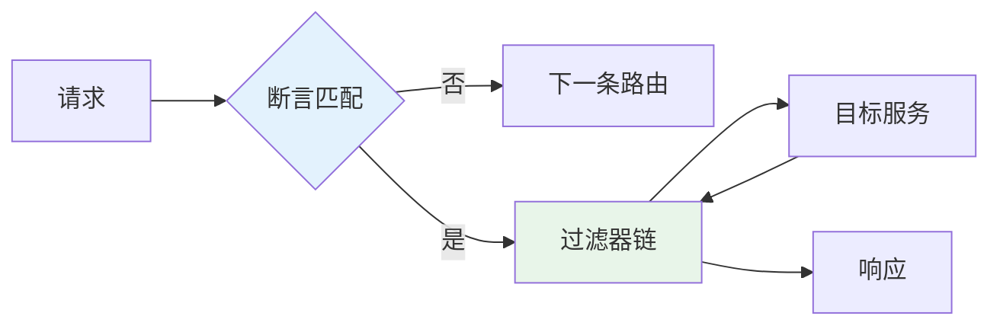
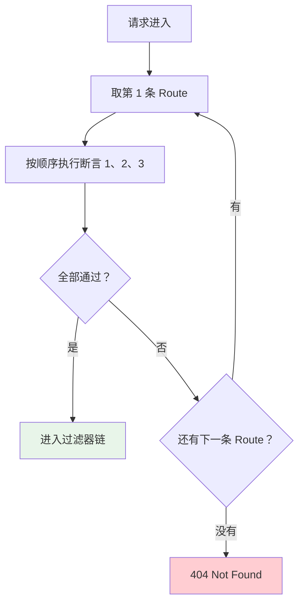
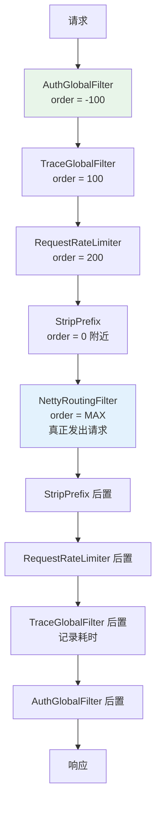
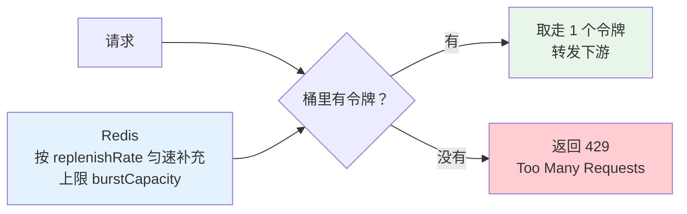

# 路由断言工厂与过滤器

## 课程目标

- 掌握断言工厂（Route Predicate Factory）的命名规则、配置结构与"全部匹配"语义
- 掌握 Path、Method、Header、Query、Cookie、Host、时间、IP、Weight 等内置断言的用法与典型场景
- 能够继承 `AbstractRoutePredicateFactory` 编写自定义断言，并同时支持完整写法与短写形式
- 理解 GatewayFilter 与 GlobalFilter 的分工，掌握常见内置过滤器的配置方式
- 掌握过滤器 order 值与 pre/post 的执行语义，能画出完整的执行顺序
- 能够编写记录耗时与 traceId 的 GlobalFilter，并验证其作用于所有路由
- 掌握 `RequestRateLimiter` 基于 Redis 令牌桶的限流配置，能验证限流生效并解释回调结果

## 回顾与导入

上一课我们把三个服务收进了 `book-gateway`，用三条路由把 `/api/products/**`、`/api/users/**`、`/api/orders/**` 转发到 8081、8082、8083。功能通了，但配置里能用的只有两个东西：一个 `Path` 断言，一个 `StripPrefix` 过滤器。

真实需求很快就超出这两个的能力。运营要在灰度期间让 10% 的请求打到新版本商品服务；安全要求只允许公司内网访问订单查询；前端要求 `/api/v1/products/**` 统一重写成 `/products/**` 且响应里补一个版本头；压测期间需要对商品查询限流，超出的请求返回 429。

这些需求没有一条需要改代码，全部由**断言**和**过滤器**的组合完成。断言回答"这个请求该不该走这条路由"，过滤器回答"走的时候要对请求和响应做什么"。这两者构成了 SCG 的全部可变行为。



本课把这两个能力拆开讲透：先过一遍内置断言并逐个给出配置片段，再用一个自定义断言说明扩展点；然后讲过滤器的分类与执行顺序，最后落一个能直接上生产的功能——Redis 令牌桶限流。

## 断言工厂

### 命名规则与配置结构

SCG 的断言来自 `RoutePredicateFactory` 接口，内置实现都以 `RoutePredicateFactory` 结尾。配置里写的名字，就是类名去掉这个后缀：`PathRoutePredicateFactory` 对应 `Path`，`WeightRoutePredicateFactory` 对应 `Weight`。

一条路由可以配多个断言，它们之间是**逻辑与**：全部通过才转发，任何一个不通过就跳过这条路由。

| 写法 | 示例 | 适用场景 |
| --- | --- | --- |
| 短写形式 | `- Path=/api/products/**` | 只有一个参数，最常用 |
| 完整形式 | `- name: Path` + `args` | 参数多、需要分行阅读时 |
| 多参数短写 | `- Header=X-Client-Type, vip` | 参数顺序由 `shortcutFieldOrder` 固定 |

```yaml
spring:
  cloud:
    gateway:
      routes:
        - id: product-route
          uri: lb://book-product
          predicates:
            - name: Path
              args:
                pattern: /api/products/**
            - name: Method
              args:
                - GET
                - POST
```

短写与完整写法完全等价，编译后是同一个 `Predicate` 对象。团队内约定一种即可，混用会让 review 变慢。

### 判断流程



理解"按路由顺序逐条尝试"很重要：路由不是按最长前缀匹配，而是**声明顺序**。所以把精确度高的路由写在前面，兜底路由写在最后。

### 内置断言工厂速查

| 断言 | 作用 | yml 片段 |
| --- | --- | --- |
| Path | 按路径匹配，支持 `/**` 通配 | `- Path=/api/products/**,/api/books/**` |
| Method | 按 HTTP 方法匹配 | `- Method=GET,POST` |
| Header | 按请求头匹配，支持正则 | `- Header=X-Client-Type, vip` |
| Query | 按查询参数匹配，支持正则 | `- Query=page,\d+` |
| Cookie | 按 Cookie 名与值匹配 | `- Cookie=sessionId, [a-z0-9]{32}` |
| Host | 按 Host 头匹配，支持通配 | `- Host=**.example.com` |
| Before | 早于指定时间才匹配 | `- Before=2026-01-01T00:00:00+08:00[Asia/Shanghai]` |
| After | 晚于指定时间才匹配 | `- After=2026-06-01T00:00:00+08:00[Asia/Shanghai]` |
| Between | 时间区间内匹配 | `- Between=2026-06-01T00:00:00+08:00,2026-06-08T00:00:00+08:00` |
| RemoteAddr | 按来源 IP 段匹配 | `- RemoteAddr=192.168.1.0/24` |
| Weight | 按权重分流，用于灰度 | `- Weight=product-group, 80` |
| XForwardedRemoteAddr | 按 `X-Forwarded-For` 中的 IP 段匹配 | `- XForwardedRemoteAddr=10.0.0.0/8` |

### 组合示例一：内网白名单加时间窗口

订单查询只允许公司内网访问，且活动期间才开放：

```yaml
- id: order-admin-route
  uri: lb://book-order
  predicates:
    - Path=/api/admin/orders/**
    - Method=GET
    - RemoteAddr=192.168.1.0/24,10.10.0.0/16
    - After=2026-06-01T00:00:00+08:00[Asia/Shanghai]
    - Before=2026-06-08T00:00:00+08:00[Asia/Shanghai]
  filters:
    - StripPrefix=2
```

四个断言的语义是：路径对、方法是 GET、来源在内网段、当前时间在活动窗口内。少一个就不转发，返回 404。

> **注意：** 时间断言必须带时区。只写 `2026-06-01T00:00:00` 会按 JVM 默认时区解析，容器里通常是 UTC，与北京时间差 8 小时，活动会提前或推迟 8 小时生效。推荐写成 `2026-06-01T00:00:00+08:00[Asia/Shanghai]` 的形式。

### 组合示例二：Weight 断言做灰度

`Weight` 是唯一一个"带状态"的断言：它在同一分组内按权重做随机分流，网关内部维护计数器。

```yaml
- id: product-gray-route
  uri: lb://book-product-gray
  predicates:
    - Path=/api/products/**
    - Weight=product-group, 10
  filters:
    - StripPrefix=1

- id: product-stable-route
  uri: lb://book-product
  predicates:
    - Path=/api/products/**
    - Weight=product-group, 90
  filters:
    - StripPrefix=1
```

两条路由共享分组名 `product-group`，权重 10 与 90 意味着大约十分之一的流量进入灰度服务。两个权重之和不必等于 100，占比由 `自身权重 / 组内总权重` 决定。

> **提示：** `Weight` 的分流发生在**网关进程内**，多实例网关时各自独立计算；且它不支持按用户粘性分流，同一个用户可能在两个版本之间来回跳。需要粘性灰度时按用户 ID 哈希分流，见《网关动态路由、跨域与高可用》。

### 组合示例三：XForwardedRemoteAddr 与 RemoteAddr 的区别

经过 Nginx 之后，网关看到的来源 IP 是 Nginx 的地址，`RemoteAddr` 会失效。此时要用 `XForwardedRemoteAddr` 读 `X-Forwarded-For`。

```yaml
- id: product-internal-route
  uri: lb://book-product
  predicates:
    - Path=/api/internal/products/**
    - XForwardedRemoteAddr=10.0.0.0/8,172.16.0.0/12
  filters:
    - StripPrefix=2
```

| 断言 | 取值来源 | 适用位置 | 风险 |
| --- | --- | --- | --- |
| RemoteAddr | TCP 连接的对端地址 | 网关直接对外 | 有代理时取到的是代理 IP |
| XForwardedRemoteAddr | `X-Forwarded-For` 头 | 网关在可信代理之后 | 头可被伪造，必须由最外层代理覆写 |

> **注意：** 客户端可以自己伪造 `X-Forwarded-For`。只在前置 Nginx 明确执行 `proxy_set_header X-Forwarded-For $proxy_add_x_forwarded_for`（或直接 `$remote_addr`）的前提下，这个断言才是可信的。

## 自定义断言工厂

### 为什么需要自定义

内置断言覆盖了路径、方法、头、IP、时间，但业务侧常有自己的判断维度：客户端类型、租户套餐、AB 实验分组。这些判断的共同点是**只看请求本身**，不查库、不依赖业务状态——符合这个前提才适合做成断言。

下面实现一个"按客户端类型匹配"的断言：请求头 `X-Client-Type` 等于指定值才匹配。

### 完整实现

```java
package com.example.gateway.predicate;

import lombok.Data;
import org.springframework.cloud.gateway.handler.predicate.AbstractRoutePredicateFactory;
import org.springframework.stereotype.Component;
import org.springframework.util.StringUtils;
import org.springframework.web.server.ServerWebExchange;

import java.util.List;
import java.util.function.Predicate;

@Component
public class VipRoutePredicateFactory
        extends AbstractRoutePredicateFactory<VipRoutePredicateFactory.Config> {

    public VipRoutePredicateFactory() {
        super(Config.class);
    }

    @Override
    public List<String> shortcutFieldOrder() {
        return List.of("headerName", "headerValue");
    }

    @Override
    public Predicate<ServerWebExchange> apply(Config config) {
        return exchange -> {
            String actual = exchange.getRequest()
                    .getHeaders()
                    .getFirst(config.getHeaderName());
            if (!StringUtils.hasText(actual)) {
                return false;
            }
            return actual.equalsIgnoreCase(config.getHeaderValue());
        };
    }

    @Data
    public static class Config {

        private String headerName = "X-Client-Type";

        private String headerValue = "vip";
    }
}
```

三个必须遵守的点：

- **类名必须以 `RoutePredicateFactory` 结尾**，否则 SCG 不会把它注册为断言工厂；前缀 `Vip` 就是配置里用的名字。
- **必须标注 `@Component`**，SCG 通过容器收集所有 `RoutePredicateFactory` 类型的 Bean。
- **泛型必须是内部静态 `Config` 类**，`apply` 返回 `Predicate<ServerWebExchange>` 而非布尔值——返回的是一个可复用的判断函数。

### 两种配置写法

```yaml
- id: vip-product-route
  uri: lb://book-product
  predicates:
    - Path=/api/products/**
    - name: Vip
      args:
        headerName: X-Client-Type
        headerValue: vip
  filters:
    - StripPrefix=1
```

```yaml
- id: vip-product-route
  uri: lb://book-product
  predicates:
    - Path=/api/products/**
    - Vip=X-Client-Type,vip
  filters:
    - StripPrefix=1
```

短写形式能工作，靠的是 `shortcutFieldOrder()`：它声明了逗号分隔的参数依次绑定到 `headerName`、`headerValue`。不重写这个方法，短写形式就没有参数可绑，会直接报错。

### 验证与注意

```bash
curl.exe -s -o NUL -w "%{http_code}\n" http://127.0.0.1:8080/api/products/1
curl.exe -s -o NUL -w "%{http_code}\n" -H "X-Client-Type: vip" http://127.0.0.1:8080/api/products/1
```

第一行返回 404（缺头，断言不通过），第二行返回 200。这个对比同时证明了"断言不通过 = 404"，而不是 403。

| 常见错误 | 现象 | 原因 |
| --- | --- | --- |
| 类名没以 `RoutePredicateFactory` 结尾 | yml 里的 `Vip` 报无法解析 | SCG 按类名后缀发现工厂 |
| 忘了 `@Component` | 同上 | 未被容器收集 |
| `Config` 不是静态内部类 | 启动报实例化失败 | 反射需要无参构造 |
| 没重写 `shortcutFieldOrder` 却用短写 | 启动报参数数量不匹配 | 短写按该方法的顺序绑定 |
| 在 `apply` 里查数据库 | 网关吞吐骤降、线程池打满 | 断言在事件循环里执行，不能阻塞 |

## 过滤器

### 两类过滤器与内置工厂

| 类型 | 接口 | 作用范围 | 注册方式 | 典型用途 |
| --- | --- | --- | --- | --- |
| 路由过滤器 | `GatewayFilter` | 只作用于配置了它的那条路由 | yml 的 `filters` 或 `default-filters` | 路径重写、加头、限流、重试 |
| 全局过滤器 | `GlobalFilter` | 作用于所有路由 | 声明为 Bean | 鉴权、链路标识、日志、耗时统计 |
| 内置工厂 | 实现 `GatewayFilterFactory` | 由 yml 引用 | `- 工厂名=参数` | 无需写代码即可组合出常用能力 |

判断标准很简单：**只对某些路由生效的用 GatewayFilter，对所有路由生效的用 GlobalFilter**。鉴权、traceId 这类横切关注点如果写成路由过滤器，新增路由时忘配一次就是安全漏洞。

### 常见内置过滤器

| 过滤器 | 作用 | yml 片段 |
| --- | --- | --- |
| AddRequestHeader | 给下游请求加头 | `- AddRequestHeader=X-Gateway, book-gateway` |
| AddResponseHeader | 给响应加头 | `- AddResponseHeader=X-Version, v1` |
| RemoveRequestHeader | 删掉指定请求头 | `- RemoveRequestHeader=Cookie` |
| RewritePath | 正则重写路径 | `- RewritePath=/api/v1/(?<seg>.*), /$\{seg}` |
| PrefixPath | 给路径加前缀 | `- PrefixPath=/api` |
| SetStatus | 直接返回指定状态码 | `- SetStatus=401` |
| Retry | 失败重试 | `- name: Retry` + `args: retries: 3` |
| CircuitBreaker | 熔断降级 | `- name: CircuitBreaker` + `args: name: productCb` |
| RequestRateLimiter | 限流 | `- name: RequestRateLimiter` + `args` |

`RewritePath` 是版本化改造里最常用的一个：对外保留 `/api/v1/...`，内部仍然是 `/products/...`。

```yaml
- id: product-v1-route
  uri: lb://book-product
  predicates:
    - Path=/api/v1/products/**
  filters:
    - RewritePath=/api/v1/(?<segment>.*), /$\{segment}
    - AddResponseHeader=X-Api-Version, v1
```

> **注意：** yml 里写 `` $\{segment} `` 是为了转义 `${}`，避免被 Spring 当成占位符提前解析。写成 `${segment}` 会在启动时报"无法解析占位符"，这是 `RewritePath` 最常见的翻车点。

### default-filters 的定位

`spring.cloud.gateway.default-filters` 里配的东西会加到**每一条路由**上，语法与 `filters` 相同：

```yaml
spring:
  cloud:
    gateway:
      default-filters:
        - AddResponseHeader=X-Gateway, book-gateway
        - DedupeResponseHeader=Access-Control-Allow-Origin Access-Control-Allow-Credentials, RETAIN_FIRST
```

`DedupeResponseHeader` 解决的是网关与下游都加了 CORS 头导致浏览器报"头重复"的经典问题，跨域配置那一课会再遇到。它适合放在 `default-filters`，因为所有路由都需要。

## 执行顺序

### order 值与前后的语义

所有过滤器（全局 + 路由级）会被合并成一个链，按 `Ordered` 排序后执行。`order` 越小越靠前。



关键规律：**前置按 order 升序，后置按 order 降序**，像栈一样先进后出。这意味着 `order` 最小的过滤器，其"后置代码"最后执行——正好适合做"记录耗时"（第一个进来，最后一个出去）。

```java
@Override
public Mono<Void> filter(ServerWebExchange exchange, GatewayFilterChain chain) {
    long start = System.currentTimeMillis();
    return chain.filter(exchange)
            .then(Mono.fromRunnable(() -> {
                long cost = System.currentTimeMillis() - start;
                // 这里是 post 逻辑，order 最小的过滤器最后执行
            }));
}
```

`chain.filter(...)` 之前是 pre，之后拼上去的 `then(...)` 是 post。忘记这一点，就会写出"耗时永远是 0"的日志。

### 常见组件的 order 参考

| 组件 | order 量级 | 说明 |
| --- | --- | --- |
| `AdaptCachedBodyGlobalFilter` | 负值 | 缓存请求体，鉴权要读 body 时依赖它 |
| 自定义鉴权 GlobalFilter | -100 ~ -50 | 必须在限流之前，先把非法请求挡掉 |
| 自定义 traceId GlobalFilter | 100 | 尽量靠前，保证后续日志都有 traceId |
| `RequestRateLimiter` | 200 左右 | 在鉴权之后，避免为非法请求消耗令牌 |
| `StripPrefix` / `RewritePath` | 0 附近 | 只改路径，顺序不敏感 |
| `NettyRoutingFilter` | `Integer.MAX_VALUE` | 真正转发，最后执行 |

> **结论：** order 不是随便填的数字，它表达的是"谁必须先跑"。鉴权必须先于限流（否则攻击者能靠伪造请求耗尽令牌桶），traceId 必须早于所有日志。

## 自定义 GlobalFilter

### 记录耗时与 traceId

这个过滤器解决两个问题：上游没传 traceId 时生成一个并透传给下游，以及在响应回来时打印一条带耗时的访问日志。

```java
package com.example.gateway.filter;

import lombok.extern.slf4j.Slf4j;
import org.springframework.cloud.gateway.filter.GatewayFilterChain;
import org.springframework.cloud.gateway.filter.GlobalFilter;
import org.springframework.core.Ordered;
import org.springframework.http.server.reactive.ServerHttpRequest;
import org.springframework.stereotype.Component;
import org.springframework.web.server.ServerWebExchange;
import reactor.core.publisher.Mono;

import java.util.UUID;

@Slf4j
@Component
public class AccessLogGlobalFilter implements GlobalFilter, Ordered {

    private static final String TRACE_ID = "X-Trace-Id";
    private static final String START_TIME = "gatewayStartTime";

    @Override
    public Mono<Void> filter(ServerWebExchange exchange, GatewayFilterChain chain) {
        ServerHttpRequest request = exchange.getRequest();
        String traceId = request.getHeaders().getFirst(TRACE_ID);
        if (traceId == null || traceId.isBlank()) {
            traceId = UUID.randomUUID().toString().replace("-", "");
        }
        String currentTraceId = traceId;

        ServerHttpRequest mutated = request.mutate()
                .header(TRACE_ID, currentTraceId)
                .build();
        exchange.getAttributes().put(START_TIME, System.currentTimeMillis());

        return chain.filter(exchange.mutate().request(mutated).build())
                .doFinally(signal -> {
                    Long start = exchange.getAttribute(START_TIME);
                    long cost = start == null ? -1L : System.currentTimeMillis() - start;
                    log.info("traceId={} method={} path={} status={} cost={}ms",
                            currentTraceId,
                            request.getMethod(),
                            request.getURI().getPath(),
                            exchange.getResponse().getStatusCode(),
                            cost);
                });
    }

    @Override
    public int getOrder() {
        return Ordered.HIGHEST_PRECEDENCE + 100;
    }
}
```

四个实现要点：

- **改写请求必须用 `mutate()`**，`ServerHttpRequest` 不可变，直接 `setHeader` 不存在。
- **属性要存在 `exchange` 上**，而不是成员变量。网关是并发处理请求的，成员变量会被不同请求互相覆盖。
- **后置逻辑用 `doFinally`**，它在成功、失败、取消三种情况下都会执行，比 `then` 更全面。
- **`getStatusCode()` 可能为 null**，下游连接失败时响应还没设置状态码，直接调用方法容易在日志里抛空指针。

### 验证

```bash
curl.exe -s -i http://127.0.0.1:8080/api/products/1 | findstr /i "x-trace-id"
curl.exe -s -H "X-Trace-Id: abc123" http://127.0.0.1:8080/api/products/1
```

第一条能拿到网关生成的 traceId（下游若把请求头回显到响应），第二条的日志里 traceId 应该是 `abc123` 而不是新生成的值——证明"有则沿用、无则生成"。

日志输出形如：

```text
traceId=abc123 method=GET path=/api/products/1 status=200 cost=37ms
```

## Redis 令牌桶限流

### 令牌桶模型

`RequestRateLimiter` 是内置过滤器，底层用 Redis + Lua 实现分布式令牌桶，多个网关实例共享同一个桶。



两个参数决定行为：`replenishRate` 是每秒补充的令牌数（等于长期平均 QPS），`burstCapacity` 是桶容量（等于允许的瞬时突发量）。把 `burstCapacity` 设成 `replenishRate` 的 2 倍，是"允许一点突发但长期限速"的常见起点。

### 配置

先加 Redis 依赖与连接信息：

```xml
<dependency>
    <groupId>org.springframework.boot</groupId>
    <artifactId>spring-boot-starter-data-redis-reactive</artifactId>
</dependency>
```

```yaml
spring:
  data:
    redis:
      host: 127.0.0.1
      port: 6379
      database: 0
```

再给路由挂上限流过滤器：

```yaml
      routes:
        - id: product-route
          uri: lb://book-product
          predicates:
            - Path=/api/products/**
          filters:
            - StripPrefix=1
            - name: RequestRateLimiter
              args:
                redis-rate-limiter.replenishRate: 10
                redis-rate-limiter.burstCapacity: 20
                redis-rate-limiter.requestedTokens: 1
                key-resolver: "#{@apiKeyResolver}"
```

`key-resolver` 用 SpEL 引用容器里的 Bean，`#{@beanName}` 的写法不能省。它决定"按什么维度限流"：按用户、按 IP、按接口。

### KeyResolver

```java
package com.example.gateway.config;

import org.springframework.cloud.gateway.filter.ratelimit.KeyResolver;
import org.springframework.context.annotation.Bean;
import org.springframework.context.annotation.Configuration;
import org.springframework.util.StringUtils;
import reactor.core.publisher.Mono;

@Configuration
public class RateLimitConfig {

    @Bean
    public KeyResolver apiKeyResolver() {
        return exchange -> {
            String userId = exchange.getRequest().getHeaders().getFirst("X-User-Id");
            if (StringUtils.hasText(userId)) {
                return Mono.just("user:" + userId);
            }
            String ip = exchange.getRequest().getRemoteAddress() == null
                    ? "unknown"
                    : exchange.getRequest().getRemoteAddress().getAddress().getHostAddress();
            return Mono.just("ip:" + ip);
        };
    }
}
```

已登录用户按用户 ID 限流，未登录按 IP 兜底。前缀 `user:` 与 `ip:` 不能省——否则一个 ID 恰好等于某个 IP 字符串时会共用同一个桶。

### 验证

```bash
for i in $(seq 1 40); do curl -s -o /dev/null -w "%{http_code} " http://127.0.0.1:8080/api/products/1; done
```

Windows 下用 `for /L %i in (1,1,40) do @curl.exe -s -o NUL -w "%{http_code} " http://127.0.0.1:8080/api/products/1`，也可以跑下面的并发版本：

```powershell
1..40 | ForEach-Object -Parallel {
    (Invoke-WebRequest -Uri "http://127.0.0.1:8080/api/products/1" -SkipHttpErrorCheck).StatusCode
} -ThrottleLimit 20 | Group-Object | Select-Object Name, Count
```

期望结果：前 20 个左右返回 200，之后大量返回 429。

| 验证项 | 操作 | 期望结果 |
| --- | --- | --- |
| 限流生效 | 短时间连打 40 次 | 出现 429 |
| 恢复能力 | 停 3 秒再打 | 又能通过，说明令牌在补充 |
| 维度正确 | 换一个 `X-User-Id` | 不受前一个用户的配额影响 |
| 分布式共享 | 启动两个网关实例交替请求 | 总配额仍是 10 QPS，不是 20 |

### 限流配置的五个注意点

1. **Redis 必须可用**：`RequestRateLimiter` 强依赖 Redis，Redis 挂掉时请求会直接失败，不会"放行"，生产上要给 Redis 做高可用。
2. **默认响应体是空的**：超限时只返回 429 状态码，没有统一 `Result` 结构。要自定义响应需配置 `status-code` 或改用 `SentinelGatewayFilter`，见《网关统一鉴权与限流》。
3. **`replenishRate` 不是硬上限**：它是长期平均速率，瞬时允许冲到 `burstCapacity`，压测时看到"超过 10 QPS"是正常的。
4. **`key-resolver` 引用的 Bean 名必须存在**：名字写错时启动不报错，第一次请求才抛异常，属于典型的"启动成功但请求 500"。
5. **限流不等于防刷**：按 IP 限流挡不住分布式代理池，真正的防刷还需要黑名单、验证码、风控，网关只做第一道粗筛。

## 注意事项

1. **断言之间是"与"，路由之间是"或"**：多写一个断言会让匹配更容易失败，多写一条路由会让匹配更容易成功，两者方向相反，配置时容易搞反。
2. **时间断言必须带时区**，容器默认 UTC 会让活动窗口偏移 8 小时，写法统一为 `+08:00[Asia/Shanghai]`。
3. **自定义断言里不要做 IO**：`apply` 在事件循环中执行，任何阻塞都会拖垮整个网关。
4. **`RewritePath` 的 `$\{...}` 必须转义**，否则会被当成配置占位符在启动期解析失败。
5. **GlobalFilter 的状态不能放成员变量**：并发场景下会串请求，状态一律放 `exchange.getAttributes()`。
6. **order 决定业务正确性，不只是性能**：鉴权必须先于限流、traceId 必须早于日志，排错时先看 order 再看逻辑。
7. **`default-filters` 影响所有路由**：加一个重试过滤器可能让所有写接口变成重复提交的隐患，改动前先评估幂等性。
8. **限流参数要跟着容量走**：`burstCapacity` 大于下游能承受的并发时，网关不拦，下游照样被打穿，限流值应基于压测结论而非拍脑袋。

## 小结

本节课我们学习了：

1. **命名规则**：配置名等于工厂类名去掉 `RoutePredicateFactory` 后缀，多个断言之间是逻辑与，路由之间按声明顺序依次尝试。
2. **内置断言**：Path、Method、Header、Query、Cookie、Host、时间三兄弟、RemoteAddr、Weight、XForwardedRemoteAddr 覆盖了绝大多数路由维度。
3. **时间与 IP 的坑**：时间断言必须带时区；有代理时 RemoteAddr 失效，要用 XForwardedRemoteAddr 且依赖前置代理覆写头。
4. **Weight 灰度**：同组权重按比例分流，是进程内的随机分流，不具备用户粘性。
5. **自定义断言**：继承 `AbstractRoutePredicateFactory`，类名后缀、`@Component`、静态 `Config`、`shortcutFieldOrder` 四件事决定它能否被正确加载。
6. **两类过滤器**：GatewayFilter 只作用于单条路由，GlobalFilter 作用于全部路由；横切逻辑一律用 GlobalFilter。
7. **执行顺序**：前置按 order 升序、后置按 order 降序，`chain.filter(...)` 前后分别是 pre 与 post，耗时统计要用 `doFinally` 或 `then`。
8. **Redis 令牌桶限流**：`replenishRate` 管长期速率、`burstCapacity` 管瞬时突发、`KeyResolver` 管限流维度，多实例共享同一个桶。

## 作业

### 作业一：用断言实现三个真实需求

1. 让商品服务只允许 `GET` 与 `POST`，其余方法返回 404，并用 curl 验证 `PUT` 请求的结果。
2. 配置 `Weight` 灰度：`book-product-gray`（可用 8084 端口模拟）占 20%，稳定版占 80%，连续请求 50 次统计比例。
3. 配置一条只在每天 20:00 到 22:00 生效的秒杀路由，时间断言带正确时区，并说明为什么不能用 JVM 默认时区。

### 作业二：自定义断言与过滤器

1. 实现一个 `TenantRoutePredicateFactory`，从 `X-Tenant-Id` 读取租户并匹配白名单（支持多个租户），同时支持完整写法与短写形式。
2. 给 `AccessLogGlobalFilter` 增加"记录下游实例地址"的能力（提示：从 `GATEWAY_ROUTE_ATTR` 或负载均衡结果中取），并说明为什么不建议记录完整请求体。
3. 把 traceId 过滤器与三个业务服务的日志配置串起来，用一次请求验证三份日志里的 traceId 一致。

### 作业三：限流方案对比

1. 分别用 `RequestRateLimiter` 与 `KeyResolver` 实现"按用户限流 5 QPS、按 IP 限流 20 QPS"两组规则，说明为什么不能只靠一种维度。
2. 压测观察 429 出现的时机，调整 `burstCapacity` 从 10 到 40，记录 200 与 429 的数量变化，解释令牌桶与漏桶在这个场景下的差异。
3. 说明 `RequestRateLimiter` 在 Redis 故障时的行为，并给出两种兜底思路（本地限流降级、Sentinel 集群流控），对比优缺点。
