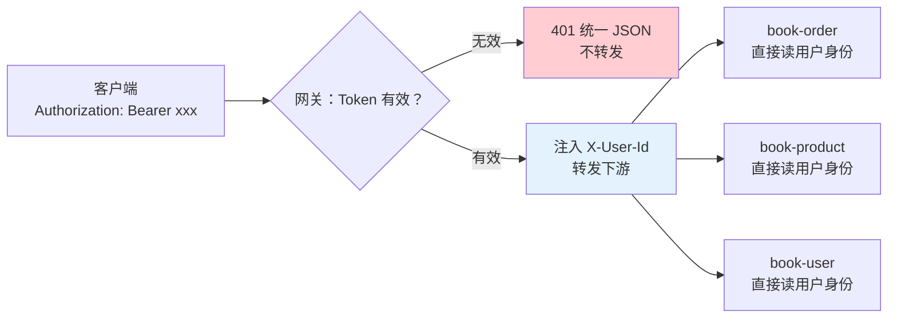
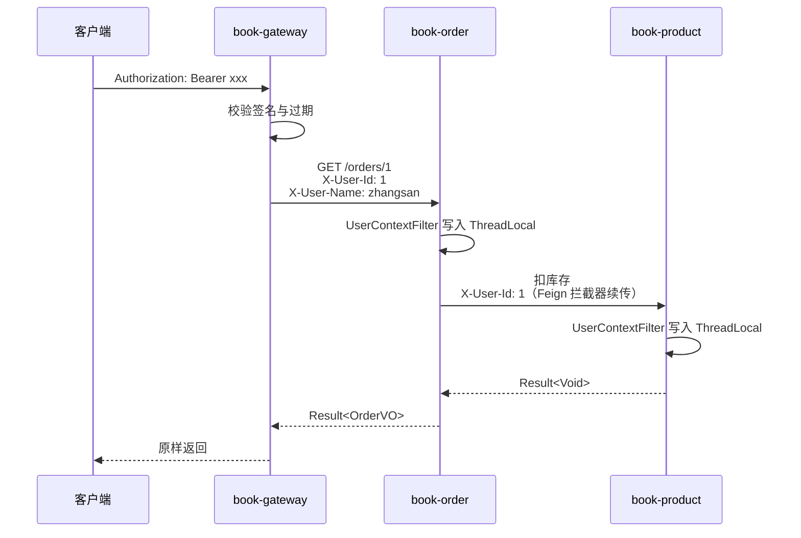
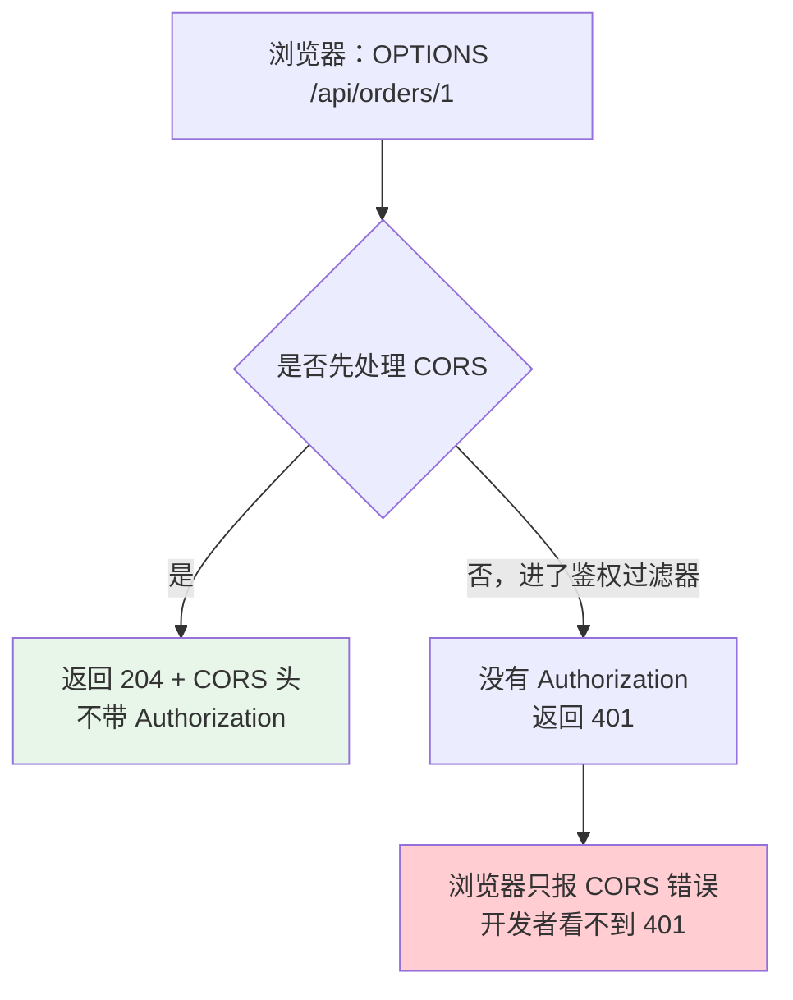

# 网关统一鉴权与限流

## 课程目标

- 理解网关统一鉴权、服务内鉴权、混合鉴权三种方案的取舍，能给出选型结论
- 掌握 JWT 的无状态特性，能说明为什么它特别适合在网关做统一校验
- 能够用 `GlobalFilter` 完成 Token 解析、签名与过期校验、白名单放行、统一 JSON 失败响应
- 掌握用户上下文透传的完整链路：网关注入请求头、Feign 拦截器续传、下游过滤器落线程上下文
- 掌握 Sentinel 网关限流的规则配置与自定义 `BlockRequestHandler` 响应
- 能够对比 Sentinel 网关限流与 `RequestRateLimiter` 的差异并做出选择
- 掌握 `globalcors` 配置，能解释预检请求为什么必须在鉴权过滤器之前放行
- 能够识别网关鉴权中的密钥管理、头伪造、令牌续期、响应体统一四类风险

## 回顾与导入

前两课网关已经能按路径转发、能按断言分流、能按 Redis 令牌桶限流。但它对"你是谁"一无所知：任何人在浏览器里敲 `http://127.0.0.1:8080/api/orders/1`，都能拿到别人的订单详情。

在网关出现之前，每个服务各自校验 Token：商品服务校验通过，订单服务忘了配，用户服务校验了却没校验过期时间。三份实现、三种结果，攻击者只需要找最弱的那一个。

网关统一鉴权要解决的就是这件事：**把"你是谁、你能不能进"的判断收敛到一个地方**，业务服务只负责"你能做什么"。这要求网关在转发前完成校验，并把校验结果以可信的请求头形式传给下游。



第二个配套问题是限流。上一课的 Redis 令牌桶只按路由限流，维度单一、也没有熔断能力，本课用 Sentinel 网关限流补齐。

> **前置条件：** `book-gateway` 已在 8080 运行；《OpenFeign拦截器与上下文透传》中的 `AuthRelayInterceptor` 已落地；Redis 已启动。

## 鉴权方案对比

### 三种方案

| 方案 | 做法 | 优点 | 缺点 | 适用场景 |
| --- | --- | --- | --- | --- |
| 网关统一鉴权 | 网关校验 Token 并把身份写进请求头，服务只信任头 | 逻辑单点、规则统一、服务零改造、无法绕过 | 网关成为安全单点；服务必须禁止外部直连 | 绝大多数内外网分离的微服务系统 |
| 服务内鉴权 | 每个服务自己解析 Token | 无单点、服务可独立对外 | 逻辑重复、规则易漂移、新服务容易漏配 | 服务需要直接对第三方开放 |
| 混合鉴权 | 网关做认证与粗粒度鉴权，服务做细粒度数据权限 | 分层清晰、纵深防御 | 两处都要维护，边界要界定清楚 | 有复杂数据权限（如按部门隔离）的中大型系统 |

本课程选**混合鉴权**：网关负责认证与接口级鉴权，服务负责数据级鉴权。

> **结论：** 网关只需要回答"你是谁""你能不能调这个接口"；"你能不能看这条数据"必须由服务判断——那需要查业务库，把这类判断放进网关，等于把它变成第二个业务系统。

## JWT 与网关

### 为什么 JWT 适合放在网关校验

JWT（JSON Web Token）是自包含的：签名、载荷、过期时间都在令牌里，校验只需要密钥，不需要查库、也不需要调用户服务。这种"纯计算、零网络"的特性让它天然适合放在网关这种不能阻塞的位置。

| 令牌方案 | 校验成本 | 能否在网关校验 | 撤销难度 |
| --- | --- | --- | --- |
| 服务端 Session | 需查共享存储 | 可以，但每次请求一次 Redis 往返 | 容易，删 Session 即可 |
| 不透明 Token + 内省接口 | 需调授权服务 | 成本高，网关多一跳 | 容易 |
| JWT | 纯本地计算 | 极低，无网络调用 | 困难，需靠短过期加黑名单 |

JWT 的代价是**无法即时撤销**。所以生产上通常是"短有效期 Access Token（如 30 分钟）+ 长有效期 Refresh Token"，撤销靠短有效期自然过期。

### 依赖

```xml
<dependency>
    <groupId>io.jsonwebtoken</groupId>
    <artifactId>jjwt-api</artifactId>
    <version>0.12.6</version>
</dependency>
<dependency>
    <groupId>io.jsonwebtoken</groupId>
    <artifactId>jjwt-impl</artifactId>
    <version>0.12.6</version>
    <scope>runtime</scope>
</dependency>
<dependency>
    <groupId>io.jsonwebtoken</groupId>
    <artifactId>jjwt-jackson</artifactId>
    <version>0.12.6</version>
    <scope>runtime</scope>
</dependency>
```

`jjwt-api` 只在编译期用，`jjwt-impl` 与 `jjwt-jackson` 是运行期实现，作用域写 `runtime` 可以避免业务代码误用内部类。

### 鉴权配置项

```java
package com.example.gateway.config;

import lombok.Data;
import org.springframework.boot.context.properties.ConfigurationProperties;
import org.springframework.stereotype.Component;

import java.util.ArrayList;
import java.util.List;

@Data
@Component
@ConfigurationProperties(prefix = "gateway.auth")
public class GatewayAuthProperties {
    private boolean enabled = true;

    private String secret;

    private String issuer = "book-user";

    private List<String> whitelist = new ArrayList<>();

    private String userIdHeader = "X-User-Id";

    private String userNameHeader = "X-User-Name";
}
```

```yaml
gateway:
  auth:
    enabled: true
    issuer: book-user
    secret: ${JWT_SECRET:}
    whitelist:
      - /api/users/login
      - /api/users/register
      - /actuator/health
      - /actuator/info
```

密钥从环境变量注入，`${JWT_SECRET:}` 的冒号后面留空表示"没配就是空字符串"，方便本地启动时由启动脚本注入，而不是把密钥写进仓库。

### 校验器

```java
package com.example.gateway.auth;

import com.example.gateway.config.GatewayAuthProperties;
import io.jsonwebtoken.Claims;
import io.jsonwebtoken.JwtException;
import io.jsonwebtoken.Jwts;
import io.jsonwebtoken.io.Decoders;
import io.jsonwebtoken.security.Keys;
import jakarta.annotation.PostConstruct;
import lombok.RequiredArgsConstructor;
import org.springframework.stereotype.Component;
import org.springframework.util.StringUtils;

import javax.crypto.SecretKey;
import java.util.Date;

@Component
@RequiredArgsConstructor
public class JwtTokenValidator {
    private final GatewayAuthProperties properties;

    private SecretKey key;

    @PostConstruct
    void init() {
        if (!StringUtils.hasText(properties.getSecret())) {
            throw new IllegalStateException("gateway.auth.secret 未配置，网关拒绝启动");
        }
        this.key = Keys.hmacShaKeyFor(Decoders.BASE64.decode(properties.getSecret()));
    }

    public JwtPayload validate(String token) {
        Claims claims = Jwts.parser()
                .verifyWith(key)
                .requireIssuer(properties.getIssuer())
                .build()
                .parseSignedClaims(token)
                .getPayload();

        Date expiration = claims.getExpiration();
        if (expiration == null || expiration.before(new Date())) {
            throw new JwtException("令牌已过期");
        }
        Long userId = claims.get("userId", Long.class);
        String username = claims.getSubject();
        if (userId == null || !StringUtils.hasText(username)) {
            throw new JwtException("令牌缺少必要声明");
        }
        return new JwtPayload(userId, username);
    }
}
```

`validate` 返回的 `JwtPayload` 是一个 `record`，只承载 `userId` 与 `username` 两个字段，下游的请求头就来自它。

三个要点：密钥长度必须满足 HMAC-SHA256 的要求（至少 256 位，Base64 编码后 44 字符），否则启动即抛 `WeakKeyException`；`requireIssuer` 校验签发方，防止拿别的系统的合法 Token 来用；过期时间在 `parseSignedClaims` 阶段已校验一次，这里的二次判断是为了防御没有 `exp` 的令牌。

### 鉴权过滤器

```java
package com.example.gateway.filter;

import com.example.common.result.Result;
import com.example.common.result.ResultCode;
import com.example.gateway.auth.JwtPayload;
import com.example.gateway.auth.JwtTokenValidator;
import com.example.gateway.config.GatewayAuthProperties;
import com.fasterxml.jackson.databind.ObjectMapper;
import io.jsonwebtoken.ExpiredJwtException;
import io.jsonwebtoken.JwtException;
import lombok.RequiredArgsConstructor;
import lombok.extern.slf4j.Slf4j;
import org.springframework.cloud.gateway.filter.GatewayFilterChain;
import org.springframework.cloud.gateway.filter.GlobalFilter;
import org.springframework.core.Ordered;
import org.springframework.core.io.buffer.DataBuffer;
import org.springframework.http.HttpHeaders;
import org.springframework.http.HttpMethod;
import org.springframework.http.HttpStatus;
import org.springframework.http.MediaType;
import org.springframework.http.server.reactive.ServerHttpRequest;
import org.springframework.http.server.reactive.ServerHttpResponse;
import org.springframework.stereotype.Component;
import org.springframework.util.AntPathMatcher;
import org.springframework.web.server.ServerWebExchange;
import reactor.core.publisher.Mono;

import java.nio.charset.StandardCharsets;

@Slf4j
@Component
@RequiredArgsConstructor
public class AuthGlobalFilter implements GlobalFilter, Ordered {

    private static final String BEARER_PREFIX = "Bearer ";
    private static final AntPathMatcher MATCHER = new AntPathMatcher();

    private final JwtTokenValidator validator;
    private final GatewayAuthProperties properties;
    private final ObjectMapper objectMapper;

    @Override
    public Mono<Void> filter(ServerWebExchange exchange, GatewayFilterChain chain) {
        ServerHttpRequest request = exchange.getRequest();
        if (!properties.isEnabled()) {
            return chain.filter(exchange);
        }
        if (HttpMethod.OPTIONS.equals(request.getMethod())) {
            return chain.filter(exchange);
        }
        String path = request.getURI().getPath();
        if (isWhitelisted(path)) {
            return chain.filter(exchange);
        }

        String authorization = request.getHeaders().getFirst(HttpHeaders.AUTHORIZATION);
        if (authorization == null || !authorization.startsWith(BEARER_PREFIX)) {
            return reject(exchange, ResultCode.UNAUTHORIZED, "缺少访问令牌");
        }

        try {
            JwtPayload payload = validator.validate(authorization.substring(BEARER_PREFIX.length()));
            ServerHttpRequest mutated = request.mutate()
                    .headers(headers -> {
                        headers.remove(properties.getUserIdHeader());
                        headers.remove(properties.getUserNameHeader());
                        headers.set(properties.getUserIdHeader(), String.valueOf(payload.userId()));
                        headers.set(properties.getUserNameHeader(), payload.username());
                    })
                    .build();
            return chain.filter(exchange.mutate().request(mutated).build());
        } catch (ExpiredJwtException e) {
            return reject(exchange, ResultCode.TOKEN_EXPIRED, "访问令牌已过期");
        } catch (JwtException | IllegalArgumentException e) {
            log.warn("令牌校验失败 path={} reason={}", path, e.getMessage());
            return reject(exchange, ResultCode.UNAUTHORIZED, "访问令牌无效");
        }
    }

    private boolean isWhitelisted(String path) {
        return properties.getWhitelist().stream().anyMatch(pattern -> MATCHER.match(pattern, path));
    }

    private Mono<Void> reject(ServerWebExchange exchange, ResultCode code, String message) {
        ServerHttpResponse response = exchange.getResponse();
        response.setStatusCode(HttpStatus.UNAUTHORIZED);
        response.getHeaders().setContentType(MediaType.APPLICATION_JSON);
        byte[] bytes;
        try {
            bytes = objectMapper.writeValueAsBytes(Result.fail(code, message));
        } catch (Exception e) {
            bytes = "{\"code\":401,\"message\":\"unauthorized\"}".getBytes(StandardCharsets.UTF_8);
        }
        DataBuffer buffer = response.bufferFactory().wrap(bytes);
        return response.writeWith(Mono.just(buffer));
    }

    @Override
    public int getOrder() {
        return Ordered.HIGHEST_PRECEDENCE + 10;
    }
}
```

这段代码里有四个容易被忽略但必须保留的细节：

- **先 `remove` 再 `set`**：客户端完全可以自己带一个 `X-User-Id: 999`，只 `set` 不 `remove` 在某些实现下会变成追加，下游的 `getFirst` 可能拿到伪造值。
- **`OPTIONS` 直接放行**：预检请求不带 `Authorization`，若被拦下会返回 401，浏览器表现为"CORS 错误"而不是"未认证"，极难排查。
- **`ObjectMapper` 注入而非 `new`**：复用 Spring 的配置，`Long` 转字符串、日期格式、`null` 处理都与业务一致。
- **order 取 `HIGHEST_PRECEDENCE + 10`**：小到足够靠前，又给"追踪过滤器"留出位置。

### 验证

```bash
curl.exe -s -i http://127.0.0.1:8080/api/orders/1
curl.exe -s -i -H "Authorization: Bearer invalid.token.value" http://127.0.0.1:8080/api/orders/1
curl.exe -s -i -H "Authorization: Bearer <有效令牌>" http://127.0.0.1:8080/api/orders/1
```

```json
{"code":401,"message":"缺少访问令牌","data":null}
```

| 验证项 | 请求 | 期望结果 |
| --- | --- | --- |
| 无令牌 | 不带 `Authorization` | 401 + 统一 JSON |
| 令牌过期 | 用昨天签发的 Token | 401，message 为"访问令牌已过期" |
| 白名单 | 访问 `/api/users/login` | 直接放行到下游 |
| 头伪造 | 自带 `X-User-Id: 999` 且 Token 属于 1 号用户 | 下游拿到的是 1，不是 999 |

## 全链路用户上下文透传

### 三段接力

网关只完成了第一段。请求继续往下走：`book-order` 收到 `X-User-Id`，它再通过 Feign 调 `book-product` 扣库存时，这个头必须继续带过去，否则商品服务拿不到用户身份。



三段职责清晰：网关认证并注入，服务接收并落上下文，Feign 拦截器跨服务续传。

### 下游接收

```java
package com.example.order.filter;

@Component
public class UserContextFilter extends OncePerRequestFilter {

    @Override
    protected void doFilterInternal(HttpServletRequest request, HttpServletResponse response,
                                    FilterChain chain) throws ServletException, IOException {
        String userId = request.getHeader("X-User-Id");
        String userName = request.getHeader("X-User-Name");
        try {
            if (StringUtils.hasText(userId)) {
                UserContext.set(new UserContext.CurrentUser(Long.valueOf(userId), userName));
            }
            chain.doFilter(request, response);
        } finally {
            UserContext.clear();
        }
    }
}
```

`finally` 里的 `clear()` 不能省。Tomcat 复用线程，不清就会把上一个请求的用户身份带给下一个请求——这类越权问题在压测时几乎不会暴露，只在真实并发下偶发。

### Feign 续传

```java
package com.example.order.interceptor;

@Component
public class UserContextRelayInterceptor implements RequestInterceptor {

    private static final List<String> HEADERS = List.of("X-User-Id", "X-User-Name", "Authorization");

    @Override
    public void apply(RequestTemplate template) {
        ServletRequestAttributes attributes =
                (ServletRequestAttributes) RequestContextHolder.getRequestAttributes();
        if (attributes == null) {
            return;
        }
        for (String header : HEADERS) {
            String value = attributes.getRequest().getHeader(header);
            if (value != null && !value.isBlank()) {
                template.header(header, value);
            }
        }
    }
}
```

这个拦截器在《OpenFeign拦截器与上下文透传》里已经写过一遍。网关上线后它的定位变了：以前是把客户端 Token 抄给下游，现在主要是把网关注入的身份继续往后传。

> **注意：** 服务端口必须禁止外部直连。若 8081 能被公网访问，攻击者跳过网关直接请求并自带 `X-User-Id: 999`，网关做得再好也没用。生产上用安全组、Service Mesh 或内网域名限制访问来源。

## 网关限流：Sentinel 方案

### 为什么主推 Sentinel

上一课的 `RequestRateLimiter` 一条路由只有一份配额。真实场景要按 IP、按热点参数组合限流，还要熔断降级，Sentinel 网关适配器正好补上这块。

| 能力 | RequestRateLimiter | Sentinel 网关限流 |
| --- | --- | --- |
| 限流算法 | Redis 令牌桶 | 滑动窗口（匀速/预热/冷启动） |
| 限流维度 | 由 `KeyResolver` 决定，单一维度 | 路由、自定义 API 分组、来源 IP、Header/参数 |
| 集群共享 | 天然共享（Redis） | 需集群流控模式 |
| 熔断降级 | 不支持 | 支持慢调用、异常比例、异常数 |
| 动态规则 | 需重启或刷新配置 | 控制台推送，实时生效 |
| 依赖 | Redis | Sentinel 核心 + 可选 Dashboard |
| 自定义拒绝响应 | 能力有限 | `BlockRequestHandler` 完全可控 |

结论：**要按业务维度精细控制、要熔断、要动态调规则，用 Sentinel；只需要一个简单的全局限速、且不想引入新组件，用 `RequestRateLimiter`。**

### 依赖与配置

```xml
<dependency>
    <groupId>com.alibaba.cloud</groupId>
    <artifactId>spring-cloud-starter-alibaba-sentinel</artifactId>
</dependency>
<dependency>
    <groupId>com.alibaba.csp</groupId>
    <artifactId>sentinel-spring-cloud-gateway-adapter</artifactId>
    <version>1.8.8</version>
</dependency>
```

```yaml
spring:
  cloud:
    sentinel:
      transport:
        dashboard: 127.0.0.1:8858
      eager: true
```

`eager: true` 让 Sentinel 启动时就连 Dashboard，否则要等第一次请求才建连，规则推送会延迟。

网关适配器会自动注册 `SentinelGatewayFilter` 与 `SentinelGatewayBlockExceptionHandler`，前者按 `GatewayFlowRule` 拦截请求，后者负责输出拒绝响应，所以业务代码只需要关心"规则"与"响应体"两件事。

### 规则配置

```java
package com.example.gateway.config;

import com.alibaba.csp.sentinel.adapter.gateway.common.SentinelGatewayConstants;
import com.alibaba.csp.sentinel.adapter.gateway.common.api.ApiDefinition;
import com.alibaba.csp.sentinel.adapter.gateway.common.api.ApiPathPredicateItem;
import com.alibaba.csp.sentinel.adapter.gateway.common.api.ApiPredicateItem;
import com.alibaba.csp.sentinel.adapter.gateway.common.api.GatewayApiDefinitionManager;
import com.alibaba.csp.sentinel.adapter.gateway.common.rule.GatewayFlowRule;
import com.alibaba.csp.sentinel.adapter.gateway.common.rule.GatewayParamFlowItem;
import com.alibaba.csp.sentinel.adapter.gateway.common.rule.GatewayRuleManager;
import com.alibaba.csp.sentinel.adapter.gateway.sc.callback.BlockRequestHandler;
import com.alibaba.csp.sentinel.adapter.gateway.sc.callback.GatewayCallbackManager;
import com.example.common.result.Result;
import com.example.common.result.ResultCode;
import com.fasterxml.jackson.databind.ObjectMapper;
import jakarta.annotation.PostConstruct;
import lombok.RequiredArgsConstructor;
import org.springframework.http.HttpStatus;
import org.springframework.http.MediaType;
import org.springframework.http.server.reactive.ServerHttpResponse;
import org.springframework.stereotype.Component;
import reactor.core.publisher.Mono;

import java.util.HashSet;
import java.util.Set;

@Component
@RequiredArgsConstructor
public class GatewaySentinelConfig {

    private final ObjectMapper objectMapper;

    @PostConstruct
    public void init() {
        initCustomApi();
        initGatewayRules();
        initBlockHandler();
    }

    private void initCustomApi() {
        Set<ApiPredicateItem> items = new HashSet<>();
        items.add(new ApiPathPredicateItem()
                .setPattern("/api/orders/**")
                .setMatchStrategy(SentinelGatewayConstants.URL_MATCH_STRATEGY_PREFIX));

        Set<ApiDefinition> definitions = new HashSet<>();
        definitions.add(new ApiDefinition("order-write-api").setPredicateItems(items));
        GatewayApiDefinitionManager.loadApiDefinitions(definitions);
    }

    private void initGatewayRules() {
        Set<GatewayFlowRule> rules = new HashSet<>();

        rules.add(new GatewayFlowRule("product-route")
                .setResourceMode(SentinelGatewayConstants.RESOURCE_MODE_ROUTE_ID)
                .setCount(50)
                .setIntervalSec(1));

        rules.add(new GatewayFlowRule("order-write-api")
                .setResourceMode(SentinelGatewayConstants.RESOURCE_MODE_CUSTOM_API_NAME)
                .setCount(10)
                .setIntervalSec(1)
                .setBurst(5)
                .setParamItem(new GatewayParamFlowItem()
                        .setParseStrategy(SentinelGatewayConstants.PARAM_PARSE_STRATEGY_CLIENT_IP)));

        GatewayRuleManager.loadRules(rules);
    }
}
```

`GatewayParamFlowItem` 的 `parseStrategy` 支持四种：`CLIENT_IP`、`HEADER`、`URL_PARAM`、`COOKIE`。按 IP 限流时配合 `setFieldName("X-Forwarded-For")` 使用，取的是经过代理后的真实来源。

### 自定义拒绝响应

同一个类里补上 `init()` 调用的这个方法，把默认的纯文本拒绝响应换成统一 `Result`：

```java
    private void initBlockHandler() {
        BlockRequestHandler handler = (exchange, throwable) -> {
            ServerHttpResponse response = exchange.getResponse();
            response.setStatusCode(HttpStatus.TOO_MANY_REQUESTS);
            response.getHeaders().setContentType(MediaType.APPLICATION_JSON);
            byte[] bytes;
            try {
                bytes = objectMapper.writeValueAsBytes(
                        Result.fail(ResultCode.TOO_MANY_REQUESTS, "请求过于频繁，请稍后重试"));
            } catch (Exception e) {
                bytes = "{\"code\":429,\"message\":\"too many requests\"}".getBytes();
            }
            return response.writeWith(Mono.just(response.bufferFactory().wrap(bytes)));
        };
        GatewayCallbackManager.setBlockHandler(handler);
    }
```

默认的拒绝响应是 `429` 加一句纯文本 `Blocked by Sentinel (flow limiting)`，前端拿到后无法按统一格式解析。改成 `Result` 结构后，前端的错误处理逻辑才能和业务异常共用一套。

### 验证

```bash
for i in $(seq 1 80); do curl -s -o /dev/null -w "%{http_code}\n" http://127.0.0.1:8080/api/products/1; done
```

Windows 下可换成 `for /L %i in (1,1,80) do @curl.exe -s -o NUL -w "%{http_code} " http://127.0.0.1:8080/api/products/1`。

期望前 50 个左右为 200，之后出现 429。同时打开 Sentinel Dashboard（默认 8858），在"簇点链路"里能看到 `product-route`、`order-write-api` 两个资源名——**路由 id 就是资源名**，这条对应关系是排查"规则没生效"的第一现场。

## 跨域与执行顺序

### globalcors 配置

```yaml
spring:
  cloud:
    gateway:
      globalcors:
        add-to-simple-url-handler-mapping: true
        cors-configurations:
          '[/**]':
            allowedOriginPatterns: "https://*.example.com"
            allowedMethods: "*"
            allowedHeaders: "*"
            exposedHeaders: X-Trace-Id
            allowCredentials: true
            maxAge: 3600
```

`allowedOriginPatterns` 不能换成 `allowedOrigins: "*"`：一旦 `allowCredentials` 为 `true`，规范禁止用通配符返回 `Access-Control-Allow-Origin: *`，浏览器会直接拒绝。`add-to-simple-url-handler-mapping: true` 保证预检请求即使没匹配到任何路由也能被处理。

### 为什么预检必须在鉴权之前放行



预检请求由浏览器自动发起，**不带 `Authorization`**。它被鉴权过滤器拦成 401 后，浏览器看到的是一次没有 CORS 头的失败响应，控制台只打印"已阻止跨域请求"，真实原因被掩盖。所以 `AuthGlobalFilter` 第一段判断必须是 `OPTIONS` 直接放行。

一个更隐蔽的问题是：鉴权失败时我们自己拼的响应没有 CORS 头，浏览器同样会把它当成跨域错误。推荐在 `reject` 里显式回显 origin 并校验白名单，否则等于让任意站点都能读到 401 响应体。

## 注意事项

1. **服务端口必须禁止外部直连**：`X-User-Id` 可被伪造，真正的安全边界是"只有网关能访问服务"。
2. **密钥不能进代码仓库**：用环境变量或密钥管理服务注入，并支持轮换；轮换期用双密钥校验，避免全量用户掉线。
3. **JWT 无法即时撤销**：Access Token 有效期控制在 30 分钟以内，配合 Refresh Token 续期，必要时再加一层 Redis 黑名单。
4. **不要在网关做重业务**：鉴权只做"读 Token 算签名"，任何查库、调第三方都会让网关成为性能瓶颈与故障放大器。
5. **`OPTIONS` 预检与 401 响应都要带 CORS 头**：这两个位置漏一个，前端就只会看到"CORS 错误"，排查成本极高。
6. **统一响应体要与业务服务完全一致**：`Result`、`ResultCode` 的字段名与状态码语义必须对齐，否则前端要为网关单独写一套错误处理。
7. **限流规则要落在资源名上**：Sentinel 网关的资源名是路由 id 或自定义 API 名，写错一个字符规则就永不触发，且不会报错。
8. **令牌续期不要放在网关**：续期要签发新令牌，属于认证服务职责，放在网关等于让它持有签发密钥。

## 小结

本节课我们学习了：

1. **三种鉴权方案**：网关统一鉴权解决重复与漂移，服务内鉴权适合直接对外，混合鉴权是主流——网关管认证与接口级鉴权，服务管数据级鉴权。
2. **JWT 的适配性**：自包含、无网络调用、校验成本极低，适合网关；代价是无法即时撤销，要靠短有效期加黑名单兜底。
3. **鉴权过滤器**：解析 `Bearer`、校验签名与签发方、校验过期、白名单放行、统一 JSON 失败响应。
4. **头注入必须先去后设**：客户端自带 `X-User-Id` 是真实攻击面，`remove` 后再 `set` 才能保证下游拿到网关算出来的值。
5. **全链路透传三段接力**：网关注入、服务 `UserContextFilter` 落 ThreadLocal、Feign 拦截器续传，`finally` 里的 `clear()` 防串号。
6. **Sentinel 网关限流**：`GatewayFlowRule` 配路由或自定义 API 资源，`GatewayParamFlowItem` 支持 IP、Header、URL 参数、Cookie 四种维度。
7. **`BlockRequestHandler`**：默认的纯文本 429 前端无法解析，必须改成与业务一致的 `Result` 结构。
8. **跨域与顺序**：`OPTIONS` 必须在鉴权之前放行，401 响应也必须带 CORS 头，否则真实错误会被浏览器掩盖成跨域失败。

## 作业

### 作业一：完成网关统一鉴权

1. 在 `book-gateway` 中实现 `AuthGlobalFilter`，配置三个白名单路径，验证无令牌、错误令牌、过期令牌三种失败场景的响应体。
2. 让 `book-order` 的 `UserContextFilter` 与 Feign 拦截器串起来，用一次"创建订单"请求验证 `book-product` 的日志里能拿到正确的 `X-User-Id`。
3. 故意在请求里自带 `X-User-Id: 999`，验证下游拿到的是真实用户 ID，并说明是哪一段代码拦住了伪造。

### 作业二：Sentinel 网关限流

1. 为 `product-route` 配置 50 QPS 限流，为 `order-write-api` 配置"按 IP 每秒 10 次、突发 5 次"的规则，用脚本验证两组规则同时生效。
2. 自定义 `BlockRequestHandler` 返回 `Result` 结构，并用浏览器开发者工具确认响应头与状态码正确。
3. 在 Dashboard 上把阈值从 50 改成 5，观察多久生效，说明规则持久化的缺口在哪（详见《Sentinel规则持久化与集群流控》）。

### 作业三：跨域与安全复盘

1. 用 `allowedOrigins: "*"` 配 `allowCredentials: true` 启动，记录浏览器的报错原文，解释规范为什么禁止这种组合。
2. 把 `AuthGlobalFilter` 里的 `OPTIONS` 放行删掉，用前端页面发起跨域请求，记录浏览器控制台的提示，说明为什么它不显示 401。
3. 设计一套 JWT 密钥轮换方案：双密钥并行校验的时间窗口、旧令牌淘汰策略、轮换期的监控指标。
