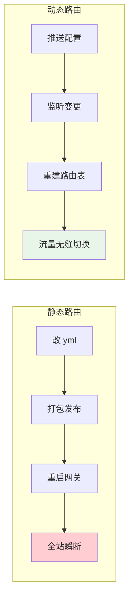
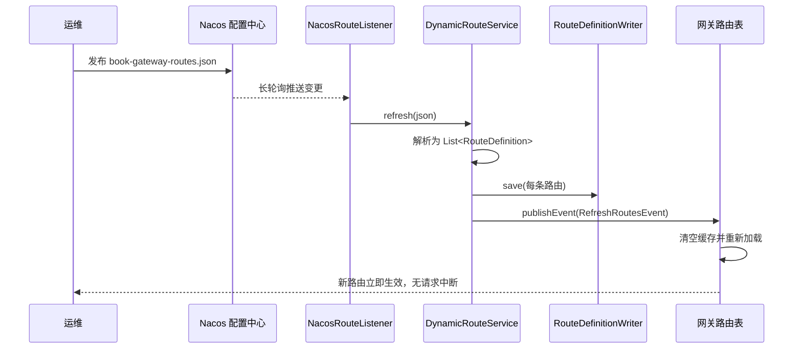
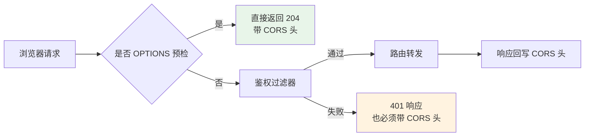
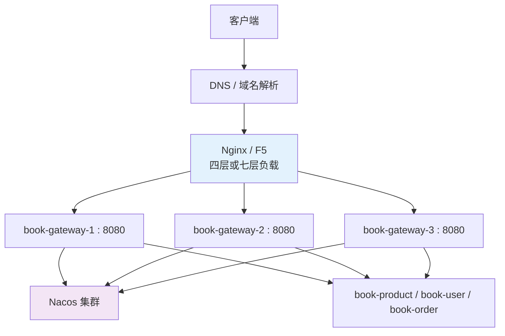

# 网关动态路由、跨域与高可用

## 课程目标

- 理解静态路由在扩展性与发布流程上的四个限制，能判断何时必须引入动态路由
- 掌握 SCG 路由模型中的三个扩展点：`RouteDefinitionLocator`、`RouteDefinitionWriter`、`RouteDefinitionRepository`
- 能够用 Nacos 配置监听配合 `RefreshRoutesEvent` 实现路由热更新，并验证不重启即生效
- 掌握自定义 `RouteDefinitionRepository` 从数据库加载路由的表设计与实现要点
- 能够评估 `discovery.locator.enabled` 自动路由的便利与风险，并给出是否启用的判断
- 掌握三种跨域配置方式的差异，能处理重复 CORS 头与预检请求问题
- 理解网关高可用架构，能配置 `httpclient` 超时与连接池、健康检查与多实例部署
- 能够用一张检查清单把网关推到生产，覆盖超时、连接池、日志、限流、鉴权、灰度六个面

## 回顾与导入

前三课我们把网关配成了这样：三条路由写在 `application.yml` 里，鉴权与限流挂在全局过滤器上，跨域写在 `globalcors` 里。功能完整，但有一个结构性问题——**路由是编译产物的一部分**。

这意味着任何一次路由变更都要走完整发布流程：新增一个 `book-coupon` 服务要加一条路由，得改 yml、打包、停网关、起网关；灰度期间要把 10% 商品流量切到新版本，得改权重再重启；测试环境想临时把某个服务指向本地实例，也得重启。

网关是所有流量的必经之路，重启网关的代价不是"这一个服务不可用"，而是"全站不可用"。把一个高频变更的东西绑在一次全站停机上，这个设计本身就有问题。



本课把三件上生产前必须解决的事收口：路由要能热更新、跨域要配得对、网关自己不能是单点。

## 为什么需要动态路由

### 静态路由的四个限制

| 限制 | 具体表现 | 业务影响 |
| --- | --- | --- |
| 变更要重启 | 路由写在 `application.yml`，属于构建产物 | 每加一个服务就停一次全站 |
| 环境难隔离 | 三套环境三份文件，靠 profile 切换 | 路由配置容易串环境 |
| 灰度不可调 | `Weight` 的权重写在配置里 | 调 5% 到 10% 要发版 |
| 无法自助 | 改路由要开发改代码、运维发布 | 业务方排期等一天，临时需求做不到 |

### 动态路由的两类真实场景

第一类是**服务扩张**。业务每季度新增两三个服务，每个都要在网关上挂前缀。如果每次都要发版，网关就成了交付链路上最慢的一环。

第二类是**灰度与临时切流**。大促前要把某个服务切到备用集群、把某个租户的请求打到专用实例、把某个 IP 段导流到压测环境——这些都是小时级甚至分钟级的需求，等不了发版窗口。

### 静态与动态对比

| 维度 | 静态路由（yml） | 动态路由（配置中心 / 数据库） |
| --- | --- | --- |
| 变更生效 | 重启网关 | 秒级热更新 |
| 变更人 | 开发 + 运维 | 有权限的运维或平台 |
| 审计 | Git 提交记录 | 配置中心历史或数据库审计字段 |
| 回滚 | 回滚代码包 | 回滚配置版本 |
| 复杂度 | 低 | 需要监听、刷新、异常兜底 |
| 适用阶段 | 服务数量稳定、变更少 | 服务持续新增、有灰度需求 |

> **结论：** 服务数量超过五个、或存在灰度发布需求时，静态路由的维护成本会迅速超过动态路由的搭建成本。

## 路由模型的三个扩展点

SCG 把"路由从哪来"和"路由往哪写"拆成了三个接口，理解它们的职责是写好动态路由的前提。

| 扩展点 | 职责 | 内置实现 | 何时用它 |
| --- | --- | --- | --- |
| `RouteDefinitionLocator` | 读取路由定义，支持多个实现并存 | `PropertiesRouteDefinitionLocator`、`DiscoveryClientRouteDefinitionLocator` | 只想读、不想写 |
| `RouteDefinitionWriter` | 保存与删除路由，写入后需发事件刷新 | `InMemoryRouteDefinitionRepository` | 读配置中心的场景 |
| `RouteDefinitionRepository` | 同时继承上面两个接口 | 同上 | 会话式增删改查（如运营后台） |

关键点：`RouteDefinitionLocator` 的多个实现的结果是**合并**的，yml 里的路由与配置中心里的路由可以共存。这让我们能"核心路由放 yml、易变路由放 Nacos"，避免把保底路由也放到一个可能不可用的外部系统里。

## 方案一：Nacos 配置监听 + RefreshRoutesEvent

### 整体机制



`RefreshRoutesEvent` 是整个机制的核心：它通知 `CachingRouteLocator` 清空缓存，下一次请求时重新从所有 `RouteDefinitionLocator` 拉一遍。**没有这个事件，写入的路由不会被看见**——这是动态路由最常见的"写进去了但没生效"。

### 配置项

```yaml
spring:
  config:
    import: optional:nacos:book-gateway-dev.yml?group=DEFAULT_GROUP
  cloud:
    nacos:
      config:
        server-addr: 127.0.0.1:8848
        namespace: dev
        username: nacos
        password: nacos

gateway:
  dynamic-route:
    data-id: book-gateway-routes.json
    group: DEFAULT_GROUP
```

路由单独建一条 dataId，不要和普通配置混在一起：路由变更频率与其他配置不同，混在一起会让每次改日志级别都触发一次路由全量重建。

### 路由定义格式

Nacos 里存的是 `RouteDefinition` 的 JSON 数组，与 yml 的 `routes` 结构一一对应：

```json
[
  {
    "id": "product-route",
    "uri": "lb://book-product",
    "predicates": [
      { "name": "Path", "args": { "pattern": "/api/products/**" } }
    ],
    "filters": [
      { "name": "StripPrefix", "args": { "parts": "1" } }
    ],
    "metadata": { "version": "v1", "owner": "product-team" },
    "order": 0
  },
  {
    "id": "coupon-route",
    "uri": "lb://book-coupon",
    "predicates": [
      { "name": "Path", "args": { "pattern": "/api/coupons/**" } }
    ],
    "filters": [
      { "name": "StripPrefix", "args": { "parts": "1" } }
    ],
    "order": 10
  }
]
```

注意 `args` 的值都是字符串：`parts` 写 `"1"` 而不是 `1`，`order` 才是数字。混用会在反序列化时报类型错误。

### 刷新服务

```java
package com.example.gateway.route;

import com.fasterxml.jackson.core.type.TypeReference;
import com.fasterxml.jackson.databind.ObjectMapper;
import lombok.RequiredArgsConstructor;
import lombok.extern.slf4j.Slf4j;
import org.springframework.cloud.gateway.event.RefreshRoutesEvent;
import org.springframework.cloud.gateway.route.RouteDefinition;
import org.springframework.cloud.gateway.route.RouteDefinitionWriter;
import org.springframework.context.ApplicationEventPublisher;
import org.springframework.stereotype.Service;
import reactor.core.publisher.Flux;
import reactor.core.publisher.Mono;

import java.util.List;

@Slf4j
@Service
@RequiredArgsConstructor
public class DynamicRouteService {

    private final RouteDefinitionWriter routeDefinitionWriter;
    private final ObjectMapper objectMapper;
    private final ApplicationEventPublisher publisher;

    public Mono<Void> refresh(String json) {
        List<RouteDefinition> definitions;
        try {
            definitions = objectMapper.readValue(json, new TypeReference<List<RouteDefinition>>() {
            });
        } catch (Exception e) {
            log.error("路由配置解析失败，保留现有路由", e);
            return Mono.empty();
        }
        return Flux.fromIterable(definitions)
                .concatMap(definition -> routeDefinitionWriter.save(Mono.just(definition)))
                .then(Mono.fromRunnable(() -> {
                    publisher.publishEvent(new RefreshRoutesEvent(this));
                    log.info("动态路由刷新完成，共 {} 条", definitions.size());
                }));
    }
}
```

两个设计取舍：`concatMap` 保证写入按顺序完成再发事件，避免"事件先到、路由没写完"；解析失败时直接返回空 `Mono` 并保留原路由，**坏配置不应该把网关打瘫**——这条兜底比任何日志都重要。

### 监听器

```java
package com.example.gateway.route;

import com.alibaba.nacos.api.config.ConfigService;
import com.alibaba.nacos.api.config.listener.Listener;
import com.alibaba.cloud.nacos.NacosConfigManager;
import jakarta.annotation.PostConstruct;
import lombok.RequiredArgsConstructor;
import lombok.extern.slf4j.Slf4j;
import org.springframework.beans.factory.annotation.Value;
import org.springframework.stereotype.Component;

import java.util.concurrent.Executor;

@Slf4j
@Component
@RequiredArgsConstructor
public class NacosRouteListener {

    private final NacosConfigManager nacosConfigManager;
    private final DynamicRouteService dynamicRouteService;

    @Value("${gateway.dynamic-route.data-id}")
    private String dataId;

    @Value("${gateway.dynamic-route.group}")
    private String group;

    @PostConstruct
    public void listen() throws Exception {
        ConfigService configService = nacosConfigManager.getConfigService();
        String content = configService.getConfig(dataId, group, 5000);
        if (content != null) {
            dynamicRouteService.refresh(content).subscribe();
        }
        configService.addListener(dataId, group, new Listener() {
            @Override
            public Executor getExecutor() {
                return null;
            }

            @Override
            public void receiveConfigInfo(String configInfo) {
                log.info("收到 Nacos 路由变更推送");
                dynamicRouteService.refresh(configInfo).subscribe();
            }
        });
    }
}
```

`getExecutor()` 返回 `null` 表示使用 Nacos 客户端的默认线程池。如果你的刷新逻辑耗时较长，应返回专用线程池，避免阻塞 Nacos 的长轮询线程。

> **注意：** `addListener` 的回调线程不是 Spring 管理的，`refresh` 里的异常必须自己捕获。否则一次反序列化失败会抛到 Nacos 客户端线程里，后续变更再也不触发。

### 验证

```bash
curl.exe -s http://127.0.0.1:8080/actuator/gateway/routes | findstr coupon
```

在 Nacos 控制台把 `coupon-route` 的 `order` 从 10 改成 5 并发布，几秒后重新执行上面的命令，能看到 `order` 已更新；随后 `curl.exe -s http://127.0.0.1:8080/api/coupons/1` 直接从 404 变成 200，全程网关进程未重启。

| 验证项 | 操作 | 期望结果 |
| --- | --- | --- |
| 初次加载 | 启动网关 | 日志显示路由条数与 Nacos 一致 |
| 新增路由 | 在 JSON 中加一条 | 新路径立即可访问 |
| 修改断言 | 改 `Path` 的 pattern | 旧路径 404，新路径 200 |
| 删除路由 | 从数组中移除一条 | 该路径返回 404 |
| 坏配置 | 推送非法 JSON | 日志报解析失败，原路由继续工作 |

## 方案二：从数据库加载路由

### 表设计

路由需要被运营后台增删改，还要留下操作痕迹，数据库比配置中心更合适。

```sql
CREATE TABLE gateway_route (
    id          BIGSERIAL PRIMARY KEY,
    route_id    VARCHAR(64)  NOT NULL UNIQUE,
    uri         VARCHAR(256) NOT NULL,
    predicates  TEXT         NOT NULL,
    filters     TEXT,
    metadata    TEXT,
    route_order INT          NOT NULL DEFAULT 0,
    enabled     SMALLINT     NOT NULL DEFAULT 1,
    remark      VARCHAR(256),
    updated_by  VARCHAR(64),
    created_at  TIMESTAMP    NOT NULL DEFAULT CURRENT_TIMESTAMP,
    updated_at  TIMESTAMP    NOT NULL DEFAULT CURRENT_TIMESTAMP
);

CREATE INDEX idx_gateway_route_enabled ON gateway_route (enabled, route_order);
```

`predicates` 与 `filters` 存 JSON 字符串，结构与上一节的 `RouteDefinition` 完全一致——这样两种方案可以共用同一套解析逻辑。

### 实现 `RouteDefinitionRepository`

```java
package com.example.gateway.route;

import com.fasterxml.jackson.core.type.TypeReference;
import com.fasterxml.jackson.databind.ObjectMapper;
import lombok.RequiredArgsConstructor;
import lombok.extern.slf4j.Slf4j;
import org.springframework.cloud.gateway.filter.FilterDefinition;
import org.springframework.cloud.gateway.handler.predicate.PredicateDefinition;
import org.springframework.cloud.gateway.route.RouteDefinition;
import org.springframework.cloud.gateway.route.RouteDefinitionRepository;
import org.springframework.stereotype.Component;
import reactor.core.publisher.Flux;
import reactor.core.publisher.Mono;

import java.net.URI;
import java.util.List;

@Slf4j
@Component
@RequiredArgsConstructor
public class DatabaseRouteDefinitionRepository implements RouteDefinitionRepository {

    private final GatewayRouteMapper gatewayRouteMapper;
    private final ObjectMapper objectMapper;

    @Override
    public Flux<RouteDefinition> getRouteDefinitions() {
        try {
            return Flux.fromStream(gatewayRouteMapper.selectEnabled().stream())
                    .map(this::toDefinition);
        } catch (Exception e) {
            log.error("从数据库加载路由失败，本次返回空路由表", e);
            return Flux.empty();
        }
    }

    @Override
    public Mono<Void> save(Mono<RouteDefinition> route) {
        return route.doOnNext(this::persist).then();
    }

    @Override
    public Mono<Void> delete(Mono<String> routeId) {
        return routeId.doOnNext(gatewayRouteMapper::deleteByRouteId).then();
    }

    private RouteDefinition toDefinition(GatewayRouteEntity entity) {
        RouteDefinition definition = new RouteDefinition();
        definition.setId(entity.getRouteId());
        definition.setUri(URI.create(entity.getUri()));
        definition.setOrder(entity.getRouteOrder());
        definition.setPredicates(read(entity.getPredicates(), new TypeReference<List<PredicateDefinition>>() {
        }));
        definition.setFilters(read(entity.getFilters(), new TypeReference<List<FilterDefinition>>() {
        }));
        return definition;
    }

    private <T> List<T> read(String json, TypeReference<List<T>> type) {
        if (json == null || json.isBlank()) {
            return List.of();
        }
        try {
            return objectMapper.readValue(json, type);
        } catch (Exception e) {
            throw new IllegalStateException("路由定义反序列化失败", e);
        }
    }

    private void persist(RouteDefinition definition) {
        gatewayRouteMapper.upsert(GatewayRouteEntity.from(definition));
    }
}
```

这里用 MyBatis-Plus 的同步 Mapper 直接查询，是因为 `getRouteDefinitions` 只在路由刷新时被调用（频率极低），一次阻塞查询可以接受。**但要注意**：它仍然跑在事件循环线程上，若数据库慢会短暂影响请求。稳妥做法是把查询结果放进本地缓存，由定时任务或 MQ 通知刷新。

### 两种方案对比

| 维度 | Nacos 配置监听 | 数据库 + RouteDefinitionRepository |
| --- | --- | --- |
| 存储 | 配置中心 | 业务库 |
| 变更入口 | Nacos 控制台 / OpenAPI | 运营后台 |
| 权限模型 | 复用 Nacos 命名空间授权 | 需自建角色与审批 |
| 审计 | 配置历史版本 | 表字段 + 业务审计日志 |
| 生效速度 | 秒级（长轮询） | 依赖刷新触发（手动或定时） |
| 实现复杂度 | 低，只需监听 + 事件 | 高，需要表、Mapper、后台页面 |
| 适用场景 | 运维主导、服务数量中等 | 平台化、路由由业务方自助维护 |

> **结论：** 中小团队优先选 Nacos 方案，一天能落地；要做"路由即产品"的网关平台，再上数据库方案，并补上审批与灰度能力。

## discovery locator 自动路由

### 开启方式

```yaml
spring:
  cloud:
    gateway:
      discovery:
        locator:
          enabled: true
          lower-case-service-id: true
```

开启后，注册中心里的每个服务都会自动生成一条路由：`/book-product/**` 转发到 `lb://book-product`。

### 利弊

| 维度 | 表现 |
| --- | --- |
| 优点 | 零配置，新增服务自动可访问，本地联调非常方便 |
| 优点 | 不需要维护路由表，服务名即路径 |
| 缺点 | 路径暴露内部服务名，`book-order` 这类命名直接对外可见 |
| 缺点 | 无法配置 `StripPrefix`、鉴权白名单、限流规则等路由级能力 |
| 缺点 | 服务一旦注册成功就自动对外可用，缺少"上线审批"这一层 |
| 缺点 | 与服务名强绑定，服务改名即接口变更 |

### 建议的用法

| 环境 | 是否开启 | 理由 |
| --- | --- | --- |
| 本地开发 | 开启 | 免配置，随时调新服务 |
| 测试环境 | 开启 | 方便测试同学直接访问 |
| 预发 | 关闭 | 需要验证真实路由规则 |
| 生产 | 关闭 | 暴露内部拓扑，且无法挂鉴权限流 |

自动路由与手写路由可以共存，但**不要在生产同时使用**：一旦某个服务被自动暴露，它会绕过你在 `AuthGlobalFilter` 里按路径配置的白名单规则，形成"未登记的可访问入口"。

## 跨域三种配置方式

### 对比

| 方式 | 配置位置 | 优点 | 缺点 | 适用场景 |
| --- | --- | --- | --- | --- |
| yml `globalcors` | 配置文件 | 零代码、集中、可随配置中心刷新 | 规则表达能力有限，动态白名单难做 | 绝大多数项目 |
| `CorsWebFilter` Bean | Java 代码 | 完全可编程，可按租户或域名动态判断 | 与 `globalcors` 并存会导致头重复 | 多租户、需要查库判断来源 |
| 网关过滤器手写响应头 | `GlobalFilter` | 最灵活，能与其他逻辑耦合 | 要自己处理预检与回显，容易漏 | 兼容历史客户端、特殊协议 |

### 方式一：yml 配置

```yaml
spring:
  cloud:
    gateway:
      default-filters:
        - DedupeResponseHeader=Access-Control-Allow-Origin Access-Control-Allow-Credentials, RETAIN_FIRST
      globalcors:
        add-to-simple-url-handler-mapping: true
        cors-configurations:
          '[/**]':
            allowedOriginPatterns: "https://*.example.com,http://localhost:*"
            allowedMethods: "GET,POST,PUT,DELETE,OPTIONS"
            allowedHeaders: "*"
            exposedHeaders: "X-Trace-Id"
            allowCredentials: true
            maxAge: 3600
```

`DedupeResponseHeader` 放在 `default-filters` 里解决"网关与下游都加了 CORS 头"的问题：浏览器遇到两个 `Access-Control-Allow-Origin` 会直接判定失败，而报错信息里不会告诉你是重复导致的。

### 方式二：CorsWebFilter

```java
package com.example.gateway.config;

import org.springframework.context.annotation.Bean;
import org.springframework.context.annotation.Configuration;
import org.springframework.web.cors.CorsConfiguration;
import org.springframework.web.cors.reactive.CorsWebFilter;
import org.springframework.web.cors.reactive.UrlBasedCorsConfigurationSource;
import org.springframework.web.util.pattern.PathPatternParser;

import java.util.List;

@Configuration
public class CorsConfig {

    @Bean
    public CorsWebFilter corsWebFilter() {
        CorsConfiguration config = new CorsConfiguration();
        config.setAllowedOriginPatterns(List.of("https://*.example.com", "http://localhost:*"));
        config.setAllowedMethods(List.of("GET", "POST", "PUT", "DELETE", "OPTIONS"));
        config.setAllowedHeaders(List.of("*"));
        config.setExposedHeaders(List.of("X-Trace-Id"));
        config.setAllowCredentials(true);
        config.setMaxAge(3600L);

        UrlBasedCorsConfigurationSource source =
                new UrlBasedCorsConfigurationSource(new PathPatternParser());
        source.registerCorsConfiguration("/**", config);
        return new CorsWebFilter(source);
    }
}
```

用这种方式时必须**把 `globalcors` 全部删掉**。两套 CORS 机制同时存在，会各加一次响应头，症状与上一节的头重复完全相同，但排查方向完全不同。

### 方式三：过滤器手写

只有在需要把 CORS 与鉴权耦合处理时才走这条路：比如按 `Origin` 查库判断是否可信来源，命中后再决定是否放行。代价是预检、回显、`Vary` 头都要自己维护，属于"确有需要才做"的方案。



三个位置都不能漏：预检、正常响应、错误响应。漏掉错误响应最危险，因为前端只能看到"CORS 错误"，看不到真正的 401。

## 网关高可用

### 拓扑

网关是流量入口，单实例等于全站单点。生产必须是"多实例 + 前置负载均衡 + 注册中心"的三层结构。



三个设计要点：网关**无状态**（不存会话、不存本地路由增量），任何实例都能处理任何请求；路由配置来自同一个配置中心，三个实例的路由表天然一致；Nacos 集群保证网关启动时的服务发现不会成为启动瓶颈。

### 超时与连接池

网关的默认超时是"不限"，下游一旦挂起，请求会一直占着连接，几分钟内就能把连接池耗尽。必须显式配置。

```yaml
spring:
  cloud:
    gateway:
      httpclient:
        connect-timeout: 2000
        response-timeout: 5s
        pool:
          type: fixed
          max-connections: 500
          max-idle-time: 30s
          max-life-time: 60s
          acquire-timeout: 3000
```

| 参数 | 含义 | 建议起点 | 过小 / 过大的后果 |
| --- | --- | --- | --- |
| `connect-timeout` | 建立 TCP 连接的超时 | 1000 到 2000 毫秒 | 过小会误杀正常建连；过大让故障等待变长 |
| `response-timeout` | 等待下游响应的总时长 | 业务 P99 的 1.5 倍 | 过小会截断慢请求；过大让线程与连接被长期占用 |
| `max-connections` | 连接池上限 | 单实例 QPS × 平均耗时（秒）× 2 | 过小排队；过大会把下游压垮 |
| `acquire-timeout` | 从池中取连接的等待时长 | 2000 到 3000 毫秒 | 过小直接失败；过大会放大雪崩 |

`response-timeout` 与 Feign 的超时是两层独立配置：网关超时了不代表下游停了，下游可能还在处理。所以写接口的下游超时应该短于网关超时，让下游有机会自己结束。

### 健康检查与就绪探针

```yaml
management:
  endpoints:
    web:
      exposure:
        include: health,info,gateway
  endpoint:
    health:
      probes.enabled: true
      show-details: when_authorized
```

容器编排用 `/actuator/health/liveness` 判断要不要重启、用 `/actuator/health/readiness` 判断要不要接流量。网关的就绪探针要包含"能否连上 Nacos"，否则实例会被过早加入负载均衡，导致启动初期一批 503。

## 生产检查清单

| 面 | 检查项 | 配置或动作 | 不做的后果 |
| --- | --- | --- | --- |
| 超时 | 连接与响应超时 | `httpclient.connect-timeout`、`response-timeout` | 下游挂起时连接池耗尽 |
| 连接池 | 上限与回收 | `pool.max-connections`、`max-idle-time` | 突发流量下大量排队失败 |
| 日志 | 访问日志含 traceId、耗时、状态码 | 自定义 `GlobalFilter` | 出问题无法定位是哪一跳慢 |
| 限流 | 路由级与 IP 级双维度 | Sentinel `GatewayFlowRule` | 单个来源打满全站 |
| 鉴权 | 全局过滤器 + 白名单最小化 | `AuthGlobalFilter` | 未登记接口被直接访问 |
| 健康检查 | 存活与就绪探针分离 | `probes.enabled: true` | 滚动发布时流量打到未就绪实例 |
| 灰度 | 权重或按用户分流 | `Weight` 断言或自定义过滤器 | 新版本一次性全量 |
| 高可用 | 至少两实例 + 前置负载 | Nginx / F5 | 网关重启即全站不可用 |
| 配置 | 核心路由留在本地兜底 | yml + 动态路由合并 | 配置中心故障后网关"失忆" |
| 监控 | QPS、延迟、4xx/5xx、429 计数 | Micrometer + 指标看板 | 故障只能靠用户投诉发现 |

## 注意事项

1. **动态路由必须保留本地兜底**：配置中心不可用时，网关仍要能按 yml 里的核心路由工作，否则一次 Nacos 抖动等于全站 404。
2. **写完路由必须发 `RefreshRoutesEvent`**：`RouteDefinitionWriter.save` 只改内存表，不发事件不会生效，这是动态路由第一大坑。
3. **坏配置要能拒绝**：解析失败时保留旧路由并打错误日志，不要让异常冒泡到监听线程，否则后续变更全部失联。
4. **不要在事件循环里做慢查询**：数据库方案的 `getRouteDefinitions` 跑在请求线程上，必须配缓存或定时预加载。
5. **`globalcors` 与 `CorsWebFilter` 不能共存**：两套机制会重复写头，浏览器直接判定跨域失败。
6. **生产关闭 `discovery.locator.enabled`**：自动路由会绕过鉴权白名单，形成未登记入口，且暴露内部服务名。
7. **`response-timeout` 要大于下游自身超时**：让下游有机会先返回超时结果，网关再兜底，避免上游先断导致下游做无用功。
8. **网关重启是一次全站事件**：滚动发布时先摘流量再停实例，就绪探针必须包含注册中心连通性检查。

## 小结

本节课我们学习了：

1. **静态路由的四个限制**：变更要重启、环境难隔离、灰度不可调、无法自助，服务数量一多就会成为交付瓶颈。
2. **三个扩展点**：`RouteDefinitionLocator` 负责读、`RouteDefinitionWriter` 负责写、`RouteDefinitionRepository` 两者合一，多个 Locator 的结果会合并。
3. **Nacos 方案**：监听 dataId 变更、解析为 `RouteDefinition`、写入后发 `RefreshRoutesEvent`，三步缺一不可。
4. **数据库方案**：`gateway_route` 表存 JSON 形式的断言与过滤器，实现 `RouteDefinitionRepository` 即可接管全量路由，适合平台化场景。
5. **discovery locator**：开发测试开启图省事，生产必须关闭，因为它绕过鉴权白名单且暴露内部拓扑。
6. **跨域三方式**：yml 配置最省事、`CorsWebFilter` 最灵活、手写响应头最自由但最容易漏，三者不能混用。
7. **高可用架构**：多实例网关无状态、前置 Nginx 或 F5、统一 Nacos 集群，配合超时与连接池参数避免雪崩。
8. **生产检查清单**：超时、连接池、日志、限流、鉴权、健康检查、灰度、配置兜底、监控九个面逐项确认后再上线。

## 作业

### 作业一：落地 Nacos 动态路由

1. 在 Nacos 的 `dev` 命名空间新建 `book-gateway-routes.json`，写入商品与订单两条路由，实现监听与刷新。
2. 推送一条新增的 `coupon-route`，用 `/actuator/gateway/routes` 与 curl 双重验证生效，并记录从推送到生效的耗时。
3. 故意推送一段非法 JSON，确认网关原有路由仍然可用，并说明代码里哪一行保住了这个行为。

### 作业二：数据库路由与后台接口

1. 建 `gateway_route` 表并实现 `DatabaseRouteDefinitionRepository`，用初始化数据完成启动加载。
2. 增加一个受保护的 `POST /admin/routes/refresh` 接口，触发路由重载，并用 `@Order` 保证它本身不被动态路由影响。
3. 对比两种方案在你项目里的实施成本，给出选型结论与理由。

### 作业三：压测与容量规划

1. 用两个网关实例加一个 Nginx 做前置，压测 500 并发，观察 `max-connections` 取 200、500、1000 时的错误率与 P99 延迟。
2. 把 `response-timeout` 从 5s 调到 1s，记录下游正常但被网关截断的请求比例，说明为什么它必须基于 P99 而不是平均值。
3. 按压测结果填写本课的生产检查清单，标注每一项的实际取值与依据，形成一份可交付的上线方案。
