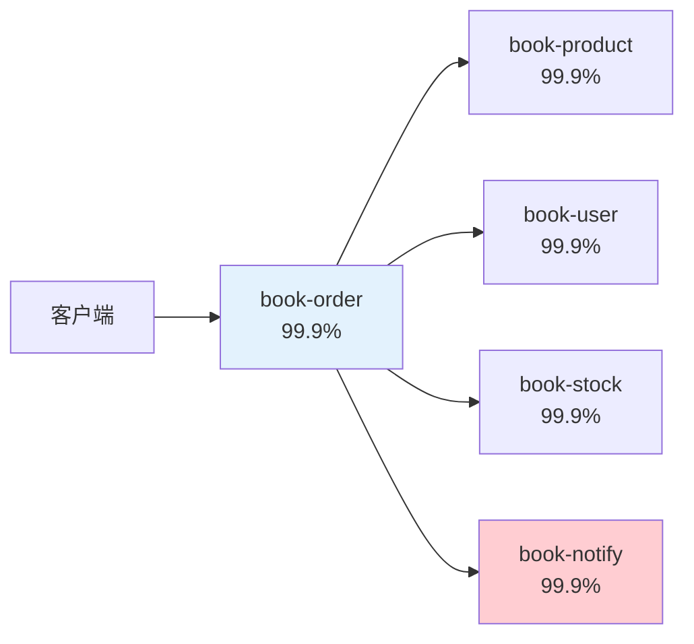
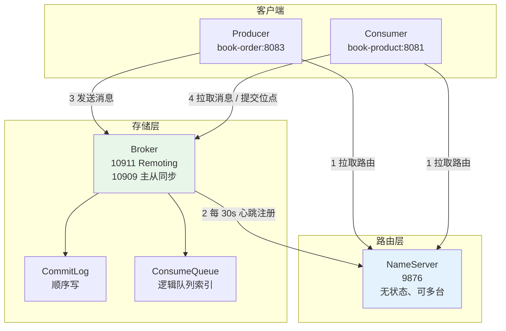
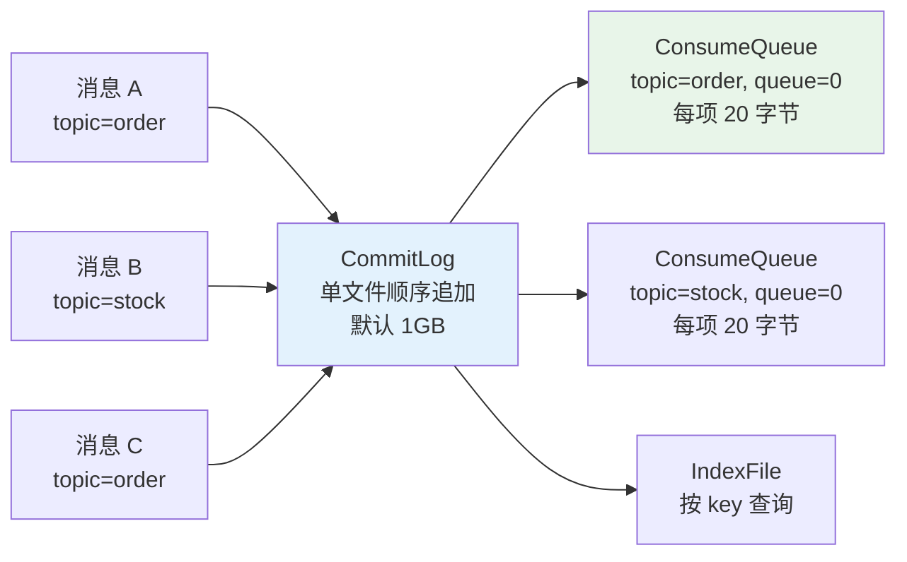

# RocketMQ概述与部署

## 课程目标

- 理解消息中间件在微服务架构中的位置，说清同步调用带来的耦合与故障放大
- 掌握消息驱动的三大价值：解耦、异步、削峰，并说清每一项的代价
- 掌握 RocketMQ 的架构组成与端口划分：NameServer、Broker、Producer、Consumer、Proxy
- 理解 CommitLog、ConsumeQueue、IndexFile 的存储模型，说清"写入快、消费也快"的原因
- 能够完成 RocketMQ 5.3.x 单机部署：二进制包启动与 docker-compose 两种方式
- 能够用 Dashboard 与 `mqadmin` 验证集群、Topic、消费进度，并排查三类典型部署故障

## 回顾与导入

前三十八课走完了"服务能互相调用"这条主线：Nacos 负责发现，OpenFeign 负责调用，LoadBalancer 负责选实例，Config 负责下发配置，Gateway 负责统一入口。它们合起来只构成一种协作方式：**同步调用**。

同步调用的好处是直观：调用方拿到返回值就知道结果，出错立刻抛异常。但它有两个绕不过去的问题。

第一个是**耦合**。第 26 课下单扣库存，订单服务必须知道图书服务的接口路径、参数结构、错误码含义。图书服务加一个必填参数，订单服务不改就调不通；图书服务把"扣减"拆成"预占 + 确认"，订单服务得跟着改编排。业务上没有依赖的两个团队，被一个接口签名绑在一起。

第二个是**故障放大**。同步链路上，任何一个环节慢，调用方就跟着慢；任何一个环节挂，调用方就跟着挂。



一次下单串行调用四个下游，每个下游可用性 99.9%，整条链路只有 `0.999^4 ≈ 99.6%`；每个下游 200 毫秒，延迟直接叠到 800 毫秒。"通知"这种失败了也无所谓的动作，被排在必须成功的链路上，这是设计问题，不是运维问题。

| 现象 | 代码里的证据 | 本质 |
| --- | --- | --- |
| 图书服务重启，订单全部失败 | `FeignException` 直接抛给前端 | 调用方与被调用方强耦合 |
| 通知接口抖动，下单变慢 | `orderNotifyClient.send()` 在事务后同步执行 | 非核心动作占用核心链路 |
| 促销瞬时流量打崩库存服务 | 请求原样透传到 `book-product` | 没有缓冲层，流量直达 |

本课引入的 RocketMQ，就是来解决这三件事的：把"必须一起完成"拆成"先后完成"，把"同步等待"改成"异步通知"，把"瞬时洪峰"摊成"持续消费"。但要说清楚：**消息中间件不是免费的**，它把一次函数调用换成了一次网络投递，系统复杂度、一致性、可观测性都会上升。

## 一、为什么需要消息中间件

### 三大价值

判断一段逻辑该不该走消息，先回答一个问题：**调用方需不需要立刻知道结果**。这条边界不是"核心业务走同步、非核心走异步"这么粗暴——库存扣减是核心的，但它不需要在下单请求里立刻返回给用户，用户关心的是"下单成功"，不是"库存已扣"。所以库存也能走消息，代价是要接受"下单成功但库存不足"这种中间状态，并用补偿兜住。

| 价值 | 解决的问题 | 案例系统中的落地 | 代价 |
| --- | --- | --- | --- |
| 解耦 | 生产者不必知道有几个消费者、是谁 | 下单发一条消息，库存与通知服务各自订阅 | 契约从编译期移到运行期，漂移无人报错 |
| 异步 | 非关键路径不占请求线程与响应时间 | 通知、积分、报表改由消费端处理 | 用户看到的是最终状态，中间态要设计 |
| 削峰 | 瞬时流量被缓冲，消费端匀速处理 | 大促消息堆积，库存服务按 TPS 平稳消费 | 消息可能延迟数分钟，要评估业务容忍度 |

三个价值对应三种不同的压力：解耦对抗**变更**，异步对抗**延迟**，削峰对抗**流量**。三者的共同前提是：**系统能接受"现在不完成，稍后一定完成"**。如果业务要求强一致（比如账户余额转账），消息只能做辅助，不能做主体。

### 引入消息之后新增的问题

| 新问题 | 具体表现 | 在哪一课解决 |
| --- | --- | --- |
| 消息可能丢失 | 生产者发送失败、Broker 宕机未刷盘、消费者处理完未提交位点 | 第 42 课 |
| 消息可能重复 | 网络超时导致生产者重发、消费失败重试 | 第 42 课 |
| 消息可能乱序 | 多队列并行消费，同一订单的两次变更被颠倒 | 第 41 课 |
| 本地事务与消息不一致 | 订单落库成功、消息发送失败 | 第 41、42 课 |
| 消息堆积无人知 | 消费端宕机，队列持续增长 | 第 42 课 |
| 链路难排查 | 一个请求跨服务、跨队列，日志断成两截 | 第 49 课 |

> **结论：** 消息中间件买到的是"时间上的解耦"，付出的是"一致性上的复杂度"。后面的四课，本质上都在补这张表的欠账。

## 二、RocketMQ 架构与核心模型

### 整体架构

RocketMQ 5.3.x 的部署形态有两大类：**经典架构**（客户端直连 Broker，Remoting 协议）与 **Proxy 架构**（客户端连 Proxy，gRPC 协议）。本课程统一使用经典架构，因为 `rocketmq-spring-boot-starter` 走的就是 Remoting 协议，也是目前生产环境占比最高的形态。



四个角色各管一件事，没有谁是"中心"：NameServer 只存路由，Broker 只存消息，Producer 与 Consumer 都从 NameServer 拿路由后直连 Broker。主从部署时 `brokerId=0` 为主，`brokerId>0` 为从。

| 角色 | 默认端口 | 职责 | 是否保存状态 |
| --- | --- | --- | --- |
| NameServer | 9876 | 路由注册与发现 | 内存状态，重启后由 Broker 心跳重建 |
| Broker | 10911 | 消息存储与投递 | 磁盘文件，全部状态 |
| Broker HA | 10909 | 主从数据同步 | 无 |
| Broker FastRemoting | 10912 | 内部快速通道 | 无 |
| Proxy（可选） | 8080 / 8081 | gRPC / Remoting 接入层 | 无 |

> **注意：** 5.x 的 Proxy 默认监听 8080 与 8081，而 `book-gateway` 也在 8080。同一台机器上同时跑网关、Proxy、Dashboard 时，端口必然冲突，部署前先做一张端口分配表。

生产端选一个队列写入后会拿到 `SendResult`，其中的 `SEND_OK` 只代表**消息进了 Broker 的内存队列**，不代表已经落盘，落盘与否由后文的 `flushDiskType` 决定；而 `offset` 是**每个队列各自**的进度，回答"消费到第几条"必须带上队列号。

### 存储模型：为什么写入和读取都很快

RocketMQ 的写入是**所有 Topic 共用一份 CommitLog**，顺序追加，不做随机写；读取靠 ConsumeQueue 这层轻量索引。



| 文件 | 内容 | 写入方式 | 用途 |
| --- | --- | --- | --- |
| CommitLog | 消息本体（含属性、存储时间） | 顺序追加，所有 Topic 混合 | 数据唯一来源，重启恢复靠它 |
| ConsumeQueue | 消费位点索引：`offset + size + tag hash` 共 20 字节 | 由 CommitLog 异步构建 | 消费者按队列顺序读，不必扫 CommitLog |
| IndexFile | key 哈希索引 | 后台线程构建 | 控制台按 key 反查消息 |

顺序写加页缓存（PageCache），让 Broker 的写入接近磁盘顺序写上限；消费端按 ConsumeQueue 的小块索引连续读，再定位到 CommitLog。这与 Kafka 的思路一致，区别在于 RocketMQ 所有 Topic 共享一份 CommitLog，Kafka 是每个 Partition 一个日志段。

### 核心概念

| 概念 | 说明 | 案例系统中的对应 |
| --- | --- | --- |
| Topic | 一类消息的逻辑集合，生产与消费的基本单位 | `stock-deduct-topic`、`order-notify-topic` |
| Tag | Topic 下的二级分类，消费端可按 Tag 过滤 | `DEDUCT`、`RESTORE` |
| Queue | Topic 在某个 Broker 上的物理分片，默认每 Topic 4 个 | 顺序消息的"有序范围"就是同一个 Queue |
| 消费组（ConsumerGroup） | 一组逻辑相同的消费者实例 | `stock-deduct-consumer-group` |
| 位点（Offset） | 消费组在某个队列上的消费进度 | 提交到 Broker，控制台可见 |
| 消息模型 | 集群消费 / 广播消费 | 库存用集群，本地缓存刷新用广播 |

| 消费模式 | 行为 | 一条消息被消费几次 | 适用场景 |
| --- | --- | --- | --- |
| `CLUSTERING`（集群，默认） | 组内实例分摊队列 | 组内合计一次 | 业务处理，必须只做一次的场景 |
| `BROADCASTING`（广播） | 组内每个实例都收到 | 每个实例各一次 | 刷新本地缓存、推送配置变更 |

## 三、RocketMQ 与 Kafka、RabbitMQ 的对比

三者都能"发消息、收消息"，差别在模型与取舍。选型时先看业务对**顺序、事务、延迟**的要求，再看团队运维能力。

| 维度 | RocketMQ 5.3.x | Kafka 3.9.x | RabbitMQ 4.x |
| --- | --- | --- | --- |
| 模型 | Topic + Queue，所有 Topic 共享 CommitLog | Topic + Partition，每分区独立日志段 | Exchange + Queue + Binding |
| 吞吐量级 | 十万级（单机示意值） | 十万到百万级（单机示意值） | 万级（单机示意值） |
| 投递延迟 | 毫秒级 | 毫秒级 | 微秒到毫秒级 |
| 顺序消息 | 按 Queue 有序，原生支持 | 按 Partition 有序，原生支持 | 多消费者下无保证 |
| 延迟消息 | 5.x 支持任意时间定时消息 | 不支持，需外部组件补齐 | 支持 TTL + 死信，受队头阻塞影响 |
| 事务消息 | 半消息 + 回查，原生支持 | 仅限 Kafka 内部读写（EOS） | 不支持，靠 confirm 人工补偿 |
| 消息回溯 | 按时间重置位点 | 按 offset 或时间重放，能力最强 | 消费后即删，不支持回溯 |
| 运维复杂度 | 中，NameServer 与 Broker 两类进程 | 中高，KRaft 或 ZooKeeper，分区规划敏感 | 低，单机即可用 |
| 典型场景 | 电商、金融的业务消息 | 日志采集、流处理管道 | 企业集成、复杂路由 |

> **提示：** 选型看三条：要业务消息、顺序消息、事务消息，选 RocketMQ；要海量日志与流处理，选 Kafka；要复杂路由与多协议兼容，选 RabbitMQ。团队只有一两个人维护中间件时，运维成本比吞吐量更重要。另外不要用吞吐量数字做唯一依据——业务消息的瓶颈通常在消费端的数据库写入，而不是消息中间件本身。

## 四、部署实战

### 准备工作

RocketMQ 5.3.x 在 JDK 17 下运行，先配置两个环境变量：

| 变量 | 示例值 | 作用 |
| --- | --- | --- |
| `JAVA_HOME` | `D:\devProgramFiles\jdk-17` | 启动脚本靠它找 java |
| `ROCKETMQ_HOME` | `D:\devProgramFiles\rocketmq-all-5.3.2-bin-release` | Broker 与 mqadmin 定位配置与日志 |

Linux 或 macOS 下写入 `~/.bashrc`：

```bash
export ROCKETMQ_HOME=/opt/rocketmq-all-5.3.2-bin-release
export PATH=$PATH:$ROCKETMQ_HOME/bin
```

```text
:: Windows（管理员 CMD，设置后需重开窗口）
setx ROCKETMQ_HOME "D:\devProgramFiles\rocketmq-all-5.3.2-bin-release"
setx PATH "%PATH%;%ROCKETMQ_HOME%\bin"
```

> **注意：** Windows 下不要用 PowerShell 的 `$env:ROCKETMQ_HOME=...` 启动脚本，`mqnamesrv.cmd` 是批处理，子进程拿不到当前会话变量，必须用 `setx` 写进系统环境或改脚本内的默认值。

### 第一步：改小 JVM 内存

发行包默认按生产机器给内存：`runbroker.cmd` 是 `-Xms8g -Xmx8g -Xmn4g`，`runserver.cmd` 是 `-Xms4g -Xmx4g`。开发机直接启动多半报"内存不足"或进程被系统杀掉。

```text
:: rocketmq-all-5.3.2\bin\runbroker.cmd，找到 set "JAVA_OPT=..." 一行并替换
set "JAVA_OPT=%JAVA_OPT% -server -Xms1g -Xmx1g -Xmn512m -XX:MaxDirectMemorySize=512m"
set "JAVA_OPT=%JAVA_OPT% -XX:+UseG1GC -XX:G1HeapRegionSize=16m -XX:+PrintGCDetails"
```

```text
:: rocketmq-all-5.3.2\bin\runserver.cmd
set "JAVA_OPT=%JAVA_OPT% -server -Xms512m -Xmx512m -Xmn256m -XX:MaxDirectMemorySize=256m"
```

Linux 对应改 `runbroker.sh`、`runserver.sh` 的 `JAVA_OPT`。`MaxDirectMemorySize` 必须显式给，否则直接内存与 PageCache 会挤压堆空间，导致频繁 Full GC。

### 第二步：写 Broker 配置

```properties
brokerClusterName = DefaultCluster
brokerName = broker-a
brokerId = 0
namesrvAddr = 127.0.0.1:9876
deleteWhen = 04
fileReservedTime = 72
brokerRole = ASYNC_MASTER
flushDiskType = ASYNC_FLUSH
autoCreateTopicEnable = true
enablePropertyFilter = true
storePathRootDir = D:/rocketmq/store
```

| 参数 | 作用 | 开发机取值 | 生产建议 |
| --- | --- | --- | --- |
| `brokerRole` | 主从角色 | `ASYNC_MASTER` | 金融级用 `SYNC_MASTER`，主从双写才算成功 |
| `flushDiskType` | 刷盘方式 | `ASYNC_FLUSH` | 不丢消息用 `SYNC_FLUSH`，代价是单机 TPS 下降 |
| `autoCreateTopicEnable` | 允许自动建 Topic | `true` | **生产必须 `false`**，Topic 由运维统一创建 |
| `enablePropertyFilter` | 开启 SQL92 属性过滤 | `true` | 需要按属性过滤时开启 |
| `fileReservedTime` | 消息保留小时数 | `72` | 按业务回溯需求，常见 72 到 168 |
| `storePathRootDir` | 存储根目录 | 非系统盘 | 独立数据盘，避免与日志抢 IO |
| `brokerIP1` | 对外暴露 IP | 单机可省 | 多网卡机器必填，否则注册错误 IP |

`brokerIP1` 是多网卡环境最常见的坑：Broker 自动探测到的 IP 客户端连不上，注册到 NameServer 的地址就是错的，表现是"发送消息超时"。用 Docker 时同理，要填宿主机可达的 IP。

### 第三步：启动 NameServer 与 Broker

```text
:: Windows，两个独立的 CMD 窗口，先启 NameServer
mqnamesrv.cmd -n localhost:9876
mqbroker.cmd -n localhost:9876 -c D:\devProgramFiles\rocketmq-all-5.3.2-bin-release\conf\broker.conf
```

Linux 或 macOS 在发行包根目录执行：

```bash
sh bin/mqnamesrv -n localhost:9876
sh bin/mqbroker -n localhost:9876 -c conf/broker.conf
```

`-n` 指定 NameServer 地址，`-c` 指定配置文件，进程不退出即为正常。看到 `The broker[broker-a, 192.168.x.x:10911] boot success` 说明 Broker 已注册成功。

> **提示：** 不写 `-n` 时也可以设 `NAMESRV_ADDR=127.0.0.1:9876`，但客户端与服务端都读这个变量，混用会增加排查难度，课程统一用显式 `-n`。

### 第四步：docker-compose 方式

```yaml
services:
  namesrv:
    image: apache/rocketmq:5.3.2
    command: sh mqnamesrv
    ports:
      - "9876:9876"
    environment:
      JAVA_OPT_EXT: "-Xms512m -Xmx512m -Xmn256m"

  broker:
    image: apache/rocketmq:5.3.2
    depends_on:
      - namesrv
    command: sh mqbroker -n namesrv:9876 -c /home/rocketmq/conf/broker.conf
    ports:
      - "10909:10909"
      - "10911:10911"
    environment:
      NAMESRV_ADDR: namesrv:9876
      JAVA_OPT_EXT: "-Xms1g -Xmx1g -Xmn512m"
    volumes:
      - ./conf/broker.conf:/home/rocketmq/conf/broker.conf
      - ./data/broker/store:/home/rocketmq/store

  dashboard:
    image: apacherocketmq/rocketmq-dashboard:latest
    depends_on:
      - namesrv
    ports:
      - "8180:8080"
    environment:
      JAVA_OPTS: "-Drocketmq.namesrv.addr=namesrv:9876 -Dcom.rocketmq.sendMessageWithVIPChannel=false"
```

容器网络有两点与宿主机不同：`namesrvAddr` 要写容器名 `namesrv:9876`，不能写 `127.0.0.1`；Broker 注册的地址必须是**宿主机能访问的地址**，Docker Desktop 下通常要显式设置 `brokerIP1`。

### 第五步：控制台与验证

Dashboard 是排查消息问题的主力工具，主要看四块：

| 页面 | 看什么 | 什么时候用 |
| --- | --- | --- |
| Cluster | Broker 地址、角色、版本、写入 TPS | 确认 Broker 是否注册成功 |
| Topic | 队列数、读写队列、路由到哪些 Broker | 确认 Topic 是否创建、分片是否够 |
| Consumer | 消费组、订阅关系、堆积量、消费 TPS | 确认消费是否跟得上 |
| Message | 按 Topic / Key / msgId 查询消息详情与轨迹 | 定位某条消息是否发出、是否被消费 |

`mqadmin` 在 Linux 下无后缀、Windows 下为 `mqadmin.cmd`，参数完全一致：

```bash
mqadmin clusterList -n 127.0.0.1:9876
mqadmin topicList -n 127.0.0.1:9876
mqadmin updateTopic -n 127.0.0.1:9876 -c DefaultCluster -t stock-deduct-topic
mqadmin topicStatus -n 127.0.0.1:9876 -t stock-deduct-topic
mqadmin consumerProgress -n 127.0.0.1:9876 -g stock-deduct-consumer-group
```

`clusterList` 输出里的 `InTPS`、`OutTPS` 是第一眼指标：`InTPS` 有值而 `OutTPS` 为 0，说明生产正常、消费侧没起来。`consumerProgress` 的 `Diff Total` 就是堆积量，也是第 42 课告警的核心指标。

## 五、常见问题排查

### 问题一：启动报内存不足

启动日志打印 `Could not reserve enough space for 8388608KB object heap`，原因是默认 `-Xms8g`。按上一节第一步改小 `JAVA_OPT`，并确认没有误用 32 位 JVM（堆上限约 1.5GB）。

### 问题二：Broker 未注册到 NameServer

| 现象 | 根因 | 排查与处理 |
| --- | --- | --- |
| `clusterList` 只有表头 | Broker 没起来或启动即退出 | 看 `logs/rocketmqlogs/broker.log`，修配置后重启 |
| 日志报 `connect to namesrv failed` | `namesrvAddr` 写错或 NameServer 未启动 | `telnet 127.0.0.1 9876`，先启 NameServer |
| 注册成功但发送超时 | 注册的 IP 客户端不可达 | `clusterList` 看地址列，设置 `brokerIP1` |
| 一段时间后 Broker 消失 | 心跳中断，多是网络或长时间 GC | 看 Broker GC 日志与网络连通性 |

### 问题三：控制台连不上

| 现象 | 根因 | 处理 |
| --- | --- | --- |
| Dashboard 页面打不开 | 默认 8080 与网关冲突 | 映射到 8180，或改 `server.port` |
| 页面能开，列表全空 | `namesrvAddr` 配错 | 检查 `rocketmq.namesrv.addr`，容器内写服务名 |
| 点进 Topic 报错 | 客户端与 Broker 版本不一致 | 统一客户端为 5.3.x |
| 查询消息一直转圈 | key 对应的消息已过期清理 | 缩短时间范围，检查 `fileReservedTime` |

> **结论：** 排查顺序固定为四步：9876 端口是否监听、`clusterList` 是否有 Broker 且 `InTPS` 有值、`topicStatus` 的 `maxOffset` 是否增长、`consumerProgress` 的 `Diff Total` 是否收敛。跳步只会浪费时间。

## 注意事项

- `autoCreateTopicEnable=true` 只适合开发。生产环境自动建 Topic 会用默认 4 个队列，后期想改队列数只能删重建，且新 Topic 可能被路由到不该出现的 Broker 上。
- 单机部署只适合开发与压测。生产至少两主两从，`brokerRole` 与 `flushDiskType` 共同决定可靠性等级：`SYNC_MASTER + SYNC_FLUSH` 最稳，`ASYNC_MASTER + ASYNC_FLUSH` 最快。
- 磁盘要预留空间并设置保留时间。消息写满磁盘后 Broker 拒绝写入，生产端会收到 `SERVICE_NOT_AVAILABLE`，恢复要等清理线程跑完。
- NameServer 至少两台。它无状态但客户端启动时要能连上一台，单点会让"重启 NameServer"变成一次故障。
- 端口规划要提前做：8080 给网关、8180 给 Dashboard、9876 给 NameServer、10911/10909 给 Broker，避免边部署边发现冲突。

## 小结

本节课我们学习了：

1. **消息中间件的位置**：它是同步调用之外的第二条协作通道，解决耦合与故障放大，代价是一致性复杂度。
2. **三大价值与代价**：解耦对抗变更、异步对抗延迟、削峰对抗流量，共同前提是业务能接受"稍后完成"。
3. **RocketMQ 架构**：NameServer 管路由、Broker 管存储，Producer 与 Consumer 直连 Broker。
4. **存储模型**：CommitLog 顺序追加、ConsumeQueue 建 20 字节索引、IndexFile 支持按 key 反查。
5. **与 Kafka、RabbitMQ 的取舍**：业务消息与事务消息选 RocketMQ，大数据管道选 Kafka，复杂路由选 RabbitMQ。
6. **部署与验证**：改小 JVM、写好 `broker.conf`，用 `clusterList`、`topicStatus`、`consumerProgress` 三级验证。
7. **三类典型故障**：内存不足、Broker 未注册、控制台连不上，各有固定排查顺序。

## 作业

### 作业一：完成单机部署

1. 下载 RocketMQ 5.3.x 二进制包，配置 `JAVA_HOME` 与 `ROCKETMQ_HOME`。
2. 修改 `runbroker.cmd` / `runserver.cmd` 的 JVM 参数，把堆降到 1GB 与 512MB。
3. 启动 NameServer 与 Broker，用 `clusterList` 确认 `broker-a` 已注册，记录 `InTPS` 字段的值。

### 作业二：创建业务 Topic 并验证

1. 关闭 `autoCreateTopicEnable`，用 `mqadmin updateTopic` 手工创建 `stock-deduct-topic` 与 `order-notify-topic`，队列数设为 4。
2. 用 `mqadmin sendMessage` 各发一条消息，再用 `topicStatus` 观察 `maxOffset` 变化。
3. 启动 Dashboard，用 msgId 与 Key 各查一次，记录消息的存储时间与队列 ID。
