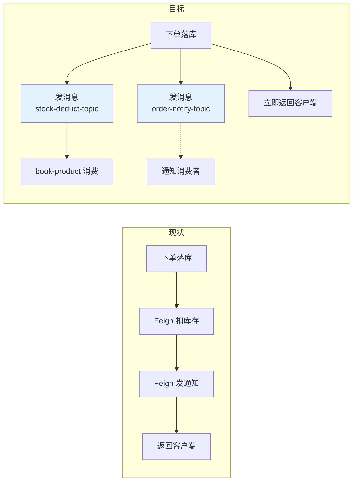
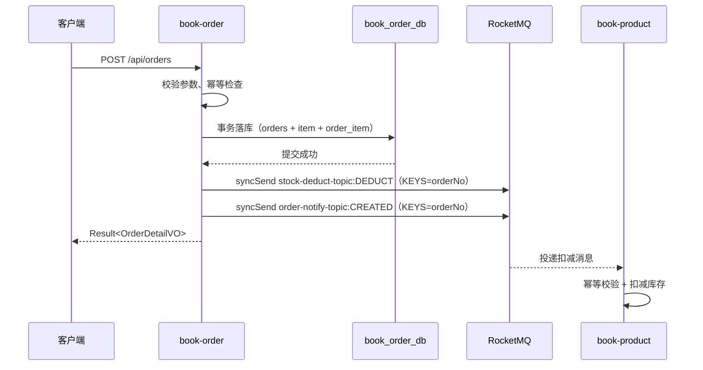

# 消息发送与消费实战

## 课程目标

- 掌握 `rocketmq-spring-boot-starter` 的引入方式，说清 2.3.x 与 Spring Boot 3.5 的兼容边界
- 掌握 `RocketMQTemplate` 的三种发送方式：同步 `syncSend`、异步 `asyncSend`、单向 `sendOneWay`，并知道何时用哪一种
- 掌握消息体设计：Body 放什么、KEYS 放什么、TAGS 放什么、自定义属性放什么
- 掌握 `@RocketMQMessageListener` 的核心属性，能独立写一个可上线的消费者
- 能够完成 `book-order` 的改造：下单成功后发出"扣减库存"与"发送通知"两条消息，并带上幂等键
- 能够用控制台与 `mqadmin` 验证消息是否发出、是否被消费，并处理重复消费与反序列化异常

## 回顾与导入

上一课把 RocketMQ 跑起来了：NameServer 在 9876，Broker 在 10911，Dashboard 在 8180，集群列表里有 `broker-a`。但此刻它还是一条空管道，一条业务消息都没流动过。
订单链路目前仍是第 26 课的形态：订单落库后同步调用 `ProductClient.deduct()` 扣库存，再同步调用通知接口。三个具体问题：扣库存同步调用，图书服务抖动订单请求跟着变慢；通知同步调用，通知失败会导致订单报错；新增积分、报表都要改订单服务。



消息化不是把 Feign 换成 `send`。要回答四个问题：消息体长什么样、发失败怎么办、消费端怎么保证只处理一次、怎么确认消息被消费。幂等留给第 42 课。

## 一、接入 rocketmq-spring-boot-starter

### 依赖坐标与版本选择

```xml
<dependency>
    <groupId>org.apache.rocketmq</groupId>
    <artifactId>rocketmq-spring-boot-starter</artifactId>
    <version>2.3.6</version>
</dependency>
```

版本关系要记住一句话：`rocketmq-spring-boot-starter 2.3.6` 内含 `rocketmq-client 5.3.2`（与 5.3.x Broker 对齐，Remoting 协议），它自己的编译基线是 Spring Boot 2.7.18，运行时由课程父 POM 统一到 3.5.16。

兼容性有四个要点，都是踩坑之后才会明白：

- **必须 2.3.x 及以上**。2.2.x 及更早只提供 `META-INF/spring.factories`，Boot 3 不再读它做自动装配，表现是配置写了、`RocketMQTemplate` 注入不进来。
- **自动装配靠 `AutoConfiguration.imports`**。2.3.x 同时带 `spring.factories` 与 `AutoConfiguration.imports`，前者服务 Boot 2，后者服务 Boot 3。
- **不要自己 `new DefaultMQProducer()`**。starter 负责创建、启动、关闭生产者，自建一份会出现两个实例、两套线程池。
- **传递依赖不用手动排除**。starter 带的 starter 与 validation 由 Boot 3.5.16 统一管理版本，手工排除反而容易漏掉校验器。

### 配置项

```yaml
rocketmq:
  name-server: 127.0.0.1:9876
  producer:
    group: book-order-producer-group
    send-message-timeout: 3000
    retry-times-when-send-failed: 2
    retry-times-when-send-async-failed: 2
    max-message-size: 4194304
    compress-message-body-threshold: 4096
```

| 配置项 | 作用 | 建议值 |
| --- | --- | --- |
| `rocketmq.name-server` | NameServer 地址，多个用分号分隔 | 集群环境写两台以上 |
| `rocketmq.producer.group` | 生产者组，同一应用共用一个 | `book-order-producer-group` |
| `send-message-timeout` | 同步发送超时（毫秒） | 3000，与消费耗时无关 |
| `retry-times-when-send-failed` | 同步发送失败重试次数 | 2 |

`name-server` 没配时启动直接失败并提示 `rocketmq.name-server must be specified`，这是好事——比运行到发消息时才报错容易定位。

## 二、用 RocketMQTemplate 发送消息

### 三种发送方式的取舍

| 方式 | 是否等结果 | 失败能否感知 | 吞吐 | 适用场景 |
| --- | --- | --- | --- | --- |
| `syncSend` | 等 Broker 返回 `SendResult` | 能，可判断 `SendStatus` | 中 | 业务消息，必须知道是否发出 |
| `asyncSend` | 不等，回调通知 | 能，在 `SendCallback` 里处理 | 高 | 高并发且不想阻塞请求线程 |
| `sendOneWay` | 完全不等 | **不能** | 最高 | 日志、埋点等丢了可接受的数据 |

> **结论：** 业务消息默认用 `syncSend`。它的代价是一次网络往返（毫秒级），换来的是"发没发出去"这个确定性，后续的重试、补偿、对账都依赖它。

### 同步发送与结果校验

目标地址的格式是 `topic:tag`，Tag 用于消费端过滤。下面这个类是本章唯一的发送入口，三种方式都在里面，后续小节只解释差异。

```java
package com.example.order.mq;

import com.example.order.dto.OrderCreatedMessage;
import com.example.order.dto.OrderLogMessage;
import com.example.order.dto.StockDeductMessage;
import lombok.RequiredArgsConstructor;
import lombok.extern.slf4j.Slf4j;
import org.apache.rocketmq.client.producer.SendCallback;
import org.apache.rocketmq.client.producer.SendResult;
import org.apache.rocketmq.client.producer.SendStatus;
import org.apache.rocketmq.spring.core.RocketMQTemplate;
import org.apache.rocketmq.spring.support.RocketMQHeaders;
import org.springframework.messaging.Message;
import org.springframework.messaging.support.MessageBuilder;
import org.springframework.stereotype.Component;

@Slf4j
@Component
@RequiredArgsConstructor
public class OrderMessageProducer {

    private static final String STOCK_TOPIC = "stock-deduct-topic";
    private static final String NOTIFY_TOPIC = "order-notify-topic";

    private final RocketMQTemplate rocketMQTemplate;
    private final MessageCompensator messageCompensator;

    public SendResult sendStockDeduct(StockDeductMessage body) {
        SendResult result = rocketMQTemplate.syncSend(STOCK_TOPIC + ":DEDUCT",
                build(STOCK_TOPIC + ":DEDUCT", body, body.getOrderNo() + ":DEDUCT"));
        check(result, STOCK_TOPIC, body.getOrderNo());
        return result;
    }

    public void sendOrderCreatedAsync(OrderCreatedMessage body) {
        rocketMQTemplate.asyncSend(NOTIFY_TOPIC + ":CREATED",
                build(NOTIFY_TOPIC + ":CREATED", body, body.getOrderNo() + ":CREATED"),
                new SendCallback() {
                    @Override
                    public void onSuccess(SendResult sendResult) {
                        log.info("通知消息发送成功，orderNo={}，msgId={}", body.getOrderNo(), sendResult.getMsgId());
                    }

                    @Override
                    public void onException(Throwable throwable) {
                        // 异步失败必须落库或进补偿任务，不能只打日志
                        log.error("通知消息发送失败，orderNo={}，进入补发队列", body.getOrderNo(), throwable);
                        messageCompensator.save(NOTIFY_TOPIC, body);
                    }
                }, 3000);
    }

    public void sendOrderLog(OrderLogMessage body) {
        rocketMQTemplate.sendOneWay("order-log-topic", body);
    }

    private <T> Message<T> build(String destination, T payload, String bizKey) {
        return MessageBuilder.withPayload(payload)
                .setHeader(RocketMQHeaders.KEYS, bizKey)
                .setHeader("bizType", destination)
                .build();
    }

    private void check(SendResult result, String topic, String orderNo) {
        if (result.getSendStatus() != SendStatus.SEND_OK) {
            log.error("消息发送未确认，topic={}，orderNo={}，status={}，msgId={}",
                    topic, orderNo, result.getSendStatus(), result.getMsgId());
            throw new MessagingSendException("消息发送失败：" + topic);
        }
    }
}
```

关键点在 `SendStatus` 的判断。`syncSend` 不抛异常不代表发送成功，它可能返回一个"部分成功"的状态：

| `SendStatus` | 含义 | 是否算成功 | 处理建议 |
| --- | --- | --- | --- |
| `SEND_OK` | 消息已写入 Broker 并完成主从同步或刷盘（按配置） | 是 | 正常继续 |
| `FLUSH_DISK_TIMEOUT` | 消息已写入，但同步刷盘超时 | 部分成功 | 记录并告警，消息大概率已落盘 |
| `FLUSH_SLAVE_TIMEOUT` | 主从同步超时 | 部分成功 | 记录并告警，主节点有数据 |
| `SLAVE_NOT_AVAILABLE` | 从节点不可用，主从同步未执行 | 部分成功 | 检查集群，主节点数据仍可用 |

这四种状态只在同步刷盘或同步复制下才出现；`ASYNC_FLUSH` 时基本只有 `SEND_OK`，但判断不能省。

### 异步发送

异步发送适合"发消息只是顺带动作"的场景，请求线程不等 Broker 返回。上面 `sendOrderCreatedAsync` 就是异步：`onSuccess` 只记日志，`onException` 把消息交给 `MessageCompensator` 落库补发。

`asyncSend` 的最后一个参数是等**回调**的超时，不是投递结果的超时。超时后 `onException` 会被调用，但消息可能已经发出，所以补发必须以幂等为前提。

### 单向发送

`sendOrderLog` 用 `sendOneWay`，连 Broker 的响应都不读，只保证"写进了 Socket 缓冲区"。它适合审计日志、行为埋点这类丢了也能接受的场景；业务消息用它，等于放弃了对发送结果的掌控。

### 消息体设计

一条消息有四个可承载信息的位置，各有分工，放错位置会在排查时付出代价。

| 位置 | 放什么 | 案例 | 能否用于查询 |
| --- | --- | --- | --- |
| Body | 业务数据的 JSON | 订单号、商品 ID、数量、时间戳 | 否 |
| KEYS | 业务唯一键 | `orderNo`，多个用空格分隔 | 是，控制台与 `mqadmin` 按 key 查 |
| TAGS | 动作类型，消费端据此过滤 | `DEDUCT`、`RESTORE` | 是，按 Tag 过滤订阅 |
| 用户属性 | 版本、来源、重试标记等元数据 | `bizType=STOCK_DEDUCT`、`schemaVersion=1` | 否 |

```java
package com.example.order.dto;

import lombok.Data;

import java.io.Serializable;
import java.time.LocalDateTime;

@Data
public class StockDeductMessage implements Serializable {

    private String orderNo;

    private Long productId;

    private Integer quantity;

    private LocalDateTime occurredAt;
}
```

三条实践规则：**Body 只放消费端真正需要的字段**；**KEYS 必须是业务键**，msgId 是发送之后才有的，不能用；**避免深层嵌套**，跨版本反序列化最容易在这里出问题。

> **注意：** rocketmq-spring 默认用 Jackson 序列化，`LocalDateTime` 需要 `jackson-datatype-jsr310` 并开启 `WRITE_DATES_AS_TIMESTAMPS=false`，否则消费端拿到的是数组。

## 三、消费端实战

### @RocketMQMessageListener 属性全表

| 属性 | 默认值 | 作用 | 使用建议 |
| --- | --- | --- | --- |
| `topic` | 必填 | 订阅的 Topic | 一个消费者只订阅一个 Topic |
| `consumerGroup` | 必填 | 消费组名 | **同组内订阅关系必须一致** |
| `selectorExpression` | `*` | Tag 过滤表达式，`A \|\| B` 为多选 | 动作类消息按 Tag 过滤 |
| `selectorType` | `TAG` | `TAG` 或 `SQL92` | SQL92 需 Broker 开 `enablePropertyFilter` |
| `consumeMode` | `CONCURRENTLY` | 并发消费或顺序消费 | 有先后依赖时用 `ORDERLY` |
| `messageModel` | `CLUSTERING` | 集群消费或广播消费 | 业务处理一律集群 |
| `consumeThreadNumber` | 20 | 消费线程数 | 按消费端 IO 能力调，不是越大越好 |
| `maxReconsumeTimes` | -1（16 次） | 最大重试次数 | 业务明确时可设 5 到 8 |
| `delayLevelWhenNextConsume` | 0 | 下次重试的延迟级别 | 0 表示按退避策略自动计算 |
| `suspendCurrentQueueTimeMillis` | 1000 | 顺序消费失败后暂停队列的时长 | 仅顺序消费有效 |
| `consumeTimeout` | 15 | 单条消息消费超时（分钟） | 超时即判失败并重试 |
| `consumeFromWhere` | `CONSUME_FROM_LAST_OFFSET` | 新消费组的起始位点 | 首次上线回放用 `FIRST_OFFSET` |
| `pullBatchSize` | 32 | 单次拉取条数 | 大消息调小 |
| `consumeMessageBatchMaxSize` | 1 | 批量消费条数 | 与 `RocketMQListener<List<T>>` 搭配 |
| `nameServer` | 空 | 单独覆盖 NameServer | 多集群场景才用 |
| `namespace` / `namespaceV2` | 空 | 命名空间隔离 | 多租户隔离 |
| `accessKey` / `secretKey` | 空 | ACL 凭证 | 开启 ACL 时必填 |
| `enableMsgTrace` | `false` | 消息轨迹开关 | 生产建议开启 |

`consumeThreadMax` 在 2.3.x 中仍然存在，但 5.x 客户端线程池由 `consumeThreadNumber` 控制，配它不会生效。

### 库存扣减消费者

```java
package com.example.product.mq;

import com.example.order.dto.StockDeductMessage;
import lombok.RequiredArgsConstructor;
import lombok.extern.slf4j.Slf4j;
import org.apache.rocketmq.spring.annotation.ConsumeMode;
import org.apache.rocketmq.spring.annotation.MessageModel;
import org.apache.rocketmq.spring.annotation.RocketMQMessageListener;
import org.apache.rocketmq.spring.core.RocketMQListener;
import org.springframework.stereotype.Component;

@Slf4j
@Component
@RequiredArgsConstructor
@RocketMQMessageListener(
        topic = "stock-deduct-topic",
        consumerGroup = "stock-deduct-consumer-group",
        selectorExpression = "DEDUCT",
        consumeMode = ConsumeMode.CONCURRENTLY,
        messageModel = MessageModel.CLUSTERING,
        consumeThreadNumber = 20,
        maxReconsumeTimes = 5)
public class StockDeductConsumer implements RocketMQListener<StockDeductMessage> {

    private final StockService stockService;

    @Override
    public void onMessage(StockDeductMessage message) {
        log.info("收到库存扣减消息，orderNo={}，productId={}，quantity={}",
                message.getOrderNo(), message.getProductId(), message.getQuantity());
        stockService.deduct(message.getOrderNo(), message.getProductId(), message.getQuantity());
    }
}
```

`RocketMQListener<T>` 的泛型就是反序列化目标，方法**正常返回即视为消费成功**，抛异常则失败并重试。所以业务异常要不要抛出，取决于你想不想重试；`catch` 住异常再打日志，等于告诉框架"消费成功"。

另外两条组内规则：同组所有实例的订阅关系必须完全一致（队列分配按订阅关系计算），且一个消费者实例只订阅一个 Topic。

## 四、改造 book-order：下单后发两条消息

### 改造后的时序



注意两个顺序细节：**先落库再发消息**，反过来会出现"库存扣了但订单没落库"；**两条消息分别发送**，因为它们的消费者、重试策略、失败影响完全不同。

生产者沿用第二节的 `OrderMessageProducer`：扣减走 `sendStockDeduct`（同步），通知走 `sendOrderCreatedAsync`（异步）。

幂等键设计成 `orderNo:动作`。同一订单会先后产生"扣减""通知""回补"多条消息，只用订单号会让消费端的去重表把第二条当成重复请求丢掉。

### 编排层调用

```java
// CreateOrderService.create() 的尾部，替换原来的两次 Feign 调用
String orderNo = orderTxService.createOrder(request, products);

stockDeductMessageFactory.build(orderNo, request.getItems())
        .forEach(orderMessageProducer::sendStockDeduct);
orderMessageProducer.sendOrderCreatedAsync(
        OrderCreatedMessage.of(orderNo, request.getUserId(), totalAmount));

orderTxService.markWaitPay(orderNo);
return orderTxService.detail(orderNo);
```

> **注意：** 这里仍然是"先落库、后发消息"，第二步失败会让订单停在 `CREATED` 而没有库存动作。本课只是记录日志并抛出异常，真正的兜底（本地消息表、事务消息）在第 41、42 课给出。

### 通知消费者

```java
@Slf4j
@Component
@RequiredArgsConstructor
@RocketMQMessageListener(topic = "order-notify-topic", consumerGroup = "order-notify-consumer-group",
        selectorExpression = "CREATED", consumeThreadNumber = 10, maxReconsumeTimes = 3)
public class OrderNotifyConsumer implements RocketMQListener<OrderCreatedMessage> {

    private final NotifyService notifyService;

    @Override
    public void onMessage(OrderCreatedMessage message) {
        log.info("收到下单通知消息，orderNo={}，userId={}", message.getOrderNo(), message.getUserId());
        notifyService.sendOrderCreated(message.getOrderNo(), message.getUserId());
    }
}
```

通知消费者的重试次数给 3 次就够：短信、站内信这类动作重试 3 次仍失败说明渠道确实不可用，继续重试只会堆积。库存扣减给 5 次，因为它的失败更可能是数据库瞬时问题。

## 五、验证与排查

### 验证步骤

```bash
mqadmin topicStatus -n 127.0.0.1:9876 -t stock-deduct-topic
curl -X POST http://127.0.0.1:8083/api/orders -H "Content-Type: application/json" ^
  -d "{\"requestId\":\"req-1001\",\"userId\":1,\"items\":[{\"productId\":1,\"quantity\":2}]}"
mqadmin consumerProgress -n 127.0.0.1:9876 -g stock-deduct-consumer-group
mqadmin queryMsgByKey -n 127.0.0.1:9876 -t stock-deduct-topic -k req-1001
```

四条命令对应四个检查点：`topicStatus` 的 `maxOffset` 是否增长、订单接口是否返回 200 与 `WAIT_PAY`、`consumerProgress` 的 `Diff Total` 是否为 0、按业务键能否查到带 `KEYS` 与 `TAGS` 的消息。哪条不通过就断在哪一环：没有 `maxOffset` 是没写进 Topic，`Diff Total` 不收敛是消费失败，查不到消息是时间范围或 KEYS 设置错了。

### 常见异常

| 现象 | 根因 | 处理 |
| --- | --- | --- |
| 启动报 `rocketmq.name-server must be specified` | 配置没写或写在错误的 profile | 检查 `rocketmq.name-server` |
| `RocketMQTemplate` 注入失败 | starter 低于 2.3，Boot 3 不读 `spring.factories` | 升级到 2.3.x |
| 消费端反复报反序列化异常，字段全 `null` | Body 是字符串但泛型声明为对象，或字段名不一致 | 发送端与消费端共用同一个 DTO |
| 同一条消息被消费多次 | 消费超时或抛异常触发重试 | 消费端做幂等，见第 42 课 |
| 消费端启动但收不到消息 | 订阅关系不一致、Tag 不匹配、组名拼错 | 对照 `consumerProgress` 与订阅表达式 |
| 消息查到但 `Diff Total` 一直涨 | 消费线程被慢业务占满 | 调 `consumeThreadNumber`，优化消费逻辑 |
| 发送报 `RemotingTooMuchRequestException` | 发送超时，Broker 压力大或 GC 停顿 | 加大超时、扩容 Broker |

> **提示：** 反序列化异常的典型表现是字段全为 `null`：发送端与消费端字段名不一致，检查 `@JsonProperty` 与 DTO 定义是否同步。

## 注意事项

- 业务消息用 `syncSend` 并校验 `SendStatus`。只 `try-catch` 不判断状态，`FLUSH_DISK_TIMEOUT` 会被当成成功。
- 异步发送必须在 `onException` 里落库或进补偿任务，只打日志等于把消息丢了。
- 幂等键用"业务号 + 动作"组合。只用订单号会让后续的回补消息被误判为重复。
- 消费方法正常返回就算成功。捕获异常后不重新抛出，框架会提交位点，消息永久丢失。
- 不要把大对象塞进 Body。超过 4MB 直接发送失败，消息里只放 ID 与必要字段。
- 同一消费组内订阅关系必须一致，否则灰度时新旧版本订阅不同 Topic，部分消息会无人消费。

## 小结

本节课我们学习了：

1. **依赖与兼容**：starter 2.3.6 内含 client 5.3.2，靠 `AutoConfiguration.imports` 在 Boot 3.5 自动装配，2.2.x 不可用。
2. **三种发送方式**：`syncSend` 等结果可校验、`asyncSend` 回调处理、`sendOneWay` 不感知失败，业务消息默认选第一种。
3. **发送结果校验**：`SendStatus` 四个取值里只有 `SEND_OK` 是完全成功，其余要记录并告警。
4. **消息体设计**：Body 放业务数据、KEYS 放业务键、TAGS 放动作类型，KEYS 决定后续能否按业务键排查。
5. **消费者属性**：`consumerGroup`、`selectorExpression`、`consumeMode`、`consumeThreadNumber`、`maxReconsumeTimes` 是必须理解的五个。
6. **订单链路改造**：先落库后发消息、扣减与通知拆成两条独立消息、幂等键用 `orderNo:动作`。
7. **验证手段**：`topicStatus` 看写入、`consumerProgress` 看堆积、`queryMsgByKey` 看消息本体。

## 作业

### 作业一：跑通同步发送与消费

1. 在 `book-order` 与 `book-product` 中引入 starter，配置 `name-server` 与生产者组。
2. 把 `CreateOrderService` 的扣减调用替换成 `orderMessageProducer.sendStockDeduct()`，启动两个服务下单一次。
3. 用 `mqadmin consumerProgress` 与 `queryMsgByKey` 验证消息已发出、已被消费，记录 `Diff Total`。

### 作业二：改造异步与单向发送

1. 把通知改成 `asyncSend`，在 `onException` 中写入一张 `mq_send_fail` 表。
2. 新增一条行为埋点消息，用 `sendOneWay` 发送，对比它与 `syncSend` 在下单接口耗时上的差别。
3. 制造一次消费端异常（例如库存不足时抛 `BusinessException`），观察 `maxReconsumeTimes` 生效后的表现，记录第 5 次失败时消息的去向。
