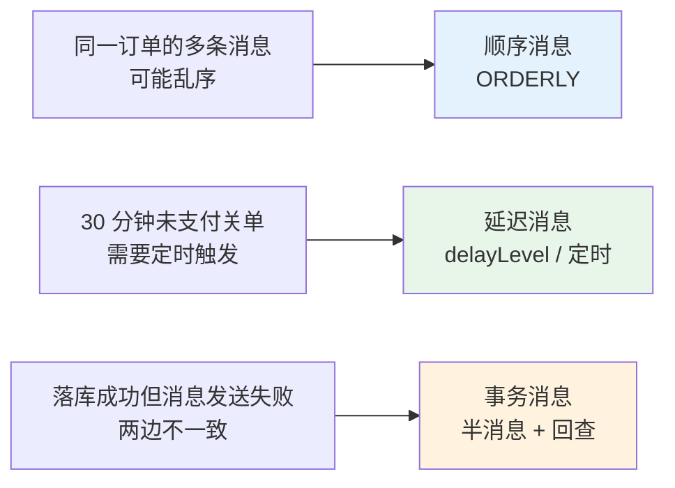
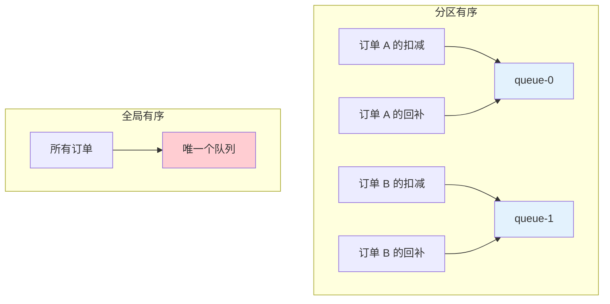
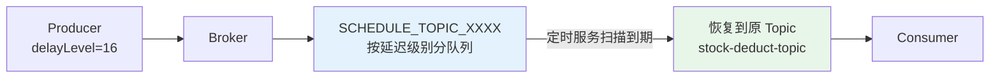
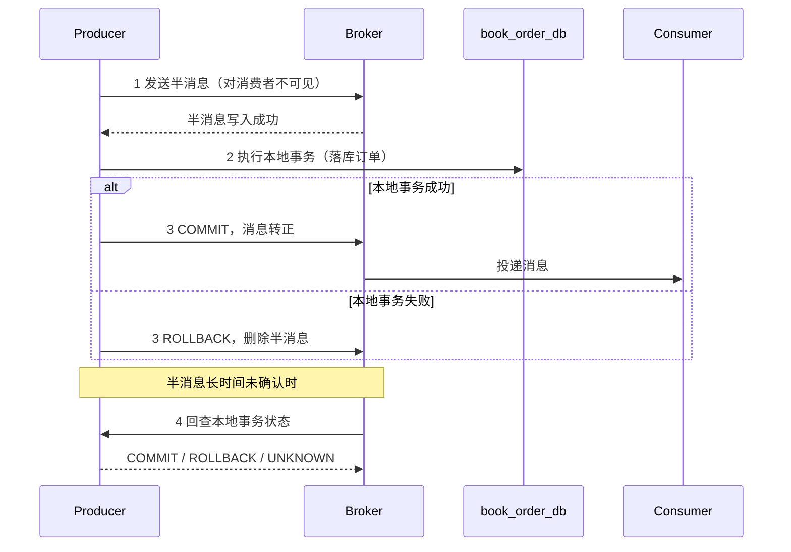

# 顺序消息、延迟消息与事务消息

## 课程目标

- 理解全局有序与分区有序的差别，说清"有序"在 RocketMQ 里到底保证到什么粒度
- 掌握顺序消息的两端改造：发送端 `syncSendOrderly` 与 `MessageQueueSelector`，消费端 `consumeMode = ORDERLY`
- 掌握延迟消息的两种写法：4.x 的延迟级别与 5.x 的定时消息，并知道精度与上限
- 掌握事务消息的三个步骤：半消息、本地事务、回查，能独立实现 `RocketMQLocalTransactionListener`
- 能够按业务场景在顺序、延迟、事务三种消息之间做出选择
- 能够识别顺序消息的阻塞风险、事务消息的回查上限与幂等的必要性

## 回顾与导入

上一课把消息发出去、也消费到了，链路通了。但真实业务马上会提三个新需求，而普通消息一个都接不住。

第一个需求来自库存：同一订单先后产生"扣减 2 本""回补 2 本"两条消息，消费端却可能先处理回补，结果库存变成 102。原因是普通消息在多个队列间并行，队列之间没有先后关系。

第二个需求来自订单超时：下单 30 分钟未支付要自动关闭。定时任务轮询数据库当然可以，但那是把时间维度压在业务库里；更自然的方式是"发一条 30 分钟后才可见的消息"。

第三个需求来自一致性：订单落库成功后要发消息，如果落库成功、发消息失败，库存就永远不会扣。上一课只是把这个失败记了日志，没有真正解决。



三种能力对应三种约束：顺序依赖、时间依赖、事务依赖。三者都要发送端、消费端或 Broker 配置配合，配错了不会报错，只会在某天以数据错误的形式出现。

## 一、顺序消息

### 全局有序与分区有序

RocketMQ 的顺序只在一个队列内保证。Topic 有多个队列，队列之间是并行的，所以"顺序"必然是**分区有序**，全局有序只能是分区有序的特例。

| 有序级别 | 做法 | 吞吐 | 代价 |
| --- | --- | --- | --- |
| 全局有序 | Topic 只建 1 个队列，所有消息进同一队列 | 单队列上限，最低 | 无法水平扩展，一般不建议 |
| 分区有序 | 按业务键选队列，同一键进同一队列 | 随队列数线性扩展 | 需要设计好分片键，热点键会倾斜 |
| 无序 | 默认轮询选队列 | 最高 | 无法保证任何先后 |



> **结论：** 绝大多数业务只需要"同一订单内有序"，把分片键选成订单号即可，不必牺牲吞吐。

### 发送端：按订单号选队列

`RocketMQTemplate` 提供了基于 hash 的快捷方法 `syncSendOrderly(topic, payload, hashKey)`，第三个参数相同则落在同一队列。

```java
package com.example.order.mq;

import com.example.order.dto.StockDeductMessage;
import lombok.RequiredArgsConstructor;
import lombok.extern.slf4j.Slf4j;
import org.apache.rocketmq.client.producer.SendResult;
import org.apache.rocketmq.spring.core.RocketMQTemplate;
import org.apache.rocketmq.spring.support.RocketMQHeaders;
import org.springframework.messaging.support.MessageBuilder;
import org.springframework.stereotype.Component;

@Slf4j
@Component
@RequiredArgsConstructor
public class OrderlyStockProducer {

    private static final String TOPIC = "stock-deduct-topic";

    private final RocketMQTemplate rocketMQTemplate;

    public SendResult send(StockDeductMessage body, String action) {
        // hashKey 用订单号：同一订单永远落到同一个队列
        SendResult result = rocketMQTemplate.syncSendOrderly(TOPIC + ":" + action,
                MessageBuilder.withPayload(body)
                        .setHeader(RocketMQHeaders.KEYS, body.getOrderNo() + ":" + action)
                        .build(),
                body.getOrderNo());
        log.info("顺序消息已发送，orderNo={}，action={}，queue={}，offset={}",
                body.getOrderNo(), action,
                result.getMessageQueue().getQueueId(), result.getQueueOffset());
        return result;
    }
}
```

内部实现是 `SelectMessageQueueByHash`：对 hashKey 取散列再对队列数取模。它只负责"选队列"，不负责"保证顺序"，真正的顺序保障来自消费端的顺序消费模式。

如果分片规则需要自定义（例如按用户 ID 而不是订单号，或者要做热点隔离），就得用原生的 `DefaultMQProducer` 加 `MessageQueueSelector`。下面是发送方法与选择器的核心片段：

```java
public SendResult send(DefaultMQProducer producer, String orderNo, String json) throws Exception {
    Message message = new Message("stock-deduct-topic", "DEDUCT", json.getBytes(StandardCharsets.UTF_8));
    message.setKeys(orderNo);
    MessageQueueSelector selector = (queues, msg, arg) ->
            queues.get(Math.floorMod(String.valueOf(arg).hashCode(), queues.size()));
    return producer.send(message, selector, orderNo);
}
```

用 `Math.floorMod` 而不是 `%`：`hashCode()` 可能为负，`%` 会得到负数下标并抛 `IndexOutOfBoundsException`。队列数从路由 `queues.size()` 动态取，不要硬编码 4。

### 消费端：顺序消费模式

```java
@Slf4j
@Component
@RequiredArgsConstructor
@RocketMQMessageListener(
        topic = "stock-deduct-topic",
        consumerGroup = "stock-deduct-orderly-consumer-group",
        selectorExpression = "DEDUCT || RESTORE",
        consumeMode = ConsumeMode.ORDERLY,
        consumeThreadNumber = 20,
        suspendCurrentQueueTimeMillis = 1000,
        maxReconsumeTimes = 5)
public class StockDeductOrderlyConsumer implements RocketMQListener<StockDeductMessage> {

    private final StockService stockService;

    @Override
    public void onMessage(StockDeductMessage message) {
        log.info("顺序消费，orderNo={}，productId={}，quantity={}",
                message.getOrderNo(), message.getProductId(), message.getQuantity());
        stockService.deduct(message.getOrderNo(), message.getProductId(), message.getQuantity());
    }
}
```

`ConsumeMode.ORDERLY` 下，Broker 会把同一队列"锁"给一个消费者实例，消费线程池按队列串行提交任务。三个后果必须清楚：

- 一条消息处理失败时，**整个队列暂停**（`suspendCurrentQueueTimeMillis`），后续消息全部等待，直到这条成功或被跳过。
- 队列数决定顺序消费的并行度上限：4 个队列最多 4 个实例同时消费，第 5 个实例会闲置。
- 消费逻辑越慢，队列阻塞时间越长，顺序与吞吐在这里是直接的取舍关系。

| 限制 | 表现 | 应对 |
| --- | --- | --- |
| 单队列串行 | 一条慢消息拖住整个队列 | 消费逻辑只做必要写库，重活异步化 |
| 队列数即并行度 | 实例扩到队列数以上无收益 | 建 Topic 时按峰值实例数规划队列 |
| 失败即阻塞 | 反复失败会卡住队列 | 区分可重试与不可重试异常，不可重试的立即转人工 |
| 扩缩容会短暂重复 | 队列重新分配期间可能重复消费 | 消费端必须幂等，见第 42 课 |

## 二、延迟消息

### 4.x 的延迟级别与 5.x 的定时消息

| 方案 | 版本 | 表达能力 | 精度 | 实现 |
| --- | --- | --- | --- | --- |
| 延迟级别 `delayLevel` | 4.x 起，5.x 仍兼容 | 18 个固定档位 | 按档位，最小 1 秒 | 消息先进 `SCHEDULE_TOPIC_XXXX`，到点回投原 Topic |
| 定时消息 `deliverTimeMillis` | 5.x 新增 | 任意延迟或指定时刻 | 秒级（`timerPrecisionMs`，默认 1 秒） | 时间轮（TimerWheel）+ 定时日志，到期投递 |

4.x 的 18 个级别对应 `messageDelayLevel = "1s 5s 10s 30s 1m 2m 3m 4m 5m 6m 7m 8m 9m 10m 20m 30m 1h 2h"`，序号从 1 开始；常用档位是 1 级 1 秒、5 级 1 分钟、16 级 30 分钟、17 级 1 小时、18 级 2 小时。

档位是 Broker 级别配置，改它会影响全集群所有 Topic；所以"能不能延迟 15 分钟"这个问题，4.x 的答案是不能，只能选 10 分钟或 20 分钟。

### 代码：三种延迟写法

```java
package com.example.order.mq;

import lombok.RequiredArgsConstructor;
import lombok.extern.slf4j.Slf4j;
import org.apache.rocketmq.spring.core.RocketMQTemplate;
import org.springframework.messaging.support.MessageBuilder;
import org.springframework.stereotype.Component;

@Slf4j
@Component
@RequiredArgsConstructor
public class OrderCloseDelayProducer {

    private static final String TOPIC = "order-close-topic";

    private final RocketMQTemplate rocketMQTemplate;

    /** 4.x 风格：延迟级别 16，即 30 分钟 */
    public void closeByLevel(String orderNo) {
        rocketMQTemplate.syncSend(TOPIC + ":CLOSE",
                MessageBuilder.withPayload(orderNo).build(), 3000, 16);
    }

    /** 5.x 风格：相对延迟，多少秒之后可见 */
    public void closeBySeconds(String orderNo, long delaySeconds) {
        rocketMQTemplate.syncSendDelayTimeSeconds(TOPIC + ":CLOSE",
                MessageBuilder.withPayload(orderNo).build(), delaySeconds);
    }

    /** 5.x 风格：相对延迟，毫秒粒度，适合短延迟场景 */
    public void closeByMillis(String orderNo, long delayMillis) {
        rocketMQTemplate.syncSendDelayTimeMills(TOPIC + ":CLOSE",
                MessageBuilder.withPayload(orderNo).build(), delayMillis);
    }
}
```

三个方法对应三种 API：`syncSend(dest, msg, timeout, delayLevel)` 是老接口，第四个参数是级别；`syncSendDelayTimeSeconds` 与 `syncSendDelayTimeMills` 是 2.3.x 为 5.x 定时消息新增的，参数是相对延迟。要投递到绝对时刻，用原生客户端 `Message#setDeliverTimeMs(long)`，或把 `TIMER_DELIVER_MS` 写进消息头。

> **注意：** 5.x 定时消息的上限与精度由 Broker 的 `timerMaxDelaySec`、`timerPrecisionMs` 控制，改配置要重启 Broker，上线前先与运维确认，不要假设"任意时间都能投"。

### 消费端与幂等

```java
@Slf4j
@Component
@RequiredArgsConstructor
@RocketMQMessageListener(topic = "order-close-topic", consumerGroup = "order-close-consumer-group",
        selectorExpression = "CLOSE", maxReconsumeTimes = 3)
public class OrderCloseConsumer implements RocketMQListener<String> {

    private final OrderCloseService orderCloseService;

    @Override
    public void onMessage(String orderNo) {
        log.info("收到超时关单消息，orderNo={}", orderNo);
        orderCloseService.closeIfUnpaid(orderNo);
    }
}
```

`closeIfUnpaid` 必须先查状态再关闭：用户在 29 分 59 秒付了款，消息在 30 分钟时到达，此时订单已是 `PAID`，直接关闭会造成"付了钱订单没了"。延迟消息只保证"到点提醒"，业务判断仍要落在消费端。

### 延迟消息的原理



4.x 的实现是"存两份"：消息先写进内部 Topic 并改写原 Topic 到属性里，后台线程每秒扫描到期的那一级队列，到点再恢复原 Topic 重新投递。所以延迟消息的存储成本翻倍，且第一级延迟队列的扫描频率决定了精度。

5.x 换成时间轮：消息按投递时刻放进时间轮的槽位，到点直接从定时日志里取出投递，避免了扫描全量数据，精度也从秒级档位细化到可配置的毫秒级。这是 5.x 值得升级的少数理由之一。

## 三、事务消息

### 三个步骤与两次回查

事务消息解决的是"本地事务与消息发送必须同生共死"。它把发送拆成两段：先发一条对消费者不可见的**半消息**，本地事务执行完再决定提交或回滚。



回查是这套机制的关键：生产者可能在提交阶段宕机，Broker 不知道本地事务到底成没成，只能反过来问生产者。生产者必须能根据消息里的业务键查到本地状态，所以**事务消息的业务键一定要落库**。

| 状态 | 含义 | Broker 行为 | 生产者何时返回 |
| --- | --- | --- | --- |
| `COMMIT` | 本地事务成功 | 消息转正并投递 | 落库成功 |
| `ROLLBACK` | 本地事务失败 | 删除半消息 | 落库失败、业务校验不通过 |
| `UNKNOWN` | 状态未知 | 等待下次回查 | 数据库超时、结果不确定 |

### 实现 RocketMQLocalTransactionListener

```java
package com.example.order.mq;

import com.example.order.dto.OrderCreatedMessage;
import com.example.order.service.OrderTxService;
import lombok.RequiredArgsConstructor;
import lombok.extern.slf4j.Slf4j;
import org.apache.rocketmq.spring.annotation.RocketMQTransactionListener;
import org.apache.rocketmq.spring.core.RocketMQLocalTransactionListener;
import org.apache.rocketmq.spring.core.RocketMQLocalTransactionState;
import org.springframework.messaging.Message;

@Slf4j
@RocketMQTransactionListener
@RequiredArgsConstructor
public class OrderTransactionListener implements RocketMQLocalTransactionListener {

    private final OrderTxService orderTxService;

    @Override
    public RocketMQLocalTransactionState executeLocalTransaction(Message msg, Object arg) {
        OrderCreatedMessage body = (OrderCreatedMessage) arg;
        try {
            orderTxService.createOrder(body);
            return RocketMQLocalTransactionState.COMMIT;
        } catch (BusinessException ex) {
            log.warn("本地事务业务失败，回滚消息，orderNo={}", body.getOrderNo(), ex);
            return RocketMQLocalTransactionState.ROLLBACK;
        } catch (Exception ex) {
            // 结果不确定：交给 Broker 回查，不能直接 ROLLBACK
            log.error("本地事务结果未知，等待回查，orderNo={}", body.getOrderNo(), ex);
            return RocketMQLocalTransactionState.UNKNOWN;
        }
    }

    @Override
    public RocketMQLocalTransactionState checkLocalTransaction(Message msg) {
        String orderNo = (String) msg.getHeaders().get("orderNo");
        boolean exists = orderTxService.existsByOrderNo(orderNo);
        log.info("事务回查，orderNo={}，本地事务已提交={}", orderNo, exists);
        return exists
                ? RocketMQLocalTransactionState.COMMIT
                : RocketMQLocalTransactionState.ROLLBACK;
    }
}
```

两个方法职责完全不同：`executeLocalTransaction` 主动执行，只在发送线程里跑一次；`checkLocalTransaction` 被动回答，Broker 反复回调，必须**只读且幂等**。

`arg` 参数是发送时传入的业务对象，`msg` 是半消息，取业务键要从未被序列化的 header 里拿——这也是为什么第 40 课强调 header 要放业务键。

### 发送事务消息

```java
public void createOrderInTransaction(OrderCreatedMessage body) {
    TransactionSendResult result = rocketMQTemplate.sendMessageInTransaction(
            "order-tx-topic:CREATED",
            MessageBuilder.withPayload(body).setHeader("orderNo", body.getOrderNo()).build(),
            body);
    log.info("事务消息发送完成，orderNo={}，本地事务状态={}，发送状态={}",
            body.getOrderNo(), result.getLocalTransactionState(), result.getSendStatus());
}
```

`sendMessageInTransaction` 的第三个参数就是监听器里的 `arg`。返回值同时带两部分状态：`LocalTransactionState` 是本地事务的结论，`SendStatus` 是半消息的发送结果，两者要分开判断。

### 回查机制的限制

| 参数 | 默认值 | 含义 | 调优建议 |
| --- | --- | --- | --- |
| `transactionTimeOut` | 6 秒 | 半消息多久未确认开始回查 | 小于本地事务最长耗时即可 |
| `transactionCheckInterval` | 60 秒 | 回查间隔 | 网络抖动多时适当缩短 |
| `transactionCheckMax` | 15 次 | 最大回查次数 | 超过后丢弃并记录，需人工对账 |
| `transactionCheckExecuter` 线程数 | 由 Broker 配置 | 回查并发能力 | 回查堆积时检查该线程池 |

回查次数用完仍返回 `UNKNOWN` 时，Broker 会丢弃这条半消息——消息没了，本地事务可能已经提交。所以事务消息必须配合对账：定时扫描"已落库但下游未处理"的记录。

## 四、三种消息的对比与选型

| 维度 | 顺序消息 | 延迟消息 | 事务消息 |
| --- | --- | --- | --- |
| 解决的问题 | 同一业务键的先后关系 | 到点才需要处理 | 本地事务与消息的一致性 |
| 发送 API | `syncSendOrderly` | `syncSend(..., delayLevel)` / `syncSendDelayTimeSeconds` | `sendMessageInTransaction` |
| 消费端要求 | `consumeMode = ORDERLY` | 无特殊要求 | 无特殊要求 |
| 关键约束 | 单队列串行，吞吐受限 | 有档位或上限，精度有限 | 回查次数有限，需对账兜底 |
| 典型场景 | 订单状态流转、库存扣减与回补 | 超时关单、预约提醒、重试退避 | 扣库存与建单的最终一致 |

| 场景 | 建议选择 | 理由 |
| --- | --- | --- |
| 同一订单的扣减与回补必须按序 | 顺序消息 | 分区有序即可，成本最低 |
| 30 分钟后关闭未支付订单 | 延迟消息（5.x 定时） | 不必引入定时任务与轮询扫描 |
| 建单成功才允许下游扣库存 | 事务消息或本地消息表 | 一致性要求高，且能接受回查开销 |
| 只需"尽量通知" | 普通消息 + 重试 | 不必引入额外复杂度 |

> **提示：** 三种能力可以组合（如事务消息 + 延迟消息），但每叠加一层排查路径就长一段，能用简单方案就别叠加。

## 注意事项

- 顺序消息的并行度等于队列数。建 Topic 时按预期最大实例数规划队列，事后改队列数会让历史消息与新消息的映射不一致。
- 顺序消费里不要做长耗时操作。一条消息卡 30 秒，整条队列就停 30 秒；耗时逻辑拆到异步线程或独立 Topic。
- 顺序消费失败的阻塞是"设计特性"不是 bug。区分可重试异常（网络、锁冲突）与不可重试异常（参数错误），后者记录并返回成功，避免卡死队列。
- 4.x 的延迟级别是集群级配置，不要为某个业务加档位。需要任意延迟就升级 5.x 用定时消息。
- 延迟消息的消费端必须做状态校验。消息到点时业务状态可能已变，"关闭未支付订单"要先查再改。
- 事务消息的 `checkLocalTransaction` 只能读不能写。在里面补写业务数据会重复执行，也让回查结果不可信。
- 事务消息回查次数耗尽后消息会被丢弃，必须配一张对账表定时补齐；三种消息都要求消费端幂等，第 42 课给出方案。

## 小结

本节课我们学习了：

1. **有序的粒度**：RocketMQ 只保证队列内有序，业务要的是"同一业务键有序"，用订单号做分片键即可。
2. **顺序消息两端改造**：发送端 `syncSendOrderly` 或 `MessageQueueSelector` 选队列，消费端必须配 `consumeMode = ORDERLY`。
3. **顺序的代价**：并行度等于队列数、失败会阻塞队列、扩缩容期间可能重复，所以它只适合状态流转类消息。
4. **延迟消息的两代实现**：4.x 的 18 个固定档位靠扫描 `SCHEDULE_TOPIC_XXXX`，5.x 用时间轮支持任意延迟。
5. **事务消息三步走**：半消息、本地事务、提交或回滚，未确认时由 Broker 回查。
6. **事务消息的边界**：`checkLocalTransaction` 只读幂等、回查次数有限、必须配对账兜底。
7. **选型方法**：先问是"顺序问题""时间问题"还是"一致性问题"，再决定用哪一种，能叠加但尽量不叠加。

## 作业

### 作业一：顺序消息验证

1. 把 `stock-deduct-topic` 重建为 4 个队列，用 `syncSendOrderly` 连续发送"扣减 2 本""回补 2 本"两组消息，hashKey 用两个不同订单号。
2. 消费端改为 `ConsumeMode.ORDERLY`，日志里打印 `queueId` 与 `offset`，确认同一订单的消息落在同一队列且顺序递增。
3. 改回 `CONCURRENTLY` 再跑一次，记录乱序出现的次数，理解为什么顺序必须两端配合。

### 作业二：延迟消息与事务消息

1. 用 `syncSendDelayTimeSeconds` 实现"10 秒后关闭未支付订单"，观察消息在 Dashboard 的定时队列中如何变化。
2. 实现 `OrderTransactionListener`，把 `checkLocalTransaction` 改成读订单表判断状态，人为让 `executeLocalTransaction` 返回 `UNKNOWN`，观察回查日志与最终结论。
3. 记录一次完整失败场景：本地事务抛非业务异常后，Broker 回查了几次、间隔多久、消息最终去向如何。
