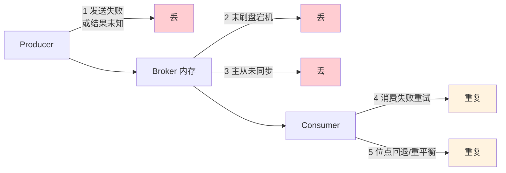
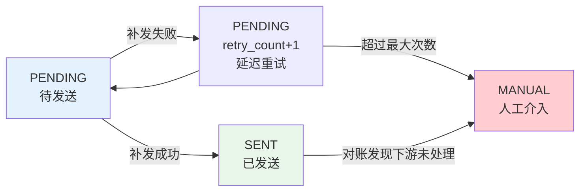
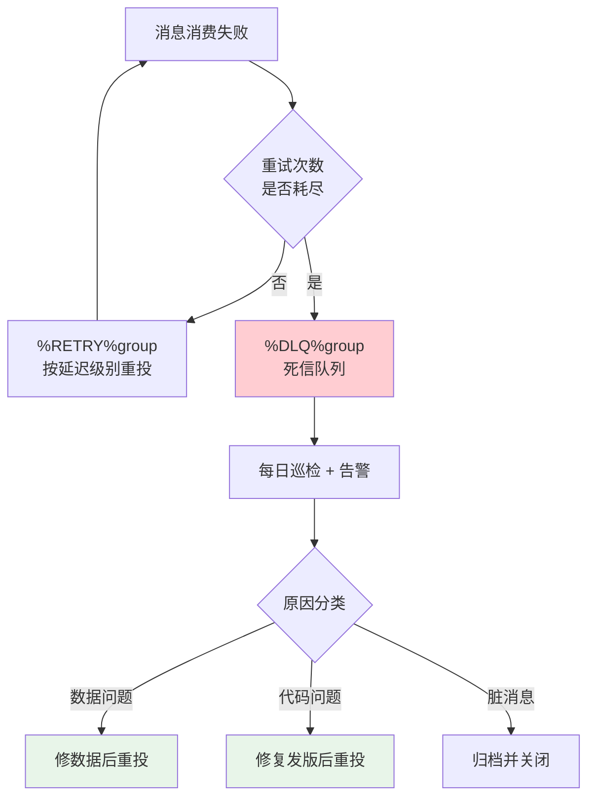

# 消息可靠性与幂等设计

## 课程目标

- 理解消息可靠性的三段论：生产可靠、存储可靠、消费可靠，说清每一段可能丢消息的位置
- 掌握本地消息表的落地方式：DDL、状态机、定时补发，以及它与事务消息的取舍
- 掌握三种消费幂等方案：唯一键去重表、状态机幂等、Redis 去重，并能按场景选择
- 能够定位消息堆积：从堆积量、消费 TPS、线程数三个维度判断瓶颈在哪
- 能够设计死信队列的处理与人工补偿流程，而不是让消息静静消失
- 能够用监控指标与上线检查清单把可靠性变成可验证的工程动作

## 回顾与导入

前三课把消息发出去、消费到、并按顺序与时间语义跑通了。但还有一个问题始终悬着：**消息真的不会丢、不会重吗？**

答案是：会。RocketMQ 提供的是"尽力而为 + 可配置的强度"，不是默认的绝对可靠。链路上至少有三个位置会丢消息，还有两个位置会重复：



上一课的事务消息只解决了"本地事务与发送"这一段的一致性，而且它的回查有次数上限。真实的生产系统还需要另外三样东西：一张兜底的本地消息表、一套幂等机制、一套堆积与死信的处置流程。本课把这三件事补齐，这套组合才是"消息可以上生产"的完整答案。

## 一、可靠性三段论

### 三段的分工

| 阶段 | 可能丢失的原因 | 核心手段 | 强度上限 |
| --- | --- | --- | --- |
| 生产可靠 | 网络超时、Broker 拒收、发送结果未知 | 同步发送、校验 `SendStatus`、失败重试、本地消息表 | 只要消息落库就能补发，可达"不丢" |
| 存储可靠 | 未刷盘宕机、主从未同步、磁盘写满 | 同步刷盘、同步复制、容量告警 | 取决于刷盘与复制配置 |
| 消费可靠 | 业务异常、消费超时、位点提前提交 | 重试、死信、幂等 | 只要幂等做对，至少一次即等价于一次 |

顺序不能颠倒：**先保证不丢，再保证不重**。反过来做的典型后果是"消息不重复了，但丢了一批"，而丢消息往往在月末对账时才被发现。

### 生产可靠

```java
public void sendSafely(String orderNo, StockDeductMessage body) {
    try {
        SendResult result = rocketMQTemplate.syncSend("stock-deduct-topic:DEDUCT",
                MessageBuilder.withPayload(body)
                        .setHeader(RocketMQHeaders.KEYS, orderNo + ":DEDUCT")
                        .build());
        if (result.getSendStatus() != SendStatus.SEND_OK) {
            throw new MessagingSendException("发送未确认：" + result.getSendStatus());
        }
    } catch (Exception ex) {
        log.error("发送失败，落本地消息表待补发，orderNo={}", orderNo, ex);
        outboxService.save(orderNo + ":DEDUCT", "stock-deduct-topic", "DEDUCT", body);
    }
}
```

三个动作缺一不可：同步发送拿到结果、校验状态而不只看异常、失败落表。`syncSend` 内部默认会重试 2 次，但重试结束后仍失败时它抛异常或返回非 `SEND_OK`，此时**只有本地消息表能兜住**。

### 存储可靠

| 配置 | 单机宕机是否丢 | 主从切换是否丢 | 写入性能 |
| --- | --- | --- | --- |
| `ASYNC_FLUSH + ASYNC_MASTER` | 可能丢（内存中的数据） | 可能丢（未同步到从） | 最高 |
| `SYNC_FLUSH + ASYNC_MASTER` | 不丢 | 可能丢 | 中 |
| `SYNC_FLUSH + SYNC_MASTER` | 不丢 | 不丢 | 最低 |

5.x 还提供基于 Controller 的主从自动切换（`enableSlaveActingMaster=true`），配合 `totalReplicas` 与 `inSyncReplicas` 控制同步副本数。要真正"不丢"，三者必须一起配：同步刷盘、同步复制、足够的最小同步副本。只配一项等于给自己一个心理安慰。

> **注意：** 同步刷盘会让单机 TPS 明显下降。多数业务的选择是"异步刷盘 + 同步复制 + 消费端幂等 + 对账"，用业务层面的最终一致换取吞吐，而不是把可靠性全部压在 Broker 配置上。

### 消费可靠

消费端的三条规则：

- **处理成功才提交位点**。`RocketMQListener` 正常返回即提交，抛异常即不提交并重试，不要自己吞异常。
- **重试有上限**。并发消费默认 16 次，超过后进入死信队列 `%DLQ%消费组名`；顺序消费默认无限重试，需要显式设置 `maxReconsumeTimes`。
- **重试不保证顺序**。重试消息进的是 `%RETRY%消费组名`，按延迟级别递进（1s、5s、10s……），在此期间后续消息可能已经被消费。

## 二、本地消息表

### 为什么需要它

事务消息已经能保证"本地事务 + 消息"一致，但它有两个限制：回查次数用尽后消息会被丢弃；业务方要额外实现一个监听器并保证回查接口可读。本地消息表把这件事变成一张普通的业务表，用定时任务补发，逻辑全在自己手里。

| 方案 | 一致性保证 | 实现成本 | 失败兜底 | 适用场景 |
| --- | --- | --- | --- | --- |
| 事务消息 | 半消息 + 回查，框架保证 | 中，要实现监听器 | 回查耗尽后无兜底 | 强一致要求、下游是关键链路 |
| 本地消息表 | 本地事务内写表，定时补发 | 中，要建表与定时任务 | 表在，消息就一定会发 | 大多数业务消息 |
| 发送失败只记日志 | 无 | 低 | 无 | 不允许上生产 |

### DDL 与状态机

```sql
CREATE TABLE mq_outbox (
    id            BIGSERIAL PRIMARY KEY,
    biz_key       VARCHAR(128) NOT NULL,
    topic         VARCHAR(128) NOT NULL,
    tag           VARCHAR(64)  NOT NULL,
    payload       TEXT         NOT NULL,
    status        VARCHAR(20)  NOT NULL DEFAULT 'PENDING',
    retry_count   INT          NOT NULL DEFAULT 0,
    next_retry_at TIMESTAMP    NOT NULL DEFAULT now(),
    created_at    TIMESTAMP    NOT NULL DEFAULT now(),
    updated_at    TIMESTAMP    NOT NULL DEFAULT now(),
    CONSTRAINT uk_outbox_biz_key UNIQUE (biz_key)
);

CREATE INDEX idx_outbox_status_next ON mq_outbox (status, next_retry_at);
```

`biz_key` 唯一索引是防重的第一道锁：同一业务动作重复写表会被数据库拒绝，不会产生两条待发消息。`(status, next_retry_at)` 联合索引服务于补发任务的扫描条件。



### 事务内写业务表与消息表

```java
package com.example.order.service.impl;

import com.example.order.dto.OrderCreatedMessage;
import com.example.order.entity.MqOutbox;
import com.example.order.mapper.MqOutboxMapper;
import lombok.RequiredArgsConstructor;
import org.springframework.stereotype.Service;
import org.springframework.transaction.annotation.Transactional;

@Service
@RequiredArgsConstructor
public class OrderTxService {

    private final OrderMapper orderMapper;
    private final OrderItemMapper orderItemMapper;
    private final MqOutboxMapper outboxMapper;
    private final ObjectMapper objectMapper;

    @Transactional(rollbackFor = Exception.class)
    public void createOrderWithOutbox(OrderCreatedMessage body) throws Exception {
        orderMapper.insert(body.toOrder());
        orderItemMapper.insertBatch(body.toItems());

        MqOutbox outbox = new MqOutbox();
        outbox.setBizKey(body.getOrderNo() + ":DEDUCT");
        outbox.setTopic("stock-deduct-topic");
        outbox.setTag("DEDUCT");
        outbox.setPayload(objectMapper.writeValueAsString(body));
        outboxMapper.insert(outbox);
    }
}
```

业务表与消息表在**同一个本地事务**里提交，这是整套方案的地基：要么都成功，要么都失败，不存在"订单有了、消息表没有"的中间态。消息的发送被推迟到事务提交之后，由补发任务完成。

### 定时补发

```java
@Slf4j
@Component
@RequiredArgsConstructor
public class OutboxRelay {

    private final MqOutboxMapper outboxMapper;
    private final RocketMQTemplate rocketMQTemplate;

    @Scheduled(fixedDelay = 5000)
    public void relay() {
        List<MqOutbox> pending = outboxMapper.selectPending(100);
        for (MqOutbox msg : pending) {
            try {
                SendResult result = rocketMQTemplate.syncSend(
                        msg.getTopic() + ":" + msg.getTag(),
                        MessageBuilder.withPayload(msg.getPayload())
                                .setHeader(RocketMQHeaders.KEYS, msg.getBizKey())
                                .build());
                if (result.getSendStatus() != SendStatus.SEND_OK) {
                    throw new MessagingSendException("发送未确认：" + result.getSendStatus());
                }
                outboxMapper.markSent(msg.getId());
                log.info("补发成功，bizKey={}，msgId={}", msg.getBizKey(), result.getMsgId());
            } catch (Exception ex) {
                outboxMapper.markRetry(msg.getId(), nextRetryAt(msg.getRetryCount()));
                log.warn("补发失败，bizKey={}，第 {} 次", msg.getBizKey(), msg.getRetryCount() + 1, ex);
            }
        }
    }
}
```

补发任务有两个必须写对的 SQL：

```sql
UPDATE mq_outbox SET status = 'SENT', updated_at = now()
WHERE id = #{id} AND status = 'PENDING';

UPDATE mq_outbox
SET status = CASE WHEN retry_count >= 8 THEN 'MANUAL' ELSE 'PENDING' END,
    retry_count = retry_count + 1,
    next_retry_at = #{nextRetryAt},
    updated_at = now()
WHERE id = #{id} AND status = 'PENDING';
```

`WHERE status = 'PENDING'` 是乐观锁：多个实例同时补发时只有一个能把状态推成 `SENT`，另一个影响行数为 0，说明已被别人处理。重试间隔用指数退避（`retry_count` 的平方乘以 10 秒），避免下游故障时被自己的补发打垮。`retry_count` 达到 8 次即转 `MANUAL`，进入人工队列——**永远不要让它无限重试**，那只会掩盖问题。

## 三、消费幂等

### 三种方案对比

| 方案 | 实现 | 一致性 | 成本 | 适用场景 |
| --- | --- | --- | --- | --- |
| 唯一键去重表 | 插入去重记录，冲突即跳过 | 与业务同库同事务，强 | 每消息一次插入 | 写库类业务，最通用 |
| 状态机幂等 | `UPDATE ... WHERE status = '旧值'` | 强，与业务天然一致 | 需要状态流转清晰 | 订单、支付等有状态实体 |
| Redis 去重 | `SETNX key` 带 TTL | 弱，Redis 故障即失效 | 最低，性能最好 | 高频、允许极小概率重复 |

> **结论：** 写库业务首选唯一键去重表；有明确状态机的实体优先用状态机（不需要额外表）；Redis 只作为前置快速过滤，不能作为唯一手段。

### 唯一键去重表

```sql
CREATE TABLE mq_consume_record (
    id             BIGSERIAL PRIMARY KEY,
    consumer_group VARCHAR(128) NOT NULL,
    biz_key        VARCHAR(128) NOT NULL,
    created_at     TIMESTAMP    NOT NULL DEFAULT now(),
    CONSTRAINT uk_consume_group_key UNIQUE (consumer_group, biz_key)
);
```

```java
@Transactional(rollbackFor = Exception.class)
public void handle(StockDeductMessage message) {
    String bizKey = message.getOrderNo() + ":" + message.getProductId();
    try {
        consumeRecordMapper.insert("stock-deduct-consumer-group", bizKey);
    } catch (DuplicateKeyException ex) {
        log.info("重复消息，跳过，bizKey={}", bizKey);
        return;
    }
    stockMapper.deduct(message.getProductId(), message.getQuantity());
}
```

去重记录与业务写库在同一个事务里：业务失败会一起回滚，重试时可以重新插入；业务成功则记录留存。表会持续增长，按 `created_at` 定期清理（例如保留 7 天，远大于消息最大重试周期）。

### 状态机幂等

```sql
UPDATE orders SET status = 'PAID', paid_at = now()
WHERE order_no = #{orderNo} AND status = 'WAIT_PAY';
```

影响行数为 0 表示这条消息之前已经处理过（或状态不允许），直接返回成功即可。这种方式不需要额外的去重表，代价是要求实体有清晰的状态机，并且所有写操作都写成条件更新。

### Redis 去重

```java
public boolean tryLock(String bizKey) {
    String key = "mq:consume:stock-deduct:" + bizKey;
    Boolean first = redisTemplate.opsForValue().setIfAbsent(key, "1", Duration.ofHours(24));
    return Boolean.TRUE.equals(first);
}
```

三处必须注意：**先占坑再执行**，而不是执行完再标记，否则并发重复消息会同时进入业务；**业务失败要删除 key**，否则重试会被自己挡住；**TTL 必须大于消息最大重试周期**，否则过期的 key 会让重复消息重新生效。Redis 挂了就退化成"无去重"，所以它只能做前置过滤，最终仍要有数据库约束兜底。

## 四、消息堆积与死信

### 定位堆积

| 指标 | 查看方式 | 判断 |
| --- | --- | --- |
| 堆积量 | `mqadmin consumerProgress -g 组名` 的 `Diff Total` | 持续增长说明消费能力不足 |
| 消费 TPS | Dashboard 的 Consumer 页 `ConsumeTPS` | 远低于生产 TPS 即为瓶颈 |
| 线程活跃度 | JVM 监控中的消费线程池 | 线程全忙说明处理慢，线程空闲说明拉取慢 |
| 单条耗时 | 消费方法内的日志耗时打点 | P99 高说明下游 IO 或锁等待 |
| 消费失败率 | 重试 Topic 的写入量、死信数量 | 大量重试会进一步放大堆积 |

判断顺序固定：先看 `Diff Total` 是否增长，再看消费 TPS 与生产 TPS 的比值，最后看单条耗时与线程数。三步下来，瓶颈是"消费太慢"、"实例太少"还是"下游挂了"，一目了然。

### 处理手段

| 手段 | 做法 | 生效速度 | 风险 |
| --- | --- | --- | --- |
| 加实例 | 扩 `book-product` 副本数 | 分钟级 | 受队列数限制，超过队列数的实例空转 |
| 加线程 | 调大 `consumeThreadNumber` | 秒级，需重启 | 下游数据库连接池压力同步上升 |
| 批量消费 | `consumeMessageBatchMaxSize` 配合批量写 | 分钟级 | 单条失败会导致整批重试 |
| 扩队列 | 重建 Topic（不能原地改） | 小时级，需停机迁移 | 历史消息与新消息分属不同队列 |
| 临时降级 | 关闭非核心逻辑、异步落库 | 分钟级 | 数据完整性与体验下降 |
| 生产限流 | 网关或发送端限速 | 立即 | 影响正常业务 |

> **提示：** 堆积时最先做的动作不是扩容，而是确认消费端有没有卡在某个外部依赖上。下游数据库慢查询导致的堆积，扩实例只会把数据库压得更狠。

### 死信队列

消息重试次数耗尽后进入 `%DLQ%消费组名`。死信不是垃圾，是"需要人处理的消息"。



人工补偿的四步：**查**（按 KEYS 在 Dashboard 查到消息体与失败次数）、**判**（区分数据问题、代码问题、脏消息）、**修**（修数据或发版）、**投**（从死信 Topic 取原消息重新发送到原 Topic）。整个流程要留痕：谁处理、什么原因、是否重投，否则下个月同样的问题会再来一次。

## 五、监控与上线清单

### 监控指标

| 指标 | 采集方式 | 告警阈值建议 |
| --- | --- | --- |
| 发送失败率 | 发送端埋点，失败数/总数 | 连续 5 分钟大于 0.1% |
| 发送 RT P99 | 埋点计时 | 超过 500ms 持续 5 分钟 |
| 消费堆积量 | `Diff Total` | 大于 1 万且持续增长 |
| 消费 TPS | Dashboard / 埋点 | 连续 10 分钟低于基线 50% |
| 消费失败率 | 重试消息量/消费量 | 大于 1% |
| 死信数量 | `%DLQ%group` 的消息量 | 大于 0 即告警 |
| Broker 磁盘使用率 | Broker 自带指标 | 大于 80% |
| CommitLog 写入延迟 | Broker 指标 | P99 明显抖动 |
| 主从同步延迟 | Broker 指标 | 超过 1 秒 |

### 上线检查清单

- 发送端全部使用 `syncSend` 并校验 `SendStatus`，失败落本地消息表
- 每个业务流都有唯一的 `biz_key`，并在日志中打印
- 每个消费者都实现了幂等，且有数据库唯一约束兜底
- 关键消费组设置了 `maxReconsumeTimes`，死信有巡检任务
- 补发任务与死信处理都有告警，`MANUAL` 状态有处理人
- 消费组监控接入看板，堆积量与死信数量可查历史趋势
- 生产环境关闭 `autoCreateTopicEnable`，Topic 与队列数提前规划
- 刷盘与复制策略已与业务方确认过"可接受丢多少"

## 注意事项

- 先做不丢再做不重。幂等做得再完美，丢了消息也无法补救；而对账与补发能在事后修正重复。
- 本地消息表要与业务表同库同事务。跨库写消息表，等于把一个问题变成两个问题。
- 补发任务必须限流并加乐观锁。多实例同时补发同一个 Topic，没有状态条件更新就会重复发送。
- 去重表的唯一键要带消费组名。不同消费组处理同一业务消息是正常需求，只用业务键会误杀。
- Redis 去重只做前置过滤。它宕机时去重直接失效，数据库唯一约束才是最后一道防线。
- 死信数量大于 0 就该告警，不要等到"用户投诉没收到通知"才发现消息躺在 `%DLQ%` 里。
- 监控要看趋势不是看瞬时值。一次重平衡引起的堆积属正常，持续增长才是问题。

## 小结

本节课我们学习了：

1. **可靠性三段论**：生产靠同步发送与本地消息表，存储靠刷盘与复制配置，消费靠重试、死信与幂等。
2. **先不丢再处理重复**：丢消息无法事后补救，重复可以通过幂等与对账收敛。
3. **本地消息表**：`mq_outbox` 与业务表同事务提交，靠状态机与定时补发把"发消息"变成可重试的本地动作。
4. **与事务消息的取舍**：事务消息框架化、适合强一致；本地消息表自主可控、兜底更彻底。
5. **三种幂等方案**：去重表通用、状态机最省事、Redis 最快但最弱，数据库唯一约束是所有方案的底座。
6. **堆积定位四步**：看堆积量、比 TPS、查线程与耗时，再决定扩容、限流还是降级。
7. **死信是待办不是垃圾**：查、判、修、投四步闭环，配告警与留痕。

## 作业

### 作业一：落地本地消息表

1. 创建 `mq_outbox` 表与唯一索引，把 `createOrder` 改成"业务表 + 消息表"同事务写入。
2. 实现 `OutboxRelay` 定时补发，验证停掉 Broker 后消息停在 `PENDING`，恢复后自动补发。
3. 人为制造 8 次连续失败，确认状态转 `MANUAL` 并触发告警。

### 作业二：实现并验证幂等

1. 给库存扣减消费者加唯一键去重表，重复投递同一条消息，确认只扣一次。
2. 把订单支付改成状态机幂等（`WHERE status = 'WAIT_PAY'`），验证重复消息不会二次扣款。
3. 用 `mqadmin` 查 `%DLQ%stock-deduct-consumer-group`，模拟一条超限消息，完整走一遍查、判、修、投。
