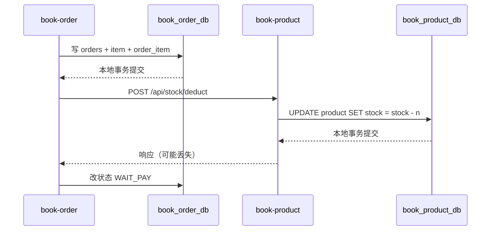
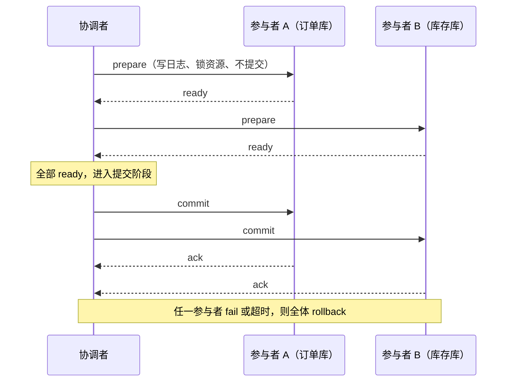
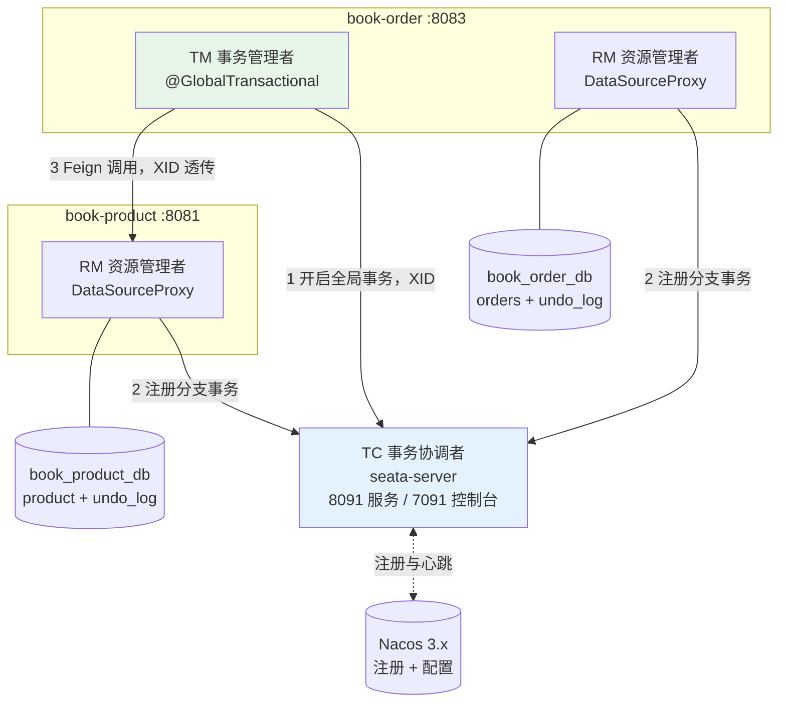
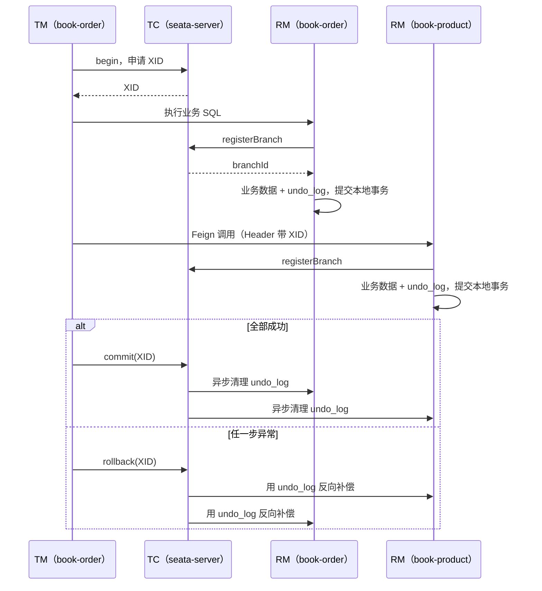

# 分布式事务理论与Seata架构

## 课程目标

- 理解跨库、跨服务、跨中间件三类边界上分布式事务的产生原因
- 掌握 ACID 在分布式下的失效点，能用 CAP、BASE 解释一致性取舍
- 掌握 2PC / 3PC 的流程，能说清为什么不在业务链路直接使用
- 掌握本地消息表、最大努力通知、TCC、Saga、AT 的差异与选型依据
- 理解 Seata 的 TC / TM / RM、事务组、分支事务与全局锁
- 掌握 AT 模式两阶段动作与 `@GlobalTransactional` 的代理机制
- 能够部署 Seata Server 2.2.x 并注册到 Nacos

## 回顾与导入

上一课补齐了 RocketMQ 的可靠性：消息不丢、消费幂等、堆积可观测。但消息只回答"事件怎么送出去"，没有回答更基础的问题——一次业务操作跨越两个数据库时，怎样保证要么全成功、要么全失败。

订单服务现在的做法是：`OrderTxService` 用 `@Transactional` 写订单三张表，提交之后再 Feign 扣库存；扣减失败就改 `CANCELLED` 并回补。这套补偿逻辑全部手写，依赖开发者记得写、记得回补、记得幂等。

问题集中在三处：事务只覆盖本库，约束不了 `book_product_db`；失败靠手写补偿，补偿本身失败没有兜底；部分成功无法自动回滚，没有全局事务视图。

分布式事务把多个本地事务组织成一个**全局事务**，由协调者记录每个分支的状态，失败时统一驱动回滚。本课先讲理论与方案全景，再拆 Seata 的架构与 AT 原理，最后把 Server 跑起来，为下一课的代码实战铺路。

## 一、分布式事务从哪里来

### 三类跨边界场景

判断标准只有一条：参与本次业务的数据，是否落在两个无法共享同一个本地事务的资源里。

| 边界 | 图书系统中的例子 | 不一致的后果 |
| --- | --- | --- |
| 跨库 | 订单落 `book_order_db`，库存扣 `book_product_db` | 订单存在但库存没扣，超卖 |
| 跨服务 | 下单后调 `book-product` 扣库存，再调 `book-user` 扣积分 | 部分服务成功，彼此不感知 |
| 跨中间件 | 订单落库后发 RocketMQ 消息通知履约 | 库里有订单，消息没发出去 |

> **结论：** 只要写操作涉及两个资源，就必须回答"第二个失败时第一个怎么办"。答案可以是补偿、消息或全局事务，但不能是没有答案。

### 下单扣库存的失败矩阵



| 编号 | 失败位置 | 已发生的事实 | 不做处理的后果 |
| --- | --- | --- | --- |
| F1 | 写订单前校验失败 | 无 | 无 |
| F2 | 写订单本地事务失败 | 无 | 无 |
| F3 | 扣减请求未到达 | 订单已提交 | 订单停在 `CREATED` |
| F4 | 执行前库存不足 | 订单已提交 | 订单与库存都不对 |
| F5 | 扣减已提交，响应超时 | 订单与库存都已变更 | 调用方重试导致重复扣减 |
| F6 | 扣减成功，改状态失败 | 状态与实际不符 | 已扣库存的订单显示未支付 |
| F7 | 库存服务重启，事务状态未知 | 未知 | 无法判断该回补还是继续 |

F5 与 F7 是真正的难点：**调用方拿不到确定结果，资源却可能已经变更**。手写补偿只能覆盖 F3、F4、F6 这类结果确定的场景，F5 需要靠全局事务 ID 反查分支状态。

### ACID 在分布式下的挑战

| 特性 | 单库如何保证 | 跨资源后的失效点 |
| --- | --- | --- |
| 原子性 | 统一 WAL 提交或回滚 | 两个库各自提交，无法同时撤销 |
| 一致性 | 约束、外键、触发器在库内生效 | 跨库业务规则无人校验 |
| 隔离性 | 锁与 MVCC 由同一事务管理器调度 | 各库锁互不可见，出现脏读、脏写 |
| 持久性 | 落盘加日志 | 持久的是局部结果，不是业务结果 |

> **注意：** 分布式事务保证的是最终业务一致，不是数据库层面的 ACID。声称"跨库强一致且零成本"的方案，都要追问它的阻塞点。

## 二、CAP 与 BASE

CAP 指一致性、可用性、分区容错性。网络分区不是"是否发生"而是"何时发生"，所以 P 必须保留，真正的选择是分区期间要 C 还是要 A。

| 选择 | 分区期间的行为 | 典型系统 | 图书系统的决策 |
| --- | --- | --- | --- |
| CP | 拒绝部分请求，保证读到最新值 | ZooKeeper、etcd、Seata 的 db 存储 | 库存扣减、支付记账 |
| AP | 继续响应，允许旧值，事后收敛 | Nacos 临时实例、Eureka、Redis 主从 | 商品详情、推荐、评价 |

**交易链路选 CP，展示链路选 AP。** 把商品浏览也做成强一致，一次数据库抖动就会放大成全站不可用。

BASE 是基本可用、软状态、最终一致：承认中间状态存在，用状态机、补偿、对账换掉锁与阻塞，适合积分、通知、统计这类允许窗口内不一致的业务。

把方案按一致性强度排开：XA / 2PC 换来零窗口但阻塞，AT 把窗口压到毫秒级，TCC、Saga 与消息表落在秒级到分钟级，最大努力通知最弱、可能要靠人工对账。选型时先定"业务能容忍多大的不一致窗口"，再挑技术。

## 三、两阶段提交与其缺陷

两阶段提交（2PC）把提交拆成"准备"与"提交"，由协调者统一裁决，数据库层的 XA 就是它的标准实现。



三阶段提交（3PC）把 2PC 拆成 `CanCommit`、`PreCommit`、`DoCommit` 三步：预询问只问"能不能做"，不锁资源；参与者超时后可按所处阶段自行中止或提交。它缓解了阻塞，但没有消除不一致——网络分区下仍可能出现一部分提交、一部分回滚。

| 2PC 缺陷 | 表现 | 影响 | 缓解方式 |
| --- | --- | --- | --- |
| 同步阻塞 | prepare 后资源锁到 commit | 吞吐随参与者数量下降 | 缩短事务、减少参与者 |
| 协调者单点 | 协调者宕机，参与者挂起 | 资源长期被占 | 协调者高可用、超时兜底 |
| 数据不一致 | commit 阶段部分参与者没收到指令 | 局部提交 | 事务日志加重试与对账 |
| 脑裂 | 协调者恢复后重复下发 | 重复提交 | 全局事务 ID 幂等 |
| 连接占用 | XA 期间持有数据库连接 | 连接池耗尽 | 控制并发、独立连接池 |

> **结论：** 2PC 适合"参与者少、执行快、强一致优先"的场景。套在十几个微服务上，阻塞时间按最长链路累加，生产上通常不可接受。

## 四、柔性事务方案全景

柔性事务的思路是：先让业务往前走，用可补偿的设计换掉阻塞。五类方案的差异集中在"谁来记状态""失败怎么回滚""业务要改多少"。

| 方案 | 一致性强度 | 侵入性 | 性能 | 失败处理 | 适用场景 |
| --- | --- | --- | --- | --- | --- |
| 本地消息表 | 最终一致 | 低，加一张表与投递任务 | 高 | 定时重投，消费方幂等 | 落库后通知、状态同步 |
| 最大努力通知 | 弱一致 | 低 | 高 | 有限重试加对账 | 第三方回调、对账文件 |
| TCC | 准强一致 | 高，每个服务写三套方法 | 中高 | 协调者驱动 Cancel | 资金、库存等资源预留 |
| Saga | 最终一致 | 中，正向服务加补偿服务 | 高 | 反向补偿链 | 长流程、跨系统编排 |
| AT | 准强一致 | 极低，只加注解与 `undo_log` | 中，受全局锁影响 | 自动生成反向 SQL | 大多数 CRUD 业务 |

本地消息表把"写业务"与"写消息"放进同一个本地事务，再由独立任务投递到 MQ。表里需要 `business_key` 唯一索引（同一业务只产生一条消息）、`status` 与 `next_retry_at`（按退避策略重投）。消费方必须幂等，否则重投就会重复业务。

最大努力通知不保证送达，只保证"尽力多次通知"，靠对方的主动查询与对账兜底，适用于支付结果回调这类外部系统。

选型时先问三件事：需要同步拿到结果吗，参与方能否反向操作，业务代码允许改多少。答案决定你选 TCC、消息表还是 AT。

## 五、Seata 架构

### 三个角色

| 角色 | 全称 | 部署位置 | 职责 |
| --- | --- | --- | --- |
| TC | Transaction Coordinator 事务协调者 | 独立服务 seata-server | 维护全局与分支事务状态，驱动提交回滚，管理全局锁 |
| TM | Transaction Manager 事务管理者 | 发起方应用内 | 定义全局事务边界：开启、提交、回滚 |
| RM | Resource Manager 资源管理者 | 每个数据源 | 注册分支事务、上报状态、执行二阶段动作、管理 `undo_log` |



### 事务组与分支事务

- **事务组（Transaction Group）**：TC 集群的逻辑分组。客户端用 `tx-service-group` 声明所属组，再用 `service.vgroup-mapping` 映射到 TC 集群名（如 `default`）。
- **分支事务（Branch Transaction）**：RM 在一次全局事务里的一次本地事务，`branchId` 是回滚的最小单位。
- **全局事务（Global Transaction）**：由 `XID` 标识，串起多个分支事务。

| 概念 | 标识 | 存储表 | 作用 |
| --- | --- | --- | --- |
| 全局事务 | `XID` | `global_table` | 全局状态与超时控制 |
| 分支事务 | `branchId` | `branch_table` | 定位回滚目标与资源 |
| 全局锁 | `resourceId + tableName + pk` | `lock_table` | 阻止其他全局事务写同一行 |



## 六、AT 模式原理

AT（Auto Transaction）是 Seata 的默认模式，卖点是**业务代码零侵入**：照常写 SQL，框架通过数据源代理记录前后镜像。

### 一阶段：业务 SQL + undo_log

RM 拦截业务 SQL，解析表名、主键、更新列，然后在同一个本地事务里做三件事：查询前镜像（`beforeImage`）、执行业务 SQL、查询后镜像（`afterImage`）并写入 `undo_log`。


`rollback_info` 里保存 `beforeImage` 与 `afterImage` 两组行数据，每行带列名、JDBC 类型码与值，`sqlWhere` 是由主键拼出的回滚条件；`log_status` 为 0 表示正常，为 1 表示全局事务已结束、可以清理。回滚时框架用 `afterImage` 与当前值比对：一致就按 `beforeImage` 反向更新，不一致说明被其他事务改过，进入脏写校验。完整内容解读放在下一课。

> **注意：** 前镜像依赖主键生成 `sqlWhere`，所以 AT 模式的 `UPDATE` / `DELETE` 必须能解析出主键条件。按非主键字段批量更新会退化为全表镜像，甚至无法正确回滚。

### 二阶段：提交与回滚

| 阶段 | 触发 | TC 下发 | RM 动作 | 是否阻塞业务 |
| --- | --- | --- | --- | --- |
| 二阶段提交 | 全局事务成功 | `branchCommit` | 异步删除对应 `undo_log` | 否 |
| 二阶段回滚 | 任一分支失败 | `branchRollback` | 读 `undo_log` 生成反向 SQL 执行后删除 | 是，需重新拿锁 |

二阶段提交非常轻：本地事务早已提交，只剩清理日志。这是 AT 比 XA 快的主要原因——**锁的持有时间从两阶段缩短到一阶段**。

### 全局锁与读写隔离

一阶段提交后本地锁已释放，其他全局事务可能改同一行，Seata 用全局锁补上这层保护：分支提交前向 TC 申请 `resourceId + tableName + pk` 的锁，全局事务结束才释放；申请失败按 `client.rm.lock.retry-interval` 重试，超时抛 `LockConflictException`。

| 场景 | 是否加全局锁 | 读到什么 | 风险 |
| --- | --- | --- | --- |
| 普通 `SELECT` | 否 | 可能读到未提交的中间值 | 脏读 |
| `SELECT ... FOR UPDATE` | 是 | 阻塞到全局锁释放 | 无脏读，有等待 |
| 本地事务（非全局）写 | 否 | 可写 | 脏写，需 `@GlobalLock` 防护 |

> **结论：** AT 默认隔离级别是**读未提交**。对"读到中间值就会算错"的查询，必须加 `FOR UPDATE`，让它去申请全局锁。

### @GlobalTransactional 的代理机制

注解本身不做业务，它是 TM 的入口标记，靠 AOP 生效：方法进入时向 TC 申请 `XID` 并绑定 `RootContext`；本地事务被 `DataSourceProxy` 增强注册为分支；Feign 拦截器把 `XID` 放进请求头 `TX_XID`；方法正常返回则 `commit`，抛出 `rollbackFor` 异常则 `rollback`。

```java
package com.example.order.service.impl;

import io.seata.spring.annotation.GlobalTransactional;
import lombok.RequiredArgsConstructor;
import org.springframework.stereotype.Service;

@Service
@RequiredArgsConstructor
public class CreateOrderService {

    private final OrderTxService orderTxService;
    private final StockService stockService;

    @GlobalTransactional(name = "create-order", rollbackFor = Exception.class)
    public Long create(OrderCreateRequest request) {
        Long orderId = orderTxService.saveOrder(request);
        stockService.deduct(request.getItems(), request.getRequestId());
        return orderId;
    }
}
```

`rollbackFor = Exception.class` 必须写：默认只对 `RuntimeException` 回滚，受检异常会被漏掉。

## 七、Seata Server 部署

### 存储模式选择

TC 需要持久化全局事务、分支事务与全局锁。

| 模式 | 数据位置 | 高可用 | 适用场景 |
| --- | --- | --- | --- |
| `file` | 本地文件 | 不支持多节点共享 | 单机学习、功能验证 |
| `db` | 关系库 | 多节点共享同一库 | 生产常用，运维熟悉 |
| `redis` | Redis | 依赖 Redis 高可用 | 高并发、可接受内存存储 |
| `raft` | 内置 Raft 集群 | Seata 自管 | 不想额外依赖 DB 或 Redis |

图书系统已有 PostgreSQL 16，选 `db` 最省事：备份、监控、权限都复用现成体系。`db` 模式需要 `global_table`、`branch_table`、`lock_table`、`distributed_lock` 四张表，建表脚本以发行包 `script/server/db/postgresql.sql` 为准。

`lock_table.row_key` 由 `resourceId^tableName^pk` 拼成，是全局锁唯一键；`global_table.status` 记录全局事务状态，TC 重启后靠它恢复未完成事务。

### docker-compose 启动

```yaml
services:
  seata-server:
    image: apache/seata-server:2.2.0
    container_name: seata-server
    restart: unless-stopped
    ports:
      - "8091:8091"
      - "7091:7091"
    environment:
      SEATA_PORT: 8091
      CONSOLE_PORT: 7091
      STORE_MODE: db
      SEATA_IP: 192.168.1.5
    volumes:
      - ./seata/application.yml:/seata-server/resources/application.yml
```

`SEATA_IP` 必须是**其他容器能访问到的地址**，写 `127.0.0.1` 会让其他容器注册到一个连不上的地址。8091 是事务服务端口，7091 是控制台端口，只映射前者就打不开 Web 控制台。

### 注册到 Nacos 的配置

```yaml
server:
  port: 7091

spring:
  application:
    name: seata-server

seata:
  registry:
    type: nacos
    nacos:
      application: seata-server
      server-addr: 192.168.1.5:8848
      group: SEATA_GROUP
      cluster: default
      username: nacos
      password: nacos
  config:
    type: nacos
    nacos:
      server-addr: 192.168.1.5:8848
      group: SEATA_GROUP
      data-id: seataServer.properties
  store:
    mode: db
    db:
      datasource: druid
      db-type: postgresql
      driver-class-name: org.postgresql.Driver
      url: jdbc:postgresql://192.168.1.5:5432/seata
      user: postgres
      password: postgres
      global-table: global_table
      branch-table: branch_table
      lock-table: lock_table
      distributed-lock-table: distributed_lock
```

两个要点：`registry.cluster` 要与客户端 `vgroup-mapping` 的目标集群一致；用 `config` 把 `seataServer.properties` 托管到 Nacos，改配置不必重启容器。2.x 默认开启通信鉴权，客户端要配同一个 `security.secretKey`。

### 启动验证

```bash
# 1. 容器状态与关键日志
docker compose ps
docker compose logs -f seata-server | grep -i "server started"

# 2. 控制台：浏览器打开 http://192.168.1.5:7091，默认 seata / seata

# 3. Nacos 中的实例
curl "http://192.168.1.5:8848/nacos/v1/ns/instance/list?serviceName=seata-server&groupName=SEATA_GROUP"
```

```bash
# Windows 本地包方式
startup.cmd -m db
# Linux 本地包方式
sh startup.sh -m db
```

判定成功看三条：日志出现 `Server started, listen port: 8091`；控制台能登录并看到 `default` 集群；Nacos 里 `seata-server` 有健康实例。缺一条，下一课客户端就会报 `no available service`。

## 注意事项

- 事务边界要短。`@GlobalTransactional` 方法里不要放查询列表、文件上传、第三方调用，否则全局锁会被慢操作长时间占住。
- `tx-service-group` 是客户端声明，`service.vgroup-mapping` 是映射关系，任一处拼错都会得到 `no available service 'xxx' found`。
- `store.mode=file` 只适合单机验证：多节点各存一份状态，回滚时找不到分支，表现为"日志里有回滚但数据没动"。
- `db` 模式要把 `lock_table` 的堆积纳入监控，异常堆积的表现是大量 `LockConflictException`。
- 全局事务超时默认 60 秒，要小于上游网关与 Feign 的超时总和，否则会出现"TC 已回滚、调用方还在重试"的双写窗口。
- 分布式事务不是消息的替代品：能用"事件加幂等消费"收敛的场景优先用消息，把全局事务留给必须同步返回结果的写操作。
- 升级到 2.x 时同步 `security.secretKey`，控制台与客户端不一致会被直接拒绝连接。

## 小结

本节课我们学习了：

1. **分布式事务的来源**：跨库、跨服务、跨中间件三类边界，涉及两个资源就必须定义失败后的处理方式。
2. **失败矩阵**：F5"已提交但响应超时"与 F7"状态未知"是手写补偿覆盖不到的位置，必须靠全局事务 ID 反查。
3. **理论基座**：ACID 跨资源后逐项失守，CAP 决定分区期间选 C 还是 A，BASE 用中间态换可用性。
4. **2PC / 3PC 的边界**：2PC 阻塞换强一致，3PC 缓解阻塞但不消除不一致，都不适合长链路微服务。
5. **五类柔性事务**：本地消息表、最大努力通知、TCC、Saga、AT 在一致性、侵入性、性能上各有取舍。
6. **Seata 三角色与 AT 原理**：TC 维护状态与全局锁，TM 定义边界，RM 管理 `undo_log`；一阶段记镜像，二阶段清理或反向补偿。
7. **Seata Server 部署**：`db` 模式四张表，compose 暴露 8091/7091，注册到 Nacos 的 `SEATA_GROUP`。

## 作业

### 作业一：画出一条链路的失败矩阵

1. 选一条真实的跨服务写链路，拆成不超过八个步骤。
2. 逐步骤列出"失败时已发生的事实"与"不处理会留下的脏数据"，标出哪些必须靠全局事务兜住。

### 作业二：部署 Seata Server

1. 用 `db` 模式初始化 `seata` 库的四张表，用 docker-compose 启动 2.2.0 并注册到 Nacos。
2. 说明 `SEATA_IP` 配错时会出现什么现象，以及如何从日志确认。

### 作业三：为三个场景选型

1. 为"下单后发短信通知"、"下单扣库存"、"跨行转账"各选一种柔性事务方案，用表格写出理由。
2. 说明所选方案在什么条件下会退化，以及对应的兜底手段。
