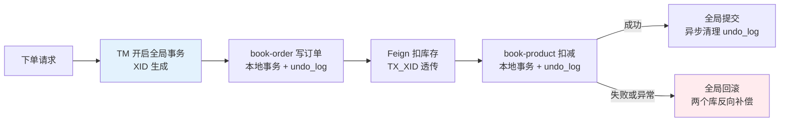
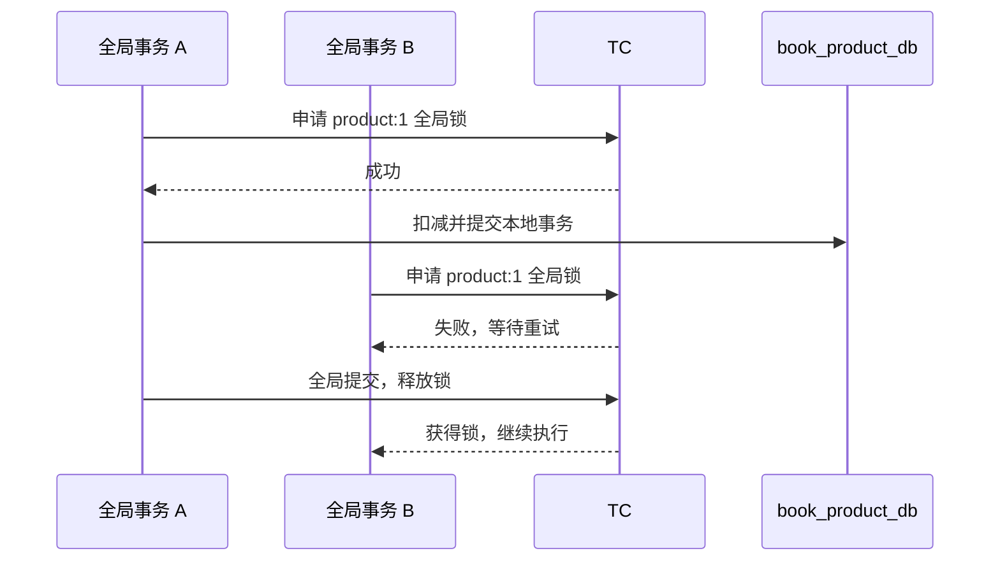

# Seata AT模式实战

## 课程目标

- 掌握 `spring-cloud-starter-alibaba-seata` 在 Spring Boot 3.5 下的依赖处理方式
- 掌握客户端 `seata.*` 配置：事务组、映射、注册与配置中心
- 掌握 PostgreSQL 16 下 `undo_log` 的建表方式，理解每个业务库都要建的原因
- 能够用 `@GlobalTransactional` 包住"订单落库 + Feign 扣库存"并验证回滚
- 能够读懂 `undo_log` 中的 `beforeImage` / `afterImage`
- 掌握全局锁冲突的处理与 `@GlobalLock` 的使用场景
- 能够按排查表定位事务不回滚、数据源代理失效等常见问题

## 回顾与导入

上一课把 Seata 的角色与 AT 原理讲清了：TC 维护状态、TM 定义边界、RM 记录镜像。Server 也已经跑起来，控制台能看到 `default` 集群，Nacos 里有健康实例。但客户端一行代码都没改，`@Transactional` 依然管不到 `book_product_db`。

这一课要把能力真正接到业务上。改造点只有三处：加依赖与配置、给两个库建 `undo_log`、给下单入口加一个注解。真正花时间的是验证——**回滚是否发生、`undo_log` 写了什么、并发时锁在哪**。

| 改造项 | 涉及位置 | 完成标志 |
| --- | --- | --- |
| 客户端依赖 | `book-order`、`book-product` 的 pom | 启动日志出现 RM/TM 初始化 |
| 客户端配置 | 两个服务的 `application.yml` | 能连上 TC，无 `no available service` |
| `undo_log` | `book_order_db`、`book_product_db` | AT 模式写入日志不报错 |
| 全局事务 | `CreateOrderService.create` | 库存不足时订单不落库 |



> **前置条件：** Seata Server 2.2.0 已注册到 Nacos 的 `SEATA_GROUP`，`book-order` 与 `book-product` 都能访问 8091 端口。

## 一、依赖与 Boot 3.5 适配

### 为什么不能直接用传递依赖

`spring-cloud-starter-alibaba-seata` 会传递 `seata-spring-boot-starter`。SCA 2025.0.0.0 传递进来的版本可能低于 2.2.x，而 Spring Boot 3.5 要求 starter 提供 `META-INF/spring/org.springframework.boot.autoconfigure.AutoConfiguration.imports`；1.x 的 starter 只有 `spring.factories`，Boot 3 不会再加载它。

症状很有辨识度：启动正常、注解不报错，但事务完全不生效，`RootContext.getXID()` 永远是 `null`。

```xml
<dependency>
    <groupId>com.alibaba.cloud</groupId>
    <artifactId>spring-cloud-starter-alibaba-seata</artifactId>
    <exclusions>
        <exclusion>
            <groupId>io.seata</groupId>
            <artifactId>seata-spring-boot-starter</artifactId>
        </exclusion>
    </exclusions>
</dependency>
<dependency>
    <groupId>io.seata</groupId>
    <artifactId>seata-spring-boot-starter</artifactId>
    <version>2.2.0</version>
</dependency>
```

排除再显式引入，是为了让版本可控。两个业务服务都要加，**只有发起方加注解是不够的**——被调用方也必须有 RM 才能注册分支。

技术基线是 Spring Boot 3.5.16 + Spring Cloud Alibaba 2025.0.0.0 + Seata 2.2.0 + PostgreSQL 16。服务端与客户端的大版本必须一致，2.2.0 的 TC 与 1.8 的 RM 混用会在握手阶段失败。

### 客户端配置

```yaml
seata:
  enabled: true
  application-id: book-order
  tx-service-group: book_tx_group
  enable-auto-data-source-proxy: true
  data-source-proxy-mode: AT
  service:
    vgroup-mapping:
      book_tx_group: default
  registry:
    type: nacos
    nacos:
      application: seata-server
      server-addr: 192.168.1.5:8848
      group: SEATA_GROUP
      cluster: default
      username: nacos
      password: nacos
  config:
    type: nacos
    nacos:
      server-addr: 192.168.1.5:8848
      group: SEATA_GROUP
      data-id: seataServer.properties
      username: nacos
      password: nacos
  client:
    tm:
      default-global-transaction-timeout: 60000
    rm:
      lock:
        retry-interval: 10
        retry-times: 30
```

四个字段是最容易出错的：

| 配置 | 作用 | 常见错误 |
| --- | --- | --- |
| `tx-service-group` | 声明客户端所属事务组 | 与 `vgroup-mapping` 的键不一致 |
| `service.vgroup-mapping` | 事务组映射到 TC 集群名 | 值写成 `seata-server` 而不是 `default` |
| `registry.nacos.cluster` | 指定连接哪个 TC 集群 | 与服务端 `registry.cluster` 不同 |
| `registry.nacos.application` | TC 在 Nacos 的服务名 | 与服务端 `spring.application.name` 不同 |

`enable-auto-data-source-proxy` 默认为 `true`，会包装容器里的 `DataSource`。用了动态数据源时，自动代理可能只包住主数据源，需要手工包装成 `DataSourceProxy`。

## 二、undo_log 建表

### PostgreSQL 16 的 DDL

`undo_log` 由 RM 在业务库里读写，不是 TC 的表。

```sql
CREATE TABLE IF NOT EXISTS public.undo_log (
    branch_id     BIGINT       NOT NULL,
    xid           VARCHAR(128) NOT NULL,
    context       VARCHAR(128) NOT NULL,
    rollback_info BYTEA        NOT NULL,
    log_status    INT          NOT NULL,
    log_created   TIMESTAMP(6) NOT NULL,
    log_modified  TIMESTAMP(6) NOT NULL,
    CONSTRAINT ux_undo_log UNIQUE (xid, branch_id)
);

CREATE INDEX IF NOT EXISTS ix_undo_log_status ON public.undo_log (log_status);
CREATE INDEX IF NOT EXISTS ix_undo_log_xid ON public.undo_log (xid);
```

| 字段 | 类型 | 含义 |
| --- | --- | --- |
| `branch_id` | `BIGINT` | 分支事务 ID，与 `xid` 一起唯一确定一条日志 |
| `xid` | `VARCHAR(128)` | 全局事务 ID |
| `context` | `VARCHAR(128)` | 序列化方式等上下文 |
| `rollback_info` | `BYTEA` | 前后镜像的序列化内容，PostgreSQL 用二进制列 |
| `log_status` | `INT` | `0` 正常可回滚，`1` 全局已结束可清理 |
| `log_created` / `log_modified` | `TIMESTAMP(6)` | 写入与更新时间，毫秒精度 |

> **注意：** 早期脚本带 `id BIGSERIAL` 与 `undo_log_id_seq` 序列，2.x 的客户端按 `(xid, branch_id)` 定位记录，不再依赖自增主键。新建库不要照抄旧脚本；已有库多这一列不影响运行，但序列会成为无用对象。

### 为什么每个业务库都要建

AT 的回滚是**各库自己执行**的：`book-order` 的 RM 把订单镜像写进 `book_order_db.undo_log`，`book-product` 的 RM 把库存镜像写进 `book_product_db.undo_log`。TC 只下发"回滚这个 `branchId`"，真正读日志、拼反向 SQL 的是各库的 RM。

| 库 | 是否建 `undo_log` | 不建的后果 |
| --- | --- | --- |
| `book_order_db` | 必须 | 一阶段写镜像失败，订单插入直接报错 |
| `book_product_db` | 必须 | 库存扣减无法回滚，超卖 |
| `seata`（TC 库） | 不需要 | TC 用 `global_table` 等四张表 |

```sql
-- 两个业务库分别执行
\c book_order_db
CREATE TABLE IF NOT EXISTS public.undo_log ( ... );

\c book_product_db
CREATE TABLE IF NOT EXISTS public.undo_log ( ... );
```

## 三、改造下单流程

### 分层职责

改造后仍保持"编排层不加本地事务"的约定，只是编排层多了一个全局事务注解。

| 类 | 职责 | 事务 |
| --- | --- | --- |
| `CreateOrderService` | 编排：写订单 → 逐项扣库存 → 改状态 | `@GlobalTransactional` |
| `OrderTxService` | 订单三表落库、状态更新 | `@Transactional` |
| `StockServiceImpl` | 扣减库存，库存不足抛异常 | `@Transactional` |

### 订单落库

```java
package com.example.order.service.impl;

import com.example.order.dto.OrderCreateRequest;
import com.example.order.dto.OrderItemRequest;
import com.example.order.dto.ProductDTO;
import com.example.order.feign.ProductClient;
import com.example.order.feign.dto.StockChangeRequest;
import io.seata.spring.annotation.GlobalTransactional;
import lombok.RequiredArgsConstructor;
import lombok.extern.slf4j.Slf4j;
import org.springframework.stereotype.Service;

import java.math.BigDecimal;

@Slf4j
@Service
@RequiredArgsConstructor
public class CreateOrderService {

    private final OrderTxService orderTxService;
    private final ProductClient productClient;

    @GlobalTransactional(name = "create-order", rollbackFor = Exception.class, timeoutMills = 30000)
    public Long create(OrderCreateRequest request) {
        BigDecimal total = BigDecimal.ZERO;
        for (OrderItemRequest item : request.getItems()) {
            ProductDTO product = productClient.getById(item.getProductId()).getData();
            total = total.add(product.getPrice().multiply(BigDecimal.valueOf(item.getQuantity())));
        }

        Long orderId = orderTxService.saveOrder(request, total);
        log.info("订单已落库，orderId={}, xid={}", orderId, io.seata.core.context.RootContext.getXID());

        for (OrderItemRequest item : request.getItems()) {
            StockChangeRequest stock = new StockChangeRequest();
            stock.setProductId(item.getProductId());
            stock.setQuantity(item.getQuantity());
            stock.setRequestId(request.getRequestId() + ":" + item.getProductId());
            productClient.deduct(stock);
        }

        orderTxService.updateStatus(orderId, "WAIT_PAY");
        return orderId;
    }
}
```

关键点：金额由图书服务返回的价格计算，不接受前端传值；`timeoutMills` 要小于网关超时；远端返回业务错误时 `ProductClient` 必须抛异常，不能返回 `Result.fail` 了事，否则全局事务会当作成功提交。

```java
package com.example.order.service.impl;

import com.example.order.dto.OrderCreateRequest;
import com.example.order.entity.Order;
import com.example.order.mapper.OrderMapper;
import lombok.RequiredArgsConstructor;
import org.springframework.stereotype.Service;
import org.springframework.transaction.annotation.Transactional;

import java.math.BigDecimal;

@Service
@RequiredArgsConstructor
public class OrderTxService {

    private final OrderMapper orderMapper;

    @Transactional(rollbackFor = Exception.class)
    public Long saveOrder(OrderCreateRequest request, BigDecimal totalAmount) {
        Order order = new Order();
        order.setOrderNo("BO" + System.currentTimeMillis());
        order.setUserId(request.getUserId());
        order.setTotalAmount(totalAmount);
        order.setStatus("CREATED");
        order.setRequestId(request.getRequestId());
        orderMapper.insert(order);
        return order.getId();
    }

    @Transactional(rollbackFor = Exception.class)
    public void updateStatus(Long orderId, String status) {
        orderMapper.updateStatus(orderId, status);
    }
}
```

### 库存扣减

```java
package com.example.product.service.impl;

import com.example.common.exception.BusinessException;
import com.example.common.result.ResultCode;
import com.example.product.feign.dto.StockChangeRequest;
import com.example.product.mapper.ProductMapper;
import lombok.RequiredArgsConstructor;
import org.springframework.stereotype.Service;
import org.springframework.transaction.annotation.Transactional;

@Service
@RequiredArgsConstructor
public class StockServiceImpl implements StockService {

    private final ProductMapper productMapper;

    @Override
    @Transactional(rollbackFor = Exception.class)
    public void deduct(StockChangeRequest request) {
        int rows = productMapper.deductStock(request.getProductId(), request.getQuantity());
        if (rows == 0) {
            throw new BusinessException(ResultCode.STOCK_NOT_ENOUGH);
        }
    }
}
```

```java
package com.example.product.mapper;

import org.apache.ibatis.annotations.Mapper;
import org.apache.ibatis.annotations.Param;
import org.apache.ibatis.annotations.Update;

@Mapper
public interface ProductMapper {

    @Update("UPDATE product SET stock = stock - #{quantity}, sales = sales + #{quantity} "
            + "WHERE id = #{productId} AND stock >= #{quantity}")
    int deductStock(@Param("productId") Long productId, @Param("quantity") Integer quantity);
}
```

`WHERE id = ?` 是 AT 模式的硬要求：主键必须出现在条件里，RM 才能生成精确的 `sqlWhere` 并定位行。`stock >= ?` 则保证不会扣成负数，扣不动就返回 0 行并抛异常，异常经 Feign 传回调用方，全局事务回滚。

## 四、回滚验证

### 验证场景

| 场景 | 操作 | 预期结果 |
| --- | --- | --- |
| 正常下单 | 库存 100，买 2 | 订单 `WAIT_PAY`，库存 98，两个库的 `undo_log` 清空 |
| 库存不足 | 库存 2，买 5 | 返回 `1004`，订单表无记录，库存仍为 2 |
| 第二项不足 | 第一项够、第二项不够 | 第一项扣减被回滚，库存恢复原值 |
| 扣减超时 | 停掉 `book-product` | 返回 `2001`，订单不落库 |
| 改状态失败 | 人为让 `updateStatus` 抛异常 | 订单与库存都回滚 |

```sql
-- 订单侧：确认没有残留
SELECT id, order_no, status, total_amount FROM orders ORDER BY id DESC LIMIT 5;
-- 库存侧：确认恢复
SELECT id, stock, sales FROM product WHERE id IN (1, 2);
-- 两个库分别检查未清理的日志
SELECT branch_id, xid, log_status, log_created FROM undo_log ORDER BY log_created DESC;
```

### undo_log 内容解读

```json
{
  "branchId": 6428741935206400,
  "xid": "192.168.1.5:8091:7391827463521001",
  "sqlUndoLogs": [{
    "sqlType": "UPDATE",
    "tableName": "product",
    "beforeImage": { "rows": [{ "fields": [
      { "name": "id", "type": 8, "value": 1 },
      { "name": "stock", "type": 4, "value": 100 },
      { "name": "sales", "type": 4, "value": 0 }] }], "sqlWhere": "id = ?" },
    "afterImage": { "rows": [{ "fields": [
      { "name": "id", "type": 8, "value": 1 },
      { "name": "stock", "type": 4, "value": 98 },
      { "name": "sales", "type": 4, "value": 2 }] }], "sqlWhere": "id = ?" }
  }]
}
```

| 部分 | 含义 | 回滚时怎么用 |
| --- | --- | --- |
| `sqlType` | 操作类型，这里是 `UPDATE` | 决定生成 `UPDATE` 还是 `INSERT`/`DELETE` |
| `beforeImage` | 修改前的整行值 | 作为反向更新的目标值 |
| `afterImage` | 修改后的整行值 | 与当前值比对，判断是否被他人改过 |
| `sqlWhere` | 由主键拼出的条件 | 精确定位要回滚的行 |
| `type` | JDBC 类型码，`8` 为 `BIGINT`、`4` 为 `INTEGER` | 反序列化时还原字段类型 |

回滚执行的是"把 `stock` 改回 100、`sales` 改回 0"。如果当前值既不是 `afterImage` 也不是 `beforeImage`，说明回滚期间有人动过这行，框架会按 `client.rm.lock.retry-policy-branch-rollback-on-conflict` 决定重试或告警。

## 五、隔离与并发

### 全局锁冲突

两个用户同时买同一本书，第二个全局事务在申请全局锁时会被挡住。



默认重试间隔 10 毫秒、30 次，约 300 毫秒后抛 `LockConflictException`。这不是缺陷，而是**用等待换正确**：没有它，两个事务会基于同一个 `stock = 100` 各扣一次。

| 冲突处理方式 | 配置 | 效果 |
| --- | --- | --- |
| 客户端重试 | `client.rm.lock.retry-interval` / `retry-times` | 短暂冲突自动消化 |
| 缩短事务 | 减少分支、减少慢调用 | 降低冲突概率 |
| 业务排队 | 按商品 ID 哈希到队列 | 从源头串行化热点商品 |

### @GlobalLock 与脏写防护

`@GlobalLock` 用于**非全局事务**的本地写：它不开启全局事务，只在提交前检查目标行是否被全局锁占用，防止越过 Seata 直接改数据造成脏写。

```java
package com.example.product.service.impl;

import io.seata.spring.annotation.GlobalLock;
import org.springframework.stereotype.Service;
import org.springframework.transaction.annotation.Transactional;

@Service
public class StockAdminService {

    private final ProductMapper productMapper;

    public StockAdminService(ProductMapper productMapper) {
        this.productMapper = productMapper;
    }

    @GlobalLock
    @Transactional(rollbackFor = Exception.class)
    public void replenish(Long productId, Integer quantity) {
        Integer stock = productMapper.selectStockForUpdate(productId);
        if (stock == null) {
            throw new IllegalArgumentException("商品不存在: " + productId);
        }
        productMapper.addStock(productId, quantity);
    }
}
```

`selectStockForUpdate` 对应 `SELECT stock FROM product WHERE id = ? FOR UPDATE`，先拿本地锁再检查全局锁。缺少 `@GlobalLock` 时，后台补货可能改到"已被全局事务锁定但尚未提交"的行，回滚时镜像对不上。

### 性能影响与优化

| 开销来源 | 说明 | 优化手段 |
| --- | --- | --- |
| 多一次镜像查询 | 每条写 SQL 前后各查一次 | 只更新必要列，避免大字段 |
| 多一次 TC 交互 | 注册分支、上报状态 | 合并 SQL，减少分支数量 |
| 全局锁等待 | 热点行串行 | 热点拆分、业务排队 |
| 二阶段清理 | 删除 `undo_log` | 调大 `client.rm.async-commit-buffer-limit` 批量清理 |
| 长事务 | 锁持有时间拉长 | `timeoutMills` + 异步化非核心步骤 |

> **提示：** 二阶段提交是异步的，业务线程不等 TC。真正拖慢接口的是一阶段的镜像查询与全局锁等待，压测优先看这两项。

## 六、常见问题排查

| 现象 | 可能原因 | 排查方法 | 处理 |
| --- | --- | --- | --- |
| 抛出异常但数据没回滚 | `rollbackFor` 没写，或异常被 catch 吞掉 | 看日志有无 `Rollback` 与 `XID` | 补 `rollbackFor = Exception.class`，异常向上抛 |
| 注解不生效 | 1.x starter 在 Boot 3 下未加载 | `RootContext.getXID()` 是否为 `null` | 排除旧 starter，显式引入 2.2.0 |
| `can not connect to services-server` | TC 地址不可达、端口映射缺失 | `telnet 192.168.1.5 8091` | 修网络或补 8091 映射 |
| `no available service 'default' found` | `vgroup-mapping` 键值与 `tx-service-group` 不一致 | 核对两个字符串 | 改成同名并重启 |
| `Table 'undo_log' doesn't exist` | 业务库漏建表 | 查 `information_schema.tables` | 每个业务库都建 |
| 更新语句不回滚 | 更新条件不含主键 | 看 SQL 是否有 `WHERE id = ?` | 改为按主键更新 |
| 大量 `LockConflictException` | 热点行竞争或长事务 | 查 `lock_table` 堆积 | 缩短事务、拆分热点 |
| 下游没加入全局事务 | Feign 未透传 `TX_XID` | 下游日志的 `XID` 是否为空 | 检查拦截器与 Header 透传 |

排查顺序固定为：**先看 `XID`、再看分支注册、最后看镜像与锁**；`XID` 为空说明全局事务没开，后面两步不用查。

## 注意事项

- `@GlobalTransactional` 的方法必须是外部调用入口。同类内部调用不走代理，注解会被静默忽略。
- `rollbackFor = Exception.class` 不能省，默认只回滚 `RuntimeException`；同时不要在方法里 `catch` 后不抛出。
- 远端服务返回 `Result.fail` 不会自动回滚，必须在 Feign 调用处判断并抛异常。
- `undo_log` 不是业务表，不要手工改 `rollback_info`；清理时只删 `log_status = 1` 且超过保留期的记录。
- AT 模式要求写操作能解析出主键，批量按条件更新、`INSERT ... ON CONFLICT` 要单独验证回滚行为。
- 全局事务超时（默认 60 秒）必须小于网关与 Feign 的超时链路，否则会出现 TC 已回滚、调用方仍在重试的窗口。
- 压测时关注 `lock_table` 行数与 `LockConflictException` 比例，它们比接口 RT 更早暴露热点问题。

## 小结

本节课我们学习了：

1. **依赖处理**：排除 SCA 传递的旧 starter，显式使用 Seata 2.2.0，才能在 Boot 3.5 下加载自动配置。
2. **客户端配置**：`tx-service-group` 声明组、`vgroup-mapping` 映射集群，注册与配置中心都指向 Nacos。
3. **`undo_log`**：PostgreSQL 用 `BYTEA` 存镜像，按 `(xid, branch_id)` 唯一；每个业务库都要建。
4. **全局事务改造**：编排层加 `@GlobalTransactional`，落库与扣减各自保留本地事务，远端失败必须抛异常。
5. **回滚验证**：库存不足、超时、改状态失败三种场景下订单不落库、库存恢复，`undo_log` 被清理。
6. **镜像解读**：`beforeImage` / `afterImage` / `sqlWhere` 决定回滚 SQL，主键是前提。
7. **隔离与性能**：全局锁冲突用重试与拆分化解，非全局写用 `@GlobalLock` 防脏写。
8. **排查方法**：先看 `XID`，再看分支注册，最后看镜像与锁。

## 作业

### 作业一：完成下单全局事务改造

1. 两个服务加依赖与配置，启动后确认日志里有 RM/TM 初始化且无 `no available service`。
2. 两个库建 `undo_log`，分别验证正常下单与库存不足，用 SQL 确认订单、库存与日志状态。

### 作业二：观察全局锁

1. 用两个线程并发买同一本书（库存只够一单），记录其中一个的异常类型与耗时。
2. 把 `retry-interval` 改为 50 毫秒、`retry-times` 改为 5 重复实验，说明等待为何必要、热点商品如何拆分。

### 作业三：写一份排查手册

1. 构造"事务不回滚"：去掉 `rollbackFor`，记录现象与日志关键行。
2. 构造"下游未加入全局事务"：去掉 Header 透传，对比两个库的 `undo_log`，整理成六步检查清单。
