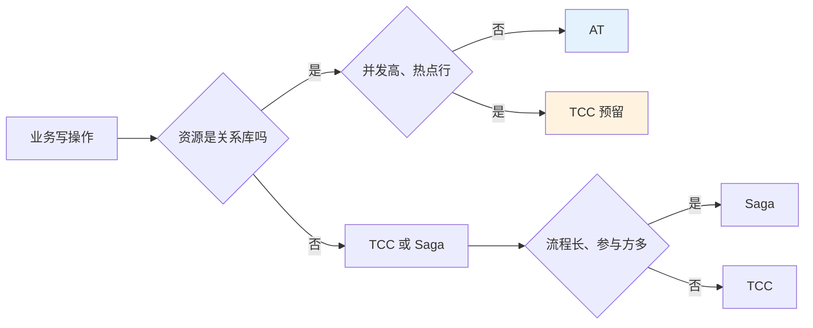
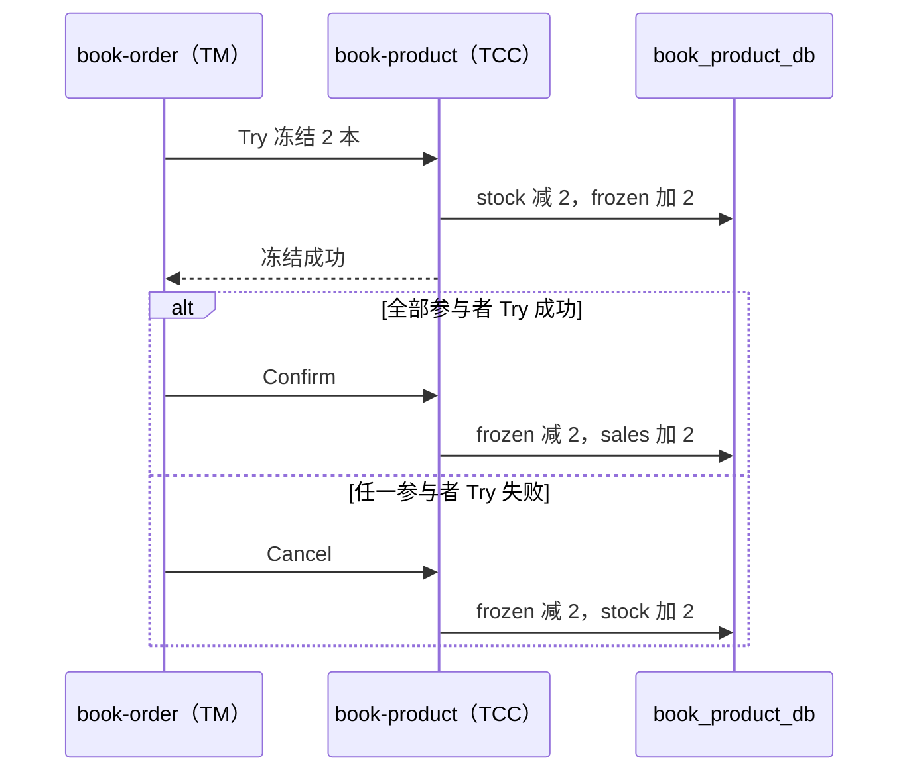
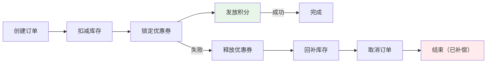
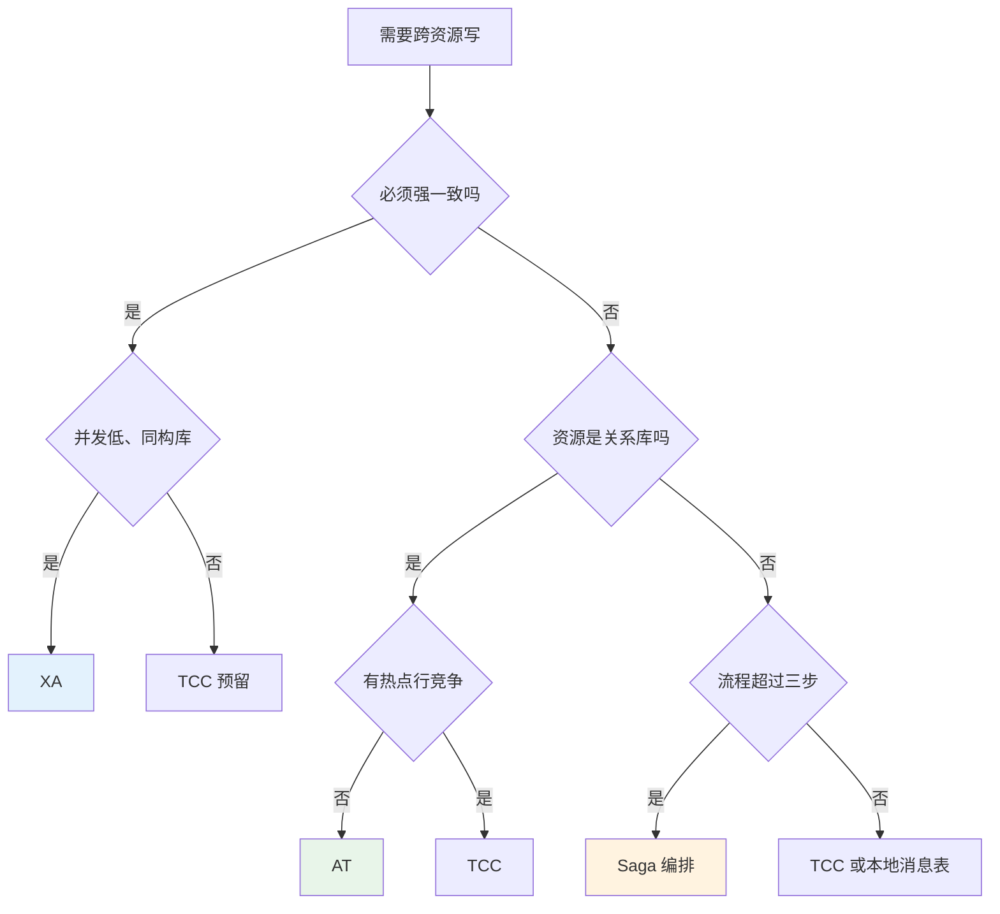

# TCC、Saga、XA模式与选型

## 课程目标

- 掌握 TCC 的 Try / Confirm / Cancel 语义与资源冻结模型
- 掌握 TCC 的空回滚、悬挂、幂等三大问题与事务控制表解法
- 掌握 Saga 的正向服务与补偿服务，能区分编排与协同
- 理解 XA 的强一致代价与数据库层的前置要求
- 能够用对比表判断 AT、TCC、Saga、XA 的适用边界
- 能够按决策树为图书系统的下单、转账、积分场景选型
- 掌握补偿重试、告警、人工兜底等生产必备措施

## 回顾与导入

上一课用 AT 跑通了"订单落库 + 扣减库存"：一阶段记录镜像，异常时 TC 驱动两个库反向补偿。AT 的优势是零侵入，代价是**它只能管关系库**——镜像靠 SQL 解析，回滚靠反向 SQL。

现实里有两类操作 AT 管不了：一是资源不是数据库，比如冻结 Redis 里的名额、调用第三方的开票接口；二是热点行竞争激烈，全局锁把并发压成串行。这两类场景需要"由业务自己定义预留与释放"，也就是 TCC；流程更长、参与方更多的场景需要 Saga；而对一致性要求极高、并发不高的场景，XA 仍然是最省心的选择。

| 方案 | 一句话概括 | 典型适用 |
| --- | --- | --- |
| AT | 框架记镜像，自动反向补偿 | 自家库的 CRUD |
| TCC | 业务自己预留、确认、释放 | 库存、额度、优惠券 |
| Saga | 正向一步步走，失败逐步补偿 | 长流程、跨系统 |
| XA | 数据库两阶段提交，锁到全局结束 | 强一致、低并发 |



## 一、TCC 模式

### 三个方法的分工

TCC 把一次业务拆成三个动作：Try 预留资源、Confirm 确认使用、Cancel 释放预留。它与 AT 最大的区别是**没有全局锁**，隔离性由业务自己保证。

| 方法 | 时机 | 库存场景 | 要求 |
| --- | --- | --- | --- |
| Try | 一阶段，全局事务内 | 冻结 `quantity`，可用库存减少 | 幂等、可重复执行 |
| Confirm | 二阶段，全部 Try 成功 | 冻结转实扣，销量增加 | 幂等，不再校验业务规则 |
| Cancel | 二阶段，任一 Try 失败 | 解冻，可用库存恢复 | 幂等，允许 Try 未执行 |



### 库存冻结的表设计

```sql
CREATE TABLE stock_freeze (
    id          BIGSERIAL PRIMARY KEY,
    product_id  BIGINT      NOT NULL,
    xid         VARCHAR(128) NOT NULL,
    branch_id   BIGINT      NOT NULL,
    quantity    INT         NOT NULL,
    status      VARCHAR(16) NOT NULL DEFAULT 'FROZEN',
    created_at  TIMESTAMP   NOT NULL DEFAULT now(),
    updated_at  TIMESTAMP   NOT NULL DEFAULT now(),
    CONSTRAINT uk_freeze_xid_branch UNIQUE (xid, branch_id)
);
```

`(xid, branch_id)` 唯一约束是 TCC 幂等的基础：同一个分支重复 Try 会命中唯一键，捕获后直接返回成功。`status` 走 `FROZEN → CONFIRMED` 或 `FROZEN → CANCELLED`，保证确认与释放互斥。

### TCC 代码骨架

Seata 的 TCC 通过 `@TwoPhaseBusinessAction` 声明三方法关系，`BusinessActionContext` 携带 `xid`、`branchId` 与 Try 阶段传入的业务参数。

```java
package com.example.product.tcc;

import io.seata.rm.tcc.api.BusinessActionContext;
import io.seata.rm.tcc.api.BusinessActionContextParameter;
import io.seata.rm.tcc.api.LocalTCC;
import io.seata.rm.tcc.api.TwoPhaseBusinessAction;

@LocalTCC
public interface StockTccAction {

    @TwoPhaseBusinessAction(name = "stockTccAction", commitMethod = "confirm", rollbackMethod = "cancel")
    boolean tryFreeze(@BusinessActionContextParameter(paramName = "productId") Long productId,
                      @BusinessActionContextParameter(paramName = "quantity") Integer quantity,
                      BusinessActionContext context);

    boolean confirm(BusinessActionContext context);

    boolean cancel(BusinessActionContext context);
}
```

```java
package com.example.product.tcc.impl;

import com.example.product.mapper.StockFreezeMapper;
import com.example.product.tcc.StockTccAction;
import io.seata.rm.tcc.api.BusinessActionContext;
import lombok.RequiredArgsConstructor;
import org.springframework.stereotype.Service;
import org.springframework.transaction.annotation.Transactional;

@Service
@RequiredArgsConstructor
public class StockTccActionImpl implements StockTccAction {

    private final StockFreezeMapper freezeMapper;

    @Override
    @Transactional(rollbackFor = Exception.class)
    public boolean tryFreeze(Long productId, Integer quantity, BusinessActionContext context) {
        int rows = freezeMapper.freeze(productId, quantity);
        if (rows == 0) {
            throw new IllegalStateException("库存不足: " + productId);
        }
        freezeMapper.insertLog(context.getXid(), context.getBranchId(), productId, quantity, "FROZEN");
        return true;
    }

    @Override
    @Transactional(rollbackFor = Exception.class)
    public boolean confirm(BusinessActionContext context) {
        freezeMapper.confirm(context.getXid(), context.getBranchId());
        return true;
    }

    @Override
    @Transactional(rollbackFor = Exception.class)
    public boolean cancel(BusinessActionContext context) {
        freezeMapper.cancel(context.getXid(), context.getBranchId());
        return true;
    }
}
```

对应的 SQL 都是"带状态条件的一条更新"，这样确认与释放天然互斥，也不会把库存扣成负数。

```sql
-- product 表需要冻结列
ALTER TABLE product ADD COLUMN frozen INT NOT NULL DEFAULT 0;

-- Try：可用库存足够才冻结
UPDATE product SET stock = stock - #{quantity}, frozen = frozen + #{quantity}
WHERE id = #{productId} AND stock >= #{quantity};

-- Confirm：冻结转实扣，只有 FROZEN 才处理
UPDATE product p SET frozen = p.frozen - f.quantity, sales = p.sales + f.quantity
FROM stock_freeze f
WHERE f.xid = #{xid} AND f.branch_id = #{branchId} AND f.status = 'FROZEN' AND p.id = f.product_id;

UPDATE stock_freeze SET status = 'CONFIRMED', updated_at = now()
WHERE xid = #{xid} AND branch_id = #{branchId} AND status = 'FROZEN';

-- Cancel：解冻，只有 FROZEN 才处理
UPDATE product p SET stock = p.stock + f.quantity, frozen = p.frozen - f.quantity
FROM stock_freeze f
WHERE f.xid = #{xid} AND f.branch_id = #{branchId} AND f.status = 'FROZEN' AND p.id = f.product_id;

UPDATE stock_freeze SET status = 'CANCELLED', updated_at = now()
WHERE xid = #{xid} AND branch_id = #{branchId} AND status = 'FROZEN';
```

### 三大问题与标准解法

TCC 的难点不在三个方法怎么写，而在网络异常下的调用顺序不可控。

| 问题 | 发生原因 | 不处理的后果 | 标准解法 |
| --- | --- | --- | --- |
| 空回滚 | Try 未执行（请求丢失）就收到 Cancel | 把别人的库存解冻了 | Cancel 查事务控制表，无 Try 记录则只记 Cancel 并返回成功 |
| 悬挂 | Cancel 先到并执行，Try 后到 | 资源被永久冻结 | Try 执行前检查是否有 Cancel 记录，有则拒绝 |
| 幂等 | TC 重试、网络重发 | 重复扣减或重复解冻 | `(xid, branchId, phase)` 唯一约束，重复直接返回成功 |

```sql
CREATE TABLE tcc_transaction (
    id          BIGSERIAL PRIMARY KEY,
    xid         VARCHAR(128) NOT NULL,
    branch_id   BIGINT       NOT NULL,
    phase       VARCHAR(16)  NOT NULL,
    status      VARCHAR(16)  NOT NULL,
    remark      VARCHAR(64),
    created_at  TIMESTAMP    NOT NULL DEFAULT now(),
    CONSTRAINT uk_tcc_phase UNIQUE (xid, branch_id, phase)
);
```

```java
package com.example.product.tcc.impl;

import io.seata.rm.tcc.api.BusinessActionContext;
import org.springframework.transaction.annotation.Transactional;

public class TccGuard {

    private final TccTransactionMapper tccMapper;

    public TccGuard(TccTransactionMapper tccMapper) {
        this.tccMapper = tccMapper;
    }

    @Transactional(rollbackFor = Exception.class)
    public boolean cancel(BusinessActionContext context) {
        String xid = context.getXid();
        Long branchId = context.getBranchId();
        if (tccMapper.exists(xid, branchId, "CANCEL")) {
            return true;
        }
        if (!tccMapper.exists(xid, branchId, "TRY")) {
            tccMapper.insert(xid, branchId, "CANCEL", "EMPTY_ROLLBACK");
            return true;
        }
        tccMapper.insert(xid, branchId, "CANCEL", "SUCCESS");
        return true;
    }

    @Transactional(rollbackFor = Exception.class)
    public boolean tryPhase(String xid, Long branchId) {
        if (tccMapper.exists(xid, branchId, "CANCEL")) {
            throw new IllegalStateException("检测到悬挂的 Cancel，拒绝 Try: " + xid);
        }
        tccMapper.insert(xid, branchId, "TRY", "SUCCESS");
        return true;
    }
}
```

`tryPhase` 的检查必须与业务写入在同一个本地事务里，否则检查与写入之间仍有空档。实际实现中，`tryFreeze` 在冻结前调用 `tryPhase`，`cancel` 在释放前调用上面的 `cancel`，把幂等、空回滚与悬挂判断收在一处。

## 二、Saga 模式

### 正向与补偿

Saga 把长事务拆成一串本地事务，每一步失败就反向调用前面每一步的补偿服务。它没有预留、没有锁，只有"做过的都记下来，失败逐个撤"。



补偿必须是**幂等 + 可重试**的，且不能依赖"正向已经成功"的假设：补偿可能因为超时被重复调用，也可能在正向结果未知时就被触发。

### 编排与协同

| 维度 | 编排（Orchestration） | 协同（Choreography） |
| --- | --- | --- |
| 控制中心 | 有，状态机或流程引擎统一调度 | 无，各服务监听事件自行推进 |
| 流程可见性 | 强，一处可看全链路 | 弱，散落在各服务 |
| 耦合度 | 参与者只与编排器交互 | 参与者之间通过事件耦合 |
| 补偿顺序 | 由编排器保证 | 需自行设计，易乱序 |
| 适用场景 | 参与者多、流程长、需要可视化 | 参与者少、事件驱动架构 |

图书系统的下单链路有 4 到 5 个参与者，且需要可视化的失败轨迹，选编排更合适。参与者只有两三个、又已经是消息驱动架构时，协同的改造成本更低。

### Seata Saga 状态机

Seata Saga 用 JSON 描述状态机：每个 `ServiceTask` 声明 `CompensateState`，引擎按 `Next` 前进，失败时自动逆序调用补偿。

```json
{
  "Name": "createOrderSaga",
  "Comment": "下单 Saga：建单、扣库存、发积分",
  "Version": "0.0.1",
  "StartState": "CreateOrder",
  "States": {
    "CreateOrder": {
      "Type": "ServiceTask",
      "ServiceName": "orderAction",
      "ServiceMethod": "create",
      "CompensateState": "CancelOrder",
      "Next": "DeductStock"
    },
    "DeductStock": {
      "Type": "ServiceTask",
      "ServiceName": "stockAction",
      "ServiceMethod": "deduct",
      "CompensateState": "RestoreStock",
      "Next": "GrantPoints"
    },
    "GrantPoints": {
      "Type": "ServiceTask",
      "ServiceName": "pointAction",
      "ServiceMethod": "grant",
      "CompensateState": "RevokePoints",
      "Next": "Successful"
    },
    "CancelOrder": { "Type": "ServiceTask", "ServiceName": "orderAction", "ServiceMethod": "cancel", "Next": "Fail" },
    "RestoreStock": { "Type": "ServiceTask", "ServiceName": "stockAction", "ServiceMethod": "restore", "Next": "CancelOrder" },
    "RevokePoints": { "Type": "ServiceTask", "ServiceName": "pointAction", "ServiceMethod": "revoke", "Next": "RestoreStock" },
    "Successful": { "Type": "Succeed" },
    "Fail": { "Type": "Fail", "ErrorCode": "501", "Message": "下单 Saga 失败" }
  }
}
```

`CompensateState` 是契约核心：写了补偿，引擎才能在失败时回退；漏写一个，前面所有步骤都白做。状态机定义建议纳入版本管理，每次变更都配合回放测试。

## 三、XA 模式

XA 是数据库层实现的 2PC：`prepare` 阶段各库把事务准备好但不提交，`commit` 阶段统一提交。Seata 对 XA 的支持只需把代理模式改为 `XA`。

```yaml
seata:
  data-source-proxy-mode: XA
```

| 维度 | XA 的表现 |
| --- | --- |
| 一致性 | 强一致，提交前外界看不到中间状态 |
| 依赖 | 数据库必须支持 XA；PostgreSQL 需设置 `max_prepared_transactions` 大于 0 |
| 性能 | 两阶段持锁，RT 与并发明显劣化 |
| 侵入性 | 低，只改代理模式，业务代码不动 |
| 失败处理 | 依赖数据库与 TC 的恢复流程，人工介入成本高 |
| 适用场景 | 同构数据库、强一致、低并发，如账户转账 |

> **注意：** PostgreSQL 默认 `max_prepared_transactions = 0`，等于关闭预备事务。不调整这个参数，XA 分支会直接失败。

XA 与 AT 的区别在于"锁在哪"：XA 的本地锁一直持有到全局提交，AT 的本地锁在一阶段就释放、改用全局锁。所以 XA 更一致，AT 吞吐更高。

## 四、四种模式对比

| 维度 | AT | TCC | Saga | XA |
| --- | --- | --- | --- | --- |
| 一致性 | 准强一致 | 准强一致 | 最终一致 | 强一致 |
| 性能 | 中，受全局锁影响 | 中高，无全局锁 | 高，无锁 | 低，两阶段持锁 |
| 侵入性 | 极低，加注解 | 高，写三套方法 | 中，写正向与补偿 | 低，改代理模式 |
| 隔离性 | 全局锁补读未提交 | 业务自己保证 | 无隔离，可能脏读 | 数据库级隔离 |
| 失败处理 | 自动反向 SQL | 自动 Cancel | 逆序补偿 | 数据库回滚 |
| 适用场景 | 自家库 CRUD | 库存、额度、券 | 长流程、跨系统 | 强一致、低并发 |
| 运维成本 | 低 | 高，接口数量翻三倍 | 中高，补偿链要可观测 | 中，受数据库参数约束 |

选型不是选"最好"的方案，而是选"失败时你能兜住"的方案。TCC 的三套方法意味着三倍的接口与三倍的幂等测试；Saga 的补偿链意味着每个补偿都要能被独立重试；XA 的强一致意味着必须接受 RT 上升。

## 五、选型决策与场景推荐



| 图书系统场景 | 推荐方案 | 理由 | 兜底措施 |
| --- | --- | --- | --- |
| 下单扣库存 | AT 起步，热点改 TCC | 两个自家库，CRUD 简单；大促时全局锁成为瓶颈 | 对账任务核对 `stock + frozen` |
| 跨行转账 | XA | 余额不允许中间态，参与者只有两个库 | 日终对账，异常挂账人工处理 |
| 积分发放 | Saga 或本地消息表 | 积分可延迟、可撤销，允许最终一致 | 补偿重试 + 告警 |
| 优惠券核销 | TCC | 券状态必须互斥，且要支持释放 | 券状态机 + 定时清理悬挂 |
| 第三方开票 | Saga + 人工兜底 | 外部系统无补偿接口，只能冲正 | 工单 + 对账文件 |

## 六、生产建议

- **事务日志表**：TCC 与 Saga 都要有 `xid`、`branch_id`、`phase`、`status` 的落库记录，它是幂等与排查的唯一依据。
- **补偿重试与告警**：补偿失败不能只打日志，要进重试队列并设置阈值告警；连续失败进入死信，交给人工。
- **幂等设计**：所有 Try / Confirm / Cancel 与正向 / 补偿接口都按业务键去重，不能依赖调用方只调一次。
- **超时与人工兜底**：明确全局超时、单步超时与补偿超时；无法自动收敛的进入人工工单，不要让异常数据沉默。
- **不要用分布式事务解决"能用消息解决"的问题**：通知、报表、积分这类可异步的业务，本地消息表更简单、更抗故障。
- **控制参与者数量**：每增加一个分支，失败组合就翻倍。能合并的步骤合并，能在同一个库完成的不要拆成两个服务。

## 注意事项

- TCC 的 Confirm 与 Cancel 必须能处理"Try 没执行"的情况，不能假设 Try 一定成功过。
- 悬挂的防护要放在 Try 的第一步，且与业务写入同一个本地事务，否则仍会漏。
- Saga 的补偿不是"反向业务"而是"冲正业务"：库存回补要写流水，不能只改数字。
- XA 上线前先确认 `max_prepared_transactions`，并评估连接池是否够两阶段占用。
- AT 与 TCC 可以混用：核心热点用 TCC，外围 CRUD 用 AT，但同一业务链路的事务组要保持一致。
- 补偿接口要限制重试次数与间隔，无限重试会把故障放大成雪崩。
- 选型评审要给出失败演练结果，而不是只对比理论指标。

## 小结

本节课我们学习了：

1. **TCC 语义**：Try 预留、Confirm 确认、Cancel 释放，隔离性由业务自己保证。
2. **三大问题**：空回滚、悬挂、幂等，用 `tcc_transaction` 控制表与唯一约束统一解决。
3. **Saga 结构**：正向服务加补偿服务，补偿必须幂等、可重试、可单独观测。
4. **编排与协同**：编排可见性强、适合长流程；协同耦合低、适合事件驱动的小链路。
5. **XA 的代价**：数据库层两阶段，强一致但持锁到全局结束，且依赖预备事务参数。
6. **四模式对比**：一致性、性能、侵入性、失败处理、运维成本共同决定选型。
7. **选型方法**：先问是否强一致，再问资源类型与热点，最后按场景表落方案。
8. **生产要求**：事务日志、补偿告警、幂等、超时兜底，缺一不可。

## 作业

### 作业一：实现库存 TCC

1. 按表结构建 `stock_freeze` 与 `tcc_transaction`，实现 Try / Confirm / Cancel。
2. 正常下单验证冻结转实扣；库存不足验证 Cancel 后 `stock + frozen` 回到原值。
3. 人为重复调用 Cancel 三次，确认库存只恢复一次。

### 作业二：模拟空回滚与悬挂

1. 跳过 Try 直接调用 Cancel，确认控制表写入 `EMPTY_ROLLBACK` 且库存不变。
2. 先调用 Cancel 再调用 Try，确认 Try 被拒绝，并解释为什么必须拒绝。
3. 用 SQL 列出两类异常记录，说明它们如何帮助定位问题。

### 作业三：为三个场景写选型报告

1. 为"下单扣库存"、"跨行转账"、"积分发放"各选一种模式。
2. 报告包含一致性要求、性能预估方法、失败处理、运维成本四部分。
3. 给出一次失败演练的设计：注入什么故障、预期补偿结果、如何验证收敛。
