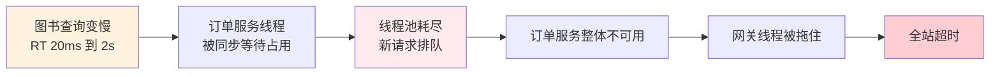
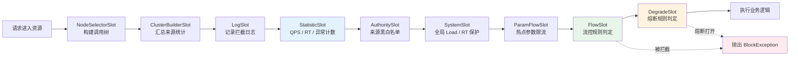

# Sentinel快速上手与流量控制

## 课程目标

- 理解服务雪崩（Cascading Failure）的形成条件，说清同步调用链被慢依赖拖垮的过程
- 掌握限流、熔断、降级、隔离、超时五种保障手段的分工与边界
- 掌握 Sentinel 的核心概念：资源、规则、Slot 责任链、Entry 与上下文
- 能够部署 1.8.8 Dashboard，并让 8081 的图书服务出现在控制台
- 掌握流控规则的阈值类型、流控模式、流控效果三组配置及其组合语义
- 能够用代码下发流控规则，并用压测确认限流真实生效

## 回顾与导入

前几课我们在 RocketMQ 与 Seata 上解决了"数据最终一致"。但系统还有一类更常见的故障：数据没错，服务却整体不可用。它从一个不致命的慢接口开始，最后演变成所有服务一起超时。

看案例里的调用链：网关 → 订单服务 → 图书服务 → 数据库。图书服务的查询因为缺索引从 20ms 变成 2s，订单服务的 Tomcat 线程会全部停在等待响应上；线程池满后，订单服务对**所有**请求都不再响应，包括根本不查图书的请求。网关线程随后被拖住，用户看到的是一片超时。

按并发 = QPS × RT 估算：并发 100、RT 2s 时占用约 200 个线程，正好是 Tomcat 默认上限。这条链上没有一行代码有 bug，问题在于**调用没有边界**。



> **结论：** 雪崩不是"某个服务坏了"，而是"坏的影响被同步调用无限放大"。保障手段的本质，是在放大的每一环装一个能主动断开的开关。

## 一、服务雪崩与五种保障手段

### 形成条件

雪崩需要三个条件同时成立，缺一个都不会失控。

| 条件 | 本案例中的表现 | 打断它的手段 |
| --- | --- | --- |
| 同步调用 | `ProductClient` 阻塞等待返回 | 异步化、超时 |
| 资源有限 | Tomcat 默认 200 个工作线程 | 线程隔离、限流 |
| 无失败边界 | 下游再慢也一直等 | 熔断、快速失败 |

第三点最关键。若订单服务发现图书服务连续超时后立刻返回降级结果，线程最多被占用"超时时间 × 并发"，不会无限累积。

### 五种手段的分工

这五个词经常被混用，它们的判断依据完全不同，不能互相替代。

| 手段 | 判断依据 | 解决的问题 | 代价 | 典型配置 |
| --- | --- | --- | --- | --- |
| 超时 | 单次调用耗时 | 一次调用不会无限等待 | 设小了误杀慢请求 | Feign `readTimeout` 1s |
| 限流 | 单位时间请求数 | 保护自己不被压垮 | 正常用户可能被拒 | 详情页 200 QPS |
| 熔断 | 一段时间内的失败比例 | 下游已坏就别再打 | 恢复有延迟 | 慢调用比例 50% |
| 降级 | 主逻辑是否可用 | 给用户可接受的替代结果 | 结果不完整 | 返回缓存或默认值 |
| 隔离 | 资源分区 | 一个依赖坏掉不牵连其他 | 利用率下降 | 每依赖独立线程池 |

顺序上，超时决定单次调用最坏耗时，限流决定同时有多少请求进入，熔断决定还要不要继续尝试，降级决定失败时给用户看什么。第 37 课的网关限流只认路由维度，且服务间调用不经过网关，因此服务内限流不可省略。

> **注意：** 限流保护的是**自己**（进来的流量），熔断保护的是**调用方**（出去的依赖）。混为一谈会出现"下游挂了却只给自己限流"的错误配置。

## 二、Sentinel 核心概念

### 五个必须建立的概念

| 概念 | 含义 | 代码里的对应物 | 类比 |
| --- | --- | --- | --- |
| 资源 Resource | 被保护的逻辑单元 | `@SentinelResource("productDetail")` | 一扇要守的门 |
| 规则 Rule | 作用在资源上的判定条件 | `FlowRule`、`DegradeRule` | 门卫的判断标准 |
| Entry | 一次进入资源的凭证 | `SphU.entry()` 的返回值 | 通行证 |
| 上下文 Context | 调用链的统计命名空间 | `ContextUtil.enter("ctx")` | 同一批人的队伍 |
| 槽 Slot | 责任链上的处理节点 | `StatisticSlot`、`FlowSlot` | 门卫的分工岗位 |

资源粒度决定保护效果：按 URL 保护只挡住"这个接口被打爆"，按业务方法保护才能挡住"这个方法被某个调用方打爆"。

### Slot 责任链

请求不是直接判定，而是穿过一条固定责任链。每个 Slot 只做一件事，统计与规则由此解耦：统计槽先记录调用，规则槽才有数据可用。



顺序有意义：`SystemSlot` 在 `FlowSlot` 之前，系统级保护优先于接口级流控；`ParamFlowSlot` 在 `FlowSlot` 之前，热点参数先判定。排查"规则不生效"时，先确认请求是否走到了对应 Slot。

手动埋点时用 `SphU.entry(resource)` 获取 Entry，`BlockException` 表示被拦截，业务异常要用 `Tracer.traceEntry(e, entry)` 上报（否则熔断的异常比例永远是 0），`entry.exit()` 必须写在 `finally`。`@SentinelResource` 就是这套流程的注解封装。

### 与 Hystrix 的对比

Hystrix 已停止维护，新项目不应再选它，但看懂差异有助于维护老代码。

| 对比项 | Sentinel | Hystrix | 结论 |
| --- | --- | --- | --- |
| 线程模型 | 以信号量为主，不强制线程池 | 默认线程池隔离 | 高并发下开销更小 |
| 隔离粒度 | 资源可任意定义 | 依赖级 | 能按方法与参数隔离 |
| 控制台 | 自带 Dashboard | 需 Turbine 组合 | 开箱可用 |
| 规则动态化 | 支持 Nacos 等多种数据源 | 主要靠配置文件 | 适合云原生 |
| 熔断模型 | 慢调用比例、异常比例、异常数 | 错误率加熔断窗口 | 多一个响应时间维度 |
| 维护状态 | 活跃，随 SCA 发布 | 2018 年后维护模式 | 新项目选 Sentinel |

> **提示：** Hystrix 用线程池隔离防止调用方被拖死，代价是线程切换与上下文丢失；Sentinel 把"不拖死"交给超时与熔断，把"不压垮下游"交给限流。

## 三、部署 Dashboard 并接入客户端

### 启动 Dashboard

Dashboard 版本须与客户端主版本一致，本课程统一 1.8.8。它只是控制台，规则下发后由客户端内存与数据源生效。

```bash
# 下载 sentinel-dashboard-1.8.8.jar 后在同一目录执行
java -jar sentinel-dashboard-1.8.8.jar --server.port=8858

# 后台运行（Linux）
nohup java -jar sentinel-dashboard-1.8.8.jar --server.port=8858 > sentinel.log 2>&1 &
```

| 项目 | 取值 | 说明 |
| --- | --- | --- |
| 控制台地址 | `http://127.0.0.1:8858` | 默认 8080 会与网关冲突 |
| 默认账号密码 | `sentinel` / `sentinel` | 生产环境启动后立即修改 |
| 客户端通信端口 | `8719` | 客户端暴露给控制台的 HTTP 端口 |
| 规则存储 | 内存 | Dashboard 重启后规则丢失 |

> **注意：** `8719` 是客户端端口而非控制台端口。同机跑多个服务时必须为每个服务分配不同端口，否则后启动的抢占失败，控制台只能看到一个。

### book-product 接入

依赖只需一个 starter，注解切面与 Web 适配器都已包含。

```xml
<dependency>
    <groupId>com.alibaba.cloud</groupId>
    <artifactId>spring-cloud-starter-alibaba-sentinel</artifactId>
</dependency>
<dependency>
    <groupId>org.springframework.boot</groupId>
    <artifactId>spring-boot-starter-aop</artifactId>
</dependency>
```

`spring-boot-starter-aop` 不是多余的：`@SentinelResource` 依赖 AOP 代理，缺少它时注解静默失效，这是本课最常见的坑。

```yaml
server:
  port: 8081

spring:
  application:
    name: book-product
  cloud:
    sentinel:
      eager: true
      transport:
        dashboard: 127.0.0.1:8858
        port: 8719
      web-context-unify: false
      filter:
        enabled: true
```

| 配置项 | 作用 | 不配的后果 |
| --- | --- | --- |
| `eager` | 启动即初始化并注册 | 控制台看不到服务，直到首次访问 |
| `transport.dashboard` | 控制台上报地址 | 规则无法下发 |
| `transport.port` | 客户端 HTTP 端口 | 同机多服务端口冲突 |
| `web-context-unify` | 是否统一 Web 上下文 | 链路模式无法区分入口 |
| `filter.enabled` | 自动为 URL 生成资源 | 只能保护显式声明的资源 |

### 验证接入

```bash
# 1. 启动 Dashboard 与 book-product
# 2. 触发一次访问，让懒加载的资源出现在控制台
curl http://127.0.0.1:8081/api/products/1
```

控制台左侧应出现 `book-product`，"簇点链路"里能看到 `/api/products/{id}`。资源名默认取 Spring MVC 的接口模板而不是真实路径；若看到带具体 ID 的名字，说明适配器配置被改过。

## 四、流控规则详解

### 阈值类型

| 阈值类型 | 统计对象 | 阈值含义 | 适用场景 | 风险 |
| --- | --- | --- | --- | --- |
| QPS | 每秒通过请求数 | 超过即拒绝，与耗时无关 | 大多数对外接口 | 防不住慢请求堆积 |
| 线程数 | 当前并发执行数 | 超过即拒绝新请求 | 调用慢依赖的接口 | 阈值不好估 |

判断方法：接口耗时稳定用 QPS；耗时随下游膨胀、可能阻塞的接口用线程数。20 QPS × 2s 的接口需要 40 个线程，而 200 QPS × 5ms 只占 1 个左右。

### 流控模式

| 模式 | 判定依据 | 语义 | 适用场景 |
| --- | --- | --- | --- |
| 直接 | 本资源自身流量 | 自己超阈值就拒绝自己 | 绝大多数接口 |
| 关联 | 另一个资源的流量 | 关联资源超阈值时限制本资源 | 读写互斥，写满则限读 |
| 链路 | 指定入口进来的流量 | 只限制该入口的调用 | 同一方法被多入口复用 |

链路模式最易误解：它限的是**从指定入口进入**的那部分流量，其他入口照常通行。例如 `ProductService.query()` 同时被商品详情与内部库存校验调用，只想限制前者，就必须用链路模式并指定入口资源名。

### 流控效果

| 效果 | 行为 | 请求命运 | 适用场景 |
| --- | --- | --- | --- |
| 快速失败 | 超阈值立即抛 `BlockException` | 直接拒绝 | 保护型限流，宁可拒绝 |
| Warm Up 预热 | 阈值从 `阈值 / coldFactor` 起步，在预热时长内升到阈值 | 早期超出的被拒 | 冷启动、缓存与连接池未热 |
| 排队等待 | 请求匀速通过，超出部分排队，超时才拒 | 被削峰 | 不能丢请求的批处理 |

`coldFactor` 默认 3，预热时长由 `warmUpPeriodSec` 指定。排队等待基于漏桶算法，不提升吞吐，只把突发流量拉平，超过 `maxQueueingTimeMs` 的请求仍会被拒。

### 九种组合的语义

| 模式 + 效果 | 语义 | 适用场景 |
| --- | --- | --- |
| 直接 + 快速失败 | 本资源超阈值即拒 | 90% 的普通接口 |
| 直接 + 预热 | 阈值从 1/3 起步逐渐放开 | 大促前扩容的新实例 |
| 直接 + 排队等待 | 请求匀速放行，超时被拒 | 报表导出、批量同步 |
| 关联 + 快速失败 | 关联资源超阈值，本资源被拒 | 写接口打满时限制读接口 |
| 关联 + 预热 | 实际按快速失败理解 | 不推荐，语义不直观 |
| 关联 + 排队等待 | 关联资源超阈值后本资源排队 | 本资源可容忍延迟 |
| 链路 + 快速失败 | 仅限制特定入口的流量 | 公共方法被多入口复用 |
| 链路 + 预热 | 特定入口的流量预热 | 新上线入口逐步放量 |
| 链路 + 排队等待 | 特定入口的流量排队 | 内部批处理入口限速 |

> **结论：** 生产上真正需要的是"直接 + 快速失败""直接 + 预热""关联 + 快速失败"三种，其余组合理解即可。

## 五、代码方式定义规则与注解用法

### 用 FlowRule 下发规则

控制台适合调试，生产要用代码或配置中心固化。`FlowRuleManager.loadRules` 是进程内全量覆盖，重复调用会替换同资源的旧规则。

```java
package com.example.product.config;

import com.alibaba.csp.sentinel.slots.block.RuleConstant;
import com.alibaba.csp.sentinel.slots.block.flow.FlowRule;
import com.alibaba.csp.sentinel.slots.block.flow.FlowRuleManager;
import jakarta.annotation.PostConstruct;
import org.springframework.context.annotation.Configuration;

import java.util.ArrayList;
import java.util.List;

@Configuration
public class SentinelFlowConfig {

    @PostConstruct
    public void initFlowRules() {
        List<FlowRule> rules = new ArrayList<>();

        // 商品详情：QPS 20，直接限流，快速失败
        FlowRule detail = new FlowRule();
        detail.setResource("productDetail");
        detail.setGrade(RuleConstant.FLOW_GRADE_QPS);
        detail.setCount(20);
        detail.setStrategy(RuleConstant.STRATEGY_DIRECT);
        detail.setControlBehavior(RuleConstant.CONTROL_BEHAVIOR_DEFAULT);
        rules.add(detail);

        // 库存扣减：线程数 10，保护可能被下游拖慢的写接口
        FlowRule deduct = new FlowRule();
        deduct.setResource("deductStock");
        deduct.setGrade(RuleConstant.FLOW_GRADE_THREAD);
        deduct.setCount(10);
        rules.add(deduct);

        // 新品推荐：预热 60 秒后放开到 100 QPS
        FlowRule warmUp = new FlowRule();
        warmUp.setResource("newArrivals");
        warmUp.setGrade(RuleConstant.FLOW_GRADE_QPS);
        warmUp.setCount(100);
        warmUp.setControlBehavior(RuleConstant.CONTROL_BEHAVIOR_WARM_UP);
        warmUp.setWarmUpPeriodSec(60);
        rules.add(warmUp);

        FlowRuleManager.loadRules(rules);
    }
}
```

三个字段对应控制台的下拉框：`grade` 选 QPS 或线程数，`strategy` 选模式，`controlBehavior` 选效果。`STRATEGY_RELATE` 与 `STRATEGY_CHAIN` 都需额外设置 `refResource`。

### @SentinelResource 基本用法

```java
package com.example.product.controller;

import com.alibaba.csp.sentinel.annotation.SentinelResource;
import com.alibaba.csp.sentinel.slots.block.BlockException;
import com.example.common.result.Result;
import com.example.common.result.ResultCode;
import com.example.product.dto.ProductDTO;
import com.example.product.service.ProductService;
import lombok.RequiredArgsConstructor;
import lombok.extern.slf4j.Slf4j;
import org.springframework.web.bind.annotation.GetMapping;
import org.springframework.web.bind.annotation.PathVariable;
import org.springframework.web.bind.annotation.RestController;

@Slf4j
@RestController
@RequiredArgsConstructor
public class ProductController {

    private final ProductService productService;

    @GetMapping("/api/products/{id}")
    @SentinelResource(value = "productDetail", blockHandler = "detailBlockHandler")
    public Result<ProductDTO> detail(@PathVariable("id") Long id) {
        return Result.success(productService.getById(id));
    }

    /** 限流兜底：参数与原方法一致，末尾多一个 BlockException */
    public Result<ProductDTO> detailBlockHandler(Long id, BlockException ex) {
        log.warn("限流拦截 resource=productDetail id={} rule={}", id, ex.getRule());
        return Result.fail(ResultCode.FLOW_LIMITED);
    }
}
```

兜底方法有三条硬约束，违反任一条都会在运行期报找不到方法：必须 `public`，返回类型与原方法一致，参数为"原参数 + `BlockException`"。写成 `static` 时需通过 `blockHandlerClass` 指定所在类。

在公共模块 `ResultCode` 中新增一个错误码，让限流与系统异常在监控上可区分：

```java
FLOW_LIMITED(1029, "请求过于频繁，请稍后重试"),
```

前端的处理方式不同：看到 `1029` 可以退避重试或提示稍后再试，看到 `2000` 只能报错。把限流也返回成系统异常，限流指标就失去了意义。

> **注意：** `@SentinelResource` 加在 Controller 上时，URL 资源与注解资源是**两个**独立资源。控制台会同时出现 `/api/products/{id}` 与 `productDetail`，规则要下在真正生效的那个上面。

## 六、压测验证限流

### 压测命令

目标是在 1 秒内打出远超阈值的请求，观察被拒比例。

```bash
# 并发 20，共 200 次请求，统计返回码
seq 1 200 | xargs -P 20 -I{} curl -s -o /dev/null -w "%{http_code}\n" \
  http://127.0.0.1:8081/api/products/1 | sort | uniq -c

# ApacheBench 写法
ab -n 1000 -c 50 http://127.0.0.1:8081/api/products/1
```

```powershell
# Windows：并发 20 打 200 次
1..200 | ForEach-Object -Parallel {
    try { (Invoke-WebRequest "http://127.0.0.1:8081/api/products/1" -UseBasicParsing).StatusCode }
    catch { $_.Exception.Response.StatusCode.value__ }
} -ThrottleLimit 20 | Group-Object | Select-Object Name, Count
```

JMeter 等价做法：线程数 50、Ramp-Up 1 秒、循环 20 次，加"聚合报告"。Ramp-Up 必须短，否则形不成瞬时压力，永远不会触发限流。

### 观察点

| 观察位置 | 预期现象 | 说明 |
| --- | --- | --- |
| 返回体 `code` | 部分为 `1029` | 被限流的请求返回业务错误码 |
| 控制台实时监控 | QPS 曲线稳定在 20 | 通过量被削平，拒绝量上升 |
| 簇点链路 | 通过 QPS 与拒绝 QPS 同时存在 | 规则命中的是注解资源 |
| 响应耗时 | 被拒请求耗时接近 0 | 快速失败不排队 |

若压测后全部返回 200，按顺序排查：资源名与方法 `value` 是否一致 → 该实例是否收到规则 → 是否缺少 AOP starter → 调用是否走了代理（同类内部调用不经过代理）。

### 限流必须可观测

被限流是正常行为，但必须留痕。生产上建议打 WARN 并聚合统计；`ex.getRule()` 能直接打出命中的规则内容，比猜"哪条规则拦的"高效得多。

## 注意事项

| 现象 | 原因 | 处理方式 |
| --- | --- | --- |
| 控制台看不到服务 | 懒加载未触发 | 配 `eager=true` 或先访问一次 |
| 控制台看不到服务 | `8719` 被同机服务占用 | 每服务显式配置 `transport.port` |
| 控制台看不到服务 | 网络不通 | 容器内要用宿主机 IP |
| 规则不生效 | 资源名不匹配 | 注解资源与控制台资源名逐字一致 |
| 规则不生效 | 只推到其中一台实例 | 逐台确认"机器列表" |
| 注解完全不生效 | 缺 AOP 或同类内部调用 | 加 starter，跨 Bean 调用 |
| 启动类冲突 | 手工引入老版本 `sentinel-*` | 只保留 starter，由 BOM 统一版本 |
| Boot 3 功能异常 | 依赖版本不匹配 | 使用 SCA 2025.0.0.0 的 BOM |

- **Dashboard 只是控制台，不是规则仓库。** 规则存在客户端内存里，两端重启都会丢失，持久化是第 48 课的主题。
- **端口冲突要在开发期解决。** 8081/8082/8083 同机时 `8719` 只能给一个，另外两个改成 `8720`、`8721`。
- **默认账号密码必须改。** `sentinel/sentinel` 是公开值，暴露到内网前先改密码。
- **限流不是越严越好。** 阈值低于正常峰值等于自己制造故障，阈值应来自压测而不是"感觉"。

## 小结

本节课我们学习了：

1. **雪崩的成因**：同步调用、有限线程、无失败边界三者叠加，一个 2s 的慢查询可以拖垮整站。
2. **五种手段的分工**：超时管单次耗时，限流管进入量，熔断管要不要再试，降级管返回什么，隔离管资源不串扰。
3. **Sentinel 核心概念**：资源是被保护对象，规则是判定条件，Entry 是通行证，Context 是统计命名空间，Slot 是责任链上的职责。
4. **与 Hystrix 的差异**：不强制线程池隔离、自带控制台、原生支持规则数据源推送，更适合当前技术栈。
5. **接入三件事**：Dashboard 部署在 8858，客户端配 dashboard 地址与 `eager`，同机多服务分配不同 transport 端口。
6. **流控规则三要素**：阈值类型决定保护什么，流控模式决定限制谁，流控效果决定拒绝还是排队。
7. **代码下发与验证**：`FlowRuleManager.loadRules` 固化规则，`@SentinelResource` 声明资源，压测确认通过量被削平。

## 作业

### 作业一：让图书服务出现在控制台

1. 启动 `sentinel-dashboard-1.8.8.jar`，端口改为 8858，登录后修改默认密码。
2. 为 `book-product` 增加 starter 与 `eager` 配置，访问一次详情接口。
3. 记录控制台出现了哪些资源名，把资源名与接口路径的对应关系整理成表。

### 作业二：对比三种流控效果

1. 为 `productDetail` 配置 QPS 5、快速失败，压测后统计 `1029` 的比例。
2. 改成预热，`warmUpPeriodSec=30`，观察前 10 秒与第 30 秒之后的通过量差异。
3. 改成排队等待，`maxQueueingTimeMs=2000`，观察响应耗时分布，说明为什么吞吐没有提升。

### 作业三：排查一次规则不生效

1. 故意把规则的资源名写成 `product-detail`，确认压测时没有拦截。
2. 借助日志与控制台定位问题，记录依次检查了哪几项。
3. 修复后补充链路模式规则，只限制来自 `/api/products/{id}` 入口的调用，并说明为什么需要 `web-context-unify=false`。
