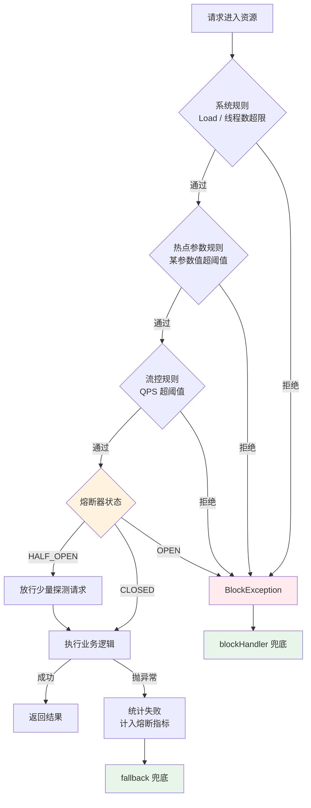
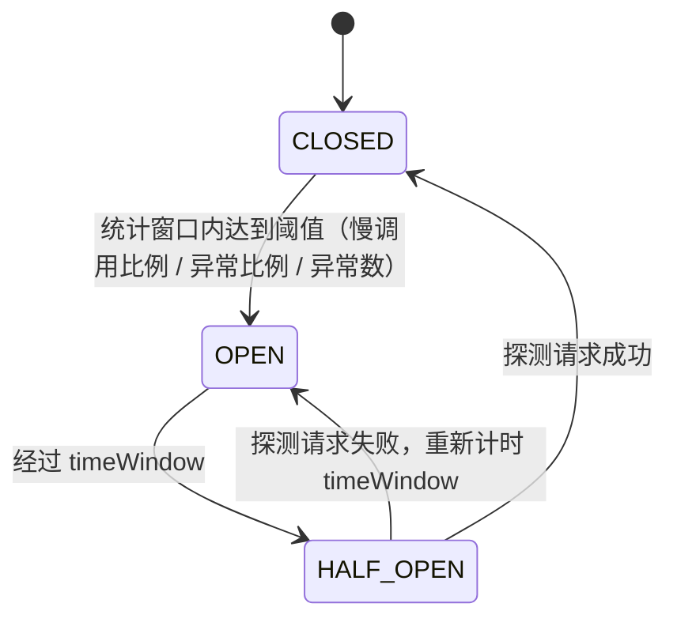

# Sentinel熔断降级与热点参数限流

## 课程目标

- 掌握慢调用比例、异常比例、异常数三种熔断策略的参数含义与配置差异
- 理解熔断状态机 CLOSED、OPEN、HALF_OPEN 的迁移条件与恢复过程
- 掌握 `@SentinelResource` 中 `blockHandler`、`fallback`、`defaultFallback`、`exceptionsToIgnore` 的分工
- 能够为商品详情与秒杀接口配置热点参数限流，并设置参数例外项
- 掌握系统自适应保护的五项指标与配置建议
- 完成 OpenFeign 与 Sentinel 的集成，验证下游故障时的降级响应

## 回顾与导入

上一课我们用流控规则给接口加了"入口闸门"：超过 QPS 就快速失败。但闸门只解决"进来太多"，解决不了"下游已经坏了"。

设想图书服务的数据库连接池被打满，每次查询从 20ms 变成 3s。此时 QPS 可能只有 30，远低于设好的 200 阈值，限流一条都不会触发，订单服务的线程却仍会被慢慢占满。所以：**只看流量大小不够，还要看调用的成功率和耗时**。

本课补齐后三种能力，目标只有一个：**当继续调用已经没有意义时，尽早停止调用并给出可接受的替代结果**。突发洪峰靠限流，下游变慢靠熔断加降级，单点商品被刷靠热点参数，整机负载过高靠系统自适应保护。

## 一、熔断在调用链中的位置

### 三个判定点

一次请求进入资源后，Sentinel 依次做系统、热点参数、流控、熔断判定，哪一步失败就由对应的兜底方法接管：`BlockException` 走 `blockHandler`，业务异常走 `fallback`。



熔断是判定，降级是动作。熔断器打开后请求不再进入业务逻辑，必须有降级结果顶上，否则用户拿到的仍然是异常，所以"规则 + 兜底方法"永远成对出现。

## 二、三种熔断策略

### 策略参数

三种策略共用一个 `DegradeRule` 结构，差异在 `grade` 与它解释的字段。

| 策略 | `grade` | `count` 的含义 | 关键参数 | 适用场景 |
| --- | --- | --- | --- | --- |
| 慢调用比例 | 0 | 慢调用判定阈值（毫秒） | `slowRatioThreshold` | 下游变慢但没报错 |
| 异常比例 | 1 | 异常占比阈值（0~1） | `minRequestAmount` | 下游大量抛异常 |
| 异常数 | 2 | 统计窗口内的异常个数 | `statIntervalMs` | 低频但严重的接口 |

其余参数三者含义一致：

| 参数 | 含义 | 默认值 |
| --- | --- | --- |
| `timeWindow` | 熔断时长（秒），OPEN 至少持续这么久 | 10 |
| `minRequestAmount` | 窗口内最小请求数，不足则不触发 | 5 |
| `statIntervalMs` | 统计窗口长度（毫秒） | 1000 |
| `slowRatioThreshold` | 慢调用比例阈值（0~1） | 1.0 |

> **注意：** Sentinel 1.7 的 RT 策略是"平均响应时间超阈值就熔断"，1.8 改为"慢调用比例"。迁移时不要照搬 `count` 值：原平均 RT 阈值现在表示"单次调用多慢算慢"。

以 `count=200`、`slowRatioThreshold=0.5`、`statIntervalMs=1000`、`minRequestAmount=10`、`timeWindow=10` 为例，含义是：最近 1 秒内至少有 10 个请求，且其中耗时超过 200ms 的比例达到 50%，就熔断 10 秒。

### 用代码下发熔断规则

```java
package com.example.product.config;

import com.alibaba.csp.sentinel.slots.block.degrade.DegradeRule;
import com.alibaba.csp.sentinel.slots.block.degrade.DegradeRuleManager;
import jakarta.annotation.PostConstruct;
import org.springframework.context.annotation.Configuration;

import java.util.List;

@Configuration
public class SentinelDegradeConfig {

    @PostConstruct
    public void initDegradeRules() {
        // 慢调用比例：>200ms 视为慢，比例达 50% 且样本 >=10 时熔断 10 秒
        DegradeRule slow = new DegradeRule("productDetail")
                .setGrade(0)
                .setCount(200)
                .setSlowRatioThreshold(0.5)
                .setMinRequestAmount(10)
                .setStatIntervalMs(1000)
                .setTimeWindow(10);

        // 异常比例：异常占比超过 30% 熔断 15 秒
        DegradeRule errorRatio = new DegradeRule("deductStock")
                .setGrade(1)
                .setCount(0.3)
                .setMinRequestAmount(5)
                .setStatIntervalMs(1000)
                .setTimeWindow(15);

        DegradeRuleManager.loadRules(List.of(slow, errorRatio));
    }
}
```

`DegradeRule` 的 setter 返回自身，可以链式书写。异常数策略把 `grade` 设为 2、`count` 设为窗口内异常个数即可，但必须保证 `minRequestAmount` 小于等于 `count`，否则规则永远无法触发。

## 三、熔断状态机

### 三个状态



- **CLOSED**：正常放行并持续统计，窗口内指标越过阈值立刻转 OPEN。
- **OPEN**：所有请求直接抛 `BlockException`，不进入业务逻辑，由 `blockHandler` 接管，至少持续 `timeWindow` 秒。
- **HALF_OPEN**：时间到后放行少量探测请求，全部成功则关闭熔断器，只要有一个失败就重回 OPEN 并重新计时。

### 恢复过程的两点实践含义

`timeWindow` 设得太短会导致"熔断—恢复—再熔断"的抖动：下游数据库恢复通常需要几十秒，10 秒窗口意味着熔断器很快又被打开，整体恢复反而更慢。

半开状态只放行少量请求，第一个探测请求往往来自真实用户。这要求降级结果必须是合法的业务返回值，不能是 null，否则异常会继续传导到前端。

> **提示：** 熔断器状态可在控制台"簇点链路"看到，OPEN 期间通过 QPS 降为 0、拒绝 QPS 上升。

## 四、@SentinelResource 的兜底方法体系

### 四种配置的区别

| 配置 | 处理什么 | 方法签名要求 | 优先级 | 典型用途 |
| --- | --- | --- | --- | --- |
| `blockHandler` | 仅 `BlockException` | 原参数 + `BlockException` | 最高 | 限流、熔断、热点被拒 |
| `fallback` | 业务异常（`Throwable`） | 原参数 + 可选 `Throwable` | 次之 | 单个资源的业务兜底 |
| `defaultFallback` | 业务异常（通用） | 空参或 `Throwable` | 最低 | 整个类的统一兜底 |
| `exceptionsToIgnore` | 不参与统计也不进 fallback | 异常类型数组 | 不适用 | 参数校验类异常 |

三条优先级规则：`BlockException` 永远只走 `blockHandler`，即使同时配了 `fallback`；`fallback` 存在时 `defaultFallback` 不生效；`exceptionsToIgnore` 中的异常会直接抛给上层，既不统计也不兜底。

### 完整代码

商品详情接口同时需要限流兜底与业务兜底，两类异常返回不同的错误码。

```java
package com.example.product.controller;

import com.alibaba.csp.sentinel.annotation.SentinelResource;
import com.alibaba.csp.sentinel.slots.block.BlockException;
import com.example.common.exception.ParamException;
import com.example.common.result.Result;
import com.example.common.result.ResultCode;
import com.example.product.dto.ProductDTO;
import com.example.product.service.ProductService;
import lombok.RequiredArgsConstructor;
import lombok.extern.slf4j.Slf4j;
import org.springframework.web.bind.annotation.GetMapping;
import org.springframework.web.bind.annotation.PathVariable;
import org.springframework.web.bind.annotation.RestController;

@Slf4j
@RestController
@RequiredArgsConstructor
public class ProductDetailController {

    private final ProductService productService;

    @GetMapping("/api/products/{id}")
    @SentinelResource(
            value = "productDetail",
            blockHandler = "detailBlockHandler",
            fallback = "detailFallback",
            defaultFallback = "defaultFallback",
            exceptionsToIgnore = ParamException.class)
    public Result<ProductDTO> detail(@PathVariable("id") Long id) {
        if (id == null || id <= 0) {
            throw new ParamException("商品ID非法");
        }
        return Result.success(productService.getById(id));
    }

    /** 被限流或熔断：返回可重试的业务码 */
    public Result<ProductDTO> detailBlockHandler(Long id, BlockException ex) {
        log.warn("资源被拦截 resource=productDetail id={} rule={}", id, ex.getRule());
        return Result.fail(ResultCode.FLOW_LIMITED);
    }

    /** 业务异常：返回降级结果，不让堆栈穿透到前端 */
    public Result<ProductDTO> detailFallback(Long id, Throwable ex) {
        log.error("业务降级 resource=productDetail id={}", id, ex);
        return Result.fail(ResultCode.REMOTE_CALL_FAILED);
    }

    /** 本类未单独配 fallback 的资源统一走这里 */
    public Result<ProductDTO> defaultFallback(Throwable ex) {
        log.error("默认降级", ex);
        return Result.fail(ResultCode.SYSTEM_ERROR);
    }
}
```

四个方法同在一个类里，`blockHandler` 与 `fallback` 用字符串引用方法名，重命名方法而忘了改注解是常见低级错误，改完务必跑一次限流验证。

> **注意：** `exceptionsToIgnore` 里的异常连 `fallback` 都不进。`ParamException` 是"用户传错参数"，应由全局异常处理器返回 400，让它进降级会被记成服务故障，污染熔断指标。

## 五、热点参数限流

### 为什么需要热点参数

限流规则作用于资源整体，看不到参数。秒杀场景里 `productId=1001` 被脚本刷到 5000 QPS，其他商品被一起拒绝，这就是"保护了系统却没有保护业务"。热点参数限流按参数值统计，可以为单个热点值设独立阈值。

| 字段 | 含义 | 说明 |
| --- | --- | --- |
| `resource` | 资源名 | 必须是 `@SentinelResource` 声明的资源 |
| `paramIdx` | 参数索引 | 从 0 开始 |
| `count` | 阈值 | 每个参数值允许的量 |
| `grade` | 阈值类型 | 目前仅支持 QPS |
| `durationInSec` | 统计窗口（秒） | 默认 1 |
| `paramFlowItemList` | 参数例外项 | 为特定值单独设阈值 |

例外项用 `object` 与 `classType` 描述具体值，适合"热门商品单独限流"这类需求。参数必须是基本类型、包装类型或 `String`，复杂对象需要自行实现取值逻辑。

### 秒杀接口实战

热点规则只接受简单类型参数，DTO 不能直接作为取值目标，因此把 `productId` 提为方法的第一个参数，`paramIdx=0` 就指向商品 ID。

```java
package com.example.order.controller;

import com.alibaba.csp.sentinel.annotation.SentinelResource;
import com.alibaba.csp.sentinel.slots.block.BlockException;
import com.example.common.result.Result;
import com.example.common.result.ResultCode;
import com.example.order.dto.SeckillRequest;
import com.example.order.service.SeckillService;
import lombok.RequiredArgsConstructor;
import lombok.extern.slf4j.Slf4j;
import org.springframework.web.bind.annotation.PostMapping;
import org.springframework.web.bind.annotation.RequestBody;
import org.springframework.web.bind.annotation.RequestParam;
import org.springframework.web.bind.annotation.RestController;

@Slf4j
@RestController
@RequiredArgsConstructor
public class SeckillController {

    private final SeckillService seckillService;

    /** 参数顺序决定 paramIdx：productId 是第 0 个参数 */
    @PostMapping("/api/seckill/orders")
    @SentinelResource(value = "seckillOrder", blockHandler = "seckillBlockHandler")
    public Result<String> create(@RequestParam("productId") Long productId,
                                 @RequestBody SeckillRequest request) {
        return Result.success(seckillService.create(productId, request));
    }

    public Result<String> seckillBlockHandler(Long productId, SeckillRequest request,
                                              BlockException ex) {
        log.warn("秒杀被拦截 productId={} userId={} rule={}",
                productId, request.getUserId(), ex.getRule());
        return Result.fail(ResultCode.FLOW_LIMITED);
    }
}
```

```java
package com.example.order.config;

import com.alibaba.csp.sentinel.slots.block.RuleConstant;
import com.alibaba.csp.sentinel.slots.block.flow.param.ParamFlowItem;
import com.alibaba.csp.sentinel.slots.block.flow.param.ParamFlowRule;
import com.alibaba.csp.sentinel.slots.block.flow.param.ParamFlowRuleManager;
import jakarta.annotation.PostConstruct;
import org.springframework.context.annotation.Configuration;

import java.util.List;

@Configuration
public class SentinelParamFlowConfig {

    @PostConstruct
    public void initParamFlowRules() {
        ParamFlowRule rule = new ParamFlowRule("seckillOrder")
                .setParamIdx(0)
                .setGrade(RuleConstant.FLOW_GRADE_QPS)
                .setCount(50)
                .setDurationInSec(1);

        // 例外项：热门商品 1001 只放行 5 QPS，其余商品 50 QPS
        ParamFlowItem hot = new ParamFlowItem()
                .setObject("1001")
                .setClassType(Long.class.getSimpleName())
                .setCount(5);
        rule.setParamFlowItemList(List.of(hot));

        ParamFlowRuleManager.loadRules(List.of(rule));
    }
}
```

`classType` 要写 `long` 或 `Long`，与 `object` 字符串的解析方式有关。写错类型不会报错，但例外项永远匹配不上，表现为"设了例外却没效果"。

> **提示：** 热点参数限流只作用于注解资源，URL 资源不采集参数。秒杀接口必须用 `@SentinelResource` 且参数出现在方法签名上。

## 六、系统自适应保护

### 五项指标

系统规则不看单个接口，而是从整机维度兜底，防止所有接口都"各自达标"却把机器压死。

| 指标 | 字段 | 含义 | 配置建议 |
| --- | --- | --- | --- |
| 入口 QPS | `qps` | 所有入口流量的总和 | 单机容量压测值的 70%~80% |
| 平均 RT | `avgRt` | 所有入口的平均响应时间（毫秒） | 正常值的 2~3 倍 |
| 线程数 | `maxThread` | 并发执行线程总数 | Tomcat 最大线程数的 80% |
| Load | `highestSystemLoad` | 系统 load1 | 核数 × 0.8 |
| CPU 使用率 | `highestCpuUsage` | 0~1 之间的比例 | 0.8 |

系统规则只保留最先触发的那条生效，多条同时配置时以最严格者为准。`highestSystemLoad` 依赖系统 load 值，**在 Windows 上不生效**，本地验证请改用 QPS 或线程数。

配置方式与前面的规则一致，用 `SystemRule` 的 `setQps`、`setMaxThread`、`setHighestCpuUsage` 等方法赋值后交给 `SystemRuleManager.loadRules`。系统规则的拦截资源名是 `sentinel_system` 这类内置名，为每个接口写兜底并不实际，更常见的做法是在入口过滤器里统一捕获 `BlockException` 并返回 503。

## 七、OpenFeign 集成 Sentinel

### 集成原理

`feign.sentinel.enabled=true` 后，每个 Feign 方法都生成一个以 `METHOD:URL` 命名的资源，例如 `GET:http://book-product/api/products/{id}`，服务间每次调用因此自动受规则保护。

```yaml
feign:
  sentinel:
    enabled: true

spring:
  cloud:
    sentinel:
      transport:
        dashboard: 127.0.0.1:8858
```

Spring Cloud Alibaba 2021 之后的版本该开关默认为 true，显式写出是为了避免版本组合导致行为不一致。

### 降级工厂

Feign 的 `fallbackFactory` 能拿到具体异常，比 `fallback` 更适合排查。

```java
package com.example.order.feign;

import com.example.common.result.Result;
import com.example.common.result.ResultCode;
import com.example.order.dto.ProductDTO;
import lombok.extern.slf4j.Slf4j;
import org.springframework.cloud.openfeign.FallbackFactory;
import org.springframework.stereotype.Component;

@Slf4j
@Component
public class ProductClientFallbackFactory implements FallbackFactory<ProductClient> {

    @Override
    public ProductClient create(Throwable cause) {
        return new ProductClient() {

            @Override
            public Result<ProductDTO> getById(Long id) {
                log.error("查询商品降级 id={}", id, cause);
                return Result.fail(ResultCode.REMOTE_CALL_FAILED);
            }

            @Override
            public Result<Void> deduct(StockChangeRequest request) {
                // 写操作不能静默降级为成功，必须让调用方感知失败
                log.error("扣减库存降级 productId={} requestId={}",
                        request.getProductId(), request.getRequestId(), cause);
                return Result.fail(ResultCode.REMOTE_CALL_FAILED);
            }
        };
    }
}
```

降级工厂必须是 Spring Bean，否则 Feign 启动时报找不到实例。

```java
@FeignClient(
        name = "book-product",
        path = "/api",
        contextId = "productClient",
        fallbackFactory = ProductClientFallbackFactory.class)
public interface ProductClient {

    @GetMapping("/products/{id}")
    Result<ProductDTO> getById(@PathVariable("id") Long id);

    @PostMapping("/stock/deduct")
    Result<Void> deduct(@RequestBody StockChangeRequest request);
}
```

### 验证下游故障

把图书服务的详情接口人为拖慢（例如在方法里 `Thread.sleep(3000)`），或直接停掉 8081，按顺序观察。

| 步骤 | 操作 | 预期结果 |
| --- | --- | --- |
| 1 | 停掉 book-product | 返回 2001，日志有 `Connection refused` |
| 2 | 注入 3s 延迟并持续压测 | 一开始返回 2001，随后熔断器打开，耗时降到接近 0 |
| 3 | 等待 `timeWindow` 后恢复下游 | 半开探测成功，恢复正常 |

降级生效后响应突然变快，因为请求根本没走到网络层。

> **注意：** 读接口可以降级为缓存或空对象，写接口绝不能降级成"成功"——扣减库存降级返回成功，等于凭空放行一次超卖。

## 注意事项

| 问题 | 表现 | 处理方式 |
| --- | --- | --- |
| 兜底方法找不到 | 抛 `Error: can not find method` | 检查 `public`、返回类型、参数列表 |
| 降级没生效 | 异常仍穿透到前端 | 确认未被 `exceptionsToIgnore` 排除 |
| 熔断不触发 | 拒绝 QPS 一直为 0 | `minRequestAmount` 是否大于实际请求数 |
| 热点规则无效 | 例外项不匹配 | `classType` 与 `object` 类型一致 |
| 系统 Load 规则无效 | Windows 下完全不触发 | 改用 QPS 或线程数指标 |
| Feign 降级不生效 | 仍抛 FeignException | 检查开关与工厂是否为 Bean |

- **降级方法不能吞掉所有异常。** `catch (Exception e) { return null; }` 会让问题变成"数据莫名其妙为空"，比报错更难查。
- **降级要有日志与告警。** 降级频繁说明下游有故障，只降级不告警等于把故障藏起来。
- **熔断时长要与恢复时间匹配。** 下游重启通常需要 30 秒以上，`timeWindow` 设 10 秒会反复熔断。
- **热点参数规则不支持复杂对象。** 参数是 DTO 时必须把关键字段提为独立参数，否则规则等于没配。

## 小结

本节课我们学习了：

1. **熔断的必要性**：QPS 正常但耗时暴涨时流控不会触发，必须靠成功率与耗时指标发现问题。
2. **三种熔断策略**：慢调用比例看耗时，异常比例看占比，异常数看数量；`count` 在三种策略下含义完全不同。
3. **状态机与恢复**：CLOSED 统计、OPEN 拒绝、HALF_OPEN 探测，`timeWindow` 决定恢复节奏。
4. **兜底方法体系**：`blockHandler` 只管 `BlockException`，`fallback` 管业务异常，`defaultFallback` 兜底全类，`exceptionsToIgnore` 把参数类异常排除在统计之外。
5. **热点参数限流**：按参数值维度设阈值，`paramIdx` 指向简单类型参数，例外项为热点值单独限流。
6. **系统自适应保护**：从 QPS、RT、线程数、Load、CPU 五个维度兜底整机，Load 规则在 Windows 上不生效。
7. **OpenFeign 集成**：开启开关后 Feign 方法自动成为资源，用 `fallbackFactory` 实现带异常信息的降级，写操作不得降级为成功。

## 作业

### 作业一：为详情接口配置熔断

1. 为 `productDetail` 配置慢调用比例规则：`count=200`、比例 0.5、最小请求数 10、熔断 10 秒。
2. 在 `ProductService` 中注入 300ms 延迟，压测并观察熔断器从 CLOSED 到 OPEN 的过程。
3. 记录熔断前后响应耗时的变化，对比控制台的通过 QPS 与拒绝 QPS 曲线。

### 作业二：区分四类兜底

1. 为同一资源同时配置 `blockHandler`、`fallback`、`defaultFallback` 与 `exceptionsToIgnore`。
2. 分别制造限流、业务异常、参数非法三种情况，记录实际进入的是哪个方法。
3. 说明为什么 `BlockException` 永远不走 `fallback`，以及去掉 `exceptionsToIgnore` 会污染哪个指标。

### 作业三：秒杀热点参数限流

1. 把 `productId` 提为接口第一个参数，配置 `paramIdx=0`、阈值 50 QPS。
2. 增加例外项：商品 1001 只允许 5 QPS，商品 1002 不允许任何流量。
3. 用两个不同 `productId` 并发压测验证互不影响，再停掉 `book-product` 验证 Feign 降级返回 `2001`。
