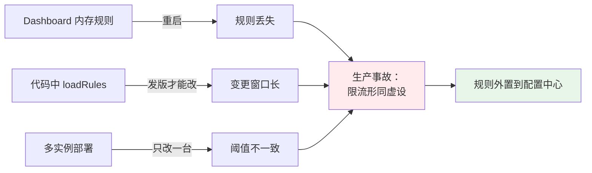
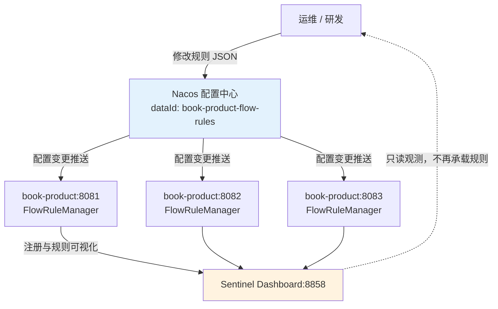
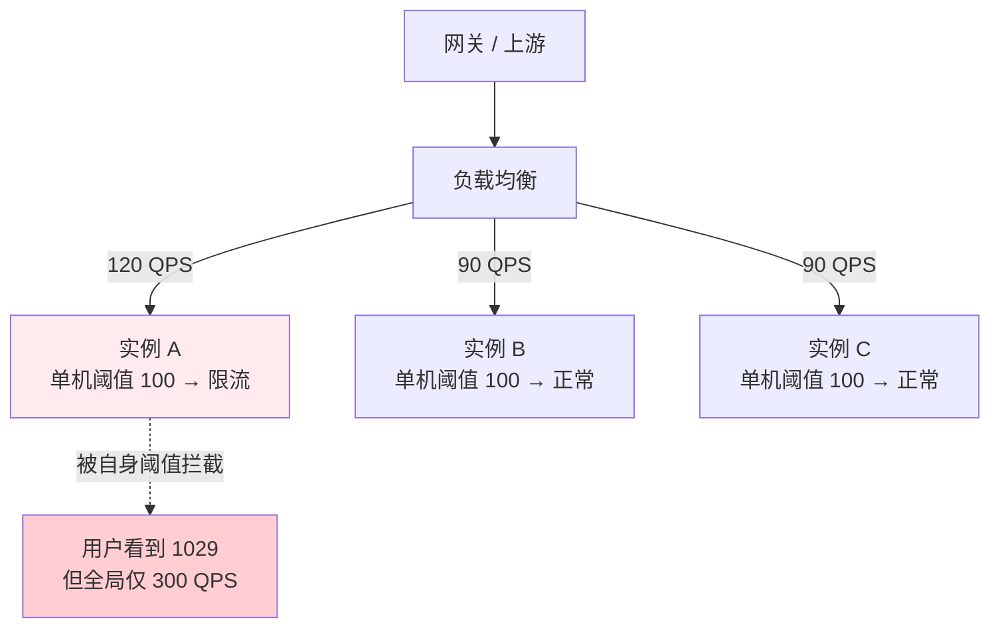

# Sentinel规则持久化与集群流控

## 课程目标

- 理解 Sentinel 默认规则存内存带来的两类生产问题：重启丢失、多实例不一致
- 掌握原始模式、Pull 模式、Push 模式的差异与推模式的生产优势
- 能够用 Nacos 完成流控、降级、热点、系统、授权五类规则的持久化
- 掌握规则 JSON 的字段格式与 `data-id`、`group-id` 的命名约定
- 能够验证规则推送后的动态生效，并用命名空间做版本与灰度隔离
- 掌握集群流控的两种部署形态与失败降级为单机限流的配置

## 回顾与导入

前两课我们把规则配进了 Dashboard，也写进了 `@PostConstruct`。两种方式都能让规则生效，但都不能让规则"活到下一次发布"：Dashboard 存在内存里，代码存在 Jar 包里。

| 场景 | 现象 | 后果 |
| --- | --- | --- |
| Dashboard 配置 | Dashboard 重启 | 规则全部消失，控制台空白 |
| 客户端重启 | `loadRules` 未执行或被覆盖 | 保护能力凭空消失 |
| 三个实例 | 只在 A 实例上改了规则 | B、C 仍按旧阈值运行 |
| 大促前调阈值 | 需要逐台操作或重新发版 | 变更窗口长，容易漏机器 |

规则是**运行时安全配置**，它的生命周期必须独立于应用进程。所以业界统一把它放进配置中心：应用启动时拉取，运行中监听变更，多实例天然一致。本课用 Nacos 做这件事，并在最后一节讨论单机规则永远解决不了的"全局阈值"问题。



## 一、三种规则管理模式

### 模式对比

Sentinel 官方文档把规则管理分为三种模式，差别在于"谁写规则、规则存在哪、客户端怎么拿到"。

| 模式 | 规则存放位置 | 客户端如何获取 | 优点 | 缺点 | 适用场景 |
| --- | --- | --- | --- | --- | --- |
| 原始模式 | 客户端内存 | 代码 `loadRules` 或 Dashboard 推送 | 简单，无外部依赖 | 重启丢失、多实例不一致 | 本地开发、临时验证 |
| Pull 模式 | 本地文件、数据库或配置中心 | 客户端定时轮询拉取 | 实现简单，减轻中心压力 | 变更生效有延迟，实时性差 | 规则极少变动的小系统 |
| Push 模式 | 配置中心（Nacos、ZooKeeper、Apollo） | 配置中心长连接推送 | 实时生效、多实例一致、可审计 | 依赖配置中心可用性 | 生产环境 |

### 推模式为什么是生产标准

推模式同时满足三个硬性要求：变更即时生效（秒级）、多实例强一致（同一次推送）、变更可追溯（配置中心有历史版本与操作人）。前两条保证"改了就按新的执行"，第三条保证"出事能查是谁改的、能一键回滚"。



这张图有一个关键变化：Dashboard 从"规则仓库"退化为"观测面板"。规则的真实来源是 Nacos，Dashboard 上看到的规则是客户端上报的运行时状态。**不要再用 Dashboard 直接改规则**，否则它只改到了某一台实例的内存，下次配置推送又会覆盖回去。

## 二、Nacos 持久化完整实现

### 引入依赖

`sentinel-datasource-nacos` 是规则数据源实现，starter 只提供自动装配，不会自动带上它。

```xml
<dependency>
    <groupId>com.alibaba.csp</groupId>
    <artifactId>sentinel-datasource-nacos</artifactId>
</dependency>
```

版本由 Spring Cloud Alibaba 的 BOM 决定，不要单独指定，否则容易与 `sentinel-core` 的版本错位，表现为控制台能连上但规则不生效。

### 配置数据源

每类规则一个数据源，命名（`ds1`、`ds2`）只是本地标识，真正决定规则类型的是 `rule-type`。

```yaml
server:
  port: 8081

spring:
  application:
    name: book-product
  cloud:
    nacos:
      server-addr: 127.0.0.1:8848
      username: nacos
      password: nacos
    sentinel:
      eager: true
      transport:
        dashboard: 127.0.0.1:8858
        port: 8719
      datasource:
        flow:
          nacos:
            server-addr: ${spring.cloud.nacos.server-addr}
            username: ${spring.cloud.nacos.username}
            password: ${spring.cloud.nacos.password}
            namespace: ${SENTINEL_NAMESPACE:public}
            group-id: SENTINEL_GROUP
            data-id: ${spring.application.name}-flow-rules
            data-type: json
            rule-type: flow
        degrade:
          nacos:
            server-addr: ${spring.cloud.nacos.server-addr}
            username: ${spring.cloud.nacos.username}
            password: ${spring.cloud.nacos.password}
            namespace: ${SENTINEL_NAMESPACE:public}
            group-id: SENTINEL_GROUP
            data-id: ${spring.application.name}-degrade-rules
            data-type: json
            rule-type: degrade
```

`data-type` 必须是 `json`，写成 `text` 会解析失败但只在 DEBUG 日志里提示；`rule-type` 决定解析成哪种子类，写错会把流控规则当成降级规则解析，结果是一条规则都没有。

### 命名约定

| 配置项 | 约定值 | 说明 |
| --- | --- | --- |
| `data-id` | `${应用名}-flow-rules` | 一类规则一个 dataId，便于单独回滚 |
| `data-id` | `${应用名}-degrade-rules` | 降级规则独立存放 |
| `group-id` | `SENTINEL_GROUP` | 与业务配置分开，避免误删 |
| `namespace` | `dev` / `test` / `prod` | 环境隔离的唯一手段 |
| `rule-type` | `flow`、`degrade`、`param-flow`、`system`、`authority` | 五类规则分别对应 |

把五类规则塞进同一个 dataId 是常见错误：`rule-type` 只能声明一种，多出来的规则会被静默丢弃。

### 规则 JSON 格式

流控规则与 `FlowRule` 的字段一一对应，数组形式表示多条规则。

```json
[
  {
    "resource": "productDetail",
    "limitApp": "default",
    "grade": 1,
    "count": 20,
    "strategy": 0,
    "controlBehavior": 0,
    "clusterMode": false
  },
  {
    "resource": "newArrivals",
    "limitApp": "default",
    "grade": 1,
    "count": 100,
    "strategy": 0,
    "controlBehavior": 1,
    "warmUpPeriodSec": 60,
    "clusterMode": false
  }
]
```

`grade` 中 1 表示 QPS、0 表示线程数；`strategy` 中 0 直接、1 关联、2 链路；`controlBehavior` 中 0 快速失败、1 预热、2 排队等待。字段名与 Java 属性完全一致，写错一个字母该条规则会被忽略，其余规则照常加载——这种"部分生效"最容易被误判为配置成功。

```json
[
  {
    "resource": "productDetail",
    "grade": 0,
    "count": 200,
    "timeWindow": 10,
    "minRequestAmount": 10,
    "statIntervalMs": 1000,
    "slowRatioThreshold": 0.5
  }
]
```

这是降级规则：`grade` 0 慢调用比例、1 异常比例、2 异常数。注意它与流控规则的 `grade` 含义完全不同，两份 JSON 不要互相复制。

```json
[
  { "resource": "seckillOrder", "paramIdx": 0, "count": 50, "grade": 1, "durationInSec": 1 }
]
```

```json
[
  { "highestSystemLoad": 5.0, "avgRt": 200, "maxThread": 200, "qps": 800, "highestCpuUsage": 0.8 }
]
```

```json
[
  { "resource": "productDetail", "limitApp": "app-a", "strategy": 0 }
]
```

后三段分别是热点参数、系统、授权规则。授权规则的 `strategy` 0 表示白名单、1 表示黑名单，`limitApp` 写调用方标识，由 `RequestOriginParser` 提供。

### @PostConstruct 的定位

数据源接管之后，`@PostConstruct` 不再是规则来源，而应退化为**本地兜底**：配置中心不可用时至少还有一套最低限度的保护。

```java
package com.example.product.config;

import com.alibaba.csp.sentinel.slots.block.RuleConstant;
import com.alibaba.csp.sentinel.slots.block.flow.FlowRule;
import com.alibaba.csp.sentinel.slots.block.flow.FlowRuleManager;
import jakarta.annotation.PostConstruct;
import lombok.extern.slf4j.Slf4j;
import org.springframework.context.annotation.Configuration;

import java.util.List;

@Slf4j
@Configuration
public class SentinelFallbackRuleConfig {

    /**
     * 仅在配置中心未下发任何规则时生效。
     * 数据源的监听会在规则到达后覆盖这里的规则。
     */
    @PostConstruct
    public void initFallbackRules() {
        if (!FlowRuleManager.getRules().isEmpty()) {
            return;
        }
        FlowRule rule = new FlowRule("productDetail")
                .setGrade(RuleConstant.FLOW_GRADE_QPS)
                .setCount(5);
        FlowRuleManager.loadRules(List.of(rule));
        log.warn("使用本地兜底流控规则，请检查 Nacos 数据源配置");
    }
}
```

关键在于先判断 `FlowRuleManager.getRules()` 是否为空。数据源的初始化顺序不保证在 `@PostConstruct` 之前，无条件 `loadRules` 会覆盖刚拉到的远端规则，形成"配置了却不生效"的假象。

> **注意：** 兜底阈值要明显低于正常阈值，它只是防止"完全没有保护"，不应成为长期配置。

### 控制台改造说明

Dashboard 默认把规则写进自己的内存。要变成"写 Nacos"，需要改造它的规则推送逻辑：把 `FlowControllerV2` 的 `FlowRuleProvider` 换成写 Nacos 的 `DynamicRuleProvider` 与 `DynamicRulePublisher`，并在 `application.properties` 中配置 `nacos.server-addr`、命名空间与 Group。

改造涉及编译 Dashboard 源码，工作量不小。多数团队的做法更简单：**规则只在 Nacos 控制台维护**，Dashboard 只用于观测。这样既避免维护私有分支，也符合"配置单一来源"的原则。

## 三、验证动态生效与规则治理

### 生效链路验证

| 步骤 | 操作 | 观察点 |
| --- | --- | --- |
| 1 | 在 Nacos 新建 dataId，内容为 `[]` | 客户端启动日志出现 `Loading flow rules` |
| 2 | 改成一条 QPS 2 的规则并发布 | 客户端日志出现 `flow rules changed`，控制台规则页同步 |
| 3 | 压测该资源 | 通过量被削到 2，超出部分返回 `1029` |
| 4 | 把 `count` 改为 50 并发布 | 压测通过量上升到 50，无需重启 |
| 5 | 删除该 dataId | 规则被清空，保护消失——这是最危险的操作 |

第五步值得单独强调：删除 dataId 等价于下发空数组，客户端会立刻失去所有规则，且不会有任何报错。生产环境的 `SENTINEL_GROUP` 必须收紧写权限。

### 版本管理与灰度

| 手段 | 做法 | 解决的问题 |
| --- | --- | --- |
| 命名空间隔离 | `dev`、`test`、`prod` 各一个 namespace | 环境之间彻底隔离，杜绝改错环境 |
| Group 分区 | 同一环境用 `SENTINEL_GROUP_BETA` 放灰度规则 | 小范围验证新阈值 |
| 配置历史 | 使用 Nacos 自带的版本对比与回滚 | 误改后秒级恢复 |
| 变更单 | 阈值调整附压测数据与影响面 | 避免拍脑袋改数 |
| 分批发布 | 先一台实例改 `namespace` 指向 | 验证后再全量 |

灰度验证的做法是：把一台实例的 `SENTINEL_NAMESPACE` 指向灰度命名空间，压测这台实例观察是否出现预期拦截与误杀，确认后再把规则合并到生产命名空间。

## 四、集群流控

### 单机阈值的局限

单机规则按实例计数，实例数增加时全局允许量线性放大。更麻烦的是流量分布不均：3 台实例、单机 100 QPS，某台因为长连接或网络问题接到 250 QPS，它自己先被限流，而全局总量还远没到 300。



集群流控把计数集中到一个 Token Server，由它按全局阈值统一发放令牌，每个请求消耗一个令牌。全局阈值因此与实例数解耦。

### 两种部署形态

| 形态 | Token Server 位置 | 优点 | 缺点 | 适用场景 |
| --- | --- | --- | --- | --- |
| Token Server 独立部署 | 单独进程 `sentinel-cluster-server` | 职责单一，重启不影响业务 | 多一个需要运维的组件 | 实例多、流量大的核心服务 |
| Embedded 嵌入模式 | 指定一个应用实例兼任 | 无需额外部署，接入快 | 该实例故障即失去集群限流 | 中小规模、可接受降级 |

两种模式的客户端代码一致，差别只在服务端的启动方式：独立模式用 `sentinel-cluster-server.jar` 启动并设置 `csp.sentinel.dashboard.server`；嵌入式模式在某个业务实例上设置 `-Dcsp.sentinel.app.type=1`，让它同时充当 Token Server。

### 集群流控配置

```java
package com.example.product.config;

import com.alibaba.csp.sentinel.cluster.ClusterStateManager;
import com.alibaba.csp.sentinel.cluster.client.config.ClusterClientConfig;
import com.alibaba.csp.sentinel.cluster.client.config.ClusterClientConfigManager;
import com.alibaba.csp.sentinel.slots.block.RuleConstant;
import com.alibaba.csp.sentinel.slots.block.flow.FlowRule;
import com.alibaba.csp.sentinel.slots.block.flow.FlowRuleManager;
import jakarta.annotation.PostConstruct;
import org.springframework.context.annotation.Configuration;

import java.util.List;

@Configuration
public class SentinelClusterFlowConfig {

    @PostConstruct
    public void initClusterRules() {
        // 客户端：令牌请求超时 200ms，超时后按失败策略处理
        ClusterClientConfig clientConfig = new ClusterClientConfig();
        clientConfig.setRequestTimeout(200);
        ClusterClientConfigManager.applyNewConfig(clientConfig);

        FlowRule rule = new FlowRule("productDetail")
                .setGrade(RuleConstant.FLOW_GRADE_QPS)
                .setCount(300);
        rule.setClusterMode(true);

        // 关键：Token Server 不可用时退化为单机限流，而不是全部放行
        rule.setClusterConfig(new com.alibaba.csp.sentinel.cluster.ClusterFlowConfig()
                .setFlowId(1001L)
                // thresholdType 0 为单机均摊（服务端按连接数换算全局总量），1 为全局阈值
                .setThresholdType(0)
                .setFallbackToLocalWhenFail(true)
                .setSampleCount(10)
                .setWindowIntervalMs(1000));

        FlowRuleManager.loadRules(List.of(rule));
        ClusterStateManager.applyState(ClusterStateManager.CLUSTER_CLIENT);
    }
}
```

`fallbackToLocalWhenFail` 必须为 true。Token Server 挂掉时如果直接放行，等于在系统最脆弱的时候取消了所有保护；退化为单机限流后，每个实例仍按 300 除以实例数附近的量级自我保护，损失可控。

`flowId` 要与服务端登记的 ID 一致，不一致时客户端拿到的是"无此规则"的响应，表现为限流完全不生效。

> **提示：** 集群限流适合"资源稀缺、必须全局精确"的场景，例如秒杀库存扣减、调用第三方付费接口。普通查询接口用单机限流即可，多一层 Token Server 只是增加故障点。

## 五、生产实践

### 阈值标定

阈值不能凭经验拍，也不能直接取压测峰值。推荐流程是：阶梯加压 → 找到 P99 达标的最大 QPS → 取 70%~80% 作为限流阈值。

| 步骤 | 做法 | 关注指标 |
| --- | --- | --- |
| 单机基线 | 单实例阶梯加压，每档稳定 5 分钟 | QPS、P99、错误率、CPU |
| 找拐点 | 逐步提高并发直到 P99 明显上翘 | P99 拐点对应的 QPS |
| 打折 | 拐点 QPS 取 70%~80% | 预留突发与抖动余量 |
| 全局换算 | 单机阈值 × 实例数，或改用集群限流 | 与网关总限流对齐 |
| 复核 | 线上观察一周，看拒绝 QPS 是否长期非零 | 拒绝量持续偏高说明阈值过低 |

网关、服务、数据库三层阈值要对齐：网关总限流不能大于所有实例单机阈值之和，否则请求会在服务层被拒，前端却以为是网关问题。

### 告警联动

规则只是手段，最终要落到"有人知道系统在被限流"。建议为每个资源建两条告警：拒绝 QPS 占比超过 5% 持续 5 分钟、熔断器连续两次进入 OPEN。

| 信号 | 数据来源 | 处置动作 |
| --- | --- | --- |
| 拒绝 QPS 突增 | Dashboard 监控或 Micrometer 指标 | 判断是攻击、热点还是阈值过低 |
| 熔断频繁打开 | 客户端日志中的 `BlockException` | 先看下游健康度，再决定是否调熔断参数 |
| 规则未加载 | 启动日志缺少 `Loading flow rules` | 检查 Nacos 地址、命名空间、权限 |
| Token Server 连接失败 | 客户端 `ClusterClientConfig` 相关日志 | 确认服务端存活，触发单机降级 |

### 大促预案

| 阶段 | 动作 | 目的 |
| --- | --- | --- |
| 提前一天 | 全链路压测，按 P99 标定阈值并写入 Nacos | 有数据支撑的阈值 |
| 提前半天 | 打开预热规则，冷启动实例逐步放量 | 避免 JIT 与连接池未热导致误熔断 |
| 活动开始 | 非核心接口切排队等待，核心接口保持快速失败 | 保核心、限边缘 |
| 流量峰值 | 降级开关打开，返回缓存或静态兜底 | 保住可用性 |
| 结束复盘 | 导出拒绝与熔断曲线，复核阈值 | 为下次活动积累基线 |

降级开关建议通过配置中心的布尔值控制，而不是临时改代码：开关切换要能在 10 秒内对所有实例生效，且事后能一键恢复。

## 注意事项

| 问题 | 原因 | 处理方式 |
| --- | --- | --- |
| 规则突然全部失效 | Nacos 中 dataId 被误删，等同下发空数组 | 收紧写权限，开启配置变更通知 |
| 本地规则覆盖远端 | `@PostConstruct` 无条件 `loadRules` | 先判断现有规则是否为空 |
| 只有部分实例生效 | 命名空间或 Group 配置不一致 | 统一用环境变量注入命名空间 |
| 规则写进同一个 dataId | `rule-type` 只能声明一种 | 五类规则分开存放 |
| 集群限流不生效 | `flowId` 与服务端不匹配 | 核对 ID 与阈值类型 |
| Token Server 单点 | 用了 Embedded 或未做高可用 | 独立部署多节点，或接受降级 |
| Dashboard 改了没保存 | Dashboard 只写内存 | 规则只在 Nacos 维护 |

- **版本要成套对齐。** Dashboard 1.8.8、`sentinel-datasource-nacos` 与客户端核心包必须同一主版本，混用会出现"能拉取但解析后为空"。
- **Push 模式的前提是配置中心高可用。** Nacos 挂掉时客户端保留最后一次规则，不会清空，但也不能再变更，所以 Nacos 本身也要集群部署。
- **变更前先备份 JSON。** 阈值类配置的误改会立刻生效，Nacos 的配置历史是唯一的一键回滚手段。
- **集群流控的收益要能算清。** 如果单机阈值的误差在可接受范围内，就不要引入 Token Server，额外组件的运维成本通常高于收益。

## 小结

本节课我们学习了：

1. **默认模式的缺陷**：规则存在内存或代码里，重启丢失、多实例不一致、变更需要发版。
2. **三种管理模式**：原始模式最简单但不持久，Pull 模式靠轮询牺牲实时性，Push 模式用配置中心推送实现实时与一致。
3. **Nacos 落地要点**：依赖 `sentinel-datasource-nacos`，每类规则一个 dataId，`data-type` 为 json，`rule-type` 决定解析类型。
4. **规则 JSON 格式**：五类规则各有字段名，流控与降级的 `grade` 含义不同，部分规则字段写错会被静默忽略。
5. **@PostConstruct 的新定位**：从规则来源退化为本地兜底，且必须先判空，避免覆盖远端规则。
6. **动态生效与治理**：改配置即生效，用命名空间隔离环境、用配置历史回滚、用变更单约束阈值调整。
7. **集群流控**：单机阈值乘以实例数不等于全局阈值，Token Server 统一发令牌，`fallbackToLocalWhenFail` 保证服务端故障时退化而不放行。
8. **生产实践**：阈值来自压测与 P99 拐点，配告警联动，大促按"预热—排队—降级开关"三步走。

## 作业

### 作业一：把五类规则迁到 Nacos

1. 在 `SENTINEL_GROUP` 下为 `book-product` 建五个 dataId，分别放流控、降级、热点、系统、授权规则。
2. 修改 `application.yml` 配置五个数据源，重启后确认启动日志出现规则加载记录。
3. 在 Nacos 修改 `count` 并发布，验证不重启即生效，记录从发布到生效的时间。

### 作业二：复现并修复"规则被覆盖"

1. 写一个无条件 `loadRules` 的 `@PostConstruct`，观察 Nacos 中的规则是否被覆盖。
2. 加入判空逻辑后再次验证，说明加载顺序为什么会造成这个现象。
3. 把兜底规则阈值设为正常值的十分之一，解释它为什么只能叫兜底。

### 作业三：设计一次大促预案

1. 按"阶梯加压 + P99 拐点"为 `productDetail` 标定阈值，写出压测表与结论。
2. 为秒杀接口设计集群限流方案，说明选择 Token Server 还是 Embedded 的理由。
3. 给出预热、排队等待、降级开关三项配置的具体数值与切换时机。
