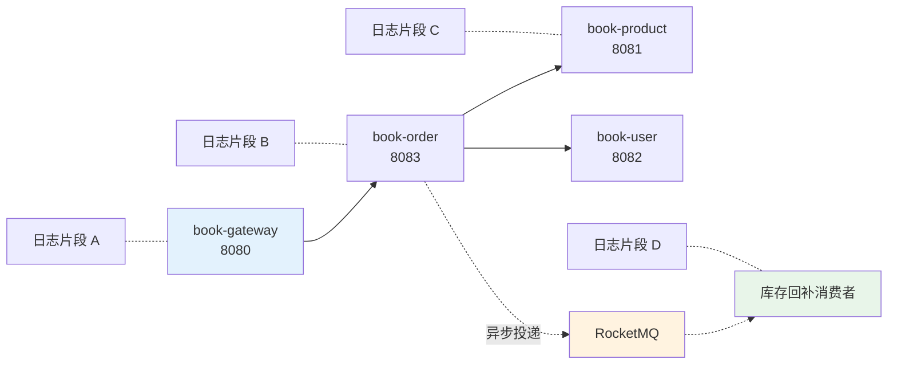
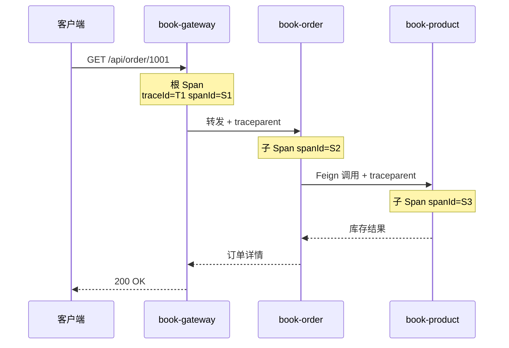
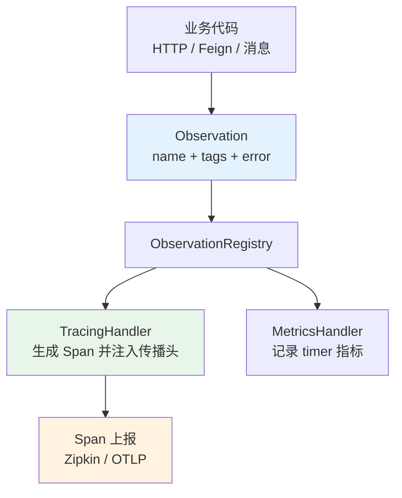

# Micrometer Tracing与链路追踪

## 课程目标

- 理解单机日志在跨服务、异步与消息场景下的断链问题，说清 traceId 的价值与局限
- 掌握 Micrometer Observation 的核心概念，以及它与 Sleuth 的替代关系
- 掌握追踪依赖组合与 `application.yml` 配置，理解采样概率与上报端点的含义
- 能够用 `logback-spring.xml` 在日志中输出 traceId 与 spanId，并验证效果
- 掌握 Feign、Gateway 的自动传播与 RocketMQ 的手工透传、消费端上下文恢复
- 能够部署 Zipkin，读懂 Span 树与错误标记
- 能够在 Brave 与 OpenTelemetry 之间选型，并控制采样成本

## 回顾与导入

第 46 到 48 课用 Sentinel 给系统装上了刹车：限流挡流量、熔断隔离依赖、规则持久化。刹车解决"别被打死"，没解决"出问题怎么查"。

现在系统里有四个服务、网关、配置中心、消息队列和事务协调器。用户下单失败，你在 book-order 看到"库存扣减失败"，再翻 book-product 的上万行日志，找不到对应那一行。日志没有共同标识，服务之间就对不上。

断裂也不止在进程边界：线程池任务、RocketMQ 的生产与消费，都会让"一次请求"碎成几段。



本课给"一次请求"发一张身份证：traceId，承载它的体系叫链路追踪（Distributed Tracing）。

## 为什么单机日志不够

### 三类断链场景

| 场景 | 日志表现 | 断在哪里 | 对策 |
| --- | --- | --- | --- |
| 跨服务调用 | 各服务各写各的 | 进程边界 | 请求头透传 traceId |
| 异步线程 | 线程池任务丢 traceId | ThreadLocal 上下文 | 上下文传播与线程装饰 |
| 消息队列 | 生产与消费两段无关 | 消息中间件 | 消息属性透传并在消费端恢复 |
| 网关转发 | 网关与后端日志无法对齐 | 反向代理层 | 网关侧自动注入追踪头 |
| 定时任务 | 批量任务产生并行日志 | 没有请求入口 | 为任务创建根 Span |

第三类最隐蔽：生产者在事务提交后发消息，消费者几秒后才处理，两段时间不重叠，仅凭时间和参数对不上。

### MDC 为什么传不过去

日志里的 traceId 通常来自 MDC（Mapped Diagnostic Context），底层是 `ThreadLocal`：同线程共享，跨线程即断；`@Async` 与自建线程池提交任务时不带过去；RocketMQ 消费线程与生产线程无关。所以"日志没有 traceId"九成不是配置写错，而是上下文没被传播。追踪框架负责的正是这件事：入口创建、出口注入、对端提取。

### traceId 的价值与局限

| 类别 | 说明 |
| --- | --- |
| 唯一索引 | 一次请求一个 traceId，把 N 个服务的日志收成一条时间线 |
| 拓扑还原 | 通过父子 Span 还原因果与调用方向 |
| 耗时定位 | 每个 Span 自带起止时间，算出时间花在哪一跳 |
| 故障归因 | 异常标记在对应 Span 上，快速收敛到出错服务 |
| 只是索引 | 它告诉你去哪看，不解释为什么，需结合指标与异常栈 |
| 采样会丢 | 头部采样未命中时，故障请求整条不在 |
| 看不到方法内部 | Span 内部耗时分布需方法级观测 |

> **结论：** traceId 解决"定位效率"，不解决"故障原因"。先建索引，再用指标与日志内容判断。

### 一次请求的 Span 树



同一 traceId 下 spanId 逐层不同，父子关系由 `parentId` 记录。Zipkin 里的树就是这张图的数据版本。

## Micrometer Observation 概念模型

### 三个核心对象

Spring Boot 3 不再使用 Sleuth，改用 Micrometer 的观测（Observation）API。三个对象解释了整条链路的数据来源：

| 对象 | 职责 | 案例系统中的体现 |
| --- | --- | --- |
| `Observation` | 描述一次被观测的操作 | 一次 HTTP 请求、一次 Feign 调用 |
| `ObservationRegistry` | 观测注册中心，持有处理器链 | 自动配置注入，全局单例 |
| `ObservationHandler` | 开始、结束、出错时执行动作 | 生成 Span、记录指标、输出日志 |



执行顺序是"开始通知 → 业务执行 → 结束或异常通知"。追踪与指标共用同一条观测链，引入 tracing 后 `/actuator/metrics` 的标签也更完整。

### 从 Sleuth 到 Micrometer Tracing

| 维度 | Spring Cloud Sleuth | Micrometer Tracing |
| --- | --- | --- |
| 所属体系 | Spring Cloud 独立项目 | Spring Boot 可观测性体系 |
| 维护状态 | 3.x 后停止演进 | 随 Spring Boot 主线维护 |
| 传播格式 | 默认 B3 | 默认 W3C `traceparent`，可切 B3 |
| 桥接实现 | Brave 内建 | brave 或 otel bridge |
| 日志字段 | traceId、spanId 入 MDC | 同样入 MDC，pattern 写法基本不变 |
| 迁移成本 | - | 换依赖、改包名、查自定义 Span |

> **注意：** 旧教程仍以 Sleuth 为例，依赖坐标与包名都对不上 Spring Boot 3.5。遇到"依赖能下、类找不到"，先看 import 来自哪个包。

观测是"面"，追踪是"点"：一次请求是一个 Observation，落到追踪体系变成 Span，多个 Span 用 traceId 串成 Trace。业务代码不直接操作 Span，只要入口都在观测范围内，数据自然完整。

## 依赖与配置

### 依赖组合

Actuator 提供运行支撑，bridge 把观测翻译成 Span，reporter 把 Span 送到 Zipkin。

```xml
<dependencies>
    <dependency>
        <groupId>org.springframework.boot</groupId>
        <artifactId>spring-boot-starter-actuator</artifactId>
    </dependency>
    <dependency>
        <groupId>io.micrometer</groupId>
        <artifactId>micrometer-tracing-bridge-brave</artifactId>
    </dependency>
    <dependency>
        <groupId>io.zipkin.reporter2</groupId>
        <artifactId>zipkin-reporter-brave</artifactId>
    </dependency>
</dependencies>
```

版本由 `spring-boot-dependencies` 管理，不写 `<version>`。改造成 OTel 只需换取 bridge 与 reporter 两个坐标。建议放在 `book-common` 的 `<dependencies>` 里，让四个服务一次到位。

### application.yml

```yaml
spring:
  application:
    name: book-order

management:
  tracing:
    enabled: true
    sampling:
      probability: 1.0
  zipkin:
    tracing:
      endpoint: http://127.0.0.1:9411/api/v2/spans
  endpoints:
    web:
      exposure:
        include: health,info,metrics,prometheus
```

| 配置项 | 含义 | 建议 |
| --- | --- | --- |
| `management.tracing.enabled` | 追踪总开关 | 全环境 `true` |
| `management.tracing.sampling.probability` | 头部采样概率 | 本地 1.0，生产 0.05 到 0.2 |
| `management.zipkin.tracing.endpoint` | 上报地址 | 指向 `/api/v2/spans` |
| `management.endpoints.web.exposure.include` | 暴露的端点 | 只暴露必要项 |

> **提示：** 采样概率为 0 时链路不上报，但 MDC 里的 traceId 仍在，适合"只要日志关联、不承担存储成本"的场景。

生产采样率按 QPS 与存储容量定：常规流量 5% 到 20%，核心链路（下单、支付）单独提到 1.0，再用指标告警兜底。采样是入口处的"掷骰子"，不采就整条不在。

## 日志中输出 traceId 与 spanId

### logback-spring.xml 完整片段

追踪数据只在 Zipkin 里看到还不够，日常排查主要在日志平台。下面这份配置把 traceId 与 spanId 拼进每一行：

```xml
<?xml version="1.0" encoding="UTF-8"?>
<configuration>

    <springProperty scope="context" name="APP_NAME" source="spring.application.name" defaultValue="unknown"/>
    <property name="LOG_HOME" value="${LOG_HOME:-logs}"/>
    <property name="LOG_PATTERN"
              value="%d{yyyy-MM-dd HH:mm:ss.SSS} %-5level [${APP_NAME},%X{traceId:-},%X{spanId:-}] [%thread] %logger{40} - %msg%n"/>

    <appender name="CONSOLE" class="ch.qos.logback.core.ConsoleAppender">
        <encoder>
            <pattern>${LOG_PATTERN}</pattern>
            <charset>UTF-8</charset>
        </encoder>
    </appender>

    <appender name="FILE" class="ch.qos.logback.core.rolling.RollingFileAppender">
        <file>${LOG_HOME}/${APP_NAME}.log</file>
        <rollingPolicy class="ch.qos.logback.core.rolling.SizeAndTimeBasedRollingPolicy">
            <fileNamePattern>${LOG_HOME}/${APP_NAME}-%d{yyyy-MM-dd}.%i.log.gz</fileNamePattern>
            <maxFileSize>100MB</maxFileSize>
            <maxHistory>15</maxHistory>
            <totalSizeCap>10GB</totalSizeCap>
        </rollingPolicy>
        <encoder>
            <pattern>${LOG_PATTERN}</pattern>
            <charset>UTF-8</charset>
        </encoder>
    </appender>

    <root level="INFO">
        <appender-ref ref="CONSOLE"/>
        <appender-ref ref="FILE"/>
    </root>

    <logger name="com.example" level="DEBUG"/>
</configuration>
```

关键只有一处：`%X{traceId:-}` 与 `%X{spanId:-}`。`%X` 取 MDC 值，`:-` 表示取不到时输出空串，避免出现 `traceId_IS_UNDEFINED`。

> **注意：** 不要在代码里手工 `MDC.put("traceId", ...)`。框架通过作用域装饰器写入，手工写会覆盖成空。

### 验证 MDC 是否生效

启动 book-order，访问一个会产生下游调用的接口：

```text
2026-11-10 10:21:33.412 INFO  [book-order,6f1c2a9d3b7e4f10,9a2c4d1e] [http-nio-8083-exec-3] c.e.order.controller.OrderController - 开始创建订单
2026-11-10 10:21:33.560 INFO  [book-order,6f1c2a9d3b7e4f10,7b3e5a2c] [http-nio-8083-exec-3] c.e.order.client.ProductClient - 校验库存完成
```

依次是服务名、同一 traceId、不同 spanId，spanId 变化说明 Feign 另开了子 Span。再去 book-product 搜同一个 traceId，能搜到就说明跨进程传播正常。排查"哪一跳丢了上下文"时，手工构造 `traceparent` 最快：直接给某个服务发请求，看它记录的 traceId 是不是你给的那一个。

```bash
curl -s -H "traceparent: 00-6f1c2a9d3b7e4f109a2c4d1e5f607182-9a2c4d1e5f607182-01" \
  http://127.0.0.1:8081/api/product/1
```

## 跨进程传播

### Feign 与 Gateway 自动透传

Micrometer 会观测 Feign 客户端，把当前上下文写入请求头，默认 W3C 格式：

```text
traceparent: 00-6f1c2a9d3b7e4f109a2c4d1e5f607182-9a2c4d1e5f607182-01
```

服务端由 MVC 或 WebFlux 的观测过滤器提取并写入 MDC，链路就接上了。只需检查两点：自定义 `RequestInterceptor` 不要覆盖 `traceparent`、`b3`；不要关闭 `spring.cloud.openfeign.micrometer.enabled`。

book-gateway 基于 WebFlux 与 Reactor Netty，转发客户端同样接入观测，这一跳通常不用写代码。要防的是"自己加的东西弄丢上下文"：在全局过滤器里重建请求、自己用 `WebClient` 转发、在过滤器内切线程，都可能断链。自查方法是比对网关与下游日志的 traceId。

### RocketMQ 手工透传

消息没有 HTTP 头，需要用用户属性（user property）承载传播字段。生产端在发送前注入当前上下文，复用框架自动配置的传播器，不自己拼字符串：

```java
package com.example.order.mq;

import io.micrometer.tracing.Span;
import io.micrometer.tracing.Tracer;
import io.micrometer.tracing.propagation.Propagator;
import lombok.RequiredArgsConstructor;
import org.apache.rocketmq.common.message.Message;
import org.springframework.stereotype.Component;

@Component
@RequiredArgsConstructor
public class TraceMessageInjector {

    private final Tracer tracer;
    private final Propagator propagator;

    public void inject(Message message) {
        Span span = tracer.currentSpan();
        if (span == null) {
            return;
        }
        propagator.inject(span.context(), (carrier, key, value) -> message.putUserProperty(key, value));
    }
}
```

调用处只需在建好消息后插一行：

```java
Message message = new Message("book-order-topic", "PAID", orderId.getBytes(StandardCharsets.UTF_8));
traceMessageInjector.inject(message);
rocketMQTemplate.getProducer().send(message);
```

消费端从消息属性提取上下文，在恢复的上下文里执行业务，最后关闭 Span：

```java
package com.example.order.mq;

import io.micrometer.tracing.Span;
import io.micrometer.tracing.Tracer;
import io.micrometer.tracing.propagation.Propagator;
import lombok.RequiredArgsConstructor;
import lombok.extern.slf4j.Slf4j;
import org.apache.rocketmq.common.message.MessageExt;
import org.apache.rocketmq.spring.annotation.RocketMQMessageListener;
import org.apache.rocketmq.spring.core.RocketMQListener;
import org.springframework.stereotype.Component;

import java.nio.charset.StandardCharsets;

@Slf4j
@Component
@RequiredArgsConstructor
@RocketMQMessageListener(topic = "book-order-topic", selectorExpression = "PAID",
        consumerGroup = "book-order-paid-consumer")
public class OrderPaidConsumer implements RocketMQListener<MessageExt> {

    private final Tracer tracer;
    private final Propagator propagator;
    private final StockRestoreService stockRestoreService;

    @Override
    public void onMessage(MessageExt message) {
        Span span = startConsumerSpan(message);
        try (Tracer.SpanInScope scope = tracer.withSpan(span)) {
            String orderId = new String(message.getBody(), StandardCharsets.UTF_8);
            log.info("收到支付成功消息, orderId={}, msgId={}", orderId, message.getMsgId());
            stockRestoreService.restore(orderId);
        } catch (RuntimeException ex) {
            span.error(ex);
            throw ex;
        } finally {
            span.end();
        }
    }

    private Span startConsumerSpan(MessageExt message) {
        Span.Builder builder = tracer.spanBuilder().name("rocketmq consume " + message.getTopic());
        var context = propagator.extract((carrier, key) -> carrier.getUserProperty(key)).getOrElse(null);
        if (context != null) {
            builder.setParent(context);
        }
        return builder.start();
    }
}
```

`tracer.withSpan(span)` 打开作用域时触发日志装饰器，MDC 被填充，业务日志自动带 traceId，不需要手工 `MDC.put`。`propagator.extract` 的入参是 `TextMap` 适配器，本质是"给 key 返回 value"的函数。取不到上下文时退回新的根 Span，保证消费逻辑不因缺追踪头失败。

> **提示：** 若注入到的类型是 `TextMapPropagator`，把字段类型改成它即可。消息用户属性不要用 `KEYS`、`TAGS`、`WAIT` 等系统属性名，否则发送时报错。

### 异步线程的上下文恢复

线程池任务与消息消费是同类问题：取出上下文，在新线程里恢复。Spring 管理的 `ThreadPoolTaskExecutor` 只需挂一个 `ContextPropagatingTaskDecorator`，自建线程池则要包装 `Runnable` 或在提交前手工恢复，否则任务里的日志一定没有 traceId。

## Zipkin 部署与界面解读

### 部署

```bash
docker run -d --name zipkin \
  -p 9411:9411 \
  -e STORAGE_TYPE=mem \
  -e JAVA_OPTS="-Xms256m -Xmx512m" \
  openzipkin/zipkin:3
```

内存存储重启即清空，只适合本地与联调。生产把 `STORAGE_TYPE` 换成 `elasticsearch` 并配置 `ES_HOSTS`，保存天数按排障窗口定，常见 3 到 7 天。启动后访问 `http://127.0.0.1:9411`，选服务名 `book-order` 后 `RUN QUERY`。

### 界面解读

| 区域 | 内容 | 怎么用 |
| --- | --- | --- |
| 查询区 | 服务名、Span 名、时间范围、耗时下限 | 查慢请求时把耗时下限设为 P99 |
| 追踪列表 | 入口、总耗时、Span 数、时间 | 按时间倒序看最近一次故障 |
| Span 树 | 服务与操作的分层结构 | 判断调用方向与嵌套层级 |
| 耗时条 | 每个 Span 在总时间轴上的位置 | 分辨"自己慢"还是"下游慢" |
| 详情面板 | 标签、日志、异常、请求头 | 看 `error` 标签与异常栈 |
| 依赖图 | 服务间调用关系 | 评审架构时核对依赖方向 |

三个常用判断：自身耗时等于 Span 总耗时减去子 Span 之和，子 Span 占大头说明问题在下游；红色条目说明打上了 `error=true`，直接指向出错服务；父 Span 早于子 Span 结束，通常是客户端超时先结束、服务端仍在处理。

| 现象 | 可能原因 | 处理 |
| --- | --- | --- |
| 只有网关一个 Span | 下游没引依赖或没开观测 | 检查依赖与 `management.tracing.enabled` |
| 每个服务一个 traceId | 传播头被覆盖或丢失 | 检查拦截器与自定义转发代码 |
| 消费端链路断开 | 未透传消息属性 | 注入用户属性并在消费端提取 |
| 时间轴错位 | 机器时钟不一致 | 全集群启用 NTP |

## 选型：Brave 还是 OpenTelemetry

| 维度 | Brave | OpenTelemetry |
| --- | --- | --- |
| 成熟度 | 老牌实现，Spring 集成久 | 云原生标准，社区扩张快 |
| 传播格式 | 默认 W3C，可切 B3 | 默认 W3C |
| 后端兼容 | Zipkin、Jaeger 均可 | OTLP 原生，Zipkin 需额外 exporter |
| 资源开销 | 轻，适合纯 Spring 体系 | 略高，但支持批量与更多处理器 |
| 迁移成本 | 从 Sleuth 迁移最省事 | 需重配 exporter 与资源属性 |
| 适用场景 | 已有 Zipkin、单 JVM 技术栈 | 多语言混布、已建 Collector |

> **结论：** 本课程用 Brave 是为了把注意力放在"上下文怎么传"。一旦出现非 JVM 服务或已有 Collector 收口，就应切到 OTel，改的是依赖与上报配置，业务代码几乎不动。

## 采样策略与成本控制

| 策略 | 做法 | 优点 | 缺点 | 适用场景 |
| --- | --- | --- | --- | --- |
| 头部概率采样 | `probability: 0.1` | 简单、开销低 | 错误请求可能被丢 | 常规业务 |
| 固定速率采样 | 按每秒 N 条限流 | 成本上限可控 | 流量突增覆盖率下降 | 高 QPS 服务 |
| 按链路采样 | 核心 URI 设 1.0 | 关键链路全量 | 需按路径分别配置 | 下单、支付 |
| 尾部采样 | Collector 按报错或慢请求决定 | 错误必留，成本最优 | 需集中式 Collector | 已建可观测平台 |

成本由三部分构成：Span 数量乘单条体积决定网络与写入量，保存天数决定磁盘，查询并发决定检索资源。稳妥做法是先用 10% 采样跑一周，量出日数据量与查询体验，再决定调采样率还是换存储方案。

> **注意：** 提高采样率永远比事后排查便宜，但全量只应作为临时手段，观察期结束要调回，否则成本随 QPS 线性增长。

## 注意事项

1. **不要手工写 MDC**：框架会写，手工写会覆盖成空，日志出现"有字段但为空"。
2. **传播头不能被整体替换**：自定义拦截器加鉴权头没问题，但不要重建 header 集合。
3. **`%X{traceId:-}` 的默认值不能省**：否则无上下文时出现 `traceId_IS_UNDEFINED`。
4. **RocketMQ 用户属性有命名限制**：避开系统属性名，否则发送阶段就报错。
5. **采样率 0 不等于关闭追踪**：MDC 仍工作，适合只要日志关联、不要存储的场景。
6. **生产不要用内存存储的 Zipkin**：重启丢数据且无容量保护。
7. **时钟必须同步**：节点未开 NTP 会导致 Span 时间倒挂，结论完全错。

## 小结

本节课我们学习了：

1. **三类断链场景**：跨服务、异步线程、消息队列，本质都是上下文没有跨边界传播。
2. **traceId 的价值与局限**：最有效的日志索引，但不解释原因，需与指标、异常信息配合。
3. **Observation 模型**：Observation 描述操作，Registry 管理处理器，Handler 生成 Span 与指标。
4. **依赖与配置**：Actuator 加 bridge 加 reporter，配合采样概率与上报端点。
5. **日志关联**：用 `%X{traceId:-}`、`%X{spanId:-}` 把上下文写进每行日志。
6. **跨进程传播**：Feign 与 Gateway 自动完成，RocketMQ 需注入用户属性并在消费端提取。
7. **Zipkin 与选型**：读懂 Span 树、耗时分解与错误标记，按技术栈在 Brave 与 OTel 之间取舍。

## 作业

### 作业一：把四个服务接入链路追踪

1. 在 `book-common` 添加三个追踪依赖，确认四个服务都能启动并通过 `/actuator/health`。
2. 为每个服务增加 `logback-spring.xml`，输出 traceId 与 spanId，重启后确认启动日志格式正确。
3. 用 `docker run` 启动 Zipkin，从网关发起一次下单请求，记录 Span 树的服务层级与每一跳耗时。

### 作业二：补齐消息链路的上下文

1. 按本课代码实现 `TraceMessageInjector` 与消费端 Span 恢复，验证生产与消费日志的 traceId 一致。
2. 注释掉生产端的注入逻辑，观察消费端行为，用一段话说明为什么"消费端会退化成根 Span"。
3. 把采样概率改成 0.1，连续发起 20 次请求，统计被采样比例并解释偏差来源。
