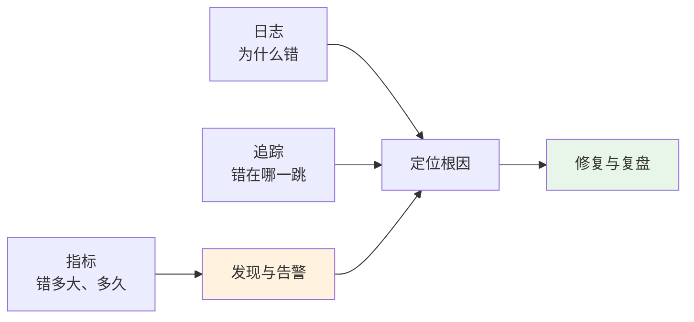
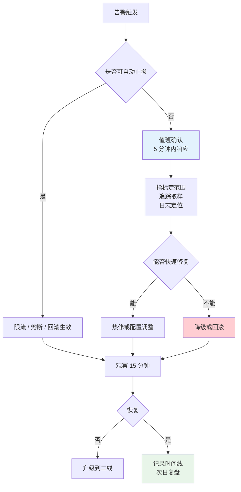

# 日志关联、指标监控与告警

## 课程目标

- 理解日志、指标、追踪三者的分工，能够判断一次故障该先看哪一类数据
- 掌握结构化日志的落地方式：JSON encoder 配置、字段约定与检索侧的查询写法
- 掌握日志落盘与治理策略：分级、异步 Appender、脱敏
- 掌握 Actuator 的端点暴露与安全加固，知道哪些端点绝不能上生产
- 掌握 Micrometer 与 Prometheus 的接入方式，能读懂关键指标并设计黄金信号面板
- 能够编写 PromQL 告警规则，按 P0 到 P3 分级并配套值班流程
- 理解指标基数与存储成本的来源，能够在上线前做容量估算

## 回顾与导入

上一课解决了"串起来"：一次请求有了 traceId，跨服务、跨消息都能连成一条链路。但串起来只是第一步，接下来三个问题会立刻出现。

第一，日志还是人肉看的。时间、服务、级别、traceId 混在一行文本里，平台只能全文检索，想统计"哪个接口错得最多"几乎做不到。

第二，系统是死是活没人知道。日志只在有人翻的时候才有价值，而流量突增、内存打满、连接池耗尽，需要在用户投诉之前被发现。

第三，发现了也没人叫醒你。指标画在面板上，如果没人盯着屏幕，它和不存在没有区别。



三者的分工可以概括为：指标负责"发现"，追踪负责"定位"，日志负责"解释"。本课把后两条腿补齐，并把"发现"接到告警上。

## 结构化日志

### 为什么要 JSON

文本日志适合人读，机器读着痛苦。JSON 把字段独立出来，平台能按字段过滤、聚合、排序，也能让 traceId 成为可点击的关联入口。

| 字段 | 类型 | 说明 | 是否必填 |
| --- | --- | --- | --- |
| `time` | 时间戳 | ISO-8601 或毫秒，全站统一 | 必填 |
| `level` | 字符串 | 大写级别，便于过滤 | 必填 |
| `service` | 字符串 | `spring.application.name`，不要用主机名 | 必填 |
| `traceId` | 字符串 | 取自 MDC，无上下文时为空 | 必填 |
| `spanId` | 字符串 | 取自 MDC | 必填 |
| `userId` | 字符串 | 业务上下文，由拦截器写入 MDC | 选填 |
| `logger` | 字符串 | 日志来源类名 | 必填 |
| `thread` | 字符串 | 线程名，排查线程池问题靠它 | 必填 |
| `message` | 字符串 | 结构化后的消息正文 | 必填 |
| `stack_trace` | 字符串 | 异常栈，仅异常日志有 | 选填 |

字段名一旦定下就不要改。面板、告警规则、检索语句都建立在这套字段上，改名等于让历史数据失效。

### logback JSON encoder 配置

引入 `logstash-logback-encoder`，把输出从 pattern 换成 JSON：

```xml
<dependency>
    <groupId>net.logstash.logback</groupId>
    <artifactId>logstash-logback-encoder</artifactId>
    <version>8.0</version>
</dependency>
```

```xml
<?xml version="1.0" encoding="UTF-8"?>
<configuration>

    <springProperty scope="context" name="APP_NAME" source="spring.application.name" defaultValue="unknown"/>
    <property name="LOG_HOME" value="${LOG_HOME:-logs}"/>

    <appender name="JSON_FILE" class="ch.qos.logback.core.rolling.RollingFileAppender">
        <file>${LOG_HOME}/${APP_NAME}.json</file>
        <rollingPolicy class="ch.qos.logback.core.rolling.SizeAndTimeBasedRollingPolicy">
            <fileNamePattern>${LOG_HOME}/${APP_NAME}-%d{yyyy-MM-dd}.%i.json.gz</fileNamePattern>
            <maxFileSize>200MB</maxFileSize>
            <maxHistory>7</maxHistory>
            <totalSizeCap>20GB</totalSizeCap>
        </rollingPolicy>
        <encoder class="net.logstash.logback.encoder.LogstashEncoder">
            <timeZone>Asia/Shanghai</timeZone>
            <customFields>{"service":"${APP_NAME}"}</customFields>
            <includeMdcKeyName>traceId</includeMdcKeyName>
            <includeMdcKeyName>spanId</includeMdcKeyName>
            <includeMdcKeyName>userId</includeMdcKeyName>
            <fieldNames>
                <timestamp>time</timestamp>
                <message>message</message>
                <logger>logger</logger>
                <thread>thread</thread>
                <level>level</level>
                <stackTrace>stack_trace</stackTrace>
            </fieldNames>
        </encoder>
    </appender>

    <appender name="CONSOLE" class="ch.qos.logback.core.ConsoleAppender">
        <encoder>
            <pattern>%d{HH:mm:ss.SSS} %-5level [${APP_NAME},%X{traceId:-}] %logger{36} - %msg%n</pattern>
        </encoder>
    </appender>

    <root level="INFO">
        <appender-ref ref="CONSOLE"/>
        <appender-ref ref="JSON_FILE"/>
    </root>
</configuration>
```

两个 appender 是刻意的：控制台保留人读的短格式，文件输出 JSON 供采集器抓取。`includeMdcKeyName` 只放需要的字段，MDC 其他内容不要全量带入。

输出效果：

```json
{"time":"2026-11-10T10:21:33.412+08:00","level":"INFO","service":"book-order","traceId":"6f1c2a9d3b7e4f10","spanId":"9a2c4d1e","thread":"http-nio-8083-exec-3","logger":"c.e.order.controller.OrderController","message":"创建订单成功, orderId=1001"}
```

> **提示：** `userId` 等业务字段通过拦截器写入 MDC，请求结束时务必 `MDC.remove`，线程池复用会把上一位用户的 id 带到下一位用户的日志里。

### 日志分级与落盘策略

| 级别 | 使用场景 | 生产建议 |
| --- | --- | --- |
| ERROR | 影响业务的失败：调用失败、数据不一致 | 必须告警，数量应当是每日个位数 |
| WARN | 可自愈的异常：重试成功、降级生效 | 关注趋势，突增说明下游不稳 |
| INFO | 关键状态流转：下单、支付、状态变更 | 保留，是排查主要依据 |
| DEBUG | 参数与中间结果 | 默认关闭，按需动态开启 |
| TRACE | 框架级细节 | 不用于生产 |

| 日志类型 | 保存时长 | 存储介质 | 说明 |
| --- | --- | --- | --- |
| 访问日志 | 7 天 | 日志平台 | 量大，价值集中在近期 |
| 业务日志 | 30 天 | 日志平台 | 对账与客诉需要回溯 |
| 错误日志 | 90 天 | 冷存储 | 复发问题需要长窗口 |
| 审计日志 | 按合规要求 | 独立库 | 不可与业务日志混放 |

### 异步 Appender

同步写盘会阻塞业务线程，磁盘抖动时接口 RT 会跟着抖。用 `AsyncAppender` 把写日志放到独立线程：

```xml
<appender name="ASYNC_JSON" class="ch.qos.logback.classic.AsyncAppender">
    <queueSize>8192</queueSize>
    <discardingThreshold>0</discardingThreshold>
    <neverBlock>true</neverBlock>
    <includeCallerData>false</includeCallerData>
    <appender-ref ref="JSON_FILE"/>
</appender>

<root level="INFO">
    <appender-ref ref="CONSOLE"/>
    <appender-ref ref="ASYNC_JSON"/>
</root>
```

`discardingThreshold=0` 表示队列满之前不丢 INFO，`neverBlock=true` 表示满了直接丢而不阻塞业务线程。两项合起来就是"宁可丢日志，不拖垮接口"。

### 敏感信息脱敏

| 敏感项 | 示例 | 处理方式 |
| --- | --- | --- |
| 手机号 | 138****8888 | 中间四位掩码 |
| 身份证 | 前 6 后 4 保留 | 掩码 |
| 银行卡 | 仅保留后 4 位 | 掩码 |
| 密码与令牌 | 一律不打印 | 直接删除字段 |
| 地址 | 仅保留到区县 | 截断 |

统一在 encoder 层做，比在每个 `log.info` 里手工处理可靠：有人忘记就漏一条。可用自定义 `JsonProvider` 或 `MaskingJsonGeneratorDecorator` 替换敏感字段。

```java
public class SensitiveMaskingProvider extends JsonProviderBase {

    private static final Pattern MOBILE = Pattern.compile("(1[3-9]\\d)\\d{4}(\\d{4})");

    @Override
    protected void writeTo(JsonGenerator generator, ILoggingEvent event) throws IOException {
        String message = event.getFormattedMessage();
        generator.writeStringField("message", MOBILE.matcher(message).replaceAll("$1****$2"));
    }
}
```

这段代码把手机号中间四位替换掉，挂到 encoder 的 `providers` 里。更稳的做法是从源头不打印敏感字段。

## 日志检索与 traceId 关联

### 方案对比

| 方案 | 优点 | 缺点 | 适用场景 |
| --- | --- | --- | --- |
| ELK（Elasticsearch + Logstash + Kibana） | 检索能力强，聚合灵活，生态成熟 | 资源占用高，运维成本高 | 中大型自建团队 |
| Loki + Grafana | 索引轻，成本低，与指标面板同屏 | 全文检索弱，不支持复杂聚合 | 已用 Grafana 的团队 |
| 云日志服务 | 免运维，弹性好 | 长期存储费用高，数据出域需评估 | 中小团队、快速上线 |

选型的核心不是"哪个更强"，而是"愿意为检索付多少资源"。日志的检索频率远低于指标，轻索引方案在多数团队更划算。

### traceId 关联查询

```text
# Kibana KQL：查某次请求的全部日志
traceId:"6f1c2a9d3b7e4f10"

# Kibana KQL：查某服务近 15 分钟的错误
service:"book-order" and level:"ERROR"

# LogQL：按 traceId 过滤并统计错误数
{service="book-order"} |= "6f1c2a9d3b7e4f10" |= "ERROR"

# 云日志服务 SQL
SELECT time, service, level, message FROM log
WHERE traceId = '6f1c2a9d3b7e4f10' ORDER BY time ASC
```


这条路径是可观测性的标准动作：指标给范围，追踪给样本，日志给细节。

## Actuator 端点治理

### 暴露配置

```yaml
management:
  endpoints:
    web:
      exposure:
        include: health,info,metrics,prometheus
      base-path: /actuator
  endpoint:
    health:
      show-details: when_authorized
      probes:
        enabled: true
  server:
    port: 18083
```

| 端点 | 用途 | 是否上生产 |
| --- | --- | --- |
| `/actuator/health` | 健康检查，K8s 探针依赖它 | 是 |
| `/actuator/info` | 版本与构建信息 | 是 |
| `/actuator/metrics` | 指标查询，调试用 | 是 |
| `/actuator/prometheus` | Prometheus 抓取入口 | 是 |
| `/actuator/loggers` | 动态调整日志级别 | 谨慎，需鉴权 |
| `/actuator/env` | 环境变量与配置 | 否 |
| `/actuator/heapdump` | 堆转储下载 | 否 |
| `/actuator/threaddump` | 线程栈 | 否 |
| `/actuator/shutdown` | 远程关闭应用 | 否 |

`include` 是白名单，默认只暴露 `health`，这个默认值合理，不要把 `include: "*"` 当成方便。

### 安全加固

| 风险 | 后果 | 手段 |
| --- | --- | --- |
| `env` 暴露 | 数据库密码、令牌全部可读 | 不暴露，或加鉴权 |
| `heapdump` 暴露 | 内存中的明文数据被打包下载 | 关闭，改为运维通道按需开启 |
| `shutdown` 暴露 | 一个 GET 就能停掉服务 | 关闭 |
| 管理端口与业务端口同开 | 公网可达 | 单独端口，仅内网监听 |
| 无鉴权 | 任何人都能读取内部信息 | 网关不放行 `/actuator`，或加 Basic 认证 |

```yaml
management:
  server:
    port: 18083
    address: 127.0.0.1
```

管理端口绑定回环地址是最简单有效的一招：Prometheus 与探针走内网，公网不可达。若必须跨机抓取，再放开到内网网段并加认证。

## 指标：Micrometer 与 Prometheus

### 依赖与抓取

```xml
<dependency>
    <groupId>org.springframework.boot</groupId>
    <artifactId>spring-boot-starter-actuator</artifactId>
</dependency>
<dependency>
    <groupId>io.micrometer</groupId>
    <artifactId>micrometer-registry-prometheus</artifactId>
</dependency>
```

```yaml
management:
  metrics:
    tags:
      application: ${spring.application.name}
  prometheus:
    metrics:
      export:
        enabled: true
```

`management.metrics.tags.application` 给所有指标打上应用名，这是面板与告警的前提，否则多服务共用 Prometheus 时无法区分来源。

抓取配置写在 Prometheus 侧：

```yaml
scrape_configs:
  - job_name: book-microservice
    metrics_path: /actuator/prometheus
    static_configs:
      - targets:
          - 127.0.0.1:18081
          - 127.0.0.1:18083
```

### 关键指标

| 类别 | 指标名 | 含义 | 关注点 |
| --- | --- | --- | --- |
| HTTP 服务端 | `http_server_requests_seconds_count` | 请求数，可算 QPS | 突增突降都异常 |
| HTTP 服务端 | `http_server_requests_seconds_sum` | 总耗时，可算平均 RT | 与 count 配合算 P95 |
| HTTP 服务端 | `http_server_requests_seconds_bucket` | 直方图分桶 | 用于算分位耗时 |
| JVM | `jvm_memory_used_bytes` | 各区内存使用 | 老年代持续上涨是泄漏信号 |
| JVM | `jvm_gc_pause_seconds_sum` | GC 停顿累计 | 停顿占比超过 5% 需关注 |
| 连接池 | `hikaricp_connections_active` | 活跃连接数 | 接近上限即排队 |
| 连接池 | `hikaricp_connections_pending` | 等待连接的线程数 | 大于 0 说明池子不够 |
| Feign | `feign_Client_seconds_count` | 客户端调用次数 | 分服务看失败率 |
| 线程池 | `executor_active_threads` | 活跃线程数 | 长时间打满说明任务堆积 |
| 业务 | `book_order_created_total` | 自定义下单计数 | 与流量对比看转化 |

> **注意：** 缺失的指标不会报错，只会让面板空白。先访问 `/actuator/prometheus` 确认指标名，再核对标签。

### 自定义业务指标

```java
@Component
@RequiredArgsConstructor
public class OrderMetrics {

    private final MeterRegistry meterRegistry;

    public void recordOrderCreated(String channel) {
        Counter.builder("book.order.created")
                .description("下单成功次数")
                .tag("channel", channel)
                .register(meterRegistry)
                .increment();
    }
}
```

指标名中的点会被转换成下划线，`book.order.created` 在 Prometheus 里是 `book_order_created_total`。`channel` 这类低基数标签可以加，`orderId`、`userId` 这类高基数标签绝对不能加。

## Grafana 面板设计

黄金信号（Four Golden Signals）是面板骨架：流量、延迟、错误、饱和度。

| 面板 | 核心指标 | 图形 | 判读方式 |
| --- | --- | --- | --- |
| 流量 | `rate(http_server_requests_seconds_count[5m])` | 折线，按服务拆分 | 突降可能是上游挂了 |
| 延迟 | `histogram_quantile(0.95, ...)` | 折线，P95 与 P99 双线 | P99 远高于 P95 说明长尾 |
| 错误 | 5xx 计数 / 总计数 | 折线加阈值线 | 超过 1% 触发告警 |
| 饱和度 | CPU、堆内存、连接池使用率 | 面积图加水位线 | 超过 80% 预警 |

```text
# QPS
sum by (application) (rate(http_server_requests_seconds_count[5m]))

# P95 延迟
histogram_quantile(0.95, sum by (le, uri) (rate(http_server_requests_seconds_bucket[5m])))

# 5xx 错误率
sum(rate(http_server_requests_seconds_count{status=~"5.."}[5m]))
  / sum(rate(http_server_requests_seconds_count[5m]))
```

面板从上到下建议是：总览（四个黄金信号）→ 服务维度 → 资源维度（JVM、连接池、线程池）→ 业务维度。总览一屏看清"有没有事"，往下钻才是"哪里有事"。

## 告警规则与分级

### PromQL 告警示例

```yaml
groups:
  - name: book-microservice
    rules:
      - alert: HighErrorRate
        expr: |
          sum(rate(http_server_requests_seconds_count{status=~"5.."}[5m]))
            / sum(rate(http_server_requests_seconds_count[5m])) > 0.01
        for: 5m
        labels:
          severity: P1
        annotations:
          summary: "5xx 错误率超过 1%"
          description: "当前错误率 {{ $value | humanizePercentage }}"

      - alert: SlowP95
        expr: |
          histogram_quantile(0.95,
            sum by (le, uri) (rate(http_server_requests_seconds_bucket[5m]))) > 1
        for: 10m
        labels:
          severity: P2
        annotations:
          summary: "接口 P95 超过 1 秒"

      - alert: ConnectionPoolExhausted
        expr: hikaricp_connections_pending > 0
        for: 3m
        labels:
          severity: P1
        annotations:
          summary: "连接池出现等待线程"
```

三条规则分别对应"错得多""慢得久""资源紧"。`for` 压制抖动：瞬时尖刺不告警，持续异常才告警。

### 告警分级

| 级别 | 判定标准 | 响应时限 | 通知方式 |
| --- | --- | --- | --- |
| P0 | 核心链路不可用，用户全面受影响 | 5 分钟 | 电话加群消息 |
| P1 | 核心功能受损，错误率或 RT 明显恶化 | 15 分钟 | 电话或群消息 |
| P2 | 非核心功能异常，有降级方案 | 1 小时 | 群消息 |
| P3 | 容量预警、趋势劣化 | 次工作日 | 工单 |

分级的价值在于"叫醒谁"。所有告警都是 P0，值班同学两周内就会学会忽略告警；只有 P0 才通知，非核心问题又会积累成事故。

### 值班与止损流程



止损优先于定位。能回滚就先回滚，"止血"与"找原因"是两件事。

## 指标基数与成本控制

指标成本取决于时间序列（time series）数量，即指标名乘标签组合数。`uri` 标签若带上订单号，序列数随业务量膨胀，Prometheus 很快被拖垮。

| 高基数来源 | 后果 | 处理 |
| --- | --- | --- |
| 路径含 ID | 每个订单一条序列 | 用路由模板代替真实路径 |
| 用户 ID 作标签 | 序列数等于用户数 | 改为日志字段 |
| 异常消息作标签 | 每条错误文案一条序列 | 只保留异常类名 |
| 时间戳作标签 | 序列无限增长 | 禁止 |
| 多环境混抓 | 数据互相污染 | 加 environment 标签区分 |

```yaml
management:
  metrics:
    web:
      server:
        request:
          autotime:
            enabled: true
  prometheus:
    metrics:
      export:
        enabled: true
```

Spring Boot 默认按路由模板（`/api/order/{id}`）打标签，不要改。发现序列数异常增长时，先查是否有自定义过滤器把原始 URL 塞进了标签。

容量估算的经验做法：单序列约占 1 到 3KB（含索引，示意量级），按序列数乘活跃天数估磁盘，再留一倍余量。序列数超过十万就要规划分片或降基数。

## 注意事项

1. **不要用 `include: "*"`**：`env`、`heapdump`、`shutdown` 一旦暴露，等于把运维权限交给任何能访问端口的人。
2. **管理端口要与业务端口分离**：绑回环或独立网段，避免经网关泄露。
3. **JSON 日志不要全量带 MDC**：MDC 里放大对象会让日志体积翻倍，只取约定字段。
4. **`userId` 用完要清理**：线程池复用会串号，`MDC.remove` 不能省。
5. **告警必须有 `for`**：没有持续时间的规则会被瞬时抖动反复触发。
6. **不要给告警加高基数标签**：告警标签会放大序列数，也会让通知内容不可读。
7. **异步 Appender 会丢日志**：`neverBlock=true` 时队列满即丢，审计日志应单独走同步通道。
8. **面板先做总览再做细节**：没有总览的面板，故障时没人知道从哪看起。

## 小结

本节课我们学习了：

1. **三类数据的分工**：指标发现、追踪定位、日志解释，排查顺序是先指标后日志。
2. **结构化日志**：用 JSON encoder 加固定字段约定，让日志从"人读"变成"可检索"。
3. **日志治理**：分级控制量、异步 Appender 保护业务线程、脱敏在 encoder 层统一处理。
4. **检索方案选型**：ELK、Loki、云日志服务各有取舍，traceId 是把三者与追踪连起来的钥匙。
5. **Actuator 治理**：白名单暴露、管理端口隔离、危险端点关闭，这三条决定端点能不能上生产。
6. **指标接入**：Micrometer 加 Prometheus，理解 HTTP、JVM、连接池、Feign、线程池五类关键指标。
7. **面板与告警**：黄金信号四张图定位问题，PromQL 规则按 P0 到 P3 分级，值班流程先止损后定位。
8. **成本控制**：序列数才是成本源头，高基数标签是必须提前拦住的风险。

## 作业

### 作业一：把 book-order 的日志改成结构化

1. 引入 `logstash-logback-encoder`，按本课的字段约定输出 JSON，确认 `traceId`、`spanId`、`service` 三个字段存在。
2. 注册一个 MVC 拦截器，把 `userId` 写入 MDC 并在请求结束时清理，验证两次不同用户的请求不会串号。
3. 用手机号在日志里打印一次，验证脱敏生效，并说明为什么在 encoder 层做比在业务代码里做更可靠。

### 作业二：为三个服务建立黄金信号面板

1. 打开 Actuator 的 `prometheus` 端点并配置 Prometheus 抓取，确认 `http_server_requests_seconds_count` 能查到数据。
2. 在 Grafana 中建立流量、延迟、错误、饱和度四个面板，并把 P95 与 P99 画在同一张图上。
3. 为错误率与连接池等待各写一条告警规则，设置合理的 `for` 与级别，然后在本地注入一次异常验证告警能触发。
